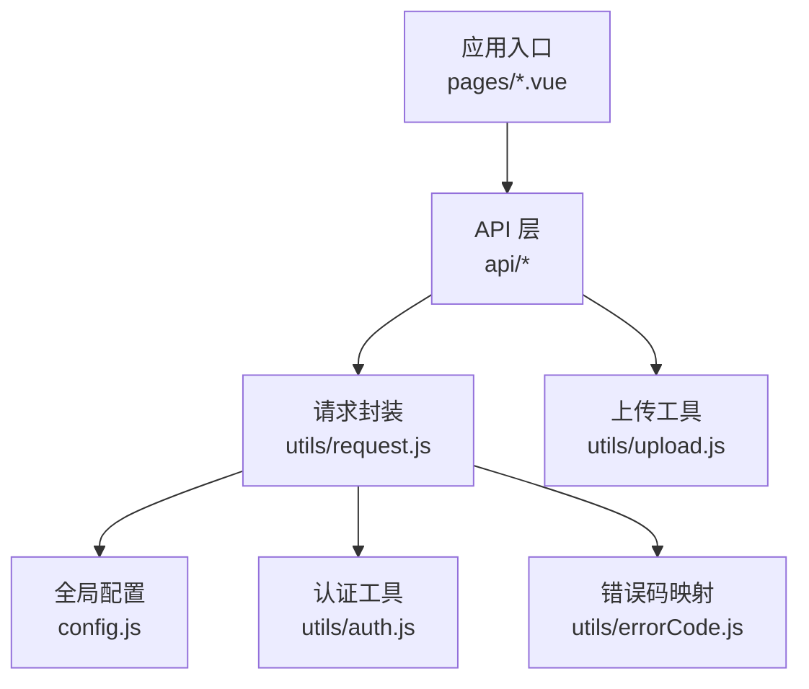
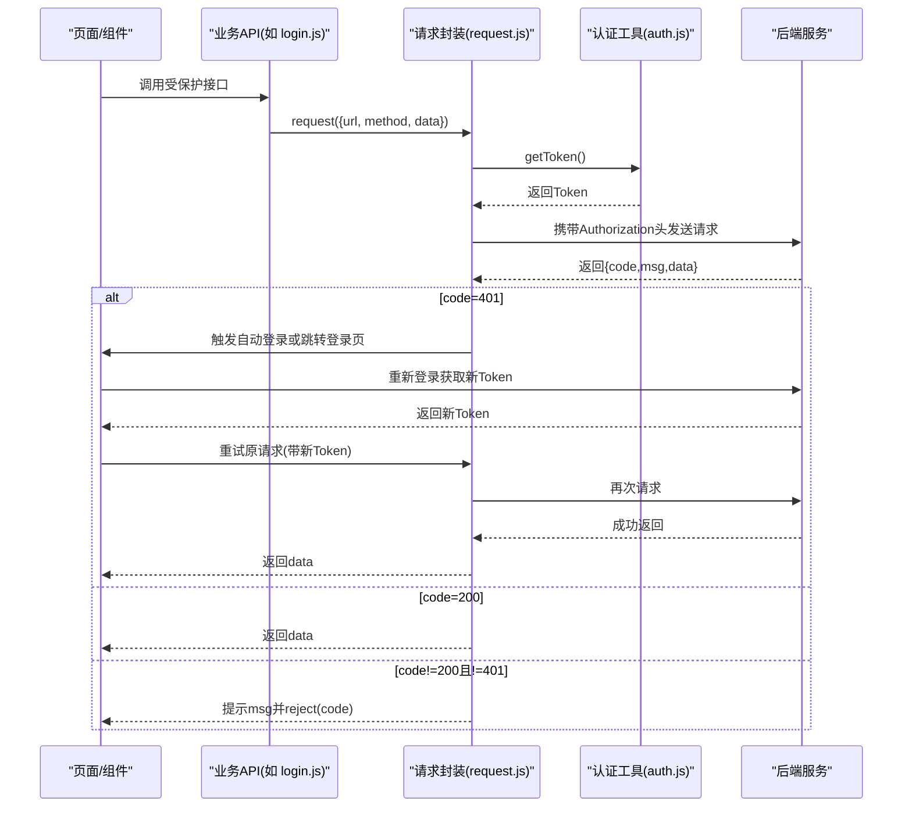
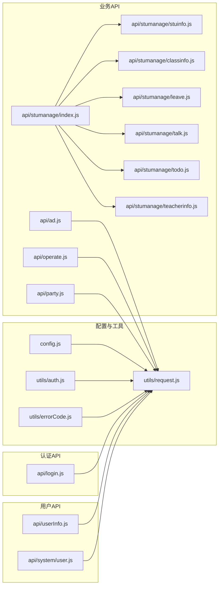
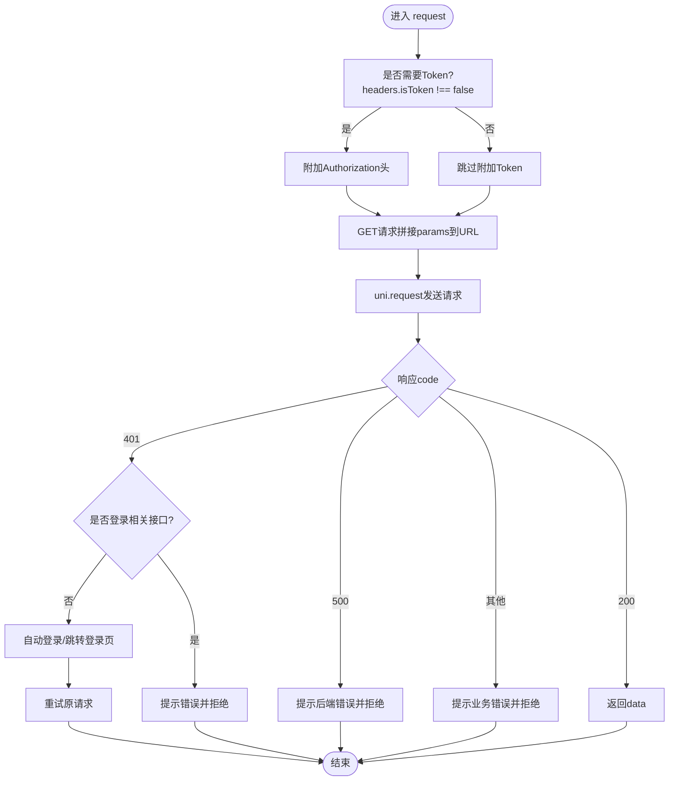

# API接口文档

<cite>
**本文引用的文件**
- [config.js](file://config.js)
- [utils/request.js](file://utils/request.js)
- [utils/auth.js](file://utils/auth.js)
- [utils/errorCode.js](file://utils/errorCode.js)
- [api/login.js](file://api/login.js)
- [api/userInfo.js](file://api/userInfo.js)
- [api/system/user.js](file://api/system/user.js)
- [api/ad.js](file://api/ad.js)
- [api/operate.js](file://api/operate.js)
- [api/party.js](file://api/party.js)
- [api/stumanage/index.js](file://api/stumanage/index.js)
- [api/stumanage/stuinfo.js](file://api/stumanage/stuinfo.js)
- [api/stumanage/classinfo.js](file://api/stumanage/classinfo.js)
- [api/stumanage/leave.js](file://api/stumanage/leave.js)
- [api/stumanage/talk.js](file://api/stumanage/talk.js)
- [api/stumanage/todo.js](file://api/stumanage/todo.js)
- [api/stumanage/teacherinfo.js](file://api/stumanage/teacherinfo.js)
</cite>

## 目录
1. [简介](#简介)
2. [项目结构](#项目结构)
3. [核心组件](#核心组件)
4. [架构总览](#架构总览)
5. [详细接口说明](#详细接口说明)
6. [依赖关系分析](#依赖关系分析)
7. [性能与限制](#性能与限制)
8. [故障排查指南](#故障排查指南)
9. [结论](#结论)
10. [附录](#附录)

## 简介
本文件为移动端前端（基于 UniApp）的 RESTful API 参考文档，覆盖认证、用户信息、校园运营、党务管理、学生管理等模块。文档包含：
- 统一请求封装机制与错误处理策略
- 认证与授权流程（Token 获取、刷新、验证）
- 各模块接口的 HTTP 方法、URL 模式、参数与响应约定
- 版本管理与向后兼容建议
- 客户端集成指南与安全注意事项
- 常用接口示例与排错方法

## 项目结构
前端通过统一的请求封装对后端发起调用，所有业务接口集中在 api 目录下按模块组织；配置集中于 config.js；认证与存储工具在 utils 下。

图表来源
- [config.js:1-38](file://config.js#L1-L38)
- [utils/request.js:1-117](file://utils/request.js#L1-L117)
- [utils/auth.js:1-47](file://utils/auth.js#L1-L47)
- [utils/errorCode.js:1-7](file://utils/errorCode.js#L1-L7)
- [api/login.js:1-168](file://api/login.js#L1-L168)

章节来源
- [config.js:1-38](file://config.js#L1-L38)
- [utils/request.js:1-117](file://utils/request.js#L1-L117)
- [utils/auth.js:1-47](file://utils/auth.js#L1-L47)
- [utils/errorCode.js:1-7](file://utils/errorCode.js#L1-L7)

## 核心组件
- 统一请求封装
  - 自动注入 Authorization: Bearer Token（可关闭）
  - GET 请求将 params 拼接为查询字符串
  - 统一处理 401/500/其他非 200 状态码，并提示消息
  - 网络异常、超时等错误统一捕获并友好提示
- 认证与存储
  - Token 与 UserId 的存取、登录态判断
- 全局配置
  - 协议、主机、端口、API 前缀与 baseUrl 计算
- 错误码映射
  - 将后端返回 code 映射为中文提示

章节来源
- [utils/request.js:1-117](file://utils/request.js#L1-L117)
- [utils/auth.js:1-47](file://utils/auth.js#L1-L47)
- [config.js:1-38](file://config.js#L1-L38)
- [utils/errorCode.js:1-7](file://utils/errorCode.js#L1-L7)

## 架构总览
下图展示一次受保护接口的典型调用链路，包括 Token 注入、401 自动处理与重登逻辑。

图表来源
- [utils/request.js:1-117](file://utils/request.js#L1-L117)
- [utils/auth.js:1-47](file://utils/auth.js#L1-L47)
- [api/login.js:1-168](file://api/login.js#L1-L168)

## 详细接口说明

### 通用约定
- 基础地址
  - 由配置项生成：协议 + 主机 + 端口 + API 前缀
  - 参考路径：[config.js:1-38](file://config.js#L1-L38)
- 请求封装
  - 默认添加 Authorization: Bearer {token}，可通过 headers.isToken=false 关闭
  - GET 请求会将 params 拼接为 URL 查询串
  - 参考路径：[utils/request.js:1-117](file://utils/request.js#L1-L117)
- 响应格式
  - 统一返回对象包含 code、msg、data
  - 常见 code：200 成功；401 未认证；500 服务端异常；其他业务码见具体接口
  - 参考路径：[utils/request.js:1-117](file://utils/request.js#L1-L117), [utils/errorCode.js:1-7](file://utils/errorCode.js#L1-L7)
- 分页参数
  - pageNum、pageSize 作为查询参数传递
- 文件上传
  - 使用 upload 工具，以 multipart/form-data 方式提交
  - 参考路径：[api/system/user.js:34-42](file://api/system/user.js#L34-L42)

### 认证与授权
- 账号密码登录
  - 方法：POST
  - 路径：/login
  - 请求体：username、password、code、uuid
  - 说明：headers.isToken=false，不携带 Token
  - 参考：[api/login.js:4-19](file://api/login.js#L4-L19)
- 注册
  - 方法：POST
  - 路径：/register
  - 请求体：注册所需字段（由后端定义）
  - 参考：[api/login.js:22-31](file://api/login.js#L22-L31)
- 退出登录
  - 方法：POST
  - 路径：/logout
  - 参考：[api/login.js:42-47](file://api/login.js#L42-L47)
- 验证码图片
  - 方法：GET
  - 路径：/captchaImage
  - 说明：headers.isToken=false
  - 参考：[api/login.js:50-59](file://api/login.js#L50-L59)
- 微信自动登录
  - 方法：POST
  - 路径：/wxLogin
  - 请求体：code
  - 说明：headers.isToken=false
  - 参考：[api/login.js:77-86](file://api/login.js#L77-L86)
- 微信绑定账号
  - 方法：POST
  - 路径：/wxBind
  - 请求体：code、username、password
  - 参考：[api/login.js:89-98](file://api/login.js#L89-L98)
- 解除微信绑定
  - 方法：POST
  - 路径：/api/user/unbind
  - 参考：[api/login.js:101-106](file://api/login.js#L101-L106)
- 手机号快捷登录
  - 方法：POST
  - 路径：/phoneLogin
  - 请求体：phoneCode、loginCode
  - 参考：[api/login.js:109-121](file://api/login.js#L109-L121)
- 教师手机号一键绑定
  - 方法：POST
  - 路径：/api/auth/teacherPhoneBind
  - 请求体：phoneCode、loginCode
  - 参考：[api/login.js:124-136](file://api/login.js#L124-L136)
- 教师账号绑定登录
  - 方法：POST
  - 路径：/api/auth/teacherBindLogin
  - 请求体：code、username、password
  - 参考：[api/login.js:139-152](file://api/login.js#L139-L152)
- 学生手机号一键绑定
  - 方法：POST
  - 路径：/phoneLogin（复用）
  - 请求体：phoneCode、loginCode
  - 参考：[api/login.js:155-167](file://api/login.js#L155-L167)
- 学生绑定登录
  - 方法：POST
  - 路径：/api/auth/studentBindLogin
  - 请求体：code、studentNo
  - 参考：[api/login.js:62-74](file://api/login.js#L62-L74)

注意：
- 401 时，若当前请求为登录相关接口（/login、/phoneLogin、/wxLogin、/captchaImage），不会触发自动登录，直接返回错误消息
- 非登录接口 401 时，会尝试自动登录（微信小程序环境）或跳转登录页

章节来源
- [api/login.js:1-168](file://api/login.js#L1-L168)
- [utils/request.js:1-117](file://utils/request.js#L1-L117)

### 用户信息与头像
- 获取用户信息
  - 方法：GET
  - 路径：/getInfo
  - 说明：需要 Token
  - 参考：[api/login.js:34-39](file://api/login.js#L34-L39), [api/userInfo.js:5-10](file://api/userInfo.js#L5-L10)
- 查询个人信息
  - 方法：GET
  - 路径：/system/user/profile
  - 参考：[api/system/user.js:18-23](file://api/system/user.js#L18-L23), [api/userInfo.js:21-26](file://api/userInfo.js#L21-L26)
- 修改个人信息
  - 方法：PUT
  - 路径：/system/user/profile
  - 请求体：待更新的用户信息字段
  - 参考：[api/system/user.js:26-32](file://api/system/user.js#L26-L32), [api/userInfo.js:52-58](file://api/userInfo.js#L52-L58)
- 重置密码
  - 方法：PUT
  - 路径：/system/user/profile/updatePwd
  - 请求体：oldPassword、newPassword
  - 参考：[api/system/user.js:5-15](file://api/system/user.js#L5-L15), [api/userInfo.js:29-39](file://api/userInfo.js#L29-L39)
- 上传头像
  - 方法：POST
  - 路径：/system/user/profile/avatar
  - 内容类型：multipart/form-data
  - 字段名：name、filePath（由上传工具封装）
  - 参考：[api/system/user.js:35-41](file://api/system/user.js#L35-L41)

章节来源
- [api/system/user.js:1-42](file://api/system/user.js#L1-L42)
- [api/userInfo.js:1-61](file://api/userInfo.js#L1-L61)

### 广告模块
- 获取广告列表
  - 方法：GET
  - 路径：/api/ad/getList
  - 查询参数：position（banner/feed/popup/footer）
  - 参考：[api/ad.js:7-13](file://api/ad.js#L7-L13)
- 上报广告展示
  - 方法：POST
  - 路径：/api/ad/reportShow
  - 查询参数：adId
  - 参考：[api/ad.js:19-25](file://api/ad.js#L19-L25)
- 上报广告点击
  - 方法：POST
  - 路径：/api/ad/reportClick
  - 查询参数：adId
  - 参考：[api/ad.js:31-37](file://api/ad.js#L31-L37)
- 批量上报广告展示
  - 方法：POST
  - 路径：/api/ad/batchReportShow
  - 请求体：adIds（数组）
  - 参考：[api/ad.js:43-49](file://api/ad.js#L43-L49)

章节来源
- [api/ad.js:1-50](file://api/ad.js#L1-L50)

### 校园运营模块
- 删除发布的信息
  - 方法：DELETE
  - 路径：campus/delContent/{cid}
  - 参考：[api/operate.js:7-12](file://api/operate.js#L7-L12)
- 点赞
  - 方法：GET
  - 路径：campus/zan/{cid}
  - 参考：[api/operate.js:14-19](file://api/operate.js#L14-L19)
- 发布评论
  - 方法：POST
  - 路径：campus/toComment
  - 请求体：toCommentVo
  - 参考：[api/operate.js:21-27](file://api/operate.js#L21-L27)
- 发布内容
  - 方法：POST
  - 路径：campus/sendContent
  - 请求体：sendContentVo
  - 参考：[api/operate.js:29-35](file://api/operate.js#L29-L35)
- 获取自己发的信息
  - 方法：POST
  - 路径：campus/ownContents
  - 查询参数：contentVo（分页等）
  - 参考：[api/operate.js:37-43](file://api/operate.js#L37-L43)
- 获取自己的评论
  - 方法：GET
  - 路径：campus/getOwnComment
  - 查询参数：commentVo（分页等）
  - 参考：[api/operate.js:45-51](file://api/operate.js#L45-L51)

章节来源
- [api/operate.js:1-53](file://api/operate.js#L1-L53)

### 党务管理模块
- 我的党员档案
  - 方法：GET
  - 路径：/api/party/myInfo
  - 参考：[api/party.js:6-8](file://api/party.js#L6-L8)
- 我的发展进度
  - 方法：GET
  - 路径：/api/party/progress
  - 参考：[api/party.js:10-12](file://api/party.js#L10-L12)
- 我的支部/组织信息
  - 方法：GET
  - 路径：/api/party/myBranch
  - 参考：[api/party.js:14-16](file://api/party.js#L14-L16)
- 思想汇报列表（学生）
  - 方法：GET
  - 路径：/api/party/thoughtReport/list
  - 参考：[api/party.js:18-20](file://api/party.js#L18-L20)
- 提交思想汇报（学生）
  - 方法：POST
  - 路径：/api/party/thoughtReport
  - 请求体：思想汇报数据
  - 参考：[api/party.js:22-24](file://api/party.js#L22-L24)
- 入党申请书（提交/查看）
  - 提交：POST /api/party/application
  - 查看：GET /api/party/application
  - 参考：[api/party.js:26-32](file://api/party.js#L26-L32)
- 培训记录（我的）
  - 方法：GET
  - 路径：/api/party/training/my
  - 参考：[api/party.js:34-36](file://api/party.js#L34-L36)
- 党费记录（我的）
  - 方法：GET
  - 路径：/api/party/fee/my
  - 参考：[api/party.js:38-40](file://api/party.js#L38-L40)
- 下级支部列表（书记/辅导员）
  - 方法：GET
  - 路径：/api/party/branch/children
  - 参考：[api/party.js:44-46](file://api/party.js#L44-L46)
- 支部统计概览
  - 方法：GET
  - 路径：/api/party/branch/stats
  - 查询参数：branchId
  - 参考：[api/party.js:48-50](file://api/party.js#L48-L50)
- 支部党员列表
  - 方法：GET
  - 路径：/api/party/branch/members
  - 查询参数：query（分页等）
  - 参考：[api/party.js:52-54](file://api/party.js#L52-L54)
- 党员详情
  - 方法：GET
  - 路径：/api/party/member/{memberId}
  - 参考：[api/party.js:56-58](file://api/party.js#L56-L58)
- 辅导员端统计/成员
  - 统计：GET /api/party/counselor/stats
  - 成员：GET /api/party/counselor/members?query
  - 参考：[api/party.js:62-68](file://api/party.js#L62-L68)
- 教师个人党务
  - 档案：GET /api/party/teacher/info
  - 思想汇报列表：GET /api/party/teacher/thoughtReport/list
  - 提交思想汇报：POST /api/party/teacher/thoughtReport
  - 党费记录：GET /api/party/teacher/fee/my
  - 参考：[api/party.js:72-86](file://api/party.js#L72-L86)

章节来源
- [api/party.js:1-88](file://api/party.js#L1-L88)

### 学生管理模块
入口聚合：[api/stumanage/index.js:1-32](file://api/stumanage/index.js#L1-L32)

#### 学生信息管理
- 查询学生信息列表
  - 方法：GET
  - 路径：/api/mini/stuinfo/list
  - 查询参数：query（含分页等）
  - 参考：[api/stumanage/stuinfo.js:4-10](file://api/stumanage/stuinfo.js#L4-L10)
- 获取当前登录学生详细信息
  - 方法：GET
  - 路径：/api/stuinfo/myInfo
  - 参考：[api/stumanage/stuinfo.js:13-18](file://api/stumanage/stuinfo.js#L13-L18)
- 更新本人联系电话
  - 方法：POST
  - 路径：/api/stuinfo/updatePhone
  - 请求体：phone
  - 参考：[api/stumanage/stuinfo.js:21-27](file://api/stumanage/stuinfo.js#L21-L27)
- 查询学生信息详细
  - 方法：GET
  - 路径：/api/mini/stuinfo/{xh}
  - 参考：[api/stumanage/stuinfo.js:30-35](file://api/stumanage/stuinfo.js#L30-L35)
- 根据用户ID获取学生信息
  - 方法：GET
  - 路径：/api/mini/stuinfo/byUserId/{userId}
  - 参考：[api/stumanage/stuinfo.js:38-43](file://api/stumanage/stuinfo.js#L38-L43)
- 获取我的学生列表
  - 方法：GET
  - 路径：/api/mini/stuinfo/myStudents
  - 参考：[api/stumanage/stuinfo.js:46-51](file://api/stumanage/stuinfo.js#L46-L51)
- 搜索学生
  - 方法：GET
  - 路径：/api/mini/stuinfo/search
  - 查询参数：keyword
  - 参考：[api/stumanage/stuinfo.js:54-60](file://api/stumanage/stuinfo.js#L54-L60)
- 获取学生详情（含是否可查看完整信息标记）
  - 方法：GET
  - 路径：/api/mini/stuinfo/detail/{xh}
  - 参考：[api/stumanage/stuinfo.js:63-68](file://api/stumanage/stuinfo.js#L63-L68)
- 获取学院-班级树结构
  - 方法：GET
  - 路径：/api/mini/stuinfo/collegeClassTree
  - 参考：[api/stumanage/stuinfo.js:71-76](file://api/stumanage/stuinfo.js#L71-L76)
- 根据角色获取学院-班级树结构
  - 方法：GET
  - 路径：/api/mini/stuinfo/collegeClassTreeByRole
  - 参考：[api/stumanage/stuinfo.js:79-84](file://api/stumanage/stuinfo.js#L79-L84)

章节来源
- [api/stumanage/stuinfo.js:1-85](file://api/stumanage/stuinfo.js#L1-L85)

#### 班级管理
- 查询班级列表
  - 方法：GET
  - 路径：/stumanage/bjdmb/list
  - 查询参数：query
  - 参考：[api/stumanage/classinfo.js:4-10](file://api/stumanage/classinfo.js#L4-L10)
- 查询班级详细
  - 方法：GET
  - 路径：/stumanage/bjdmb/{bjid}
  - 参考：[api/stumanage/classinfo.js:13-18](file://api/stumanage/classinfo.js#L13-L18)

章节来源
- [api/stumanage/classinfo.js:1-19](file://api/stumanage/classinfo.js#L1-L19)

#### 请假管理
- 获取请假列表
  - 方法：GET
  - 路径：/api/leave/list
  - 查询参数：query
  - 参考：[api/stumanage/leave.js:9-15](file://api/stumanage/leave.js#L9-L15)
- 获取请假详情
  - 方法：GET
  - 路径：/api/leave/{id}
  - 参考：[api/stumanage/leave.js:18-23](file://api/stumanage/leave.js#L18-L23)
- 审批请假
  - 方法：PUT
  - 路径：/api/leave/approval
  - 请求体：approvalLeave.data
  - 参考：[api/stumanage/leave.js:26-32](file://api/stumanage/leave.js#L26-L32)
- 我的请假列表（学生端）
  - 方法：GET
  - 路径：/api/leave/myLeaves
  - 查询参数：query
  - 参考：[api/stumanage/leave.js:35-41](file://api/stumanage/leave.js#L35-L41)
- 待审批的请假列表
  - 方法：GET
  - 路径：/api/leave/pending
  - 参考：[api/stumanage/leave.js:44-49](file://api/stumanage/leave.js#L44-L49)

章节来源
- [api/stumanage/leave.js:1-51](file://api/stumanage/leave.js#L1-L51)

#### 谈话管理
- 获取谈话记录列表
  - 方法：GET
  - 路径：/api/talk/list
  - 查询参数：query
  - 参考：[api/stumanage/talk.js:9-15](file://api/stumanage/talk.js#L9-L15)
- 获取谈话记录详情
  - 方法：GET
  - 路径：/api/talk/{id}
  - 参考：[api/stumanage/talk.js:18-23](file://api/stumanage/talk.js#L18-L23)
- 新增谈话记录
  - 方法：POST
  - 路径：/api/talk
  - 请求体：addTalk.data
  - 参考：[api/stumanage/talk.js:26-32](file://api/stumanage/talk.js#L26-L32)
- 修改谈话记录
  - 方法：PUT
  - 路径：/api/talk
  - 请求体：updateTalk.data
  - 参考：[api/stumanage/talk.js:35-41](file://api/stumanage/talk.js#L35-L41)
- 删除谈话记录
  - 方法：DELETE
  - 路径：/api/talk/{ids}
  - 参考：[api/stumanage/talk.js:44-49](file://api/stumanage/talk.js#L44-L49)
- 获取我的学生列表（支持学号/姓名模糊搜索）
  - 方法：GET
  - 路径：/api/mini/stuinfo/list
  - 查询参数：xh 或 studentName（内部自动选择）
  - 参考：[api/stumanage/talk.js:52-64](file://api/stumanage/talk.js#L52-L64)
- 获取待跟进的谈话记录
  - 方法：GET
  - 路径：/api/talk/pending
  - 参考：[api/stumanage/talk.js:67-72](file://api/stumanage/talk.js#L67-L72)
- 获取违纪学生列表
  - 方法：GET
  - 路径：/api/talk/violationStudents
  - 查询参数：checkDate、bjdm
  - 参考：[api/stumanage/talk.js:75-81](file://api/stumanage/talk.js#L75-L81)
- 获取限时谈话配置
  - 方法：GET
  - 路径：/api/talk/deadlineConfig
  - 参考：[api/stumanage/talk.js:84-89](file://api/stumanage/talk.js#L84-L89)

章节来源
- [api/stumanage/talk.js:1-90](file://api/stumanage/talk.js#L1-L90)

#### 待办事项
- 查询待办列表
  - 方法：GET
  - 路径：/api/todo/list
  - 参考：[api/stumanage/todo.js:4-9](file://api/stumanage/todo.js#L4-L9)
- 获取未读待办数量
  - 方法：GET
  - 路径：/api/todo/unreadCount
  - 参考：[api/stumanage/todo.js:12-17](file://api/stumanage/todo.js#L12-L17)
- 新增待办
  - 方法：POST
  - 路径：/api/todo
  - 请求体：addTodo.data
  - 参考：[api/stumanage/todo.js:20-26](file://api/stumanage/todo.js#L20-L26)
- 删除待办
  - 方法：POST
  - 路径：/api/todo/delete/{id}
  - 参考：[api/stumanage/todo.js:29-34](file://api/stumanage/todo.js#L29-L34)
- 标记已读
  - 方法：POST
  - 路径：/api/todo/read/{id}
  - 参考：[api/stumanage/todo.js:37-42](file://api/stumanage/todo.js#L37-L42)

章节来源
- [api/stumanage/todo.js:1-43](file://api/stumanage/todo.js#L1-L43)

#### 教师信息管理
- 查询教师信息列表
  - 方法：GET
  - 路径：/stumanage/teacherinfo/list
  - 查询参数：query
  - 参考：[api/stumanage/teacherinfo.js:4-10](file://api/stumanage/teacherinfo.js#L4-L10)
- 查询教师信息详细
  - 方法：GET
  - 路径：/stumanage/teacherinfo/{jsid}
  - 参考：[api/stumanage/teacherinfo.js:13-18](file://api/stumanage/teacherinfo.js#L13-L18)
- 根据用户ID获取教师信息（小程序专用）
  - 方法：GET
  - 路径：/api/teacher/myInfo
  - 参考：[api/stumanage/teacherinfo.js:21-26](file://api/stumanage/teacherinfo.js#L21-L26)
- 教师修改自己的信息（小程序专用）
  - 方法：PUT
  - 路径：/api/teacher/updateMyInfo
  - 请求体：updateMyTeacherinfo.data
  - 参考：[api/stumanage/teacherinfo.js:29-35](file://api/stumanage/teacherinfo.js#L29-L35)
- 获取角色列表（小程序专用）
  - 方法：GET
  - 路径：/api/teacher/roles
  - 参考：[api/stumanage/teacherinfo.js:38-43](file://api/stumanage/teacherinfo.js#L38-L43)
- 删除教师信息
  - 方法：DELETE
  - 路径：/stumanage/teacherinfo/{jsid}
  - 参考：[api/stumanage/teacherinfo.js:46-51](file://api/stumanage/teacherinfo.js#L46-L51)

章节来源
- [api/stumanage/teacherinfo.js:1-52](file://api/stumanage/teacherinfo.js#L1-L52)

## 依赖关系分析

图表来源
- [config.js:1-38](file://config.js#L1-L38)
- [utils/request.js:1-117](file://utils/request.js#L1-L117)
- [utils/auth.js:1-47](file://utils/auth.js#L1-L47)
- [utils/errorCode.js:1-7](file://utils/errorCode.js#L1-L7)
- [api/login.js:1-168](file://api/login.js#L1-L168)
- [api/userInfo.js:1-61](file://api/userInfo.js#L1-L61)
- [api/system/user.js:1-42](file://api/system/user.js#L1-L42)
- [api/ad.js:1-50](file://api/ad.js#L1-L50)
- [api/operate.js:1-53](file://api/operate.js#L1-L53)
- [api/party.js:1-88](file://api/party.js#L1-L88)
- [api/stumanage/index.js:1-32](file://api/stumanage/index.js#L1-L32)
- [api/stumanage/stuinfo.js:1-85](file://api/stumanage/stuinfo.js#L1-L85)
- [api/stumanage/classinfo.js:1-19](file://api/stumanage/classinfo.js#L1-L19)
- [api/stumanage/leave.js:1-51](file://api/stumanage/leave.js#L1-L51)
- [api/stumanage/talk.js:1-90](file://api/stumanage/talk.js#L1-L90)
- [api/stumanage/todo.js:1-43](file://api/stumanage/todo.js#L1-L43)
- [api/stumanage/teacherinfo.js:1-52](file://api/stumanage/teacherinfo.js#L1-L52)

## 性能与限制
- 请求超时
  - 默认超时时间由请求封装设置，可在调用时覆盖
  - 参考：[utils/request.js:7-8](file://utils/request.js#L7-L8)
- 频率限制
  - 请遵循后端网关或服务器限流策略；建议在客户端实现退避重试与防抖
- 缓存与幂等
  - 对频繁读取的数据（如字典、树形结构）进行本地缓存
  - 对写操作确保幂等设计，避免重复提交
- 大文件上传
  - 分片上传与断点续传需在后端配合；前端应避免阻塞主线程

## 故障排查指南
- 401 未认证
  - 现象：请求返回 401，非登录接口将触发自动登录或跳转登录页
  - 排查要点：检查 Token 是否存在、是否过期；确认是否为登录相关接口（不会触发自动登录）
  - 参考：[utils/request.js:41-88](file://utils/request.js#L41-L88)
- 500 服务端异常
  - 现象：返回 500，显示后端 msg
  - 排查要点：查看后端日志与入参校验
  - 参考：[utils/request.js:89-91](file://utils/request.js#L89-L91)
- 其他业务码
  - 现象：code 不为 200，弹出对应 msg
  - 排查要点：对照接口文档确认入参与权限
  - 参考：[utils/request.js:92-98](file://utils/request.js#L92-L98)
- 网络异常/超时
  - 现象：Network Error、timeout 等
  - 排查要点：检查网络、后端可达性、超时配置
  - 参考：[utils/request.js:101-112](file://utils/request.js#L101-L112)
- 错误码映射
  - 参考：[utils/errorCode.js:1-7](file://utils/errorCode.js#L1-L7)

章节来源
- [utils/request.js:1-117](file://utils/request.js#L1-L117)
- [utils/errorCode.js:1-7](file://utils/errorCode.js#L1-L7)

## 结论
本 API 文档基于前端代码梳理出完整的接口清单与调用规范，涵盖认证、用户、广告、校园运营、党务与学生管理等模块。通过统一的请求封装与错误处理，保证了前后端交互的一致性与可维护性。建议在实际集成中结合后端网关策略完善限流、鉴权与审计能力。

## 附录

### 统一请求封装流程图

图表来源
- [utils/request.js:10-114](file://utils/request.js#L10-L114)

### 版本管理与兼容性建议
- 版本标识
  - 应用版本与名称由配置提供，便于在日志与诊断中识别
  - 参考：[config.js:17-36](file://config.js#L17-L36)
- 向后兼容
  - 新增字段保持可选，旧字段保留至少一个主版本周期
  - 接口变更优先采用扩展而非破坏式修改
  - 对废弃接口提供过渡期提示

### 客户端集成最佳实践
- 统一封装
  - 所有网络请求均通过 request 封装，避免分散处理
  - 参考：[utils/request.js:1-117](file://utils/request.js#L1-L117)
- 安全
  - 不要在前端硬编码敏感信息；Token 仅用于访问控制
  - 对上传文件进行大小与类型校验
- 用户体验
  - 合理设置超时与重试；失败时给出明确提示
  - 对长耗时操作提供加载反馈