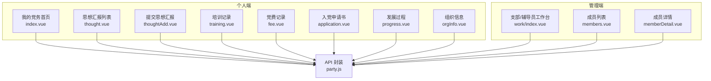
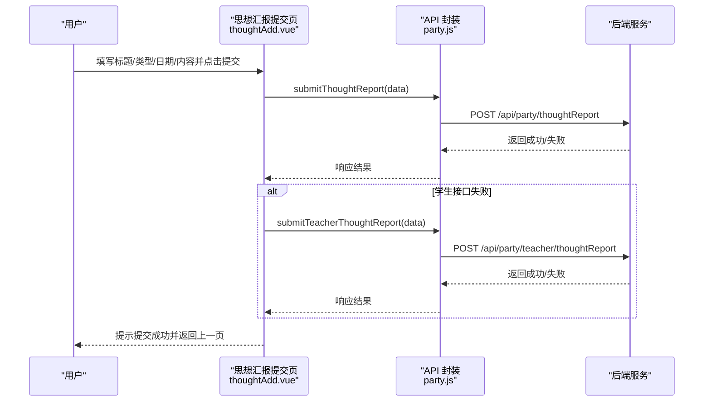
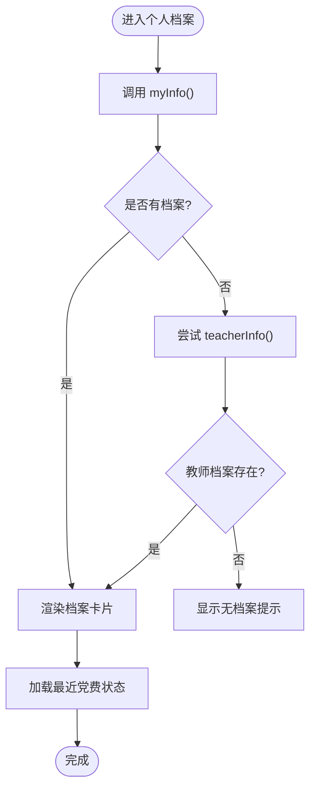
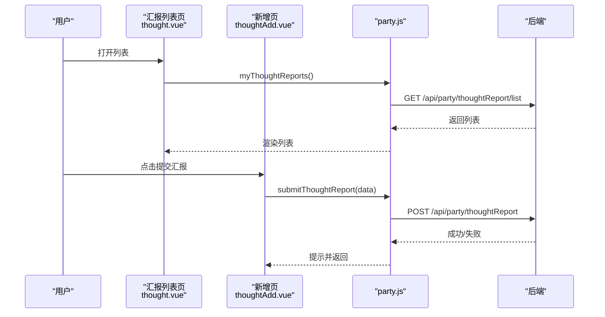
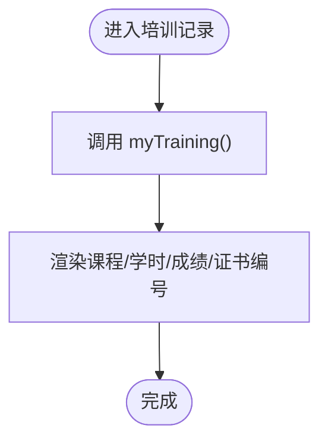
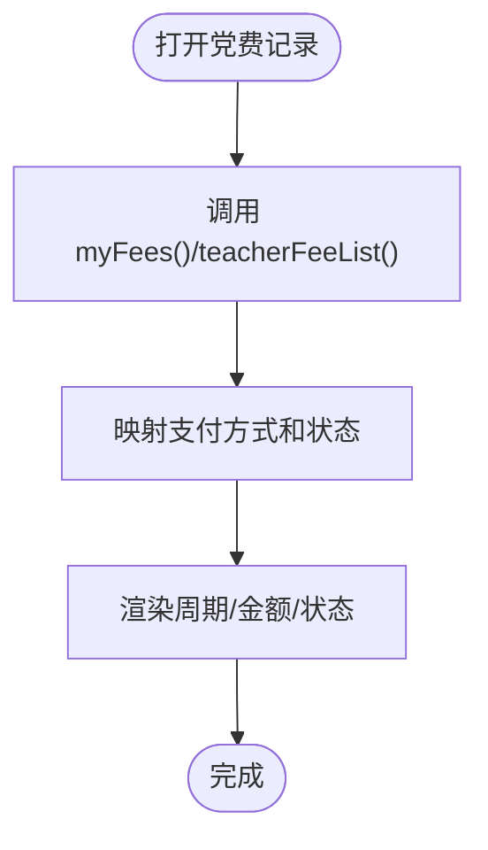
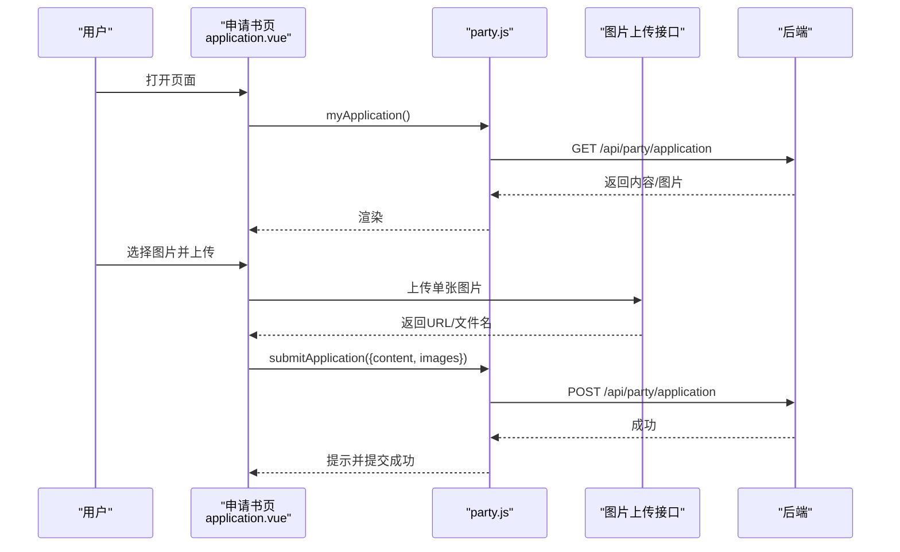
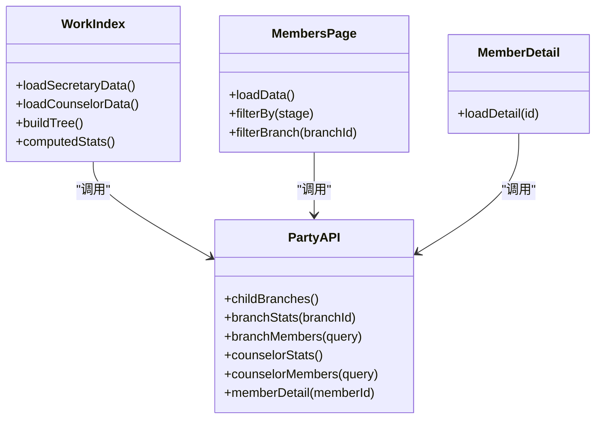
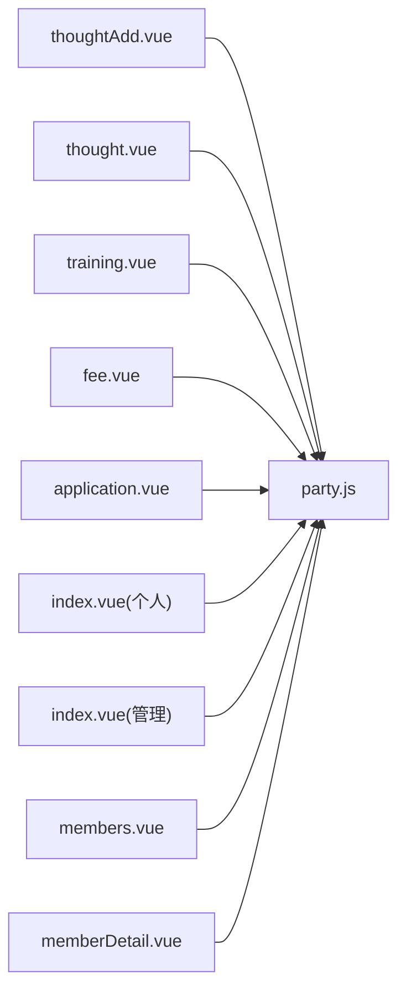

# 党务管理接口

<cite>
**本文引用的文件**   
- [api/party.js](file://api/party.js)
- [pages/sub-mine/party/index.vue](file://pages/sub-mine/party/index.vue)
- [pages/sub-mine/party/thought.vue](file://pages/sub-mine/party/thought.vue)
- [pages/sub-mine/party/thoughtAdd.vue](file://pages/sub-mine/party/thoughtAdd.vue)
- [pages/sub-mine/party/training.vue](file://pages/sub-mine/party/training.vue)
- [pages/sub-mine/party/fee.vue](file://pages/sub-mine/party/fee.vue)
- [pages/sub-mine/party/application.vue](file://pages/sub-mine/party/application.vue)
- [pages/sub-mine/party/progress.vue](file://pages/sub-mine/party/progress.vue)
- [pages/sub-mine/party/orgInfo.vue](file://pages/sub-mine/party/orgInfo.vue)
- [pages/sub-work/party/index.vue](file://pages/sub-work/party/index.vue)
- [pages/sub-work/party/members.vue](file://pages/sub-work/party/members.vue)
- [pages/sub-work/party/memberDetail.vue](file://pages/sub-work/party/memberDetail.vue)
</cite>

## 目录
1. [简介](#简介)
2. [项目结构](#项目结构)
3. [核心组件](#核心组件)
4. [架构总览](#架构总览)
5. [详细组件分析](#详细组件分析)
6. [依赖关系分析](#依赖关系分析)
7. [性能与可用性建议](#性能与可用性建议)
8. [故障排查指南](#故障排查指南)
9. [结论](#结论)
10. [附录：数据模型与字段说明](#附录数据模型与字段说明)

## 简介
本文件面向“党务管理”相关的前端能力，围绕党员信息管理、思想汇报管理、培训记录、党费收缴、党组织架构与层级、统计报表等能力进行系统化梳理。文档基于前端代码中的 API 调用与页面交互逻辑，提炼出可用的接口清单、数据结构约定、业务流程与合规要点，便于前后端协同开发与联调。

## 项目结构
- 前端采用 uni-app 多端框架，业务入口集中在 pages 与 api 目录。
- 党务模块主要包含两类角色视角：
  - 个人端（sub-mine）：查看个人档案、提交思想汇报、查看培训与党费记录、查看组织信息等。
  - 管理端（sub-work）：支部/辅导员视角的统计、成员列表、详情查看、组织树筛选等。

图表来源
- [api/party.js:1-88](file://api/party.js#L1-L88)
- [pages/sub-mine/party/index.vue:1-206](file://pages/sub-mine/party/index.vue#L1-L206)
- [pages/sub-mine/party/thought.vue:1-62](file://pages/sub-mine/party/thought.vue#L1-L62)
- [pages/sub-mine/party/thoughtAdd.vue:1-74](file://pages/sub-mine/party/thoughtAdd.vue#L1-L74)
- [pages/sub-mine/party/training.vue:1-53](file://pages/sub-mine/party/training.vue#L1-L53)
- [pages/sub-mine/party/fee.vue:1-52](file://pages/sub-mine/party/fee.vue#L1-L52)
- [pages/sub-mine/party/application.vue:1-170](file://pages/sub-mine/party/application.vue#L1-L170)
- [pages/sub-mine/party/progress.vue:1-266](file://pages/sub-mine/party/progress.vue#L1-L266)
- [pages/sub-mine/party/orgInfo.vue:1-112](file://pages/sub-mine/party/orgInfo.vue#L1-L112)
- [pages/sub-work/party/index.vue:1-533](file://pages/sub-work/party/index.vue#L1-L533)
- [pages/sub-work/party/members.vue:1-192](file://pages/sub-work/party/members.vue#L1-L192)
- [pages/sub-work/party/memberDetail.vue:1-160](file://pages/sub-work/party/memberDetail.vue#L1-L160)

章节来源
- [api/party.js:1-88](file://api/party.js#L1-L88)
- [pages/sub-mine/party/index.vue:1-206](file://pages/sub-mine/party/index.vue#L1-L206)
- [pages/sub-work/party/index.vue:1-533](file://pages/sub-work/party/index.vue#L1-L533)

## 核心组件
- 统一 API 封装：所有党务相关请求通过 party.js 集中定义，按“学生端/书记/辅导员/教师个人”划分方法。
- 个人端页面：提供档案概览、思想汇报、培训、党费、申请与发展过程可视化。
- 管理端页面：提供组织树、统计概览、成员列表与详情查看。

章节来源
- [api/party.js:1-88](file://api/party.js#L1-L88)
- [pages/sub-mine/party/index.vue:1-206](file://pages/sub-mine/party/index.vue#L1-L206)
- [pages/sub-work/party/index.vue:1-533](file://pages/sub-work/party/index.vue#L1-L533)

## 架构总览
以下序列图展示“提交思想汇报”的端到端流程（含学生/教师双通道兼容）。

图表来源
- [pages/sub-mine/party/thoughtAdd.vue:1-74](file://pages/sub-mine/party/thoughtAdd.vue#L1-L74)
- [api/party.js:1-88](file://api/party.js#L1-L88)

## 详细组件分析

### 一、党员档案管理
- 功能范围
  - 个人档案概览：基本信息、政治面貌、所属支部、递交申请时间、当前阶段、最近党费状态等。
  - 组织信息：支部名称、编码、上级组织、负责人、人数、状态等。
  - 发展阶段：从申请人到正式党员的完整时间线及佐证材料展示。
- 关键接口
  - 获取个人档案：GET /api/party/myInfo
  - 获取组织信息：GET /api/party/myBranch
  - 获取发展进度：GET /api/party/progress
  - 教师个人档案（兼容）：GET /api/party/teacher/info
- 数据要点
  - 阶段枚举：APPLICANT、ACTIVIST、TARGET、PROBATIONARY、FORMAL
  - 时间字段：applyDate、activistDate、targetDate、probationDate、formalDate
  - 佐证材料：applicationImages、thoughtReports[].attachment、politicalReview.attachment
- 页面路径
  - 个人档案首页：[pages/sub-mine/party/index.vue:1-206](file://pages/sub-mine/party/index.vue#L1-L206)
  - 组织信息：[pages/sub-mine/party/orgInfo.vue:1-112](file://pages/sub-mine/party/orgInfo.vue#L1-L112)
  - 发展过程：[pages/sub-mine/party/progress.vue:1-266](file://pages/sub-mine/party/progress.vue#L1-L266)

图表来源
- [pages/sub-mine/party/index.vue:1-206](file://pages/sub-mine/party/index.vue#L1-L206)
- [api/party.js:1-88](file://api/party.js#L1-L88)

章节来源
- [pages/sub-mine/party/index.vue:1-206](file://pages/sub-mine/party/index.vue#L1-L206)
- [pages/sub-mine/party/orgInfo.vue:1-112](file://pages/sub-mine/party/orgInfo.vue#L1-L112)
- [pages/sub-mine/party/progress.vue:1-266](file://pages/sub-mine/party/progress.vue#L1-L266)
- [api/party.js:1-88](file://api/party.js#L1-L88)

### 二、思想汇报管理
- 功能范围
  - 列表查看：支持待审、已通过、需修改、已退回等状态展示。
  - 提交新增：支持季度/半年/年度/专题类型，可带附件图片。
  - 审核归档：由后端维护 reviewStatus；前端仅展示状态与附件。
- 关键接口
  - 列表：GET /api/party/thoughtReport/list
  - 提交：POST /api/party/thoughtReport
  - 教师端列表：GET /api/party/teacher/thoughtReport/list
  - 教师端提交：POST /api/party/teacher/thoughtReport
- 页面路径
  - 列表：[pages/sub-mine/party/thought.vue:1-62](file://pages/sub-mine/party/thought.vue#L1-L62)
  - 新增：[pages/sub-mine/party/thoughtAdd.vue:1-74](file://pages/sub-mine/party/thoughtAdd.vue#L1-74)

图表来源
- [pages/sub-mine/party/thought.vue:1-62](file://pages/sub-mine/party/thought.vue#L1-L62)
- [pages/sub-mine/party/thoughtAdd.vue:1-74](file://pages/sub-mine/party/thoughtAdd.vue#L1-74)
- [api/party.js:1-88](file://api/party.js#L1-L88)

章节来源
- [pages/sub-mine/party/thought.vue:1-62](file://pages/sub-mine/party/thought.vue#L1-L62)
- [pages/sub-mine/party/thoughtAdd.vue:1-74](file://pages/sub-mine/party/thoughtAdd.vue#L1-74)
- [api/party.js:1-88](file://api/party.js#L1-L88)

### 三、培训记录
- 功能范围
  - 课程名称、实际学时、考试成绩、是否通过、证书编号等。
- 关键接口
  - 我的培训记录：GET /api/party/training/my
- 页面路径
  - 培训记录：[pages/sub-mine/party/training.vue:1-53](file://pages/sub-mine/party/training.vue#L1-53)

图表来源
- [pages/sub-mine/party/training.vue:1-53](file://pages/sub-mine/party/training.vue#L1-53)
- [api/party.js:1-88](file://api/party.js#L1-L88)

章节来源
- [pages/sub-mine/party/training.vue:1-53](file://pages/sub-mine/party/training.vue#L1-53)
- [api/party.js:1-88](file://api/party.js#L1-L88)

### 四、党费收缴与状态跟踪
- 功能范围
  - 按月展示缴费周期、金额、支付方式、状态（已缴/减免/未缴）。
  - 首页快速展示“最近已缴月份”。
- 关键接口
  - 我的党费记录：GET /api/party/fee/my
  - 教师端党费记录：GET /api/party/teacher/fee/my
- 页面路径
  - 党费记录：[pages/sub-mine/party/fee.vue:1-52](file://pages/sub-mine/party/fee.vue#L1-52)
  - 首页最近缴费：[pages/sub-mine/party/index.vue:1-206](file://pages/sub-mine/party/index.vue#L1-L206)

图表来源
- [pages/sub-mine/party/fee.vue:1-52](file://pages/sub-mine/party/fee.vue#L1-52)
- [pages/sub-mine/party/index.vue:1-206](file://pages/sub-mine/party/index.vue#L1-L206)
- [api/party.js:1-88](file://api/party.js#L1-L88)

章节来源
- [pages/sub-mine/party/fee.vue:1-52](file://pages/sub-mine/party/fee.vue#L1-52)
- [pages/sub-mine/party/index.vue:1-206](file://pages/sub-mine/party/index.vue#L1-L206)
- [api/party.js:1-88](file://api/party.js#L1-L88)

### 五、入党申请书
- 功能范围
  - 查看/编辑申请书内容与附件图片，支持上传至服务端。
- 关键接口
  - 查看：GET /api/party/application
  - 提交：POST /api/party/application
  - 图片上传：POST /party/upload/image（独立上传接口）
- 页面路径
  - 申请书：[pages/sub-mine/party/application.vue:1-170](file://pages/sub-mine/party/application.vue#L1-170)

图表来源
- [pages/sub-mine/party/application.vue:1-170](file://pages/sub-mine/party/application.vue#L1-170)
- [api/party.js:1-88](file://api/party.js#L1-L88)

章节来源
- [pages/sub-mine/party/application.vue:1-170](file://pages/sub-mine/party/application.vue#L1-170)
- [api/party.js:1-88](file://api/party.js#L1-L88)

### 六、党组织架构与层级关系
- 功能范围
  - 书记端：组织树展开/折叠、多选分支、统计概览、成员列表。
  - 辅导员端：所带学生入党情况统计与列表。
- 关键接口
  - 下级支部列表：GET /api/party/branch/children
  - 支部统计概览：GET /api/party/branch/stats
  - 支部党员列表：GET /api/party/branch/members
  - 辅导员统计：GET /api/party/counselor/stats
  - 辅导员成员列表：GET /api/party/counselor/members
  - 党员详情：GET /api/party/member/{id}
- 页面路径
  - 工作台：[pages/sub-work/party/index.vue:1-533](file://pages/sub-work/party/index.vue#L1-533)
  - 成员列表：[pages/sub-work/party/members.vue:1-192](file://pages/sub-work/party/members.vue#L1-192)
  - 成员详情：[pages/sub-work/party/memberDetail.vue:1-160](file://pages/sub-work/party/memberDetail.vue#L1-160)

图表来源
- [api/party.js:1-88](file://api/party.js#L1-L88)
- [pages/sub-work/party/index.vue:1-533](file://pages/sub-work/party/index.vue#L1-L533)
- [pages/sub-work/party/members.vue:1-192](file://pages/sub-work/party/members.vue#L1-192)
- [pages/sub-work/party/memberDetail.vue:1-160](file://pages/sub-work/party/memberDetail.vue#L1-160)

章节来源
- [pages/sub-work/party/index.vue:1-533](file://pages/sub-work/party/index.vue#L1-L533)
- [pages/sub-work/party/members.vue:1-192](file://pages/sub-work/party/members.vue#L1-192)
- [pages/sub-work/party/memberDetail.vue:1-160](file://pages/sub-work/party/memberDetail.vue#L1-160)
- [api/party.js:1-88](file://api/party.js#L1-L88)

### 七、党务统计与报表
- 能力现状
  - 前端提供统计概览与筛选（按阶段、按支部），用于工作台的可视化展示。
  - 未见导出报表或批量导入导出的专用接口。
- 建议扩展
  - 增加“导出为 Excel/CSV”的下载接口。
  - 增加“批量导入成员/培训/党费”的模板下载与导入接口。

章节来源
- [pages/sub-work/party/index.vue:1-533](file://pages/sub-work/party/index.vue#L1-L533)
- [pages/sub-work/party/members.vue:1-192](file://pages/sub-work/party/members.vue#L1-192)

### 八、工作流程示例与合规性要求
- 典型流程
  - 思想汇报：提交 → 后台审核 → 状态更新（待审/通过/需改/退回）→ 前端展示。
  - 入党申请：撰写与附件上传 → 提交 → 归档至发展过程佐证材料。
  - 培训结业：记录学时与成绩 → 生成证书编号 → 在个人档案中可见。
  - 党费缴纳：按月生成记录 → 标记状态（已缴/减免/未缴）→ 首页展示最近已缴月份。
- 合规性建议
  - 权限控制：书记/辅导员/教师/学生不同角色的接口访问应受鉴权保护。
  - 数据安全：附件上传需校验类型与大小，敏感信息脱敏展示。
  - 审计留痕：关键操作（提交、审核、归档）需记录操作日志。
  - 数据一致性：阶段推进需满足前置条件（如思想汇报数量、培训学时等）。

章节来源
- [pages/sub-mine/party/thoughtAdd.vue:1-74](file://pages/sub-mine/party/thoughtAdd.vue#L1-74)
- [pages/sub-mine/party/application.vue:1-170](file://pages/sub-mine/party/application.vue#L1-170)
- [pages/sub-mine/party/progress.vue:1-266](file://pages/sub-mine/party/progress.vue#L1-L266)
- [pages/sub-mine/party/fee.vue:1-52](file://pages/sub-mine/party/fee.vue#L1-52)

## 依赖关系分析
- 页面与 API 的耦合
  - 各页面均通过 import partyApi 调用统一封装，降低重复代码。
  - 部分页面具备“学生/教师双通道兼容”策略，提升健壮性。
- 外部依赖
  - 图片上传使用独立的 /party/upload/image 接口，需要携带 Authorization 头。
  - 路由跳转使用 uni.navigateTo，页面间传递参数以 query 为主。

图表来源
- [api/party.js:1-88](file://api/party.js#L1-L88)
- [pages/sub-mine/party/thoughtAdd.vue:1-74](file://pages/sub-mine/party/thoughtAdd.vue#L1-74)
- [pages/sub-mine/party/thought.vue:1-62](file://pages/sub-mine/party/thought.vue#L1-L62)
- [pages/sub-mine/party/training.vue:1-53](file://pages/sub-mine/party/training.vue#L1-53)
- [pages/sub-mine/party/fee.vue:1-52](file://pages/sub-mine/party/fee.vue#L1-52)
- [pages/sub-mine/party/application.vue:1-170](file://pages/sub-mine/party/application.vue#L1-170)
- [pages/sub-mine/party/index.vue:1-206](file://pages/sub-mine/party/index.vue#L1-L206)
- [pages/sub-work/party/index.vue:1-533](file://pages/sub-work/party/index.vue#L1-L533)
- [pages/sub-work/party/members.vue:1-192](file://pages/sub-work/party/members.vue#L1-192)
- [pages/sub-work/party/memberDetail.vue:1-160](file://pages/sub-work/party/memberDetail.vue#L1-L160)

章节来源
- [api/party.js:1-88](file://api/party.js#L1-L88)
- [pages/sub-mine/party/index.vue:1-206](file://pages/sub-mine/party/index.vue#L1-L206)
- [pages/sub-work/party/index.vue:1-533](file://pages/sub-work/party/index.vue#L1-L533)

## 性能与可用性建议
- 列表分页与懒加载：成员列表、思想汇报列表建议引入分页，避免一次性拉取大量数据。
- 缓存策略：组织树、统计概览可短期缓存，减少频繁请求。
- 图片优化：上传前压缩、预览时按需加载，避免首屏卡顿。
- 错误重试与降级：网络异常时提供重试与友好提示，必要时回退到教师端接口。

## 故障排查指南
- 常见问题
  - 无档案：检查 myInfo/teacherInfo 返回 hasPartyRecord 是否为 true。
  - 思想汇报未显示：确认 reviewStatus 映射是否正确，检查列表接口是否返回空数组。
  - 党费状态异常：核对 payStatus 值（1=已缴，2=减免，其他=未缴）与排序逻辑。
  - 图片无法预览：确认 fullImageUrl 拼接 baseUrl 是否正确，附件路径是否有效。
- 定位步骤
  - 打开浏览器开发者工具或小程序调试面板，查看对应 API 的请求与响应。
  - 对比页面渲染的数据结构与接口返回字段是否一致。
  - 对兼容逻辑（学生/教师双通道）分别测试两端接口。

章节来源
- [pages/sub-mine/party/index.vue:1-206](file://pages/sub-mine/party/index.vue#L1-L206)
- [pages/sub-mine/party/thought.vue:1-62](file://pages/sub-mine/party/thought.vue#L1-L62)
- [pages/sub-mine/party/fee.vue:1-52](file://pages/sub-mine/party/fee.vue#L1-52)
- [pages/sub-mine/party/progress.vue:1-266](file://pages/sub-mine/party/progress.vue#L1-L266)

## 结论
本党务管理前端实现了覆盖个人与管理双视角的核心能力，包括档案查看、思想汇报、培训与党费记录、组织树与统计等。当前未见导入导出报表的专用接口，建议在后续迭代中补充标准化导入导出能力，完善权限与审计机制，以提升系统的安全性与可运维性。

## 附录：数据模型与字段说明
- 党员档案（个人）
  - 基本信息：xh（学号/工号）、memberName/studentName、archiveNo、phone、branchName
  - 政治面貌与阶段：currentStage（APPLICANT/ACTIVIST/TARGET/PROBATIONARY/FORMAL）、stageStatus
  - 时间节点：applyDate、activistDate、targetDate、probationDate、formalDate
  - 介绍人：introducer1、introducer2
  - 组织信息：branch（branchName、branchCode、orgType、secretary、status、memberCount）、parentBranch
- 思想汇报
  - 字段：reportId、title、reportType（QUARTERLY/SEMIANNUAL/ANNUAL/SPECIAL）、reportDate、quarter、reviewStatus（0待审/1通过/2需改/3退回）、attachment（逗号分隔图片路径）
- 培训记录
  - 字段：id、courseName、attendHours、examScore、passStatus（0未考/1通过/2未通过）、certificateNo
- 党费记录
  - 字段：feeId、feeYear、feeMonth、amount、payMethod（CASH/TRANSFER/ONLINE）、payStatus（1已缴/2减免/其他未缴）
- 入党申请书
  - 字段：hasApplication、content、images（逗号分隔）、applyDate、currentStage
- 发展过程
  - 字段：member、conditions[]、thoughtReports[]、applicationImages、politicalReview.attachment、trainingRecords[]

章节来源
- [pages/sub-mine/party/index.vue:1-206](file://pages/sub-mine/party/index.vue#L1-L206)
- [pages/sub-mine/party/thought.vue:1-62](file://pages/sub-mine/party/thought.vue#L1-L62)
- [pages/sub-mine/party/training.vue:1-53](file://pages/sub-mine/party/training.vue#L1-53)
- [pages/sub-mine/party/fee.vue:1-52](file://pages/sub-mine/party/fee.vue#L1-52)
- [pages/sub-mine/party/application.vue:1-170](file://pages/sub-mine/party/application.vue#L1-170)
- [pages/sub-mine/party/progress.vue:1-266](file://pages/sub-mine/party/progress.vue#L1-L266)
- [pages/sub-mine/party/orgInfo.vue:1-112](file://pages/sub-mine/party/orgInfo.vue#L1-L112)
- [api/party.js:1-88](file://api/party.js#L1-L88)