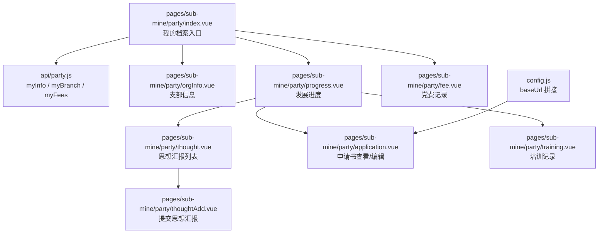
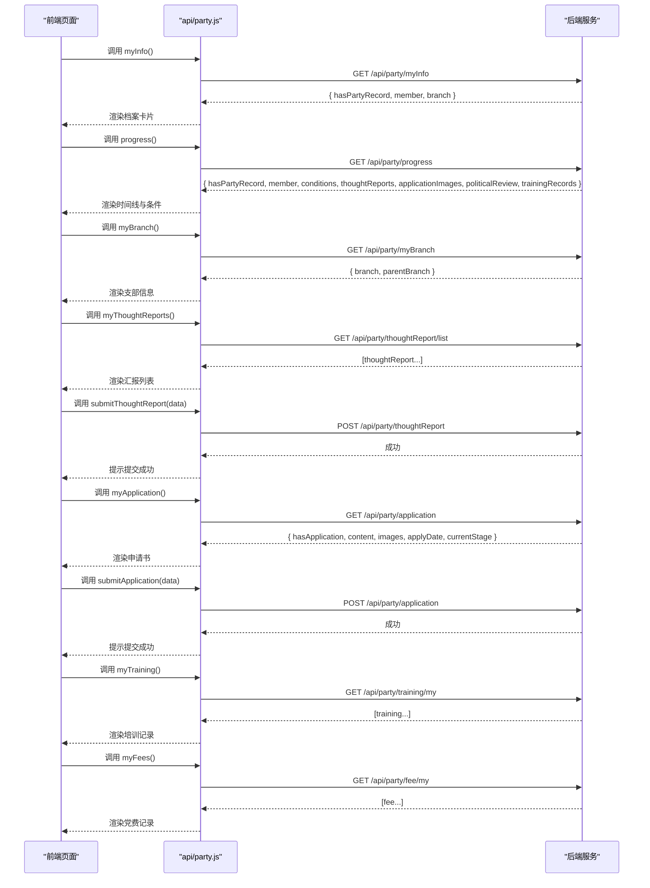
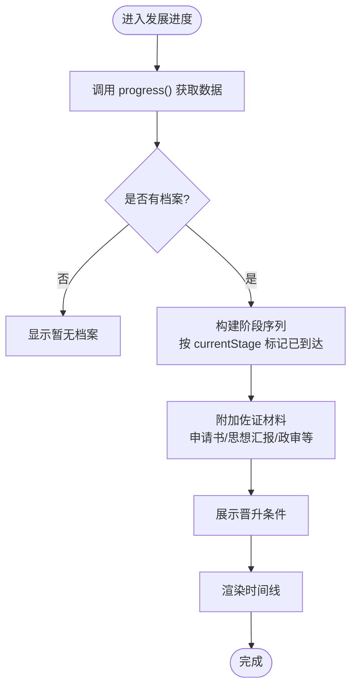
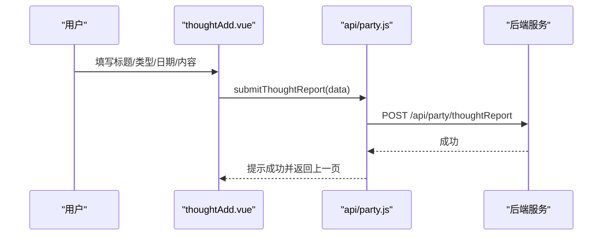
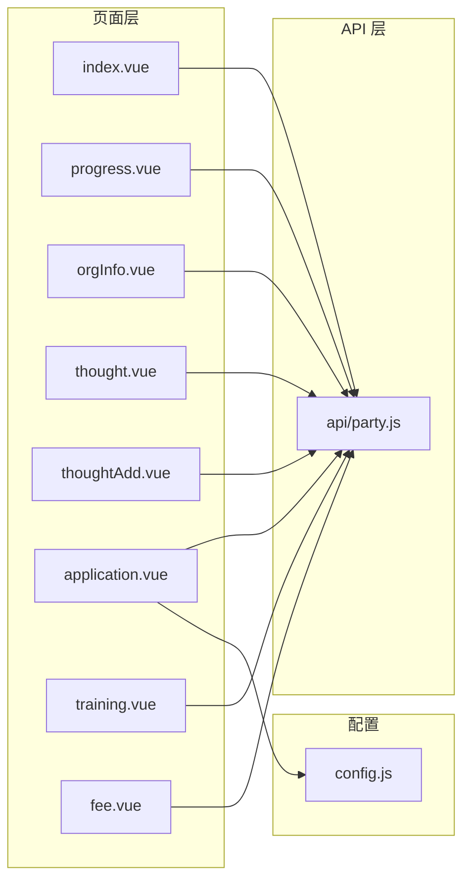

# 学生端党务接口

<cite>
**本文引用的文件**   
- [api/party.js](file://api/party.js)
- [pages/sub-mine/party/index.vue](file://pages/sub-mine/party/index.vue)
- [pages/sub-mine/party/progress.vue](file://pages/sub-mine/party/progress.vue)
- [pages/sub-mine/party/orgInfo.vue](file://pages/sub-mine/party/orgInfo.vue)
- [pages/sub-mine/party/thought.vue](file://pages/sub-mine/party/thought.vue)
- [pages/sub-mine/party/thoughtAdd.vue](file://pages/sub-mine/party/thoughtAdd.vue)
- [pages/sub-mine/party/application.vue](file://pages/sub-mine/party/application.vue)
- [pages/sub-mine/party/training.vue](file://pages/sub-mine/party/training.vue)
- [pages/sub-mine/party/fee.vue](file://pages/sub-mine/party/fee.vue)
- [config.js](file://config.js)
</cite>

## 目录
1. [简介](#简介)
2. [项目结构](#项目结构)
3. [核心组件](#核心组件)
4. [架构总览](#架构总览)
5. [详细组件分析](#详细组件分析)
6. [依赖关系分析](#依赖关系分析)
7. [性能与可用性建议](#性能与可用性建议)
8. [故障排查指南](#故障排查指南)
9. [结论](#结论)

## 简介
本文件面向“学生端党务”功能，系统化梳理并文档化以下能力：
- 我的党员档案查询（含政治面貌、支部信息、培养人、介绍人等）
- 入党发展进度跟踪（阶段定义、状态流转、佐证材料展示）
- 支部信息查询（组织基本信息、上级组织）
- 思想汇报的提交、查看与管理（类型、日期、季度、审核状态）
- 入党申请书的在线提交与查看（内容、附件图片）
- 培训记录查询（课程名称、学时、成绩、证书编号、通过状态）
- 党费缴纳记录查看（缴费金额、时间、支付方式、状态）

同时提供完整的请求参数与响应数据结构示例，便于前后端联调与测试。

## 项目结构
学生端党务相关的前端实现集中在 pages/sub-mine/party 目录下，API 封装在 api/party.js，全局配置在 config.js。

图表来源
- [api/party.js:1-88](file://api/party.js#L1-L88)
- [pages/sub-mine/party/index.vue:1-206](file://pages/sub-mine/party/index.vue#L1-L206)
- [pages/sub-mine/party/orgInfo.vue:1-112](file://pages/sub-mine/party/orgInfo.vue#L1-L112)
- [pages/sub-mine/party/progress.vue:1-266](file://pages/sub-mine/party/progress.vue#L1-L266)
- [pages/sub-mine/party/thought.vue:1-62](file://pages/sub-mine/party/thought.vue#L1-L62)
- [pages/sub-mine/party/thoughtAdd.vue:1-74](file://pages/sub-mine/party/thoughtAdd.vue#L1-L74)
- [pages/sub-mine/party/application.vue:1-170](file://pages/sub-mine/party/application.vue#L1-L170)
- [pages/sub-mine/party/training.vue:1-53](file://pages/sub-mine/party/training.vue#L1-L53)
- [pages/sub-mine/party/fee.vue:1-52](file://pages/sub-mine/party/fee.vue#L1-L52)
- [config.js:1-38](file://config.js#L1-L38)

章节来源
- [api/party.js:1-88](file://api/party.js#L1-L88)
- [pages/sub-mine/party/index.vue:1-206](file://pages/sub-mine/party/index.vue#L1-L206)
- [config.js:1-38](file://config.js#L1-L38)

## 核心组件
- 统一 API 封装：api/party.js 暴露了学生端、书记/辅导员端、教师个人端三类接口方法，其中学生端包含档案、进度、支部、思想汇报、申请书、培训、党费等能力。
- 页面模块：
  - index.vue：汇总展示“我的档案”，聚合基础信息、最近一次党费状态、跳转各子模块。
  - orgInfo.vue：展示当前支部及上级组织信息。
  - progress.vue：以时间线形式展示入党发展过程，附带前置条件、思想汇报、申请书材料预览。
  - thought.vue / thoughtAdd.vue：思想汇报列表与新增提交。
  - application.vue：入党申请书查看与在线提交（支持图片附件）。
  - training.vue：培训记录列表。
  - fee.vue：党费缴纳记录列表。

章节来源
- [api/party.js:1-88](file://api/party.js#L1-L88)
- [pages/sub-mine/party/index.vue:1-206](file://pages/sub-mine/party/index.vue#L1-L206)
- [pages/sub-mine/party/orgInfo.vue:1-112](file://pages/sub-mine/party/orgInfo.vue#L1-L112)
- [pages/sub-mine/party/progress.vue:1-266](file://pages/sub-mine/party/progress.vue#L1-L266)
- [pages/sub-mine/party/thought.vue:1-62](file://pages/sub-mine/party/thought.vue#L1-L62)
- [pages/sub-mine/party/thoughtAdd.vue:1-74](file://pages/sub-mine/party/thoughtAdd.vue#L1-L74)
- [pages/sub-mine/party/application.vue:1-170](file://pages/sub-mine/party/application.vue#L1-L170)
- [pages/sub-mine/party/training.vue:1-53](file://pages/sub-mine/party/training.vue#L1-L53)
- [pages/sub-mine/party/fee.vue:1-52](file://pages/sub-mine/party/fee.vue#L1-L52)

## 架构总览
下图展示了从前端页面到后端接口的调用路径与数据流向。

图表来源
- [api/party.js:1-88](file://api/party.js#L1-L88)
- [pages/sub-mine/party/index.vue:1-206](file://pages/sub-mine/party/index.vue#L1-L206)
- [pages/sub-mine/party/progress.vue:1-266](file://pages/sub-mine/party/progress.vue#L1-L266)
- [pages/sub-mine/party/orgInfo.vue:1-112](file://pages/sub-mine/party/orgInfo.vue#L1-L112)
- [pages/sub-mine/party/thought.vue:1-62](file://pages/sub-mine/party/thought.vue#L1-L62)
- [pages/sub-mine/party/thoughtAdd.vue:1-74](file://pages/sub-mine/party/thoughtAdd.vue#L1-L74)
- [pages/sub-mine/party/application.vue:1-170](file://pages/sub-mine/party/application.vue#L1-L170)
- [pages/sub-mine/party/training.vue:1-53](file://pages/sub-mine/party/training.vue#L1-L53)
- [pages/sub-mine/party/fee.vue:1-52](file://pages/sub-mine/party/fee.vue#L1-L52)

## 详细组件分析

### 我的党员档案（index.vue + api/party.js）
- 功能要点
  - 获取当前用户档案：包含学号、姓名、政治面貌、所属支部、递交申请时间、当前阶段、档案号、介绍人等。
  - 聚合最近一次党费状态，用于首页快速展示是否已缴。
  - 当学生端无档案时，自动回退尝试教师端档案接口，提升兼容性。
- 关键字段说明（来自页面渲染逻辑）
  - 政治面貌映射：APPLICANT/ACTIVIST/TARGET/PROBATIONARY/FORMAL → 入党申请人/积极分子/发展对象/预备党员/正式党员。
  - 阶段标签：currentStage 对应阶段名；stageStatus 表示进行中/已完成/已终止。
  - 介绍人：introducer1/introducer2。
  - 支部信息：branchName。
  - 档案号：archiveNo。
  - 最近党费：根据 feeYear/feeMonth 与 payStatus 计算最近已缴月份。
- 错误处理
  - 加载失败或无记录时，显示空态或提示联系党支部录入档案。
  - 兼容教师端接口作为兜底。

章节来源
- [pages/sub-mine/party/index.vue:1-206](file://pages/sub-mine/party/index.vue#L1-L206)
- [api/party.js:1-88](file://api/party.js#L1-L88)

### 支部信息查询（orgInfo.vue + api/party.js）
- 功能要点
  - 展示当前支部基本信息：名称、编码、组织类型、党员人数、支部书记、状态。
  - 展示上级组织信息：名称、负责人、组织类型。
- 数据来源
  - 调用 myBranch()，返回 branch 与 parentBranch。

章节来源
- [pages/sub-mine/party/orgInfo.vue:1-112](file://pages/sub-mine/party/orgInfo.vue#L1-L112)
- [api/party.js:1-88](file://api/party.js#L1-L88)

### 入党发展进度（progress.vue + api/party.js）
- 阶段定义与顺序
  - APPLICANT → ACTIVIST → TARGET → PROBATIONARY → FORMAL
  - 对应中文：递交申请书 → 确定为积极分子 → 确定为发展对象 → 接收为预备党员 → 转为正式党员
- 状态流转
  - 由 member.currentStage 决定当前所处阶段；每个阶段可关联一个具体日期字段（applyDate/activistDate/targetDate/probationDate/formalDate）。
  - 若到达某阶段但缺少日期，则显示“请补充”。
- 佐证材料与前置条件
  - 各阶段可关联佐证材料（如申请书图片、思想汇报附件、政审附件等），未达阶段不展示。
  - conditions 数组描述晋升至下一阶段的条件是否满足。
- 思想汇报与申请书入口
  - 直接展示近期思想汇报列表与状态，并提供跳转到提交页。
  - 展示申请书图片附件，并提供查看/编辑入口。

图表来源
- [pages/sub-mine/party/progress.vue:1-266](file://pages/sub-mine/party/progress.vue#L1-L266)
- [api/party.js:1-88](file://api/party.js#L1-L88)

章节来源
- [pages/sub-mine/party/progress.vue:1-266](file://pages/sub-mine/party/progress.vue#L1-L266)
- [api/party.js:1-88](file://api/party.js#L1-L88)

### 思想汇报（thought.vue / thoughtAdd.vue + api/party.js）
- 列表查看
  - 调用 myThoughtReports() 获取列表，包含标题、类型、日期、季度、审核状态等。
  - 若无记录，尝试教师端接口 teacherThoughtReportList() 作为兜底。
- 提交流程
  - 必填项：标题、内容、汇报日期。
  - 可选：汇报类型（季度/半年/年度/专题）、季度标识（如 2026Q1）。
  - 提交后自动返回列表刷新。
- 审核状态
  - 0 待审、1 通过、2 需改、3 退回。

图表来源
- [pages/sub-mine/party/thoughtAdd.vue:1-74](file://pages/sub-mine/party/thoughtAdd.vue#L1-L74)
- [api/party.js:1-88](file://api/party.js#L1-L88)

章节来源
- [pages/sub-mine/party/thought.vue:1-62](file://pages/sub-mine/party/thought.vue#L1-L62)
- [pages/sub-mine/party/thoughtAdd.vue:1-74](file://pages/sub-mine/party/thoughtAdd.vue#L1-L74)
- [api/party.js:1-88](file://api/party.js#L1-L88)

### 入党申请书（application.vue + api/party.js）
- 查看
  - 调用 myApplication() 获取内容、附件图片、提交时间、当前阶段。
- 提交/修改
  - 首次提交必填内容；修改模式允许更新内容与图片。
  - 图片上传走通用上传接口，成功后将文件名加入提交参数。
  - 提交参数包含 applicationContent 与 applicationImages（逗号分隔的文件名列表）。
- 校验与交互
  - 未填写内容且非编辑模式会阻止提交。
  - 图片最多 5 张，支持预览与删除。

章节来源
- [pages/sub-mine/party/application.vue:1-170](file://pages/sub-mine/party/application.vue#L1-L170)
- [api/party.js:1-88](file://api/party.js#L1-L88)
- [config.js:1-38](file://config.js#L1-L38)

### 培训记录（training.vue + api/party.js）
- 功能要点
  - 展示培训课程名称、实际学时、考试成绩、通过状态、证书编号等。
- 数据来源
  - 调用 myTraining() 获取列表。

章节来源
- [pages/sub-mine/party/training.vue:1-53](file://pages/sub-mine/party/training.vue#L1-L53)
- [api/party.js:1-88](file://api/party.js#L1-L88)

### 党费记录（fee.vue + api/party.js）
- 功能要点
  - 展示缴费年月、金额、支付方式、状态（已缴/减免/未缴）。
- 数据来源
  - 优先调用 myFees()；若无记录，尝试教师端接口 teacherFeeList()。

章节来源
- [pages/sub-mine/party/fee.vue:1-52](file://pages/sub-mine/party/fee.vue#L1-L52)
- [api/party.js:1-88](file://api/party.js#L1-L88)

## 依赖关系分析
- 页面与 API 的耦合
  - 所有页面均通过 import partyApi from '@/api/party' 使用统一 API 封装，降低重复代码。
  - 部分页面在失败或无数据时回退到教师端接口，增强健壮性。
- 配置依赖
  - 申请书图片上传使用 config.baseUrl 拼接完整地址。

图表来源
- [api/party.js:1-88](file://api/party.js#L1-L88)
- [pages/sub-mine/party/index.vue:1-206](file://pages/sub-mine/party/index.vue#L1-L206)
- [pages/sub-mine/party/progress.vue:1-266](file://pages/sub-mine/party/progress.vue#L1-L266)
- [pages/sub-mine/party/orgInfo.vue:1-112](file://pages/sub-mine/party/orgInfo.vue#L1-L112)
- [pages/sub-mine/party/thought.vue:1-62](file://pages/sub-mine/party/thought.vue#L1-L62)
- [pages/sub-mine/party/thoughtAdd.vue:1-74](file://pages/sub-mine/party/thoughtAdd.vue#L1-L74)
- [pages/sub-mine/party/application.vue:1-170](file://pages/sub-mine/party/application.vue#L1-L170)
- [pages/sub-mine/party/training.vue:1-53](file://pages/sub-mine/party/training.vue#L1-L53)
- [pages/sub-mine/party/fee.vue:1-52](file://pages/sub-mine/party/fee.vue#L1-L52)
- [config.js:1-38](file://config.js#L1-L38)

章节来源
- [api/party.js:1-88](file://api/party.js#L1-L88)
- [config.js:1-38](file://config.js#L1-L38)

## 性能与可用性建议
- 列表分页与懒加载
  - 思想汇报、培训、党费记录等列表建议在数据量较大时增加分页与滚动加载，减少首屏压力。
- 图片优化
  - 上传前压缩、按需加载缩略图，避免大图阻塞渲染。
- 缓存策略
  - 对支部信息、档案信息等相对静态的数据进行本地缓存，缩短二次打开耗时。
- 降级与容错
  - 保持现有“学生端→教师端”的降级逻辑，确保不同角色登录时的可用性。

[本节为通用建议，无需源码引用]

## 故障排查指南
- 常见错误定位
  - 网络与鉴权：检查 baseUrl 是否正确、token 是否有效。
  - 无数据：确认用户是否已有档案；如无，提示联系所在党支部录入。
  - 图片无法显示：检查图片 URL 是否为绝对路径或 baseUrl 拼接是否正确。
- 日志与调试
  - 在 uni.showLoading 与 catch 分支中打印错误信息，辅助定位。
- 兼容性问题
  - 若学生端接口返回无记录，确认教师端接口是否可用，必要时调整降级策略。

章节来源
- [pages/sub-mine/party/index.vue:1-206](file://pages/sub-mine/party/index.vue#L1-L206)
- [pages/sub-mine/party/progress.vue:1-266](file://pages/sub-mine/party/progress.vue#L1-L266)
- [pages/sub-mine/party/thought.vue:1-62](file://pages/sub-mine/party/thought.vue#L1-L62)
- [pages/sub-mine/party/fee.vue:1-52](file://pages/sub-mine/party/fee.vue#L1-L52)
- [config.js:1-38](file://config.js#L1-L38)

## 结论
学生端党务模块围绕“档案—进度—组织—思想汇报—申请书—培训—党费”形成闭环，前端通过统一的 API 封装与良好的降级策略，保证了多角色场景下的可用性。建议后续在列表分页、图片优化与缓存方面持续改进，以提升整体体验与性能。

[本节为总结，无需源码引用]

## 附录：接口与数据结构示例

说明
- 以下为基于前端调用与渲染逻辑整理的请求/响应结构示例，供联调参考。
- 字段命名与取值范围以页面实现为准。

### 1. 我的党员档案
- 请求
  - 方法：GET
  - 路径：/api/party/myInfo
- 响应示例
  - 有档案
    - hasPartyRecord: true
    - member:
      - xh: "20210001"
      - studentName: "张三"
      - currentStage: "ACTIVIST"
      - stageStatus: "0"
      - archiveNo: "DAA-2021-0001"
      - branchName: "计算机学院本科生第一党支部"
      - introducer1: "李四"
      - introducer2: "王五"
      - applyDate: "2021-09-10T00:00:00"
    - branch:
      - branchName: "计算机学院本科生第一党支部"
      - branchCode: "CS-001"
      - orgType: "3"
      - secretary: "赵六"
      - status: "0"
  - 无档案
    - hasPartyRecord: false

章节来源
- [pages/sub-mine/party/index.vue:1-206](file://pages/sub-mine/party/index.vue#L1-L206)
- [api/party.js:1-88](file://api/party.js#L1-L88)

### 2. 发展进度
- 请求
  - 方法：GET
  - 路径：/api/party/progress
- 响应示例
  - hasPartyRecord: true
  - member:
    - currentStage: "TARGET"
    - applyDate: "2021-09-10T00:00:00"
    - activistDate: "2022-03-15T00:00:00"
    - targetDate: "2023-06-20T00:00:00"
    - probationDate: null
    - formalDate: null
  - applicationImages: "/party/upload/image/xxx.jpg,/party/upload/image/yyy.jpg"
  - thoughtReports: [
      { reportId: "r1", title: "2023年第三季度思想汇报", reportType: "QUARTERLY", reportDate: "2023-09-10", quarter: "2023Q3", reviewStatus: "1", attachment: "/party/upload/image/a.jpg" },
      { reportId: "r2", title: "2023年第四季度思想汇报", reportType: "QUARTERLY", reportDate: "2023-12-12", quarter: "2023Q4", reviewStatus: "0", attachment: "" }
    ]
  - politicalReview: { attachment: "/party/upload/image/pr.jpg" }
  - trainingRecords: [
      { id: "t1", courseName: "入党积极分子培训班", attendHours: 24, examScore: 92, passStatus: "1", certificateNo: "CERT-2023-001" }
    ]
  - conditions: [
      { name: "参加党校培训", met: true },
      { name: "思想汇报次数达标", met: false, reason: "还需提交1次" }
    ]

章节来源
- [pages/sub-mine/party/progress.vue:1-266](file://pages/sub-mine/party/progress.vue#L1-L266)
- [api/party.js:1-88](file://api/party.js#L1-L88)

### 3. 支部信息
- 请求
  - 方法：GET
  - 路径：/api/party/myBranch
- 响应示例
  - branch:
    - branchName: "计算机学院本科生第一党支部"
    - branchCode: "CS-001"
    - orgType: "3"
    - memberCount: 45
    - secretary: "赵六"
    - status: "0"
  - parentBranch:
    - branchName: "计算机学院党总支"
    - secretary: "钱七"
    - orgType: "2"

章节来源
- [pages/sub-mine/party/orgInfo.vue:1-112](file://pages/sub-mine/party/orgInfo.vue#L1-L112)
- [api/party.js:1-88](file://api/party.js#L1-L88)

### 4. 思想汇报
- 列表
  - 请求
    - 方法：GET
    - 路径：/api/party/thoughtReport/list
  - 响应示例
    - [
        { reportId: "r1", title: "2023年第三季度思想汇报", reportType: "QUARTERLY", reportDate: "2023-09-10", quarter: "2023Q3", reviewStatus: "1" },
        { reportId: "r2", title: "2023年第四季度思想汇报", reportType: "QUARTERLY", reportDate: "2023-12-12", quarter: "2023Q4", reviewStatus: "0" }
      ]
- 提交
  - 请求
    - 方法：POST
    - 路径：/api/party/thoughtReport
    - 请求体示例
      - title: "2024年第一季度思想汇报"
      - reportType: "QUARTERLY"
      - reportDate: "2024-03-15"
      - quarter: "2024Q1"
      - content: "本季度学习心得..."
  - 响应示例
    - code: 200
    - message: "提交成功"

章节来源
- [pages/sub-mine/party/thought.vue:1-62](file://pages/sub-mine/party/thought.vue#L1-L62)
- [pages/sub-mine/party/thoughtAdd.vue:1-74](file://pages/sub-mine/party/thoughtAdd.vue#L1-L74)
- [api/party.js:1-88](file://api/party.js#L1-L88)

### 5. 入党申请书
- 查看
  - 请求
    - 方法：GET
    - 路径：/api/party/application
  - 响应示例
    - hasApplication: true
    - content: "我志愿加入中国共产党..."
    - images: "/party/upload/image/app1.jpg,/party/upload/image/app2.jpg"
    - applyDate: "2021-09-10T00:00:00"
    - currentStage: "ACTIVIST"
- 提交/修改
  - 请求
    - 方法：POST
    - 路径：/api/party/application
    - 请求体示例
      - applicationContent: "我志愿加入中国共产党..."
      - applicationImages: "app1.jpg,app2.jpg"
  - 响应示例
    - code: 200
    - message: "提交成功"

章节来源
- [pages/sub-mine/party/application.vue:1-170](file://pages/sub-mine/party/application.vue#L1-L170)
- [api/party.js:1-88](file://api/party.js#L1-L88)

### 6. 培训记录
- 请求
  - 方法：GET
  - 路径：/api/party/training/my
- 响应示例
  - [
      { id: "t1", courseName: "入党积极分子培训班", attendHours: 24, examScore: 92, passStatus: "1", certificateNo: "CERT-2023-001" },
      { id: "t2", courseName: "发展对象集中培训", attendHours: 16, examScore: 88, passStatus: "1", certificateNo: "CERT-2023-002" }
    ]

章节来源
- [pages/sub-mine/party/training.vue:1-53](file://pages/sub-mine/party/training.vue#L1-L53)
- [api/party.js:1-88](file://api/party.js#L1-L88)

### 7. 党费记录
- 请求
  - 方法：GET
  - 路径：/api/party/fee/my
- 响应示例
  - [
      { feeId: "f1", feeYear: 2023, feeMonth: 12, amount: 10, payMethod: "ONLINE", payStatus: "1" },
      { feeId: "f2", feeYear: 2024, feeMonth: 1, amount: 10, payMethod: "TRANSFER", payStatus: "0" }
    ]

章节来源
- [pages/sub-mine/party/fee.vue:1-52](file://pages/sub-mine/party/fee.vue#L1-L52)
- [api/party.js:1-88](file://api/party.js#L1-L88)