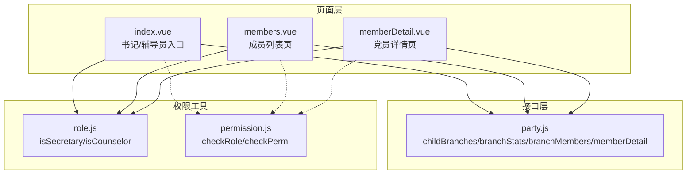
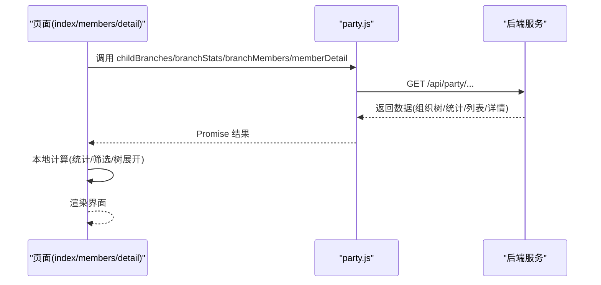
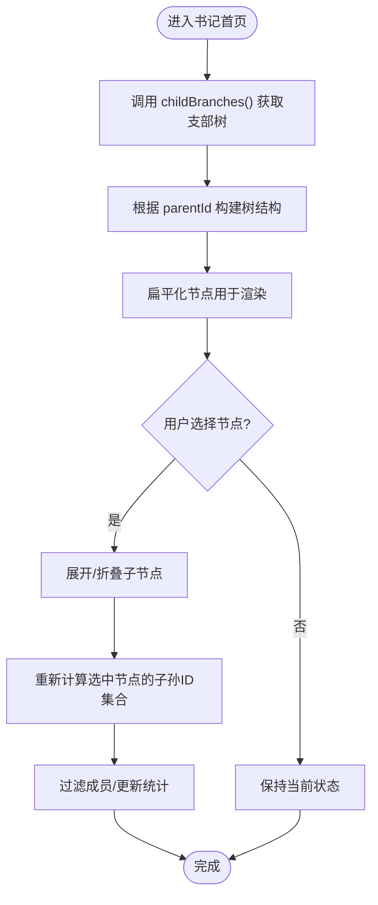
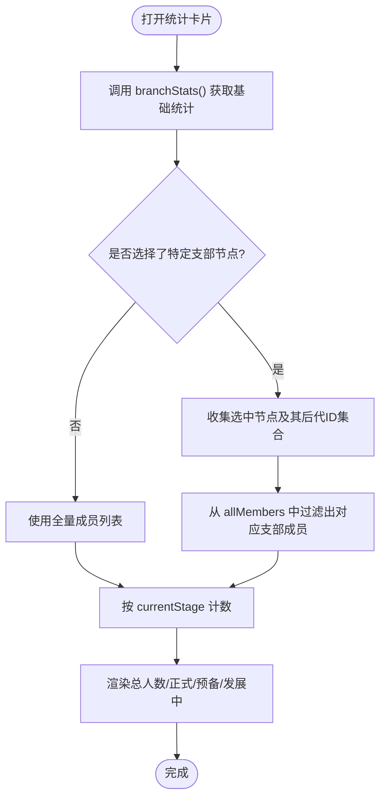
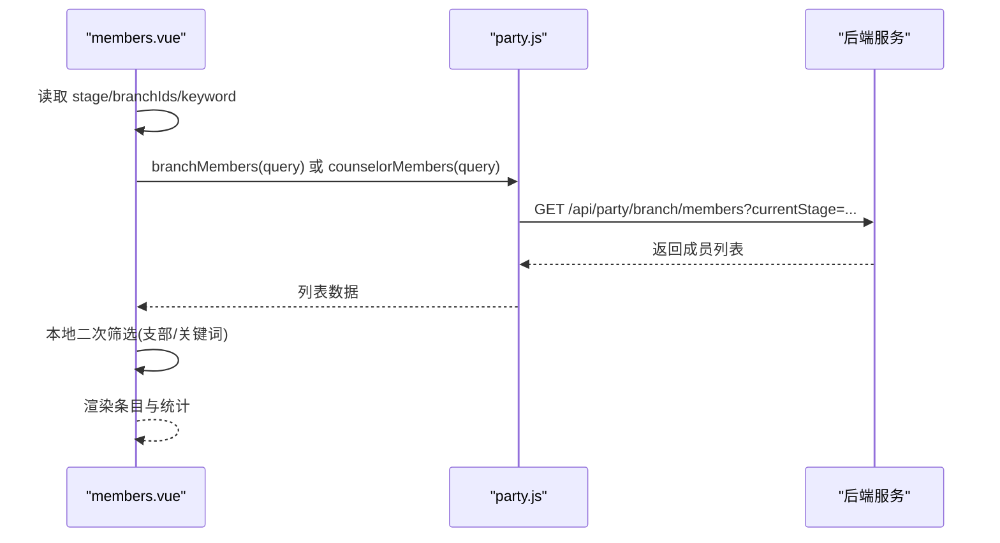
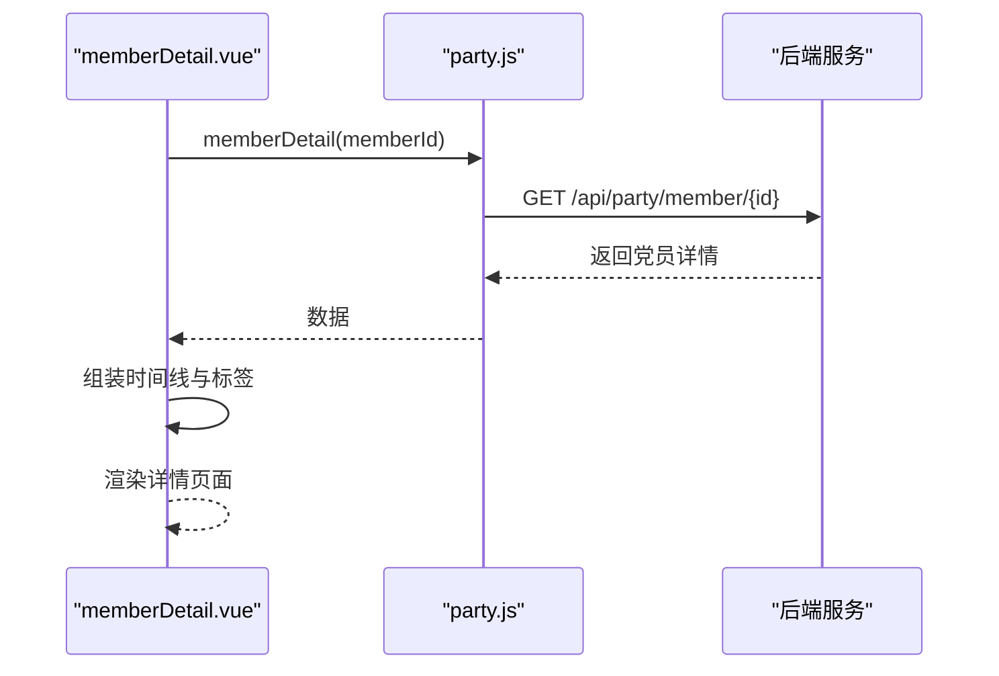
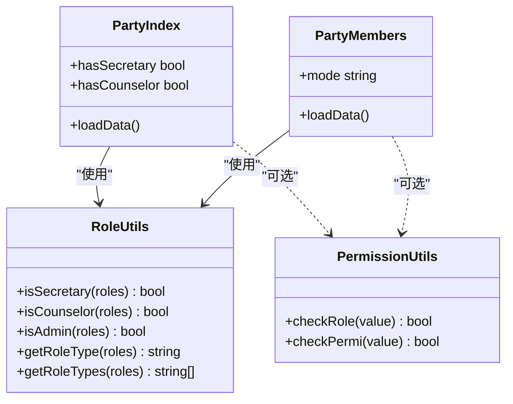
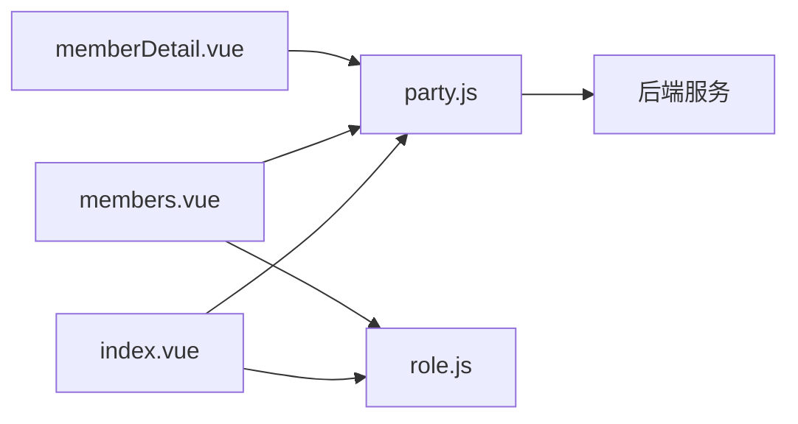

# 支部管理接口

<cite>
**本文引用的文件**   
- [api/party.js](file://api/party.js)
- [pages/sub-work/party/index.vue](file://pages/sub-work/party/index.vue)
- [pages/sub-work/party/members.vue](file://pages/sub-work/party/members.vue)
- [pages/sub-work/party/memberDetail.vue](file://pages/sub-work/party/memberDetail.vue)
- [utils/role.js](file://utils/role.js)
- [utils/permission.js](file://utils/permission.js)
</cite>

## 目录
1. [简介](#简介)
2. [项目结构](#项目结构)
3. [核心组件](#核心组件)
4. [架构总览](#架构总览)
5. [详细组件分析](#详细组件分析)
6. [依赖关系分析](#依赖关系分析)
7. [性能与可用性建议](#性能与可用性建议)
8. [故障排查指南](#故障排查指南)
9. [结论](#结论)
10. [附录：API 定义与调用示例](#附录api-定义与调用示例)

## 简介
本文件面向“支部管理”相关的前端能力，聚焦以下目标：
- 下级支部列表查询（树形结构）
- 支部统计概览（党员人数、发展对象、积极分子等指标）
- 支部成员管理（分页与筛选）
- 党员详情查询（个人信息、入党时间线、组织关系等）
- 权限控制机制（书记/辅导员角色区分）
- 完整 API 调用示例与错误处理方案

说明：
- 后端接口路径以 api/party.js 中声明为准；具体业务逻辑由服务端实现。
- 前端页面通过 uni-app 路由跳转与请求封装进行交互。

## 项目结构
与本主题相关的核心文件如下：
- 接口层：api/party.js
- 页面层：pages/sub-work/party/index.vue、members.vue、memberDetail.vue
- 权限工具：utils/role.js、utils/permission.js

图表来源
- [api/party.js:42-58](file://api/party.js#L42-L58)
- [pages/sub-work/party/index.vue:227-456](file://pages/sub-work/party/index.vue#L227-L456)
- [pages/sub-work/party/members.vue:58-155](file://pages/sub-work/party/members.vue#L58-L155)
- [pages/sub-work/party/memberDetail.vue:63-111](file://pages/sub-work/party/memberDetail.vue#L63-L111)
- [utils/role.js:16-98](file://utils/role.js#L16-L98)
- [utils/permission.js:8-49](file://utils/permission.js#L8-L49)

章节来源
- [api/party.js:1-88](file://api/party.js#L1-L88)
- [pages/sub-work/party/index.vue:1-533](file://pages/sub-work/party/index.vue#L1-L533)
- [pages/sub-work/party/members.vue:1-192](file://pages/sub-work/party/members.vue#L1-L192)
- [pages/sub-work/party/memberDetail.vue:1-160](file://pages/sub-work/party/memberDetail.vue#L1-L160)
- [utils/role.js:1-165](file://utils/role.js#L1-L165)
- [utils/permission.js:1-49](file://utils/permission.js#L1-L49)

## 核心组件
- 接口层（party.js）
  - 书记/辅导员端：下级支部列表、支部统计概览、支部党员列表、党员详情
  - 辅导员端：所带学生入党情况统计、所带学生党员列表
  - 教师个人党务：教师档案、思想汇报、党费记录等
- 页面层
  - index.vue：书记/辅导员统一入口，展示组织树、统计概览、阶段筛选、党员列表
  - members.vue：成员列表页，支持按阶段、支部、关键词筛选
  - memberDetail.vue：党员详情，包含基本信息与发展阶段时间线、介绍人、思想汇报
- 权限工具
  - role.js：基于角色名或角色键判断是否为书记/辅导员/管理员/教师
  - permission.js：字符权限与角色权限校验

章节来源
- [api/party.js:42-86](file://api/party.js#L42-L86)
- [pages/sub-work/party/index.vue:227-456](file://pages/sub-work/party/index.vue#L227-L456)
- [pages/sub-work/party/members.vue:58-155](file://pages/sub-work/party/members.vue#L58-L155)
- [pages/sub-work/party/memberDetail.vue:63-111](file://pages/sub-work/party/memberDetail.vue#L63-L111)
- [utils/role.js:16-98](file://utils/role.js#L16-L98)
- [utils/permission.js:8-49](file://utils/permission.js#L8-L49)

## 架构总览
整体数据流：页面发起请求 → 接口层封装 → 后端返回数据 → 页面渲染与计算。

图表来源
- [api/party.js:42-58](file://api/party.js#L42-L58)
- [pages/sub-work/party/index.vue:325-356](file://pages/sub-work/party/index.vue#L325-L356)
- [pages/sub-work/party/members.vue:125-144](file://pages/sub-work/party/members.vue#L125-L144)
- [pages/sub-work/party/memberDetail.vue:82-109](file://pages/sub-work/party/memberDetail.vue#L82-L109)

## 详细组件分析

### 1) 下级支部列表（树形结构）
- 接口
  - 方法：GET
  - 路径：/api/party/branch/children
  - 参数：无
  - 返回：支部节点数组（含 branchId、parentId、branchName 等）
- 前端使用
  - 在书记模式下加载并构建层级树，支持展开/折叠、多选聚合统计
  - 提供“全部”根节点与子节点递归展开逻辑
- 关键流程
  - 加载支部树 → 构建父子关系 → 扁平化显示 → 选择节点时聚合后代节点 ID 用于统计与筛选

图表来源
- [api/party.js:44-46](file://api/party.js#L44-L46)
- [pages/sub-work/party/index.vue:350-426](file://pages/sub-work/party/index.vue#L350-L426)

章节来源
- [api/party.js:44-46](file://api/party.js#L44-L46)
- [pages/sub-work/party/index.vue:350-426](file://pages/sub-work/party/index.vue#L350-L426)

### 2) 支部统计概览
- 接口
  - 方法：GET
  - 路径：/api/party/branch/stats
  - 参数：branchId（可选，视后端实现）
  - 返回：包含支部信息与阶段统计（如正式、预备、发展中等）
- 计算逻辑（前端）
  - 若未指定 branchId，默认对当前书记所属支部范围统计
  - 当用户勾选多个支部节点时，自动聚合其所有后代节点 ID，再对成员列表进行过滤后统计
  - 统计维度包括：总人数、正式党员、预备党员、发展中（申请人+积极分子+发展对象）
- 辅导员视角
  - 另有 counselorStats 接口，返回该辅导员所带学生的阶段统计

图表来源
- [api/party.js:48-50](file://api/party.js#L48-L50)
- [pages/sub-work/party/index.vue:325-342](file://pages/sub-work/party/index.vue#L325-L342)
- [pages/sub-work/party/index.vue:256-270](file://pages/sub-work/party/index.vue#L256-L270)
- [pages/sub-work/party/index.vue:344-349](file://pages/sub-work/party/index.vue#L344-L349)

章节来源
- [api/party.js:48-50](file://api/party.js#L48-L50)
- [pages/sub-work/party/index.vue:256-270](file://pages/sub-work/party/index.vue#L256-L270)
- [pages/sub-work/party/index.vue:325-349](file://pages/sub-work/party/index.vue#L325-L349)

### 3) 支部成员管理（分页与筛选）
- 接口
  - 方法：GET
  - 路径：/api/party/branch/members
  - 参数：query（例如 currentStage 等，具体字段以后端为准）
  - 返回：成员列表（可能为分页结构，字段包含 memberId、currentStage、xh、phone、branchName 等）
- 辅导员成员列表
  - 方法：GET
  - 路径：/api/party/counselor/members
  - 参数：同上
- 筛选能力（前端）
  - 阶段筛选：APPLICANT/ACTIVIST/TARGET/PROBATIONARY/FORMAL
  - 支部筛选（书记模式）：单选/多选，支持“全部支部”
  - 关键词搜索：姓名/学号/工号/手机号
- 注意
  - 当前页面未显式传递分页参数，实际分页由后端决定；如需前端分页，可在 query 中补充 page/pageSize 等字段（需后端支持）

图表来源
- [api/party.js:52-54](file://api/party.js#L52-L54)
- [api/party.js:66-68](file://api/party.js#L66-L68)
- [pages/sub-work/party/members.vue:125-144](file://pages/sub-work/party/members.vue#L125-L144)

章节来源
- [api/party.js:52-54](file://api/party.js#L52-L54)
- [api/party.js:66-68](file://api/party.js#L66-L68)
- [pages/sub-work/party/members.vue:96-155](file://pages/sub-work/party/members.vue#L96-L155)

### 4) 党员详情查询
- 接口
  - 方法：GET
  - 路径：/api/party/member/{memberId}
  - 返回：党员信息对象（可能包含 currentStage、applyDate、activistDate、targetDate、probationDate、formalDate、introducer1/introducer2、branchName 等）
- 前端展示
  - 基本信息：学号/档案号/所属支部/申请日期
  - 发展阶段时间线：按顺序展示各阶段到达时间与状态
  - 介绍人与思想汇报（如有）

图表来源
- [api/party.js:56-58](file://api/party.js#L56-L58)
- [pages/sub-work/party/memberDetail.vue:82-109](file://pages/sub-work/party/memberDetail.vue#L82-L109)

章节来源
- [api/party.js:56-58](file://api/party.js#L56-L58)
- [pages/sub-work/party/memberDetail.vue:63-111](file://pages/sub-work/party/memberDetail.vue#L63-L111)

### 5) 权限控制机制
- 角色判定
  - isSecretary：角色名包含“书记”或角色键包含“secretary”
  - isCounselor：角色名包含“辅导员”或角色键包含“counselor”
- 页面内权限
  - index.vue 根据角色动态展示书记/辅导员模块
  - members.vue 根据 mode 切换调用不同成员接口
- 通用权限校验
  - checkRole/checkPermi 可用于按钮级或路由级权限控制（当前页面未直接调用）

图表来源
- [utils/role.js:16-98](file://utils/role.js#L16-L98)
- [utils/permission.js:8-49](file://utils/permission.js#L8-L49)
- [pages/sub-work/party/index.vue:309-324](file://pages/sub-work/party/index.vue#L309-L324)
- [pages/sub-work/party/members.vue:96-106](file://pages/sub-work/party/members.vue#L96-L106)

章节来源
- [utils/role.js:16-98](file://utils/role.js#L16-L98)
- [utils/permission.js:8-49](file://utils/permission.js#L8-L49)
- [pages/sub-work/party/index.vue:309-324](file://pages/sub-work/party/index.vue#L309-L324)
- [pages/sub-work/party/members.vue:96-106](file://pages/sub-work/party/members.vue#L96-L106)

## 依赖关系分析
- 页面到接口
  - index.vue → party.js（childBranches、branchStats、branchMembers）
  - members.vue → party.js（branchMembers 或 counselorMembers）
  - memberDetail.vue → party.js（memberDetail）
- 页面到权限工具
  - index.vue → role.js（isSecretary/isCounselor）
  - members.vue → role.js（间接通过路由参数 mode）
- 潜在耦合点
  - 树形结构与统计联动：index.vue 的 selectedBranchIds 与 computedStats/filteredList 强耦合
  - 成员列表与筛选：members.vue 的 stage/branchIds/keyword 组合影响最终列表

图表来源
- [api/party.js:42-58](file://api/party.js#L42-L58)
- [pages/sub-work/party/index.vue:325-356](file://pages/sub-work/party/index.vue#L325-L356)
- [pages/sub-work/party/members.vue:125-144](file://pages/sub-work/party/members.vue#L125-L144)
- [pages/sub-work/party/memberDetail.vue:82-109](file://pages/sub-work/party/memberDetail.vue#L82-L109)
- [utils/role.js:16-98](file://utils/role.js#L16-L98)

章节来源
- [api/party.js:42-58](file://api/party.js#L42-L58)
- [pages/sub-work/party/index.vue:325-356](file://pages/sub-work/party/index.vue#L325-L356)
- [pages/sub-work/party/members.vue:125-144](file://pages/sub-work/party/members.vue#L125-L144)
- [pages/sub-work/party/memberDetail.vue:82-109](file://pages/sub-work/party/memberDetail.vue#L82-L109)
- [utils/role.js:16-98](file://utils/role.js#L16-L98)

## 性能与可用性建议
- 大数据量优化
  - 树形结构：避免重复遍历，缓存已展开节点与后代 ID 集合
  - 列表筛选：优先在后端分页与过滤，减少前端二次过滤开销
- 网络与体验
  - 统一 loading 提示与错误兜底（已在部分页面体现）
  - 失败重试与断网提示可结合全局拦截器实现
- 可维护性
  - 将阶段枚举集中管理，避免多处硬编码
  - 统一错误码与消息映射，便于定位问题

[本节为通用建议，不直接分析具体文件]

## 故障排查指南
- 常见问题
  - 无权限：确认用户角色是否包含“书记/辅导员”，检查 isSecretary/isCounselor 判定
  - 数据为空：检查 branchId 是否正确传入；确认所选支部节点是否有成员
  - 筛选无效：确认 currentStage 值是否与后端一致；检查 keyword 大小写与空格
- 日志与调试
  - 在接口调用前后打印入参与返回值
  - 关注 Promise 的 catch 分支，确保错误被捕获并提示用户

章节来源
- [pages/sub-work/party/index.vue:325-342](file://pages/sub-work/party/index.vue#L325-L342)
- [pages/sub-work/party/members.vue:125-144](file://pages/sub-work/party/members.vue#L125-L144)
- [pages/sub-work/party/memberDetail.vue:82-109](file://pages/sub-work/party/memberDetail.vue#L82-L109)

## 结论
本仓库在前端侧实现了支部管理的核心能力：组织树查询、统计概览、成员列表与详情查看，并通过角色工具函数实现书记/辅导员差异化视图。后续建议在接口层增加更完善的分页与筛选参数约定，并在前端统一错误处理与性能优化策略。

[本节为总结性内容，不直接分析具体文件]

## 附录：API 定义与调用示例

### 接口清单（书记/辅导员端）
- 下级支部列表
  - 方法：GET
  - 路径：/api/party/branch/children
  - 参数：无
  - 返回：支部节点数组
- 支部统计概览
  - 方法：GET
  - 路径：/api/party/branch/stats
  - 参数：branchId（可选）
  - 返回：支部信息与阶段统计
- 支部党员列表
  - 方法：GET
  - 路径：/api/party/branch/members
  - 参数：query（如 currentStage）
  - 返回：成员列表（可能分页）
- 党员详情
  - 方法：GET
  - 路径：/api/party/member/{memberId}
  - 返回：党员详细信息

章节来源
- [api/party.js:44-58](file://api/party.js#L44-L58)

### 调用示例（伪代码）
- 获取下级支部列表
  - 调用 partyApi.childBranches()
  - 成功后构建树结构并渲染
- 获取支部统计
  - 调用 partyApi.branchStats({ branchId })
  - 根据返回数据与选中节点计算统计
- 获取成员列表
  - 构造 query = { currentStage, ... }
  - 调用 partyApi.branchMembers(query) 或 partyApi.counselorMembers(query)
- 获取党员详情
  - 调用 partyApi.memberDetail(memberId)
  - 渲染基本信息、时间线与汇报

章节来源
- [api/party.js:44-58](file://api/party.js#L44-L58)
- [pages/sub-work/party/index.vue:325-356](file://pages/sub-work/party/index.vue#L325-L356)
- [pages/sub-work/party/members.vue:125-144](file://pages/sub-work/party/members.vue#L125-L144)
- [pages/sub-work/party/memberDetail.vue:82-109](file://pages/sub-work/party/memberDetail.vue#L82-L109)

### 错误处理方案
- 统一 Loading 与错误提示
  - 在请求前 showLoading，成功 hideLoading
  - catch 分支统一提示“加载失败，请稍后再试”
- 空数据处理
  - 列表为空时展示占位图或提示文案
  - 统计为 0 时正常展示，避免崩溃

章节来源
- [pages/sub-work/party/members.vue:125-144](file://pages/sub-work/party/members.vue#L125-L144)
- [pages/sub-work/party/memberDetail.vue:82-109](file://pages/sub-work/party/memberDetail.vue#L82-L109)