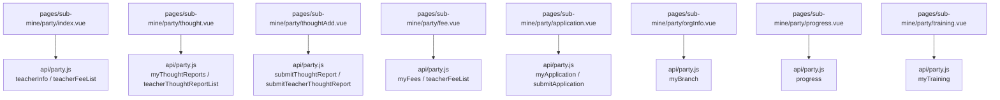
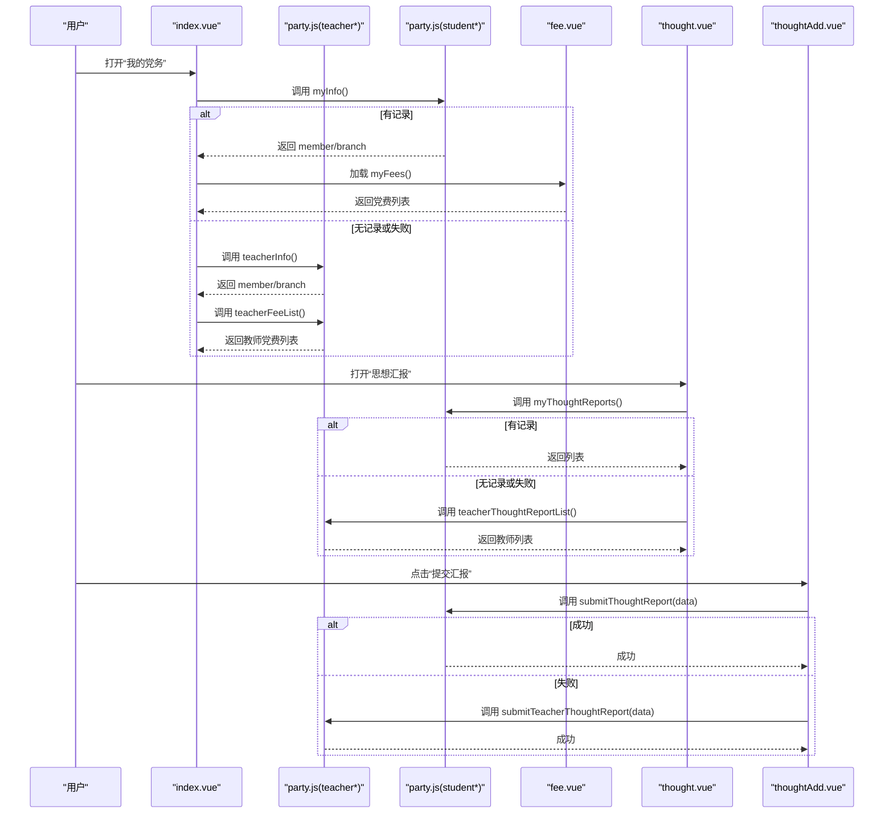
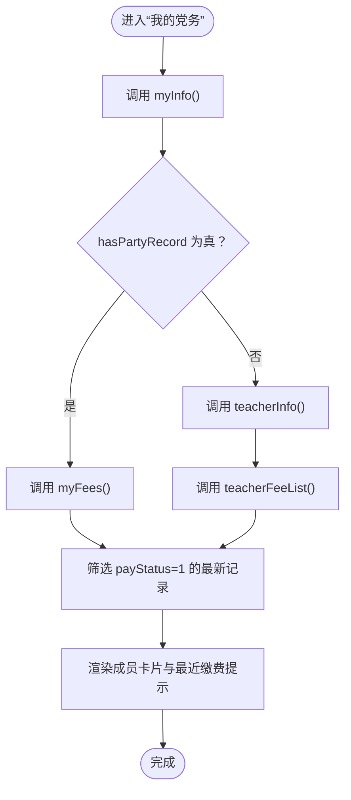
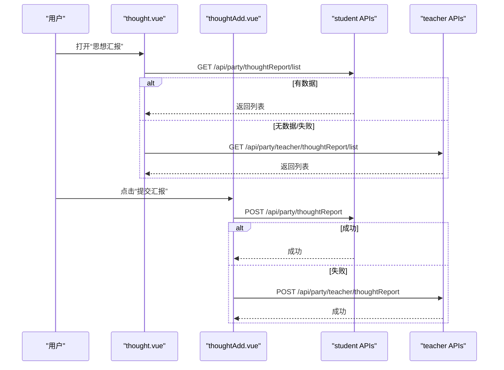
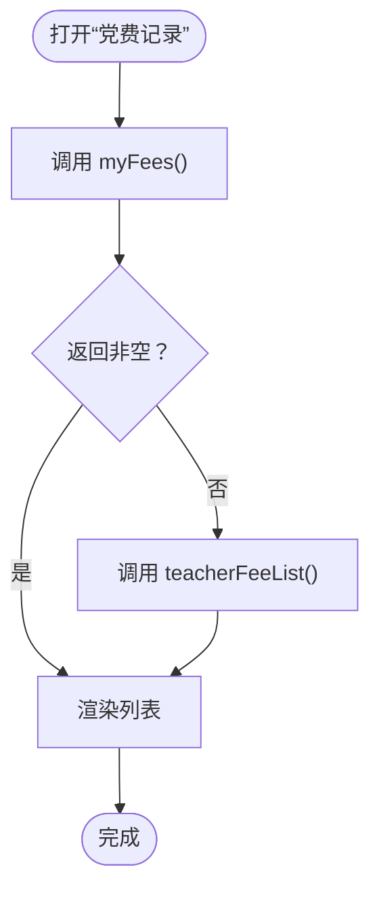
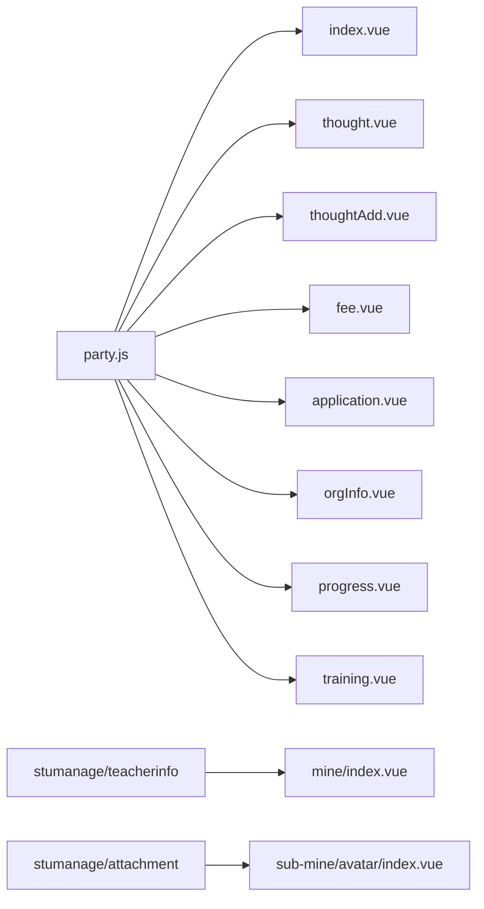

# 教师个人党务接口

<cite>
**本文引用的文件**   
- [api/party.js](file://api/party.js)
- [pages/sub-mine/party/index.vue](file://pages/sub-mine/party/index.vue)
- [pages/sub-mine/party/thought.vue](file://pages/sub-mine/party/thought.vue)
- [pages/sub-mine/party/thoughtAdd.vue](file://pages/sub-mine/party/thoughtAdd.vue)
- [pages/sub-mine/party/fee.vue](file://pages/sub-mine/party/fee.vue)
- [pages/sub-mine/party/application.vue](file://pages/sub-mine/party/application.vue)
- [pages/sub-mine/party/orgInfo.vue](file://pages/sub-mine/party/orgInfo.vue)
- [pages/sub-mine/party/progress.vue](file://pages/sub-mine/party/progress.vue)
- [pages/sub-mine/party/training.vue](file://pages/sub-mine/party/training.vue)
- [pages/mine/index.vue](file://pages/mine/index.vue)
- [pages/sub-mine/avatar/index.vue](file://pages/sub-mine/avatar/index.vue)
</cite>

## 目录
1. [简介](#简介)
2. [项目结构](#项目结构)
3. [核心组件](#核心组件)
4. [架构总览](#架构总览)
5. [详细组件分析](#详细组件分析)
6. [依赖关系分析](#依赖关系分析)
7. [性能与可用性建议](#性能与可用性建议)
8. [故障排查指南](#故障排查指南)
9. [结论](#结论)
10. [附录：API 使用示例与常见问题](#附录api-使用示例与常见问题)

## 简介
本文件面向“教师个人党务”能力，围绕以下目标进行说明：
- 教师个人党员档案管理（政治面貌、所属支部、职务信息等）
- 思想汇报管理（提交与查看流程、内容格式要求、提交频率规定）
- 党费记录查询（缴费标准、历史记录、凭证管理）
- 党组织活动参与记录接口
- 普通党员的党务权利与义务相关接口
- 与学工管理系统的集成方式
- 合规性要求与操作规范
- 完整 API 使用示例与常见问题解答

## 项目结构
前端采用 uni-app 多端框架，党务功能集中在 pages/sub-mine/party 目录下，统一通过 api/party.js 封装请求。教师个人党务相关接口在 party.js 中提供 teacher* 系列方法，并在多个页面中以“学生接口失败则回退到教师接口”的策略实现兼容。

图表来源
- [api/party.js:1-88](file://api/party.js#L1-L88)
- [pages/sub-mine/party/index.vue:96-146](file://pages/sub-mine/party/index.vue#L96-L146)
- [pages/sub-mine/party/thought.vue:29-38](file://pages/sub-mine/party/thought.vue#L29-L38)
- [pages/sub-mine/party/thoughtAdd.vue:40-57](file://pages/sub-mine/party/thoughtAdd.vue#L40-L57)
- [pages/sub-mine/party/fee.vue:24-33](file://pages/sub-mine/party/fee.vue#L24-L33)
- [pages/sub-mine/party/application.vue:76-86](file://pages/sub-mine/party/application.vue#L76-L86)
- [pages/sub-mine/party/orgInfo.vue:80-87](file://pages/sub-mine/party/orgInfo.vue#L80-L87)
- [pages/sub-mine/party/progress.vue:137-205](file://pages/sub-mine/party/progress.vue#L137-L205)
- [pages/sub-mine/party/training.vue:36-38](file://pages/sub-mine/party/training.vue#L36-L38)

章节来源
- [api/party.js:1-88](file://api/party.js#L1-L88)
- [pages/sub-mine/party/index.vue:1-206](file://pages/sub-mine/party/index.vue#L1-L206)

## 核心组件
- 教师个人档案入口：index.vue 优先调用学生端 myInfo，若无记录或失败则回退至 teacherInfo；同时聚合最近一次党费状态用于首页展示。
- 思想汇报列表与新增：thought.vue 与 thoughtAdd.vue 分别负责列表与新增，新增时先尝试学生端提交，失败后回退至教师端提交。
- 党费记录：fee.vue 优先读取学生端 myFees，无数据或失败则回退至 teacherFeeList。
- 组织信息：orgInfo.vue 调用 myBranch 获取当前支部及上级组织信息。
- 发展过程：progress.vue 调用 progress 获取阶段时间线、条件、附件等。
- 培训记录：training.vue 调用 myTraining 获取课程、学时、成绩、证书编号等。

章节来源
- [pages/sub-mine/party/index.vue:96-146](file://pages/sub-mine/party/index.vue#L96-L146)
- [pages/sub-mine/party/thought.vue:29-38](file://pages/sub-mine/party/thought.vue#L29-L38)
- [pages/sub-mine/party/thoughtAdd.vue:40-57](file://pages/sub-mine/party/thoughtAdd.vue#L40-L57)
- [pages/sub-mine/party/fee.vue:24-33](file://pages/sub-mine/party/fee.vue#L24-L33)
- [pages/sub-mine/party/orgInfo.vue:80-87](file://pages/sub-mine/party/orgInfo.vue#L80-L87)
- [pages/sub-mine/party/progress.vue:137-205](file://pages/sub-mine/party/progress.vue#L137-L205)
- [pages/sub-mine/party/training.vue:36-38](file://pages/sub-mine/party/training.vue#L36-L38)

## 架构总览
下图展示了教师个人党务的前端调用链路与关键页面交互。

图表来源
- [pages/sub-mine/party/index.vue:96-146](file://pages/sub-mine/party/index.vue#L96-L146)
- [pages/sub-mine/party/fee.vue:24-33](file://pages/sub-mine/party/fee.vue#L24-L33)
- [pages/sub-mine/party/thought.vue:29-38](file://pages/sub-mine/party/thought.vue#L29-L38)
- [pages/sub-mine/party/thoughtAdd.vue:40-57](file://pages/sub-mine/party/thoughtAdd.vue#L40-L57)
- [api/party.js:1-88](file://api/party.js#L1-L88)

## 详细组件分析

### 教师个人党员档案接口
- 能力范围
  - 基本信息：政治面貌、所属支部、档案号、递交申请日期、当前阶段、介绍人等
  - 组织信息：支部名称、编码、类型、上级组织、书记、人数、状态
  - 最新党费状态：最近已缴月份或是否未缴
- 关键接口
  - 教师档案：GET /api/party/teacher/info
  - 组织信息：GET /api/party/myBranch
  - 学生档案（兼容）：GET /api/party/myInfo
  - 学生党费（兼容）：GET /api/party/fee/my
  - 教师党费：GET /api/party/teacher/fee/my
- 页面行为
  - index.vue 优先调用 myInfo，若 hasPartyRecord 为 false 或异常，则回退调用 teacherInfo；随后根据是否有学生党费记录决定调用 myFees 还是 teacherFeeList，并计算最近已缴月份。
- 字段约定（基于页面渲染推断）
  - member.currentStage：APPLICANT/ACTIVIST/TARGET/PROBATIONARY/FORMAL
  - member.branchName、member.archiveNo、member.applyDate、member.stageStatus
  - branch.orgType：1=党委，2=党总支，3=党支部
  - fee.payStatus：1=已缴，2=减免，其他=未缴；fee.feeYear/fee.feeMonth

图表来源
- [pages/sub-mine/party/index.vue:96-146](file://pages/sub-mine/party/index.vue#L96-L146)
- [api/party.js:6-16](file://api/party.js#L6-L16)
- [api/party.js:71-86](file://api/party.js#L71-L86)

章节来源
- [pages/sub-mine/party/index.vue:1-206](file://pages/sub-mine/party/index.vue#L1-L206)
- [pages/sub-mine/party/orgInfo.vue:1-112](file://pages/sub-mine/party/orgInfo.vue#L1-L112)
- [api/party.js:1-88](file://api/party.js#L1-L88)

### 思想汇报管理（提交与查看）
- 能力范围
  - 列表查看：支持按季度/半年/年度/专题分类，显示标题、类型、日期、季度标识、审核状态
  - 新增提交：必填标题、类型、日期、内容；可选季度字段
- 关键接口
  - 学生端列表：GET /api/party/thoughtReport/list
  - 教师端列表：GET /api/party/teacher/thoughtReport/list
  - 学生端提交：POST /api/party/thoughtReport
  - 教师端提交：POST /api/party/teacher/thoughtReport
- 页面行为
  - thought.vue 优先调用学生端列表，失败或为空则回退教师端列表
  - thoughtAdd.vue 提交时先尝试学生端接口，失败则回退教师端接口
- 内容与格式要求（基于表单字段）
  - 标题：必填
  - 汇报类型：QUARTERLY/SEMIANNUAL/ANNUAL/SPECIAL
  - 汇报日期：必填
  - 季度：选填，如“2026Q1”
  - 内容：必填
- 提交频率规定
  - 前端未做强制限制，由业务层校验（例如季度/半年/年度），具体规则以服务端为准

图表来源
- [pages/sub-mine/party/thought.vue:29-38](file://pages/sub-mine/party/thought.vue#L29-L38)
- [pages/sub-mine/party/thoughtAdd.vue:40-57](file://pages/sub-mine/party/thoughtAdd.vue#L40-L57)
- [api/party.js:17-24](file://api/party.js#L17-L24)
- [api/party.js:75-82](file://api/party.js#L75-L82)

章节来源
- [pages/sub-mine/party/thought.vue:1-62](file://pages/sub-mine/party/thought.vue#L1-L62)
- [pages/sub-mine/party/thoughtAdd.vue:1-74](file://pages/sub-mine/party/thoughtAdd.vue#L1-L74)
- [api/party.js:17-24](file://api/party.js#L17-L24)
- [api/party.js:75-82](file://api/party.js#L75-L82)

### 党费记录查询（缴费标准、历史记录、凭证管理）
- 能力范围
  - 历史明细：年/月、金额、支付方式、缴纳状态
  - 最近已缴提示：首页聚合展示
- 关键接口
  - 学生端：GET /api/party/fee/my
  - 教师端：GET /api/party/teacher/fee/my
- 页面行为
  - fee.vue 优先读取学生端，无数据或失败则回退教师端
  - index.vue 在加载档案后，优先读取学生端党费，否则回退教师端，并计算最近已缴月份
- 字段约定（基于页面渲染推断）
  - feeId、feeYear、feeMonth、amount、payMethod（CASH/TRANSFER/ONLINE）、payStatus（1=已缴，2=减免，其他=未缴）
- 缴费标准与凭证管理
  - 前端仅展示金额与状态，不维护计费规则与凭证文件；标准与凭证由后端提供

图表来源
- [pages/sub-mine/party/fee.vue:24-33](file://pages/sub-mine/party/fee.vue#L24-L33)
- [pages/sub-mine/party/index.vue:135-163](file://pages/sub-mine/party/index.vue#L135-L163)
- [api/party.js:37-40](file://api/party.js#L37-L40)
- [api/party.js:83-86](file://api/party.js#L83-L86)

章节来源
- [pages/sub-mine/party/fee.vue:1-52](file://pages/sub-mine/party/fee.vue#L1-L52)
- [pages/sub-mine/party/index.vue:135-163](file://pages/sub-mine/party/index.vue#L135-L163)
- [api/party.js:37-40](file://api/party.js#L37-L40)
- [api/party.js:83-86](file://api/party.js#L83-L86)

### 入党申请书与佐证材料
- 能力范围
  - 查看/修改申请书内容、附件图片
  - 进度页汇总各阶段佐证材料（申请书、思想汇报附件、政审附件等）
- 关键接口
  - 学生端：GET /api/party/application、POST /api/party/application
  - 附件上传：POST /party/upload/image（独立于 party.js，直接调用）
- 页面行为
  - application.vue 负责查看与编辑，提交时拼接图片路径
  - progress.vue 将申请书、思想汇报、政审等附件解析为图片列表供预览

章节来源
- [pages/sub-mine/party/application.vue:1-170](file://pages/sub-mine/party/application.vue#L1-L170)
- [pages/sub-mine/party/progress.vue:137-205](file://pages/sub-mine/party/progress.vue#L137-L205)
- [api/party.js:25-32](file://api/party.js#L25-L32)

### 组织信息与上级组织
- 能力范围
  - 支部名称、编码、类型、人数、书记、状态
  - 上级组织名称、负责人、类型
- 关键接口
  - GET /api/party/myBranch
- 页面行为
  - orgInfo.vue 加载并展示支部与上级组织信息

章节来源
- [pages/sub-mine/party/orgInfo.vue:1-112](file://pages/sub-mine/party/orgInfo.vue#L1-L112)
- [api/party.js:13-16](file://api/party.js#L13-L16)

### 发展过程与培训记录
- 能力范围
  - 发展阶段时间线：递交申请书、积极分子、发展对象、预备党员、正式党员
  - 前置条件满足情况
  - 培训记录：课程名、学时、成绩、通过状态、证书编号
- 关键接口
  - GET /api/party/progress
  - GET /api/party/training/my
- 页面行为
  - progress.vue 构建阶段数组、解析附件、展示条件
  - training.vue 展示培训结果

章节来源
- [pages/sub-mine/party/progress.vue:1-266](file://pages/sub-mine/party/progress.vue#L1-L266)
- [pages/sub-mine/party/training.vue:1-53](file://pages/sub-mine/party/training.vue#L1-L53)
- [api/party.js:9-12](file://api/party.js#L9-L12)
- [api/party.js:33-36](file://api/party.js#L33-L36)

### 教师个人信息与头像
- 能力范围
  - 姓名、学院、行政/专业技术职务、照片
- 关键接口
  - 教师信息：getTeacherinfoByUserId（来自 stumanage/teacherinfo）
  - 更新教师信息：updateMyTeacherinfo（来自 stumanage/teacherinfo）
  - 上传教师证件照：uploadTeacherPhoto（来自 stumanage/attachment）
- 页面行为
  - mine/index.vue 加载教师信息并展示姓名、学院、职务、照片
  - sub-mine/avatar/index.vue 选择并上传证件照，成功后刷新主页

章节来源
- [pages/mine/index.vue:138-174](file://pages/mine/index.vue#L138-L174)
- [pages/sub-mine/avatar/index.vue:55-143](file://pages/sub-mine/avatar/index.vue#L55-L143)

## 依赖关系分析
- 模块耦合
  - 所有党务页面均依赖 api/party.js 的封装方法，形成低耦合高内聚的调用层
  - 教师端与学生端在同一页面内通过“失败回退”策略共存，避免重复路由分支
- 外部依赖
  - 教师个人信息与头像依赖 stumanage/teacherinfo 与 attachment 模块
  - 图片上传使用 config.baseURL 拼接服务地址

图表来源
- [api/party.js:1-88](file://api/party.js#L1-L88)
- [pages/mine/index.vue:138-174](file://pages/mine/index.vue#L138-L174)
- [pages/sub-mine/avatar/index.vue:55-143](file://pages/sub-mine/avatar/index.vue#L55-L143)

章节来源
- [api/party.js:1-88](file://api/party.js#L1-L88)
- [pages/mine/index.vue:1-309](file://pages/mine/index.vue#L1-L309)
- [pages/sub-mine/avatar/index.vue:1-231](file://pages/sub-mine/avatar/index.vue#L1-L231)

## 性能与可用性建议
- 减少重复请求
  - 在 index.vue 中，当 teacherInfo 成功返回后，可缓存 member/branch，避免后续页面重复拉取
- 错误重试与降级
  - 对网络抖动场景增加有限次重试；对教师端接口增加超时控制
- 图片优化
  - 上传前压缩、懒加载缩略图、分页加载更多附件
- 列表分页
  - 思想汇报与党费记录量大时，建议后端支持分页，前端按需加载

[本节为通用建议，不涉及具体文件分析]

## 故障排查指南
- 现象：教师端档案无法加载
  - 检查 teacherInfo 是否被调用且返回 hasPartyRecord=true
  - 确认 token 有效、权限包含教师角色
- 现象：思想汇报提交失败
  - 先验证必填字段（标题、类型、日期、内容）
  - 观察学生端提交失败后的回退逻辑是否触发教师端提交
- 现象：党费记录为空
  - 确认学生端 myFees 是否为空；若为空，检查 teacherFeeList 是否返回数据
- 现象：头像不更新
  - 确认 uploadTeacherPhoto 返回路径是否正确，updateMyTeacherinfo 是否成功，mine/index.vue 是否收到 refreshMinePage 事件

章节来源
- [pages/sub-mine/party/index.vue:96-146](file://pages/sub-mine/party/index.vue#L96-L146)
- [pages/sub-mine/party/thoughtAdd.vue:40-57](file://pages/sub-mine/party/thoughtAdd.vue#L40-L57)
- [pages/sub-mine/party/fee.vue:24-33](file://pages/sub-mine/party/fee.vue#L24-L33)
- [pages/mine/index.vue:138-174](file://pages/mine/index.vue#L138-L174)
- [pages/sub-mine/avatar/index.vue:84-143](file://pages/sub-mine/avatar/index.vue#L84-L143)

## 结论
教师个人党务能力在前端通过统一的 party.js 封装与“学生接口优先、教师接口回退”的策略实现良好兼容。档案、思想汇报、党费、组织信息与发展过程等核心流程均已落地，教师个人信息与头像与学工系统打通。建议在后续迭代中完善教师端专属页面、明确提交频率与合规校验、增强错误处理与性能优化。

[本节为总结性内容，不涉及具体文件分析]

## 附录：API 使用示例与常见问题

### 教师个人档案
- 接口
  - GET /api/party/teacher/info
- 典型响应字段（基于页面渲染推断）
  - hasPartyRecord: boolean
  - member: { currentStage, branchName, archiveNo, applyDate, stageStatus, introducer1, introducer2 }
  - branch: { branchName, branchCode, orgType, secretary, memberCount, status }
- 使用示例（伪代码）
  - 调用 teacherInfo，若 hasPartyRecord 为 true，渲染 member 与 branch；否则提示联系所在党支部录入档案

章节来源
- [api/party.js:71-74](file://api/party.js#L71-L74)
- [pages/sub-mine/party/index.vue:96-146](file://pages/sub-mine/party/index.vue#L96-L146)
- [pages/sub-mine/party/orgInfo.vue:80-87](file://pages/sub-mine/party/orgInfo.vue#L80-L87)

### 思想汇报
- 列表
  - GET /api/party/teacher/thoughtReport/list
- 提交
  - POST /api/party/teacher/thoughtReport
- 字段
  - title, reportType(QUARTERLY/SEMIANNUAL/ANNUAL/SPECIAL), reportDate, quarter, content
- 使用示例（伪代码）
  - 列表：teacherThoughtReportList()
  - 提交：submitTeacherThoughtReport({title, reportType, reportDate, quarter, content})

章节来源
- [api/party.js:75-82](file://api/party.js#L75-L82)
- [pages/sub-mine/party/thought.vue:29-38](file://pages/sub-mine/party/thought.vue#L29-L38)
- [pages/sub-mine/party/thoughtAdd.vue:40-57](file://pages/sub-mine/party/thoughtAdd.vue#L40-L57)

### 党费记录
- 接口
  - GET /api/party/teacher/fee/my
- 字段
  - feeId, feeYear, feeMonth, amount, payMethod(CASH/TRANSFER/ONLINE), payStatus(1=已缴,2=减免,其他=未缴)
- 使用示例（伪代码）
  - teacherFeeList() 返回数组，按 feeYear/f eeMonth 倒序展示最近已缴

章节来源
- [api/party.js:83-86](file://api/party.js#L83-L86)
- [pages/sub-mine/party/fee.vue:24-33](file://pages/sub-mine/party/fee.vue#L24-L33)

### 组织信息
- 接口
  - GET /api/party/myBranch
- 字段
  - branch: { branchName, branchCode, orgType, secretary, memberCount, status }
  - parentBranch: { branchName, secretary, orgType }
- 使用示例（伪代码）
  - myBranch() 返回 branch 与 parentBranch，渲染组织详情

章节来源
- [api/party.js:13-16](file://api/party.js#L13-L16)
- [pages/sub-mine/party/orgInfo.vue:80-87](file://pages/sub-mine/party/orgInfo.vue#L80-L87)

### 发展过程与培训记录
- 接口
  - GET /api/party/progress
  - GET /api/party/training/my
- 字段
  - progress: hasPartyRecord, member(currentStage, 各阶段日期), conditions, thoughtReports, politicalReview, trainingRecords
  - training: courseName, attendHours, examScore, passStatus, certificateNo
- 使用示例（伪代码）
  - progress(): 构建阶段时间线与条件
  - myTraining(): 渲染培训结果

章节来源
- [api/party.js:9-12](file://api/party.js#L9-L12)
- [api/party.js:33-36](file://api/party.js#L33-L36)
- [pages/sub-mine/party/progress.vue:137-205](file://pages/sub-mine/party/progress.vue#L137-L205)
- [pages/sub-mine/party/training.vue:36-38](file://pages/sub-mine/party/training.vue#L36-L38)

### 教师个人信息与头像
- 接口
  - getTeacherinfoByUserId(userId)
  - updateMyTeacherinfo({ jsid, photo })
  - uploadTeacherPhoto(filePath)
- 使用示例（伪代码）
  - 加载教师信息并展示姓名、学院、职务、照片
  - 选择照片后上传，成功后更新本地显示并通知主页刷新

章节来源
- [pages/mine/index.vue:138-174](file://pages/mine/index.vue#L138-L174)
- [pages/sub-mine/avatar/index.vue:84-143](file://pages/sub-mine/avatar/index.vue#L84-L143)

### 常见问题
- Q：为什么教师端某些页面仍会调用学生端接口？
  - A：为保证兼容性，前端默认优先学生端，失败或无数据时回退教师端。
- Q：思想汇报提交频率如何控制？
  - A：前端不做硬性限制，具体规则由服务端校验（季度/半年/年度）。
- Q：党费标准在哪里配置？
  - A：标准由后端维护，前端仅展示金额与状态。
- Q：如何查看最近一次党费缴纳月份？
  - A：首页聚合逻辑会筛选 payStatus=1 的记录并按年月倒序取最近一条。

[本节为通用问答，不涉及具体文件分析]