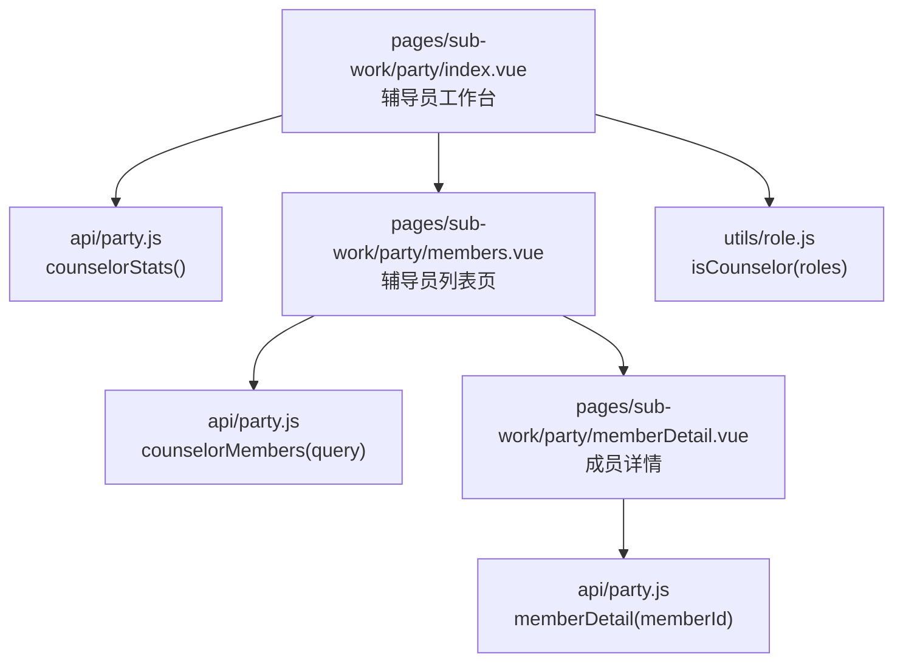
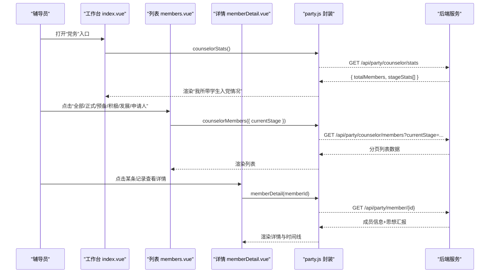
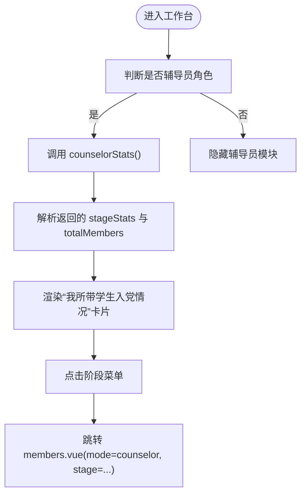
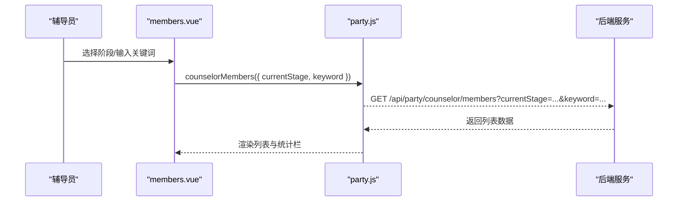
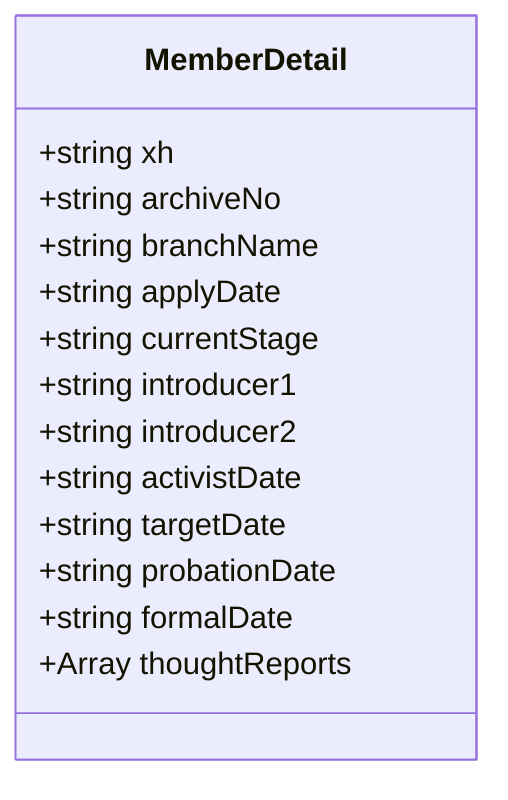
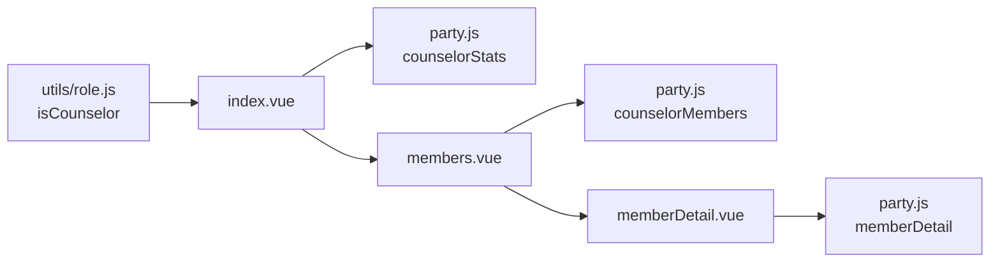

# 辅导员党务接口

<cite>
**本文引用的文件**   
- [api/party.js](file://api/party.js)
- [pages/sub-work/party/index.vue](file://pages/sub-work/party/index.vue)
- [pages/sub-work/party/members.vue](file://pages/sub-work/party/members.vue)
- [pages/sub-work/party/memberDetail.vue](file://pages/sub-work/party/memberDetail.vue)
- [utils/role.js](file://utils/role.js)
</cite>

## 目录
1. [简介](#简介)
2. [项目结构](#项目结构)
3. [核心组件](#核心组件)
4. [架构总览](#架构总览)
5. [详细组件分析](#详细组件分析)
6. [依赖关系分析](#依赖关系分析)
7. [性能与可用性建议](#性能与可用性建议)
8. [故障排查指南](#故障排查指南)
9. [结论](#结论)
10. [附录：业务场景与最佳实践](#附录业务场景与最佳实践)

## 简介
本文件面向“辅导员端”的党务能力，聚焦以下目标：
- 统计所带学生入党情况（入党申请人、积极分子、发展对象、预备党员、正式党员等关键指标）
- 查询所带学生党员列表（支持按阶段筛选、关键词搜索等）
- 快速查看学生入党进展（时间线、思想汇报等）
- 明确辅导员与学生班级的绑定关系及数据权限范围
- 对比支部书记端的数据差异与权限边界
- 提供完整业务场景示例与最佳实践建议

说明：
- 前端已暴露辅导员端相关 API 调用与页面逻辑；后端具体实现不在本仓库中，本文基于前端代码进行接口契约与交互流程说明。

## 项目结构
与辅导员党务相关的核心文件如下：
- 前端 API 封装：api/party.js
- 辅导员工作台入口：pages/sub-work/party/index.vue
- 辅导员所带学生列表页：pages/sub-work/party/members.vue
- 学生详情与进展：pages/sub-work/party/memberDetail.vue
- 角色判断工具：utils/role.js

图表来源
- [api/party.js:60-68](file://api/party.js#L60-L68)
- [pages/sub-work/party/index.vue:227-456](file://pages/sub-work/party/index.vue#L227-L456)
- [pages/sub-work/party/members.vue:58-155](file://pages/sub-work/party/members.vue#L58-L155)
- [pages/sub-work/party/memberDetail.vue:63-111](file://pages/sub-work/party/memberDetail.vue#L63-L111)
- [utils/role.js:77-98](file://utils/role.js#L77-L98)

章节来源
- [api/party.js:60-68](file://api/party.js#L60-L68)
- [pages/sub-work/party/index.vue:227-456](file://pages/sub-work/party/index.vue#L227-L456)
- [pages/sub-work/party/members.vue:58-155](file://pages/sub-work/party/members.vue#L58-L155)
- [pages/sub-work/party/memberDetail.vue:63-111](file://pages/sub-work/party/memberDetail.vue#L63-L111)
- [utils/role.js:77-98](file://utils/role.js#L77-L98)

## 核心组件
- 辅导员工作台（index.vue）
  - 根据用户角色显示“书记”或“辅导员”模块
  - 辅导员模块展示“我所带学生入党情况”统计卡片与快捷入口
- 辅导员所带学生列表（members.vue）
  - 以 mode=counselor 模式加载数据，调用 counselorMembers 接口
  - 支持按阶段筛选、关键词搜索
- 成员详情（memberDetail.vue）
  - 展示基本信息、发展阶段时间线、介绍人、思想汇报等
- 角色判断（utils/role.js）
  - isCounselor(roles) 用于判定当前用户是否为辅导员

章节来源
- [pages/sub-work/party/index.vue:103-194](file://pages/sub-work/party/index.vue#L103-L194)
- [pages/sub-work/party/members.vue:96-155](file://pages/sub-work/party/members.vue#L96-L155)
- [pages/sub-work/party/memberDetail.vue:76-111](file://pages/sub-work/party/memberDetail.vue#L76-L111)
- [utils/role.js:77-98](file://utils/role.js#L77-L98)

## 架构总览
辅导员端党务能力的前端调用链如下：

图表来源
- [api/party.js:60-68](file://api/party.js#L60-L68)
- [pages/sub-work/party/index.vue:442-453](file://pages/sub-work/party/index.vue#L442-L453)
- [pages/sub-work/party/members.vue:125-144](file://pages/sub-work/party/members.vue#L125-L144)
- [pages/sub-work/party/memberDetail.vue:82-109](file://pages/sub-work/party/memberDetail.vue#L82-L109)

## 详细组件分析

### 辅导员工作台（index.vue）
- 功能要点
  - 通过 isCounselor(roles) 判断是否显示辅导员模块
  - 调用 counselorStats() 获取“我所带学生入党情况”统计
  - 统计项包括：入党总人数、正式党员、预备党员、发展中（含申请人、积极分子、发展对象）
  - 提供快捷菜单跳转到各阶段的列表页（mode=counselor）
- 数据流
  - onLoad/onShow 触发 loadData()
  - 若为辅导员角色，调用 loadCounselorData()
  - 将 stageStats 映射到 counselorStageCounts，并计算 counselorTotal
- 界面交互
  - 点击不同阶段菜单，跳转至 members.vue 并携带 stage 与 mode=counselor

章节来源
- [pages/sub-work/party/index.vue:227-456](file://pages/sub-work/party/index.vue#L227-L456)
- [utils/role.js:77-98](file://utils/role.js#L77-L98)

#### 流程图：辅导员统计数据加载

图表来源
- [pages/sub-work/party/index.vue:442-453](file://pages/sub-work/party/index.vue#L442-L453)

### 辅导员所带学生列表（members.vue）
- 功能要点
  - 当 mode=counselor 时，调用 counselorMembers(query) 获取数据
  - 支持按 currentStage 筛选（APPLICANT/ACTIVIST/TARGET/PROBATIONARY/FORMAL）
  - 支持关键词搜索（姓名/学号/工号/手机号）
  - 顶部显示统计栏（共多少人、学生多少、教师多少）
- 数据流
  - onLoad(options) 读取 stage、mode、branchIds、keyword
  - loadData() 组装 query 并发起请求
- 注意
  - 该页面同时支持书记模式（mode=secretary），但辅导员端仅使用 mode=counselor 分支

章节来源
- [pages/sub-work/party/members.vue:96-155](file://pages/sub-work/party/members.vue#L96-L155)

#### 序列图：辅导员列表查询

图表来源
- [pages/sub-work/party/members.vue:125-144](file://pages/sub-work/party/members.vue#L125-L144)
- [api/party.js:66-68](file://api/party.js#L66-L68)

### 成员详情与进展（memberDetail.vue）
- 功能要点
  - 展示基本信息（学号、档案号、所属支部、申请日期等）
  - 展示发展阶段时间线（递交申请、确定为积极分子、确定为发展对象、接收为预备党员、转为正式党员）
  - 展示入党介绍人与思想汇报列表（含审核状态）
- 数据流
  - onLoad(options) 读取 memberId
  - loadDetail(memberId) 调用 memberDetail(memberId)
  - 根据 currentStage 推导 timelineData 的 reached 状态

章节来源
- [pages/sub-work/party/memberDetail.vue:76-111](file://pages/sub-work/party/memberDetail.vue#L76-L111)

#### 类图：成员详情数据结构（概念示意）

图表来源
- [pages/sub-work/party/memberDetail.vue:82-109](file://pages/sub-work/party/memberDetail.vue#L82-L109)

### 角色与权限（utils/role.js）
- 辅导员角色判定
  - isCounselor(roles) 支持字符串数组与对象数组两种格式
  - 匹配规则：roleName 包含“辅导员” 或 roleKey 包含“counselor”
- 与其他角色的关系
  - getRoleTypes(roles) 可返回多角色类型集合，便于复杂场景下的权限组合

章节来源
- [utils/role.js:77-98](file://utils/role.js#L77-L98)
- [utils/role.js:137-147](file://utils/role.js#L137-L147)

## 依赖关系分析
- 页面与 API 的耦合
  - index.vue 依赖 partyApi.counselorStats()
  - members.vue 依赖 partyApi.counselorMembers()
  - memberDetail.vue 依赖 partyApi.memberDetail()
- 角色判断对 UI 的影响
  - index.vue 通过 isCounselor(roles) 控制是否展示辅导员模块

图表来源
- [utils/role.js:77-98](file://utils/role.js#L77-L98)
- [api/party.js:60-68](file://api/party.js#L60-L68)
- [pages/sub-work/party/index.vue:227-456](file://pages/sub-work/party/index.vue#L227-L456)
- [pages/sub-work/party/members.vue:58-155](file://pages/sub-work/party/members.vue#L58-L155)
- [pages/sub-work/party/memberDetail.vue:63-111](file://pages/sub-work/party/memberDetail.vue#L63-L111)

章节来源
- [api/party.js:60-68](file://api/party.js#L60-L68)
- [pages/sub-work/party/index.vue:227-456](file://pages/sub-work/party/index.vue#L227-L456)
- [pages/sub-work/party/members.vue:58-155](file://pages/sub-work/party/members.vue#L58-L155)
- [pages/sub-work/party/memberDetail.vue:63-111](file://pages/sub-work/party/memberDetail.vue#L63-L111)
- [utils/role.js:77-98](file://utils/role.js#L77-L98)

## 性能与可用性建议
- 列表分页
  - 当前 members.vue 未显式实现分页参数传递，建议在 counselorMembers 接口增加分页参数（如 page、pageSize），并在前端实现滚动加载或分页控件
- 搜索优化
  - 关键词搜索目前在前端过滤，若数据量大，建议在后端支持 keyword 参数，减少前端计算压力
- 缓存策略
  - 辅导员统计数据变化频率较低，可在本地做短时缓存，避免频繁刷新
- 空态与错误处理
  - 统一处理网络异常与空数据，提升用户体验

[本节为通用建议，不直接分析具体文件]

## 故障排查指南
- 无法看到辅导员模块
  - 检查登录后的 roles 是否正确包含辅导员标识
  - 确认 isCounselor(roles) 判定逻辑是否生效
- 统计数据为空
  - 检查 counselorStats 接口是否返回 hasStudents 标志与 stageStats 数组
  - 确认后端是否已为该辅导员关联到所带学生
- 列表无数据
  - 检查 members.vue 是否正确传入 currentStage 与 mode=counselor
  - 核对 counselorMembers 接口返回结构与字段名
- 详情加载失败
  - 检查 memberDetail 传参 memberId 是否正确
  - 确认 memberDetail 接口返回字段是否包含 currentStage、thoughtReports 等

章节来源
- [pages/sub-work/party/index.vue:442-453](file://pages/sub-work/party/index.vue#L442-L453)
- [pages/sub-work/party/members.vue:125-144](file://pages/sub-work/party/members.vue#L125-L144)
- [pages/sub-work/party/memberDetail.vue:82-109](file://pages/sub-work/party/memberDetail.vue#L82-L109)
- [utils/role.js:77-98](file://utils/role.js#L77-L98)

## 结论
辅导员端党务能力通过统一的 party.js 封装对外暴露两个核心接口：counselorStats 与 counselorMembers，配合工作台与列表页完成“我所带学生入党情况”的统计与查询。成员详情页进一步提供入党进展的快速查看。角色判断工具确保仅在具备辅导员权限时展示相应功能。后续可在分页、搜索与缓存方面持续优化体验与性能。

[本节为总结性内容，不直接分析具体文件]

## 附录：业务场景与最佳实践

### 业务场景一：辅导员每日查看所带学生入党情况
- 步骤
  - 打开“党务”入口，系统自动识别辅导员角色
  - 查看“我所带学生入党情况”卡片中的总数与各阶段人数
  - 点击“积极分子/发展对象/预备党员/正式党员/入党申请人”进入对应列表
- 关键点
  - 使用 counselorStats 获取 stageStats 与 totalMembers
  - 列表页使用 counselorMembers(currentStage) 精准筛选

章节来源
- [pages/sub-work/party/index.vue:103-194](file://pages/sub-work/party/index.vue#L103-L194)
- [pages/sub-work/party/members.vue:96-155](file://pages/sub-work/party/members.vue#L96-L155)

### 业务场景二：快速定位某学生的入党进展
- 步骤
  - 在列表中点击目标学生，进入成员详情
  - 查看基本信息与发展阶段时间线
  - 查看介绍人与思想汇报列表，了解审核状态
- 关键点
  - 使用 memberDetail(memberId) 获取详细信息
  - 根据 currentStage 推导 timelineData 的 reached 状态

章节来源
- [pages/sub-work/party/memberDetail.vue:76-111](file://pages/sub-work/party/memberDetail.vue#L76-L111)

### 辅导员与支部书记端的数据差异与权限边界
- 辅导员端
  - 仅能查看“我所带学生”的入党情况与列表
  - 使用 counselorStats 与 counselorMembers 接口
- 支部书记端
  - 可查看组织树、下级支部、支部统计与支部党员列表
  - 使用 branchStats、childBranches、branchMembers 等接口
- 权限边界
  - 辅导员不可跨班级/跨支部查看非所带学生数据
  - 书记可管理其组织范围内的所有成员

章节来源
- [api/party.js:42-58](file://api/party.js#L42-L58)
- [api/party.js:60-68](file://api/party.js#L60-L68)
- [pages/sub-work/party/index.vue:11-101](file://pages/sub-work/party/index.vue#L11-L101)

### 最佳实践建议
- 数据一致性
  - 辅导员与所带学生的绑定关系应由后台维护，前端仅负责展示与筛选
- 用户体验
  - 列表页增加分页与加载更多，避免一次性加载大量数据
  - 搜索建议由后端支持 keyword 参数，提高响应速度
- 错误处理
  - 统一捕获网络异常与空数据，给出友好提示
- 安全与合规
  - 严格遵循角色权限，避免越权访问

[本节为通用建议，不直接分析具体文件]