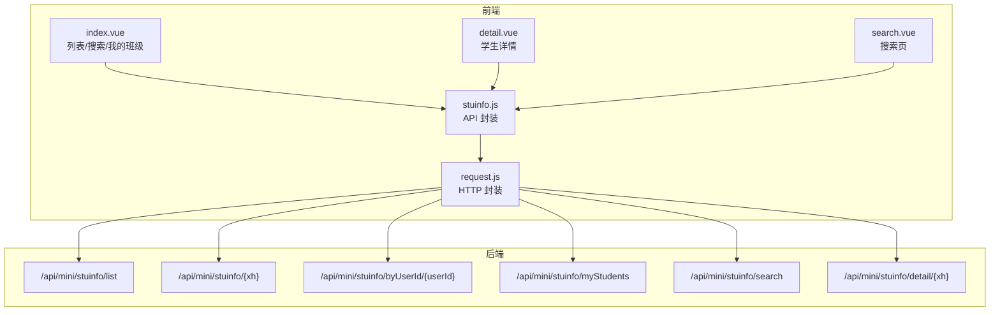
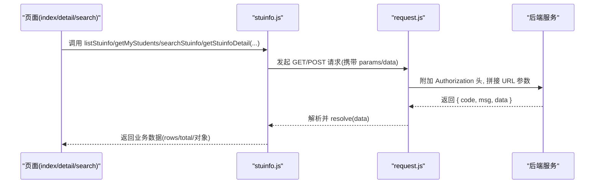
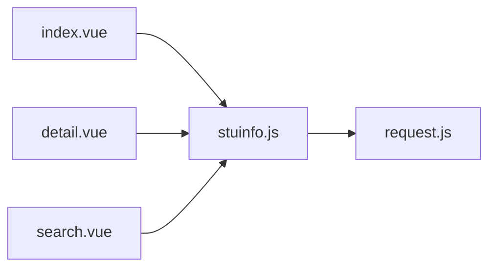

# 学生信息接口

<cite>
**本文引用的文件**   
- [api/stumanage/stuinfo.js](file://api/stumanage/stuinfo.js)
- [pages/sub-work/stuinfo/index.vue](file://pages/sub-work/stuinfo/index.vue)
- [pages/sub-work/stuinfo/detail.vue](file://pages/sub-work/stuinfo/detail.vue)
- [pages/sub-work/stuinfo/search.vue](file://pages/sub-work/stuinfo/search.vue)
- [utils/request.js](file://utils/request.js)
</cite>

## 目录
1. [简介](#简介)
2. [项目结构](#项目结构)
3. [核心组件](#核心组件)
4. [架构总览](#架构总览)
5. [详细接口说明](#详细接口说明)
6. [依赖分析](#依赖分析)
7. [性能考虑](#性能考虑)
8. [故障排查指南](#故障排查指南)
9. [结论](#结论)

## 简介
本文件面向“学生信息”相关的前端能力，梳理并文档化以下核心功能：
- 学生列表查询（分页）
- 学生详情获取（含权限控制标记）
- 学生搜索（按姓名/学号）
- 我的学生列表（教师视角）

同时给出请求参数、响应数据结构、分页与排序用法、字段定义、角色权限差异、示例及错误处理方案。

## 项目结构
学生信息相关的前端实现主要分布在以下位置：
- API 封装：api/stumanage/stuinfo.js
- 页面与交互：
  - pages/sub-work/stuinfo/index.vue（班级视图/书记统计视图、搜索入口）
  - pages/sub-work/stuinfo/detail.vue（学生详情）
  - pages/sub-work/stuinfo/search.vue（独立搜索页）
- 网络层：utils/request.js（统一请求封装、鉴权、错误提示）

图表来源
- [api/stumanage/stuinfo.js:1-85](file://api/stumanage/stuinfo.js#L1-L85)
- [pages/sub-work/stuinfo/index.vue:478-483](file://pages/sub-work/stuinfo/index.vue#L478-L483)
- [pages/sub-work/stuinfo/detail.vue:175-177](file://pages/sub-work/stuinfo/detail.vue#L175-L177)
- [pages/sub-work/stuinfo/search.vue:58-60](file://pages/sub-work/stuinfo/search.vue#L58-L60)
- [utils/request.js:10-32](file://utils/request.js#L10-L32)

章节来源
- [api/stumanage/stuinfo.js:1-85](file://api/stumanage/stuinfo.js#L1-L85)
- [pages/sub-work/stuinfo/index.vue:478-483](file://pages/sub-work/stuinfo/index.vue#L478-L483)
- [pages/sub-work/stuinfo/detail.vue:175-177](file://pages/sub-work/stuinfo/detail.vue#L175-L177)
- [pages/sub-work/stuinfo/search.vue:58-60](file://pages/sub-work/stuinfo/search.vue#L58-L60)
- [utils/request.js:10-32](file://utils/request.js#L10-L32)

## 核心组件
- stuinfo.js：集中暴露学生信息相关的 HTTP 方法，包括列表、详情、搜索、我的学生等。
- index.vue：承载“我的班级/书记统计”双视图，集成搜索与跳转详情。
- detail.vue：展示学生档案，根据 fullAccess 控制是否显示完整信息。
- search.vue：提供输入联想式搜索，调用统一搜索接口。
- request.js：统一注入 Authorization、拼接 query、统一错误提示与登录态处理。

章节来源
- [api/stumanage/stuinfo.js:1-85](file://api/stumanage/stuinfo.js#L1-L85)
- [pages/sub-work/stuinfo/index.vue:478-483](file://pages/sub-work/stuinfo/index.vue#L478-L483)
- [pages/sub-work/stuinfo/detail.vue:175-177](file://pages/sub-work/stuinfo/detail.vue#L175-L177)
- [pages/sub-work/stuinfo/search.vue:58-60](file://pages/sub-work/stuinfo/search.vue#L58-L60)
- [utils/request.js:10-32](file://utils/request.js#L10-L32)

## 架构总览
下图展示了从页面到后端的关键调用链与数据流向。

图表来源
- [api/stumanage/stuinfo.js:1-85](file://api/stumanage/stuinfo.js#L1-L85)
- [utils/request.js:10-32](file://utils/request.js#L10-L32)

## 详细接口说明

### 通用约定
- 基础路径：由 request.js 自动拼接 baseUrl + 相对路径。
- 认证：默认在请求头中注入 Authorization: Bearer <token>。
- 统一响应体：{ code, msg, data }。code=200 表示成功；非 200 时 request.js 会弹出错误提示并 reject。
- 分页参数：pageNum、pageSize。部分接口支持排序字段 orderBy。

章节来源
- [utils/request.js:10-32](file://utils/request.js#L10-L32)

---

### 1) 学生列表查询（分页）
- 方法：GET
- 路径：/api/mini/stuinfo/list
- 请求参数（Query）
  - pageNum：页码，默认 1
  - pageSize：每页数量，默认 20
  - studentName：按姓名模糊匹配（可选）
  - xh：按学号精确或模糊匹配（可选）
  - orderBy：排序字段（可选，如 xh、studentName 等，具体以服务端为准）
- 响应体（data）
  - rows：数组，元素为学生记录
  - total：总数
- 使用示例（来自页面调用）
  - 首页统计计数：传入 { pageNum: 1, pageSize: 1 }
  - 教师视图搜索：传入 { pageNum: 1, pageSize: 20, studentName: key }
  - 书记视图全院搜索：传入 { pageNum: 1, pageSize: 50, studentName: key } 或 { pageNum: 1, pageSize: 50, xh: key }

章节来源
- [api/stumanage/stuinfo.js:4-10](file://api/stumanage/stuinfo.js#L4-L10)
- [pages/index.vue:253-256](file://pages/index.vue#L253-L256)
- [pages/sub-work/stuinfo/index.vue:911-923](file://pages/sub-work/stuinfo/index.vue#L911-L923)
- [pages/sub-work/stuinfo/index.vue:834-866](file://pages/sub-work/stuinfo/index.vue#L834-L866)

---

### 2) 学生详情获取（带权限标记）
- 方法：GET
- 路径：/api/mini/stuinfo/detail/{xh}
- 路径参数
  - xh：学号
- 响应体（data）
  - stu：学生档案对象
  - fullAccess：布尔值，true 表示当前用户可查看完整信息，false 仅展示校内基本信息
- 行为说明
  - 当 fullAccess=false 时，详情页仅显示“校内信息”Tab，隐藏家庭与个人信息。
  - 当 fullAccess=true 时，显示“基本信息/家庭信息/个人信息”三个 Tab。

章节来源
- [api/stumanage/stuinfo.js:62-68](file://api/stumanage/stuinfo.js#L62-L68)
- [pages/sub-work/stuinfo/detail.vue:195-211](file://pages/sub-work/stuinfo/detail.vue#L195-L211)

---

### 3) 学生搜索（按姓名/学号）
- 方法：GET
- 路径：/api/mini/stuinfo/search
- 请求参数（Query）
  - keyword：关键词（纯数字按学号匹配，文字按姓名匹配）
- 响应体（data）
  - rows：数组，元素为简要学生记录（包含头像、姓名、学号、学院、专业、班级等）
- 交互说明
  - 输入防抖 300ms 触发搜索，点击搜索按钮立即执行。
  - 结果为空时展示空状态图。

章节来源
- [api/stumanage/stuinfo.js:53-60](file://api/stumanage/stuinfo.js#L53-L60)
- [pages/sub-work/stuinfo/search.vue:96-108](file://pages/sub-work/stuinfo/search.vue#L96-L108)

---

### 4) 我的学生列表（教师视角）
- 方法：GET
- 路径：/api/mini/stuinfo/myStudents
- 请求参数：无
- 响应体（data）
  - 数组：当前教师所带学生的简要信息集合
- 典型用途
  - 用于“谈心谈话”等场景快速选择本人所带学生。

章节来源
- [api/stumanage/stuinfo.js:45-51](file://api/stumanage/stuinfo.js#L45-L51)

---

### 5) 其他辅助接口
- 查询学生信息详细（旧版）
  - GET /api/mini/stuinfo/{xh}
  - 返回单个学生对象
- 根据用户ID获取学生信息
  - GET /api/mini/stuinfo/byUserId/{userId}
  - 返回该用户对应的学生对象
- 获取我的学生列表（别名）
  - GET /api/mini/stuinfo/myStudents
  - 与第 4 节相同

章节来源
- [api/stumanage/stuinfo.js:29-43](file://api/stumanage/stuinfo.js#L29-L43)
- [api/stumanage/stuinfo.js:45-51](file://api/stumanage/stuinfo.js#L45-L51)

---

### 6) 分页与排序使用说明
- 分页参数
  - pageNum：页码，从 1 开始
  - pageSize：每页条数，建议 20~50
- 排序参数
  - orderBy：字符串字段名，例如 xh、studentName（具体可用字段以服务端实现为准）
- 常见组合
  - 列表首屏：{ pageNum: 1, pageSize: 20 }
  - 加载更多：递增 pageNum
  - 搜索+分页：在 Query 中追加 studentName/xh 与分页参数

章节来源
- [api/stumanage/stuinfo.js:4-10](file://api/stumanage/stuinfo.js#L4-L10)
- [pages/sub-work/stuinfo/index.vue:911-923](file://pages/sub-work/stuinfo/index.vue#L911-L923)
- [pages/sub-work/stuinfo/index.vue:834-866](file://pages/sub-work/stuinfo/index.vue#L834-L866)

---

### 7) 学生档案数据结构（字段定义）
以下为详情页展示的字段集合，来源于 detail.vue 的模板绑定。若 fullAccess=false，则仅展示“校内信息”Tab 中的字段。

- 基本信息
  - xh：学号
  - studentName：姓名
  - gender：性别（1=男，2=女，其他=未知）
  - sfzh：身份证号
  - zzmmName/zzmm：政治面貌
  - xjzt：学籍状态
  - collegeName：学院
  - majorName：专业
  - className：班级
  - grade：年级
  - pycc：培养层次
  - campus：校区
  - phone：手机号
- 家庭信息
  - jtlxr：家庭联系人
  - jtdh：家庭联系电话
  - jtdz：家庭地址
- 个人信息
  - csrq：出生日期
  - nz：民族
  - sysf：生源地
  - sg：身高（单位 cm）
  - ssh：宿舍楼
  - sssh：宿舍号
  - yhkkh：银行卡号
  - khh：开户行
  - yhkBz：银行卡备注
- 校内信息（受限访问时仅展示）
  - collegeName/majorName/className/xh/counselorName/counselorPhone

注意：以上字段名称均来自前端模板绑定，实际后端返回可能包含更多字段，前端按需渲染。

章节来源
- [pages/sub-work/stuinfo/detail.vue:33-170](file://pages/sub-work/stuinfo/detail.vue#L33-L170)

---

### 8) 角色权限控制说明
- fullAccess 标记
  - 通过 getStuinfoDetail 返回的 fullAccess 控制是否展示完整信息。
  - false：仅展示“校内信息”，不展示家庭与个人信息。
  - true：展示全部三个 Tab。
- 视图差异
  - 教师视图：基于“我的班级”范围查看学生，搜索受限于本人所带班级。
  - 书记视图：可全院范围搜索学生/专业/班级，并可查看汇总统计。
- 数据范围差异
  - 教师：myStudents 仅返回本人所带学生。
  - 书记：listStuinfo 在全院范围内检索（结合搜索条件）。

章节来源
- [pages/sub-work/stuinfo/detail.vue:195-211](file://pages/sub-work/stuinfo/detail.vue#L195-L211)
- [pages/sub-work/stuinfo/index.vue:834-961](file://pages/sub-work/stuinfo/index.vue#L834-L961)
- [api/stumanage/stuinfo.js:45-51](file://api/stumanage/stuinfo.js#L45-L51)

---

### 9) 请求与响应示例（示意）
以下为基于现有代码推导的结构示例，便于对接理解。

- 列表查询
  - 请求：GET /api/mini/stuinfo/list?pageNum=1&pageSize=20&studentName=张
  - 响应 data：
    - rows：[ { xh, studentName, className, majorName, ... }, ... ]
    - total：number
- 详情获取
  - 请求：GET /api/mini/stuinfo/detail/{xh}
  - 响应 data：
    - stu：{ xh, studentName, gender, collegeName, majorName, className, ... }
    - fullAccess：boolean
- 搜索
  - 请求：GET /api/mini/stuinfo/search?keyword=张
  - 响应 data：
    - rows：[ { photo, studentName, xh, collegeName, majorName, className, ... }, ... ]
- 我的学生
  - 请求：GET /api/mini/stuinfo/myStudents
  - 响应 data：[ { xh, studentName, className, ... }, ... ]

章节来源
- [api/stumanage/stuinfo.js:4-10](file://api/stumanage/stuinfo.js#L4-L10)
- [api/stumanage/stuinfo.js:53-60](file://api/stumanage/stuinfo.js#L53-L60)
- [api/stumanage/stuinfo.js:62-68](file://api/stumanage/stuinfo.js#L62-L68)
- [api/stumanage/stuinfo.js:45-51](file://api/stumanage/stuinfo.js#L45-L51)

---

### 10) 错误处理方案
- 网络异常/超时
  - request.js 将 Network Error 转换为“后端接口连接异常”，timeout 转换为“系统接口请求超时”。
- 鉴权失败（401）
  - 非登录接口：自动登出并重定向至登录页；微信环境尝试自动登录后重试原请求。
- 服务端错误（500）
  - 弹出后端返回的错误消息。
- 其他非 200
  - 除特定码（如 20001）外，均弹出错误消息并 reject。
- 前端容错
  - 列表/搜索/详情等调用处普遍采用 catch 静默处理或 toast 提示，避免阻断主流程。

章节来源
- [utils/request.js:32-112](file://utils/request.js#L32-L112)
- [pages/sub-work/stuinfo/search.vue:100-108](file://pages/sub-work/stuinfo/search.vue#L100-L108)
- [pages/sub-work/stuinfo/detail.vue:207-211](file://pages/sub-work/stuinfo/detail.vue#L207-L211)

## 依赖分析
- 页面依赖关系
  - index.vue 依赖 stuinfo.js 的 listStuinfo 进行列表与搜索。
  - detail.vue 依赖 stuinfo.js 的 getStuinfoDetail 获取详情与权限标记。
  - search.vue 依赖 stuinfo.js 的 searchStuinfo 进行实时搜索。
- 网络层依赖
  - 所有 API 均通过 request.js 统一发起，具备鉴权、参数拼接、错误提示与登录态恢复能力。

图表来源
- [pages/sub-work/stuinfo/index.vue:478-483](file://pages/sub-work/stuinfo/index.vue#L478-L483)
- [pages/sub-work/stuinfo/detail.vue:175-177](file://pages/sub-work/stuinfo/detail.vue#L175-L177)
- [pages/sub-work/stuinfo/search.vue:58-60](file://pages/sub-work/stuinfo/search.vue#L58-L60)
- [api/stumanage/stuinfo.js:1-85](file://api/stumanage/stuinfo.js#L1-L85)
- [utils/request.js:10-32](file://utils/request.js#L10-L32)

章节来源
- [pages/sub-work/stuinfo/index.vue:478-483](file://pages/sub-work/stuinfo/index.vue#L478-L483)
- [pages/sub-work/stuinfo/detail.vue:175-177](file://pages/sub-work/stuinfo/detail.vue#L175-L177)
- [pages/sub-work/stuinfo/search.vue:58-60](file://pages/sub-work/stuinfo/search.vue#L58-L60)
- [api/stumanage/stuinfo.js:1-85](file://api/stumanage/stuinfo.js#L1-L85)
- [utils/request.js:10-32](file://utils/request.js#L10-L32)

## 性能考虑
- 分页加载：列表接口默认 pageSize=20，建议在滚动到底部时递增 pageNum 实现懒加载。
- 搜索防抖：search.vue 已实现 300ms 防抖，避免频繁请求。
- 并行请求：书记视图下对多个统计接口采用 Promise.all 并行加载，减少首屏等待时间。
- 图片降级：列表与详情中对头像加载失败做降级处理，提升用户体验。

章节来源
- [pages/sub-work/stuinfo/search.vue:90-95](file://pages/sub-work/stuinfo/search.vue#L90-L95)
- [pages/sub-work/stuinfo/index.vue:617-621](file://pages/sub-work/stuinfo/index.vue#L617-L621)
- [pages/sub-work/stuinfo/index.vue:1024-1029](file://pages/sub-work/stuinfo/index.vue#L1024-L1029)

## 故障排查指南
- 无法获取数据
  - 检查网络连通性与 baseUrl 配置。
  - 确认 token 是否存在且未过期（401 会自动登出）。
- 搜索结果无数据
  - 确认 keyword 是否为空；检查是否命中权限范围（教师仅能搜索本人所带班级）。
- 详情缺少敏感字段
  - 检查 fullAccess 是否为 false；确认当前用户是否具备完整访问权限。
- 列表分页无效
  - 确认 pageNum/pageSize 是否正确传递；orderBy 字段是否被服务端支持。

章节来源
- [utils/request.js:32-112](file://utils/request.js#L32-L112)
- [pages/sub-work/stuinfo/detail.vue:195-211](file://pages/sub-work/stuinfo/detail.vue#L195-L211)
- [pages/sub-work/stuinfo/index.vue:834-961](file://pages/sub-work/stuinfo/index.vue#L834-L961)

## 结论
本文档围绕学生信息相关的前端接口进行了系统化梳理，覆盖列表查询、详情获取、搜索与我的学生列表四大核心能力，明确了分页与排序参数、字段定义、角色权限差异以及错误处理策略。开发者可据此快速完成前后端联调与功能扩展。