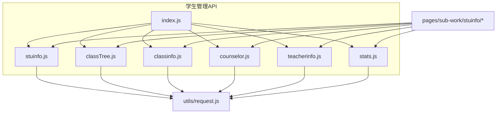
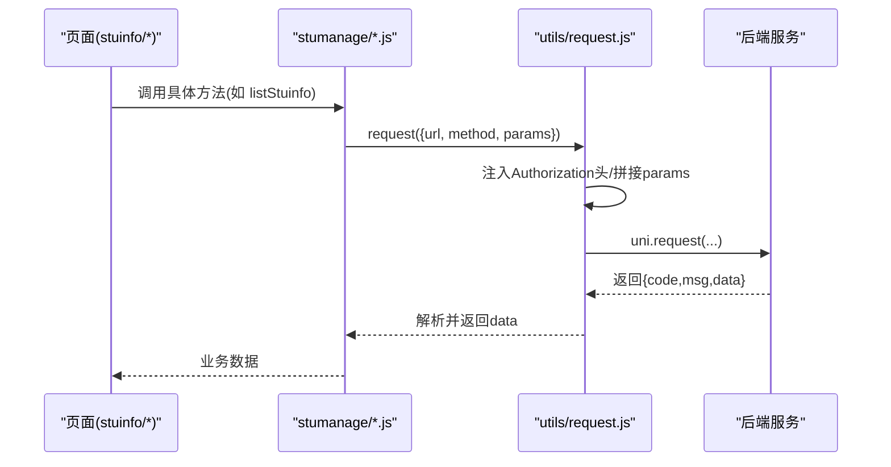
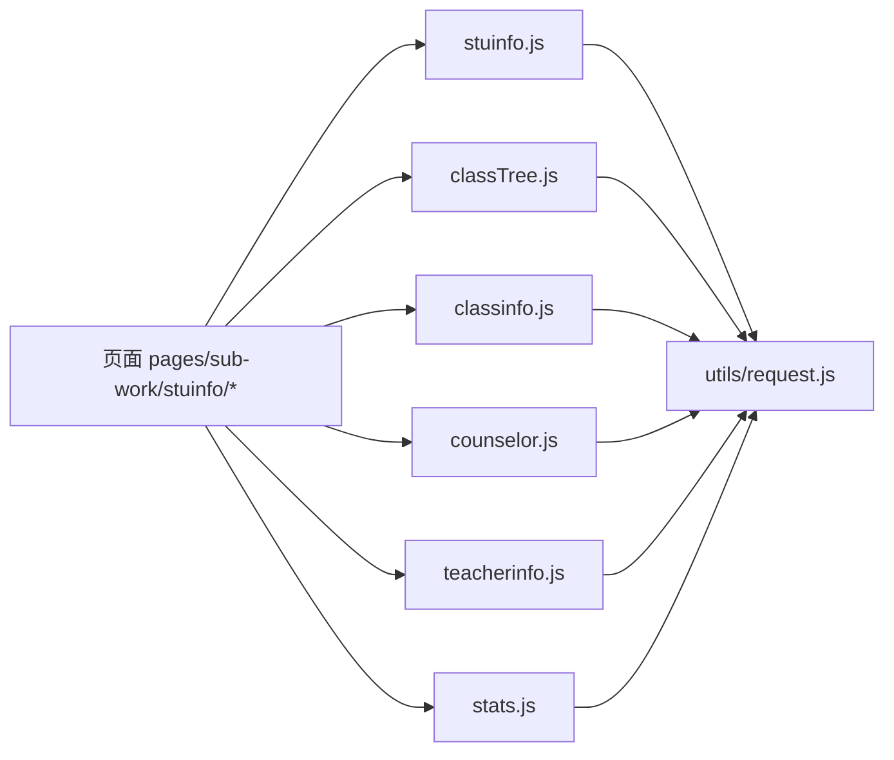
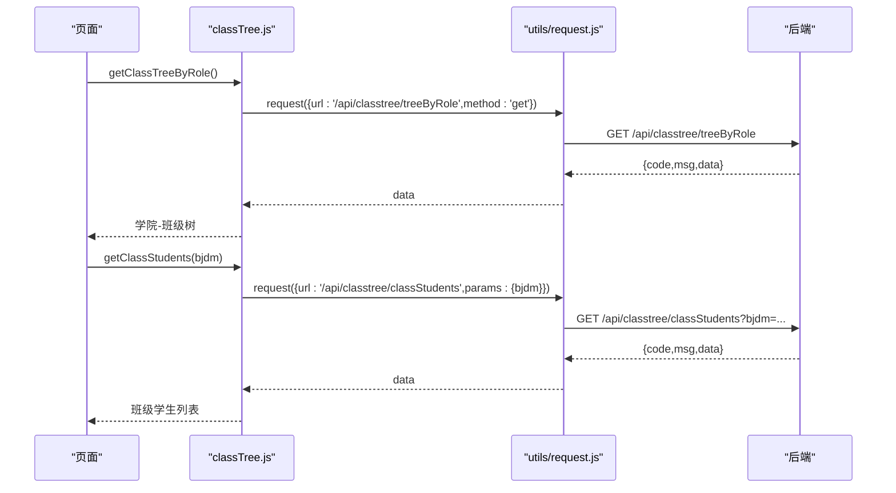

# 学生管理接口

<cite>
**本文引用的文件**
- [api/stumanage/index.js](file://api/stumanage/index.js)
- [api/stumanage/stuinfo.js](file://api/stumanage/stuinfo.js)
- [api/stumanage/classTree.js](file://api/stumanage/classTree.js)
- [api/stumanage/classinfo.js](file://api/stumanage/classinfo.js)
- [api/stumanage/counselor.js](file://api/stumanage/counselor.js)
- [api/stumanage/teacherinfo.js](file://api/stumanage/teacherinfo.js)
- [api/stumanage/stats.js](file://api/stumanage/stats.js)
- [utils/request.js](file://utils/request.js)
- [pages/sub-work/stuinfo/index.vue](file://pages/sub-work/stuinfo/index.vue)
- [pages/sub-work/stuinfo/detail.vue](file://pages/sub-work/stuinfo/detail.vue)
- [pages/sub-work/stuinfo/search.vue](file://pages/sub-work/stuinfo/search.vue)
</cite>

## 目录
1. [简介](#简介)
2. [项目结构](#项目结构)
3. [核心组件](#核心组件)
4. [架构总览](#架构总览)
5. [详细接口说明](#详细接口说明)
6. [依赖关系分析](#依赖关系分析)
7. [性能与搜索优化](#性能与搜索优化)
8. [故障排查指南](#故障排查指南)
9. [结论](#结论)
10. [附录：数据模型与示例](#附录数据模型与示例)

## 简介
本文件面向移动端（小程序）“学生管理”相关的前端 API 调用，覆盖以下能力：
- 学生信息查询、分页与排序
- 学院-班级树形结构与按角色过滤
- 班级信息列表与详情
- 辅导员信息与带班统计
- 教师信息与角色列表
- 搜索功能实现方式与性能优化建议
- 批量操作与数据导出（当前前端未暴露对应入口，提供扩展建议）
- 请求/响应约定、错误处理方案与典型调用示例

## 项目结构
学生管理相关的前端 API 集中在 api/stumanage 目录下，按模块拆分：
- stuinfo.js：学生信息列表、详情、搜索、我的学生、学院-班级树等
- classTree.js：公共的学院-班级树接口（按角色、我的班级、班级学生）
- classinfo.js：班级列表与详情
- counselor.js：辅导员列表、详情、带班列表与统计
- teacherinfo.js：教师信息列表、详情、我的教师信息、角色列表、删除
- stats.js：学院维度统计汇总、按专业/辅导员统计
- index.js：统一导出入口

图表来源
- [api/stumanage/index.js:1-32](file://api/stumanage/index.js#L1-L32)
- [api/stumanage/stuinfo.js:1-85](file://api/stumanage/stuinfo.js#L1-L85)
- [api/stumanage/classTree.js:1-32](file://api/stumanage/classTree.js#L1-L32)
- [api/stumanage/classinfo.js:1-19](file://api/stumanage/classinfo.js#L1-L19)
- [api/stumanage/counselor.js:1-56](file://api/stumanage/counselor.js#L1-L56)
- [api/stumanage/teacherinfo.js:1-52](file://api/stumanage/teacherinfo.js#L1-L52)
- [api/stumanage/stats.js:1-52](file://api/stumanage/stats.js#L1-L52)
- [utils/request.js:1-117](file://utils/request.js#L1-L117)
- [pages/sub-work/stuinfo/index.vue:1-800](file://pages/sub-work/stuinfo/index.vue#L1-L800)

章节来源
- [api/stumanage/index.js:1-32](file://api/stumanage/index.js#L1-L32)

## 核心组件
- 统一请求封装 utils/request.js：负责鉴权头注入、参数拼接、超时与网络异常处理、401自动登录重试、通用错误提示。
- 业务 API 层：各模块文件仅做 URL 与方法封装，不携带业务逻辑。
- 页面层：pages/sub-work/stuinfo/* 通过 API 层完成数据加载与展示。

章节来源
- [utils/request.js:1-117](file://utils/request.js#L1-L117)
- [api/stumanage/stuinfo.js:1-85](file://api/stumanage/stuinfo.js#L1-L85)
- [pages/sub-work/stuinfo/index.vue:1-800](file://pages/sub-work/stuinfo/index.vue#L1-L800)

## 架构总览
下图展示了从页面到后端接口的调用链路及关键中间件行为。

图表来源
- [utils/request.js:10-117](file://utils/request.js#L10-L117)
- [api/stumanage/stuinfo.js:1-85](file://api/stumanage/stuinfo.js#L1-L85)

## 详细接口说明

### 学生信息接口（stuinfo.js）
- 查询学生信息列表
  - 方法：GET
  - URL：/api/mini/stuinfo/list
  - 查询参数：query（由调用方传入，通常包含分页、筛选、排序等）
  - 分页支持：由 query 传递（例如页码、每页条数），后端根据 query 返回 rows 与总数
  - 排序选项：由 query 中的排序字段控制（如 orderField、orderDirection）
  - 参考路径：[listStuinfo:4-10](file://api/stumanage/stuinfo.js#L4-L10)

- 获取当前登录学生详细信息（学生端）
  - 方法：GET
  - URL：/api/stuinfo/myInfo
  - 参考路径：[getMyInfo:13-18](file://api/stumanage/stuinfo.js#L13-L18)

- 更新本人联系电话（同步历史电话）
  - 方法：POST
  - URL：/api/stuinfo/updatePhone
  - 请求体：{ phone }
  - 参考路径：[updateMyPhone:21-27](file://api/stumanage/stuinfo.js#L21-L27)

- 查询学生信息详细（按学号）
  - 方法：GET
  - URL：/api/mini/stuinfo/{xh}
  - 路径参数：xh（学号）
  - 参考路径：[getStuinfo:30-35](file://api/stumanage/stuinfo.js#L30-L35)

- 根据用户ID获取学生信息
  - 方法：GET
  - URL：/api/mini/stuinfo/byUserId/{userId}
  - 路径参数：userId
  - 参考路径：[getStuinfoByUserId:38-43](file://api/stumanage/stuinfo.js#L38-L43)

- 获取我的学生列表（教师端）
  - 方法：GET
  - URL：/api/mini/stuinfo/myStudents
  - 参考路径：[getMyStudents:46-51](file://api/stumanage/stuinfo.js#L46-L51)

- 搜索学生（按关键字，自动按角色过滤）
  - 方法：GET
  - URL：/api/mini/stuinfo/search
  - 查询参数：keyword
  - 参考路径：[searchStuinfo:54-60](file://api/stumanage/stuinfo.js#L54-L60)

- 获取学生详情（带是否可查看完整信息标记）
  - 方法：GET
  - URL：/api/mini/stuinfo/detail/{xh}
  - 路径参数：xh
  - 参考路径：[getStuinfoDetail:63-68](file://api/stumanage/stuinfo.js#L63-L68)

- 获取学院-班级树结构
  - 方法：GET
  - URL：/api/mini/stuinfo/collegeClassTree
  - 参考路径：[getCollegeClassTree:71-76](file://api/stumanage/stuinfo.js#L71-L76)

- 根据角色获取学院-班级树结构
  - 方法：GET
  - URL：/api/mini/stuinfo/collegeClassTreeByRole
  - 参考路径：[getCollegeClassTreeByRole:79-84](file://api/stumanage/stuinfo.js#L79-L84)

章节来源
- [api/stumanage/stuinfo.js:1-85](file://api/stumanage/stuinfo.js#L1-L85)
- [pages/sub-work/stuinfo/detail.vue:176-212](file://pages/sub-work/stuinfo/detail.vue#L176-L212)
- [pages/sub-work/stuinfo/search.vue:59-108](file://pages/sub-work/stuinfo/search.vue#L59-L108)

### 班级树接口（classTree.js）
- 根据用户角色获取学院-班级树结构
  - 方法：GET
  - URL：/api/classtree/treeByRole
  - 参考路径：[getClassTreeByRole:9-14](file://api/stumanage/classTree.js#L9-L14)

- 获取我的班级列表
  - 方法：GET
  - URL：/api/classtree/myClasses
  - 参考路径：[getMyClasses:17-22](file://api/stumanage/classTree.js#L17-L22)

- 获取班级学生列表
  - 方法：GET
  - URL：/api/classtree/classStudents
  - 查询参数：bjdm（班级代码）
  - 参考路径：[getClassStudents:25-31](file://api/stumanage/classTree.js#L25-L31)

章节来源
- [api/stumanage/classTree.js:1-32](file://api/stumanage/classTree.js#L1-L32)

### 班级信息接口（classinfo.js）
- 查询班级列表
  - 方法：GET
  - URL：/stumanage/bjdmb/list
  - 查询参数：query（分页、筛选、排序等）
  - 参考路径：[listClassinfo:4-10](file://api/stumanage/classinfo.js#L4-L10)

- 查询班级详细
  - 方法：GET
  - URL：/stumanage/bjdmb/{bjid}
  - 路径参数：bjid
  - 参考路径：[getClassinfo:13-18](file://api/stumanage/classinfo.js#L13-L18)

章节来源
- [api/stumanage/classinfo.js:1-19](file://api/stumanage/classinfo.js#L1-L19)

### 辅导员接口（counselor.js）
- 查询辅导员列表
  - 方法：GET
  - URL：/api/counselor/list
  - 查询参数：query（分页、筛选、排序等）
  - 参考路径：[listCounselor:9-15](file://api/stumanage/counselor.js#L9-L15)

- 获取辅导员详情
  - 方法：GET
  - URL：/api/counselor/{jsid}
  - 路径参数：jsid
  - 参考路径：[getCounselor:18-23](file://api/stumanage/counselor.js#L18-L23)

- 查询辅导员带班列表
  - 方法：GET
  - URL：/api/counselor/classes/{jsid}
  - 路径参数：jsid
  - 参考路径：[getCounselorClasses:26-31](file://api/stumanage/counselor.js#L26-L31)

- 获取辅导员带班统计
  - 方法：GET
  - URL：/api/counselor/stats/{jsid}
  - 路径参数：jsid
  - 参考路径：[getCounselorStats:34-39](file://api/stumanage/counselor.js#L34-L39)

- 获取我的带班列表（当前登录辅导员）
  - 方法：GET
  - URL：/api/counselor/my/classes
  - 参考路径：[getMyClasses:42-47](file://api/stumanage/counselor.js#L42-L47)

- 获取我的带班统计（当前登录辅导员）
  - 方法：GET
  - URL：/api/counselor/my/stats
  - 参考路径：[getMyStats:50-55](file://api/stumanage/counselor.js#L50-L55)

章节来源
- [api/stumanage/counselor.js:1-56](file://api/stumanage/counselor.js#L1-L56)

### 教师信息接口（teacherinfo.js）
- 查询教师信息列表
  - 方法：GET
  - URL：/stumanage/teacherinfo/list
  - 查询参数：query（分页、筛选、排序等）
  - 参考路径：[listTeacherinfo:4-10](file://api/stumanage/teacherinfo.js#L4-L10)

- 查询教师信息详细
  - 方法：GET
  - URL：/stumanage/teacherinfo/{jsid}
  - 路径参数：jsid
  - 参考路径：[getTeacherinfo:13-18](file://api/stumanage/teacherinfo.js#L13-L18)

- 根据用户ID获取教师信息（小程序专用）
  - 方法：GET
  - URL：/api/teacher/myInfo
  - 参考路径：[getTeacherinfoByUserId:21-26](file://api/stumanage/teacherinfo.js#L21-L26)

- 教师修改自己的信息（小程序专用）
  - 方法：PUT
  - URL：/api/teacher/updateMyInfo
  - 请求体：data（教师信息对象）
  - 参考路径：[updateMyTeacherinfo:29-35](file://api/stumanage/teacherinfo.js#L29-L35)

- 获取角色列表（小程序专用）
  - 方法：GET
  - URL：/api/teacher/roles
  - 参考路径：[getRoleList:38-43](file://api/stumanage/teacherinfo.js#L38-L43)

- 删除教师信息
  - 方法：DELETE
  - URL：/stumanage/teacherinfo/{jsid}
  - 路径参数：jsid
  - 参考路径：[delTeacherinfo:46-51](file://api/stumanage/teacherinfo.js#L46-L51)

章节来源
- [api/stumanage/teacherinfo.js:1-52](file://api/stumanage/teacherinfo.js#L1-L52)

### 统计接口（stats.js）
- 获取学院统计汇总数据
  - 方法：GET
  - URL：/api/mini/stats/summary
  - 查询参数：xydm（学院代码）
  - 参考路径：[getCollegeSummary:21-27](file://api/stumanage/stats.js#L21-L27)

- 获取按专业统计的数据
  - 方法：GET
  - URL：/api/mini/stats/byMajor
  - 查询参数：xydm
  - 参考路径：[getStatsByMajor:33-39](file://api/stumanage/stats.js#L33-L39)

- 获取按辅导员统计的数据
  - 方法：GET
  - URL：/api/mini/stats/byCounselor
  - 查询参数：xydm
  - 参考路径：[getStatsByCounselor:45-51](file://api/stumanage/stats.js#L45-L51)

章节来源
- [api/stumanage/stats.js:1-52](file://api/stumanage/stats.js#L1-L52)

## 依赖关系分析
- 页面依赖 API 层：pages/sub-work/stuinfo/* 直接导入 stuinfo.js、classTree.js、classinfo.js、counselor.js、teacherinfo.js、stats.js。
- API 层依赖请求封装：所有 API 均通过 utils/request.js 发起 HTTP 请求。
- 统一入口：api/stumanage/index.js 聚合导出各模块，便于上层按需引入。

图表来源
- [pages/sub-work/stuinfo/index.vue:478-483](file://pages/sub-work/stuinfo/index.vue#L478-L483)
- [api/stumanage/index.js:1-32](file://api/stumanage/index.js#L1-L32)
- [utils/request.js:1-117](file://utils/request.js#L1-L117)

章节来源
- [api/stumanage/index.js:1-32](file://api/stumanage/index.js#L1-L32)
- [pages/sub-work/stuinfo/index.vue:478-483](file://pages/sub-work/stuinfo/index.vue#L478-L483)

## 性能与搜索优化
- 防抖搜索：搜索输入采用 300ms 防抖，避免频繁请求。
  - 参考路径：[search.vue onInput/handleSearch:79-118](file://pages/sub-work/stuinfo/search.vue#L79-L118)
- 并行请求：在书记视图下，使用 Promise.all 并行拉取汇总、按专业、按辅导员三个统计接口，减少首屏等待时间。
  - 参考路径：[index.vue loadAllStats:613-675](file://pages/sub-work/stuinfo/index.vue#L613-L675)
- 权限与可见性：学生详情接口返回 fullAccess 标记，非本人所带学生仅展示校内基本信息，减少敏感数据传输。
  - 参考路径：[detail.vue loadDetail:195-212](file://pages/sub-work/stuinfo/detail.vue#L195-L212)
- 参数序列化：统一通过 tansParams 将对象参数序列化为 URL 查询串，避免复杂嵌套导致的兼容问题。
  - 参考路径：[request.js 参数拼接:18-23](file://utils/request.js#L18-L23), [common.js tansParams:75-95](file://utils/common.js#L75-L95)

章节来源
- [pages/sub-work/stuinfo/search.vue:79-118](file://pages/sub-work/stuinfo/search.vue#L79-L118)
- [pages/sub-work/stuinfo/index.vue:613-675](file://pages/sub-work/stuinfo/index.vue#L613-L675)
- [pages/sub-work/stuinfo/detail.vue:195-212](file://pages/sub-work/stuinfo/detail.vue#L195-L212)
- [utils/request.js:18-23](file://utils/request.js#L18-L23)
- [utils/common.js:75-95](file://utils/common.js#L75-L95)

## 故障排查指南
- 401 会话过期：
  - 非登录接口自动触发微信静默登录并重试；失败则跳转登录页。
  - 登录相关接口不会触发自动登录，直接显示错误消息。
  - 参考路径：[request.js 401 处理:41-88](file://utils/request.js#L41-L88)
- 网络异常与超时：
  - Network Error 统一提示“后端接口连接异常”；timeout 提示“系统接口请求超时”。
  - 参考路径：[request.js catch 分支:101-112](file://utils/request.js#L101-L112)
- 业务错误码：
  - code=500 时弹出后端 msg；其他非 200 状态码会 toast 提示（20001 特殊码静默拒绝）。
  - 参考路径：[request.js 响应处理:89-98](file://utils/request.js#L89-L98)

章节来源
- [utils/request.js:41-112](file://utils/request.js#L41-L112)

## 结论
- 学生管理模块以清晰的 API 分层组织，页面只关注展示与交互，API 层只做路由与方法封装，请求封装统一处理鉴权、错误与网络异常。
- 搜索与统计场景已实现防抖与并行请求优化，满足移动端体验要求。
- 当前前端未暴露批量操作与数据导出入口，可在现有 API 层基础上新增相应方法并在页面中集成。

## 附录：数据模型与示例

### 学生档案数据结构（字段定义）
以下为详情页展示的字段集合，来源于 detail.vue 模板渲染：
- 基本信息
  - xh（学号）、studentName（姓名）、gender（性别，1男/2女）、sfzh（身份证号）、zzmmName（政治面貌名称）、xjzt（学籍状态）、collegeName（学院）、majorName（专业）、className（班级）、grade（年级）、pycc（培养层次）、campus（校区）、phone（手机号）
- 家庭信息
  - jtlxr（家庭联系人）、jtdh（家庭联系电话）、jtdz（家庭地址）
- 个人信息
  - csrq（出生日期）、nz（民族）、sysf（生源地）、sg（身高）、ssh（宿舍楼）、sssh（宿舍号）、yhkkh（银行卡号）、khh（开户行）、yhkBz（银行卡备注）
- 校内信息（受限访问时仅展示）
  - collegeName、majorName、className、xh、counselorName（辅导员）、counselorPhone（辅导员电话）

章节来源
- [pages/sub-work/stuinfo/detail.vue:33-170](file://pages/sub-work/stuinfo/detail.vue#L33-L170)

### 分页与排序约定
- 分页参数：通过 query 对象传入（例如 page、limit），后端返回 rows 与总数。
- 排序参数：通过 query 对象传入（例如 orderField、orderDirection），后端据此排序。
- 注意：不同接口对 query 的具体键名可能略有差异，请以后端文档为准；前端统一通过 tansParams 序列化。

章节来源
- [api/stumanage/stuinfo.js:4-10](file://api/stumanage/stuinfo.js#L4-L10)
- [api/stumanage/classinfo.js:4-10](file://api/stumanage/classinfo.js#L4-L10)
- [api/stumanage/counselor.js:9-15](file://api/stumanage/counselor.js#L9-L15)
- [api/stumanage/teacherinfo.js:4-10](file://api/stumanage/teacherinfo.js#L4-L10)
- [utils/common.js:75-95](file://utils/common.js#L75-L95)

### 班级层级关系 API 调用示例
- 步骤一：获取按角色的学院-班级树
  - GET /api/classtree/treeByRole
  - 参考路径：[getClassTreeByRole:9-14](file://api/stumanage/classTree.js#L9-L14)
- 步骤二：获取我的班级列表（可选）
  - GET /api/classtree/myClasses
  - 参考路径：[getMyClasses:17-22](file://api/stumanage/classTree.js#L17-L22)
- 步骤三：根据班级代码获取该班级学生列表
  - GET /api/classtree/classStudents?bjdm={bjdm}
  - 参考路径：[getClassStudents:25-31](file://api/stumanage/classTree.js#L25-L31)

图表来源
- [api/stumanage/classTree.js:9-31](file://api/stumanage/classTree.js#L9-L31)
- [utils/request.js:18-23](file://utils/request.js#L18-L23)

### 批量操作与数据导出
- 现状：当前前端未发现批量操作与数据导出的 API 封装或页面入口。
- 建议：
  - 在对应模块文件中新增批量更新/删除方法与导出下载方法（如 exportStudentList、exportClassReport）。
  - 导出接口建议使用流式下载或返回可下载的 URL，前端通过 a 标签或 uni.downloadFile 进行下载。
  - 若需批量提交，建议在请求体中使用数组形式，并在后端增加幂等校验与事务保障。

[本节为概念性建议，不涉及具体文件]

### 请求/响应示例与错误处理
- 请求示例（学生列表）
  - GET /api/mini/stuinfo/list?page=1&limit=20&keyword=张三&orderField=createTime&orderDirection=desc
  - 参考路径：[listStuinfo:4-10](file://api/stumanage/stuinfo.js#L4-L10)
- 响应约定
  - 成功：{ code: 200, msg: "操作成功", data: { rows: [...], total: N } }
  - 失败：{ code: 500, msg: "后端错误消息" }
  - 鉴权失败：code=401，自动登录重试或跳转登录页
  - 参考路径：[request.js 响应处理:39-98](file://utils/request.js#L39-L98)

章节来源
- [api/stumanage/stuinfo.js:4-10](file://api/stumanage/stuinfo.js#L4-L10)
- [utils/request.js:39-98](file://utils/request.js#L39-L98)