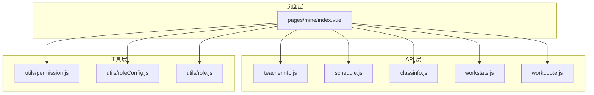
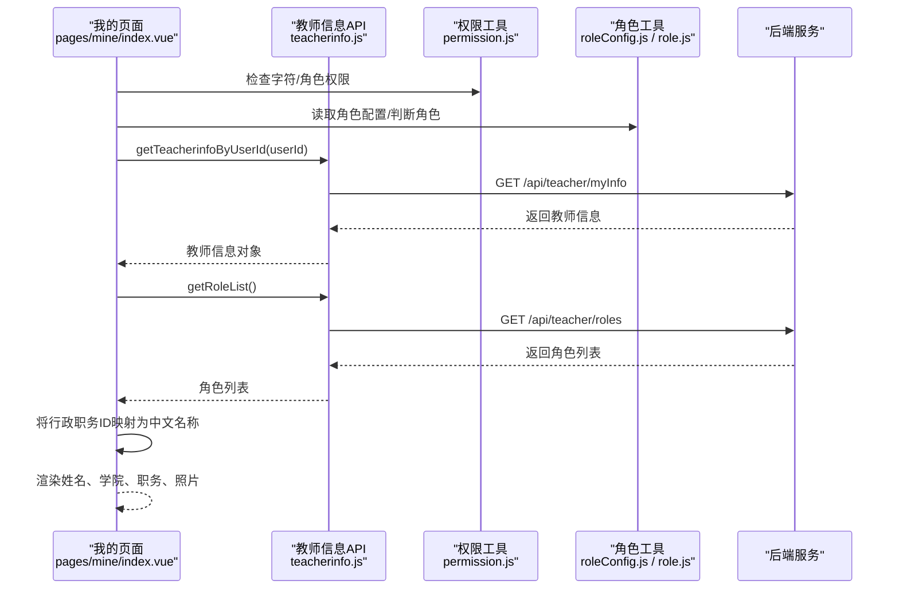
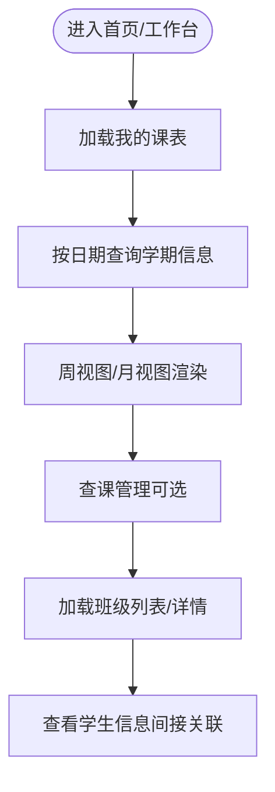
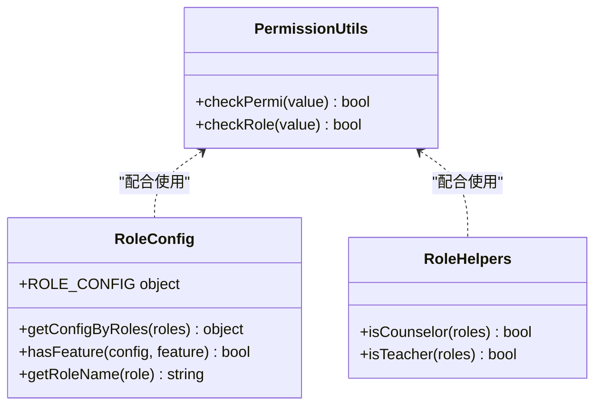
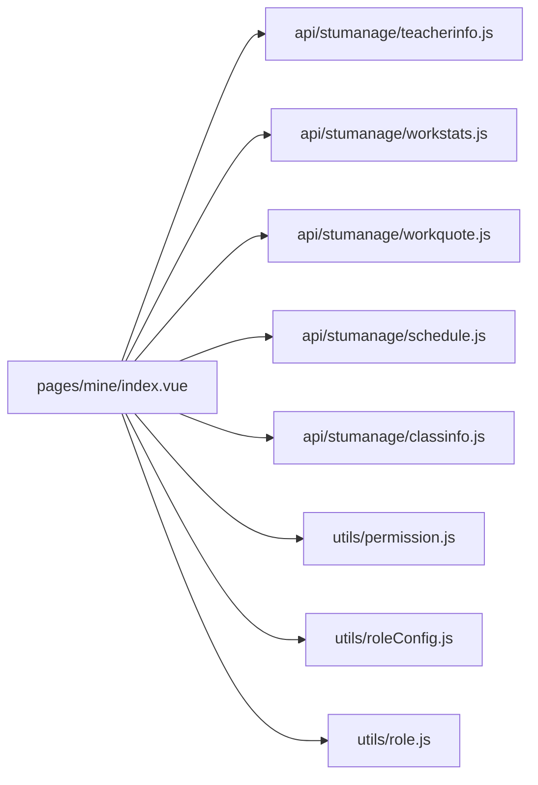

# 教师信息接口

<cite>
**本文引用的文件**   
- [api/stumanage/teacherinfo.js](file://api/stumanage/teacherinfo.js)
- [pages/mine/index.vue](file://pages/mine/index.vue)
- [utils/permission.js](file://utils/permission.js)
- [utils/roleConfig.js](file://utils/roleConfig.js)
- [utils/role.js](file://utils/role.js)
- [api/stumanage/workstats.js](file://api/stumanage/workstats.js)
- [api/stumanage/workquote.js](file://api/stumanage/workquote.js)
- [api/stumanage/schedule.js](file://api/stumanage/schedule.js)
- [api/stumanage/classinfo.js](file://api/stumanage/classinfo.js)
</cite>

## 目录
1. [简介](#简介)
2. [项目结构](#项目结构)
3. [核心组件](#核心组件)
4. [架构总览](#架构总览)
5. [详细组件分析](#详细组件分析)
6. [依赖关系分析](#依赖关系分析)
7. [性能考虑](#性能考虑)
8. [故障排查指南](#故障排查指南)
9. [结论](#结论)
10. [附录](#附录)

## 简介
本文件面向“教师信息管理”相关的前端能力，聚焦以下目标：
- 记录教师基本信息查询与管理接口（列表、详情、按用户ID获取、更新本人信息、删除等）
- 说明教师数据模型字段（工号、姓名、院系、职称、联系方式等）及其在页面中的使用方式
- 解释教师与课程、班级、学生的关联关系在前端的体现
- 提供教师工作量统计与教学评价相关的接口说明
- 阐述教师权限管理与数据访问控制的实现方式

## 项目结构
与教师信息相关的代码主要分布在以下位置：
- API 层：封装后端接口调用，如教师信息、课表、班级、工作台统计等
- 页面层：展示教师个人信息、头像、职务等
- 工具层：权限校验、角色配置、角色判断等

图表来源
- [api/stumanage/teacherinfo.js:1-52](file://api/stumanage/teacherinfo.js#L1-L52)
- [api/stumanage/schedule.js:1-46](file://api/stumanage/schedule.js#L1-L46)
- [api/stumanage/classinfo.js:1-19](file://api/stumanage/classinfo.js#L1-L19)
- [api/stumanage/workstats.js:1-10](file://api/stumanage/workstats.js#L1-L10)
- [api/stumanage/workquote.js:1-13](file://api/stumanage/workquote.js#L1-L13)
- [pages/mine/index.vue:1-309](file://pages/mine/index.vue#L1-L309)
- [utils/permission.js:1-49](file://utils/permission.js#L1-L49)
- [utils/roleConfig.js:1-149](file://utils/roleConfig.js#L1-L149)
- [utils/role.js:72-112](file://utils/role.js#L72-L112)

章节来源
- [api/stumanage/teacherinfo.js:1-52](file://api/stumanage/teacherinfo.js#L1-L52)
- [pages/mine/index.vue:1-309](file://pages/mine/index.vue#L1-L309)
- [utils/permission.js:1-49](file://utils/permission.js#L1-L49)
- [utils/roleConfig.js:1-149](file://utils/roleConfig.js#L1-L149)
- [utils/role.js:72-112](file://utils/role.js#L72-L112)

## 核心组件
- 教师信息 API 模块：提供教师列表、详情、按用户ID获取、更新本人信息、角色列表、删除等能力
- 个人信息页面：加载并展示教师姓名、学院、职务、照片等，并与角色列表联动显示中文职务名称
- 权限与角色工具：提供字符级权限校验、角色级权限校验、角色视图配置、角色判断工具
- 工作统计与金句：提供工作台汇总数据与随机金句接口
- 课表与班级：提供教师个人课表、当天课表、学期信息等；提供班级列表与详情

章节来源
- [api/stumanage/teacherinfo.js:1-52](file://api/stumanage/teacherinfo.js#L1-L52)
- [pages/mine/index.vue:1-309](file://pages/mine/index.vue#L1-L309)
- [utils/permission.js:1-49](file://utils/permission.js#L1-L49)
- [utils/roleConfig.js:1-149](file://utils/roleConfig.js#L1-L149)
- [utils/role.js:72-112](file://utils/role.js#L72-L112)
- [api/stumanage/workstats.js:1-10](file://api/stumanage/workstats.js#L1-L10)
- [api/stumanage/workquote.js:1-13](file://api/stumanage/workquote.js#L1-L13)
- [api/stumanage/schedule.js:1-46](file://api/stumanage/schedule.js#L1-L46)
- [api/stumanage/classinfo.js:1-19](file://api/stumanage/classinfo.js#L1-L19)

## 架构总览
前端通过 API 模块统一发起请求，页面负责渲染与交互，工具层提供权限控制与角色配置。教师信息流从后端返回后，由页面进行本地转换（如将行政职务 ID 转换为中文名称），再呈现给用户。

图表来源
- [pages/mine/index.vue:138-186](file://pages/mine/index.vue#L138-L186)
- [api/stumanage/teacherinfo.js:20-43](file://api/stumanage/teacherinfo.js#L20-L43)
- [utils/permission.js:8-25](file://utils/permission.js#L8-L25)
- [utils/roleConfig.js:86-129](file://utils/roleConfig.js#L86-L129)
- [utils/role.js:105-112](file://utils/role.js#L105-L112)

## 详细组件分析

### 教师信息接口定义
- 查询教师信息列表
  - 方法：GET
  - 路径：/stumanage/teacherinfo/list
  - 参数：query（分页、筛选等）
  - 用途：管理端或需要批量获取教师的场景
- 查询教师信息详情
  - 方法：GET
  - 路径：/stumanage/teacherinfo/{jsid}
  - 用途：根据教师主键获取详细信息
- 根据用户ID获取教师信息（小程序专用）
  - 方法：GET
  - 路径：/api/teacher/myInfo
  - 用途：当前登录教师查看自己的完整信息
- 修改本人信息（小程序专用）
  - 方法：PUT
  - 路径：/api/teacher/updateMyInfo
  - 用途：教师更新个人资料
- 获取角色列表（小程序专用）
  - 方法：GET
  - 路径：/api/teacher/roles
  - 用途：用于将行政职务ID映射为中文名称
- 删除教师信息
  - 方法：DELETE
  - 路径：/stumanage/teacherinfo/{jsid}
  - 用途：管理端删除教师记录

章节来源
- [api/stumanage/teacherinfo.js:1-52](file://api/stumanage/teacherinfo.js#L1-L52)

### 教师数据模型与字段说明
基于页面中对返回数据的消费，可归纳出以下常用字段（具体以实际返回为准）：
- teacherName：教师姓名
- collegeName：所属学院/院系
- xzdw：行政职务（可能为逗号分隔的多个角色ID）
- zyjszc：专业技术职务（当无行政职务时作为备选显示）
- photo：教师照片相对路径（拼接基础地址后展示）
- 其他：页面未直接消费的字段（如工号、联系方式等）需以后端返回为准

注意：
- 行政职务 xzdw 为数字ID集合，页面会结合角色列表将其转换为中文名称
- 照片路径需拼接 baseUrl 与 /profile 前缀

章节来源
- [pages/mine/index.vue:146-170](file://pages/mine/index.vue#L146-L170)
- [pages/mine/index.vue:127-136](file://pages/mine/index.vue#L127-L136)

### 教师与课程、班级、学生的关联关系
- 与课程
  - 通过“我的课表”接口获取教师当前学期的授课安排
  - 支持按日期查询学期信息，便于周/月视图切换
- 与班级
  - 提供班级列表与详情接口，用于辅导员/书记等角色查看所带班级
- 与学生
  - 学生信息通过学生信息模块接口获取，教师可通过班级维度间接关联到学生

图表来源
- [api/stumanage/schedule.js:28-45](file://api/stumanage/schedule.js#L28-L45)
- [api/stumanage/classinfo.js:4-18](file://api/stumanage/classinfo.js#L4-L18)

章节来源
- [api/stumanage/schedule.js:1-46](file://api/stumanage/schedule.js#L1-L46)
- [api/stumanage/classinfo.js:1-19](file://api/stumanage/classinfo.js#L1-L19)

### 教师工作量统计与教学评价
- 工作台统计数据
  - 方法：GET
  - 路径：/api/work-stats/summary
  - 用途：聚合考勤率、请假待办、谈心谈话次数、活动数量等指标
- 学工金句（随机）
  - 方法：GET
  - 路径：/api/work-stats/workquote/random
  - 用途：在工作台展示激励性内容

说明：
- 上述接口主要用于工作台概览展示，不涉及具体的教学评价打分流程
- 若需扩展教学评价功能，可在现有统计接口基础上增加评价维度

章节来源
- [api/stumanage/workstats.js:1-10](file://api/stumanage/workstats.js#L1-L10)
- [api/stumanage/workquote.js:1-13](file://api/stumanage/workquote.js#L1-L13)

### 教师权限管理与数据访问控制
- 字符权限校验
  - 提供 checkPermi(value) 函数，基于 store 中 permissions 进行匹配
  - 支持通配符 "*:*:*" 表示全部权限
- 角色权限校验
  - 提供 checkRole(value) 函数，基于 store 中 roles 进行匹配
  - 支持超级管理员 "admin" 拥有所有角色权限
- 角色视图配置
  - ROLE_CONFIG 定义不同角色的 TabBar、功能开关、首页路径等
  - getConfigByRoles(roles) 合并多角色配置，hasFeature(config, feature) 判断功能可见性
- 角色判断工具
  - isCounselor(roles)、isTeacher(roles) 等辅助函数，用于业务逻辑分支

图表来源
- [utils/permission.js:8-25](file://utils/permission.js#L8-L25)
- [utils/permission.js:32-49](file://utils/permission.js#L32-L49)
- [utils/roleConfig.js:6-79](file://utils/roleConfig.js#L6-L79)
- [utils/roleConfig.js:86-129](file://utils/roleConfig.js#L86-L129)
- [utils/role.js:72-112](file://utils/role.js#L72-L112)

章节来源
- [utils/permission.js:1-49](file://utils/permission.js#L1-L49)
- [utils/roleConfig.js:1-149](file://utils/roleConfig.js#L1-L149)
- [utils/role.js:72-112](file://utils/role.js#L72-L112)

## 依赖关系分析
- 页面依赖 API 模块获取教师信息与统计数据
- 页面依赖权限与角色工具进行功能可见性与操作授权控制
- 课表与班级接口为教师与课程、班级的关联提供数据支撑

图表来源
- [pages/mine/index.vue:1-309](file://pages/mine/index.vue#L1-L309)
- [api/stumanage/teacherinfo.js:1-52](file://api/stumanage/teacherinfo.js#L1-L52)
- [api/stumanage/workstats.js:1-10](file://api/stumanage/workstats.js#L1-L10)
- [api/stumanage/workquote.js:1-13](file://api/stumanage/workquote.js#L1-L13)
- [api/stumanage/schedule.js:1-46](file://api/stumanage/schedule.js#L1-L46)
- [api/stumanage/classinfo.js:1-19](file://api/stumanage/classinfo.js#L1-L19)
- [utils/permission.js:1-49](file://utils/permission.js#L1-L49)
- [utils/roleConfig.js:1-149](file://utils/roleConfig.js#L1-L149)
- [utils/role.js:72-112](file://utils/role.js#L72-L112)

## 性能考虑
- 减少重复请求：教师信息与角色列表建议在页面初始化时缓存，避免频繁刷新
- 图片资源优化：教师照片采用相对路径拼接，建议启用 CDN 与懒加载
- 接口聚合：工作台统计数据可考虑合并为一次请求，降低网络开销
- 权限计算前置：在路由守卫或页面创建阶段完成权限与角色判断，减少渲染时的条件分支

## 故障排查指南
- 教师信息为空
  - 检查是否已登录且 userId 存在
  - 确认 /api/teacher/myInfo 返回结构与字段名一致
- 职务显示异常
  - 确认 /api/teacher/roles 返回的角色列表包含 roleId 与 roleName
  - 检查 xzdw 是否为逗号分隔的数字字符串
- 权限不生效
  - 检查 store 中 permissions 与 roles 是否正确注入
  - 确认 checkPermi/checkRole 的入参与返回值是否符合预期
- 课表/班级数据缺失
  - 核对学期信息与日期参数
  - 确认班级 ID 与教师关联关系正确

章节来源
- [pages/mine/index.vue:138-186](file://pages/mine/index.vue#L138-L186)
- [utils/permission.js:8-25](file://utils/permission.js#L8-L25)
- [utils/permission.js:32-49](file://utils/permission.js#L32-L49)

## 结论
本仓库在前端侧提供了完整的教师信息管理相关能力：包括教师基本信息查询与更新、角色与权限控制、工作台统计与金句展示，以及与课程、班级、学生的关联展示。通过统一的 API 封装与工具化权限控制，系统具备良好的可扩展性与可维护性。后续如需完善教学评价与工作量统计，可在现有接口基础上扩展维度与指标。

## 附录
- 接口清单速览
  - 教师信息列表：GET /stumanage/teacherinfo/list
  - 教师信息详情：GET /stumanage/teacherinfo/{jsid}
  - 我的教师信息：GET /api/teacher/myInfo
  - 更新我的信息：PUT /api/teacher/updateMyInfo
  - 教师角色列表：GET /api/teacher/roles
  - 删除教师信息：DELETE /stumanage/teacherinfo/{jsid}
  - 工作台统计：GET /api/work-stats/summary
  - 随机金句：GET /api/work-stats/workquote/random
  - 我的课表：GET /integration/classSchedule/my
  - 当天课表：GET /api/classschedule/today?weekday=1-7
  - 学期信息：GET /integration/classSchedule/my/semesterByDate?date=YYYY-MM-DD
  - 班级列表：GET /stumanage/bjdmb/list
  - 班级详情：GET /stumanage/bjdmb/{bjid}

章节来源
- [api/stumanage/teacherinfo.js:1-52](file://api/stumanage/teacherinfo.js#L1-L52)
- [api/stumanage/workstats.js:1-10](file://api/stumanage/workstats.js#L1-L10)
- [api/stumanage/workquote.js:1-13](file://api/stumanage/workquote.js#L1-L13)
- [api/stumanage/schedule.js:1-46](file://api/stumanage/schedule.js#L1-L46)
- [api/stumanage/classinfo.js:1-19](file://api/stumanage/classinfo.js#L1-L19)