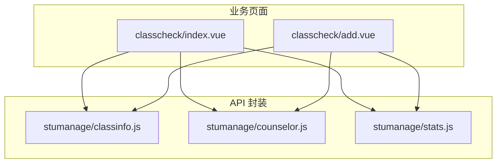
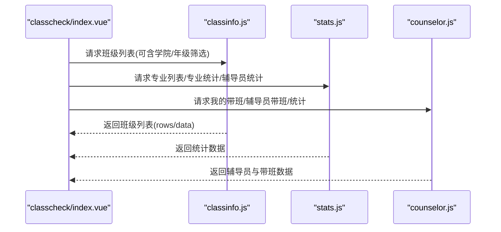
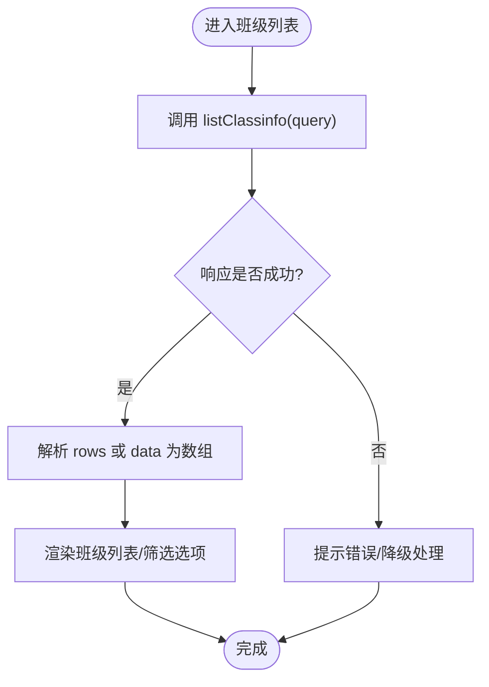
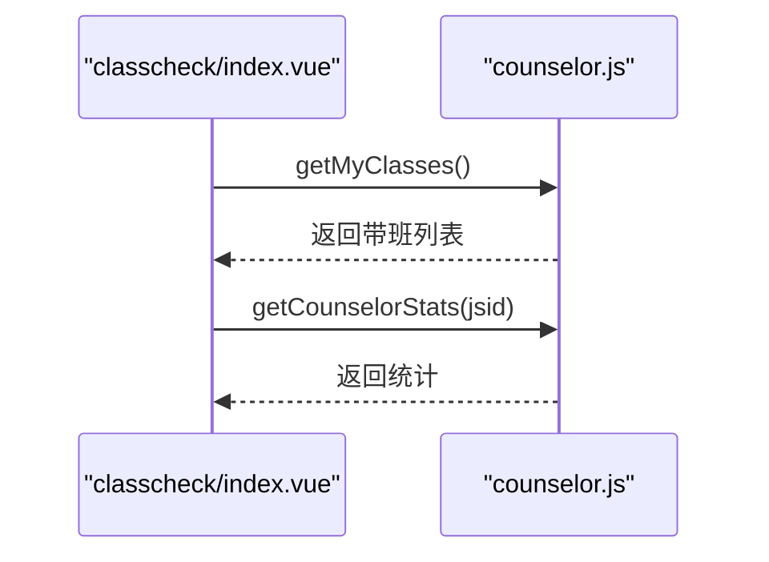
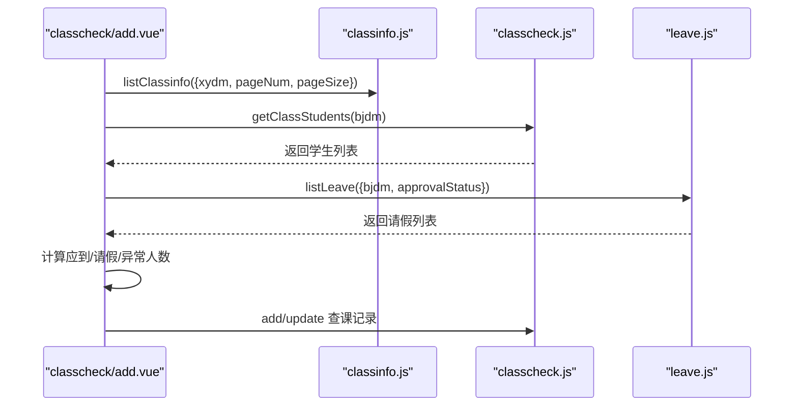
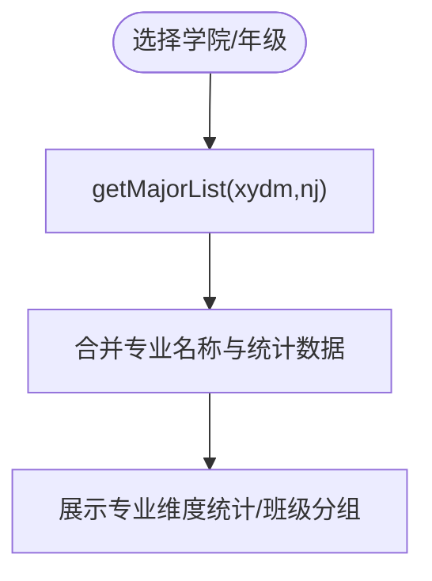
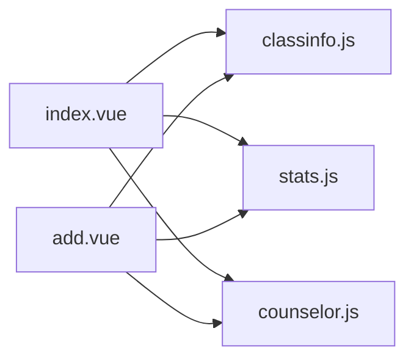

# 班级信息接口

<cite>
**本文引用的文件**
- [api/stumanage/classinfo.js](file://api/stumanage/classinfo.js)
- [api/stumanage/counselor.js](file://api/stumanage/counselor.js)
- [api/stumanage/stats.js](file://api/stumanage/stats.js)
- [pages/sub-work/classcheck/add.vue](file://pages/sub-work/classcheck/add.vue)
- [pages/sub-work/classcheck/index.vue](file://pages/sub-work/classcheck/index.vue)
</cite>

## 目录
1. [简介](#简介)
2. [项目结构](#项目结构)
3. [核心组件](#核心组件)
4. [架构总览](#架构总览)
5. [详细组件分析](#详细组件分析)
6. [依赖关系分析](#依赖关系分析)
7. [性能考虑](#性能考虑)
8. [故障排查指南](#故障排查指南)
9. [结论](#结论)
10. [附录：接口与数据模型规范](#附录接口与数据模型规范)

## 简介
本文件面向“班级信息管理”相关的前端能力，聚焦以下目标：
- 记录并说明班级基本信息的查询（列表、详情）
- 梳理班级与学生关联的管理方式（以查课场景为例）
- 汇总与班级相关的统计与分析接口（按学院/专业/辅导员维度）
- 明确批量导入导出班级的接口现状与建议

说明：
- 当前仓库为移动端前端工程，未包含后端实现。本文所有接口定义均基于前端调用代码归纳整理。
- 若需新增“增删改”和“批量导入导出”的班级管理接口，请参照本文“接口与数据模型规范”进行前后端协同设计。

## 项目结构
与班级信息相关的前端模块主要位于 api/stumanage 与 pages/sub-work/classcheck 下：
- api/stumanage/classinfo.js：封装班级列表与详情查询
- api/stumanage/counselor.js：封装辅导员及其带班、统计等接口
- api/stumanage/stats.js：封装学院/专业/辅导员维度的统计接口
- pages/sub-work/classcheck/add.vue：查课录入页，使用班级列表、学生名单、请假信息等
- pages/sub-work/classcheck/index.vue：查课首页，聚合今日课表、已查课状态、辅导员统计等

图表来源
- [pages/sub-work/classcheck/index.vue](file://pages/sub-work/classcheck/index.vue)
- [pages/sub-work/classcheck/add.vue](file://pages/sub-work/classcheck/add.vue)
- [api/stumanage/classinfo.js](file://api/stumanage/classinfo.js)
- [api/stumanage/counselor.js](file://api/stumanage/counselor.js)
- [api/stumanage/stats.js](file://api/stumanage/stats.js)

章节来源
- [api/stumanage/classinfo.js:1-19](file://api/stumanage/classinfo.js#L1-L19)
- [api/stumanage/counselor.js:1-56](file://api/stumanage/counselor.js#L1-L56)
- [api/stumanage/stats.js:1-52](file://api/stumanage/stats.js#L1-L52)
- [pages/sub-work/classcheck/index.vue:1-800](file://pages/sub-work/classcheck/index.vue#L1-L800)
- [pages/sub-work/classcheck/add.vue:1-800](file://pages/sub-work/classcheck/add.vue#L1-L800)

## 核心组件
- 班级信息查询
  - 列表：GET /stumanage/bjdmb/list，支持分页与筛选参数（如学院代码、年级等）
  - 详情：GET /stumanage/bjdmb/{bjid}
- 辅导员与带班
  - 辅导员列表/详情、带班列表、我的带班、带班统计等
- 统计分析
  - 按学院+年级的专业列表
  - 学院汇总统计
  - 按专业统计
  - 按辅导员统计

章节来源
- [api/stumanage/classinfo.js:3-18](file://api/stumanage/classinfo.js#L3-L18)
- [api/stumanage/counselor.js:8-55](file://api/stumanage/counselor.js#L8-L55)
- [api/stumanage/stats.js:8-51](file://api/stumanage/stats.js#L8-L51)

## 架构总览
从页面到 API 的调用链路如下：
- 查课首页加载班级、课表、统计；书记角色会并行拉取招生计划专业、专业统计与班级列表
- 查课录入页根据角色选择不同交互：辅导员逐人标记出勤状态，书记输入实到人数并上传现场照片
- 两者均通过 classinfo.js 获取班级列表，通过 counselor.js 获取辅导员与带班信息，通过 stats.js 获取统计数据

图表来源
- [pages/sub-work/classcheck/index.vue:480-554](file://pages/sub-work/classcheck/index.vue#L480-L554)
- [api/stumanage/classinfo.js:4-10](file://api/stumanage/classinfo.js#L4-L10)
- [api/stumanage/stats.js:9-15](file://api/stumanage/stats.js#L9-L15)
- [api/stumanage/counselor.js:41-55](file://api/stumanage/counselor.js#L41-L55)

## 详细组件分析

### 班级基本信息查询
- 列表查询
  - 方法：GET
  - 路径：/stumanage/bjdmb/list
  - 参数：query（示例：pageNum/pageSize、xydm、nj 等）
  - 返回：rows 或 data 数组（兼容两种结构）
- 详情查询
  - 方法：GET
  - 路径：/stumanage/bjdmb/{bjid}
  - 返回：班级详细信息对象

图表来源
- [api/stumanage/classinfo.js:4-10](file://api/stumanage/classinfo.js#L4-L10)
- [pages/sub-work/classcheck/add.vue:486-498](file://pages/sub-work/classcheck/add.vue#L486-L498)

章节来源
- [api/stumanage/classinfo.js:3-18](file://api/stumanage/classinfo.js#L3-L18)
- [pages/sub-work/classcheck/add.vue:486-498](file://pages/sub-work/classcheck/add.vue#L486-L498)

### 辅导员与班级关联
- 辅导员带班列表：GET /api/counselor/classes/{jsid}
- 我的带班列表：GET /api/counselor/my/classes
- 辅导员带班统计：GET /api/counselor/stats/{jsid}
- 我的带班统计：GET /api/counselor/my/stats

图表来源
- [api/stumanage/counselor.js:25-39](file://api/stumanage/counselor.js#L25-L39)
- [api/stumanage/counselor.js:41-55](file://api/stumanage/counselor.js#L41-L55)
- [pages/sub-work/classcheck/index.vue:462-479](file://pages/sub-work/classcheck/index.vue#L462-L479)

章节来源
- [api/stumanage/counselor.js:8-55](file://api/stumanage/counselor.js#L8-L55)
- [pages/sub-work/classcheck/index.vue:462-479](file://pages/sub-work/classcheck/index.vue#L462-L479)

### 班级与学生关联（查课场景）
- 获取班级学生列表：GET /api/classcheck/classStudents?bjdm=...
- 请假信息联动：通过请假列表接口过滤当日有效请假，影响出勤判定
- 辅导员模式：逐人点击切换状态（到课/迟到/早退/旷课），提交时生成明细
- 书记模式：仅输入实到人数，不提交明细

图表来源
- [pages/sub-work/classcheck/add.vue:609-631](file://pages/sub-work/classcheck/add.vue#L609-L631)
- [pages/sub-work/classcheck/add.vue:632-658](file://pages/sub-work/classcheck/add.vue#L632-L658)
- [api/stumanage/classinfo.js:4-10](file://api/stumanage/classinfo.js#L4-L10)

章节来源
- [pages/sub-work/classcheck/add.vue:609-658](file://pages/sub-work/classcheck/add.vue#L609-L658)

### 班级统计与信息分析
- 按学院+年级的专业列表：GET /api/college/majorList?xydm=&nj=
- 学院汇总统计：GET /api/mini/stats/summary?xydm=
- 按专业统计：GET /api/mini/stats/byMajor?xydm=
- 按辅导员统计：GET /api/mini/stats/byCounselor?xydm=

图表来源
- [api/stumanage/stats.js:9-15](file://api/stumanage/stats.js#L9-L15)
- [api/stumanage/stats.js:21-27](file://api/stumanage/stats.js#L21-L27)
- [api/stumanage/stats.js:33-39](file://api/stumanage/stats.js#L33-L39)
- [api/stumanage/stats.js:45-51](file://api/stumanage/stats.js#L45-L51)
- [pages/sub-work/classcheck/index.vue:498-554](file://pages/sub-work/classcheck/index.vue#L498-L554)

章节来源
- [api/stumanage/stats.js:8-51](file://api/stumanage/stats.js#L8-L51)
- [pages/sub-work/classcheck/index.vue:498-554](file://pages/sub-work/classcheck/index.vue#L498-L554)

### 概念性概览（非具体代码映射）
- 班级生命周期建议：创建→编辑→删除→归档
- 批量操作建议：导入模板校验→分批写入→结果回传
- 权限控制：管理员/院系管理员/辅导员/书记等多角色差异化访问

[本节为概念性内容，不涉及具体源码]

## 依赖关系分析
- 页面层依赖 API 封装
- API 封装统一通过 request 发起网络请求
- 统计类页面在书记模式下并行请求多组数据以提升体验

图表来源
- [pages/sub-work/classcheck/index.vue:480-554](file://pages/sub-work/classcheck/index.vue#L480-L554)
- [pages/sub-work/classcheck/add.vue:455-538](file://pages/sub-work/classcheck/add.vue#L455-L538)
- [api/stumanage/classinfo.js:4-10](file://api/stumanage/classinfo.js#L4-L10)
- [api/stumanage/stats.js:9-15](file://api/stumanage/stats.js#L9-L15)
- [api/stumanage/counselor.js:41-55](file://api/stumanage/counselor.js#L41-L55)

章节来源
- [pages/sub-work/classcheck/index.vue:480-554](file://pages/sub-work/classcheck/index.vue#L480-L554)
- [pages/sub-work/classcheck/add.vue:455-538](file://pages/sub-work/classcheck/add.vue#L455-L538)

## 性能考虑
- 并行请求：书记角色并行拉取专业列表、专业统计与班级列表，减少首屏等待
- 分页与大数据集：班级列表采用分页参数，避免一次性加载过多数据
- 本地草稿：查课录入页将状态缓存至本地存储，提升容错与恢复体验
- 图片处理：现场照片上传后优先使用缩略图/预览，降低带宽占用

章节来源
- [pages/sub-work/classcheck/index.vue:498-554](file://pages/sub-work/classcheck/index.vue#L498-L554)
- [pages/sub-work/classcheck/add.vue:689-711](file://pages/sub-work/classcheck/add.vue#L689-L711)

## 故障排查指南
- 列表为空
  - 检查 query 参数是否正确（如 xydm、nj）
  - 确认后端返回结构是否为 rows 或 data 数组
- 角色导致的数据差异
  - 书记角色与辅导员角色的班级来源不同，需分别验证
- 重复提交与自动编辑
  - 查重逻辑会在新增前检测是否存在同班级同日同节次记录，必要时进入修改模式

章节来源
- [pages/sub-work/classcheck/add.vue:586-608](file://pages/sub-work/classcheck/add.vue#L586-L608)
- [pages/sub-work/classcheck/add.vue:712-785](file://pages/sub-work/classcheck/add.vue#L712-L785)

## 结论
- 现有前端已具备班级列表与详情查询、辅导员带班与统计、以及多维度数据分析能力
- 班级与学生关联主要通过查课流程体现，辅导员与书记两种模式各有侧重
- 批量导入导出与完整的增删改接口尚未在前端暴露，可按本文附录规范进行扩展

[本节为总结性内容，不涉及具体源码]

## 附录：接口与数据模型规范

### 一、班级数据模型（建议字段）
- 班级编号：bjdm（字符串，唯一标识）
- 班级名称：bjmc 或 bjname（字符串）
- 专业代码：zydm（字符串）
- 专业名称：majorName 或 zymc 或 zyname（字符串）
- 年级：nj（字符串，如“2023”）
- 辅导员ID：jsid（字符串）
- 辅导员姓名：fdyName 或 counselorName（字符串）
- 其他可选：学院代码 xydm、班级简称 bjjc、应到人数 bcrs 等

说明：
- 前端多处兼容多种字段名（如 majorName/zyname/zymc、zydm/majorCode），建议在后续统一命名以减少适配成本。

章节来源
- [pages/sub-work/classcheck/add.vue:370-399](file://pages/sub-work/classcheck/add.vue#L370-L399)
- [pages/sub-work/classcheck/index.vue:509-540](file://pages/sub-work/classcheck/index.vue#L509-L540)

### 二、现有接口清单（前端可见）
- 班级
  - GET /stumanage/bjdmb/list
  - GET /stumanage/bjdmb/{bjid}
- 辅导员与带班
  - GET /api/counselor/list
  - GET /api/counselor/{jsid}
  - GET /api/counselor/classes/{jsid}
  - GET /api/counselor/stats/{jsid}
  - GET /api/counselor/my/classes
  - GET /api/counselor/my/stats
- 统计
  - GET /api/college/majorList?xydm=&nj=
  - GET /api/mini/stats/summary?xydm=
  - GET /api/mini/stats/byMajor?xydm=
  - GET /api/mini/stats/byCounselor?xydm=

章节来源
- [api/stumanage/classinfo.js:4-18](file://api/stumanage/classinfo.js#L4-L18)
- [api/stumanage/counselor.js:9-55](file://api/stumanage/counselor.js#L9-L55)
- [api/stumanage/stats.js:9-51](file://api/stumanage/stats.js#L9-L51)

### 三、缺失能力与扩展建议（增删改、批量导入导出）
- 新增班级
  - 建议：POST /stumanage/bjdmb
  - 入参：参考“班级数据模型”字段
  - 出参：新建后的班级主键与基础信息
- 修改班级
  - 建议：PUT /stumanage/bjdmb/{bjid}
  - 入参：待更新字段
  - 出参：更新后的班级信息
- 删除班级
  - 建议：DELETE /stumanage/bjdmb/{bjid}
  - 出参：操作结果
- 批量导入
  - 建议：POST /stumanage/bjdmb/import
  - 入参：multipart/form-data，字段 file（Excel/CSV）
  - 出参：导入结果（成功数、失败明细）
- 批量导出
  - 建议：GET /stumanage/bjdmb/export
  - 查询参数：xydm、nj、zydm 等
  - 响应：文件流（Excel/CSV）

注意：以上为建议接口，当前仓库未提供对应前端调用实现。

[本节为扩展建议，不涉及具体源码]