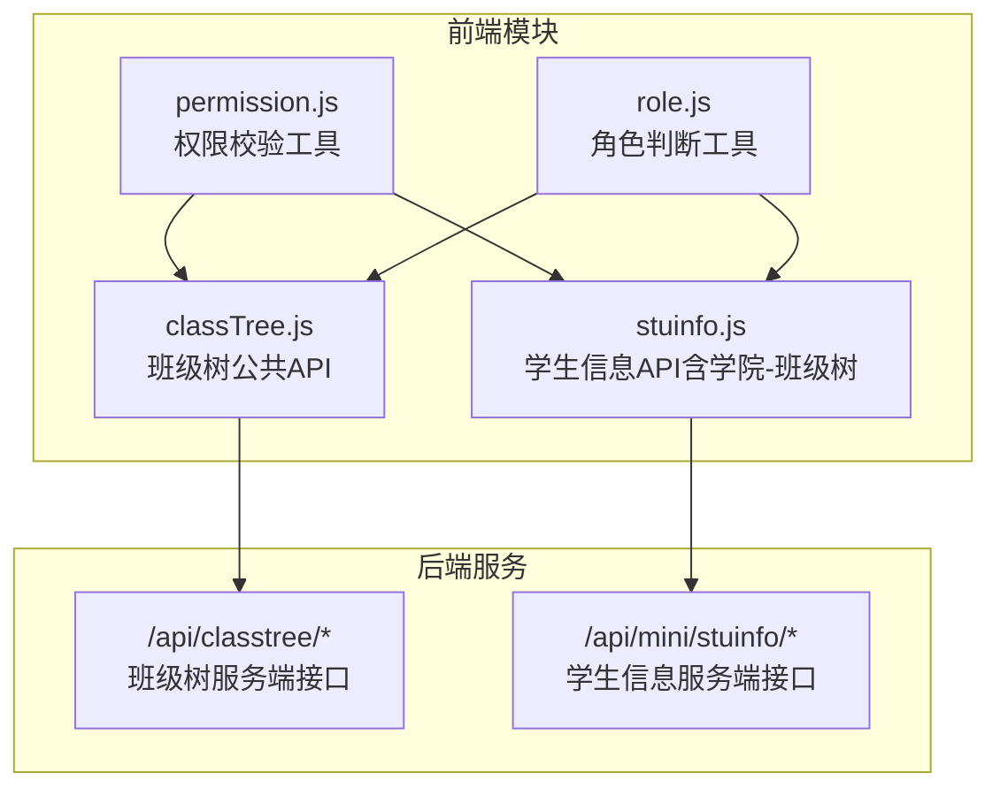
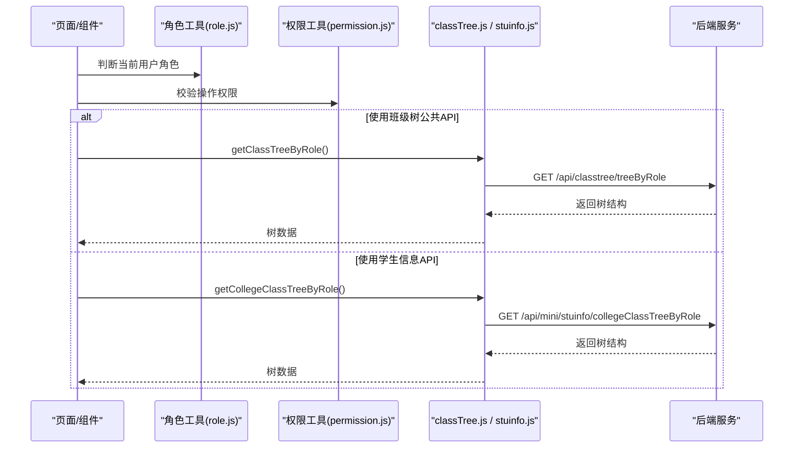
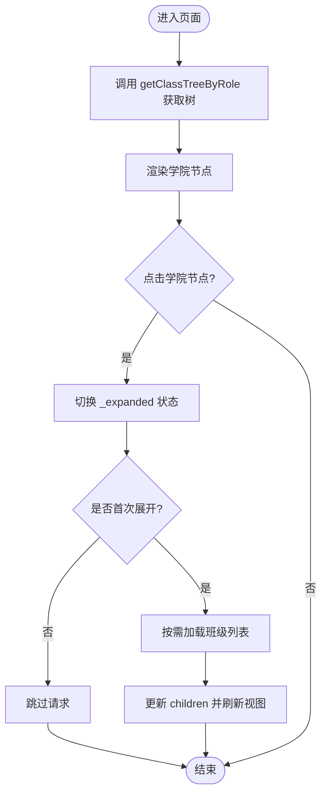
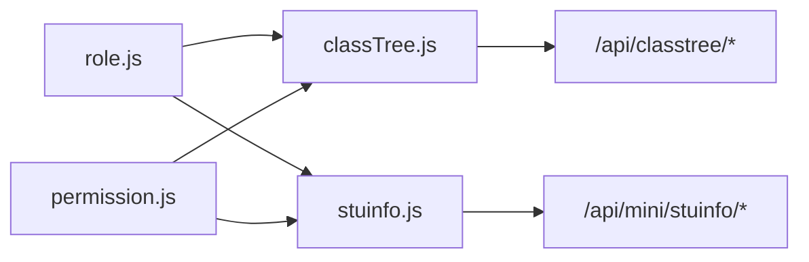

# 班级树形结构接口

<cite>
**本文引用的文件**   
- [api/stumanage/classTree.js](file://api/stumanage/classTree.js)
- [api/stumanage/stuinfo.js](file://api/stumanage/stuinfo.js)
- [utils/permission.js](file://utils/permission.js)
- [utils/role.js](file://utils/role.js)
</cite>

## 目录
1. [简介](#简介)
2. [项目结构](#项目结构)
3. [核心组件](#核心组件)
4. [架构总览](#架构总览)
5. [详细组件分析](#详细组件分析)
6. [依赖分析](#依赖分析)
7. [性能考虑](#性能考虑)
8. [故障排查指南](#故障排查指南)
9. [结论](#结论)
10. [附录](#附录)

## 简介
本文件面向移动端（小程序/H5）的“学院-班级”树形结构能力，提供：
- 基于角色的树数据获取接口说明与调用方式
- 树节点数据结构定义（学院节点、班级节点）
- 展开/折叠交互的数据绑定示例思路
- 基于角色的权限过滤机制与不同角色可见范围差异
- 大数据量场景下的懒加载实现方案与缓存策略

## 项目结构
与班级树相关的客户端 API 封装位于 api/stumanage 目录下，其中 classTree.js 提供统一的“班级树公共API”，stuinfo.js 提供学生信息相关接口（包含两套学院-班级树接口）。权限与角色判断工具位于 utils 目录。

图表来源
- [api/stumanage/classTree.js:1-32](file://api/stumanage/classTree.js#L1-L32)
- [api/stumanage/stuinfo.js:70-84](file://api/stumanage/stuinfo.js#L70-L84)
- [utils/permission.js:1-49](file://utils/permission.js#L1-L49)
- [utils/role.js:1-165](file://utils/role.js#L1-L165)

章节来源
- [api/stumanage/classTree.js:1-32](file://api/stumanage/classTree.js#L1-L32)
- [api/stumanage/stuinfo.js:70-84](file://api/stumanage/stuinfo.js#L70-L84)
- [utils/permission.js:1-49](file://utils/permission.js#L1-L49)
- [utils/role.js:1-165](file://utils/role.js#L1-L165)

## 核心组件
- 班级树公共API（classTree.js）
  - 根据用户角色获取学院-班级树结构
  - 获取我的班级列表
  - 获取班级学生列表
- 学生信息API（stuinfo.js）
  - 获取学院-班级树结构
  - 根据角色获取学院-班级树结构

章节来源
- [api/stumanage/classTree.js:8-14](file://api/stumanage/classTree.js#L8-L14)
- [api/stumanage/classTree.js:16-22](file://api/stumanage/classTree.js#L16-L22)
- [api/stumanage/classTree.js:24-31](file://api/stumanage/classTree.js#L24-L31)
- [api/stumanage/stuinfo.js:70-76](file://api/stumanage/stuinfo.js#L70-L76)
- [api/stumanage/stuinfo.js:78-84](file://api/stumanage/stuinfo.js#L78-L84)

## 架构总览
下图展示了从页面到前端的API封装再到后端的请求链路，以及角色/权限在其中的作用点。

图表来源
- [api/stumanage/classTree.js:9-14](file://api/stumanage/classTree.js#L9-L14)
- [api/stumanage/stuinfo.js:78-84](file://api/stumanage/stuinfo.js#L78-L84)
- [utils/role.js:119-130](file://utils/role.js#L119-L130)
- [utils/permission.js:32-49](file://utils/permission.js#L32-L49)

## 详细组件分析

### 接口清单与调用方式
- 根据用户角色获取学院-班级树结构
  - 路径：GET /api/classtree/treeByRole
  - 封装函数：getClassTreeByRole
  - 用途：按当前登录用户的角色返回其可访问的学院-班级树
- 获取我的班级列表
  - 路径：GET /api/classtree/myClasses
  - 封装函数：getMyClasses
  - 用途：返回当前用户直接关联的班级集合
- 获取班级学生列表
  - 路径：GET /api/classtree/classStudents?bjdm=...
  - 封装函数：getClassStudents(bjdm)
  - 用途：按班级代码查询该班学生列表
- 获取学院-班级树结构（通用）
  - 路径：GET /api/mini/stuinfo/collegeClassTree
  - 封装函数：getCollegeClassTree
- 根据角色获取学院-班级树结构
  - 路径：GET /api/mini/stuinfo/collegeClassTreeByRole
  - 封装函数：getCollegeClassTreeByRole

章节来源
- [api/stumanage/classTree.js:9-14](file://api/stumanage/classTree.js#L9-L14)
- [api/stumanage/classTree.js:16-22](file://api/stumanage/classTree.js#L16-L22)
- [api/stumanage/classTree.js:24-31](file://api/stumanage/classTree.js#L24-L31)
- [api/stumanage/stuinfo.js:70-76](file://api/stumanage/stuinfo.js#L70-L76)
- [api/stumanage/stuinfo.js:78-84](file://api/stumanage/stuinfo.js#L78-L84)

### 树形节点数据结构
- 根节点：学院节点
  - 标识字段：学院编码/ID（用于唯一标识）
  - 展示字段：学院名称
  - 子节点：班级节点集合
- 叶子节点：班级节点
  - 标识字段：班级编码/ID
  - 展示字段：班级名称
  - 扩展字段：可选人数、状态等（由后端决定）
- 层级关系
  - 学院 -> 班级（二级树）
  - 若需要多级组织，可在学院下继续扩展子节点；但现有接口以“学院-班级”为主

注意：具体字段名以服务端返回为准，前端应兼容可能的字段命名差异。

[本节为概念性说明，不直接分析具体文件]

### 基于角色的权限过滤机制
- 角色判断工具
  - 支持字符串数组或对象数组的角色格式
  - 提供 isSecretary/isCounselor/isAdmin/isTeacher 等判断方法
  - 提供 getRoleType/getRoleTypes 获取角色类型标识
- 权限校验工具
  - checkPermi：字符级权限校验
  - checkRole：角色级权限校验
- 树数据可见范围差异
  - 管理员：通常可见全部学院-班级
  - 书记：可见所属学院及下属班级
  - 辅导员：可见所带班级及其所属学院
  - 普通教师：仅可见授权范围内的班级
- 建议在前端通过角色工具选择对应接口：
  - 统一走 treeByRole 或 collegeClassTreeByRole，让服务端完成权限裁剪

章节来源
- [utils/role.js:16-41](file://utils/role.js#L16-L41)
- [utils/role.js:48-70](file://utils/role.js#L48-L70)
- [utils/role.js:77-98](file://utils/role.js#L77-L98)
- [utils/role.js:119-130](file://utils/role.js#L119-L130)
- [utils/permission.js:32-49](file://utils/permission.js#L32-L49)

### 树形组件数据绑定与展开/折叠
- 数据绑定
  - 将接口返回的树结构赋值给组件的 treeData
  - 每个节点维护 _expanded 标记控制展开/折叠
- 展开/折叠逻辑
  - 点击学院节点时切换其 _expanded 状态
  - 首次展开时按需加载班级列表（见“懒加载”小节）
- 扁平化渲染
  - 可将树结构扁平化为列表进行渲染，同时保留层级缩进
  - 参考项目中评论树的处理方式，使用 handleTree 构建父子关系

[此图为概念流程示意，无需图表来源]

### 大数据量场景下的懒加载与缓存策略
- 懒加载
  - 仅在学院节点首次展开时请求其班级列表
  - 对已加载的学院节点缓存结果，避免重复请求
- 缓存策略
  - 内存缓存：以学院编码为键，保存班级列表
  - 本地持久化：结合 uni.setStorageSync 做短期缓存（如10分钟），提升二次打开体验
  - 失效策略：当班级数据发生变更（增删改）时主动清除对应缓存
- 并发与防抖
  - 同一学院多次快速展开时，使用防抖或请求去重，避免重复网络请求
- 渲染优化
  - 虚拟列表/分页渲染：当某学院下班级数量极大时，采用分页或虚拟滚动
  - 增量更新：仅替换变更节点的 children，避免整树重建

[本节为通用性能建议，不直接分析具体文件]

## 依赖分析
- 模块耦合
  - classTree.js 与 stuinfo.js 均依赖 request 发起HTTP请求
  - 页面/组件依赖 role.js 与 permission.js 进行角色与权限判断
- 外部依赖
  - 后端服务提供 /api/classtree/* 与 /api/mini/stuinfo/* 两类接口
- 潜在循环依赖
  - 当前未见循环引用，职责清晰：API层只负责请求封装，业务逻辑在页面/组件中组合

图表来源
- [api/stumanage/classTree.js:1-32](file://api/stumanage/classTree.js#L1-L32)
- [api/stumanage/stuinfo.js:70-84](file://api/stumanage/stuinfo.js#L70-L84)
- [utils/role.js:1-165](file://utils/role.js#L1-L165)
- [utils/permission.js:1-49](file://utils/permission.js#L1-L49)

章节来源
- [api/stumanage/classTree.js:1-32](file://api/stumanage/classTree.js#L1-L32)
- [api/stumanage/stuinfo.js:70-84](file://api/stumanage/stuinfo.js#L70-L84)
- [utils/role.js:1-165](file://utils/role.js#L1-L165)
- [utils/permission.js:1-49](file://utils/permission.js#L1-L49)

## 性能考虑
- 减少不必要的请求：优先使用 treeByRole 接口，服务端完成权限裁剪
- 首屏优化：预取常用学院的班级数据（在用户进入页面时静默加载）
- 渲染优化：避免频繁整树重建，尽量局部更新 children
- 网络优化：开启请求压缩、合理设置超时与重试策略
- 内存管理：及时释放不再使用的树节点引用，避免内存泄漏

[本节为通用性能建议，不直接分析具体文件]

## 故障排查指南
- 接口无数据
  - 检查当前用户角色是否正确加载
  - 确认是否使用了正确的角色树接口（treeByRole 或 collegeClassTreeByRole）
- 权限不足
  - 使用 checkRole/checkPermi 校验权限，必要时提示用户缺少相应权限
- 树未展开或显示异常
  - 检查节点 _expanded 状态是否被正确切换
  - 确认懒加载逻辑是否触发，是否存在重复请求导致覆盖
- 缓存不一致
  - 在数据变更后主动清理对应学院缓存
  - 增加版本号或时间戳作为缓存键的一部分，避免脏读

章节来源
- [utils/permission.js:8-25](file://utils/permission.js#L8-L25)
- [utils/permission.js:32-49](file://utils/permission.js#L32-L49)
- [utils/role.js:119-130](file://utils/role.js#L119-L130)

## 结论
通过 classTree.js 与 stuinfo.js 提供的两类学院-班级树接口，结合 role.js 与 permission.js 的角色与权限判断，可实现按角色动态展示树结构。配合懒加载与缓存策略，可在大数据量场景下获得良好的用户体验。建议在页面层统一封装树数据获取与缓存逻辑，确保一致性与可维护性。

[本节为总结性内容，不直接分析具体文件]

## 附录
- 关键接口速查
  - 根据角色获取树：GET /api/classtree/treeByRole
  - 我的班级列表：GET /api/classtree/myClasses
  - 班级学生列表：GET /api/classtree/classStudents?bjdm=...
  - 学院-班级树（通用）：GET /api/mini/stuinfo/collegeClassTree
  - 学院-班级树（按角色）：GET /api/mini/stuinfo/collegeClassTreeByRole

章节来源
- [api/stumanage/classTree.js:9-14](file://api/stumanage/classTree.js#L9-L14)
- [api/stumanage/classTree.js:16-22](file://api/stumanage/classTree.js#L16-L22)
- [api/stumanage/classTree.js:24-31](file://api/stumanage/classTree.js#L24-L31)
- [api/stumanage/stuinfo.js:70-76](file://api/stumanage/stuinfo.js#L70-L76)
- [api/stumanage/stuinfo.js:78-84](file://api/stumanage/stuinfo.js#L78-L84)