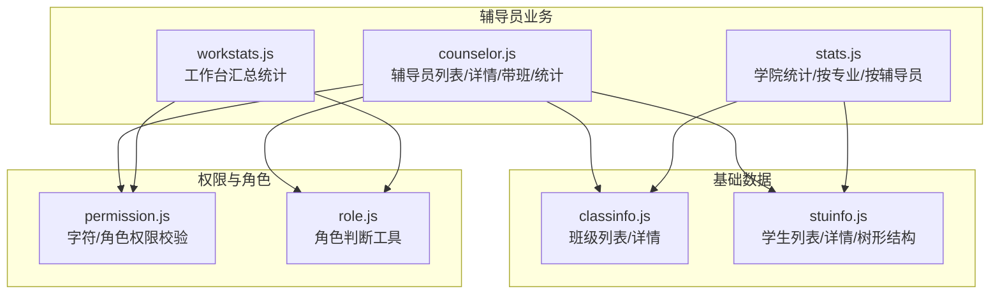
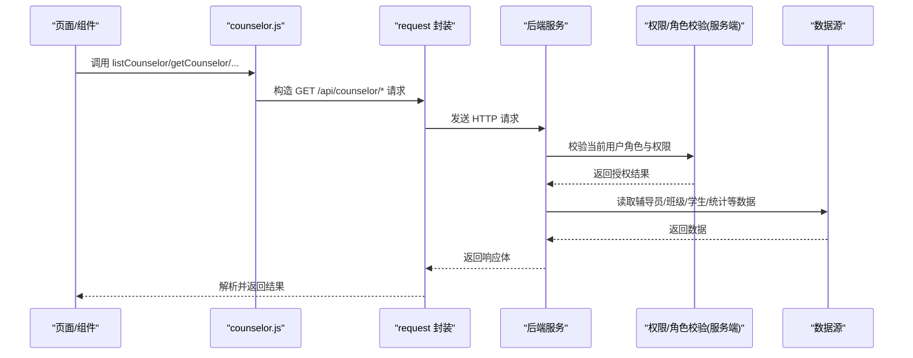
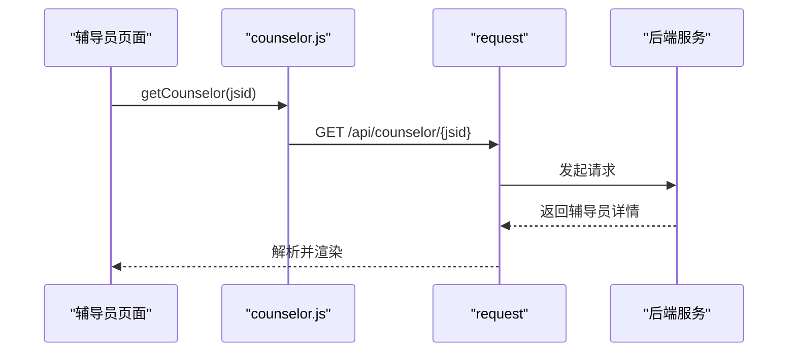
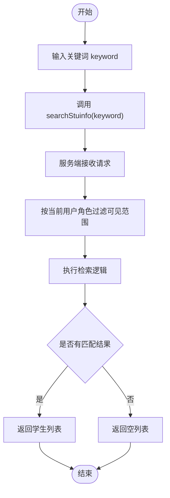
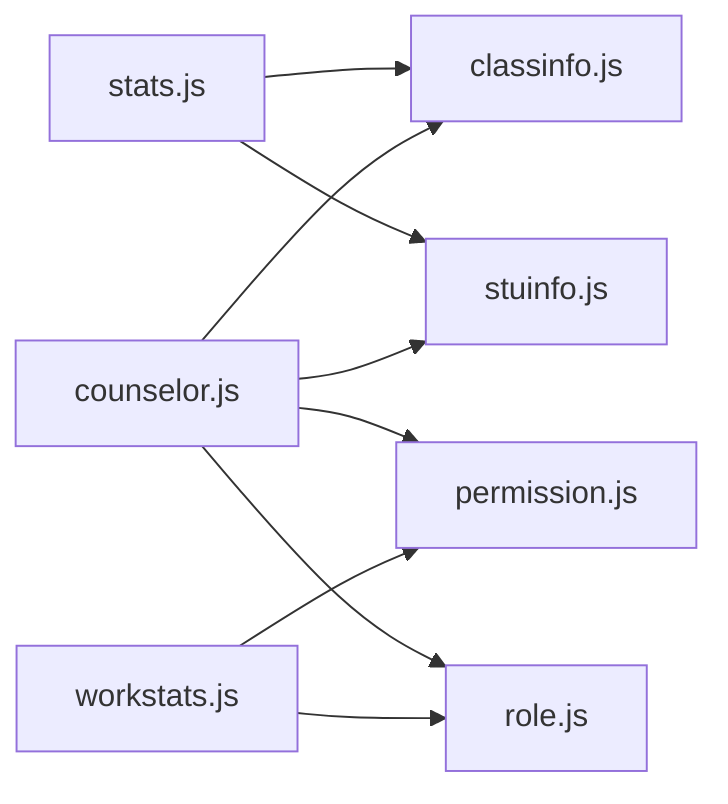

# 辅导员信息接口

<cite>
**本文引用的文件**
- [api/stumanage/counselor.js](file://api/stumanage/counselor.js)
- [api/stumanage/classinfo.js](file://api/stumanage/classinfo.js)
- [api/stumanage/stuinfo.js](file://api/stumanage/stuinfo.js)
- [api/stumanage/workstats.js](file://api/stumanage/workstats.js)
- [utils/permission.js](file://utils/permission.js)
- [utils/role.js](file://utils/role.js)
</cite>

## 目录
1. [简介](#简介)
2. [项目结构](#项目结构)
3. [核心组件](#核心组件)
4. [架构总览](#架构总览)
5. [详细组件分析](#详细组件分析)
6. [依赖关系分析](#依赖关系分析)
7. [性能与可用性建议](#性能与可用性建议)
8. [故障排查指南](#故障排查指南)
9. [结论](#结论)
10. [附录：接口清单与数据模型说明](#附录接口清单与数据模型说明)

## 简介
本文件面向移动端前端，系统化梳理“辅导员信息管理”相关接口，包括：
- 辅导员的查询、详情获取
- 辅导员带班（班级）与学生关联管理
- 辅导员工作量统计与绩效评估数据获取
- 权限控制与数据访问范围说明

文档以现有前端 API 封装为依据，结合角色与权限工具函数，给出可落地的调用方式、参数约定、返回字段说明以及常见问题的处理建议。

## 项目结构
辅导员相关能力主要分布在以下模块：
- 辅导员业务接口：api/stumanage/counselor.js
- 班级信息接口：api/stumanage/classinfo.js
- 学生信息与树形结构接口：api/stumanage/stuinfo.js
- 工作台汇总统计：api/stumanage/workstats.js
- 学院维度统计（含按辅导员统计）：api/stumanage/stats.js
- 权限校验工具：utils/permission.js
- 角色判断工具：utils/role.js

图表来源
- [api/stumanage/counselor.js:1-56](file://api/stumanage/counselor.js#L1-L56)
- [api/stumanage/classinfo.js:1-19](file://api/stumanage/classinfo.js#L1-L19)
- [api/stumanage/stuinfo.js:1-85](file://api/stumanage/stuinfo.js#L1-L85)
- [api/stumanage/workstats.js:1-10](file://api/stumanage/workstats.js#L1-L10)
- [api/stumanage/stats.js:1-52](file://api/stumanage/stats.js#L1-L52)
- [utils/permission.js:1-49](file://utils/permission.js#L1-L49)
- [utils/role.js:1-165](file://utils/role.js#L1-L165)

章节来源
- [api/stumanage/counselor.js:1-56](file://api/stumanage/counselor.js#L1-L56)
- [api/stumanage/classinfo.js:1-19](file://api/stumanage/classinfo.js#L1-L19)
- [api/stumanage/stuinfo.js:1-85](file://api/stumanage/stuinfo.js#L1-L85)
- [api/stumanage/workstats.js:1-10](file://api/stumanage/workstats.js#L1-L10)
- [api/stumanage/stats.js:1-52](file://api/stumanage/stats.js#L1-L52)
- [utils/permission.js:1-49](file://utils/permission.js#L1-L49)
- [utils/role.js:1-165](file://utils/role.js#L1-L165)

## 核心组件
- 辅导员业务接口（counselor.js）
  - 提供辅导员列表查询、详情获取、带班列表、带班统计、我的带班列表、我的带班统计等能力。
- 班级信息接口（classinfo.js）
  - 提供班级列表与详情查询，用于辅导员带班信息的展示与管理。
- 学生信息接口（stuinfo.js）
  - 提供学生列表、详情、搜索、学院-班级树、按角色过滤的树等能力，支撑辅导员对学生数据的访问。
- 工作台统计（workstats.js）
  - 提供统一的工作台汇总统计数据，便于辅导员快速了解工作概览。
- 学院统计（stats.js）
  - 提供学院维度的汇总统计、按专业统计、按辅导员统计等指标，用于绩效评估与工作量分析。
- 权限与角色（permission.js、role.js）
  - 提供字符级权限校验与角色类型判断，用于界面与接口的访问控制。

章节来源
- [api/stumanage/counselor.js:1-56](file://api/stumanage/counselor.js#L1-L56)
- [api/stumanage/classinfo.js:1-19](file://api/stumanage/classinfo.js#L1-L19)
- [api/stumanage/stuinfo.js:1-85](file://api/stumanage/stuinfo.js#L1-L85)
- [api/stumanage/workstats.js:1-10](file://api/stumanage/workstats.js#L1-L10)
- [api/stumanage/stats.js:1-52](file://api/stumanage/stats.js#L1-L52)
- [utils/permission.js:1-49](file://utils/permission.js#L1-L49)
- [utils/role.js:1-165](file://utils/role.js#L1-L165)

## 架构总览
辅导员信息接口采用“前端 API 封装 + 后端 REST 服务”的分层模式。前端通过统一的 request 发起 HTTP 请求，后端根据当前登录用户身份与权限进行数据访问范围控制，并返回结构化数据供页面渲染与业务计算使用。

图表来源
- [api/stumanage/counselor.js:1-56](file://api/stumanage/counselor.js#L1-L56)
- [utils/permission.js:1-49](file://utils/permission.js#L1-L49)
- [utils/role.js:1-165](file://utils/role.js#L1-L165)

## 详细组件分析

### 辅导员业务接口（counselor.js）
- 功能要点
  - 列表查询：支持分页与筛选条件（由 query 参数传递）。
  - 详情获取：根据辅导员标识 jsid 获取详细信息。
  - 带班列表：根据 jsid 获取其负责班级集合。
  - 带班统计：根据 jsid 获取带班相关统计指标。
  - 我的带班列表/统计：基于当前登录辅导员自动限定数据范围。
- 关键路径与方法
  - 列表：GET /api/counselor/list
  - 详情：GET /api/counselor/{jsid}
  - 带班列表：GET /api/counselor/classes/{jsid}
  - 带班统计：GET /api/counselor/stats/{jsid}
  - 我的带班列表：GET /api/counselor/my/classes
  - 我的带班统计：GET /api/counselor/my/stats
- 调用流程示意

图表来源
- [api/stumanage/counselor.js:17-23](file://api/stumanage/counselor.js#L17-L23)

章节来源
- [api/stumanage/counselor.js:1-56](file://api/stumanage/counselor.js#L1-L56)

### 班级信息接口（classinfo.js）
- 功能要点
  - 列表查询：支持分页与筛选条件（query 参数）。
  - 详情获取：根据班级标识 bjid 获取班级详情。
- 关键路径与方法
  - 列表：GET /stumanage/bjdmb/list
  - 详情：GET /stumanage/bjdmb/{bjid}
- 与辅导员的关系
  - 辅导员带班列表通常返回班级集合，可复用 classinfo 的详情接口展示班级信息。

章节来源
- [api/stumanage/classinfo.js:1-19](file://api/stumanage/classinfo.js#L1-L19)

### 学生信息接口（stuinfo.js）
- 功能要点
  - 列表查询：支持分页与筛选条件（query 参数）。
  - 详情获取：根据学号 xh 或用户ID userId 获取学生信息。
  - 我的学生：基于当前登录辅导员自动限定数据范围。
  - 搜索：根据关键词检索学生，服务端按角色自动过滤可见范围。
  - 学院-班级树：提供层级结构，支持按角色过滤。
- 关键路径与方法
  - 列表：GET /api/mini/stuinfo/list
  - 详情：GET /api/mini/stuinfo/{xh}
  - 按用户ID获取：GET /api/mini/stuinfo/byUserId/{userId}
  - 我的学生：GET /api/mini/stuinfo/myStudents
  - 搜索：GET /api/mini/stuinfo/search?keyword=...
  - 详情（含是否可查看完整信息标记）：GET /api/mini/stuinfo/detail/{xh}
  - 学院-班级树：GET /api/mini/stuinfo/collegeClassTree
  - 按角色树：GET /api/mini/stuinfo/collegeClassTreeByRole
- 流程图（搜索与权限过滤）

图表来源
- [api/stumanage/stuinfo.js:53-60](file://api/stumanage/stuinfo.js#L53-L60)

章节来源
- [api/stumanage/stuinfo.js:1-85](file://api/stumanage/stuinfo.js#L1-L85)

### 工作台统计（workstats.js）
- 功能要点
  - 提供统一的工作台汇总统计数据，便于辅导员快速了解待办、通知、消息等概览。
- 关键路径与方法
  - 汇总统计：GET /api/work-stats/summary

章节来源
- [api/stumanage/workstats.js:1-10](file://api/stumanage/workstats.js#L1-L10)

### 学院统计（stats.js）
- 功能要点
  - 学院汇总统计：按学院代码 xydm 获取汇总数据。
  - 按专业统计：按学院代码 xydm 获取专业维度统计。
  - 按辅导员统计：按学院代码 xydm 获取辅导员维度统计，用于工作量与绩效评估。
- 关键路径与方法
  - 汇总统计：GET /api/mini/stats/summary?xydm=...
  - 按专业统计：GET /api/mini/stats/byMajor?xydm=...
  - 按辅导员统计：GET /api/mini/stats/byCounselor?xydm=...

章节来源
- [api/stumanage/stats.js:1-52](file://api/stumanage/stats.js#L1-L52)

### 权限与角色控制（permission.js、role.js）
- 字符权限校验（checkPermi）
  - 依据 store 中的 permissions 列表进行白名单匹配，支持通配符 "*:*:*"。
- 角色权限校验（checkRole）
  - 依据 store 中的 roles 列表进行白名单匹配，支持超级管理员 "admin"。
- 角色判断工具（role.js）
  - isSecretary/isAdmin/isCounselor/isTeacher：根据 roleName 或 roleKey 判断角色类型。
  - getRoleType/getRoleTypes：返回最高优先级角色或所有匹配角色类型数组。
  - getRoleDisplayName：将多角色合并为显示名称，如“书记/辅导员”。
- 典型用法
  - 在页面或组件中，先通过 checkRole/checkPermi 判定是否具备访问权限，再决定是否渲染按钮或调用接口。
  - 使用 isCounselor 判断当前用户是否为辅导员，从而决定进入辅导员专属页面或功能。

章节来源
- [utils/permission.js:1-49](file://utils/permission.js#L1-L49)
- [utils/role.js:1-165](file://utils/role.js#L1-L165)

## 依赖关系分析
- counselor.js 依赖 request 封装发起 HTTP 请求；其业务语义上依赖 classinfo.js 与 stuinfo.js 的数据展示与联动。
- stats.js 与 workstats.js 提供统计类数据，常用于辅导员绩效评估与工作看板。
- permission.js 与 role.js 作为通用工具，被各页面与组件复用，实现权限与角色控制。

图表来源
- [api/stumanage/counselor.js:1-56](file://api/stumanage/counselor.js#L1-L56)
- [api/stumanage/classinfo.js:1-19](file://api/stumanage/classinfo.js#L1-L19)
- [api/stumanage/stuinfo.js:1-85](file://api/stumanage/stuinfo.js#L1-L85)
- [api/stumanage/workstats.js:1-10](file://api/stumanage/workstats.js#L1-L10)
- [api/stumanage/stats.js:1-52](file://api/stumanage/stats.js#L1-L52)
- [utils/permission.js:1-49](file://utils/permission.js#L1-L49)
- [utils/role.js:1-165](file://utils/role.js#L1-L165)

## 性能与可用性建议
- 列表与分页
  - 对辅导员列表、班级列表、学生列表等长列表场景，务必启用分页与滚动加载，避免一次性拉取大量数据。
- 缓存策略
  - 对于不频繁变化的数据（如学院-班级树、辅导员详情），可在本地做短时缓存，减少重复请求。
- 并发与重试
  - 对网络异常进行重试与退避，提升用户体验；对统计接口可做幂等处理。
- 数据裁剪
  - 仅请求必要字段，避免冗余数据传输；详情页按需加载敏感字段。
- 权限前置
  - 在调用接口前进行权限与角色校验，减少无效请求与服务端压力。

[本节为通用建议，不涉及具体文件分析]

## 故障排查指南
- 无权限或越权访问
  - 现象：调用接口返回未授权或空数据。
  - 排查：检查当前用户的 roles 与 permissions 是否正确加载；确认 checkRole/checkPermi 返回值；核对服务端数据访问范围是否与角色匹配。
- 参数缺失或格式错误
  - 现象：列表为空或报错。
  - 排查：确认 query 参数是否包含必要的分页与筛选字段；确认 jsid、bjid、xh、userId 等标识是否有效。
- 网络超时或服务端异常
  - 现象：请求失败或长时间无响应。
  - 排查：检查网络状态与服务端日志；对统计类接口增加超时与重试机制。
- 数据不一致
  - 现象：辅导员带班列表与班级详情不一致。
  - 排查：确认辅导员带班列表返回的班级标识与 classinfo 详情接口使用的标识一致；必要时刷新缓存。

章节来源
- [utils/permission.js:1-49](file://utils/permission.js#L1-L49)
- [utils/role.js:1-165](file://utils/role.js#L1-L165)

## 结论
辅导员信息接口围绕“辅导员—班级—学生—统计”的主线展开，通过清晰的 REST 路径与前后端协作，实现了辅导员信息查询、带班与学生管理、工作量统计与绩效评估等核心能力。配合权限与角色工具，系统能够灵活地控制数据访问范围，保障数据安全与合规。

[本节为总结性内容，不涉及具体文件分析]

## 附录：接口清单与数据模型说明

### 辅导员接口清单
- 列表查询
  - 方法：GET
  - 路径：/api/counselor/list
  - 参数：query（分页与筛选）
  - 用途：辅导员列表展示与筛选
- 详情获取
  - 方法：GET
  - 路径：/api/counselor/{jsid}
  - 参数：jsid（辅导员标识）
  - 用途：辅导员基本信息与联系方式等详情
- 带班列表
  - 方法：GET
  - 路径：/api/counselor/classes/{jsid}
  - 参数：jsid
  - 用途：辅导员负责的班级集合
- 带班统计
  - 方法：GET
  - 路径：/api/counselor/stats/{jsid}
  - 参数：jsid
  - 用途：辅导员带班相关统计指标
- 我的带班列表
  - 方法：GET
  - 路径：/api/counselor/my/classes
  - 用途：当前登录辅导员自动限定的带班列表
- 我的带班统计
  - 方法：GET
  - 路径：/api/counselor/my/stats
  - 用途：当前登录辅导员自动限定的带班统计

章节来源
- [api/stumanage/counselor.js:1-56](file://api/stumanage/counselor.js#L1-L56)

### 班级接口清单
- 列表查询
  - 方法：GET
  - 路径：/stumanage/bjdmb/list
  - 参数：query（分页与筛选）
- 详情获取
  - 方法：GET
  - 路径：/stumanage/bjdmb/{bjid}
  - 参数：bjid（班级标识）

章节来源
- [api/stumanage/classinfo.js:1-19](file://api/stumanage/classinfo.js#L1-L19)

### 学生接口清单
- 列表查询
  - 方法：GET
  - 路径：/api/mini/stuinfo/list
  - 参数：query（分页与筛选）
- 详情获取
  - 方法：GET
  - 路径：/api/mini/stuinfo/{xh}
  - 参数：xh（学号）
- 按用户ID获取
  - 方法：GET
  - 路径：/api/mini/stuinfo/byUserId/{userId}
  - 参数：userId
- 我的学生
  - 方法：GET
  - 路径：/api/mini/stuinfo/myStudents
  - 用途：当前登录辅导员自动限定的学生列表
- 搜索
  - 方法：GET
  - 路径：/api/mini/stuinfo/search
  - 参数：keyword
  - 用途：关键词检索，服务端按角色过滤可见范围
- 详情（含是否可查看完整信息标记）
  - 方法：GET
  - 路径：/api/mini/stuinfo/detail/{xh}
  - 用途：返回是否可查看完整信息的标记
- 学院-班级树
  - 方法：GET
  - 路径：/api/mini/stuinfo/collegeClassTree
- 按角色树
  - 方法：GET
  - 路径：/api/mini/stuinfo/collegeClassTreeByRole

章节来源
- [api/stumanage/stuinfo.js:1-85](file://api/stumanage/stuinfo.js#L1-L85)

### 统计接口清单
- 工作台汇总统计
  - 方法：GET
  - 路径：/api/work-stats/summary
- 学院汇总统计
  - 方法：GET
  - 路径：/api/mini/stats/summary
  - 参数：xydm（学院代码）
- 按专业统计
  - 方法：GET
  - 路径：/api/mini/stats/byMajor
  - 参数：xydm
- 按辅导员统计
  - 方法：GET
  - 路径：/api/mini/stats/byCounselor
  - 参数：xydm
  - 用途：辅导员工作量与绩效评估数据

章节来源
- [api/stumanage/workstats.js:1-10](file://api/stumanage/workstats.js#L1-L10)
- [api/stumanage/stats.js:1-52](file://api/stumanage/stats.js#L1-L52)

### 数据模型说明（字段定义）
- 辅导员数据模型（参考详情接口返回）
  - 基本信息：姓名、工号/标识（jsid）、性别、入职时间、所属学院等
  - 联系方式：手机号、邮箱、办公电话等
  - 负责班级：班级集合（可通过带班列表接口获取）
  - 工作年限：从入职时间计算或单独字段
  - 备注：其他扩展信息
  - 说明：以上字段为辅导员详情的常见组成，具体以服务端返回为准
- 班级数据模型（参考详情接口返回）
  - 基本信息：班级名称、班级代码（bjid）、所属学院、年级、专业、人数等
  - 辅导员：负责辅导员信息（可与辅导员详情联动）
- 学生数据模型（参考详情接口返回）
  - 基本信息：学号（xh）、姓名、性别、出生日期、民族、政治面貌等
  - 联系方式：手机号、邮箱、紧急联系人等
  - 学籍信息：学院、专业、班级、入学年份、学制、状态等
  - 权限标记：是否可查看完整信息（detail 接口返回）
- 统计模型（参考统计接口返回）
  - 辅导员维度：带班数量、学生总数、活动次数、谈话记录数、请假审批数等
  - 学院维度：总体学生数、活跃率、各类指标汇总
  - 专业维度：按专业的学生分布与活跃度等

[本节为概念性说明，旨在帮助理解字段含义；具体字段以实际接口返回为准]

### 权限控制与数据访问范围
- 字符权限
  - 使用 checkPermi 校验操作级权限（如查看、编辑、导出等），支持通配符。
- 角色权限
  - 使用 checkRole 校验角色级权限，支持超级管理员。
- 角色判断
  - 使用 isCounselor 判断当前用户是否为辅导员；getRoleType/getRoleTypes 获取角色类型；getRoleDisplayName 生成显示名称。
- 数据访问范围
  - “我的带班列表/统计”与“我的学生”接口基于当前登录辅导员自动限定数据范围。
  - 搜索与树形结构接口在服务端按角色过滤可见范围，确保数据最小化暴露。

章节来源
- [utils/permission.js:1-49](file://utils/permission.js#L1-L49)
- [utils/role.js:1-165](file://utils/role.js#L1-L165)
- [api/stumanage/counselor.js:41-55](file://api/stumanage/counselor.js#L41-L55)
- [api/stumanage/stuinfo.js:45-60](file://api/stumanage/stuinfo.js#L45-L60)