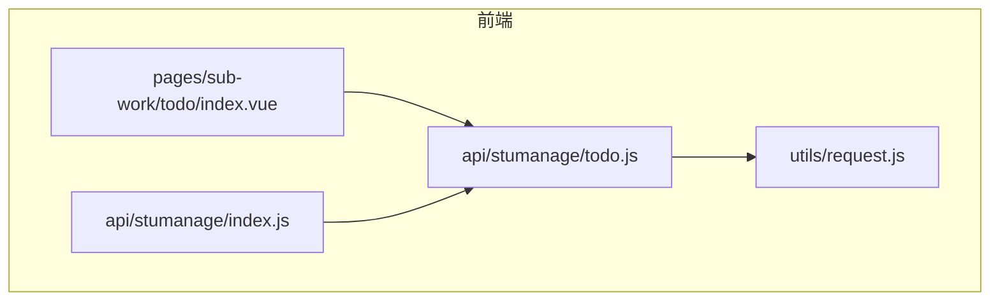
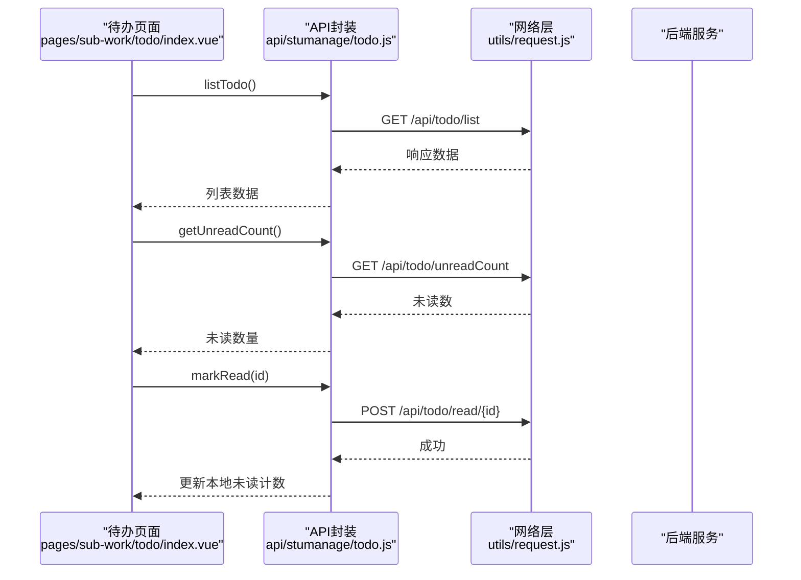
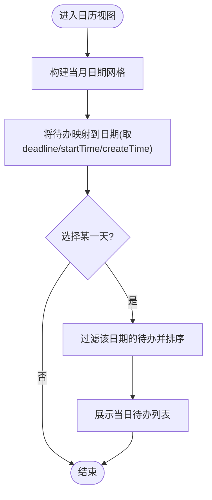
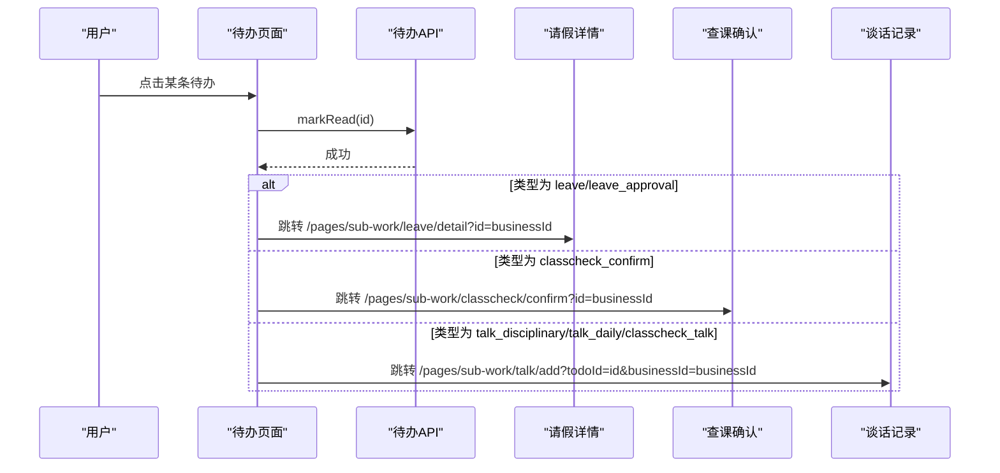
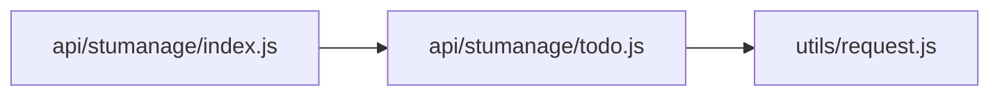

# 待办管理接口

<cite>
**本文引用的文件**
- [api/stumanage/todo.js](file://api/stumanage/todo.js)
- [pages/sub-work/todo/index.vue](file://pages/sub-work/todo/index.vue)
- [api/stumanage/index.js](file://api/stumanage/index.js)
- [utils/request.js](file://utils/request.js)
</cite>

## 目录
1. [简介](#简介)
2. [项目结构](#项目结构)
3. [核心组件](#核心组件)
4. [架构总览](#架构总览)
5. [详细组件分析](#详细组件分析)
6. [依赖分析](#依赖分析)
7. [性能考虑](#性能考虑)
8. [故障排查指南](#故障排查指南)
9. [结论](#结论)
10. [附录](#附录)

## 简介
本文件为“智能待办系统”的前端接口文档，聚焦于待办事项的创建、更新、删除、查询等基础操作，并基于现有代码梳理数据模型字段、分类与标签、周日历视图的数据组织方式、提醒机制与通知入口、批量操作与导入导出现状、统计分析接口现状，以及与请假、查课、谈话等业务模块的集成点。同时提供完整的业务流程示例，帮助开发者快速理解与对接。

## 项目结构
待办相关能力在前端以模块化 API 封装与页面视图相结合的方式呈现：
- API 层：统一在 api/stumanage/todo.js 中定义待办相关的请求方法，并通过 api/stumanage/index.js 聚合导出。
- 页面层：sub-work/todo/index.vue 实现待办的列表与日历视图、筛选排序、未读计数、已读标记以及按类型跳转至业务详情页。
- 网络层：通过 utils/request.js 发起 HTTP 请求。

图表来源
- [pages/sub-work/todo/index.vue](file://pages/sub-work/todo/index.vue)
- [api/stumanage/todo.js](file://api/stumanage/todo.js)
- [api/stumanage/index.js](file://api/stumanage/index.js)
- [utils/request.js](file://utils/request.js)

章节来源
- [api/stumanage/todo.js:1-43](file://api/stumanage/todo.js#L1-L43)
- [api/stumanage/index.js:1-32](file://api/stumanage/index.js#L1-L32)
- [pages/sub-work/todo/index.vue:1-629](file://pages/sub-work/todo/index.vue#L1-L629)
- [utils/request.js](file://utils/request.js)

## 核心组件
- 待办 API 封装
  - 列表查询：GET /api/todo/list
  - 未读数：GET /api/todo/unreadCount
  - 新增：POST /api/todo
  - 删除：POST /api/todo/delete/{id}
  - 标记已读：POST /api/todo/read/{id}
- 待办页面
  - 支持“日历/清单”双视图切换
  - 支持搜索、筛选（状态、类型、时间段）、排序（时间/紧急程度）
  - 点击待办自动标记已读并按类型跳转到对应业务页

章节来源
- [api/stumanage/todo.js:4-42](file://api/stumanage/todo.js#L4-L42)
- [pages/sub-work/todo/index.vue:224-510](file://pages/sub-work/todo/index.vue#L224-L510)

## 架构总览
待办功能的前端调用链路如下：页面触发事件 → 调用 API 封装函数 → 通过 request 工具发起 HTTP 请求 → 后端返回数据 → 页面渲染或执行后续逻辑。

图表来源
- [pages/sub-work/todo/index.vue:358-374](file://pages/sub-work/todo/index.vue#L358-L374)
- [api/stumanage/todo.js:4-17](file://api/stumanage/todo.js#L4-L17)
- [utils/request.js](file://utils/request.js)

## 详细组件分析

### 数据模型与字段说明
根据页面使用与展示逻辑，待办事项对象包含以下字段（仅列出被实际使用的字段）：
- id：待办唯一标识
- title：标题
- description：描述
- status：状态（字符串或数字，“0”未完成、“1”已完成）
- isRead：是否已读（“1”已读，非“1”未读）
- todoType：类型（如 schedule、meeting、class_meeting、leave、leave_approval、talk_disciplinary、talk_daily、classcheck_talk、classcheck_confirm 等）
- urgency：紧急程度（overdue、today、tomorrow、normal）
- deadline：截止时间（完整时间字符串）
- startTime：开始时间（可选，用于全天或具体时段）
- allDay：是否全天（“1”表示全天）
- createTime：创建时间（用于默认排序）
- businessId：关联业务主键（用于跳转到具体业务详情）

说明：
- 日期比较与显示时，优先使用 deadline；若无则回退到 startTime 或 createTime。
- 类型映射用于前端展示标签与颜色区分。
- 紧急程度用于排序与视觉提示。

章节来源
- [pages/sub-work/todo/index.vue:284-351](file://pages/sub-work/todo/index.vue#L284-L351)
- [pages/sub-work/todo/index.vue:403-416](file://pages/sub-work/todo/index.vue#L403-L416)
- [pages/sub-work/todo/index.vue:452-469](file://pages/sub-work/todo/index.vue#L452-L469)
- [pages/index.vue:270-378](file://pages/index.vue#L270-L378)

### 基础操作接口

#### 查询待办列表
- 方法：GET
- 路径：/api/todo/list
- 参数：无
- 返回：待办列表数组（字段见数据模型）
- 用途：加载清单/日历视图数据源

章节来源
- [api/stumanage/todo.js:4-9](file://api/stumanage/todo.js#L4-L9)
- [pages/sub-work/todo/index.vue:358-369](file://pages/sub-work/todo/index.vue#L358-L369)

#### 获取未读待办数量
- 方法：GET
- 路径：/api/todo/unreadCount
- 参数：无
- 返回：未读数量
- 用途：顶部提示条显示未读总数

章节来源
- [api/stumanage/todo.js:12-17](file://api/stumanage/todo.js#L12-L17)
- [pages/sub-work/todo/index.vue:370-374](file://pages/sub-work/todo/index.vue#L370-L374)

#### 新增待办
- 方法：POST
- 路径：/api/todo
- 参数：待办对象（参考数据模型字段）
- 返回：新增结果（通常包含新 ID）
- 用途：创建新的待办事项

章节来源
- [api/stumanage/todo.js:20-26](file://api/stumanage/todo.js#L20-L26)

#### 删除待办
- 方法：POST
- 路径：/api/todo/delete/{id}
- 参数：id（路径参数）
- 返回：删除结果
- 用途：移除指定待办

章节来源
- [api/stumanage/todo.js:29-34](file://api/stumanage/todo.js#L29-L34)

#### 标记已读
- 方法：POST
- 路径：/api/todo/read/{id}
- 参数：id（路径参数）
- 返回：成功标志
- 用途：用户点击待办后标记已读，减少未读计数

章节来源
- [api/stumanage/todo.js:37-42](file://api/stumanage/todo.js#L37-L42)
- [pages/sub-work/todo/index.vue:433-439](file://pages/sub-work/todo/index.vue#L433-L439)

### 分类与标签管理
- 类型枚举（todoType）：schedule、meeting、class_meeting、leave、leave_approval、talk_disciplinary、talk_daily、classcheck_talk、classcheck_confirm 等
- 标签展示：根据类型映射为中文标签，并以不同颜色区分
- 筛选：支持按类型筛选
- 注意：当前未见独立的“分类/标签”CRUD 接口，类型由前端常量维护并与后端约定

章节来源
- [pages/sub-work/todo/index.vue:255-265](file://pages/sub-work/todo/index.vue#L255-L265)
- [pages/sub-work/todo/index.vue:452-469](file://pages/sub-work/todo/index.vue#L452-L469)

### 周日历视图与日期筛选
- 日历视图：按月构建 42 天网格，计算每格所属日期及当天待办集合
- 选中日期的待办：从全量列表中过滤出与选中日期匹配的项，并按 startTime 或 deadline 排序
- 日期筛选：支持今天、本周、本月、自定义区间
- 时间解析：优先使用 deadline，其次 startTime，最后 createTime

图表来源
- [pages/sub-work/todo/index.vue:381-407](file://pages/sub-work/todo/index.vue#L381-L407)
- [pages/sub-work/todo/index.vue:284-292](file://pages/sub-work/todo/index.vue#L284-L292)

章节来源
- [pages/sub-work/todo/index.vue:281-351](file://pages/sub-work/todo/index.vue#L281-L351)
- [pages/sub-work/todo/index.vue:381-407](file://pages/sub-work/todo/index.vue#L381-L407)

### 提醒机制与通知接口
- 提醒维度：
  - 紧急程度（urgency）：overdue/today/tomorrow/normal
  - 截止时间（deadline）与开始时间（startTime）
  - 全天标记（allDay）
- 通知入口：
  - 未读计数：getUnreadCount 接口
  - 已读标记：markRead 接口
- 说明：当前未见定时任务或推送配置接口，提醒主要依赖前端对数据的展示与交互

章节来源
- [api/stumanage/todo.js:12-17](file://api/stumanage/todo.js#L12-L17)
- [api/stumanage/todo.js:37-42](file://api/stumanage/todo.js#L37-L42)
- [pages/sub-work/todo/index.vue:408-416](file://pages/sub-work/todo/index.vue#L408-L416)
- [pages/sub-work/todo/index.vue:426-432](file://pages/sub-work/todo/index.vue#L426-L432)

### 批量操作与导入导出
- 现状：未发现批量删除、批量修改、导入、导出等专用接口
- 建议：如需扩展，可新增批量接口（例如 /api/todo/batchDelete、/api/todo/import、/api/todo/export），并在页面增加相应操作入口

章节来源
- [api/stumanage/todo.js:1-43](file://api/stumanage/todo.js#L1-L43)

### 统计与分析接口
- 现状：未发现专门的待办统计接口
- 建议：可新增统计接口（如按类型/状态/时间的汇总），以便在首页或报表中展示趋势与分布

章节来源
- [api/stumanage/todo.js:1-43](file://api/stumanage/todo.js#L1-L43)

### 与其他业务模块的集成点
- 请假：leave、leave_approval 类型跳转至 /pages/sub-work/leave/detail?id={businessId}
- 查课确认：classcheck_confirm 类型跳转至 /pages/sub-work/classcheck/confirm?id={businessId}
- 谈话记录：talk_disciplinary、talk_daily、classcheck_talk 类型跳转至 /pages/sub-work/talk/add 或 /pages/sub-work/talk/index
- 日程/会议：schedule、meeting、class_meeting 类型可在待办列表查看，必要时可扩展跳转

图表来源
- [pages/sub-work/todo/index.vue:433-451](file://pages/sub-work/todo/index.vue#L433-L451)

章节来源
- [pages/sub-work/todo/index.vue:433-451](file://pages/sub-work/todo/index.vue#L433-L451)

## 依赖分析
- 模块导出：api/stumanage/index.js 统一导出各子模块，包括待办模块
- 网络请求：所有 API 均通过 utils/request.js 封装的 request 函数发起

图表来源
- [api/stumanage/index.js:20-22](file://api/stumanage/index.js#L20-L22)
- [api/stumanage/todo.js:1-2](file://api/stumanage/todo.js#L1-L2)

章节来源
- [api/stumanage/index.js:1-32](file://api/stumanage/index.js#L1-L32)
- [api/stumanage/todo.js:1-2](file://api/stumanage/todo.js#L1-L2)

## 性能考虑
- 列表数据一次性拉取：当前页面在 onShow 时拉取全部待办，适合中小规模数据；若数据量大，建议后端分页并提供按日期/类型/状态的筛选接口，以减少前端过滤开销
- 前端过滤与排序：当前在 computed 中进行多条件过滤与排序，复杂度随数据量线性增长；建议在大数据场景下将筛选与排序下沉至后端
- 日历视图构建：每月固定 42 个格子，计算开销稳定；但每日待办集合需遍历全量列表，建议后端提供按日期聚合的接口以提升性能

[本节为通用指导，不直接分析具体文件]

## 故障排查指南
- 列表为空
  - 检查 /api/todo/list 是否返回空数组
  - 检查页面是否在 onShow 中正确调用 getList
- 未读计数不更新
  - 检查 markRead 调用是否成功
  - 检查本地 unreadCount 是否同步递减
- 日历日期无数据
  - 检查 deadline/startTime/createTime 是否为有效时间字符串
  - 检查日期截取与比较逻辑是否正确
- 跳转失败
  - 检查业务页路由是否存在
  - 检查 businessId 是否传递正确

章节来源
- [pages/sub-work/todo/index.vue:358-374](file://pages/sub-work/todo/index.vue#L358-L374)
- [pages/sub-work/todo/index.vue:433-451](file://pages/sub-work/todo/index.vue#L433-L451)
- [pages/sub-work/todo/index.vue:403-407](file://pages/sub-work/todo/index.vue#L403-L407)

## 结论
当前待办模块提供了基础的增删改查与未读计数、已读标记能力，并在前端实现了丰富的交互体验（双视图、筛选、排序、类型标签、日历聚合）。尚未发现批量操作、导入导出与统计接口，建议后续按需扩展。与请假、查课、谈话等业务的集成通过类型与业务 ID 完成，具备良好的扩展性。

[本节为总结性内容，不直接分析具体文件]

## 附录

### 接口一览
- 列表查询
  - 方法：GET
  - 路径：/api/todo/list
  - 参数：无
  - 返回：待办列表
- 未读计数
  - 方法：GET
  - 路径：/api/todo/unreadCount
  - 参数：无
  - 返回：未读数量
- 新增待办
  - 方法：POST
  - 路径：/api/todo
  - 参数：待办对象
  - 返回：新增结果
- 删除待办
  - 方法：POST
  - 路径：/api/todo/delete/{id}
  - 参数：id
  - 返回：删除结果
- 标记已读
  - 方法：POST
  - 路径：/api/todo/read/{id}
  - 参数：id
  - 返回：成功标志

章节来源
- [api/stumanage/todo.js:4-42](file://api/stumanage/todo.js#L4-L42)

### 典型业务流程示例
- 打开待办页面
  - 拉取列表与未读数
  - 默认进入日历视图，构建当月网格
- 切换至清单视图
  - 支持搜索、筛选、排序
- 点击某条待办
  - 标记已读
  - 根据类型跳转到对应业务页
- 筛选与日期范围
  - 支持今天/本周/本月/自定义区间
  - 日历视图按日期聚合展示

章节来源
- [pages/sub-work/todo/index.vue:353-374](file://pages/sub-work/todo/index.vue#L353-L374)
- [pages/sub-work/todo/index.vue:281-351](file://pages/sub-work/todo/index.vue#L281-L351)
- [pages/sub-work/todo/index.vue:433-451](file://pages/sub-work/todo/index.vue#L433-L451)