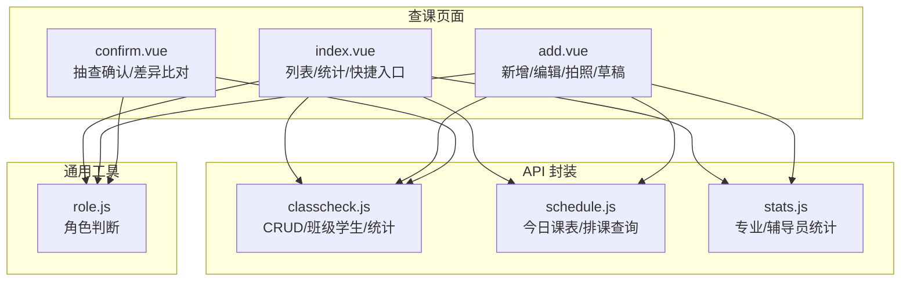
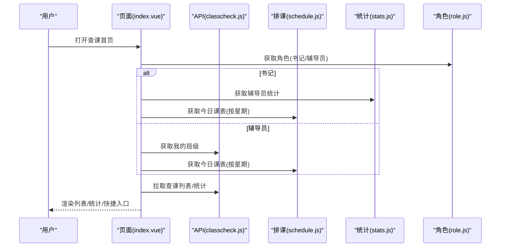
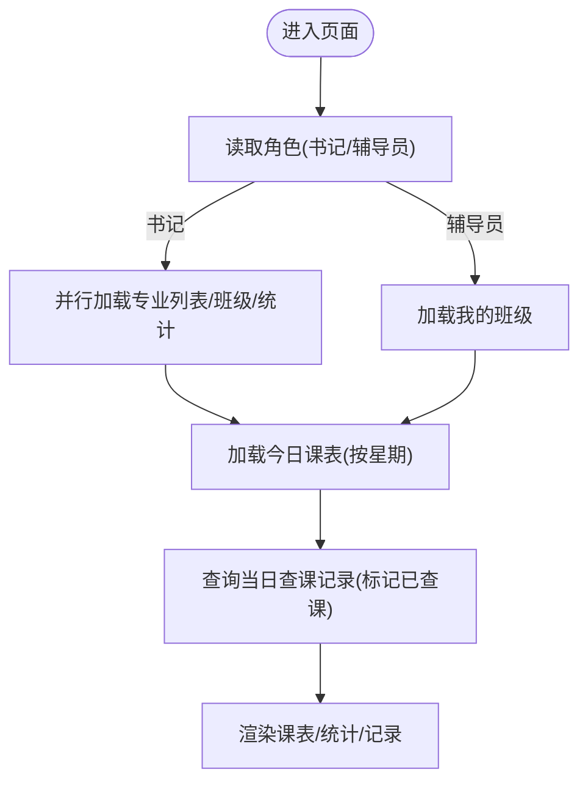
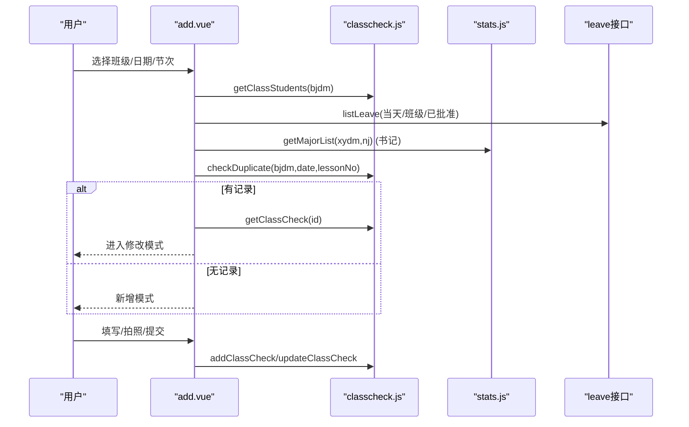
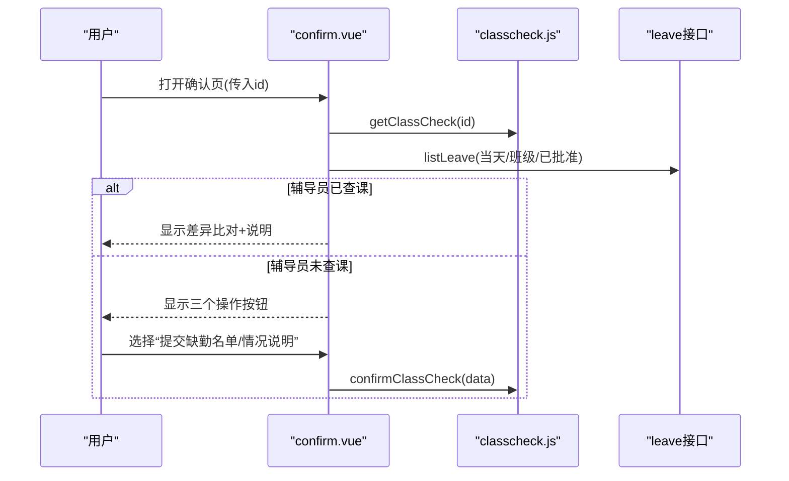
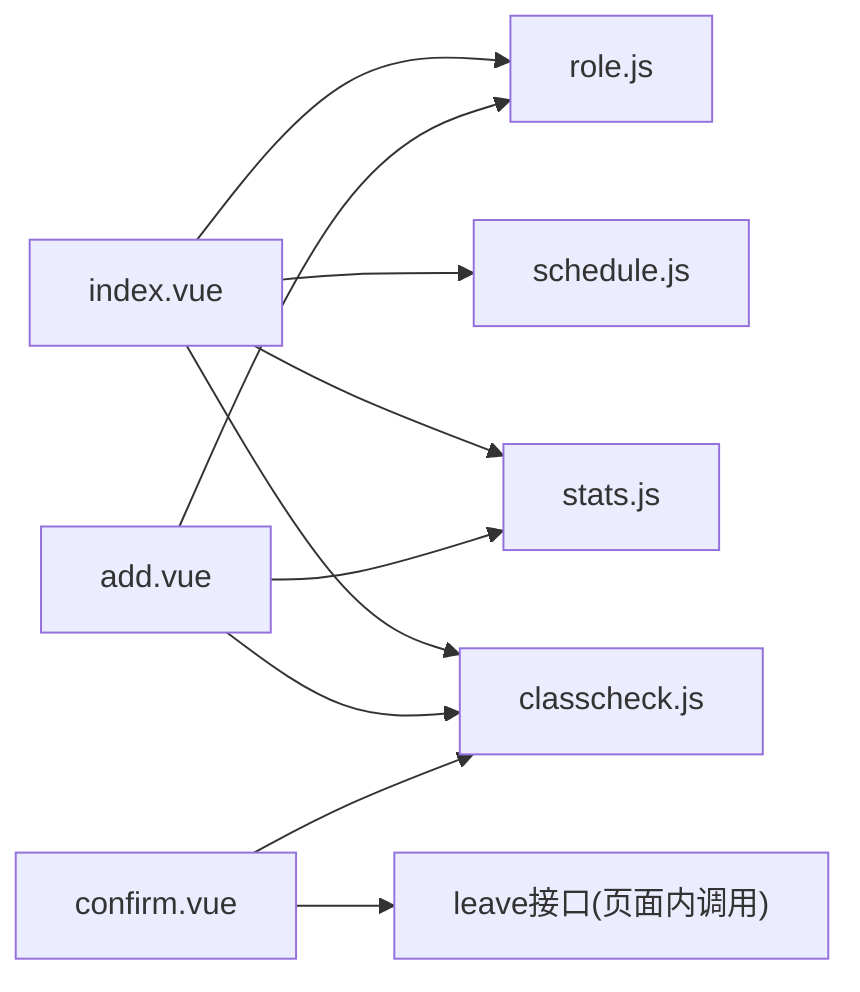
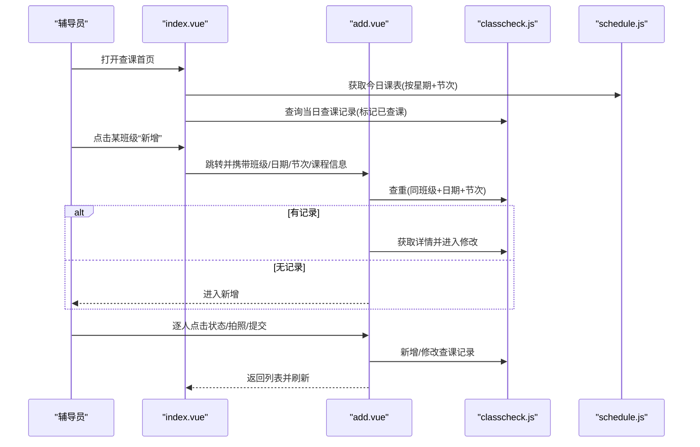
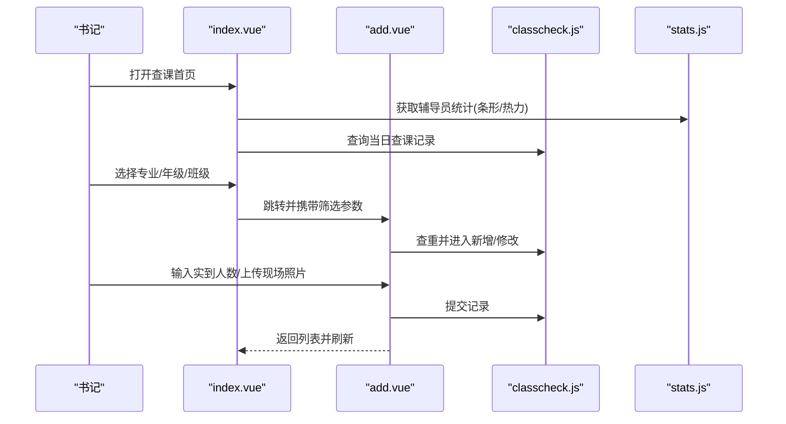

# 查课管理接口

<cite>
**本文引用的文件**   
- [api/stumanage/classcheck.js](file://api/stumanage/classcheck.js)
- [pages/sub-work/classcheck/index.vue](file://pages/sub-work/classcheck/index.vue)
- [pages/sub-work/classcheck/add.vue](file://pages/sub-work/classcheck/add.vue)
- [pages/sub-work/classcheck/confirm.vue](file://pages/sub-work/classcheck/confirm.vue)
- [api/stumanage/schedule.js](file://api/stumanage/schedule.js)
- [api/stumanage/stats.js](file://api/stumanage/stats.js)
- [utils/role.js](file://utils/role.js)
</cite>

## 目录
1. [简介](#简介)
2. [项目结构](#项目结构)
3. [核心组件](#核心组件)
4. [架构总览](#架构总览)
5. [详细组件分析](#详细组件分析)
6. [依赖关系分析](#依赖关系分析)
7. [性能与体验优化](#性能与体验优化)
8. [安全与校验机制](#安全与校验机制)
9. [排课系统集成](#排课系统集成)
10. [数据模型与字段定义](#数据模型与字段定义)
11. [业务流程示例与最佳实践](#业务流程示例与最佳实践)
12. [故障排查指南](#故障排查指南)
13. [结论](#结论)

## 简介
本文件面向移动端“查课管理”功能，覆盖课堂检查登记、抽查确认、记录管理、统计报表等能力。文档基于前端代码实现进行梳理，包含：
- 查课数据类型（课程信息、学生出勤、检查结果）
- 完整工作流（从计划制定到结果录入）
- 批量查课与快速录入
- 统计与报表数据接口
- 安全检查（位置验证、时间控制）
- 与排课系统的集成方式
- 典型流程示例与最佳实践

说明：
- 后端接口路径以移动端 API 封装为准；若需服务端契约，请结合后端实现对照。
- 本文不直接展示具体代码内容，所有实现细节通过“章节来源”标注对应文件与行号。

## 项目结构
查课相关的前端模块主要分布在以下位置：
- API 封装：api/stumanage/classcheck.js、schedule.js、stats.js
- 页面：pages/sub-work/classcheck/{index, add, confirm}.vue
- 角色工具：utils/role.js

图表来源
- [pages/sub-work/classcheck/index.vue:1-800](file://pages/sub-work/classcheck/index.vue#L1-L800)
- [pages/sub-work/classcheck/add.vue:1-800](file://pages/sub-work/classcheck/add.vue#L1-L800)
- [pages/sub-work/classcheck/confirm.vue:1-800](file://pages/sub-work/classcheck/confirm.vue#L1-L800)
- [api/stumanage/classcheck.js:1-67](file://api/stumanage/classcheck.js#L1-L67)
- [api/stumanage/schedule.js:1-25](file://api/stumanage/schedule.js#L1-L25)
- [api/stumanage/stats.js:1-52](file://api/stumanage/stats.js#L1-L52)
- [utils/role.js:1-165](file://utils/role.js#L1-L165)

章节来源
- [pages/sub-work/classcheck/index.vue:1-800](file://pages/sub-work/classcheck/index.vue#L1-L800)
- [pages/sub-work/classcheck/add.vue:1-800](file://pages/sub-work/classcheck/add.vue#L1-L800)
- [pages/sub-work/classcheck/confirm.vue:1-800](file://pages/sub-work/classcheck/confirm.vue#L1-L800)
- [api/stumanage/classcheck.js:1-67](file://api/stumanage/classcheck.js#L1-L67)
- [api/stumanage/schedule.js:1-25](file://api/stumanage/schedule.js#L1-L25)
- [api/stumanage/stats.js:1-52](file://api/stumanage/stats.js#L1-L52)
- [utils/role.js:1-165](file://utils/role.js#L1-L165)

## 核心组件
- 查课列表与统计页（index.vue）
  - 展示当日/指定日期查课次数、出勤率、缺勤人数
  - 显示“我的班级”或“学院班级”，按节次筛选
  - 加载辅导员排名/热力图统计（书记视图）
  - 提供“新增”快捷入口与“已查课”标记
- 查课登记/编辑页（add.vue）
  - 支持辅导员与学生明细模式（点击状态循环：到课→迟到→早退→旷课）
  - 支持书记角色“实到人数+现场照片”快速录入
  - 自动查重并进入修改模式，本地草稿保存/恢复
  - 请假联动（当天有效请假）
- 抽查确认页（confirm.vue）
  - 场景化引导：辅导员已查课/未查课
  - 数据差异比对与说明填写
  - 补登请假提示与操作入口
  - 提交确认（含人数校验）

章节来源
- [pages/sub-work/classcheck/index.vue:1-800](file://pages/sub-work/classcheck/index.vue#L1-L800)
- [pages/sub-work/classcheck/add.vue:1-800](file://pages/sub-work/classcheck/add.vue#L1-800)
- [pages/sub-work/classcheck/confirm.vue:1-800](file://pages/sub-work/classcheck/confirm.vue#L1-800)

## 架构总览
查课管理采用“页面 + API 封装 + 工具函数”的轻量分层：
- 页面层负责交互、表单、状态与本地缓存
- API 层统一封装 HTTP 请求，暴露业务方法
- 工具层提供角色判断等通用逻辑

图表来源
- [pages/sub-work/classcheck/index.vue:1-800](file://pages/sub-work/classcheck/index.vue#L1-L800)
- [api/stumanage/classcheck.js:1-67](file://api/stumanage/classcheck.js#L1-L67)
- [api/stumanage/schedule.js:1-25](file://api/stumanage/schedule.js#L1-L25)
- [api/stumanage/stats.js:1-52](file://api/stumanage/stats.js#L1-L52)
- [utils/role.js:1-165](file://utils/role.js#L1-L165)

## 详细组件分析

### 查课列表与统计（index.vue）
- 关键能力
  - 日期切换与“今日”快捷定位
  - 按星期与节次筛选课表，显示“已查课/未查课”标签
  - 分页加载查课记录，支持折叠展开
  - 书记视图：辅导员查课统计（条形图/热力图）
- 数据源
  - 查课列表/详情/统计：classcheck.js
  - 今日课表：schedule.js
  - 辅导员统计：stats.js
  - 角色判定：role.js

图表来源
- [pages/sub-work/classcheck/index.vue:1-800](file://pages/sub-work/classcheck/index.vue#L1-L800)
- [api/stumanage/schedule.js:1-25](file://api/stumanage/schedule.js#L1-L25)
- [api/stumanage/stats.js:1-52](file://api/stumanage/stats.js#L1-L52)
- [api/stumanage/classcheck.js:1-67](file://api/stumanage/classcheck.js#L1-L67)

章节来源
- [pages/sub-work/classcheck/index.vue:1-800](file://pages/sub-work/classcheck/index.vue#L1-L800)

### 查课登记/编辑（add.vue）
- 关键能力
  - 辅导员模式：逐人点击切换状态（到课→迟到→早退→旷课），实时统计异常人数
  - 书记模式：输入实到人数，上传至少2张现场照片（前后教室须含教师）
  - 自动查重：同班级+日期+节次已有记录则进入修改模式
  - 草稿机制：退出/卸载时保存，返回时恢复
  - 请假联动：当天有效请假自动高亮
- 数据源
  - 班级/学生：classcheck.js
  - 请假：leave 接口（由页面调用）
  - 专业/年级筛选（书记）：stats.js
  - 角色判定：role.js

图表来源
- [pages/sub-work/classcheck/add.vue:1-800](file://pages/sub-work/classcheck/add.vue#L1-L800)
- [api/stumanage/classcheck.js:1-67](file://api/stumanage/classcheck.js#L1-L67)
- [api/stumanage/stats.js:1-52](file://api/stumanage/stats.js#L1-L52)

章节来源
- [pages/sub-work/classcheck/add.vue:1-800](file://pages/sub-work/classcheck/add.vue#L1-L800)

### 抽查确认（confirm.vue）
- 关键能力
  - 场景识别：辅导员是否已查课
  - 差异比对：抽查统计未到 vs 辅导员统计未到，要求填写差异说明
  - 未登记请假提醒：列出当天已批准但未登记的请假人员
  - 提交确认：支持“提交缺勤名单/情况说明”，并进行人数校验
- 数据源
  - 查课详情/确认：classcheck.js
  - 学生列表：classcheck.js
  - 请假：leave 接口

图表来源
- [pages/sub-work/classcheck/confirm.vue:1-800](file://pages/sub-work/classcheck/confirm.vue#L1-L800)
- [api/stumanage/classcheck.js:1-67](file://api/stumanage/classcheck.js#L1-L67)

章节来源
- [pages/sub-work/classcheck/confirm.vue:1-800](file://pages/sub-work/classcheck/confirm.vue#L1-L800)

## 依赖关系分析
- 页面与 API 的耦合
  - index.vue 依赖 classcheck.js、schedule.js、stats.js、role.js
  - add.vue 依赖 classcheck.js、stats.js、role.js、upload/request
  - confirm.vue 依赖 classcheck.js、leave 接口
- 外部系统
  - 排课系统：通过 schedule.js 的 /integration/classSchedule/list 与 /api/classschedule/today 对接
  - 请假系统：通过 leave 接口获取当天有效请假
- 角色体系
  - role.js 提供 isSecretary/isCounselor/isAdmin/isTeacher 等判断，影响页面分支与数据范围

图表来源
- [pages/sub-work/classcheck/index.vue:1-800](file://pages/sub-work/classcheck/index.vue#L1-L800)
- [pages/sub-work/classcheck/add.vue:1-800](file://pages/sub-work/classcheck/add.vue#L1-L800)
- [pages/sub-work/classcheck/confirm.vue:1-800](file://pages/sub-work/classcheck/confirm.vue#L1-L800)
- [api/stumanage/classcheck.js:1-67](file://api/stumanage/classcheck.js#L1-L67)
- [api/stumanage/schedule.js:1-25](file://api/stumanage/schedule.js#L1-L25)
- [api/stumanage/stats.js:1-52](file://api/stumanage/stats.js#L1-L52)
- [utils/role.js:1-165](file://utils/role.js#L1-L165)

章节来源
- [api/stumanage/classcheck.js:1-67](file://api/stumanage/classcheck.js#L1-L67)
- [api/stumanage/schedule.js:1-25](file://api/stumanage/schedule.js#L1-L25)
- [api/stumanage/stats.js:1-52](file://api/stumanage/stats.js#L1-L52)
- [utils/role.js:1-165](file://utils/role.js#L1-L165)

## 性能与体验优化
- 并发加载
  - 书记角色在加载班级前，并行拉取专业列表、班级列表与统计数据，减少首屏等待
- 分页与增量更新
  - 查课列表使用分页，第一页替换、后续追加，避免全量刷新
- 本地草稿
  - 新增/编辑页按“班级+日期+节次”维度保存草稿，提升断点续录体验
- 图片缩略图
  - 列表优先使用后端返回的 thumbnailBase64，降低网络开销
- 节流与防抖
  - 建议对频繁触发的“切换节次/日期”增加节流，避免重复请求

[本节为通用建议，无需源码引用]

## 安全与校验机制
- 时间控制
  - 自动根据当前时间匹配“第X节”时间段，限制非上课时段默认值
  - 提交前可结合后端进行“允许录入的时间窗口”校验（建议）
- 地点验证
  - 建议在拍照上传前增加 GPS/WiFi 指纹校验，确保在教室范围内（建议）
- 权限控制
  - 书记仅能查看本院班级与统计；辅导员仅能查看所带班级
- 数据一致性
  - 提交前执行“人数校验”：应到 ≥ 实到 + 请假 + 缺勤
  - 查重机制：同班级+日期+节次只保留一条记录，重复自动进入修改

章节来源
- [pages/sub-work/classcheck/add.vue:1-800](file://pages/sub-work/classcheck/add.vue#L1-L800)
- [pages/sub-work/classcheck/confirm.vue:1-800](file://pages/sub-work/classcheck/confirm.vue#L1-L800)

## 排课系统集成
- 接口
  - 查询课表列表：/integration/classSchedule/list
  - 获取当天课表（按星期）：/api/classschedule/today?weekday=1..7
- 使用方式
  - 首页按“星期+节次”过滤出当前节次的班级课表
  - 将课程名称、教室、任课教师等信息带入查课登记页，减少手工输入

章节来源
- [api/stumanage/schedule.js:1-25](file://api/stumanage/schedule.js#L1-L25)
- [pages/sub-work/classcheck/index.vue:1-800](file://pages/sub-work/classcheck/index.vue#L1-L800)

## 数据模型与字段定义
以下为移动端侧使用的关键字段集合（来源于页面与 API 封装的使用处）。实际后端字段以服务端实现为准。

- 查课主记录（ClassCheck）
  - id: 记录ID
  - bjdm: 班级代码
  - bjmc/bjjc: 班级名称/简称
  - checkDate: 查课日期
  - lessonNo: 节次
  - courseName: 课程名称
  - classRoom: 教室
  - classTeacher: 任课教师
  - totalStudents: 应到人数
  - presentCount: 实到人数
  - leaveCount: 请假人数
  - absentCount: 缺勤人数
  - remark: 备注/差异说明
  - attachmentList: 附件列表（含 filePath、fileName、thumbnailBase64 等）
  - detailList: 学生明细（xh、studentName、absentType: late/early_leave/truant）
  - checkStatus: 状态（如 1=已完成，其他=进行中）
  - checkerRole: 抽查人角色（secretary/student_leader/duty_staff/leader/counselor）
  - checkName: 抽查人姓名
  - checkDateStr: 格式化日期（前端计算）

- 班级（Class）
  - bjdm: 班级代码
  - bjjc/bjname: 班级简称/全称
  - zydm/majorCode: 专业代码
  - majorName/zyname/zymc: 专业名称
  - nj/grade/njdm: 年级
  - bcrs: 应到人数（书记模式用）

- 学生（Student）
  - xh: 学号
  - studentName: 姓名
  - 其他基础信息（视后端返回）

- 请假（Leave）
  - xh: 学号
  - studentName: 姓名
  - startTime/endTime: 起止时间
  - leaveReason/qjyy: 请假原因
  - approvalStatus: 审批状态（approved 表示已批准）

- 统计（Stats）
  - 辅导员统计：counselorName/fdyName、checkCount
  - 专业统计：zydm、majorName、studentCount、maleCount、femaleCount、classCount

章节来源
- [pages/sub-work/classcheck/index.vue:1-800](file://pages/sub-work/classcheck/index.vue#L1-L800)
- [pages/sub-work/classcheck/add.vue:1-800](file://pages/sub-work/classcheck/add.vue#L1-L800)
- [pages/sub-work/classcheck/confirm.vue:1-800](file://pages/sub-work/classcheck/confirm.vue#L1-L800)
- [api/stumanage/classcheck.js:1-67](file://api/stumanage/classcheck.js#L1-L67)
- [api/stumanage/stats.js:1-52](file://api/stumanage/stats.js#L1-L52)

## 业务流程示例与最佳实践

### 端到端流程（辅导员）

图表来源
- [pages/sub-work/classcheck/index.vue:1-800](file://pages/sub-work/classcheck/index.vue#L1-L800)
- [pages/sub-work/classcheck/add.vue:1-800](file://pages/sub-work/classcheck/add.vue#L1-L800)
- [api/stumanage/classcheck.js:1-67](file://api/stumanage/classcheck.js#L1-L67)
- [api/stumanage/schedule.js:1-25](file://api/stumanage/schedule.js#L1-L25)

### 端到端流程（书记）

图表来源
- [pages/sub-work/classcheck/index.vue:1-800](file://pages/sub-work/classcheck/index.vue#L1-L800)
- [pages/sub-work/classcheck/add.vue:1-800](file://pages/sub-work/classcheck/add.vue#L1-L800)
- [api/stumanage/classcheck.js:1-67](file://api/stumanage/classcheck.js#L1-L67)
- [api/stumanage/stats.js:1-52](file://api/stumanage/stats.js#L1-L52)

### 批量查课与快速录入
- 批量查课
  - 通过“今日课表”按节次批量展示待查课班级，逐一点击快速进入登记
  - 建议后端提供“批量创建/批量更新”接口以提升效率（建议）
- 快速录入（书记）
  - 仅需输入“实到人数+现场照片”，无需逐人标记，适合大规模班级
- 草稿与自动查重
  - 利用本地草稿与自动查重，减少重复劳动与误操作

章节来源
- [pages/sub-work/classcheck/index.vue:1-800](file://pages/sub-work/classcheck/index.vue#L1-L800)
- [pages/sub-work/classcheck/add.vue:1-800](file://pages/sub-work/classcheck/add.vue#L1-L800)

### 统计与报表
- 当日统计
  - 查课次数、出勤率、缺勤人数（按日期）
- 辅导员排名/热力图
  - 按学院维度统计辅导员查课次数，支持条形图与热力图两种视图
- 专业统计
  - 专业维度的学生数、男女比例、班级规模等

章节来源
- [pages/sub-work/classcheck/index.vue:1-800](file://pages/sub-work/classcheck/index.vue#L1-L800)
- [api/stumanage/stats.js:1-52](file://api/stumanage/stats.js#L1-L52)

## 故障排查指南
- 列表为空或无法加载
  - 检查“我的班级”接口是否正常返回
  - 检查“今日课表”接口 weekday 参数是否正确
- 重复提交/重复记录
  - 确认查重接口是否可用，观察自动进入修改模式的触发条件
- 照片上传失败
  - 检查网络与权限，确认至少上传2张照片
- 人数校验失败
  - 核对“应到=实到+请假+缺勤”的关系，修正缺勤标记或请假数据
- 草稿丢失
  - 检查本地存储是否被清理，确认 key 生成规则（班级+日期+节次）

章节来源
- [pages/sub-work/classcheck/index.vue:1-800](file://pages/sub-work/classcheck/index.vue#L1-L800)
- [pages/sub-work/classcheck/add.vue:1-800](file://pages/sub-work/classcheck/add.vue#L1-L800)
- [pages/sub-work/classcheck/confirm.vue:1-800](file://pages/sub-work/classcheck/confirm.vue#L1-L800)

## 结论
本方案以移动端为核心，围绕“查课登记—抽查确认—记录管理—统计报表”形成闭环。通过角色区分、排课集成、草稿与查重、现场照片与人数校验等手段，兼顾了易用性与数据质量。后续可在后端补充批量接口、位置校验与更细粒度的时间窗口控制，进一步提升效率与安全性。