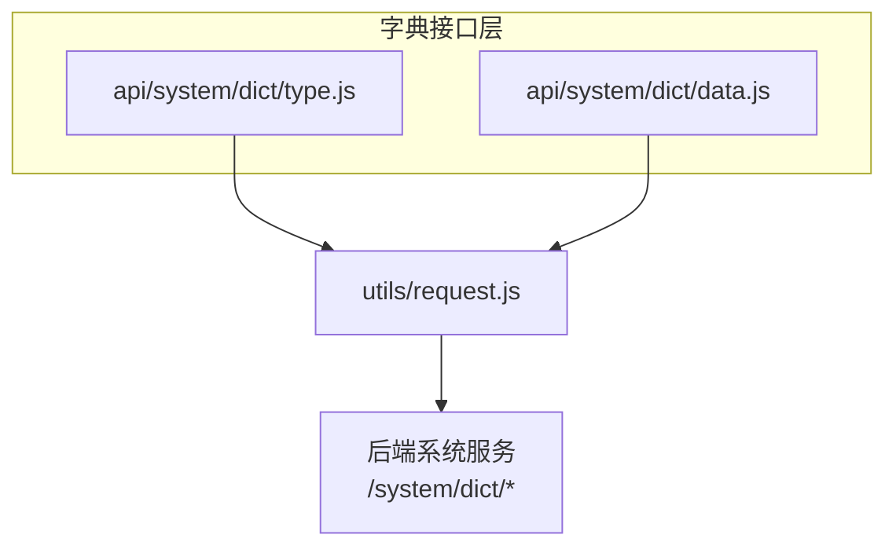
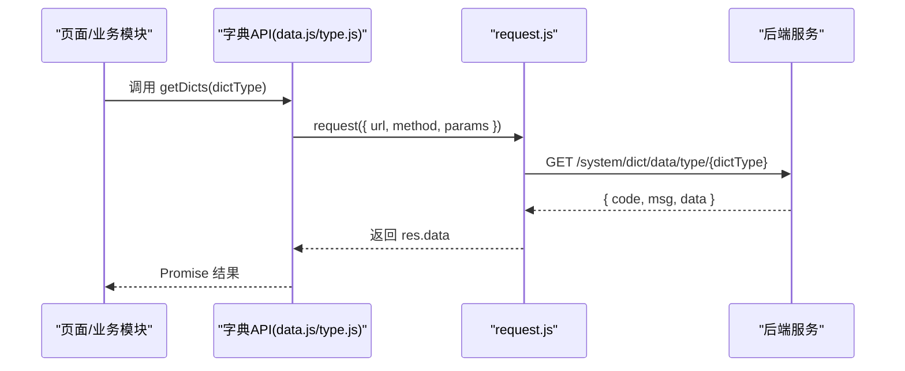
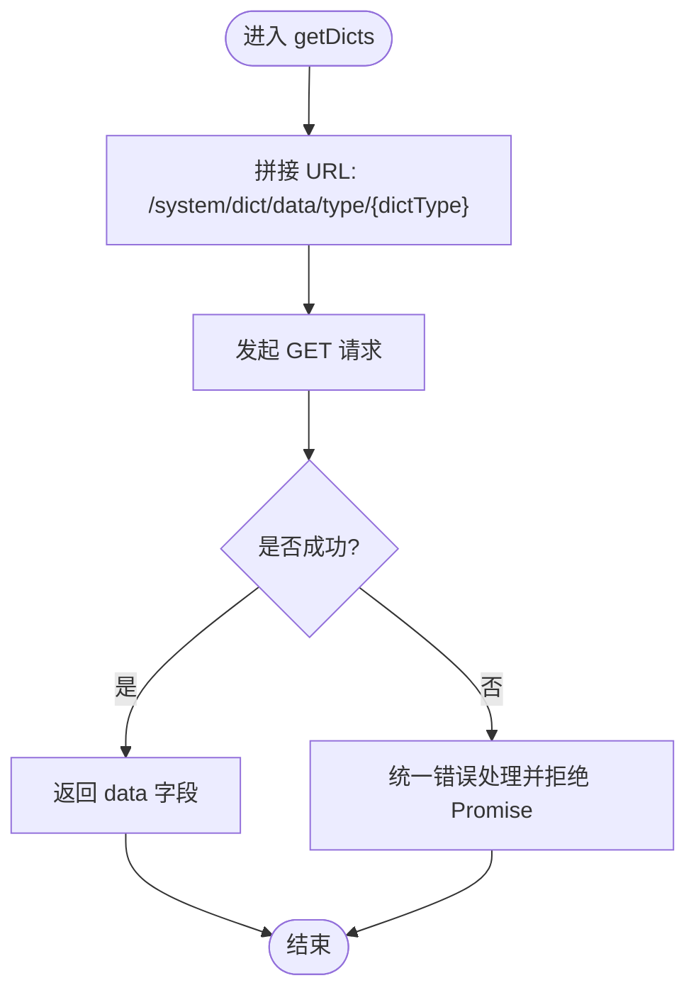
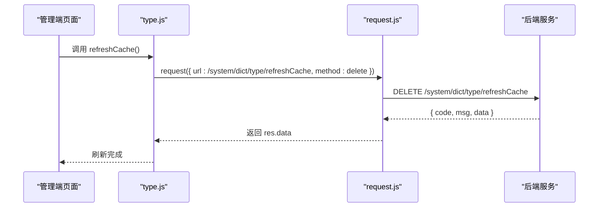
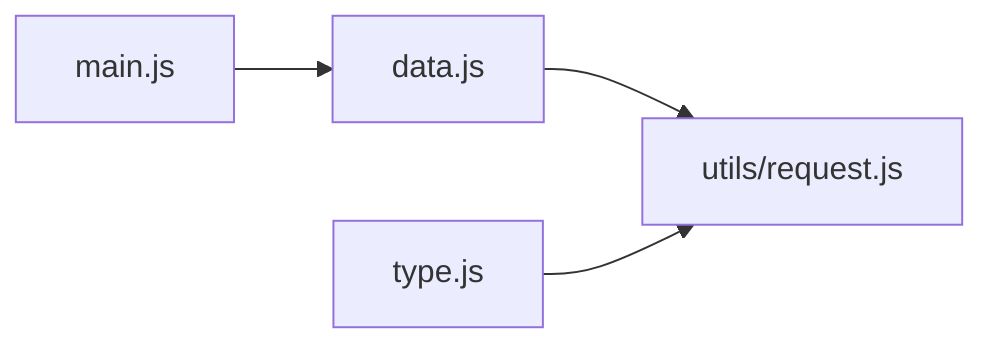

# 字典数据管理接口

<cite>
**本文引用的文件**
- [api/system/dict/data.js](file://api/system/dict/data.js)
- [api/system/dict/type.js](file://api/system/dict/type.js)
- [utils/request.js](file://utils/request.js)
- [main.js](file://main.js)
</cite>

## 目录
1. [简介](#简介)
2. [项目结构](#项目结构)
3. [核心组件](#核心组件)
4. [架构总览](#架构总览)
5. [详细组件分析](#详细组件分析)
6. [依赖关系分析](#依赖关系分析)
7. [性能与缓存策略](#性能与缓存策略)
8. [前端渲染与下拉选项生成](#前端渲染与下拉选项生成)
9. [版本管理与同步机制](#版本管理与同步机制)
10. [API 调用示例](#api-调用示例)
11. [错误处理方案](#错误处理方案)
12. [结论](#结论)

## 简介
本文件面向“字典数据管理”的前端接口层，聚焦以下目标：
- 完整记录字典类型与字典数据的 CRUD 接口（列表、详情、新增、修改、删除）
- 说明按字典类型查询、单个数据查询等常用能力
- 解释动态加载机制与缓存刷新策略
- 提供分类管理与层级结构的接入建议
- 给出前端渲染与下拉选项生成的通用方案
- 提供完整的 API 调用示例与错误处理方案

## 项目结构
与字典相关的接口定义位于 api/system/dict 目录下，分为两类：
- 字典类型接口：type.js
- 字典数据接口：data.js

请求统一通过 utils/request.js 封装的 request 方法发起，自动注入鉴权、参数序列化、错误提示与登录态处理。

图表来源
- [api/system/dict/type.js:1-61](file://api/system/dict/type.js#L1-L61)
- [api/system/dict/data.js:1-53](file://api/system/dict/data.js#L1-L53)
- [utils/request.js:1-117](file://utils/request.js#L1-L117)

章节来源
- [api/system/dict/type.js:1-61](file://api/system/dict/type.js#L1-L61)
- [api/system/dict/data.js:1-53](file://api/system/dict/data.js#L1-L53)
- [utils/request.js:1-117](file://utils/request.js#L1-L117)

## 核心组件
- 字典类型接口（type.js）
  - 列表查询：GET /system/dict/type/list
  - 详情查询：GET /system/dict/type/{dictId}
  - 新增：POST /system/dict/type
  - 修改：PUT /system/dict/type
  - 删除：DELETE /system/dict/type/{dictId}
  - 刷新缓存：DELETE /system/dict/type/refreshCache
  - 获取选择框列表：GET /system/dict/type/optionselect
- 字典数据接口（data.js）
  - 列表查询：GET /system/dict/data/list
  - 详情查询：GET /system/dict/data/{dictCode}
  - 按类型查询：GET /system/dict/data/type/{dictType}
  - 新增：POST /system/dict/data
  - 修改：PUT /system/dict/data
  - 删除：DELETE /system/dict/data/{dictCode}

章节来源
- [api/system/dict/type.js:1-61](file://api/system/dict/type.js#L1-L61)
- [api/system/dict/data.js:1-53](file://api/system/dict/data.js#L1-L53)

## 架构总览
字典数据在应用中的典型调用路径如下：页面或业务模块调用 api/system/dict 下的函数，经由 utils/request.js 统一封装后向服务端发起 HTTP 请求；服务端返回标准响应体，由 request 进行状态码解析与错误提示。

图表来源
- [api/system/dict/data.js:20-26](file://api/system/dict/data.js#L20-L26)
- [utils/request.js:10-117](file://utils/request.js#L10-L117)

## 详细组件分析

### 字典数据接口（data.js）
- 列表查询 listData(query)
  - 用途：分页或条件筛选字典数据
  - 入参：query 对象（如页码、每页条数、字典类型、关键字等）
  - 出参：后端统一响应体，通常包含数据集合与分页信息
- 详情查询 getData(dictCode)
  - 用途：根据字典数据编码获取单条数据
- 按类型查询 getDicts(dictType)
  - 用途：根据字典类型获取该类型下所有数据项，常用于下拉框、单选/多选等场景
- 新增 addData(data)
  - 用途：创建新的字典数据项
- 修改 updateData(data)
  - 用途：更新已有字典数据项
- 删除 delData(dictCode)
  - 用途：删除指定字典数据项

图表来源
- [api/system/dict/data.js:20-26](file://api/system/dict/data.js#L20-L26)
- [utils/request.js:24-113](file://utils/request.js#L24-L113)

章节来源
- [api/system/dict/data.js:1-53](file://api/system/dict/data.js#L1-L53)

### 字典类型接口（type.js）
- 列表查询 listType(query)
  - 用途：分页或条件筛选字典类型
- 详情查询 getType(dictId)
  - 用途：根据类型 ID 获取类型详情
- 新增 addType(data)
  - 用途：创建新字典类型
- 修改 updateType(data)
  - 用途：更新字典类型
- 删除 delType(dictId)
  - 用途：删除字典类型
- 刷新缓存 refreshCache()
  - 用途：触发后端刷新字典缓存，确保后续查询为最新数据
- 获取选择框列表 optionselect()
  - 用途：返回可用于选择框的字典类型列表

图表来源
- [api/system/dict/type.js:46-52](file://api/system/dict/type.js#L46-L52)
- [utils/request.js:24-113](file://utils/request.js#L24-L113)

章节来源
- [api/system/dict/type.js:1-61](file://api/system/dict/type.js#L1-L61)

## 依赖关系分析
- 字典接口均依赖统一的网络请求封装 utils/request.js
- main.js 中引入了 getDicts，表明应用启动阶段可能预加载部分字典数据，以提升首屏体验

图表来源
- [api/system/dict/data.js:1-53](file://api/system/dict/data.js#L1-L53)
- [api/system/dict/type.js:1-61](file://api/system/dict/type.js#L1-L61)
- [utils/request.js:1-117](file://utils/request.js#L1-L117)
- [main.js:1-20](file://main.js#L1-L20)

章节来源
- [api/system/dict/data.js:1-53](file://api/system/dict/data.js#L1-L53)
- [api/system/dict/type.js:1-61](file://api/system/dict/type.js#L1-L61)
- [utils/request.js:1-117](file://utils/request.js#L1-L117)
- [main.js:1-20](file://main.js#L1-L20)

## 性能与缓存策略
- 动态加载
  - 使用 getDicts(dictType) 按需加载指定类型的字典数据，避免一次性拉取全部字典，减少首屏压力
- 缓存刷新
  - 当字典数据发生变更时，调用 refreshCache() 通知后端刷新缓存，保证后续查询一致性
- 全局预加载
  - 可在应用初始化阶段（如 main.js）批量预加载常用字典类型，提升交互响应速度

章节来源
- [api/system/dict/data.js:20-26](file://api/system/dict/data.js#L20-L26)
- [api/system/dict/type.js:46-52](file://api/system/dict/type.js#L46-L52)
- [main.js:1-20](file://main.js#L1-L20)

## 前端渲染与下拉选项生成
- 下拉选项生成
  - 调用 getDicts(dictType) 获取某类型的数据集
  - 将数据集映射为前端组件所需的 options 格式（例如 label/value 对），并按 sort 排序
- 表单联动
  - 父级字典变化时，重新调用 getDicts(子级类型) 以刷新子级下拉选项
- 选择框列表
  - 使用 optionselect() 获取所有可用的字典类型，用于构建“选择框配置器”或“字典选择器”

章节来源
- [api/system/dict/data.js:20-26](file://api/system/dict/data.js#L20-L26)
- [api/system/dict/type.js:54-60](file://api/system/dict/type.js#L54-L60)

## 版本管理与同步机制
- 版本管理
  - 当前接口层未暴露显式的版本参数；如需版本控制，建议在业务侧增加版本号字段并通过扩展参数传递至后端
- 同步机制
  - 通过 refreshCache() 触发后端刷新字典缓存，实现前后端数据一致
  - 建议在增删改操作成功后主动调用 refreshCache()，并在失败时回滚本地状态

章节来源
- [api/system/dict/type.js:46-52](file://api/system/dict/type.js#L46-L52)

## API 调用示例
以下为常见调用方式（仅描述调用流程与参数含义，不展示具体代码内容）：
- 按字典类型查询
  - 调用：getDicts(dictType)
  - 说明：传入字典类型字符串，返回该类型下的数据集合
- 查询字典数据列表
  - 调用：listData(query)
  - 说明：query 可包含分页与过滤条件（如 dictType、关键字、状态等）
- 查询字典数据详情
  - 调用：getData(dictCode)
  - 说明：传入字典数据编码，返回单条数据详情
- 新增字典数据
  - 调用：addData(data)
  - 说明：提交字典数据实体，成功后可刷新缓存
- 修改字典数据
  - 调用：updateData(data)
  - 说明：提交已存在的字典数据实体，成功后可刷新缓存
- 删除字典数据
  - 调用：delData(dictCode)
  - 说明：传入字典数据编码，成功后可刷新缓存
- 刷新字典缓存
  - 调用：refreshCache()
  - 说明：在字典数据变更后调用，确保后续查询为最新数据
- 获取字典选择框列表
  - 调用：optionselect()
  - 说明：返回可用于选择框的字典类型列表

章节来源
- [api/system/dict/data.js:1-53](file://api/system/dict/data.js#L1-L53)
- [api/system/dict/type.js:1-61](file://api/system/dict/type.js#L1-L61)

## 错误处理方案
- 统一错误处理
  - 所有字典接口均通过 request.js 统一处理：
    - 网络异常：提示“后端接口连接异常”
    - 超时：提示“系统接口请求超时”
    - 非 200 状态码：根据后端返回的 code/msg 进行提示
    - 401 未授权：尝试自动登录并重试，失败则跳转登录页
- 业务侧建议
  - 在调用增删改后捕获错误并提示用户
  - 在关键路径上调用 refreshCache() 前后可结合 loading 状态提升用户体验

章节来源
- [utils/request.js:10-117](file://utils/request.js#L10-L117)

## 结论
本仓库在前端侧提供了完善的字典类型与字典数据接口封装，支持按类型查询、列表查询、详情查询以及完整的增删改操作，并提供缓存刷新与选择框列表能力。结合统一请求封装的错误处理与登录态管理，开发者可以高效地在表单、下拉框等场景中复用字典数据，同时通过缓存刷新保障数据一致性。对于更复杂的层级结构与版本管理需求，可在现有接口基础上扩展参数与业务逻辑。