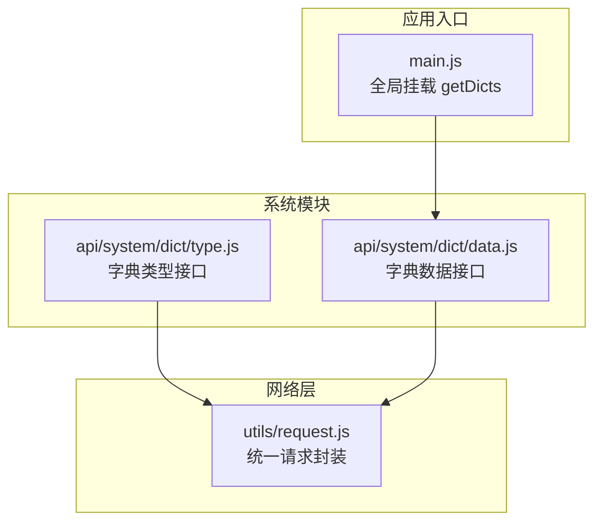
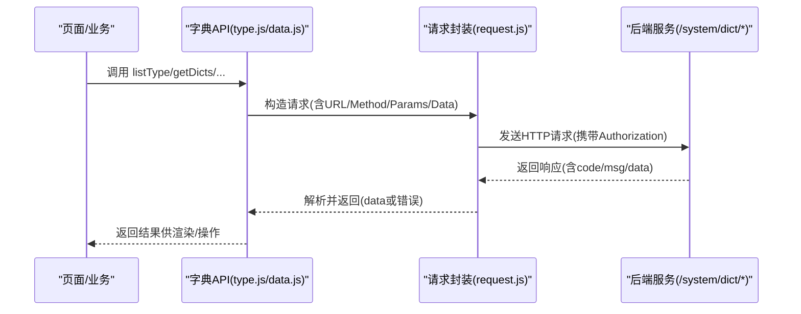
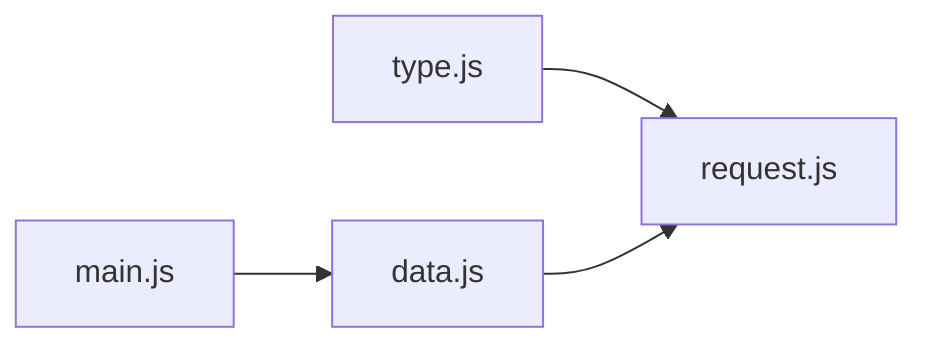
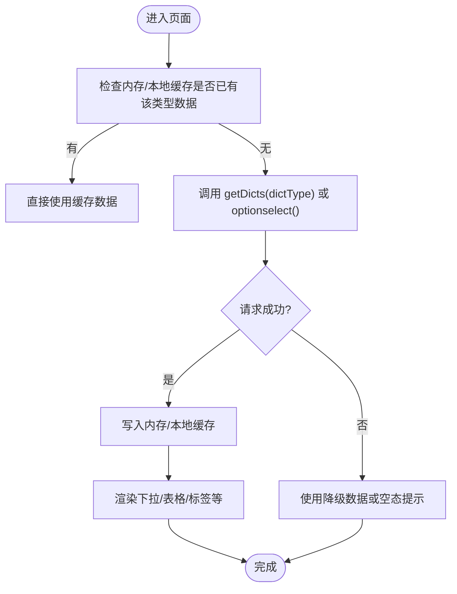

# 字典管理接口

<cite>
**本文引用的文件**   
- [api/system/dict/type.js](file://api/system/dict/type.js)
- [api/system/dict/data.js](file://api/system/dict/data.js)
- [main.js](file://main.js)
- [utils/request.js](file://utils/request.js)
</cite>

## 目录
1. [简介](#简介)
2. [项目结构](#项目结构)
3. [核心组件](#核心组件)
4. [架构总览](#架构总览)
5. [详细组件分析](#详细组件分析)
6. [依赖关系分析](#依赖关系分析)
7. [性能与缓存策略](#性能与缓存策略)
8. [前端渲染与下拉选项生成](#前端渲染与下拉选项生成)
9. [版本管理与同步机制](#版本管理与同步机制)
10. [批量导入导出](#批量导入导出)
11. [权限控制与访问限制](#权限控制与访问限制)
12. [故障排查指南](#故障排查指南)
13. [结论](#结论)

## 简介
本文件面向“字典管理”能力，覆盖字典类型与字典数据的完整接口说明。重点包括：
- 字典类型的增删改查、刷新缓存、选择框列表获取
- 字典数据的动态加载机制与缓存策略
- 字典数据的分类管理与层级结构支持（基于后端字段）
- 前端渲染与下拉选项生成方式
- 版本管理与同步机制（结合刷新缓存接口）
- 批量导入导出（建议方案）
- 权限控制与访问限制（结合请求拦截器）

## 项目结构
字典相关的前端 API 集中在 system 模块下，分为类型与数据两个子模块；应用启动时将字典查询方法挂载到全局，便于页面统一调用。

图示来源
- [api/system/dict/type.js:1-61](file://api/system/dict/type.js#L1-L61)
- [api/system/dict/data.js:1-53](file://api/system/dict/data.js#L1-L53)
- [main.js:1-31](file://main.js#L1-L31)
- [utils/request.js:1-117](file://utils/request.js#L1-L117)

章节来源
- [api/system/dict/type.js:1-61](file://api/system/dict/type.js#L1-L61)
- [api/system/dict/data.js:1-53](file://api/system/dict/data.js#L1-L53)
- [main.js:1-31](file://main.js#L1-L31)

## 核心组件
- 字典类型接口（type.js）
  - 提供字典类型的分页列表、详情、新增、修改、删除、刷新缓存、选择框列表等能力
- 字典数据接口（data.js）
  - 提供字典数据的分页列表、详情、按类型查询、新增、修改、删除等能力
- 全局挂载（main.js）
  - 将字典数据查询方法挂到 Vue 原型上，供页面便捷使用
- 请求封装（request.js）
  - 统一处理鉴权、参数拼接、错误码映射、超时与网络异常、自动重试与登出跳转

章节来源
- [api/system/dict/type.js:1-61](file://api/system/dict/type.js#L1-L61)
- [api/system/dict/data.js:1-53](file://api/system/dict/data.js#L1-L53)
- [main.js:1-31](file://main.js#L1-L31)
- [utils/request.js:1-117](file://utils/request.js#L1-L117)

## 架构总览
字典管理在前后端的交互流程如下：页面或业务逻辑通过 api 层发起请求，由 request 封装统一处理鉴权与错误，最终到达后端 /system/dict/* 系列接口。

图示来源
- [api/system/dict/type.js:1-61](file://api/system/dict/type.js#L1-L61)
- [api/system/dict/data.js:1-53](file://api/system/dict/data.js#L1-L53)
- [utils/request.js:1-117](file://utils/request.js#L1-L117)

## 详细组件分析

### 字典类型管理接口（type.js）
- 功能清单
  - 列表查询：GET /system/dict/type/list
  - 详情查询：GET /system/dict/type/{dictId}
  - 新增：POST /system/dict/type
  - 修改：PUT /system/dict/type
  - 删除：DELETE /system/dict/type/{dictId}
  - 刷新缓存：DELETE /system/dict/type/refreshCache
  - 选择框列表：GET /system/dict/type/optionselect
- 典型参数与返回
  - 列表查询支持分页与筛选参数（由后端定义），返回包含分页信息与类型集合
  - 详情返回单个类型对象
  - 新增/修改接收类型对象（包含名称、标识、状态等字段）
  - 刷新缓存用于清理服务端字典缓存，使变更立即生效
  - 选择框列表返回可直接用于下拉的简项集合
- 使用建议
  - 对类型进行增删改后，建议调用刷新缓存接口，确保后续按类型查询的数据为最新
  - 下拉选择场景可优先使用 optionselect 接口，减少不必要字段传输

章节来源
- [api/system/dict/type.js:1-61](file://api/system/dict/type.js#L1-L61)

### 字典数据管理接口（data.js）
- 功能清单
  - 列表查询：GET /system/dict/data/list
  - 详情查询：GET /system/dict/data/{dictCode}
  - 按类型查询：GET /system/dict/data/type/{dictType}
  - 新增：POST /system/dict/data
  - 修改：PUT /system/dict/data
  - 删除：DELETE /system/dict/data/{dictCode}
- 典型参数与返回
  - 列表查询支持分页与筛选（如类型标识、状态、关键字等）
  - 按类型查询返回该类型下的所有数据项，常用于前端直接渲染下拉
  - 详情返回单条数据项对象
  - 新增/修改接收数据项对象（包含键值、标签、排序、状态、备注等字段）
- 使用建议
  - 高频使用的下拉数据建议采用“按类型查询”接口一次性拉取，避免多次请求
  - 若数据量较大，可在前端做本地缓存并按需刷新

章节来源
- [api/system/dict/data.js:1-53](file://api/system/dict/data.js#L1-L53)

### 全局挂载与便捷调用（main.js）
- 将字典数据查询方法挂载到 Vue 原型，使得页面可通过 this.getDicts(dictType) 快速拉取指定类型的字典数据
- 适用于需要在多处复用同一类型数据的场景

章节来源
- [main.js:1-31](file://main.js#L1-L31)

## 依赖关系分析
- 字典 API 均依赖统一的请求封装，具备以下特性：
  - 自动注入 Authorization 头（Bearer Token）
  - GET 请求自动将 params 拼接到 URL
  - 统一错误码处理与提示
  - 会话过期自动登出与重定向
  - 网络异常与超时友好提示

图示来源
- [api/system/dict/type.js:1-61](file://api/system/dict/type.js#L1-L61)
- [api/system/dict/data.js:1-53](file://api/system/dict/data.js#L1-L53)
- [main.js:1-31](file://main.js#L1-L31)
- [utils/request.js:1-117](file://utils/request.js#L1-L117)

章节来源
- [utils/request.js:1-117](file://utils/request.js#L1-L117)

## 性能与缓存策略
- 动态加载
  - 页面按需调用 getDicts(dictType) 或 listData/query 接口，避免一次性加载全部字典
- 缓存策略建议
  - 内存缓存：在应用生命周期内维护 dictType -> items 的映射，首次加载后命中内存
  - 持久化缓存：可将常用字典写入本地存储，并在应用启动时预加载
  - 失效策略：当执行类型或数据的增删改后，主动调用 refreshCache 并清空对应内存缓存
- 并发与去抖
  - 相同 dictType 的并发请求应合并为一次请求，避免重复网络开销
- 降级与容错
  - 网络失败时回退到本地缓存；若无缓存则显示空态或默认占位

[本节为通用指导，不直接分析具体文件]

## 前端渲染与下拉选项生成
- 数据来源
  - 首选 getDicts(dictType) 获取某类型下的数据项数组
  - 也可使用 optionselect 获取仅包含展示所需字段的轻量列表
- 渲染要点
  - 将数据项映射为 { label, value } 形式供表单控件使用
  - 根据后端返回的状态字段过滤不可用项
  - 对于大量数据，建议分页或虚拟滚动
- 示例流程（概念图）

[此图为概念流程图，无需源码映射]

## 版本管理与同步机制
- 版本管理
  - 建议在字典数据模型中引入版本字段（由后端实现），每次变更递增版本号
  - 客户端记录已加载的 dictType 及其版本，下次加载前比对版本，不一致再拉取
- 同步机制
  - 管理员对类型或数据进行变更后，调用刷新缓存接口，使服务端缓存失效
  - 客户端在收到变更通知或用户触发刷新时，主动清除本地缓存并重新拉取
- 一致性保障
  - 关键页面在提交成功后，显式刷新相关字典缓存，保证 UI 与后端一致

[本节为通用指导，不直接分析具体文件]

## 批量导入导出
- 现状说明
  - 当前仓库未提供专门的批量导入/导出接口封装
- 建议方案
  - 导入：在前端提供 Excel/CSV 上传组件，调用后端提供的导入接口（需后端新增），完成后刷新字典缓存
  - 导出：调用后端导出的下载接口，保存为文件
  - 校验：前端对模板字段进行校验，失败时给出明确错误行与原因
  - 幂等：导入接口应具备幂等性，避免重复导入造成数据重复

[本节为通用指导，不直接分析具体文件]

## 权限控制与访问限制
- 鉴权
  - 所有字典接口均通过 request 封装自动附加 Authorization 头，未登录或 token 过期会触发登出与跳转
- 授权
  - 后端应在 /system/dict/* 各接口处进行角色/权限校验，仅允许具备相应权限的用户执行增删改等操作
- 安全建议
  - 列表与详情接口建议增加数据范围控制（如按组织/租户隔离）
  - 敏感字段（如内部编码）在非必要场景下不在前端展示

章节来源
- [utils/request.js:1-117](file://utils/request.js#L1-L117)

## 故障排查指南
- 常见问题
  - 401 未登录或 token 过期：检查登录态与自动登录流程
  - 500 服务器错误：查看后端日志与错误消息
  - 网络异常/超时：检查网络环境与后端可用性
  - 数据不同步：确认是否调用了刷新缓存接口，以及前端是否正确清除了本地缓存
- 定位步骤
  - 打开控制台查看请求 URL、方法与参数
  - 核对后端返回的 code 与 msg，结合错误码映射定位问题
  - 针对字典数据不一致，先刷新缓存，再验证前端缓存是否被正确清理

章节来源
- [utils/request.js:1-117](file://utils/request.js#L1-L117)

## 结论
本字典管理方案通过清晰的 API 分层与统一的请求封装，实现了类型与数据的完整管理能力。配合合理的缓存策略、版本同步与权限控制，可满足大多数业务场景的下拉与配置驱动需求。对于批量导入导出与更细粒度的权限控制，建议在后端扩展相应接口并在前端完善交互与校验。