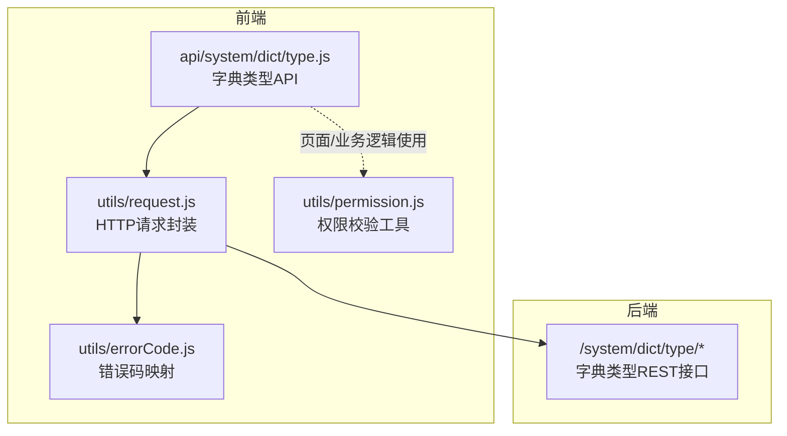
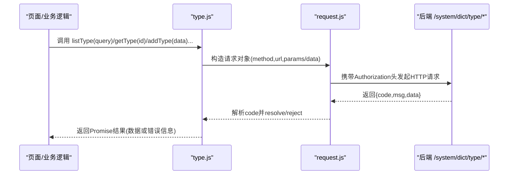
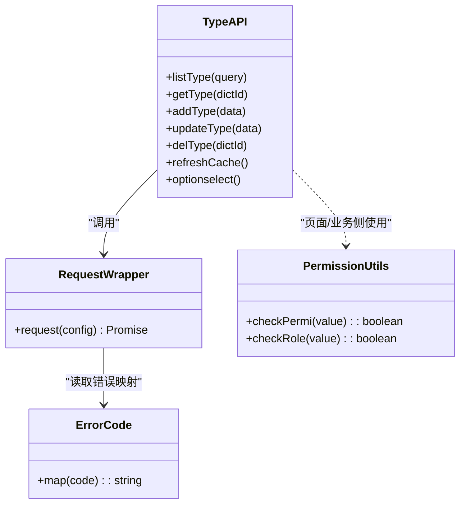

# 字典类型管理接口

<cite>
**本文引用的文件**   
- [api/system/dict/type.js](file://api/system/dict/type.js)
- [utils/request.js](file://utils/request.js)
- [utils/errorCode.js](file://utils/errorCode.js)
- [utils/permission.js](file://utils/permission.js)
</cite>

## 目录
1. [简介](#简介)
2. [项目结构](#项目结构)
3. [核心组件](#核心组件)
4. [架构总览](#架构总览)
5. [详细组件分析](#详细组件分析)
6. [依赖分析](#依赖分析)
7. [性能考虑](#性能考虑)
8. [故障排查指南](#故障排查指南)
9. [结论](#结论)
10. [附录](#附录)

## 简介
本文件面向“字典类型”的前端接口文档，覆盖完整的 CRUD 能力：新增、修改、删除、查询（含分页与详情），并提供缓存刷新与选择框列表等辅助接口。同时说明请求/响应约定、权限控制机制、错误码处理以及常见问题的排查方法。

## 项目结构
字典类型相关接口位于系统模块的字典子模块中，统一通过 HTTP 请求封装发起调用。

图表来源
- [api/system/dict/type.js:1-61](file://api/system/dict/type.js#L1-L61)
- [utils/request.js:1-117](file://utils/request.js#L1-L117)
- [utils/errorCode.js:1-7](file://utils/errorCode.js#L1-L7)
- [utils/permission.js:1-49](file://utils/permission.js#L1-L49)

章节来源
- [api/system/dict/type.js:1-61](file://api/system/dict/type.js#L1-L61)
- [utils/request.js:1-117](file://utils/request.js#L1-L117)
- [utils/errorCode.js:1-7](file://utils/errorCode.js#L1-L7)
- [utils/permission.js:1-49](file://utils/permission.js#L1-L49)

## 核心组件
- 字典类型 API 层：提供 listType、getType、addType、updateType、delType、refreshCache、optionselect 等方法，分别对应分页列表、详情、新增、修改、删除、刷新缓存、下拉选项等能力。
- 请求封装：统一注入 Authorization 头、拼接查询参数、处理超时与网络异常、对 401 进行自动登录重试或跳转登录页、将后端返回的 code/msg 转换为统一提示。
- 错误码映射：为常见状态码提供中文消息映射。
- 权限校验：提供字符权限与角色权限校验工具，供页面或按钮级控制使用。

章节来源
- [api/system/dict/type.js:1-61](file://api/system/dict/type.js#L1-L61)
- [utils/request.js:1-117](file://utils/request.js#L1-L117)
- [utils/errorCode.js:1-7](file://utils/errorCode.js#L1-L7)
- [utils/permission.js:1-49](file://utils/permission.js#L1-L49)

## 架构总览
字典类型管理的端到端流程如下：页面调用 API 层函数 → 请求封装组装请求并发送 → 后端处理并返回统一结果体 → 前端根据 code 进行成功/失败分支处理。

图表来源
- [api/system/dict/type.js:1-61](file://api/system/dict/type.js#L1-L61)
- [utils/request.js:1-117](file://utils/request.js#L1-L117)

## 详细组件分析

### 接口清单与契约
以下接口均基于 RESTful 风格，统一由 request.js 封装发起。所有接口返回统一结构 {code, msg, data}，其中 code=200 表示成功。

- 分页查询字典类型列表
  - 方法: GET
  - URL: /system/dict/type/list
  - 查询参数: query（由调用方传入，通常包含分页与筛选条件）
  - 返回: {code, msg, data}
  - 说明: 列表接口支持分页，具体分页字段以服务端实现为准；前端可参考通用分页 mixin 中的 pageNum/pageSize 约定组织参数。

- 查询字典类型详情
  - 方法: GET
  - URL: /system/dict/type/{dictId}
  - 路径参数: dictId
  - 返回: {code, msg, data}

- 新增字典类型
  - 方法: POST
  - URL: /system/dict/type
  - 请求体: data（JSON）
  - 返回: {code, msg, data}

- 修改字典类型
  - 方法: PUT
  - URL: /system/dict/type
  - 请求体: data（JSON）
  - 返回: {code, msg, data}

- 删除字典类型
  - 方法: DELETE
  - URL: /system/dict/type/{dictId}
  - 路径参数: dictId
  - 返回: {code, msg, data}

- 刷新字典缓存
  - 方法: DELETE
  - URL: /system/dict/type/refreshCache
  - 返回: {code, msg, data}

- 获取字典选择框列表
  - 方法: GET
  - URL: /system/dict/type/optionselect
  - 返回: {code, msg, data}

章节来源
- [api/system/dict/type.js:1-61](file://api/system/dict/type.js#L1-L61)

### 数据结构定义
- 请求体字段（新增/修改）
  - 字段集合由后端模型决定，前端按业务需要组织 JSON 对象并通过 data 参数提交。
- 响应体结构
  - code: 数字状态码，200 表示成功
  - msg: 字符串提示信息
  - data: 业务数据（对象或数组）

注意：当前仓库未提供后端实体定义，字段名与约束以后端实际实现为准。

章节来源
- [api/system/dict/type.js:1-61](file://api/system/dict/type.js#L1-L61)
- [utils/request.js:1-117](file://utils/request.js#L1-L117)

### 分页查询参数与返回格式
- 分页参数
  - 建议采用通用分页字段 pageNum、pageSize，便于与现有分页混入组件配合。
  - 其他筛选条件可通过 query 对象扩展传递。
- 返回格式
  - 统一遵循 {code, msg, data} 结构，data 通常为分页对象或列表数组，具体以服务端实现为准。

章节来源
- [api/system/dict/type.js:1-61](file://api/system/dict/type.js#L1-L61)
- [utils/request.js:1-117](file://utils/request.js#L1-L117)

### 批量操作接口说明
- 当前字典类型 API 未暴露批量删除/批量更新接口。如需批量操作，可在后端扩展相应接口后在前端 type.js 中补充对应方法。
- 若需临时实现批量删除，可循环调用单条删除接口，但需注意幂等性与用户体验（建议增加确认与进度反馈）。

章节来源
- [api/system/dict/type.js:1-61](file://api/system/dict/type.js#L1-L61)

### 权限控制与访问限制
- 字符权限校验
  - 提供 checkPermi 工具，用于判断当前用户是否具备指定权限标识。
- 角色权限校验
  - 提供 checkRole 工具，用于判断当前用户是否具备指定角色。
- 认证与鉴权
  - 请求封装会自动在请求头注入 Authorization: Bearer {token}。
  - 当后端返回 401 时，非登录相关接口会尝试自动登录并重试；若仍失败则退出登录并跳转登录页。
- 建议
  - 在页面或按钮级别使用 checkPermi/checkRole 控制可见性与可操作项。
  - 敏感操作（删除、刷新缓存）应结合二次确认与权限校验。

章节来源
- [utils/permission.js:1-49](file://utils/permission.js#L1-L49)
- [utils/request.js:1-117](file://utils/request.js#L1-L117)

### 请求示例与响应示例
以下为典型调用方式示意（不展示具体代码内容，仅描述步骤）：

- 分页查询
  - 调用 listType({ pageNum, pageSize, ...filters })
  - 成功: code=200，data 为列表或分页对象
  - 失败: code≠200，msg 为错误信息
- 新增
  - 调用 addType({ /* 字段 */ })
  - 成功: code=200，data 可能为新记录主键或完整对象
  - 失败: code≠200，msg 为错误信息
- 修改
  - 调用 updateType({ id, /* 字段 */ })
  - 成功: code=200
  - 失败: code≠200，msg 为错误信息
- 删除
  - 调用 delType(dictId)
  - 成功: code=200
  - 失败: code≠200，msg 为错误信息
- 刷新缓存
  - 调用 refreshCache()
  - 成功: code=200
  - 失败: code≠200，msg 为错误信息
- 选择框列表
  - 调用 optionselect()
  - 成功: code=200，data 为下拉选项数组
  - 失败: code≠200，msg 为错误信息

章节来源
- [api/system/dict/type.js:1-61](file://api/system/dict/type.js#L1-L61)
- [utils/request.js:1-117](file://utils/request.js#L1-L117)

### 错误处理与状态码
- 统一错误码映射
  - 401: 认证失败，无法访问系统资源
  - 403: 当前操作没有权限
  - 404: 访问资源不存在
  - default: 系统未知错误，请反馈给管理员
- 特殊处理
  - 401: 非登录接口自动触发重新登录并重试；失败则退出登录并跳转登录页
  - 500: 直接显示后端返回的错误消息
  - 其他非 200: 弹出 toast 提示并 reject 错误码

章节来源
- [utils/errorCode.js:1-7](file://utils/errorCode.js#L1-L7)
- [utils/request.js:1-117](file://utils/request.js#L1-L117)

## 依赖分析
字典类型 API 依赖关系如下：

图表来源
- [api/system/dict/type.js:1-61](file://api/system/dict/type.js#L1-L61)
- [utils/request.js:1-117](file://utils/request.js#L1-L117)
- [utils/errorCode.js:1-7](file://utils/errorCode.js#L1-L7)
- [utils/permission.js:1-49](file://utils/permission.js#L1-L49)

章节来源
- [api/system/dict/type.js:1-61](file://api/system/dict/type.js#L1-L61)
- [utils/request.js:1-117](file://utils/request.js#L1-L117)
- [utils/errorCode.js:1-7](file://utils/errorCode.js#L1-L7)
- [utils/permission.js:1-49](file://utils/permission.js#L1-L49)

## 性能考虑
- 列表分页：合理设置 pageSize，避免单次加载过多数据。
- 缓存刷新：在新增/修改/删除后按需调用刷新缓存接口，减少重复查询。
- 请求复用：对于频繁使用的下拉选项，可在应用启动时预取 optionselect 结果并缓存到本地存储或全局状态。
- 超时与重试：默认超时时间已在请求封装中配置，必要时可按接口特性调整。

[本节为通用指导，无需源码引用]

## 故障排查指南
- 401 未登录或会话过期
  - 现象：请求被拒绝并提示无效会话
  - 处理：检查 token 是否存在；若非登录接口，系统将尝试自动登录并重试；失败则跳转登录页
- 403 无权限
  - 现象：提示当前操作没有权限
  - 处理：检查用户角色与权限标识，确保具备所需权限
- 404 资源不存在
  - 现象：访问资源不存在
  - 处理：核对 dictId 是否正确，确认后端资源存在
- 500 服务器错误
  - 现象：后端返回 500，显示具体错误消息
  - 处理：查看后端日志定位问题
- 网络异常/超时
  - 现象：Network Error 或 timeout
  - 处理：检查网络环境与后端服务可用性；必要时增大超时时间

章节来源
- [utils/errorCode.js:1-7](file://utils/errorCode.js#L1-L7)
- [utils/request.js:1-117](file://utils/request.js#L1-L117)

## 结论
本接口文档梳理了字典类型的完整 CRUD 能力与配套功能，明确了请求/响应约定、权限控制与错误处理策略。建议在页面层结合权限工具进行细粒度控制，并在关键操作处做好用户提示与二次确认，以提升安全性与用户体验。

[本节为总结性内容，无需源码引用]

## 附录
- 常用分页字段建议：pageNum、pageSize
- 统一返回结构：{code, msg, data}
- 建议的权限点命名规范：如 system:dict:type:list、system:dict:type:add 等（具体以系统权限设计为准）

[本节为补充说明，无需源码引用]