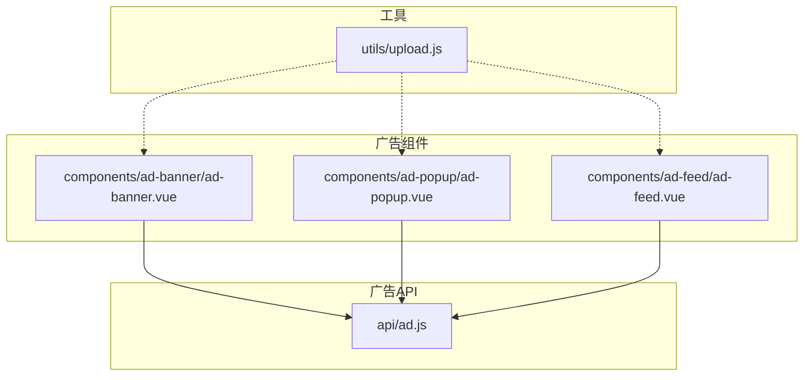
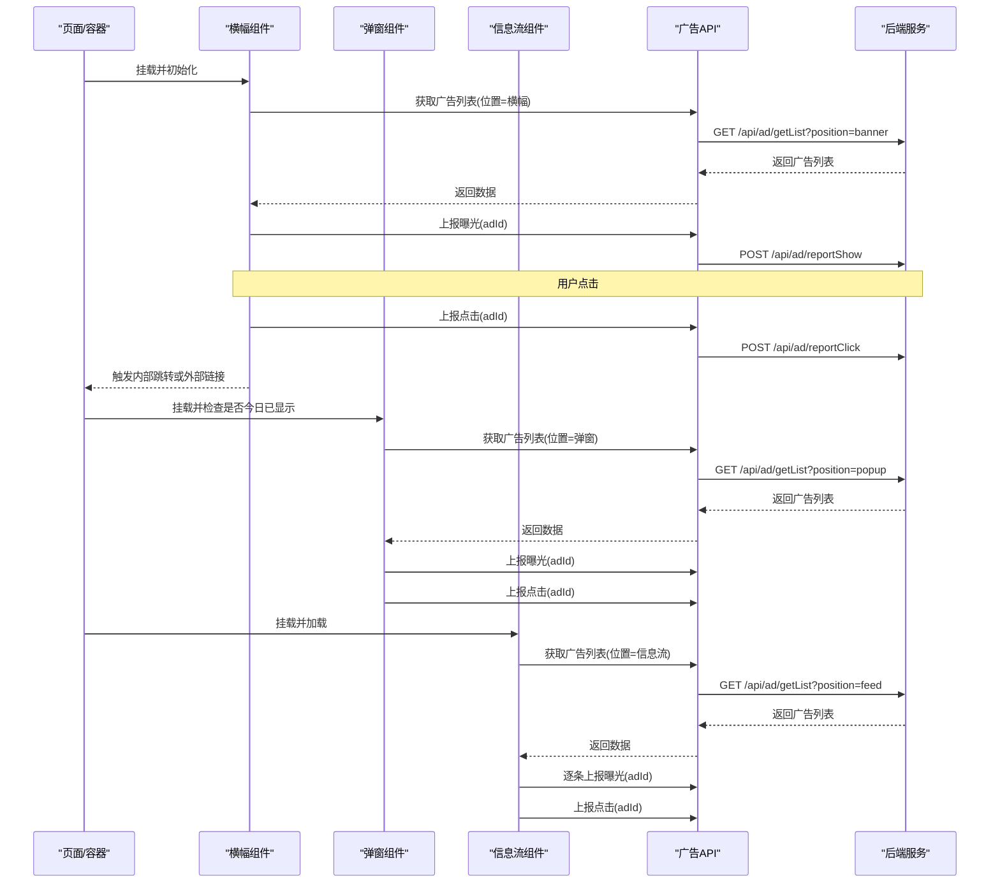
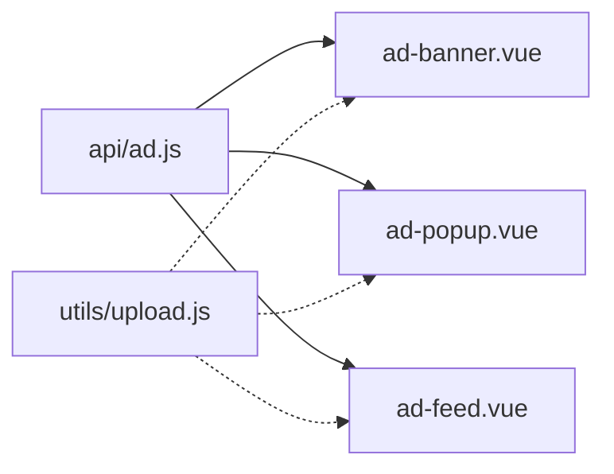

# 广告管理接口

<cite>
**本文引用的文件**   
- [api/ad.js](file://api/ad.js)
- [components/ad-banner/ad-banner.vue](file://components/ad-banner/ad-banner.vue)
- [components/ad-popup/ad-popup.vue](file://components/ad-popup/ad-popup.vue)
- [components/ad-feed/ad-feed.vue](file://components/ad-feed/ad-feed.vue)
- [utils/upload.js](file://utils/upload.js)
</cite>

## 目录
1. [简介](#简介)
2. [项目结构](#项目结构)
3. [核心组件](#核心组件)
4. [架构总览](#架构总览)
5. [详细组件分析](#详细组件分析)
6. [依赖关系分析](#依赖关系分析)
7. [性能与优化建议](#性能与优化建议)
8. [故障排查指南](#故障排查指南)
9. [结论](#结论)
10. [附录：接口定义与使用要点](#附录接口定义与使用要点)

## 简介
本文件面向“广告管理接口”的前端实现，聚焦以下能力：
- 广告内容发布、编辑、删除与查询（前端侧的调用方式与数据流转）
- 广告类型分类：横幅广告、弹窗广告、信息流广告
- 展示位置配置与优先级排序机制（基于位置参数与组件加载策略）
- 定时发布与自动下线（通过后端返回的数据字段控制，前端按时间窗口渲染）
- 点击统计与效果分析（曝光上报、点击上报）
- 审核流程与质量控制（前端根据状态字段进行可见性控制）
- 多媒体素材管理与CDN集成（图片/视频URL直链，结合上传工具）
- A/B测试与性能优化（前端可基于分组字段分流，结合缓存与降级策略）

说明：
- 当前仓库为前端工程，未包含后端实现。本文档对“发布/编辑/删除/审核/定时”等能力的描述以前端已暴露的接口与组件行为为依据；若需完整闭环，需在服务端补充对应API与调度逻辑。

## 项目结构
与广告相关的前端代码主要分布在以下位置：
- API层：统一封装广告相关请求
- 组件层：三类广告展示组件（横幅、弹窗、信息流）
- 工具层：通用上传工具（用于多媒体素材）

图表来源
- [api/ad.js:1-50](file://api/ad.js#L1-L50)
- [components/ad-banner/ad-banner.vue:1-140](file://components/ad-banner/ad-banner.vue#L1-L140)
- [components/ad-popup/ad-popup.vue:1-200](file://components/ad-popup/ad-popup.vue#L1-L200)
- [components/ad-feed/ad-feed.vue:1-199](file://components/ad-feed/ad-feed.vue#L1-L199)
- [utils/upload.js:1-71](file://utils/upload.js#L1-L71)

章节来源
- [api/ad.js:1-50](file://api/ad.js#L1-L50)
- [components/ad-banner/ad-banner.vue:1-140](file://components/ad-banner/ad-banner.vue#L1-L140)
- [components/ad-popup/ad-popup.vue:1-200](file://components/ad-popup/ad-popup.vue#L1-L200)
- [components/ad-feed/ad-feed.vue:1-199](file://components/ad-feed/ad-feed.vue#L1-L199)
- [utils/upload.js:1-71](file://utils/upload.js#L1-L71)

## 核心组件
- 广告API模块
  - 提供获取广告列表、上报曝光、上报点击、批量上报曝光等方法，统一走HTTP请求封装。
- 横幅广告组件
  - 负责轮播展示、自动播放、点击跳转、曝光与点击上报。
- 弹窗广告组件
  - 负责全屏遮罩弹窗、多素材类型（图片/视频/文本）、每日显示限制、点击上报与跳转。
- 信息流广告组件
  - 负责在信息流中插入广告卡片、逐条曝光上报、点击上报与跳转。
- 上传工具
  - 封装uni.uploadFile，支持鉴权头注入、错误提示与超时处理，可用于广告素材上传。

章节来源
- [api/ad.js:1-50](file://api/ad.js#L1-L50)
- [components/ad-banner/ad-banner.vue:1-140](file://components/ad-banner/ad-banner.vue#L1-L140)
- [components/ad-popup/ad-popup.vue:1-200](file://components/ad-popup/ad-popup.vue#L1-L200)
- [components/ad-feed/ad-feed.vue:1-199](file://components/ad-feed/ad-feed.vue#L1-L199)
- [utils/upload.js:1-71](file://utils/upload.js#L1-L71)

## 架构总览
广告在前端的整体交互流程如下：页面或容器引入广告组件 → 组件初始化时按位置拉取广告列表 → 渲染并上报曝光 → 用户点击后上报点击并执行跳转。

图表来源
- [api/ad.js:1-50](file://api/ad.js#L1-L50)
- [components/ad-banner/ad-banner.vue:1-140](file://components/ad-banner/ad-banner.vue#L1-L140)
- [components/ad-popup/ad-popup.vue:1-200](file://components/ad-popup/ad-popup.vue#L1-L200)
- [components/ad-feed/ad-feed.vue:1-199](file://components/ad-feed/ad-feed.vue#L1-L199)

## 详细组件分析

### 广告API模块
- 功能点
  - 获取广告列表：按位置筛选，返回广告集合
  - 上报曝光：单条上报
  - 上报点击：单条上报
  - 批量上报曝光：减少网络开销
- 关键路径
  - 列表获取：GET /api/ad/getList?position={banner|feed|popup|footer}
  - 曝光上报：POST /api/ad/reportShow
  - 点击上报：POST /api/ad/reportClick
  - 批量曝光：POST /api/ad/batchReportShow

章节来源
- [api/ad.js:1-50](file://api/ad.js#L1-L50)

### 横幅广告组件
- 职责
  - 轮播展示广告图
  - 自动播放与切换动画
  - 点击上报与跳转（小程序内页/H5/小程序间跳转）
  - 首次渲染后上报曝光
- 关键流程
  - 初始化加载广告列表（位置=横幅）
  - 渲染成功后上报首条曝光
  - 点击事件上报点击并执行跳转
- 注意事项
  - 外链在不同平台采用不同跳转策略
  - 可选显示“广告”标识

章节来源
- [components/ad-banner/ad-banner.vue:1-140](file://components/ad-banner/ad-banner.vue#L1-L140)
- [api/ad.js:1-50](file://api/ad.js#L1-L50)

### 弹窗广告组件
- 职责
  - 全屏遮罩弹窗展示
  - 支持图片/视频/文本三种素材
  - 每日最多显示一次（本地存储记录）
  - 点击上报与跳转
- 关键流程
  - 组件挂载时检查当日是否已显示
  - 未显示则拉取广告列表（位置=弹窗），取首条展示
  - 展示后上报曝光，关闭前可上报点击
- 注意事项
  - 关闭按钮位于右上角，点击遮罩也可关闭
  - 外链在小程序环境给出提示

章节来源
- [components/ad-popup/ad-popup.vue:1-200](file://components/ad-popup/ad-popup.vue#L1-L200)
- [api/ad.js:1-50](file://api/ad.js#L1-L50)

### 信息流广告组件
- 职责
  - 在信息流中插入广告卡片
  - 逐条上报曝光（避免重复上报）
  - 点击上报与跳转
- 关键流程
  - 自动加载广告列表（位置=信息流）
  - 渲染完成后遍历上报曝光
  - 点击事件上报点击并跳转
- 注意事项
  - 提供手动刷新方法，重置上报状态

章节来源
- [components/ad-feed/ad-feed.vue:1-199](file://components/ad-feed/ad-feed.vue#L1-L199)
- [api/ad.js:1-50](file://api/ad.js#L1-L50)

### 多媒体素材与上传
- 素材类型
  - 图片：通过adImage字段承载CDN地址
  - 视频：通过adVideo字段承载CDN地址
  - 文本：通过adContent字段承载文案
- 上传工具
  - 封装uni.uploadFile，自动注入Authorization头
  - 统一错误码与消息提示
  - 支持自定义表单字段与超时设置
- 使用建议
  - 将上传返回的CDN地址写入广告素材字段
  - 对大体积素材启用压缩与转码策略

章节来源
- [utils/upload.js:1-71](file://utils/upload.js#L1-L71)
- [components/ad-popup/ad-popup.vue:1-200](file://components/ad-popup/ad-popup.vue#L1-L200)

## 依赖关系分析
- 组件到API
  - 三个广告组件均依赖广告API模块进行数据获取与埋点上报
- 工具到组件
  - 上传工具可被任意需要素材上传的页面或组件复用
- 外部依赖
  - uni原生能力：navigateTo、open、showToast、getStorageSync/setStorageSync、uploadFile
  - 条件编译：H5与小程序平台的差异化处理

图表来源
- [api/ad.js:1-50](file://api/ad.js#L1-L50)
- [components/ad-banner/ad-banner.vue:1-140](file://components/ad-banner/ad-banner.vue#L1-L140)
- [components/ad-popup/ad-popup.vue:1-200](file://components/ad-popup/ad-popup.vue#L1-L200)
- [components/ad-feed/ad-feed.vue:1-199](file://components/ad-feed/ad-feed.vue#L1-L199)
- [utils/upload.js:1-71](file://utils/upload.js#L1-L71)

## 性能与优化建议
- 列表获取
  - 合理分页与缓存：对同一位置的广告列表做短时缓存，降低重复请求
  - 预取策略：在页面滚动接近底部时预取下一条信息流广告
- 曝光上报
  - 批量上报：优先使用批量上报接口，减少网络往返
  - 去重上报：组件内维护已上报ID集合，避免重复上报
- 媒体资源
  - CDN直链+懒加载：仅当进入视口再加载大图/视频
  - 格式与尺寸：统一输出WebP/自适应分辨率，减小带宽
- 用户体验
  - 弹窗频次控制：每日上限、用户关闭后短期不再打扰
  - 降级策略：接口失败时回退到默认占位或隐藏广告位

[本节为通用建议，不直接分析具体文件]

## 故障排查指南
- 常见问题
  - 接口连接异常：检查网络与baseUrl配置
  - 会话过期：上传工具会提示重新登录
  - 上报失败：上报接口失败不影响渲染，可在控制台查看错误日志
- 定位步骤
  - 确认组件是否正确传入位置参数
  - 检查上报接口是否成功回调
  - 核对素材URL是否可达
- 日志与调试
  - 组件内部已打印关键错误信息，便于快速定位

章节来源
- [utils/upload.js:1-71](file://utils/upload.js#L1-L71)
- [components/ad-banner/ad-banner.vue:1-140](file://components/ad-banner/ad-banner.vue#L1-L140)
- [components/ad-popup/ad-popup.vue:1-200](file://components/ad-popup/ad-popup.vue#L1-L200)
- [components/ad-feed/ad-feed.vue:1-199](file://components/ad-feed/ad-feed.vue#L1-L199)

## 结论
本前端工程实现了广告的多形态展示与基础埋点上报能力，覆盖横幅、弹窗与信息流三大场景。通过统一的API封装与组件化设计，具备良好的扩展性与可维护性。后续如需完善“发布/编辑/删除/审核/定时/AB测试”等全链路能力，建议在服务端补齐相应接口与调度系统，并在前端增加相应的管理页面与策略开关。

[本节为总结性内容，不直接分析具体文件]

## 附录：接口定义与使用要点

### 接口清单
- 获取广告列表
  - 方法：GET
  - URL：/api/ad/getList
  - 参数：position（banner/feed/popup/footer）
  - 返回：广告列表数组
- 上报曝光
  - 方法：POST
  - URL：/api/ad/reportShow
  - 参数：adId
- 上报点击
  - 方法：POST
  - URL：/api/ad/reportClick
  - 参数：adId
- 批量上报曝光
  - 方法：POST
  - URL：/api/ad/batchReportShow
  - 参数：adIds（数组）

章节来源
- [api/ad.js:1-50](file://api/ad.js#L1-L50)

### 广告类型与展示位置
- 类型
  - 横幅广告：顶部轮播
  - 弹窗广告：全屏遮罩
  - 信息流广告：内容流中的卡片
- 位置
  - banner：横幅
  - popup：弹窗
  - feed：信息流
  - footer：底部（预留）

章节来源
- [api/ad.js:1-50](file://api/ad.js#L1-L50)
- [components/ad-banner/ad-banner.vue:1-140](file://components/ad-banner/ad-banner.vue#L1-L140)
- [components/ad-popup/ad-popup.vue:1-200](file://components/ad-popup/ad-popup.vue#L1-L200)
- [components/ad-feed/ad-feed.vue:1-199](file://components/ad-feed/ad-feed.vue#L1-L199)

### 展示位置配置与优先级排序
- 位置筛选
  - 通过position参数区分不同广告位
- 优先级
  - 由后端返回列表的顺序决定前端渲染顺序
  - 前端可按业务需求对返回结果二次排序（如按权重或时间）

章节来源
- [api/ad.js:1-50](file://api/ad.js#L1-L50)

### 定时发布与自动下线
- 前端依据后端返回的时间字段控制展示
- 建议后端在列表中过滤出处于有效时间窗口的广告

章节来源
- [components/ad-banner/ad-banner.vue:1-140](file://components/ad-banner/ad-banner.vue#L1-L140)
- [components/ad-popup/ad-popup.vue:1-200](file://components/ad-popup/ad-popup.vue#L1-L200)
- [components/ad-feed/ad-feed.vue:1-199](file://components/ad-feed/ad-feed.vue#L1-L199)

### 点击统计与效果分析
- 曝光上报：组件渲染后上报
- 点击上报：用户点击后上报
- 指标建议：曝光量、点击量、CTR、转化归因（由后端聚合）

章节来源
- [api/ad.js:1-50](file://api/ad.js#L1-L50)
- [components/ad-banner/ad-banner.vue:1-140](file://components/ad-banner/ad-banner.vue#L1-L140)
- [components/ad-popup/ad-popup.vue:1-200](file://components/ad-popup/ad-popup.vue#L1-L200)
- [components/ad-feed/ad-feed.vue:1-199](file://components/ad-feed/ad-feed.vue#L1-L199)

### 审核流程与质量控制
- 前端根据后端返回的状态字段决定是否展示
- 建议后端提供审核状态枚举，并在列表接口中过滤未通过审核的广告

章节来源
- [components/ad-banner/ad-banner.vue:1-140](file://components/ad-banner/ad-banner.vue#L1-L140)
- [components/ad-popup/ad-popup.vue:1-200](file://components/ad-popup/ad-popup.vue#L1-L200)
- [components/ad-feed/ad-feed.vue:1-199](file://components/ad-feed/ad-feed.vue#L1-L199)

### 多媒体素材管理与CDN集成
- 素材字段
  - 图片：adImage
  - 视频：adVideo
  - 文本：adContent
- 上传
  - 使用上传工具提交素材至后端，获得CDN地址
- 展示
  - 组件直接加载CDN地址，无需本地缓存

章节来源
- [utils/upload.js:1-71](file://utils/upload.js#L1-L71)
- [components/ad-popup/ad-popup.vue:1-200](file://components/ad-popup/ad-popup.vue#L1-L200)

### A/B测试与性能优化
- A/B测试
  - 前端可根据后端返回的分组字段进行差异化展示
- 性能优化
  - 列表缓存、批量上报、懒加载、素材压缩

章节来源
- [api/ad.js:1-50](file://api/ad.js#L1-L50)
- [components/ad-banner/ad-banner.vue:1-140](file://components/ad-banner/ad-banner.vue#L1-L140)
- [components/ad-popup/ad-popup.vue:1-200](file://components/ad-popup/ad-popup.vue#L1-L200)
- [components/ad-feed/ad-feed.vue:1-199](file://components/ad-feed/ad-feed.vue#L1-L199)