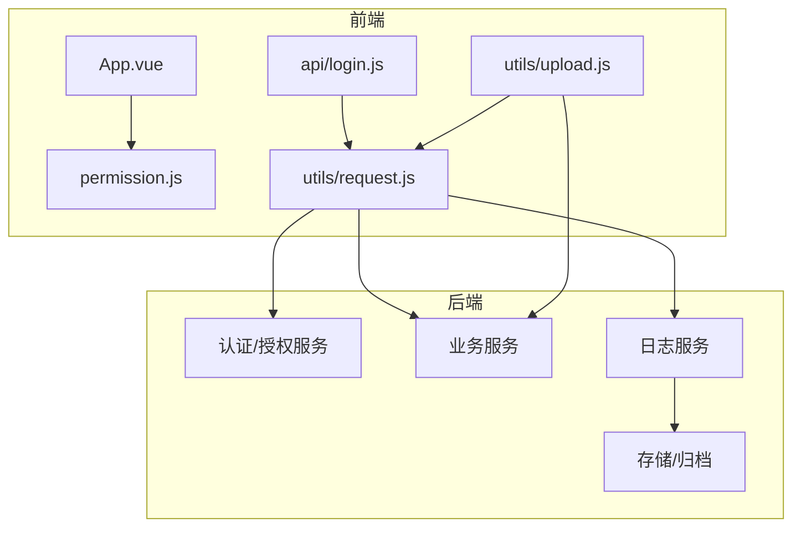
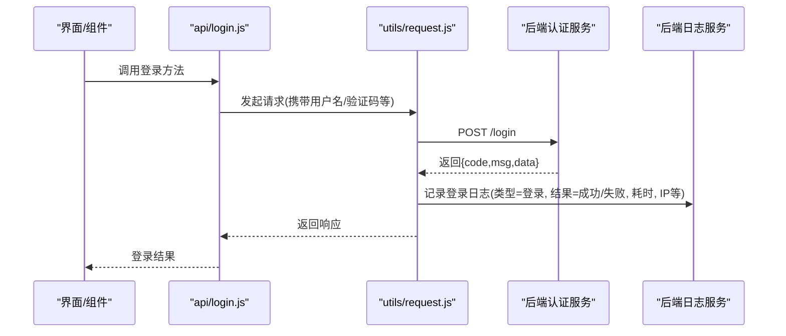
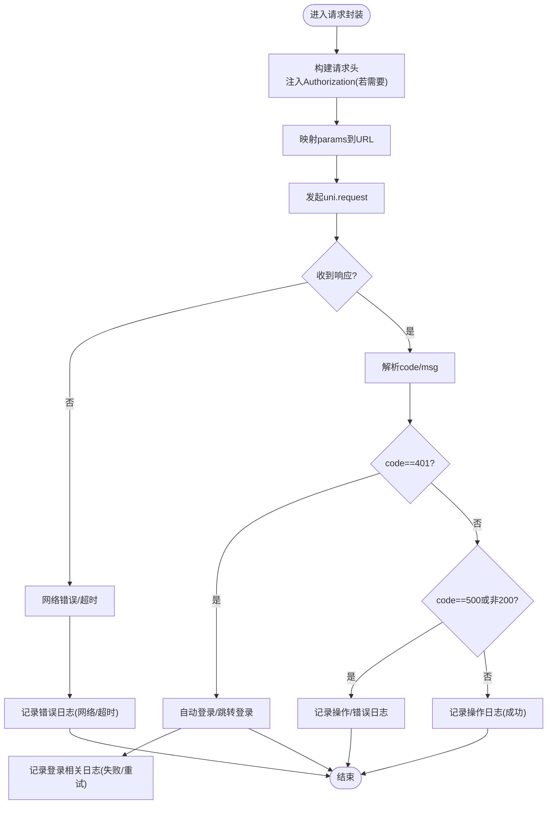
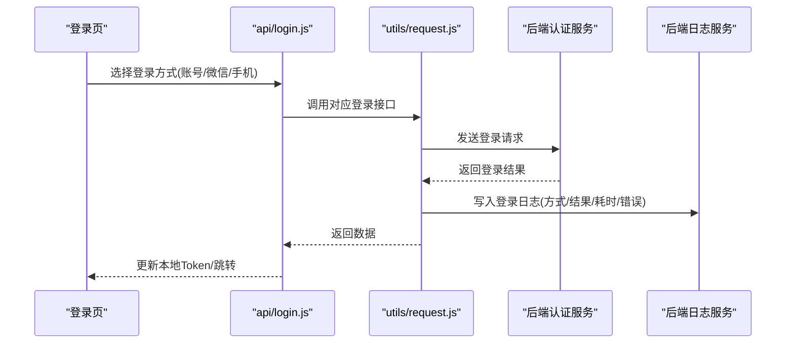
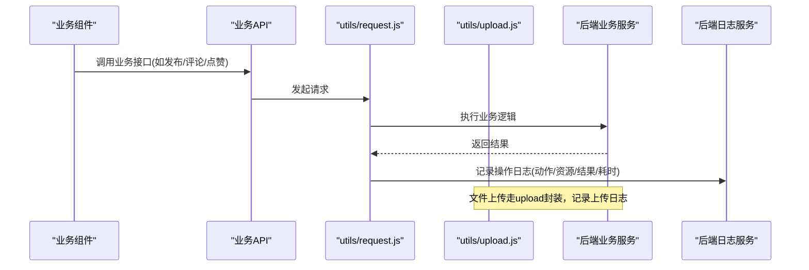
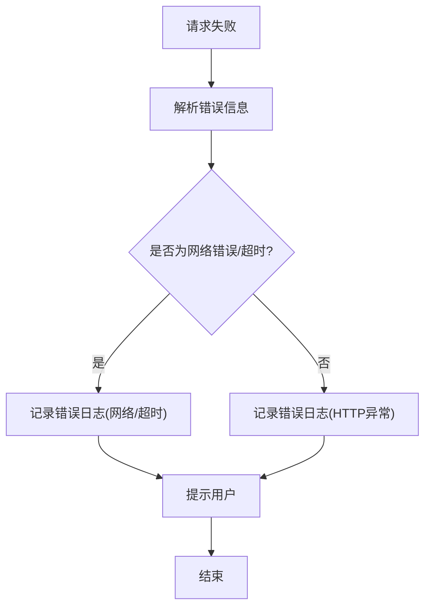
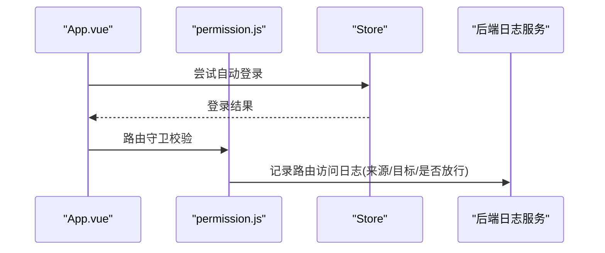
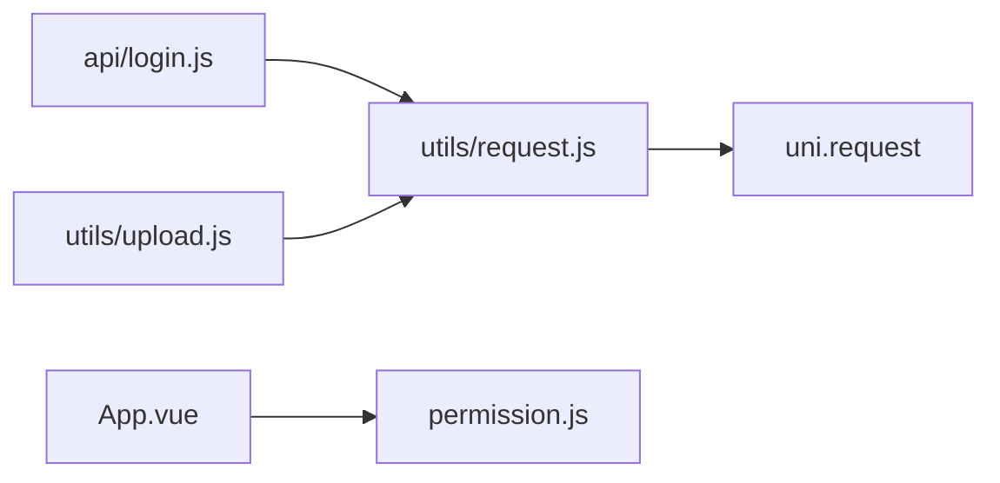

# 操作日志接口

<cite>
**本文引用的文件**   
- [api/login.js](file://api/login.js)
- [utils/request.js](file://utils/request.js)
- [utils/upload.js](file://utils/upload.js)
- [App.vue](file://App.vue)
- [permission.js](file://permission.js)
</cite>

## 目录
1. [简介](#简介)
2. [项目结构](#项目结构)
3. [核心组件](#核心组件)
4. [架构总览](#架构总览)
5. [详细组件分析](#详细组件分析)
6. [依赖分析](#依赖分析)
7. [性能考虑](#性能考虑)
8. [故障排查指南](#故障排查指南)
9. [结论](#结论)
10. [附录](#附录)

## 简介
本文件面向“操作日志接口”的文档化说明，聚焦于用户操作的审计追踪与日志收集能力。结合当前前端代码库中已有的登录、鉴权、网络请求封装等基础设施，梳理出可落地的日志采集点、分类策略、查询过滤、统计分析、清理归档、导出与脱敏方案，并给出与现有代码对接的实现建议与流程图示。

## 项目结构
从仓库结构看，本项目为 uni-app 前端应用，主要涉及：
- API 层：按模块组织（如 api/login.js）
- 工具层：统一请求封装（utils/request.js）、上传封装（utils/upload.js）
- 全局入口与权限控制：App.vue、permission.js
- 业务页面与组件：调用各 API 完成具体功能

图表来源
- [App.vue](file://App.vue)
- [permission.js](file://permission.js)
- [api/login.js](file://api/login.js)
- [utils/request.js](file://utils/request.js)
- [utils/upload.js](file://utils/upload.js)

章节来源
- [api/login.js:1-168](file://api/login.js#L1-L168)
- [utils/request.js:1-117](file://utils/request.js#L1-L117)
- [utils/upload.js:38-70](file://utils/upload.js#L38-L70)
- [App.vue:15-37](file://App.vue#L15-L37)
- [permission.js:4-10](file://permission.js#L4-L10)

## 核心组件
- 统一请求封装（utils/request.js）
  - 负责在请求前注入 Authorization 头、拼接 params、处理超时与错误码、会话过期自动重登或跳转登录页。
  - 是接入“操作日志”的最佳拦截点，可在成功/失败分支记录访问轨迹、耗时、状态码、URL、参数摘要等。
- 登录相关 API（api/login.js）
  - 提供多种登录方式（账号密码、微信、手机号等），这些登录事件应作为“登录日志”的重要来源。
- 上传封装（utils/upload.js）
  - 对文件上传进行统一封装，适合记录“文件操作日志”，包括文件名、大小、结果、错误信息等。
- 全局入口与权限（App.vue、permission.js）
  - 应用启动时执行自动登录与路由守卫，可作为“系统初始化日志”和“路由访问日志”的采集点。

章节来源
- [utils/request.js:10-114](file://utils/request.js#L10-L114)
- [api/login.js:1-168](file://api/login.js#L1-L168)
- [utils/upload.js:38-70](file://utils/upload.js#L38-L70)
- [App.vue:15-37](file://App.vue#L15-L37)
- [permission.js:4-10](file://permission.js#L4-L10)

## 架构总览
以下序列图展示一次典型登录流程及日志采集点（以统一请求封装为核心）。

图表来源
- [api/login.js:4-19](file://api/login.js#L4-L19)
- [utils/request.js:24-100](file://utils/request.js#L24-L100)

## 详细组件分析

### 统一请求封装中的日志采集点
- 采集时机
  - 请求前：记录开始时间、URL、方法、是否带 Token、请求体摘要（脱敏后）
  - 响应后：记录结束时间、耗时、状态码、消息、是否触发自动重登
  - 异常捕获：记录网络错误、超时、HTTP 状态码异常
- 日志分类
  - 登录日志：针对 /login、/wxLogin、/phoneLogin 等登录类接口
  - 操作日志：其他业务接口（增删改查、点赞、评论、发布等）
  - 错误日志：所有非 200 响应与异常路径
- 字段建议
  - id、traceId、userId、method、url、params、body、headers、ip、ua、startTime、endTime、durationMs、statusCode、message、category、action、result、errorStack
- 敏感信息脱敏
  - 对密码、token、手机号、身份证等字段进行掩码替换
  - 仅保留必要上下文，避免明文传输到服务端

图表来源
- [utils/request.js:10-114](file://utils/request.js#L10-L114)

章节来源
- [utils/request.js:10-114](file://utils/request.js#L10-L114)

### 登录日志采集
- 登录入口
  - 账号密码登录、微信自动登录、手机号快捷登录等均在 api/login.js 中定义
- 采集要点
  - 记录登录方式、用户标识（匿名/已登录）、结果、失败原因、设备信息、IP
  - 对于 401 场景，区分“登录接口直接报错”与“业务接口会话过期”的不同处理路径
- 与统一请求封装的关系
  - 登录接口在 request.js 中有特殊判断，避免重复触发自动登录；同时仍需记录登录日志

图表来源
- [api/login.js:4-19](file://api/login.js#L4-L19)
- [api/login.js:76-86](file://api/login.js#L76-L86)
- [api/login.js:108-121](file://api/login.js#L108-L121)
- [utils/request.js:41-88](file://utils/request.js#L41-L88)

章节来源
- [api/login.js:4-19](file://api/login.js#L4-L19)
- [api/login.js:76-86](file://api/login.js#L76-L86)
- [api/login.js:108-121](file://api/login.js#L108-L121)
- [utils/request.js:41-88](file://utils/request.js#L41-L88)

### 操作日志采集（业务接口）
- 采集范围
  - 除登录外的所有业务接口，例如内容发布、评论、点赞、删除等
- 采集字段
  - 操作人、操作动作（动词+资源名）、资源ID、变更前后快照（可选）、结果、耗时
- 与上传接口的结合
  - utils/upload.js 可对文件上传进行统一封装，记录上传文件名、大小、类型、结果、错误信息

图表来源
- [utils/request.js:24-100](file://utils/request.js#L24-L100)
- [utils/upload.js:38-70](file://utils/upload.js#L38-L70)

章节来源
- [utils/request.js:24-100](file://utils/request.js#L24-L100)
- [utils/upload.js:38-70](file://utils/upload.js#L38-L70)

### 错误日志采集
- 触发条件
  - 非 200 响应、网络错误、超时、HTTP 状态码异常
- 采集要点
  - 错误堆栈（前端可用 message 片段）、请求上下文、用户会话、设备信息
- 与统一请求封装的结合
  - 在 catch 分支集中处理，避免分散在各业务层

图表来源
- [utils/request.js:101-112](file://utils/request.js#L101-L112)

章节来源
- [utils/request.js:101-112](file://utils/request.js#L101-L112)

### 系统初始化与路由访问日志
- 应用启动
  - App.vue 中执行自动登录与检查登录态，可作为“系统初始化日志”的来源
- 路由守卫
  - permission.js 中维护白名单与登录跳转逻辑，可作为“路由访问日志”的来源

图表来源
- [App.vue:15-37](file://App.vue#L15-L37)
- [permission.js:4-10](file://permission.js#L4-L10)

章节来源
- [App.vue:15-37](file://App.vue#L15-L37)
- [permission.js:4-10](file://permission.js#L4-L10)

## 依赖分析
- 耦合关系
  - api/login.js 依赖 utils/request.js 进行网络请求
  - utils/upload.js 同样依赖统一的错误处理与提示机制
  - App.vue 与 permission.js 共同管理应用生命周期与路由权限
- 外部依赖
  - uni.request 为底层网络请求
  - store 用于状态管理与自动登录流程

图表来源
- [api/login.js:1-19](file://api/login.js#L1-L19)
- [utils/request.js:1-117](file://utils/request.js#L1-117)
- [utils/upload.js:38-70](file://utils/upload.js#L38-L70)
- [App.vue:15-37](file://App.vue#L15-L37)
- [permission.js:4-10](file://permission.js#L4-L10)

章节来源
- [api/login.js:1-19](file://api/login.js#L1-L19)
- [utils/request.js:1-117](file://utils/request.js#L1-117)
- [utils/upload.js:38-70](file://utils/upload.js#L38-L70)
- [App.vue:15-37](file://App.vue#L15-L37)
- [permission.js:4-10](file://permission.js#L4-L10)

## 性能考虑
- 异步批量上报
  - 将日志先写入本地队列，定时批量上报，降低主线程阻塞
- 采样与降级
  - 高并发下可按比例采样，或在网络差时降级为本地缓存
- 去重与压缩
  - 对重复日志进行去重，对上报数据进行压缩
- 敏感字段最小化
  - 仅上报必要字段，减少传输体积

[本节为通用指导，不直接分析具体文件]

## 故障排查指南
- 常见问题定位
  - 登录失败：查看登录日志中的失败原因、验证码是否正确、微信/手机号流程是否完整
  - 操作失败：查看操作日志中的错误码与消息，结合请求 URL 与方法定位问题
  - 网络异常：关注网络错误与超时的错误日志，检查后端可达性与配置
- 快速定位手段
  - 通过 traceId 串联一次请求的全链路日志
  - 使用 userId、时间范围、接口 URL 进行筛选

章节来源
- [utils/request.js:41-112](file://utils/request.js#L41-L112)
- [utils/upload.js:38-70](file://utils/upload.js#L38-L70)

## 结论
通过在统一请求封装与登录入口处集中采集日志，可实现覆盖登录、操作、错误三类日志的完整审计追踪。结合分类管理、查询过滤、统计分析、清理归档、导出与脱敏机制，既能满足合规与安全要求，也能提升运维与排障效率。

[本节为总结性内容，不直接分析具体文件]

## 附录

### 日志分类与字段规范
- 分类
  - 登录日志：记录登录方式、结果、失败原因、设备与网络信息
  - 操作日志：记录操作人、动作、资源、结果、耗时
  - 错误日志：记录错误类型、堆栈、请求上下文
- 字段建议
  - 基础：id、traceId、userId、timestamp、ip、ua
  - 请求：method、url、params、body、headers
  - 结果：statusCode、message、durationMs、category、action、result、errorStack

[本节为概念性说明，不直接分析具体文件]

### 查询过滤与时间范围筛选
- 支持维度
  - 用户、接口、动作、结果、时间范围、设备、IP
- 实现建议
  - 后端提供分页与多条件组合查询
  - 前端提供表单式筛选与快捷时间范围

[本节为概念性说明，不直接分析具体文件]

### 统计分析报表与趋势图表
- 指标建议
  - 登录成功率、失败原因分布、接口调用量、错误率、平均耗时
- 可视化建议
  - 折线图（趋势）、柱状图（分布）、饼图（占比）

[本节为概念性说明，不直接分析具体文件]

### 自动清理与归档机制
- 策略建议
  - 热数据保留 N 天，冷数据按月归档至对象存储
  - 按租户/环境分表或分区，便于检索与清理
- 任务调度
  - 定时任务执行清理与归档，记录清理日志

[本节为概念性说明，不直接分析具体文件]

### 导出与格式化输出
- 格式支持
  - CSV、Excel、JSON
- 安全限制
  - 仅允许管理员导出，且需脱敏敏感字段
  - 导出任务异步执行，完成后通知下载

[本节为概念性说明，不直接分析具体文件]

### 敏感信息脱敏与隐私保护
- 脱敏规则
  - 密码、token、手机号、身份证等字段进行掩码替换
  - 禁止在日志中记录明文敏感信息
- 传输与存储
  - 日志上报走 HTTPS，存储加密，访问受控

[本节为概念性说明，不直接分析具体文件]