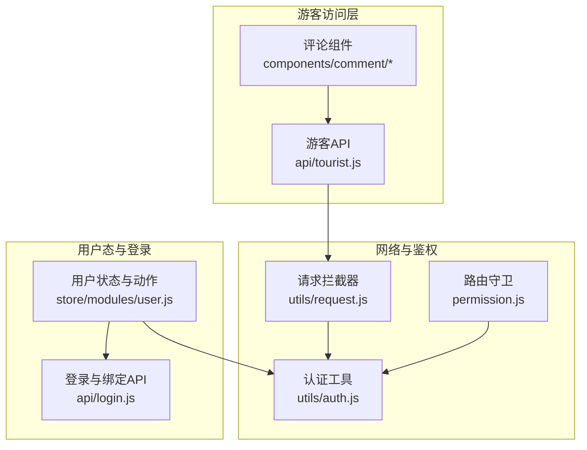
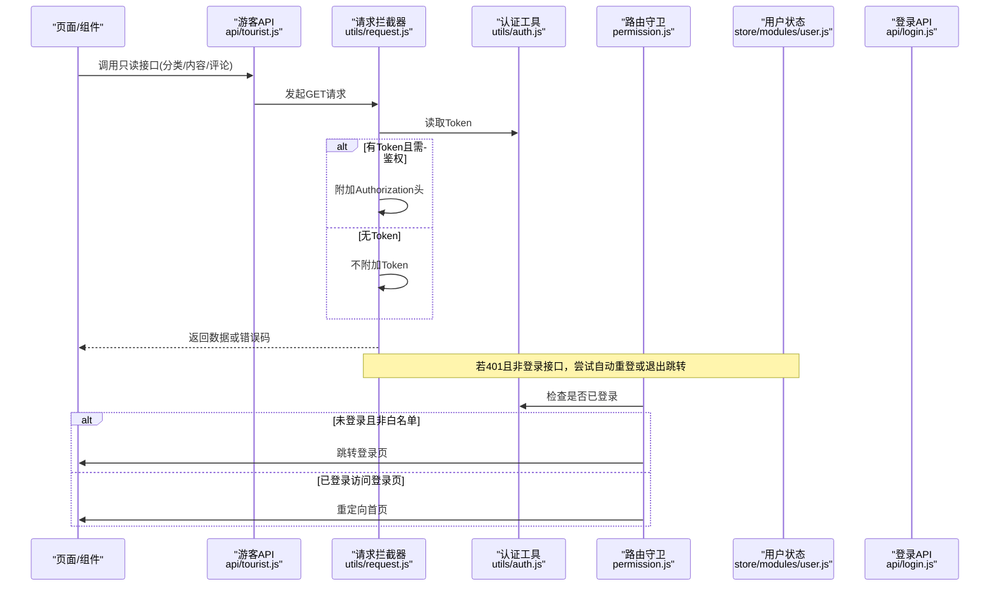
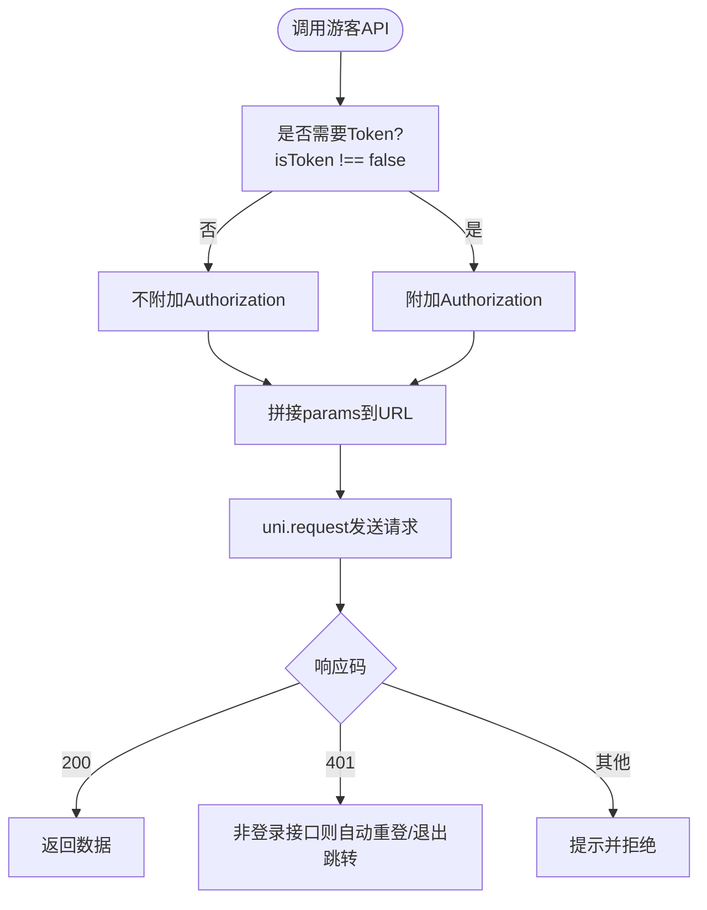
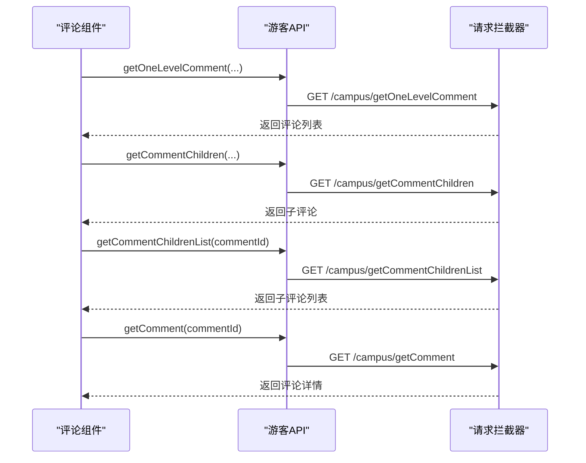
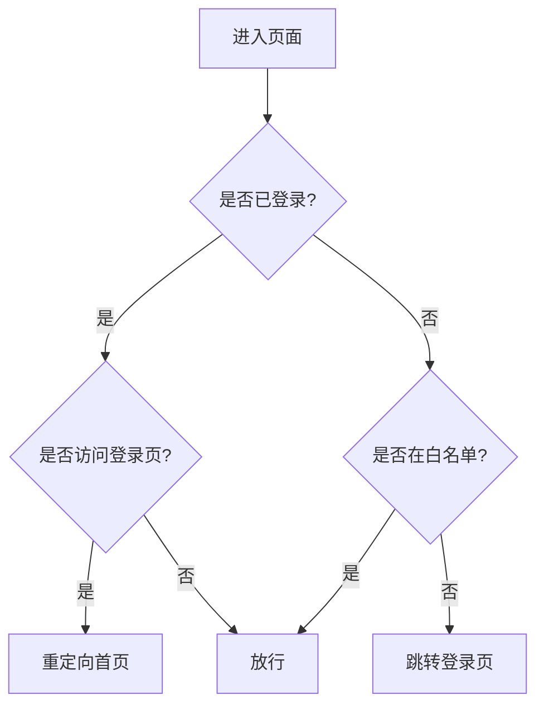
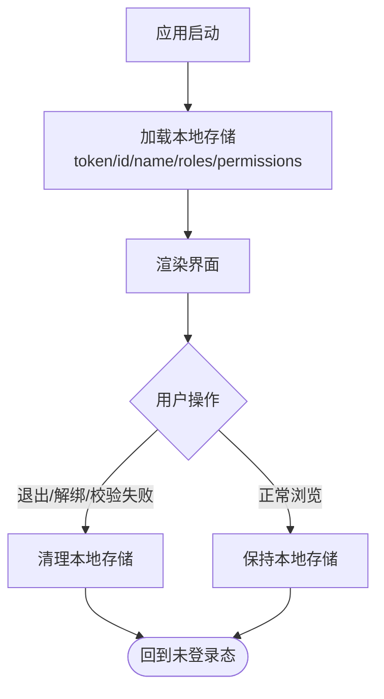
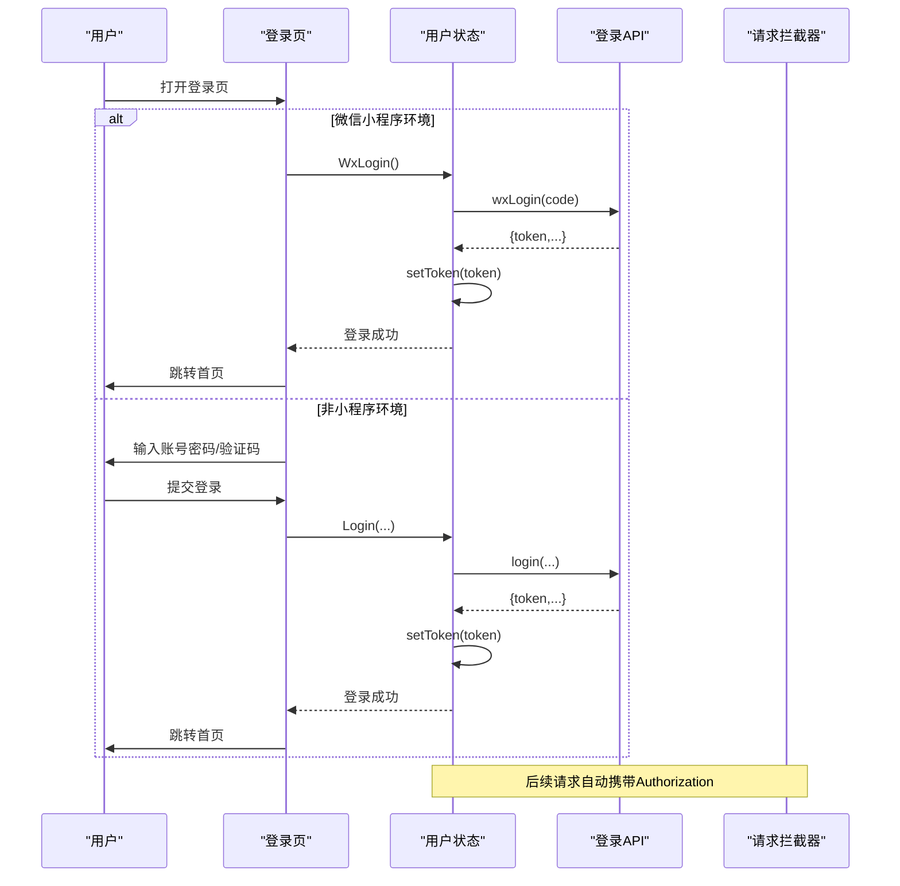
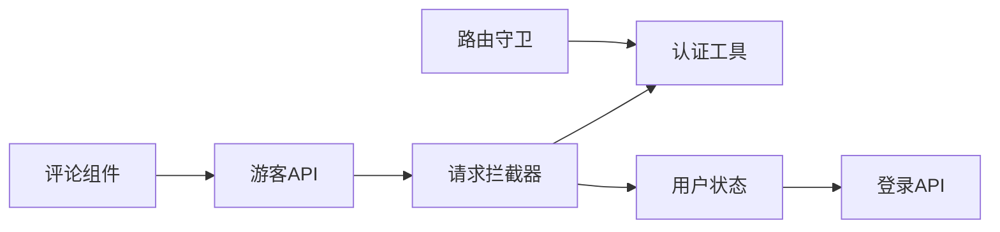

# 游客访问接口

<cite>
**本文引用的文件**   
- [api/tourist.js](file://api/tourist.js)
- [utils/request.js](file://utils/request.js)
- [utils/auth.js](file://utils/auth.js)
- [permission.js](file://permission.js)
- [store/modules/user.js](file://store/modules/user.js)
- [api/login.js](file://api/login.js)
- [components/comment/index.vue](file://components/comment/index.vue)
- [components/comment/CommentChild.vue](file://components/comment/CommentChild.vue)
- [components/comment/MoreReplies.vue](file://components/comment/MoreReplies.vue)
</cite>

## 目录
1. [简介](#简介)
2. [项目结构](#项目结构)
3. [核心组件](#核心组件)
4. [架构总览](#架构总览)
5. [详细组件分析](#详细组件分析)
6. [依赖分析](#依赖分析)
7. [性能考虑](#性能考虑)
8. [故障排查指南](#故障排查指南)
9. [结论](#结论)
10. [附录](#附录)

## 简介
本文件面向“游客访问”场景，聚焦未登录用户在当前前端工程中的受限访问能力、数据隔离与权限边界。文档基于现有代码梳理出：
- 游客身份标识与会话管理（无 Token 的默认状态）
- 游客可访问的数据范围（仅公开读接口）
- 功能降级与界面简化策略（未登录时的行为）
- 临时存储与清理策略（本地缓存的使用与清理时机）
- 监控与安全防护（请求拦截、错误处理、敏感操作保护）
- 游客到正式用户的无缝转换流程（微信自动登录、手机号快捷登录等）
- 统计分析与行为追踪建议（在现有基础上扩展埋点方案）

## 项目结构
围绕游客访问相关的前端实现，主要涉及以下模块：
- 游客只读 API 封装：提供分类、内容、评论等公开读取接口
- 全局请求拦截器：统一注入 Authorization、处理 401 会话失效与自动重登
- 路由守卫：未登录用户访问非白名单页面时跳转登录页
- 认证工具：Token 与用户 ID 的存取与登录态判断
- 登录与绑定流程：微信自动登录、手机号快捷登录、账号绑定等
- 评论组件：使用游客 API 进行公开内容的展示

图表来源
- [api/tourist.js:1-69](file://api/tourist.js#L1-L69)
- [utils/request.js:1-117](file://utils/request.js#L1-L117)
- [utils/auth.js:1-47](file://utils/auth.js#L1-L47)
- [permission.js:1-133](file://permission.js#L1-L133)
- [store/modules/user.js:1-283](file://store/modules/user.js#L1-L283)
- [api/login.js:1-168](file://api/login.js#L1-L168)
- [components/comment/index.vue](file://components/comment/index.vue)
- [components/comment/CommentChild.vue](file://components/comment/CommentChild.vue)
- [components/comment/MoreReplies.vue](file://components/comment/MoreReplies.vue)

章节来源
- [api/tourist.js:1-69](file://api/tourist.js#L1-L69)
- [utils/request.js:1-117](file://utils/request.js#L1-L117)
- [utils/auth.js:1-47](file://utils/auth.js#L1-L47)
- [permission.js:1-133](file://permission.js#L1-L133)
- [store/modules/user.js:1-283](file://store/modules/user.js#L1-L283)
- [api/login.js:1-168](file://api/login.js#L1-L168)
- [components/comment/index.vue](file://components/comment/index.vue)
- [components/comment/CommentChild.vue](file://components/comment/CommentChild.vue)
- [components/comment/MoreReplies.vue](file://components/comment/MoreReplies.vue)

## 核心组件
- 游客只读 API
  - 提供分类列表、内容列表、内容详情、一级评论、子评论、热门内容等只读能力
  - 所有方法均通过统一的 request 发起 GET 请求，不携带 Token
- 请求拦截器
  - 自动为需要鉴权的请求附加 Authorization 头
  - 对 401 做会话失效处理：在非登录接口触发自动重登或退出并跳转登录页
  - 对登录相关接口（如 /login、/wxLogin、/phoneLogin、/captchaImage）不做自动重登，避免循环
- 路由守卫
  - 未登录用户访问非白名单页面时，强制跳转到登录页
  - 已登录用户访问登录页时，重定向至首页
- 认证工具
  - 提供 Token 与用户 ID 的存取与 isLogin 判断
- 用户状态与登录动作
  - 集中管理 token、用户信息、角色权限等
  - 提供多种登录方式：账号密码、微信自动登录、手机号快捷登录、学生/教师绑定登录等
- 评论组件
  - 使用游客 API 获取公开评论内容，用于未登录用户浏览

章节来源
- [api/tourist.js:1-69](file://api/tourist.js#L1-L69)
- [utils/request.js:1-117](file://utils/request.js#L1-L117)
- [utils/auth.js:1-47](file://utils/auth.js#L1-L47)
- [permission.js:1-133](file://permission.js#L1-L133)
- [store/modules/user.js:1-283](file://store/modules/user.js#L1-L283)
- [components/comment/index.vue](file://components/comment/index.vue)
- [components/comment/CommentChild.vue](file://components/comment/CommentChild.vue)
- [components/comment/MoreReplies.vue](file://components/comment/MoreReplies.vue)

## 架构总览
下图展示了游客访问的关键路径：从页面或组件调用游客 API，经由请求拦截器决定是否带 Token，再根据后端返回码进行会话处理；同时路由守卫确保未登录用户无法进入受保护页面。

图表来源
- [api/tourist.js:1-69](file://api/tourist.js#L1-L69)
- [utils/request.js:1-117](file://utils/request.js#L1-L117)
- [utils/auth.js:1-47](file://utils/auth.js#L1-L47)
- [permission.js:1-133](file://permission.js#L1-L133)
- [store/modules/user.js:1-283](file://store/modules/user.js#L1-L283)
- [api/login.js:1-168](file://api/login.js#L1-L168)

## 详细组件分析

### 游客只读 API 设计
- 接口清单（仅列举关键能力）
  - 获取分类列表
  - 获取内容列表（支持分页参数）
  - 获取内容详情
  - 获取一级评论
  - 获取子评论
  - 获取子评论列表
  - 获取评论详情
  - 获取简单热门内容
- 特点
  - 全部为 GET 请求，无需 Token
  - 参数通过 params 传递，由请求拦截器拼接 URL
  - 适合未登录用户浏览公开内容

图表来源
- [api/tourist.js:1-69](file://api/tourist.js#L1-L69)
- [utils/request.js:1-117](file://utils/request.js#L1-L117)

章节来源
- [api/tourist.js:1-69](file://api/tourist.js#L1-L69)
- [utils/request.js:1-117](file://utils/request.js#L1-L117)

### 评论组件的游客访问
- 使用游客 API 拉取公开评论与子评论，供未登录用户浏览
- 典型调用点
  - 获取一级评论
  - 获取子评论
  - 获取子评论列表
  - 获取评论详情

图表来源
- [components/comment/index.vue](file://components/comment/index.vue)
- [components/comment/CommentChild.vue](file://components/comment/CommentChild.vue)
- [components/comment/MoreReplies.vue](file://components/comment/MoreReplies.vue)
- [api/tourist.js:1-69](file://api/tourist.js#L1-L69)
- [utils/request.js:1-117](file://utils/request.js#L1-L117)

章节来源
- [components/comment/index.vue](file://components/comment/index.vue)
- [components/comment/CommentChild.vue](file://components/comment/CommentChild.vue)
- [components/comment/MoreReplies.vue](file://components/comment/MoreReplies.vue)
- [api/tourist.js:1-69](file://api/tourist.js#L1-L69)

### 会话管理与身份标识
- 游客模式
  - 无 Token 即视为游客
  - 仅允许访问明确标记为不需要 Token 的接口（如游客 API）
- 登录态判断
  - 通过读取本地 Token 判断是否已登录
- 路由守卫
  - 未登录访问非白名单页面时，强制跳转登录页
  - 已登录访问登录页时，重定向至首页

图表来源
- [permission.js:1-133](file://permission.js#L1-L133)
- [utils/auth.js:1-47](file://utils/auth.js#L1-L47)

章节来源
- [permission.js:1-133](file://permission.js#L1-L133)
- [utils/auth.js:1-47](file://utils/auth.js#L1-L47)

### 功能降级与界面简化
- 未登录用户
  - 仅能浏览公开内容（分类、内容、评论等）
  - 无法执行写操作（发布、评论、点赞、收藏等）
  - 路由层面阻止进入受保护页面
- 已登录用户
  - 获得完整功能与数据范围
  - 访问登录页会被重定向至首页，避免重复登录

章节来源
- [permission.js:1-133](file://permission.js#L1-L133)
- [api/tourist.js:1-69](file://api/tourist.js#L1-L69)

### 临时存储与清理策略
- 本地存储
  - 用户信息（头像、ID、姓名、角色、权限）通过统一 storage 模块持久化
  - Token 与用户 ID 通过 auth 模块独立存取
- 清理时机
  - 退出系统、解除微信绑定、账号验证失败等场景会清理本地存储
  - 会话过期（401）在非登录接口会触发退出并跳转登录页

图表来源
- [store/modules/user.js:1-283](file://store/modules/user.js#L1-L283)
- [utils/storage.js:1-33](file://utils/storage.js#L1-L33)
- [utils/auth.js:1-47](file://utils/auth.js#L1-L47)

章节来源
- [store/modules/user.js:1-283](file://store/modules/user.js#L1-L283)
- [utils/storage.js:1-33](file://utils/storage.js#L1-L33)
- [utils/auth.js:1-47](file://utils/auth.js#L1-L47)

### 安全与防护
- 请求级防护
  - 自动附加 Authorization 头（仅在需要时）
  - 401 自动重登或退出，防止无效会话继续访问
  - 登录相关接口不触发自动重登，避免死循环
- 路由级防护
  - 未登录禁止访问非白名单页面
- 错误处理
  - 统一错误提示与拒绝逻辑，区分业务错误码与网络异常

章节来源
- [utils/request.js:1-117](file://utils/request.js#L1-L117)
- [permission.js:1-133](file://permission.js#L1-L133)

### 游客到正式用户的无缝转换
- 微信自动登录
  - 在小程序环境下，进入登录页时尝试微信自动登录
  - 成功后设置 Token 并进入首页
- 手机号快捷登录
  - 通过手机号验证码快速登录，成功后设置 Token
- 账号绑定
  - 微信绑定账号、学生/教师手机号绑定等流程，完成后进入正式用户态

图表来源
- [pages/login.vue](file://pages/login.vue)
- [store/modules/user.js:1-283](file://store/modules/user.js#L1-L283)
- [api/login.js:1-168](file://api/login.js#L1-L168)
- [utils/request.js:1-117](file://utils/request.js#L1-L117)

章节来源
- [pages/login.vue](file://pages/login.vue)
- [store/modules/user.js:1-283](file://store/modules/user.js#L1-L283)
- [api/login.js:1-168](file://api/login.js#L1-L168)
- [utils/request.js:1-117](file://utils/request.js#L1-L117)

### 统计分析与行为追踪（建议）
- 建议在以下位置增加埋点上报（不改变现有逻辑）：
  - 游客只读接口调用前后：记录接口名、耗时、是否成功
  - 路由跳转：记录来源页面、目标页面、是否被拦截
  - 登录流程：记录登录方式、成功率、失败原因
  - 评论浏览：记录评论列表加载次数、子评论展开次数
- 埋点数据字段建议
  - 事件类型、时间戳、设备信息、页面路径、接口路径、请求耗时、结果码、用户态（游客/已登录）

[本节为通用建议，不直接分析具体文件]

## 依赖分析
- 耦合关系
  - 游客 API 强依赖请求拦截器
  - 请求拦截器依赖认证工具与用户状态
  - 路由守卫依赖认证工具
  - 登录流程依赖用户状态与登录 API
- 外部依赖
  - uni.request 网络请求
  - uni.setStorageSync/getStorageSync 本地存储
  - uni.reLaunch/navigateTo 路由跳转

图表来源
- [api/tourist.js:1-69](file://api/tourist.js#L1-L69)
- [utils/request.js:1-117](file://utils/request.js#L1-L117)
- [utils/auth.js:1-47](file://utils/auth.js#L1-L47)
- [permission.js:1-133](file://permission.js#L1-L133)
- [store/modules/user.js:1-283](file://store/modules/user.js#L1-L283)
- [api/login.js:1-168](file://api/login.js#L1-L168)
- [components/comment/index.vue](file://components/comment/index.vue)

章节来源
- [api/tourist.js:1-69](file://api/tourist.js#L1-L69)
- [utils/request.js:1-117](file://utils/request.js#L1-L117)
- [utils/auth.js:1-47](file://utils/auth.js#L1-L47)
- [permission.js:1-133](file://permission.js#L1-L133)
- [store/modules/user.js:1-283](file://store/modules/user.js#L1-L283)
- [api/login.js:1-168](file://api/login.js#L1-L168)
- [components/comment/index.vue](file://components/comment/index.vue)

## 性能考虑
- 减少不必要的鉴权开销
  - 游客只读接口不携带 Token，降低签名与校验成本
- 合理分页与缓存
  - 内容列表与评论列表建议采用分页与本地缓存，提升首屏体验
- 错误重试与超时控制
  - 利用请求拦截器的超时配置与错误提示，避免长时间阻塞

[本节为通用指导，不直接分析具体文件]

## 故障排查指南
- 常见问题
  - 401 无效会话：检查是否误将游客接口标记为需要 Token；确认登录相关接口未触发自动重登
  - 路由跳转异常：检查白名单配置与 isLogin 判断逻辑
  - 本地存储不一致：检查退出/解绑/校验失败时是否清理了所有必要字段
- 定位步骤
  - 查看请求拦截器日志与错误提示
  - 检查路由守卫拦截逻辑与跳转目标
  - 核对本地存储中 token 与用户信息是否一致

章节来源
- [utils/request.js:1-117](file://utils/request.js#L1-L117)
- [permission.js:1-133](file://permission.js#L1-L133)
- [store/modules/user.js:1-283](file://store/modules/user.js#L1-L283)

## 结论
在当前工程中，游客访问以“无 Token + 只读接口 + 路由限制”为核心机制，配合请求拦截器与路由守卫实现基本的安全与隔离。通过微信自动登录与手机号快捷登录，可实现从游客到正式用户的平滑过渡。建议在现有基础上补充埋点与缓存策略，以提升可观测性与用户体验。

[本节为总结性内容，不直接分析具体文件]

## 附录
- 术语说明
  - 游客：未登录用户，无 Token
  - 正式用户：已完成登录的用户，具备 Token 与相应权限
- 相关文件索引
  - 游客 API：[api/tourist.js](file://api/tourist.js)
  - 请求拦截器：[utils/request.js](file://utils/request.js)
  - 认证工具：[utils/auth.js](file://utils/auth.js)
  - 路由守卫：[permission.js](file://permission.js)
  - 用户状态与登录：[store/modules/user.js](file://store/modules/user.js)、[api/login.js](file://api/login.js)
  - 评论组件：[components/comment/index.vue](file://components/comment/index.vue)、[components/comment/CommentChild.vue](file://components/comment/CommentChild.vue)、[components/comment/MoreReplies.vue](file://components/comment/MoreReplies.vue)