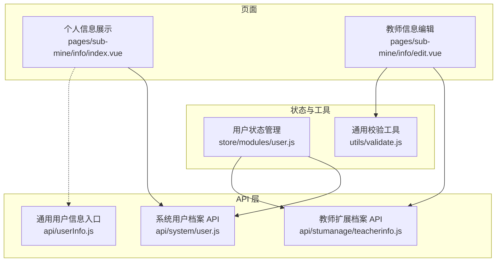
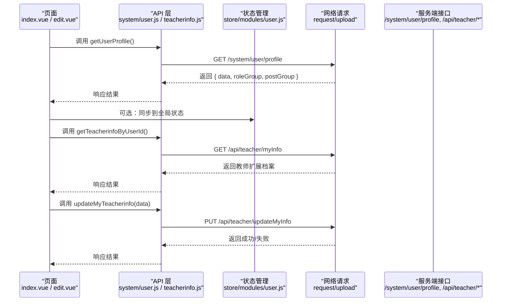
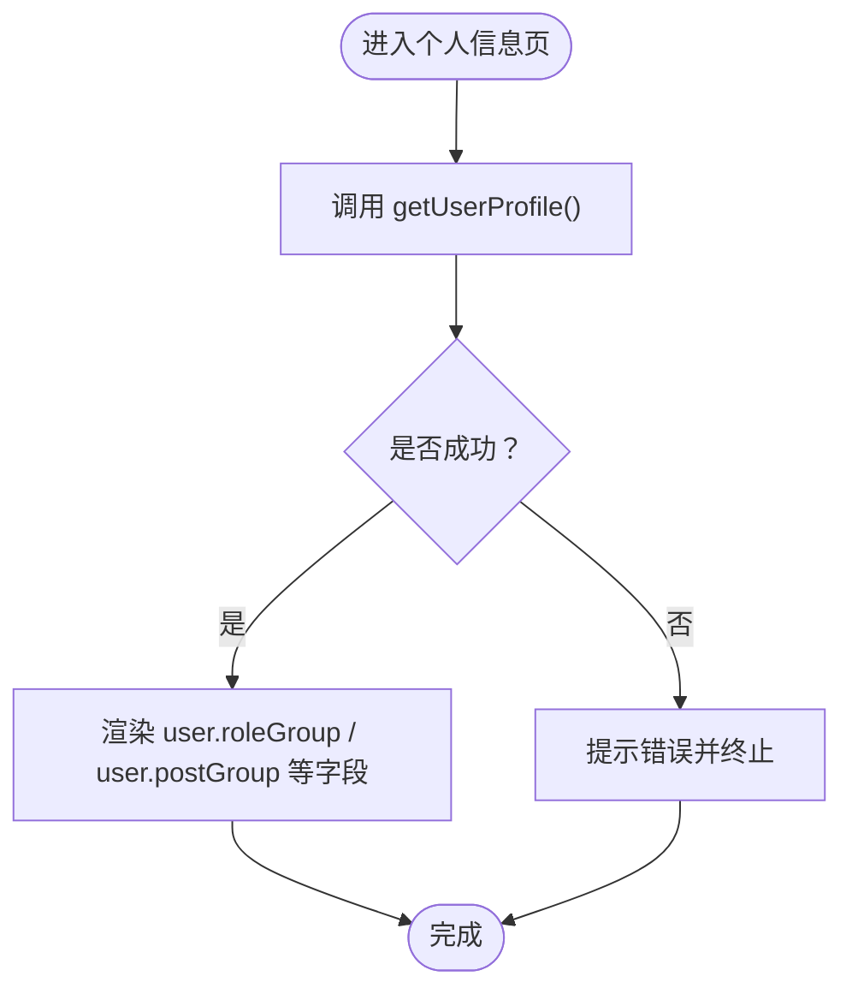
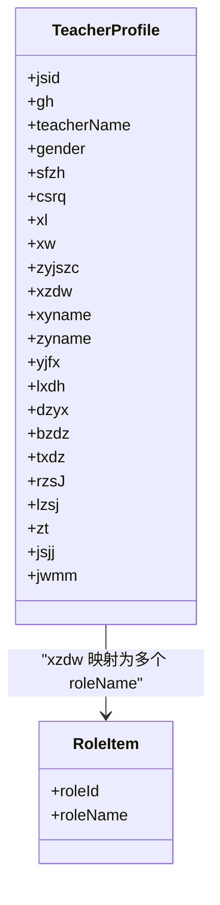
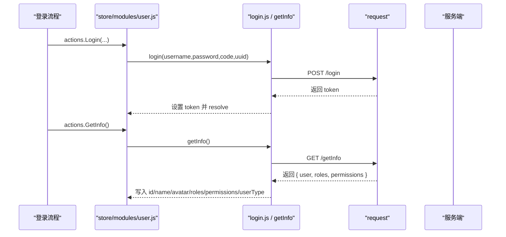
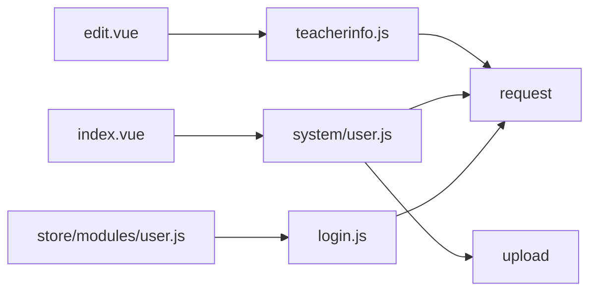

# 用户信息接口

<cite>
**本文引用的文件**   
- [api/userInfo.js](file://api/userInfo.js)
- [api/system/user.js](file://api/system/user.js)
- [pages/sub-mine/info/index.vue](file://pages/sub-mine/info/index.vue)
- [pages/sub-mine/info/edit.vue](file://pages/sub-mine/info/edit.vue)
- [api/stumanage/teacherinfo.js](file://api/stumanage/teacherinfo.js)
- [store/modules/user.js](file://store/modules/user.js)
- [utils/validate.js](file://utils/validate.js)
</cite>

## 目录
1. [简介](#简介)
2. [项目结构](#项目结构)
3. [核心组件](#核心组件)
4. [架构总览](#架构总览)
5. [详细组件分析](#详细组件分析)
6. [依赖关系分析](#依赖关系分析)
7. [性能与可用性建议](#性能与可用性建议)
8. [故障排查指南](#故障排查指南)
9. [结论](#结论)
10. [附录：数据模型与校验规则](#附录数据模型与校验规则)

## 简介
本文件面向“用户信息”相关的前端能力，聚焦以下目标：
- 记录用户基础信息的查询与管理功能（系统用户档案、教师扩展档案）
- 说明用户档案的完整数据结构与字段含义
- 解释用户信息与角色、岗位等关联关系
- 提供批量导入导出、版本历史与变更记录的实现建议
- 明确用户信息的校验规则与业务逻辑
- 提供搜索与筛选能力说明
- 给出备份恢复与数据迁移的实施建议

注意：当前仓库为前端小程序工程，后端接口定义未包含在本仓库中。因此，关于后端的数据约束、外键、权限控制、审计日志等细节以本仓库实际调用为准；对于未在代码中体现的后端能力，本文提供实现建议与最佳实践。

## 项目结构
围绕用户信息的前端组织方式如下：
- API 层
  - 系统用户档案：api/system/user.js
  - 通用用户信息入口：api/userInfo.js
  - 教师扩展档案：api/stumanage/teacherinfo.js
- 页面层
  - 个人信息展示：pages/sub-mine/info/index.vue
  - 教师信息编辑：pages/sub-mine/info/edit.vue
- 状态管理
  - 登录态与用户上下文：store/modules/user.js
- 工具库
  - 通用校验：utils/validate.js

图表来源
- [pages/sub-mine/info/index.vue:1-45](file://pages/sub-mine/info/index.vue#L1-L45)
- [pages/sub-mine/info/edit.vue:1-120](file://pages/sub-mine/info/edit.vue#L1-L120)
- [api/system/user.js:1-42](file://api/system/user.js#L1-L42)
- [api/userInfo.js:1-61](file://api/userInfo.js#L1-L61)
- [api/stumanage/teacherinfo.js:1-52](file://api/stumanage/teacherinfo.js#L1-L52)
- [store/modules/user.js:1-120](file://store/modules/user.js#L1-L120)
- [utils/validate.js:1-115](file://utils/validate.js#L1-L115)

章节来源
- [api/system/user.js:1-42](file://api/system/user.js#L1-L42)
- [api/userInfo.js:1-61](file://api/userInfo.js#L1-L61)
- [api/stumanage/teacherinfo.js:1-52](file://api/stumanage/teacherinfo.js#L1-L52)
- [pages/sub-mine/info/index.vue:1-45](file://pages/sub-mine/info/index.vue#L1-L45)
- [pages/sub-mine/info/edit.vue:1-120](file://pages/sub-mine/info/edit.vue#L1-L120)
- [store/modules/user.js:1-120](file://store/modules/user.js#L1-L120)
- [utils/validate.js:1-115](file://utils/validate.js#L1-L115)

## 核心组件
本节梳理与用户信息相关的核心模块及其职责。

- 系统用户档案 API（api/system/user.js）
  - 获取个人档案：GET /system/user/profile
  - 修改个人档案：PUT /system/user/profile
  - 修改密码：PUT /system/user/profile/updatePwd
  - 上传头像：POST /system/user/profile/avatar（通过统一上传封装）

- 通用用户信息入口（api/userInfo.js）
  - 获取用户信息：GET /getInfo
  - 判断是否绑定邮箱：GET /campus/haveMail
  - 复用系统用户档案相关方法（与 api/system/user.js 重复暴露）

- 教师扩展档案 API（api/stumanage/teacherinfo.js）
  - 根据当前用户ID获取教师信息：GET /api/teacher/myInfo
  - 更新本人教师信息：PUT /api/teacher/updateMyInfo
  - 获取角色列表（用于将职务ID映射为中文名称）：GET /api/teacher/roles
  - 其他教师信息管理（列表、详情、删除）：/stumanage/teacherinfo/*

- 个人信息展示页（pages/sub-mine/info/index.vue）
  - 调用 getUserProfile 获取系统用户档案并渲染昵称、手机号、邮箱、岗位、角色、创建时间等

- 教师信息编辑页（pages/sub-mine/info/edit.vue）
  - 加载教师信息，按 Tab 分组展示基本信息、学历职务、联系方式、其他信息
  - 提交时仅允许编辑可写字段，日期字段做本地格式化显示

- 用户状态管理（store/modules/user.js）
  - 登录成功后保存 token、用户ID、用户名、头像、角色、权限、用户类型
  - 提供 GetInfo 动作，从 /getInfo 拉取用户信息并写入状态

- 通用校验工具（utils/validate.js）
  - 提供空值、URL、邮箱等常用校验函数，供表单或业务逻辑使用

章节来源
- [api/system/user.js:1-42](file://api/system/user.js#L1-L42)
- [api/userInfo.js:1-61](file://api/userInfo.js#L1-L61)
- [api/stumanage/teacherinfo.js:1-52](file://api/stumanage/teacherinfo.js#L1-L52)
- [pages/sub-mine/info/index.vue:1-45](file://pages/sub-mine/info/index.vue#L1-L45)
- [pages/sub-mine/info/edit.vue:1-120](file://pages/sub-mine/info/edit.vue#L1-L120)
- [store/modules/user.js:1-120](file://store/modules/user.js#L1-L120)
- [utils/validate.js:1-115](file://utils/validate.js#L1-L115)

## 架构总览
下图展示了用户信息在前后端的交互路径与关键节点。

图表来源
- [pages/sub-mine/info/index.vue:25-36](file://pages/sub-mine/info/index.vue#L25-L36)
- [pages/sub-mine/info/edit.vue:209-235](file://pages/sub-mine/info/edit.vue#L209-L235)
- [api/system/user.js:18-32](file://api/system/user.js#L18-L32)
- [api/stumanage/teacherinfo.js:21-35](file://api/stumanage/teacherinfo.js#L21-L35)
- [store/modules/user.js:73-111](file://store/modules/user.js#L73-L111)

## 详细组件分析

### 系统用户档案接口
- 获取个人档案
  - 方法：GET /system/user/profile
  - 用途：返回当前登录用户的系统级档案，包括昵称、手机号、邮箱、岗位、角色、创建时间等
  - 页面使用：个人信息展示页直接读取 response.data 及 roleGroup/postGroup 进行展示

- 修改个人档案
  - 方法：PUT /system/user/profile
  - 用途：更新系统用户档案中的可编辑字段（如昵称、手机号、邮箱等）

- 修改密码
  - 方法：PUT /system/user/profile/updatePwd
  - 参数：旧密码、新密码

- 上传头像
  - 方法：POST /system/user/profile/avatar
  - 说明：通过 upload 封装上传文件，name 与 filePath 由调用方传入

图表来源
- [pages/sub-mine/info/index.vue:25-36](file://pages/sub-mine/info/index.vue#L25-L36)
- [api/system/user.js:18-32](file://api/system/user.js#L18-L32)

章节来源
- [api/system/user.js:1-42](file://api/system/user.js#L1-42)
- [pages/sub-mine/info/index.vue:1-45](file://pages/sub-mine/info/index.vue#L1-45)

### 教师扩展档案接口
- 获取本人教师信息
  - 方法：GET /api/teacher/myInfo
  - 用途：返回教师扩展档案，包含工号、姓名、性别、身份证号、出生日期、学历、学位、专业技术职务、行政职务、所属学院/专业、研究方向、联系方式、入职/离职时间、状态、简介、教务系统密码等

- 更新本人教师信息
  - 方法：PUT /api/teacher/updateMyInfo
  - 用途：更新教师扩展档案的可编辑字段（如性别、学历、学位、职务、联系方式、状态、简介、教务系统密码等）
  - 注意：部分字段只读（如工号、姓名、身份证号、出生日期、所属学院/专业、入职/离职时间），前端已禁用编辑

- 获取角色列表
  - 方法：GET /api/teacher/roles
  - 用途：将行政职务ID转换为中文名称，便于展示

图表来源
- [pages/sub-mine/info/edit.vue:123-184](file://pages/sub-mine/info/edit.vue#L123-L184)
- [api/stumanage/teacherinfo.js:21-43](file://api/stumanage/teacherinfo.js#L21-L43)

章节来源
- [api/stumanage/teacherinfo.js:1-52](file://api/stumanage/teacherinfo.js#L1-52)
- [pages/sub-mine/info/edit.vue:110-323](file://pages/sub-mine/info/edit.vue#L110-L323)

### 用户状态管理与登录态
- 登录成功后，GetInfo 会调用 /getInfo 获取用户信息，并将 userId、userName、avatar、roles、permissions、userType 写入 store
- 后续页面可通过 this.$store.state.user.* 访问当前用户上下文

图表来源
- [store/modules/user.js:55-111](file://store/modules/user.js#L55-L111)
- [api/login.js:34-39](file://api/login.js#L34-L39)

章节来源
- [store/modules/user.js:1-120](file://store/modules/user.js#L1-L120)
- [api/login.js:1-79](file://api/login.js#L1-L79)

## 依赖关系分析
- 页面依赖 API 层
  - index.vue 依赖 system/user.js 的 getUserProfile
  - edit.vue 依赖 teacherinfo.js 的 getTeacherinfoByUserId、updateMyTeacherinfo、getRoleList
- API 层依赖网络请求封装
  - request 用于常规 JSON 请求
  - upload 用于文件上传（头像）
- 状态管理依赖登录与用户信息接口
  - store/modules/user.js 依赖 login.js 的 getInfo

图表来源
- [pages/sub-mine/info/index.vue:14-36](file://pages/sub-mine/info/index.vue#L14-L36)
- [pages/sub-mine/info/edit.vue:110-120](file://pages/sub-mine/info/edit.vue#L110-L120)
- [api/system/user.js:1-42](file://api/system/user.js#L1-L42)
- [api/stumanage/teacherinfo.js:1-52](file://api/stumanage/teacherinfo.js#L1-L52)
- [store/modules/user.js:1-120](file://store/modules/user.js#L1-L120)
- [api/login.js:1-79](file://api/login.js#L1-L79)

章节来源
- [pages/sub-mine/info/index.vue:1-45](file://pages/sub-mine/info/index.vue#L1-L45)
- [pages/sub-mine/info/edit.vue:1-120](file://pages/sub-mine/info/edit.vue#L1-L120)
- [api/system/user.js:1-42](file://api/system/user.js#L1-L42)
- [api/stumanage/teacherinfo.js:1-52](file://api/stumanage/teacherinfo.js#L1-L52)
- [store/modules/user.js:1-120](file://store/modules/user.js#L1-L120)
- [api/login.js:1-79](file://api/login.js#L1-L79)

## 性能与可用性建议
- 缓存策略
  - 对 /system/user/profile 和 /api/teacher/myInfo 可在内存中短期缓存，避免频繁刷新导致重复请求
- 懒加载与分页
  - 若未来引入教师列表或历史记录，应支持分页与按需加载
- 图片优化
  - 头像上传后建议使用 CDN 与缩略图策略，减少带宽占用
- 并发控制
  - 同时发起多个请求时，做好去重与错误重试机制
- 用户体验
  - 长耗时操作增加 Loading 与进度反馈
  - 失败场景提供重试与友好提示

[本节为通用建议，不直接分析具体文件]

## 故障排查指南
- 常见问题定位
  - 个人信息无法加载：检查 /system/user/profile 返回结构与字段名是否与页面一致
  - 教师信息为空：确认当前用户是否具备教师身份，以及 /api/teacher/myInfo 是否返回数据
  - 头像上传失败：检查 upload 封装是否正确传递 name 与 filePath，以及服务端返回格式
  - 角色映射异常：确认 /api/teacher/roles 返回 roleId 与 xzdw 的对应关系
- 调试手段
  - 在浏览器/开发者工具查看 Network 面板的请求与响应
  - 在控制台打印关键变量（如 user、teacher、roleList）
- 错误处理
  - 统一捕获 Promise 拒绝，提示用户并记录必要上下文

章节来源
- [pages/sub-mine/info/index.vue:25-36](file://pages/sub-mine/info/index.vue#L25-L36)
- [pages/sub-mine/info/edit.vue:209-235](file://pages/sub-mine/info/edit.vue#L209-L235)
- [api/system/user.js:34-41](file://api/system/user.js#L34-L41)
- [api/stumanage/teacherinfo.js:37-43](file://api/stumanage/teacherinfo.js#L37-L43)

## 结论
本仓库在前端侧实现了用户基础信息查询与教师扩展档案的编辑能力，并通过状态管理维护登录态与用户上下文。针对批量导入导出、版本历史与变更记录、备份恢复与数据迁移等需求，当前仓库未包含后端实现，本文提供了可行的实现建议与最佳实践，便于后续扩展。

[本节为总结性内容，不直接分析具体文件]

## 附录：数据模型与校验规则

### 系统用户档案字段（来自页面渲染）
- 昵称、手机号码、邮箱、岗位、角色、创建时间
- 数据来源：/system/user/profile 的 data 与 roleGroup/postGroup

章节来源
- [pages/sub-mine/info/index.vue:4-10](file://pages/sub-mine/info/index.vue#L4-L10)
- [api/system/user.js:18-32](file://api/system/user.js#L18-L32)

### 教师扩展档案字段（来自编辑页表单）
- 基本信息：工号、姓名、性别、身份证号、出生日期
- 学历职务：学历、学位、专业技术职务、行政职务（只读）、所属学院（只读）、所属专业（只读）、研究方向
- 联系方式：联系电话、电子邮箱、办公地址、通讯地址
- 其他信息：入职时间（只读）、离职时间（只读）、状态、教师简介、教务系统密码

章节来源
- [pages/sub-mine/info/edit.vue:21-97](file://pages/sub-mine/info/edit.vue#L21-L97)
- [pages/sub-mine/info/edit.vue:123-184](file://pages/sub-mine/info/edit.vue#L123-L184)

### 关联关系与外键约束（基于前端行为推断）
- 教师档案与系统用户：通过当前登录用户ID关联（/api/teacher/myInfo）
- 行政职务与角色：xzdw 为逗号分隔的角色ID字符串，需通过 /api/teacher/roles 映射为中文名称
- 岗位与角色：系统用户档案返回 roleGroup/postGroup 用于展示

章节来源
- [api/stumanage/teacherinfo.js:21-43](file://api/stumanage/teacherinfo.js#L21-L43)
- [pages/sub-mine/info/index.vue:30-34](file://pages/sub-mine/info/index.vue#L30-L34)
- [pages/sub-mine/info/edit.vue:255-267](file://pages/sub-mine/info/edit.vue#L255-L267)

### 校验规则与业务逻辑
- 通用校验工具
  - 邮箱正则、空值判断、URL 校验等
- 表单输入限制
  - 联系电话：数字、最大长度 11
  - 教师简介：多行文本、最大长度 500
- 业务逻辑
  - 只读字段不可编辑（如工号、姓名、身份证号、出生日期、所属学院/专业、入职/离职时间）
  - 提交前二次确认，成功后重新加载数据
  - 日期字段本地格式化展示

章节来源
- [utils/validate.js:89-95](file://utils/validate.js#L89-L95)
- [pages/sub-mine/info/edit.vue:66-97](file://pages/sub-mine/info/edit.vue#L66-L97)
- [pages/sub-mine/info/edit.vue:278-321](file://pages/sub-mine/info/edit.vue#L278-L321)

### 搜索与筛选
- 当前仓库未提供用户信息搜索与筛选的前端实现
- 建议
  - 在教师信息列表页增加关键词搜索（姓名、工号、学院、专业）
  - 提供下拉筛选（性别、状态、职务）
  - 后端配合分页与排序

[本节为概念性建议，不直接分析具体文件]

### 批量导入与导出
- 当前仓库未提供批量导入导出功能
- 建议
  - 导入：提供 Excel/CSV 模板下载，前端选择文件后调用上传接口，后端解析并落库
  - 导出：后端生成文件流，前端触发下载
  - 校验：前端对必填项、格式进行预校验，降低后端压力

[本节为概念性建议，不直接分析具体文件]

### 版本历史与变更记录
- 当前仓库未提供版本历史与变更记录功能
- 建议
  - 后端维护变更表，记录字段级差异、操作人、时间戳
  - 前端提供“变更记录”视图，支持对比两个版本的差异

[本节为概念性建议，不直接分析具体文件]

### 备份恢复与数据迁移
- 当前仓库未提供备份恢复与数据迁移功能
- 建议
  - 定期全量/增量备份至对象存储
  - 提供一键导出与导入工具，支持断点续传与失败重试
  - 迁移脚本需保证幂等性与回滚能力

[本节为概念性建议，不直接分析具体文件]