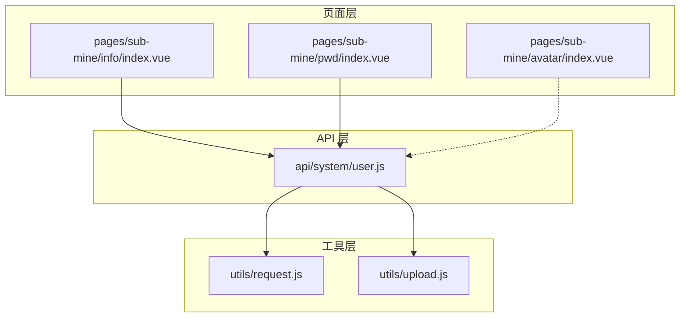
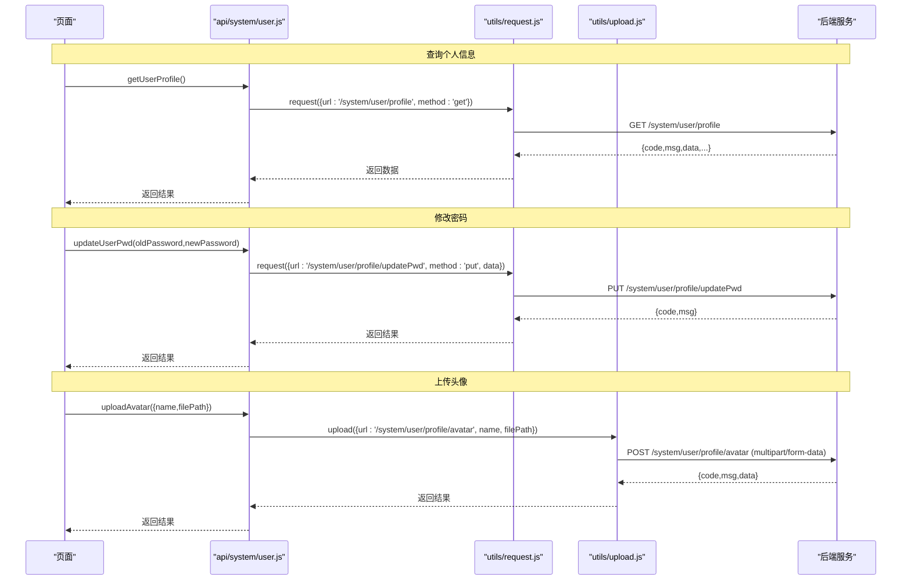
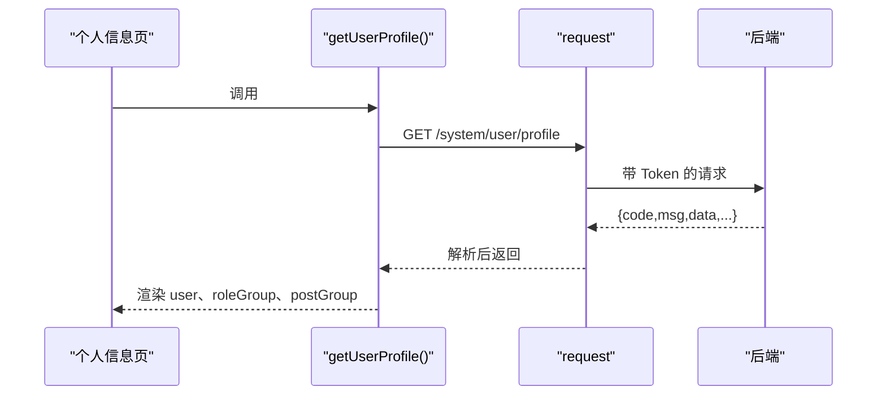
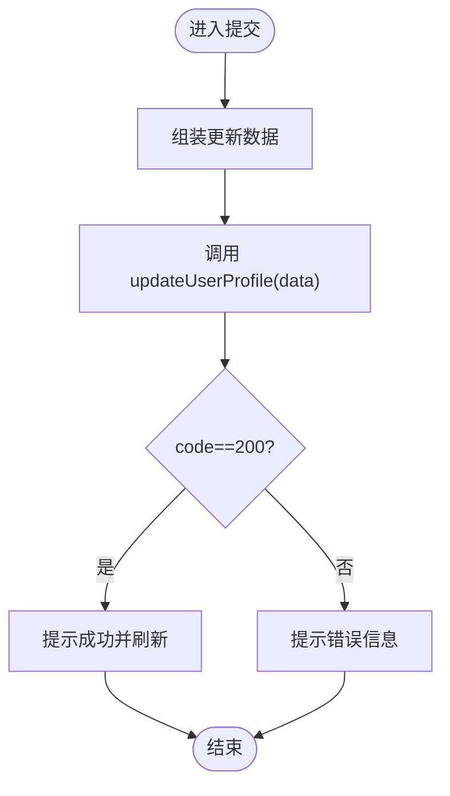
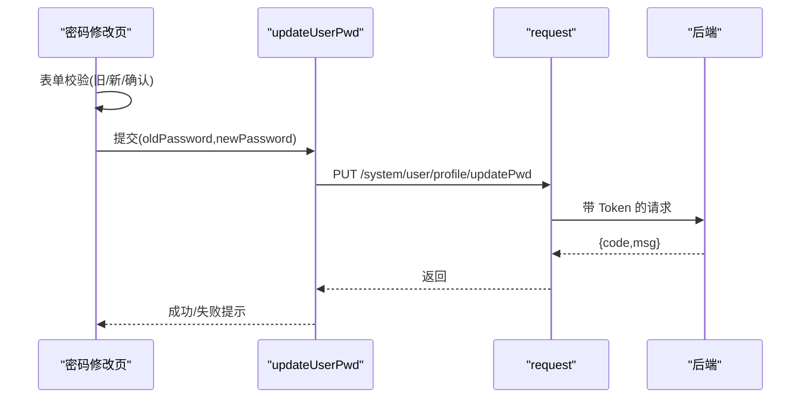
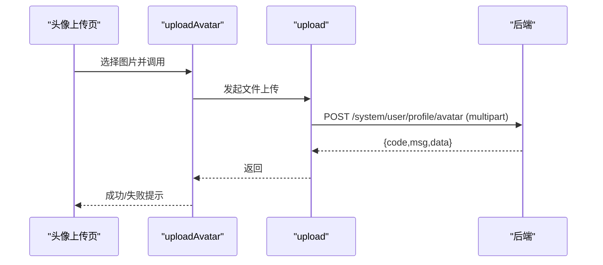
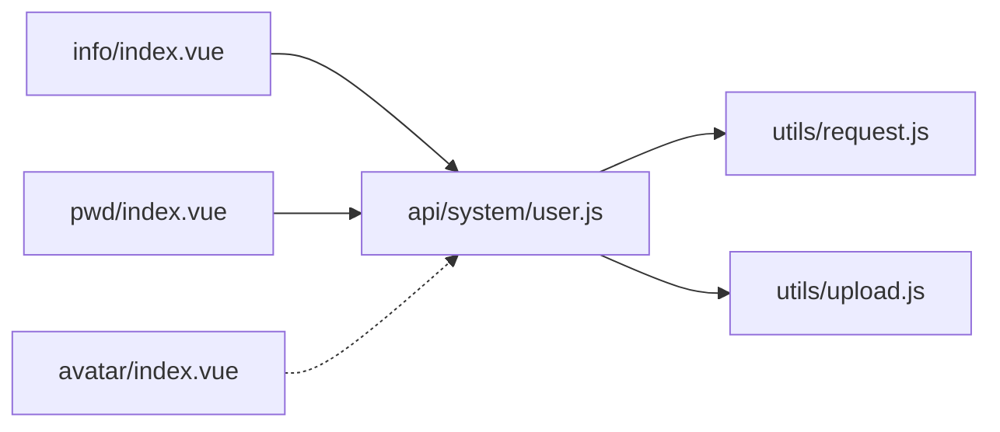

# 用户管理接口

<cite>
**本文引用的文件**   
- [api/system/user.js](file://api/system/user.js)
- [utils/request.js](file://utils/request.js)
- [utils/upload.js](file://utils/upload.js)
- [pages/sub-mine/info/index.vue](file://pages/sub-mine/info/index.vue)
- [pages/sub-mine/pwd/index.vue](file://pages/sub-mine/pwd/index.vue)
- [pages/sub-mine/avatar/index.vue](file://pages/sub-mine/avatar/index.vue)
</cite>

## 目录
1. [简介](#简介)
2. [项目结构](#项目结构)
3. [核心组件](#核心组件)
4. [架构总览](#架构总览)
5. [详细组件分析](#详细组件分析)
6. [依赖分析](#依赖分析)
7. [性能考虑](#性能考虑)
8. [故障排查指南](#故障排查指南)
9. [结论](#结论)
10. [附录](#附录)

## 简介
本文件面向前端开发者与测试人员，系统化梳理“用户管理”相关的前端接口封装与调用流程，覆盖以下能力：
- 获取当前登录用户的完整信息（含基本信息、角色/岗位等）
- 修改用户个人资料
- 重置/修改密码（含强度与一致性校验）
- 上传头像（文件上传规范、格式与大小限制）

文档同时给出错误处理机制、异常状态码说明、请求/响应示例及参数验证规则。

## 项目结构
与用户管理相关的核心前端代码分布如下：
- API 层：统一封装系统用户资料相关接口
- 工具层：HTTP 请求与文件上传的通用封装
- 页面层：个人信息查看、密码修改、头像上传页面

图表来源
- [api/system/user.js:1-42](file://api/system/user.js#L1-L42)
- [utils/request.js:1-117](file://utils/request.js#L1-L117)
- [utils/upload.js:1-71](file://utils/upload.js#L1-L71)
- [pages/sub-mine/info/index.vue:1-45](file://pages/sub-mine/info/index.vue#L1-L45)
- [pages/sub-mine/pwd/index.vue:1-86](file://pages/sub-mine/pwd/index.vue#L1-L86)
- [pages/sub-mine/avatar/index.vue:1-231](file://pages/sub-mine/avatar/index.vue#L1-L231)

章节来源
- [api/system/user.js:1-42](file://api/system/user.js#L1-L42)
- [utils/request.js:1-117](file://utils/request.js#L1-L117)
- [utils/upload.js:1-71](file://utils/upload.js#L1-L71)
- [pages/sub-mine/info/index.vue:1-45](file://pages/sub-mine/info/index.vue#L1-L45)
- [pages/sub-mine/pwd/index.vue:1-86](file://pages/sub-mine/pwd/index.vue#L1-L86)
- [pages/sub-mine/avatar/index.vue:1-231](file://pages/sub-mine/avatar/index.vue#L1-L231)

## 核心组件
- 用户信息查询：GET /system/user/profile
- 修改用户资料：PUT /system/user/profile
- 修改密码：PUT /system/user/profile/updatePwd
- 上传头像：POST /system/user/profile/avatar（通过文件上传封装）

上述接口在 api/system/user.js 中统一导出，供页面直接调用。

章节来源
- [api/system/user.js:17-32](file://api/system/user.js#L17-L32)
- [api/system/user.js:4-15](file://api/system/user.js#L4-L15)
- [api/system/user.js:34-41](file://api/system/user.js#L34-L41)

## 架构总览
下图展示了从页面到后端接口的调用链路，以及统一的鉴权与错误处理。

图表来源
- [api/system/user.js:17-41](file://api/system/user.js#L17-L41)
- [utils/request.js:10-117](file://utils/request.js#L10-L117)
- [utils/upload.js:10-71](file://utils/upload.js#L10-L71)

## 详细组件分析

### 接口一：获取当前用户信息（getUserProfile）
- 方法：GET
- 路径：/system/user/profile
- 用途：获取当前登录用户的完整信息，包括基本信息、角色/岗位等
- 请求头：自动携带 Authorization（Bearer token），由工具层注入
- 成功响应：包含用户对象与角色/岗位分组信息（如 roleGroup、postGroup）
- 失败处理：
  - 401：会话过期或无效，将触发重新登录流程
  - 500：服务端异常，提示消息并拒绝 Promise
  - 其他非 200：按业务 code 提示并拒绝

图表来源
- [api/system/user.js:17-23](file://api/system/user.js#L17-L23)
- [utils/request.js:10-117](file://utils/request.js#L10-L117)
- [pages/sub-mine/info/index.vue:14-36](file://pages/sub-mine/info/index.vue#L14-L36)

章节来源
- [api/system/user.js:17-23](file://api/system/user.js#L17-L23)
- [utils/request.js:10-117](file://utils/request.js#L10-L117)
- [pages/sub-mine/info/index.vue:14-36](file://pages/sub-mine/info/index.vue#L14-L36)

### 接口二：修改用户资料（updateUserProfile）
- 方法：PUT
- 路径：/system/user/profile
- 用途：更新当前用户的可编辑资料字段
- 请求体：JSON 对象，包含需要更新的字段（具体字段以业务为准）
- 成功响应：code=200 表示成功
- 失败处理：同通用错误处理策略

图表来源
- [api/system/user.js:25-32](file://api/system/user.js#L25-L32)
- [utils/request.js:10-117](file://utils/request.js#L10-L117)

章节来源
- [api/system/user.js:25-32](file://api/system/user.js#L25-L32)
- [utils/request.js:10-117](file://utils/request.js#L10-L117)

### 接口三：修改密码（updateUserPwd）
- 方法：PUT
- 路径：/system/user/profile/updatePwd
- 请求体：
  - oldPassword：旧密码（必填）
  - newPassword：新密码（必填）
- 前端校验规则（页面侧）：
  - 旧密码：必填
  - 新密码：必填，长度 6~20 字符
  - 确认密码：必填，且必须与新密码一致
- 安全策略：
  - 仅当旧密码正确且新密码满足长度要求时方可更新
  - 成功后应提示修改成功
- 失败处理：
  - 401：会话失效，跳转登录
  - 500：服务端异常
  - 其他：根据后端 msg 提示

图表来源
- [api/system/user.js:4-15](file://api/system/user.js#L4-L15)
- [utils/request.js:10-117](file://utils/request.js#L10-L117)
- [pages/sub-mine/pwd/index.vue:18-73](file://pages/sub-mine/pwd/index.vue#L18-L73)

章节来源
- [api/system/user.js:4-15](file://api/system/user.js#L4-L15)
- [utils/request.js:10-117](file://utils/request.js#L10-L117)
- [pages/sub-mine/pwd/index.vue:18-73](file://pages/sub-mine/pwd/index.vue#L18-L73)

### 接口四：上传头像（uploadAvatar）
- 方法：POST
- 路径：/system/user/profile/avatar
- 上传方式：multipart/form-data（通过文件上传封装）
- 参数：
  - name：表单字段名（默认 file）
  - filePath：本地临时文件路径
- 格式与大小限制：
  - 建议遵循常见图片格式（如 jpg、png）
  - 文件大小建议不超过 5MB（页面提示已体现）
- 成功响应：返回存储后的资源路径或 URL
- 失败处理：
  - 401：会话失效，弹窗引导重新登录
  - 500：服务端异常
  - 其他：根据后端 msg 提示

图表来源
- [api/system/user.js:34-41](file://api/system/user.js#L34-L41)
- [utils/upload.js:10-71](file://utils/upload.js#L10-L71)
- [pages/sub-mine/avatar/index.vue:84-143](file://pages/sub-mine/avatar/index.vue#L84-L143)

章节来源
- [api/system/user.js:34-41](file://api/system/user.js#L34-L41)
- [utils/upload.js:10-71](file://utils/upload.js#L10-L71)
- [pages/sub-mine/avatar/index.vue:84-143](file://pages/sub-mine/avatar/index.vue#L84-L143)

## 依赖分析
- 页面依赖 API 层函数进行业务调用
- API 层依赖 request（普通请求）与 upload（文件上传）两个工具模块
- 工具层负责：
  - 自动注入 Authorization 头
  - 统一错误码处理与用户提示
  - 网络异常、超时等兜底处理

图表来源
- [api/system/user.js:1-42](file://api/system/user.js#L1-L42)
- [utils/request.js:1-117](file://utils/request.js#L1-117)
- [utils/upload.js:1-71](file://utils/upload.js#L1-71)
- [pages/sub-mine/info/index.vue:14-36](file://pages/sub-mine/info/index.vue#L14-L36)
- [pages/sub-mine/pwd/index.vue:18-73](file://pages/sub-mine/pwd/index.vue#L18-L73)
- [pages/sub-mine/avatar/index.vue:84-143](file://pages/sub-mine/avatar/index.vue#L84-L143)

章节来源
- [api/system/user.js:1-42](file://api/system/user.js#L1-L42)
- [utils/request.js:1-117](file://utils/request.js#L1-117)
- [utils/upload.js:1-71](file://utils/upload.js#L1-71)

## 性能考虑
- 避免重复请求：对个人信息等低频变更的数据，可在页面内缓存，减少不必要的网络请求
- 图片上传优化：
  - 使用压缩图模式，降低带宽占用
  - 控制最大尺寸与数量（当前为单张）
- 错误重试：对于偶发网络问题，可在上层增加有限次数的重试逻辑（谨慎使用，避免幂等性问题）

## 故障排查指南
- 401 未授权：
  - 现象：请求被拦截，提示会话过期
  - 处理：自动跳转登录页或引导重新登录
- 500 服务器错误：
  - 现象：弹出后端返回的错误消息
  - 处理：检查后端日志与入参合法性
- 网络异常/超时：
  - 现象：提示“后端接口连接异常”或“系统接口请求超时”
  - 处理：检查网络环境、后端服务可用性、超时配置
- 上传失败：
  - 现象：提示上传失败或未获取到照片路径
  - 处理：检查文件格式、大小限制、后端返回路径字段是否一致

章节来源
- [utils/request.js:40-117](file://utils/request.js#L40-L117)
- [utils/upload.js:31-71](file://utils/upload.js#L31-L71)
- [pages/sub-mine/avatar/index.vue:96-143](file://pages/sub-mine/avatar/index.vue#L96-L143)

## 结论
本文档基于现有前端实现，梳理了用户管理相关接口的调用方式、参数与错误处理策略。建议在后续迭代中：
- 明确并文档化各字段的类型、长度与枚举值
- 完善前端参数校验规则（如邮箱、手机号等）
- 统一错误码字典与用户提示文案

## 附录

### 接口清单与示例

- 获取个人信息
  - 方法：GET
  - 路径：/system/user/profile
  - 请求头：Authorization: Bearer <token>
  - 成功响应示例：
    - { code: 200, msg: "操作成功", data: { ... }, roleGroup: "...", postGroup: "..." }
  - 失败响应示例：
    - { code: 401, msg: "无效的会话，或者会话已过期，请重新登录。" }
    - { code: 500, msg: "服务器内部错误" }

- 修改用户资料
  - 方法：PUT
  - 路径：/system/user/profile
  - 请求体示例：
    - { nickName: "昵称", email: "xxx@example.com", phonenumber: "13800000000" }
  - 成功响应示例：
    - { code: 200, msg: "操作成功" }

- 修改密码
  - 方法：PUT
  - 路径：/system/user/profile/updatePwd
  - 请求体示例：
    - { oldPassword: "旧密码", newPassword: "新密码" }
  - 成功响应示例：
    - { code: 200, msg: "操作成功" }

- 上传头像
  - 方法：POST
  - 路径：/system/user/profile/avatar
  - 表单字段：
    - name: file
    - filePath: 本地临时文件路径
  - 成功响应示例：
    - { code: 200, msg: "操作成功", data: "/profile/xxx.jpg" }

### 参数验证规则（前端）
- 修改密码
  - 旧密码：必填
  - 新密码：必填，长度 6~20 字符
  - 确认密码：必填，且等于新密码

章节来源
- [pages/sub-mine/pwd/index.vue:29-58](file://pages/sub-mine/pwd/index.vue#L29-L58)
- [api/system/user.js:4-15](file://api/system/user.js#L4-L15)
- [api/system/user.js:25-32](file://api/system/user.js#L25-L32)
- [api/system/user.js:17-23](file://api/system/user.js#L17-L23)
- [api/system/user.js:34-41](file://api/system/user.js#L34-L41)