# 系统管理接口

<cite>
**本文引用的文件**   
- [api/system/user.js](file://api/system/user.js)
- [api/system/dict/data.js](file://api/system/dict/data.js)
- [api/system/dict/type.js](file://api/system/dict/type.js)
- [api/roleView.js](file://api/roleView.js)
- [utils/roleViewConfig.js](file://utils/roleViewConfig.js)
- [api/ad.js](file://api/ad.js)
- [api/tourist.js](file://api/tourist.js)
- [api/userInfo.js](file://api/userInfo.js)
- [store/modules/user.js](file://store/modules/user.js)
- [plugins/auth.js](file://plugins/auth.js)
- [utils/permission.js](file://utils/permission.js)
- [utils/request.js](file://utils/request.js)
- [config.js](file://config.js)
- [utils/storage.js](file://utils/storage.js)
- [utils/constant.js](file://utils/constant.js)
</cite>

## 目录
1. [简介](#简介)
2. [项目结构](#项目结构)
3. [核心组件](#核心组件)
4. [架构总览](#架构总览)
5. [详细组件分析](#详细组件分析)
6. [依赖分析](#依赖分析)
7. [性能考虑](#性能考虑)
8. [故障排查指南](#故障排查指南)
9. [结论](#结论)
10. [附录](#附录)

## 简介
本文件面向“系统管理相关接口”的前端实现，覆盖以下能力：
- 用户管理：个人信息查询与修改、密码重置、头像上传
- 字典管理：字典类型与数据的管理、缓存刷新
- 角色视图配置：按角色动态返回页面布局与功能开关，支持前端本地缓存与降级默认值
- 广告管理：获取广告列表、展示与点击上报、批量上报
- 操作日志：当前仓库未提供独立日志模块，建议在后端统一记录并可通过通用请求拦截器扩展
- 游客访问：提供无需登录的公开内容读取接口（分类、内容、评论等）
- 用户信息：统一的个人信息入口与权限校验
- 权限控制：基于角色与字符权限的前端校验工具
- 系统配置与健康检查：通过全局配置集中管理后端地址；健康检查可在后端暴露标准端点，前端复用请求封装进行探测

## 项目结构
系统管理相关的前端代码主要分布在 api、utils、store、plugins 四个层次：
- api：按业务域划分，如 system、ad、tourist、roleView、userInfo 等
- utils：通用网络请求、存储、常量、权限判断、角色视图配置加载
- store：用户状态与登录态管理
- plugins：权限插件，供模板或逻辑层调用

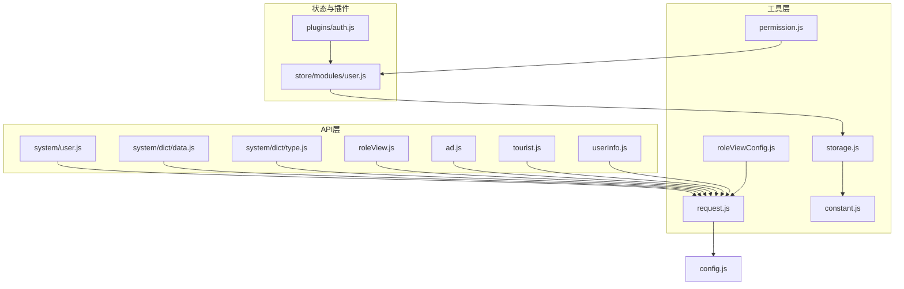

图表来源
- [api/system/user.js:1-42](file://api/system/user.js#L1-L42)
- [api/system/dict/data.js:1-53](file://api/system/dict/data.js#L1-L53)
- [api/system/dict/type.js:1-61](file://api/system/dict/type.js#L1-L61)
- [api/roleView.js:1-23](file://api/roleView.js#L1-L23)
- [utils/roleViewConfig.js:1-115](file://utils/roleViewConfig.js#L1-L115)
- [api/ad.js:1-50](file://api/ad.js#L1-L50)
- [api/tourist.js:1-69](file://api/tourist.js#L1-L69)
- [api/userInfo.js:1-61](file://api/userInfo.js#L1-L61)
- [utils/request.js:1-117](file://utils/request.js#L1-L117)
- [utils/storage.js:1-33](file://utils/storage.js#L1-L33)
- [utils/constant.js:1-10](file://utils/constant.js#L1-L10)
- [store/modules/user.js:1-283](file://store/modules/user.js#L1-L283)
- [plugins/auth.js:1-61](file://plugins/auth.js#L1-L61)
- [config.js:1-38](file://config.js#L1-L38)

章节来源
- [api/system/user.js:1-42](file://api/system/user.js#L1-L42)
- [api/system/dict/data.js:1-53](file://api/system/dict/data.js#L1-L53)
- [api/system/dict/type.js:1-61](file://api/system/dict/type.js#L1-L61)
- [api/roleView.js:1-23](file://api/roleView.js#L1-L23)
- [utils/roleViewConfig.js:1-115](file://utils/roleViewConfig.js#L1-L115)
- [api/ad.js:1-50](file://api/ad.js#L1-L50)
- [api/tourist.js:1-69](file://api/tourist.js#L1-L69)
- [api/userInfo.js:1-61](file://api/userInfo.js#L1-L61)
- [utils/request.js:1-117](file://utils/request.js#L1-L117)
- [utils/storage.js:1-33](file://utils/storage.js#L1-L33)
- [utils/constant.js:1-10](file://utils/constant.js#L1-L10)
- [store/modules/user.js:1-283](file://store/modules/user.js#L1-L283)
- [plugins/auth.js:1-61](file://plugins/auth.js#L1-L61)
- [config.js:1-38](file://config.js#L1-L38)

## 核心组件
- 用户管理接口
  - 个人信息：查询、更新
  - 密码重置
  - 头像上传
- 字典管理接口
  - 字典类型：CRUD、选项选择、刷新缓存
  - 字典数据：CRUD、按类型查询、分页列表
- 角色视图配置
  - 根据用户角色返回页面级配置（布局、开关、可见性）
  - 前端本地缓存 + 失败降级默认配置
- 广告管理接口
  - 按位置获取广告列表
  - 展示与点击上报、批量上报
- 游客访问接口
  - 分类、内容、评论等公开读接口
- 用户信息接口
  - 统一的用户信息入口（含个人信息）
- 权限与角色
  - 字符权限与角色校验工具
  - 插件化权限方法
- 网络与配置
  - 统一请求封装（自动注入 Authorization、错误处理、超时、重定向）
  - 全局配置（协议、主机、端口、前缀）
  - 本地存储封装

章节来源
- [api/system/user.js:1-42](file://api/system/user.js#L1-L42)
- [api/system/dict/data.js:1-53](file://api/system/dict/data.js#L1-L53)
- [api/system/dict/type.js:1-61](file://api/system/dict/type.js#L1-L61)
- [api/roleView.js:1-23](file://api/roleView.js#L1-L23)
- [utils/roleViewConfig.js:1-115](file://utils/roleViewConfig.js#L1-L115)
- [api/ad.js:1-50](file://api/ad.js#L1-L50)
- [api/tourist.js:1-69](file://api/tourist.js#L1-L69)
- [api/userInfo.js:1-61](file://api/userInfo.js#L1-L61)
- [utils/permission.js:1-49](file://utils/permission.js#L1-L49)
- [plugins/auth.js:1-61](file://plugins/auth.js#L1-L61)
- [utils/request.js:1-117](file://utils/request.js#L1-L117)
- [config.js:1-38](file://config.js#L1-L38)
- [utils/storage.js:1-33](file://utils/storage.js#L1-L33)

## 架构总览
前端以“API 层 + 工具层 + 状态层 + 插件层”分层组织。所有 HTTP 请求统一经 request 封装，负责鉴权头注入、参数拼接、错误码处理与异常提示。用户状态由 store 维护，权限校验通过 utils 与 plugins 提供。

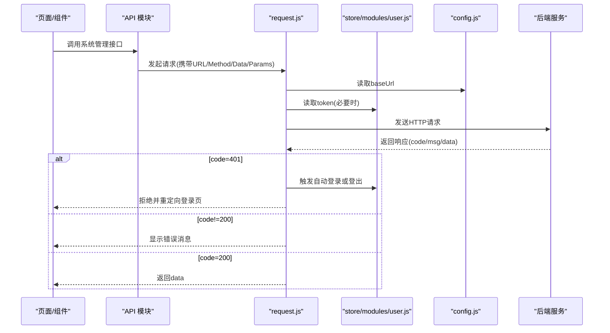

图表来源
- [utils/request.js:1-117](file://utils/request.js#L1-L117)
- [store/modules/user.js:1-283](file://store/modules/user.js#L1-L283)
- [config.js:1-38](file://config.js#L1-L38)

## 详细组件分析

### 用户管理接口
- 功能清单
  - 查询用户个人信息
  - 修改用户个人信息
  - 重置用户密码
  - 上传用户头像
- 关键路径
  - 个人信息：GET /system/user/profile；PUT /system/user/profile
  - 密码重置：PUT /system/user/profile/updatePwd
  - 头像上传：POST /system/user/profile/avatar（使用 upload 封装）
- 注意事项
  - 头像上传走专用上传封装，注意字段名与文件路径参数
  - 个人信息更新需保证必填字段完整

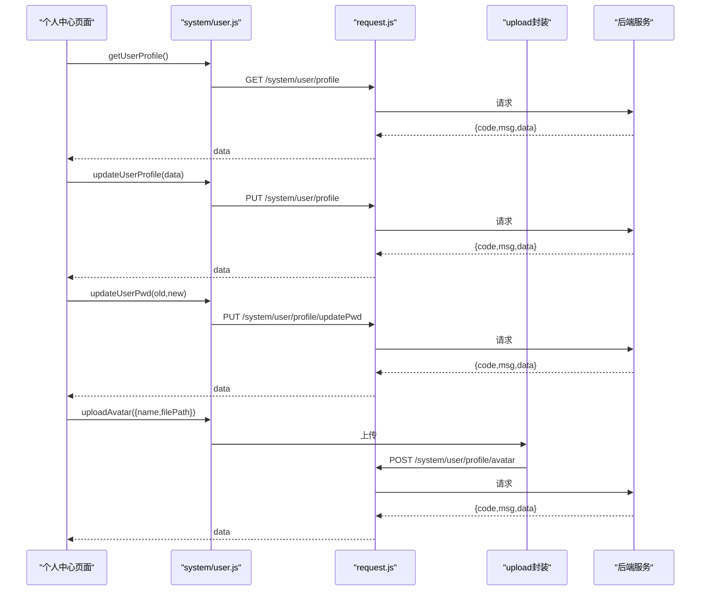

图表来源
- [api/system/user.js:1-42](file://api/system/user.js#L1-L42)
- [utils/request.js:1-117](file://utils/request.js#L1-L117)

章节来源
- [api/system/user.js:1-42](file://api/system/user.js#L1-L42)

### 字典管理接口
- 功能清单
  - 字典类型：列表、详情、新增、修改、删除、选项选择、刷新缓存
  - 字典数据：列表、详情、按类型查询、新增、修改、删除
- 关键路径
  - 类型：/system/dict/type/*
  - 数据：/system/dict/data/*
- 缓存机制
  - 提供刷新缓存接口，便于在后台变更后主动失效缓存
  - 前端可按需在变更成功后调用刷新接口

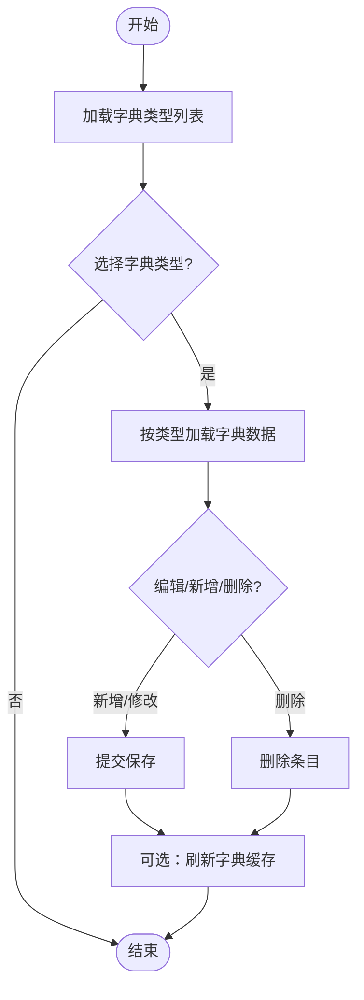

图表来源
- [api/system/dict/type.js:1-61](file://api/system/dict/type.js#L1-L61)
- [api/system/dict/data.js:1-53](file://api/system/dict/data.js#L1-L53)

章节来源
- [api/system/dict/type.js:1-61](file://api/system/dict/type.js#L1-L61)
- [api/system/dict/data.js:1-53](file://api/system/dict/data.js#L1-L53)

### 角色视图配置与动态渲染
- 能力说明
  - 根据用户角色返回页面级配置（如侧边栏展开、模块可见性、搜索能力等）
  - 前端本地缓存配置，失败时回退到默认配置
  - 支持预加载常用页面配置以提升首屏体验
- 关键路径
  - 获取角色配置：/api/role-view-config/config
  - 获取实名认证状态：/api/role-view-config/realname/status
  - 页面级配置：/api/role-view-config/{pageKey}
- 渲染流程
  - 先查本地缓存，命中则直接渲染
  - 未命中则请求后端，解析 JSON 配置后缓存
  - 请求失败则使用内置默认配置

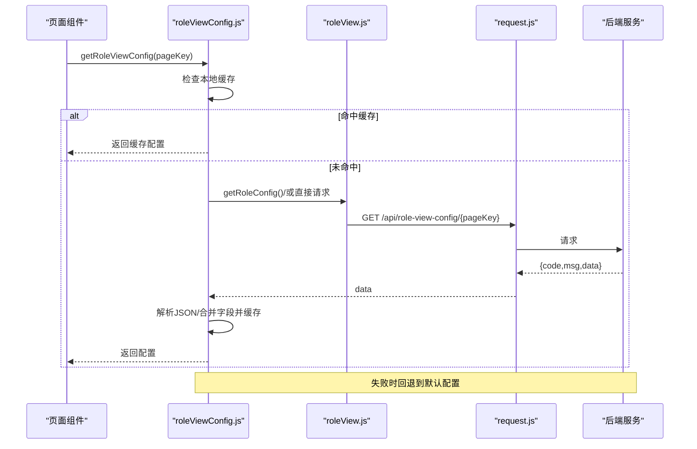

图表来源
- [api/roleView.js:1-23](file://api/roleView.js#L1-L23)
- [utils/roleViewConfig.js:1-115](file://utils/roleViewConfig.js#L1-L115)
- [utils/request.js:1-117](file://utils/request.js#L1-L117)

章节来源
- [api/roleView.js:1-23](file://api/roleView.js#L1-L23)
- [utils/roleViewConfig.js:1-115](file://utils/roleViewConfig.js#L1-L115)

### 广告管理接口
- 功能清单
  - 按位置获取广告列表（banner/feed/popup/footer）
  - 上报广告展示与点击
  - 批量上报展示
- 关键路径
  - 列表：/api/ad/getList?position=...
  - 展示上报：/api/ad/reportShow
  - 点击上报：/api/ad/reportClick
  - 批量展示上报：/api/ad/batchReportShow

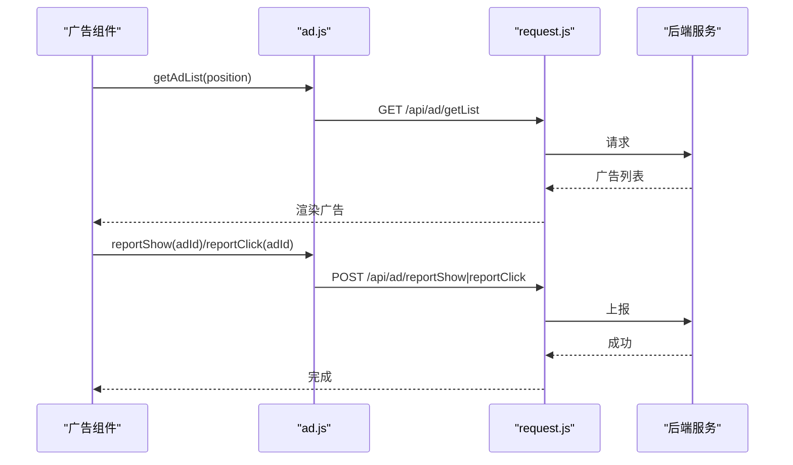

图表来源
- [api/ad.js:1-50](file://api/ad.js#L1-L50)
- [utils/request.js:1-117](file://utils/request.js#L1-L117)

章节来源
- [api/ad.js:1-50](file://api/ad.js#L1-L50)

### 游客访问接口
- 能力说明
  - 无需登录即可访问的分类、内容、评论等公开数据
- 关键路径
  - 分类列表：/campus/categoryList
  - 内容列表：/campus/contentList
  - 内容详情：/campus/getContent
  - 一级评论：/campus/getOneLevelComment
  - 子评论：/campus/getCommentChildren
  - 子评论列表：/campus/getCommentChildrenList
  - 评论详情：/campus/getComment
  - 热门内容：/campus/simpleHotContent

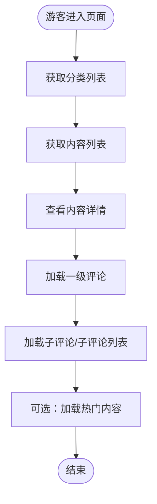

图表来源
- [api/tourist.js:1-69](file://api/tourist.js#L1-L69)

章节来源
- [api/tourist.js:1-69](file://api/tourist.js#L1-L69)

### 用户信息接口
- 能力说明
  - 统一的用户信息入口，包含个人信息查询、密码重置、头像上传、个人信息修改
- 关键路径
  - 用户信息：/getInfo
  - 个人信息：/system/user/profile
  - 密码重置：/system/user/profile/updatePwd
  - 头像上传：/system/user/profile/avatar
  - 个人信息修改：/system/user/profile

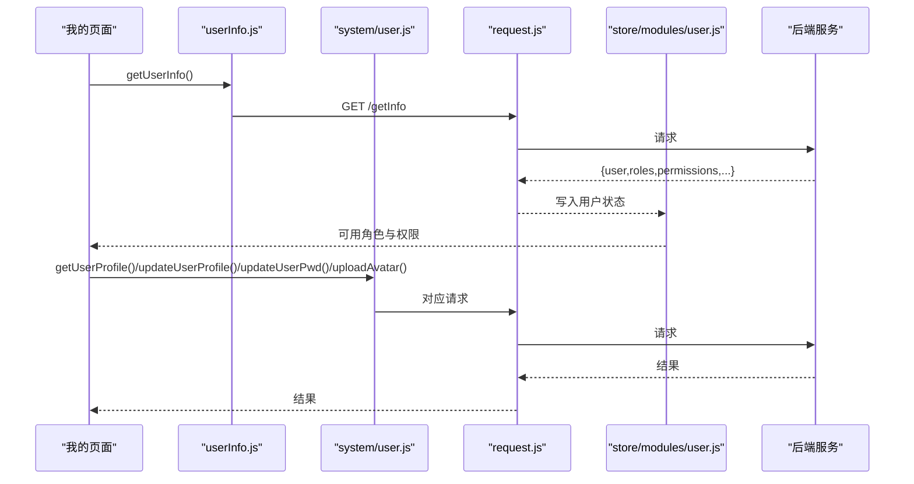

图表来源
- [api/userInfo.js:1-61](file://api/userInfo.js#L1-L61)
- [api/system/user.js:1-42](file://api/system/user.js#L1-L42)
- [store/modules/user.js:1-283](file://store/modules/user.js#L1-L283)
- [utils/request.js:1-117](file://utils/request.js#L1-L117)

章节来源
- [api/userInfo.js:1-61](file://api/userInfo.js#L1-L61)
- [api/system/user.js:1-42](file://api/system/user.js#L1-L42)
- [store/modules/user.js:1-283](file://store/modules/user.js#L1-L283)

### 权限控制与角色管理
- 能力说明
  - 字符权限校验：支持精确匹配与通配符
  - 角色权限校验：支持单角色与多角色组合
  - 插件化权限方法：hasPermi/hasRole 等便捷方法
- 关键点
  - 权限与角色来源于登录后返回并持久化至本地存储
  - 支持“全部权限”和“超级管理员”快捷判定

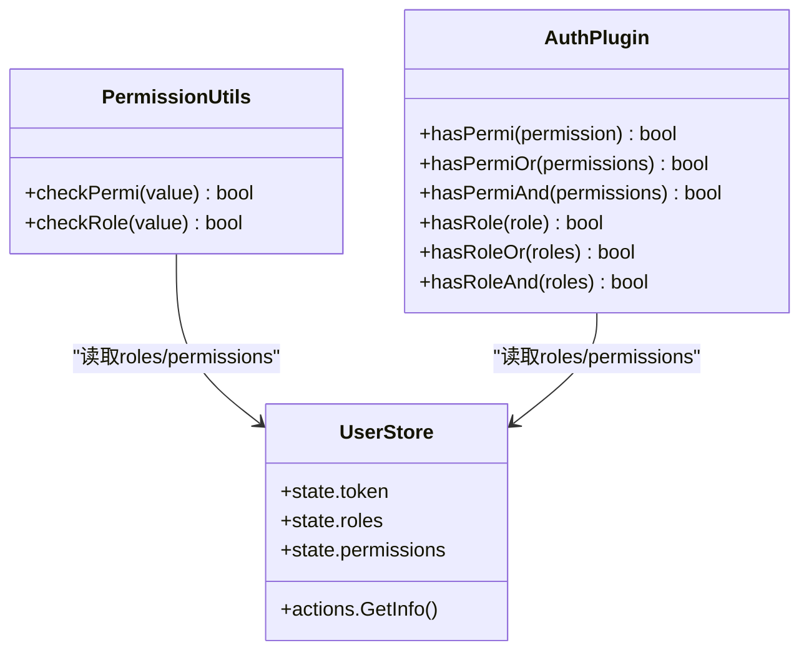

图表来源
- [utils/permission.js:1-49](file://utils/permission.js#L1-L49)
- [plugins/auth.js:1-61](file://plugins/auth.js#L1-L61)
- [store/modules/user.js:1-283](file://store/modules/user.js#L1-L283)

章节来源
- [utils/permission.js:1-49](file://utils/permission.js#L1-L49)
- [plugins/auth.js:1-61](file://plugins/auth.js#L1-L61)
- [store/modules/user.js:1-283](file://store/modules/user.js#L1-L283)

### 网络请求与错误处理
- 能力说明
  - 自动注入 Authorization 头
  - 统一错误码处理与提示
  - 401 会话过期自动处理（微信环境尝试自动登录，否则登出跳转）
  - 超时与网络异常友好提示
- 关键行为
  - 登录相关接口在 401 时不触发自动登录，直接提示错误
  - 非 200 状态码统一 toast 提示（特定码可静默）

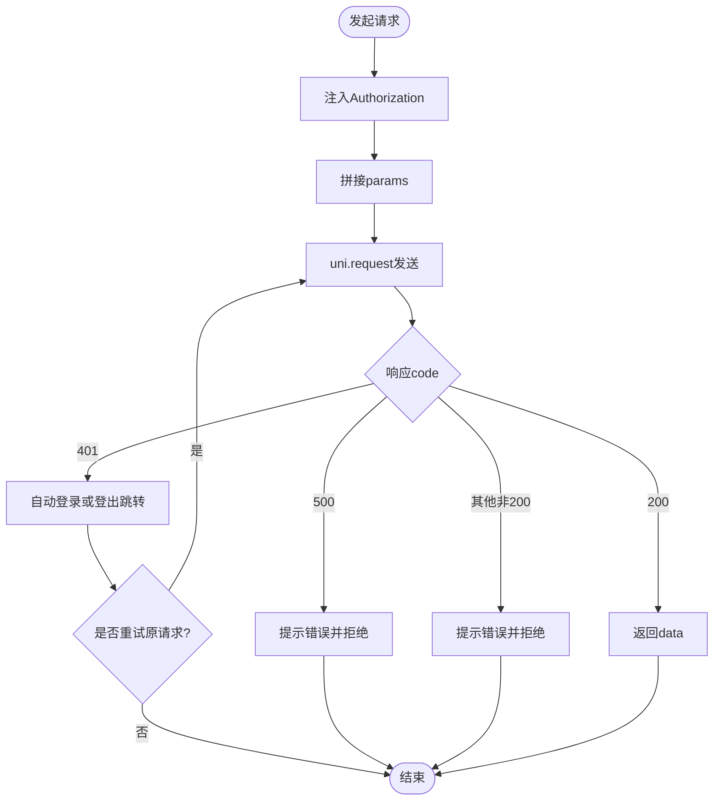

图表来源
- [utils/request.js:1-117](file://utils/request.js#L1-L117)

章节来源
- [utils/request.js:1-117](file://utils/request.js#L1-L117)

### 系统配置与健康检查
- 系统配置
  - 协议、主机、端口、API 前缀集中管理，自动拼接 baseUrl
- 健康检查
  - 建议在服务端暴露健康检查端点（例如 /actuator/health 或自定义），前端复用 request 进行探测
  - 客户端可在启动时执行一次轻量探测，用于监控与告警

章节来源
- [config.js:1-38](file://config.js#L1-L38)

## 依赖分析
- 组件耦合
  - API 模块强依赖 request 封装，弱依赖 config
  - 用户状态模块依赖 storage 与 constant，登录成功后写入 roles/permissions
  - 权限工具与插件仅依赖 store getters，无副作用
  - 角色视图配置模块依赖 request 与本地内存缓存
- 外部依赖
  - uni.request 作为底层网络库
  - 后端 REST 接口约定（统一返回结构 code/msg/data）

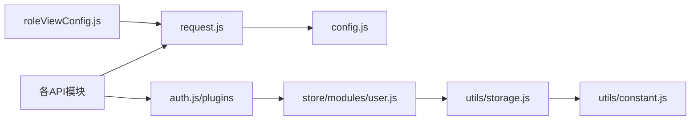

图表来源
- [utils/request.js:1-117](file://utils/request.js#L1-L117)
- [config.js:1-38](file://config.js#L1-L38)
- [plugins/auth.js:1-61](file://plugins/auth.js#L1-L61)
- [store/modules/user.js:1-283](file://store/modules/user.js#L1-L283)
- [utils/storage.js:1-33](file://utils/storage.js#L1-L33)
- [utils/constant.js:1-10](file://utils/constant.js#L1-L10)
- [utils/roleViewConfig.js:1-115](file://utils/roleViewConfig.js#L1-L115)

章节来源
- [utils/request.js:1-117](file://utils/request.js#L1-L117)
- [config.js:1-38](file://config.js#L1-L38)
- [plugins/auth.js:1-61](file://plugins/auth.js#L1-L61)
- [store/modules/user.js:1-283](file://store/modules/user.js#L1-L283)
- [utils/storage.js:1-33](file://utils/storage.js#L1-L33)
- [utils/constant.js:1-10](file://utils/constant.js#L1-L10)
- [utils/roleViewConfig.js:1-115](file://utils/roleViewConfig.js#L1-L115)

## 性能考虑
- 字典缓存
  - 利用后端刷新缓存接口，在前端变更字典后主动失效，避免频繁拉取
- 角色视图配置
  - 使用本地内存缓存减少重复请求；对常用页面预加载配置，降低首屏延迟
- 广告上报
  - 批量上报减少网络往返；展示上报可结合组件生命周期节流
- 网络层
  - 合理设置超时时间；对高频接口启用请求去抖/合并策略（可在上层封装）

[本节为通用指导，不涉及具体文件分析]

## 故障排查指南
- 401 未授权
  - 检查 token 是否存在且有效
  - 确认是否为登录相关接口（不会触发自动登录）
  - 微信环境下自动登录失败会登出并跳转登录页
- 500 服务器错误
  - 查看后端日志定位问题
  - 前端会弹出后端返回的错误消息
- 网络异常/超时
  - 检查 baseUrl 配置是否正确
  - 检查网络连通性与代理配置
- 权限不足
  - 确认用户 roles/permissions 是否正确加载
  - 使用 hasPermi/hasRole 等方法二次校验

章节来源
- [utils/request.js:1-117](file://utils/request.js#L1-L117)
- [store/modules/user.js:1-283](file://store/modules/user.js#L1-L283)
- [plugins/auth.js:1-61](file://plugins/auth.js#L1-L61)

## 结论
本系统管理接口在前端采用清晰的分层与统一的请求封装，配合本地缓存与权限校验，实现了用户管理、字典管理、角色视图动态渲染、广告管理与游客访问等核心能力。建议后续在后端补充操作日志与健康检查端点，并在前端按需集成，以完善系统管理能力。

[本节为总结性内容，不涉及具体文件分析]

## 附录
- 接口清单速览
  - 用户管理：/system/user/profile、/system/user/profile/updatePwd、/system/user/profile/avatar
  - 字典管理：/system/dict/type/*、/system/dict/data/*
  - 角色视图：/api/role-view-config/config、/api/role-view-config/realname/status、/api/role-view-config/{pageKey}
  - 广告管理：/api/ad/getList、/api/ad/reportShow、/api/ad/reportClick、/api/ad/batchReportShow
  - 游客访问：/campus/* 系列只读接口
  - 用户信息：/getInfo

[本节为汇总性内容，不涉及具体文件分析]