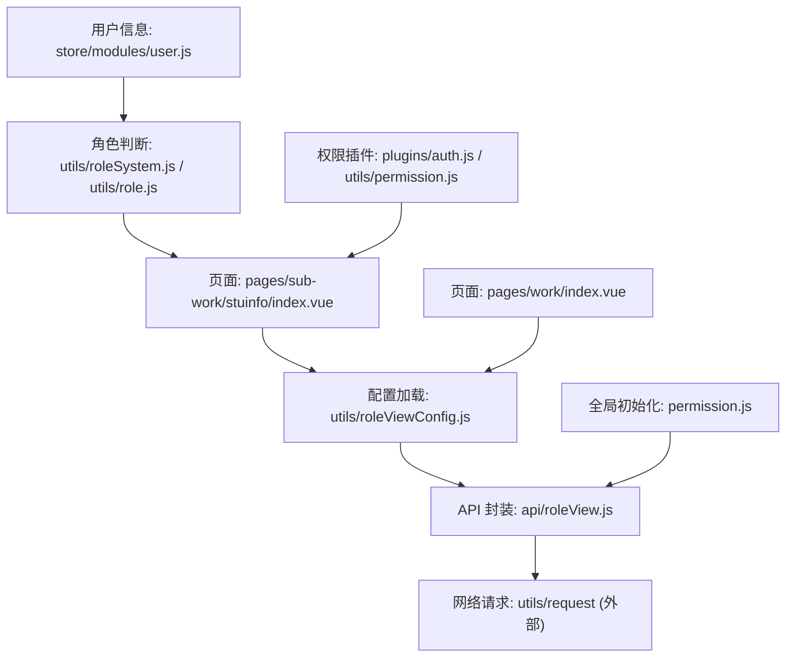
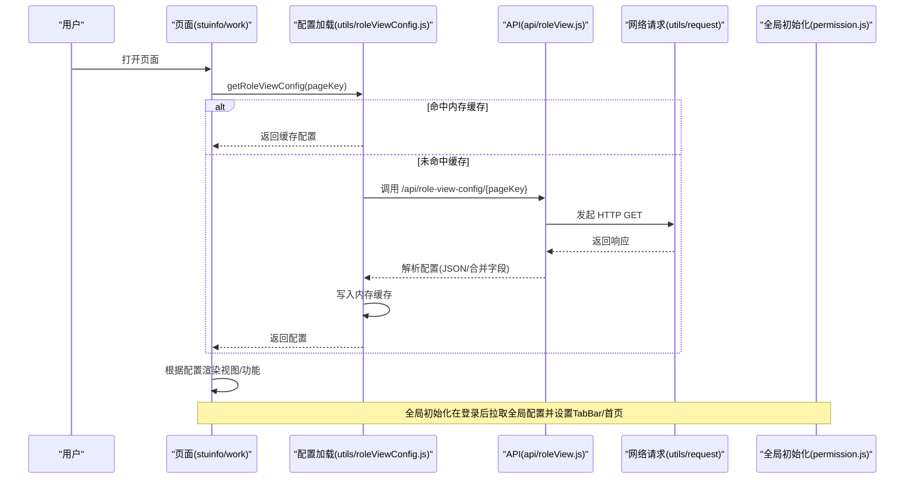
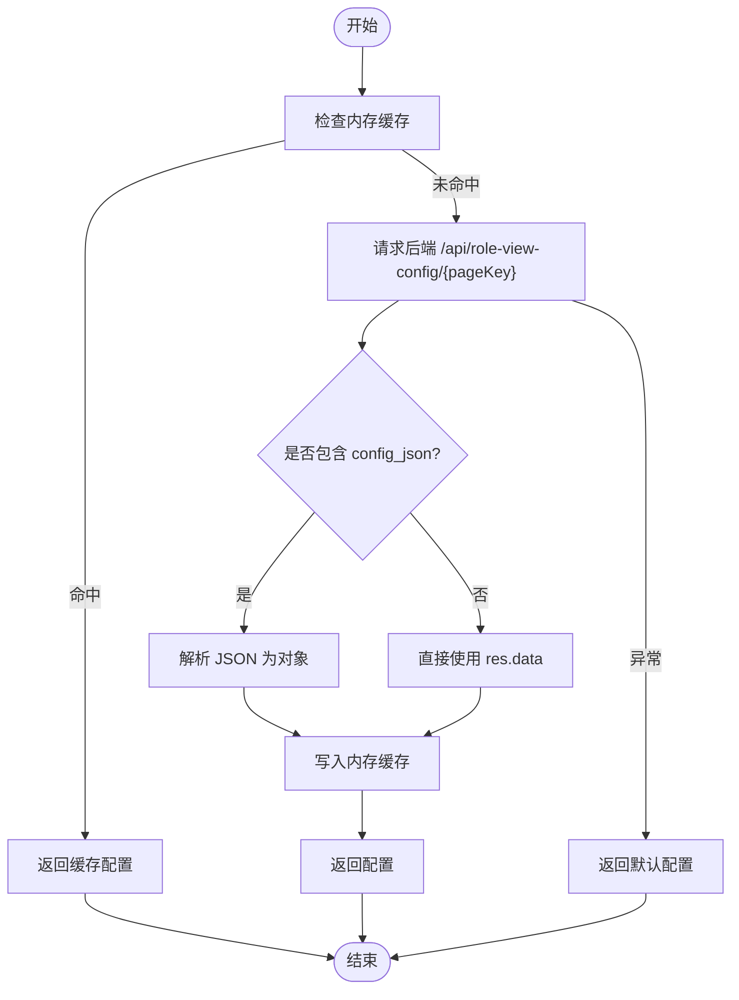
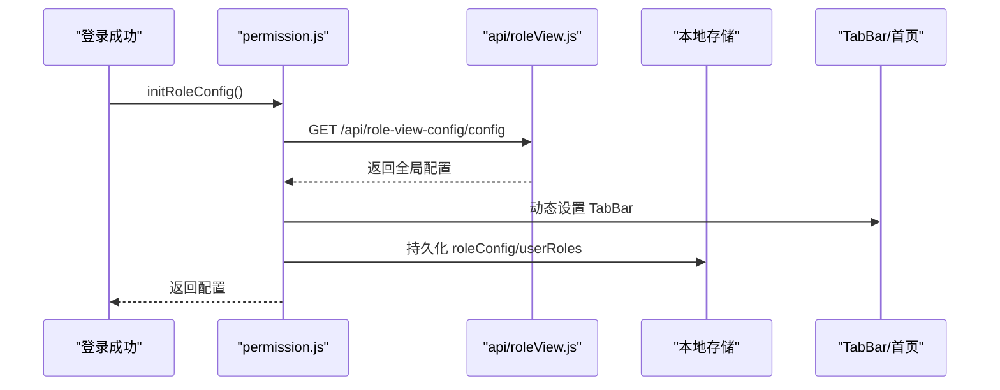
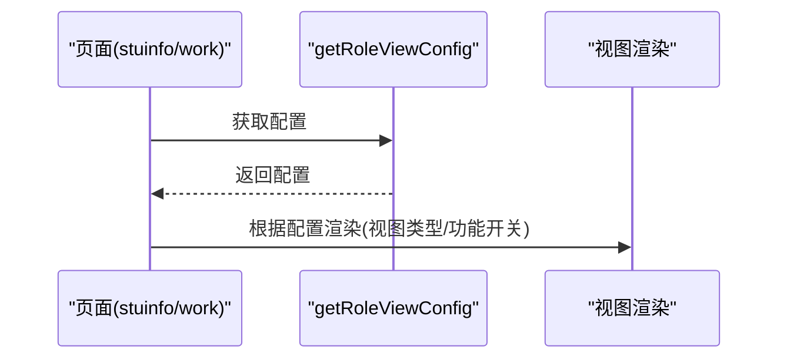
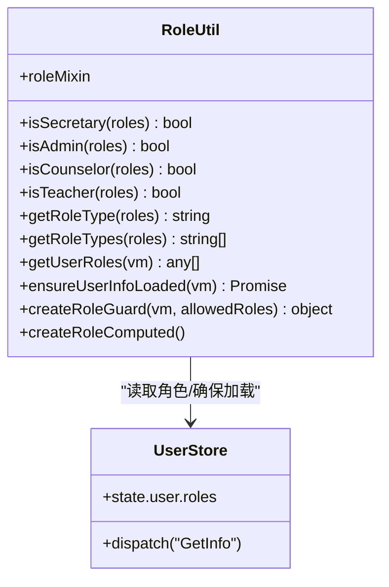
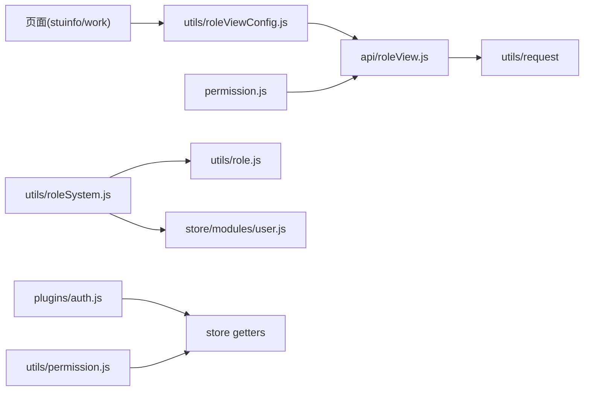

# 角色视图配置接口

<cite>
**本文引用的文件**   
- [api/roleView.js](file://api/roleView.js)
- [utils/roleViewConfig.js](file://utils/roleViewConfig.js)
- [permission.js](file://permission.js)
- [pages/sub-work/stuinfo/index.vue](file://pages/sub-work/stuinfo/index.vue)
- [pages/work/index.vue](file://pages/work/index.vue)
- [utils/roleSystem.js](file://utils/roleSystem.js)
- [utils/role.js](file://utils/role.js)
- [store/modules/user.js](file://store/modules/user.js)
- [plugins/auth.js](file://plugins/auth.js)
- [utils/permission.js](file://utils/permission.js)
- [test-config-driven.js](file://test-config-driven.js)
</cite>

## 目录
1. [简介](#简介)
2. [项目结构](#项目结构)
3. [核心组件](#核心组件)
4. [架构总览](#架构总览)
5. [详细组件分析](#详细组件分析)
6. [依赖关系分析](#依赖关系分析)
7. [性能与缓存策略](#性能与缓存策略)
8. [故障排查指南](#故障排查指南)
9. [结论](#结论)
10. [附录：版本管理与回滚建议](#附录版本管理与回滚建议)

## 简介
本文件面向“基于角色的动态菜单和功能权限配置系统”的前端实现，聚焦以下目标：
- 角色视图配置的加载机制与缓存策略
- 不同角色对应的界面布局与功能模块差异
- 权限的动态渲染与条件显示逻辑
- 角色配置的实时更新与热重载机制（当前实现现状与建议）
- 角色权限的继承与覆盖规则（当前实现现状与建议）
- 角色配置版本管理与回滚能力（当前实现现状与建议）
- 权限变更的通知与同步机制（当前实现现状与建议）

## 项目结构
围绕角色视图配置的关键路径与职责如下：
- API 层：封装后端角色视图配置接口调用
- 配置加载层：提供按页面维度获取配置、缓存与降级默认值
- 全局初始化：应用启动时拉取全局角色配置并设置 TabBar、首页等
- 页面集成：具体页面根据配置动态渲染视图与功能
- 角色判断工具：统一的角色识别与守卫能力
- 权限校验：字符级与角色级权限检查

**图表来源** 
- [pages/sub-work/stuinfo/index.vue:560-576](file://pages/sub-work/stuinfo/index.vue#L560-L576)
- [pages/work/index.vue:154-156](file://pages/work/index.vue#L154-L156)
- [utils/roleViewConfig.js:16-37](file://utils/roleViewConfig.js#L16-L37)
- [api/roleView.js:7-12](file://api/roleView.js#L7-L12)
- [permission.js:26-60](file://permission.js#L26-L60)
- [utils/roleSystem.js:110-169](file://utils/roleSystem.js#L110-L169)
- [utils/role.js:16-41](file://utils/role.js#L16-L41)
- [store/modules/user.js:73-111](file://store/modules/user.js#L73-L111)
- [plugins/auth.js:27-60](file://plugins/auth.js#L27-L60)
- [utils/permission.js:8-25](file://utils/permission.js#L8-L25)

**章节来源**
- [permission.js:26-60](file://permission.js#L26-L60)
- [utils/roleViewConfig.js:16-37](file://utils/roleViewConfig.js#L16-L37)
- [api/roleView.js:7-12](file://api/roleView.js#L7-L12)
- [pages/sub-work/stuinfo/index.vue:560-576](file://pages/sub-work/stuinfo/index.vue#L560-L576)
- [pages/work/index.vue:154-156](file://pages/work/index.vue#L154-L156)

## 核心组件
- 角色视图配置加载器
  - 负责按页面 key 从后端拉取配置，维护内存缓存，失败时返回默认配置
  - 支持预加载常用页面配置
- 全局角色配置初始化
  - 在登录成功后或首次进入时拉取全局角色配置，设置 TabBar、首页、本地缓存
- 页面集成点
  - 学生信息管理页与工作台页根据配置决定视图类型与展示内容
- 角色判断与守卫
  - 提供角色识别、计算属性、守卫函数，便于页面内条件渲染与访问控制
- 权限校验
  - 提供字符权限与角色权限校验方法，配合前端路由与按钮级显隐

**章节来源**
- [utils/roleViewConfig.js:16-37](file://utils/roleViewConfig.js#L16-L37)
- [utils/roleViewConfig.js:42-65](file://utils/roleViewConfig.js#L42-L65)
- [utils/roleViewConfig.js:70-92](file://utils/roleViewConfig.js#L70-L92)
- [utils/roleViewConfig.js:97-101](file://utils/roleViewConfig.js#L97-L101)
- [utils/roleViewConfig.js:106-114](file://utils/roleViewConfig.js#L106-L114)
- [permission.js:26-60](file://permission.js#L26-L60)
- [permission.js:81-95](file://permission.js#L81-L95)
- [pages/sub-work/stuinfo/index.vue:560-576](file://pages/sub-work/stuinfo/index.vue#L560-L576)
- [pages/work/index.vue:154-156](file://pages/work/index.vue#L154-L156)
- [utils/roleSystem.js:110-169](file://utils/roleSystem.js#L110-L169)
- [utils/role.js:16-41](file://utils/role.js#L16-L41)
- [plugins/auth.js:27-60](file://plugins/auth.js#L27-L60)
- [utils/permission.js:8-25](file://utils/permission.js#L8-L25)

## 架构总览
下图展示了“角色视图配置”的整体数据流与控制流。

**图表来源** 
- [pages/sub-work/stuinfo/index.vue:560-576](file://pages/sub-work/stuinfo/index.vue#L560-L576)
- [pages/work/index.vue:154-156](file://pages/work/index.vue#L154-L156)
- [utils/roleViewConfig.js:16-37](file://utils/roleViewConfig.js#L16-L37)
- [utils/roleViewConfig.js:42-65](file://utils/roleViewConfig.js#L42-L65)
- [api/roleView.js:7-12](file://api/roleView.js#L7-L12)
- [permission.js:26-60](file://permission.js#L26-L60)

## 详细组件分析

### 角色视图配置加载器（按页面维度）
- 关键能力
  - 内存缓存：以 pageKey 为键，避免重复请求
  - 后端兼容：支持两种返回结构（config_json 字符串或已合并字段）
  - 降级策略：网络异常或无配置时返回默认配置
  - 预加载：批量预取常用页面配置，提升首屏体验
- 典型流程
  - 先查内存缓存 → 未命中则请求后端 → 解析并缓存 → 返回配置
  - 失败时返回默认配置，保证页面可用

**图表来源** 
- [utils/roleViewConfig.js:16-37](file://utils/roleViewConfig.js#L16-L37)
- [utils/roleViewConfig.js:42-65](file://utils/roleViewConfig.js#L42-L65)
- [utils/roleViewConfig.js:70-92](file://utils/roleViewConfig.js#L70-L92)

**章节来源**
- [utils/roleViewConfig.js:16-37](file://utils/roleViewConfig.js#L16-L37)
- [utils/roleViewConfig.js:42-65](file://utils/roleViewConfig.js#L42-L65)
- [utils/roleViewConfig.js:70-92](file://utils/roleViewConfig.js#L70-L92)
- [utils/roleViewConfig.js:97-101](file://utils/roleViewConfig.js#L97-L101)
- [utils/roleViewConfig.js:106-114](file://utils/roleViewConfig.js#L106-L114)

### 全局角色配置初始化（应用级）
- 作用
  - 登录后或首次进入时拉取全局角色配置
  - 动态设置 TabBar、首页路径
  - 将全局配置与用户角色写入本地存储，供后续快速读取
- 特性
  - 失败降级：使用教师默认配置
  - 提供 hasFeature 便捷方法用于功能开关判断

**图表来源** 
- [permission.js:26-60](file://permission.js#L26-L60)
- [api/roleView.js:7-12](file://api/roleView.js#L7-L12)

**章节来源**
- [permission.js:26-60](file://permission.js#L26-L60)
- [permission.js:81-95](file://permission.js#L81-L95)

### 页面集成与动态渲染
- 学生信息管理页（stuinfo）
  - 通过 getRoleViewConfig('stuinfo') 获取配置
  - 依据 viewType 切换“专业统计视图（书记）”与“班级列表视图（教师）”
- 工作台页（work_index）
  - 通过 getRoleViewConfig('work_index') 获取配置
  - 根据配置项控制汇总卡片、常用功能、学生区段等显示

**图表来源** 
- [pages/sub-work/stuinfo/index.vue:560-576](file://pages/sub-work/stuinfo/index.vue#L560-L576)
- [pages/work/index.vue:154-156](file://pages/work/index.vue#L154-L156)

**章节来源**
- [pages/sub-work/stuinfo/index.vue:560-576](file://pages/sub-work/stuinfo/index.vue#L560-L576)
- [pages/work/index.vue:154-156](file://pages/work/index.vue#L154-L156)

### 角色判断与守卫
- 角色识别
  - 支持字符串数组与对象数组格式
  - 提供 isSecretary/isAdmin/isCounselor/isTeacher 等判断
  - 提供 getRoleType/getRoleTypes 获取主角色与多角色集合
- Mixin 与 Computed
  - 提供 roleMixin 与 createRoleComputed，简化页面中角色判断
- 守卫
  - createRoleGuard 用于页面访问控制

**图表来源** 
- [utils/roleSystem.js:110-169](file://utils/roleSystem.js#L110-L169)
- [utils/role.js:16-41](file://utils/role.js#L16-L41)
- [store/modules/user.js:73-111](file://store/modules/user.js#L73-L111)

**章节来源**
- [utils/roleSystem.js:110-169](file://utils/roleSystem.js#L110-L169)
- [utils/role.js:16-41](file://utils/role.js#L16-L41)
- [store/modules/user.js:73-111](file://store/modules/user.js#L73-L111)

### 权限校验（字符与角色）
- 字符权限
  - checkPermi 支持通配符与精确匹配
- 角色权限
  - checkRole 支持超级管理员与指定角色匹配
- 插件方式
  - plugins/auth.js 暴露 hasPermi/hasRole 等方法，便于模板或脚本中使用

**章节来源**
- [utils/permission.js:8-25](file://utils/permission.js#L8-L25)
- [utils/permission.js:32-49](file://utils/permission.js#L32-L49)
- [plugins/auth.js:27-60](file://plugins/auth.js#L27-L60)

## 依赖关系分析
- 页面依赖配置加载器
- 配置加载器依赖 API 封装
- API 封装依赖网络请求
- 全局初始化依赖 API 封装
- 角色判断依赖用户信息与工具函数
- 权限校验依赖 store 中的角色与权限

**图表来源** 
- [pages/sub-work/stuinfo/index.vue:560-576](file://pages/sub-work/stuinfo/index.vue#L560-L576)
- [pages/work/index.vue:154-156](file://pages/work/index.vue#L154-L156)
- [utils/roleViewConfig.js:16-37](file://utils/roleViewConfig.js#L16-L37)
- [api/roleView.js:7-12](file://api/roleView.js#L7-L12)
- [permission.js:26-60](file://permission.js#L26-L60)
- [utils/roleSystem.js:110-169](file://utils/roleSystem.js#L110-L169)
- [utils/role.js:16-41](file://utils/role.js#L16-L41)
- [store/modules/user.js:73-111](file://store/modules/user.js#L73-L111)
- [plugins/auth.js:27-60](file://plugins/auth.js#L27-L60)
- [utils/permission.js:8-25](file://utils/permission.js#L8-L25)

**章节来源**
- [utils/roleViewConfig.js:16-37](file://utils/roleViewConfig.js#L16-L37)
- [api/roleView.js:7-12](file://api/roleView.js#L7-L12)
- [permission.js:26-60](file://permission.js#L26-L60)
- [utils/roleSystem.js:110-169](file://utils/roleSystem.js#L110-L169)
- [utils/role.js:16-41](file://utils/role.js#L16-L41)
- [store/modules/user.js:73-111](file://store/modules/user.js#L73-L111)
- [plugins/auth.js:27-60](file://plugins/auth.js#L27-L60)
- [utils/permission.js:8-25](file://utils/permission.js#L8-L25)

## 性能与缓存策略
- 内存缓存
  - 按 pageKey 缓存配置，避免重复网络请求
  - 提供 clearConfigCache 手动清理
- 预加载
  - preloadConfigs 可并行预取常用页面配置，缩短首屏等待
- 降级默认配置
  - 网络异常或后端不可用时返回默认配置，保障可用性
- 全局配置缓存
  - 全局角色配置写入本地存储，提供同步读取方法

优化建议
- 增加过期时间或版本号，避免长期不变配置导致脏读
- 对高频页面配置采用更积极的预加载策略
- 在权限变更后主动触发缓存失效与重新拉取

**章节来源**
- [utils/roleViewConfig.js:16-37](file://utils/roleViewConfig.js#L16-L37)
- [utils/roleViewConfig.js:97-101](file://utils/roleViewConfig.js#L97-L101)
- [utils/roleViewConfig.js:106-114](file://utils/roleViewConfig.js#L106-L114)
- [permission.js:81-95](file://permission.js#L81-L95)

## 故障排查指南
- 常见问题
  - 后端接口不可达或 baseUrl 配置错误
  - 未携带 Token 导致鉴权失败
  - 小程序环境域名校验未关闭
- 定位步骤
  - 使用测试脚本验证基础配置与接口连通性
  - 检查页面是否正确调用 getRoleViewConfig 并拿到配置
  - 确认全局初始化是否成功设置 TabBar 与首页
  - 查看本地存储中 roleConfig 与 userRoles 是否存在
- 参考测试用例
  - 基础配置检查、接口连通性、配置加载、缓存机制、降级机制、页面状态检查

**章节来源**
- [test-config-driven.js:28-57](file://test-config-driven.js#L28-L57)
- [test-config-driven.js:62-91](file://test-config-driven.js#L62-L91)
- [test-config-driven.js:96-137](file://test-config-driven.js#L96-L137)
- [test-config-driven.js:142-171](file://test-config-driven.js#L142-L171)
- [test-config-driven.js:176-198](file://test-config-driven.js#L176-L198)

## 结论
- 当前实现提供了“按页面维度”的角色视图配置加载、内存缓存与降级策略，并在两个关键页面完成集成
- 全局角色配置在登录后拉取，支持动态设置 TabBar 与首页，并提供功能开关查询
- 角色判断与权限校验体系完善，便于页面条件渲染与访问控制
- 尚未实现“实时热重载”“版本管理与回滚”“变更通知与同步”等高级能力，可在后续迭代中补充

## 附录：版本管理与回滚建议
- 版本管理
  - 建议在配置结构中引入 version 字段，前端在拉取后比对本地版本，不一致再更新
  - 在全局初始化处记录上次生效版本，便于回滚决策
- 回滚机制
  - 保留最近一次成功的全局配置快照（本地存储），当新版本异常时可一键回滚
  - 页面级配置可按 pageKey 单独回滚到默认配置
- 实时更新与热重载
  - 当前未实现服务端推送或轮询刷新；建议增加“配置刷新”入口，在权限变更后由用户主动触发
  - 可选方案：WebSocket/SSE 推送配置变更事件，客户端收到后清除对应缓存并重新拉取
- 变更通知与同步
  - 在权限变更后，广播事件通知各页面刷新视图与功能
  - 结合全局配置缓存失效策略，确保多端一致性

[本节为通用建议，不直接分析具体源码文件]