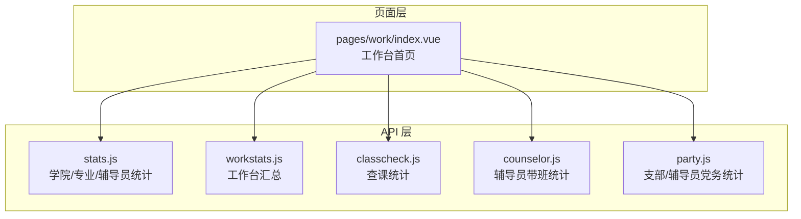
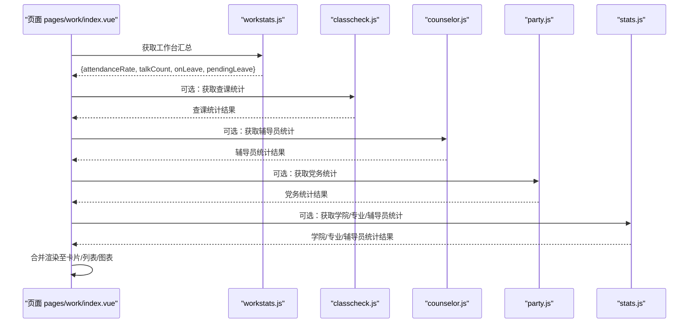
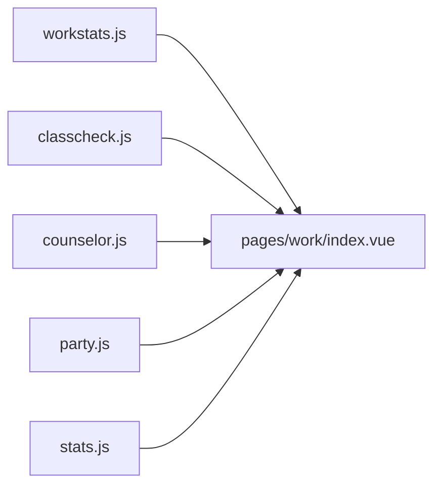

# 统计分析接口

<cite>
**本文引用的文件**   
- [api/stumanage/stats.js](file://api/stumanage/stats.js)
- [api/stumanage/workstats.js](file://api/stumanage/workstats.js)
- [api/stumanage/classcheck.js](file://api/stumanage/classcheck.js)
- [api/stumanage/counselor.js](file://api/stumanage/counselor.js)
- [api/party.js](file://api/party.js)
- [pages/work/index.vue](file://pages/work/index.vue)
</cite>

## 目录
1. [简介](#简介)
2. [项目结构](#项目结构)
3. [核心组件](#核心组件)
4. [架构总览](#架构总览)
5. [详细组件分析](#详细组件分析)
6. [依赖关系分析](#依赖关系分析)
7. [性能与缓存策略](#性能与缓存策略)
8. [可视化图表数据规范](#可视化图表数据规范)
9. [时间范围筛选与分组统计](#时间范围筛选与分组统计)
10. [数据导出与报表生成](#数据导出与报表生成)
11. [自定义统计指标扩展](#自定义统计指标扩展)
12. [大数据量优化方案](#大数据量优化方案)
13. [实时更新机制](#实时更新机制)
14. [使用示例与最佳实践](#使用示例与最佳实践)
15. [故障排查指南](#故障排查指南)
16. [结论](#结论)

## 简介
本文件面向移动端前端，系统化梳理“统计分析”相关接口的调用方式、返回字段约定、计算逻辑说明以及可视化呈现规范。覆盖到课率统计、请假数据分析、工作量统计等关键场景，并提供时间范围筛选、分组聚合、缓存策略、导出与报表、自定义指标扩展、大数据量优化及实时更新的指导。

## 项目结构
统计分析能力由多个 API 模块组成，分别对应学院维度、辅导员维度、查课维度、党务维度以及工作台汇总维度。页面层通过统一请求封装进行调用，并在本地做短时缓存以提升体验。

图示来源
- [api/stumanage/stats.js:1-52](file://api/stumanage/stats.js#L1-L52)
- [api/stumanage/workstats.js:1-10](file://api/stumanage/workstats.js#L1-L10)
- [api/stumanage/classcheck.js:1-67](file://api/stumanage/classcheck.js#L1-L67)
- [api/stumanage/counselor.js:1-56](file://api/stumanage/counselor.js#L1-L56)
- [api/party.js:1-88](file://api/party.js#L1-L88)
- [pages/work/index.vue:1-400](file://pages/work/index.vue#L1-L400)

章节来源
- [api/stumanage/stats.js:1-52](file://api/stumanage/stats.js#L1-L52)
- [api/stumanage/workstats.js:1-10](file://api/stumanage/workstats.js#L1-L10)
- [api/stumanage/classcheck.js:1-67](file://api/stumanage/classcheck.js#L1-L67)
- [api/stumanage/counselor.js:1-56](file://api/stumanage/counselor.js#L1-L56)
- [api/party.js:1-88](file://api/party.js#L1-L88)
- [pages/work/index.vue:1-400](file://pages/work/index.vue#L1-L400)

## 核心组件
- 学院统计（按学院/专业/辅导员）：提供学院汇总、按专业拆分、按辅导员拆分三类统计入口。
- 工作台汇总：聚合到课率、谈话次数、在假人数、待审批数、活动总数等关键指标。
- 查课统计：提供查课维度的统计数据。
- 辅导员带班统计：提供指定或当前辅导员的带班统计。
- 党务统计：提供支部统计与辅导员所带学生入党情况统计。

章节来源
- [api/stumanage/stats.js:17-51](file://api/stumanage/stats.js#L17-L51)
- [api/stumanage/workstats.js:3-9](file://api/stumanage/workstats.js#L3-L9)
- [api/stumanage/classcheck.js:60-66](file://api/stumanage/classcheck.js#L60-L66)
- [api/stumanage/counselor.js:33-55](file://api/stumanage/counselor.js#L33-L55)
- [api/party.js:47-64](file://api/party.js#L47-L64)

## 架构总览
前端以轻量 API 封装为入口，页面按需拉取并合并展示；对热点数据进行本地短时缓存，降低后端压力并提升首屏速度。

图示来源
- [pages/work/index.vue:204-250](file://pages/work/index.vue#L204-L250)
- [api/stumanage/workstats.js:3-9](file://api/stumanage/workstats.js#L3-L9)
- [api/stumanage/classcheck.js:60-66](file://api/stumanage/classcheck.js#L60-L66)
- [api/stumanage/counselor.js:33-55](file://api/stumanage/counselor.js#L33-L55)
- [api/party.js:47-64](file://api/party.js#L47-L64)
- [api/stumanage/stats.js:17-51](file://api/stumanage/stats.js#L17-L51)

## 详细组件分析

### 学院统计接口（按学院/专业/辅导员）
- 功能
  - 获取学院汇总数据
  - 获取按专业维度的统计数据
  - 获取按辅导员维度的统计数据
- 入参与路径
  - 学院汇总：GET /api/mini/stats/summary?xydm=...
  - 按专业统计：GET /api/mini/stats/byMajor?xydm=...
  - 按辅导员统计：GET /api/mini/stats/byCounselor?xydm=...
- 返回约定
  - 字段名与业务含义由后端定义，前端直接透传给 UI 展示。建议包含基础计数、比率、趋势序列等通用字段，便于图表复用。
- 使用建议
  - 结合时间范围参数（如 start/end）与分组维度（年级/班级/专业）在后端实现聚合，减少前端处理成本。

章节来源
- [api/stumanage/stats.js:17-51](file://api/stumanage/stats.js#L17-L51)

### 工作台汇总接口
- 功能
  - 聚合当日到课率、谈话次数、在假人数、待审批数等关键指标，用于首页卡片展示。
- 入参与路径
  - GET /api/work-stats/summary
- 返回约定
  - attendanceRate：当天到课率（字符串或百分比数值）
  - talkCount：谈话次数
  - onLeave：在假人数
  - pendingLeave：待审批请假数
  - activityCount：活动总数（由页面侧另调活动接口补充）
- 页面行为
  - 首次加载后写入本地缓存，有效期 5 分钟；过期后重新拉取。

章节来源
- [api/stumanage/workstats.js:3-9](file://api/stumanage/workstats.js#L3-L9)
- [pages/work/index.vue:204-250](file://pages/work/index.vue#L204-L250)

### 查课统计接口
- 功能
  - 提供查课相关的统计数据，可用于到课率分析与趋势展示。
- 入参与路径
  - GET /api/classcheck/stats
- 返回约定
  - 建议包含日期序列、应到/实到/缺勤数量、到课率等字段，便于折线图/柱状图展示。

章节来源
- [api/stumanage/classcheck.js:60-66](file://api/stumanage/classcheck.js#L60-L66)

### 辅导员带班统计接口
- 功能
  - 查询指定辅导员或当前登录辅导员的带班统计。
- 入参与路径
  - GET /api/counselor/stats/{jsid}
  - GET /api/counselor/my/stats
- 返回约定
  - 建议包含学生总数、请假占比、到课率、谈心谈话次数等。

章节来源
- [api/stumanage/counselor.js:33-55](file://api/stumanage/counselor.js#L33-L55)

### 党务统计接口
- 功能
  - 支部统计概览与辅导员所带学生入党情况统计。
- 入参与路径
  - GET /api/party/branch/stats?branchId=...
  - GET /api/party/counselor/stats
- 返回约定
  - 建议包含发展进度分布、思想汇报提交情况、党费缴纳情况等。

章节来源
- [api/party.js:47-64](file://api/party.js#L47-L64)

## 依赖关系分析
- 页面 pages/work/index.vue 依赖 workstats.js 获取汇总数据，同时可并行调用活动列表接口以补齐活动总数。
- 其他统计模块（classcheck、counselor、party、stats）作为可选能力被页面或子页面按需引入。

图示来源
- [pages/work/index.vue:204-250](file://pages/work/index.vue#L204-L250)
- [api/stumanage/workstats.js:3-9](file://api/stumanage/workstats.js#L3-L9)
- [api/stumanage/classcheck.js:60-66](file://api/stumanage/classcheck.js#L60-L66)
- [api/stumanage/counselor.js:33-55](file://api/stumanage/counselor.js#L33-L55)
- [api/party.js:47-64](file://api/party.js#L47-L64)
- [api/stumanage/stats.js:17-51](file://api/stumanage/stats.js#L17-L51)

## 性能与缓存策略
- 本地缓存
  - 工作台汇总数据采用本地存储缓存，有效期 5 分钟，避免频繁请求。
  - 金句内容随汇总数据一并缓存，刷新时更新缓存时间戳。
- 并发请求
  - 汇总数据与活动总数并行请求，缩短整体等待时间。
- 降级策略
  - 接口失败时静默回退默认值，保证页面可用性与用户体验。

章节来源
- [pages/work/index.vue:204-250](file://pages/work/index.vue#L204-L250)

## 可视化图表数据规范
为保证折线图、柱状图、饼图等组件的通用性，建议后端返回如下标准化结构（字段命名仅供参考，前后端需达成一致）：

- 通用时序数据（折线/柱状）
  - timeList: ["2024-01-01", ...]
  - series: [{ name: "到课率", data: [98.2, 97.5, ...] }, ...]
- 分类占比数据（饼图/环形）
  - categories: ["已批准", "待审批", "已拒绝"]
  - values: [120, 30, 10]
- 分页与总量（列表型统计）
  - total: 数字
  - list: 数组
  - pageNum/pageSize: 分页参数

说明
- 百分比字段建议统一为数值类型（如 98.2），前端再格式化显示。
- 时间轴建议采用 ISO 格式或统一字符串格式，便于排序与过滤。
- 空数据场景需返回空数组而非 null，避免前端判空分支过多。

[本节为通用规范说明，不直接分析具体文件]

## 时间范围筛选与分组统计
- 推荐查询参数
  - start/end：起止时间（ISO 字符串或时间戳）
  - groupBy：分组维度，如 day/week/month/year
  - dimension：细分维度，如 major/class/counselor
- 后端职责
  - 根据参数执行 SQL 聚合或内存聚合，返回时序或分类数据。
- 前端职责
  - 将用户选择的时间范围与维度组合成查询参数，透传给后端。
  - 对返回数据进行必要的单位转换与格式化。

[本节为通用设计建议，不直接分析具体文件]

## 数据导出与报表生成
- 导出接口建议
  - GET /api/export/stats?type=attendance|leave|workload&params=...
  - 支持 CSV/XLSX/PDF 等格式，文件名包含时间范围与维度信息。
- 异步导出
  - 对于大数据量，建议采用异步任务模式：提交任务 -> 轮询状态 -> 下载链接。
- 安全与权限
  - 导出需鉴权，限制敏感字段输出，必要时脱敏。

[本节为通用设计建议，不直接分析具体文件]

## 自定义统计指标扩展
- 指标注册
  - 新增指标需在后端维护指标字典（名称、SQL/算法、单位、是否参与汇总）。
- 前端适配
  - 通过统一的指标元数据驱动渲染，无需硬编码。
- 版本兼容
  - 指标变更保持向后兼容，旧客户端忽略未知字段。

[本节为通用设计建议，不直接分析具体文件]

## 大数据量优化方案
- 服务端
  - 预聚合表/物化视图，按天/周/月粒度缓存常用聚合结果。
  - 分页+游标，避免一次性返回海量数据。
  - 索引优化：时间、组织、人员等高频过滤字段建立复合索引。
- 客户端
  - 合理设置缓存时间与失效策略。
  - 增量更新：仅拉取变化区间的数据。
  - 懒加载与虚拟列表：长列表只渲染可视区域。

[本节为通用设计建议，不直接分析具体文件]

## 实时更新机制
- 短轮询
  - 对关键指标（如待审批数）每 30~60 秒轮询一次，差异对比后局部更新。
- WebSocket
  - 对高实时性场景（如审批状态变更）推送事件，前端订阅后即时刷新。
- 事件驱动
  - 操作成功后主动触发局部刷新，避免全量重拉。

[本节为通用设计建议，不直接分析具体文件]

## 使用示例与最佳实践
- 工作台首页加载流程
  - 进入页面时先读取本地缓存，若未过期则直接使用；否则并发请求汇总与活动总数，完成后写入缓存。
  - 失败时回退默认值，保证界面可用。
- 图表渲染
  - 将后端返回的时序/分类数据映射到图表库所需数据结构，统一处理空值与异常值。
- 错误处理
  - 网络异常、超时、业务码非成功等情况均需友好提示与降级展示。
- 可访问性
  - 为图表提供文本摘要与无障碍标签，便于读屏器朗读。

章节来源
- [pages/work/index.vue:204-250](file://pages/work/index.vue#L204-L250)

## 故障排查指南
- 常见问题
  - 缓存未生效：检查本地存储键名与过期时间判断逻辑。
  - 数据不同步：确认缓存失效时机与刷新触发点。
  - 图表为空：校验后端返回字段是否为空数组或 null。
- 定位步骤
  - 打开控制台查看请求与响应体。
  - 核对缓存时间戳与当前时间差。
  - 复现最小用例，逐步缩小问题范围。

章节来源
- [pages/work/index.vue:204-250](file://pages/work/index.vue#L204-L250)

## 结论
本统计分析体系以轻量 API 封装为核心，配合本地缓存与并发请求，有效提升了首页加载速度与稳定性。通过统一的图表数据规范、时间范围与分组参数约定，以及可扩展的指标体系，能够支撑多角色、多维度的统计需求。后续可在大数据量场景下引入预聚合与异步导出，进一步提升系统性能与可用性。