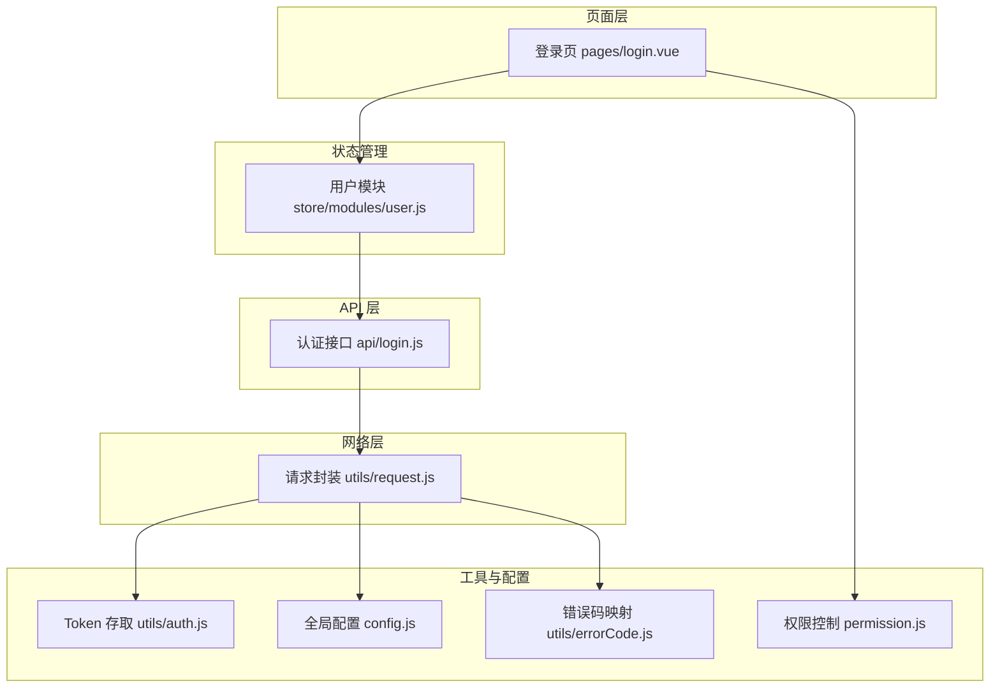
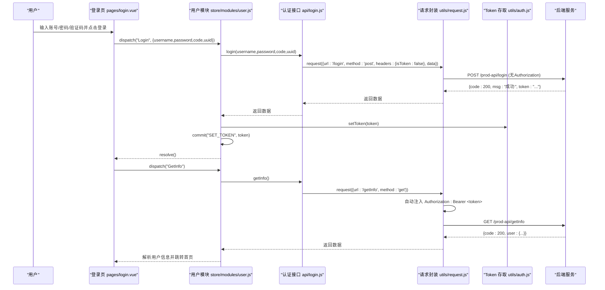
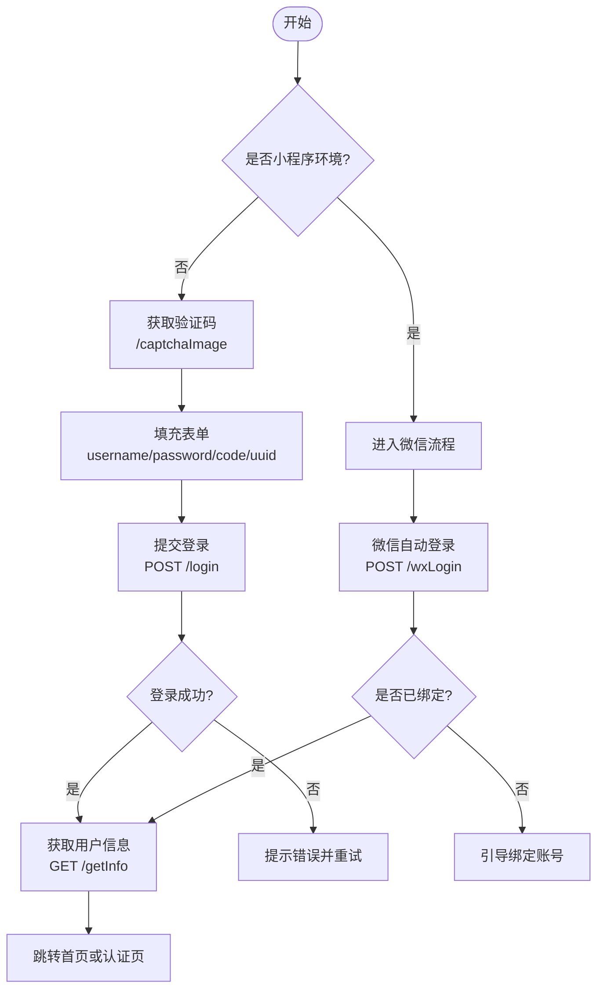
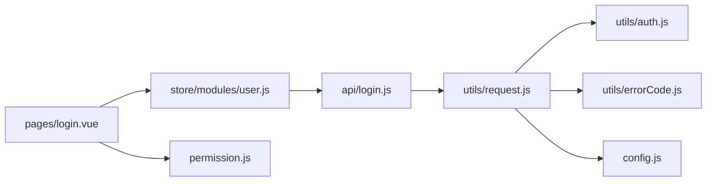

# 认证接口

<cite>
**本文引用的文件**   
- [api/login.js](file://api/login.js)
- [utils/request.js](file://utils/request.js)
- [utils/auth.js](file://utils/auth.js)
- [store/modules/user.js](file://store/modules/user.js)
- [pages/login.vue](file://pages/login.vue)
- [config.js](file://config.js)
- [permission.js](file://permission.js)
- [utils/errorCode.js](file://utils/errorCode.js)
</cite>

## 目录
1. [简介](#简介)
2. [项目结构](#项目结构)
3. [核心组件](#核心组件)
4. [架构总览](#架构总览)
5. [详细组件分析](#详细组件分析)
6. [依赖关系分析](#依赖关系分析)
7. [性能与可用性考虑](#性能与可用性考虑)
8. [故障排查指南](#故障排查指南)
9. [结论](#结论)
10. [附录：接口清单与示例](#附录接口清单与示例)

## 简介
本文件面向前端集成与对接人员，系统化梳理并文档化该应用中的用户认证相关能力，包括：
- 登录、登出、获取验证码、微信自动登录/绑定、手机号快捷登录等核心流程
- Token 的生成、存储、注入与过期处理策略（含自动刷新）
- 多方式登录支持（账号密码、微信登录、手机号登录）
- 错误码定义与异常处理策略
- 请求响应约定与集成要点

说明：
- 本项目为前端工程，JWT 的签发与校验逻辑位于后端；前端通过统一请求拦截器完成 Token 的注入与过期处理。
- 本文所有接口路径、参数与行为均以当前前端实现为准。

## 项目结构
认证相关的前端代码主要分布在以下位置：
- API 层：封装各认证接口的调用方法
- 请求层：统一封装 uni.request，负责 Token 注入、错误处理与自动刷新
- 状态管理：集中管理 token、用户信息与权限
- 页面层：登录页交互与流程编排
- 全局配置：baseUrl、协议、端口、API 前缀等
- 权限控制：路由守卫与登录后跳转策略
- 错误码映射：HTTP 业务码到用户提示文本

图表来源
- [pages/login.vue:1-462](file://pages/login.vue#L1-L462)
- [store/modules/user.js:1-283](file://store/modules/user.js#L1-L283)
- [api/login.js:1-168](file://api/login.js#L1-L168)
- [utils/request.js:1-117](file://utils/request.js#L1-L117)
- [utils/auth.js:1-47](file://utils/auth.js#L1-L47)
- [config.js:1-38](file://config.js#L1-L38)
- [permission.js:1-133](file://permission.js#L1-L133)
- [utils/errorCode.js:1-7](file://utils/errorCode.js#L1-L7)

章节来源
- [pages/login.vue:1-462](file://pages/login.vue#L1-L462)
- [store/modules/user.js:1-283](file://store/modules/user.js#L1-L283)
- [api/login.js:1-168](file://api/login.js#L1-L168)
- [utils/request.js:1-117](file://utils/request.js#L1-L117)
- [utils/auth.js:1-47](file://utils/auth.js#L1-L47)
- [config.js:1-38](file://config.js#L1-L38)
- [permission.js:1-133](file://permission.js#L1-L133)
- [utils/errorCode.js:1-7](file://utils/errorCode.js#L1-L7)

## 核心组件
- 认证 API 封装：提供登录、注册、获取信息、退出、验证码、微信登录/绑定、手机号登录等接口方法
- 请求拦截器：统一注入 Authorization 头、处理 401 会话失效、错误提示与重试
- Token 管理：本地持久化 Token 与 UserId，提供 isLogin 判断
- 用户状态：集中保存 token、角色、权限、头像等，并在登录成功后拉取用户信息
- 登录页：根据环境（小程序/非小程序）切换登录方式，编排验证码、微信一键登录、手机号一键登录等流程
- 权限控制：路由级拦截，未登录重定向至登录页，已登录访问登录页则跳转首页
- 错误码映射：将后端返回的业务码转换为友好提示

章节来源
- [api/login.js:1-168](file://api/login.js#L1-L168)
- [utils/request.js:1-117](file://utils/request.js#L1-L117)
- [utils/auth.js:1-47](file://utils/auth.js#L1-L47)
- [store/modules/user.js:1-283](file://store/modules/user.js#L1-L283)
- [pages/login.vue:1-462](file://pages/login.vue#L1-L462)
- [permission.js:1-133](file://permission.js#L1-L133)
- [utils/errorCode.js:1-7](file://utils/errorCode.js#L1-L7)

## 架构总览
下图展示一次“账号密码登录”的端到端流程，包含 Token 注入、存储与会话失效自动刷新机制。

图表来源
- [pages/login.vue:152-225](file://pages/login.vue#L152-L225)
- [store/modules/user.js:55-111](file://store/modules/user.js#L55-L111)
- [api/login.js:3-47](file://api/login.js#L3-L47)
- [utils/request.js:10-32](file://utils/request.js#L10-L32)
- [utils/auth.js:8-14](file://utils/auth.js#L8-L14)

## 详细组件分析

### 认证接口清单与参数约定
以下为前端暴露的认证相关接口方法与对应后端路径。所有接口均通过 baseUrl 拼接，默认 baseUrl 由全局配置决定。

- 账号密码登录
  - 方法：POST
  - 路径：/login
  - 请求体：{ username, password, code, uuid }
  - 说明：非小程序环境需要图形验证码；小程序环境可跳过
  - 参考：[api/login.js:3-19](file://api/login.js#L3-L19)

- 注册
  - 方法：POST
  - 路径：/register
  - 请求体：见调用处
  - 说明：headers.isToken=false
  - 参考：[api/login.js:21-31](file://api/login.js#L21-L31)

- 获取用户信息
  - 方法：GET
  - 路径：/getInfo
  - 说明：需携带 Authorization
  - 参考：[api/login.js:33-39](file://api/login.js#L33-L39)

- 退出登录
  - 方法：POST
  - 路径：/logout
  - 说明：需携带 Authorization
  - 参考：[api/login.js:41-47](file://api/login.js#L41-L47)

- 获取验证码
  - 方法：GET
  - 路径：/captchaImage
  - 响应：包含图片 base64 与 uuid
  - 说明：headers.isToken=false
  - 参考：[api/login.js:49-59](file://api/login.js#L49-L59)

- 学生绑定登录
  - 方法：POST
  - 路径：/api/auth/studentBindLogin
  - 请求体：{ code, studentNo }
  - 说明：headers.isToken=false
  - 参考：[api/login.js:61-74](file://api/login.js#L61-L74)

- 微信自动登录
  - 方法：POST
  - 路径：/wxLogin
  - 请求体：{ code }
  - 说明：headers.isToken=false
  - 参考：[api/login.js:76-86](file://api/login.js#L76-L86)

- 微信绑定账号
  - 方法：POST
  - 路径：/wxBind
  - 请求体：{ code, username, password }
  - 说明：headers.isToken=false
  - 参考：[api/login.js:88-98](file://api/login.js#L88-L98)

- 解除微信绑定
  - 方法：POST
  - 路径：/api/user/unbind
  - 说明：需携带 Authorization
  - 参考：[api/login.js:100-106](file://api/login.js#L100-L106)

- 手机号快捷登录
  - 方法：POST
  - 路径：/phoneLogin
  - 请求体：{ phoneCode, loginCode }
  - 说明：headers.isToken=false
  - 参考：[api/login.js:108-121](file://api/login.js#L108-L121)

- 教师手机号一键绑定
  - 方法：POST
  - 路径：/api/auth/teacherPhoneBind
  - 请求体：{ phoneCode, loginCode }
  - 说明：headers.isToken=false
  - 参考：[api/login.js:123-136](file://api/login.js#L123-L136)

- 教师账号绑定登录
  - 方法：POST
  - 路径：/api/auth/teacherBindLogin
  - 请求体：{ code, username, password }
  - 说明：headers.isToken=false
  - 参考：[api/login.js:138-152](file://api/login.js#L138-L152)

- 学生手机号一键绑定
  - 方法：POST
  - 路径：/phoneLogin（复用现有接口）
  - 请求体：{ phoneCode, loginCode }
  - 说明：headers.isToken=false
  - 参考：[api/login.js:154-167](file://api/login.js#L154-L167)

章节来源
- [api/login.js:1-168](file://api/login.js#L1-L168)

### Token 生成、存储与自动注入
- 生成与返回
  - 登录成功后，后端在响应中返回 token 字段，前端将其写入本地存储并更新状态
  - 参考：[store/modules/user.js:62-69](file://store/modules/user.js#L62-L69)、[store/modules/user.js:119-125](file://store/modules/user.js#L119-L125)、[store/modules/user.js:142-145](file://store/modules/user.js#L142-L145)、[store/modules/user.js:169-172](file://store/modules/user.js#L169-L172)、[store/modules/user.js:191-194](file://store/modules/user.js#L191-L194)、[store/modules/user.js:204-207](file://store/modules/user.js#L204-L207)、[store/modules/user.js:263-266](file://store/modules/user.js#L263-L266)

- 存储与读取
  - 使用本地存储键 App-Token 保存 token；App-UserId 保存用户ID
  - 提供 getToken/setToken/removeToken/isLogin 等工具方法
  - 参考：[utils/auth.js:1-47](file://utils/auth.js#L1-L47)

- 自动注入
  - 请求封装在发送前检查是否携带 token 且目标接口允许注入（默认允许），自动设置 Authorization: Bearer <token>
  - 若 headers.isToken=false，则不注入（用于登录、验证码等公开接口）
  - 参考：[utils/request.js:10-17](file://utils/request.js#L10-L17)

- 自动刷新与重试
  - 当后端返回 401 时，非登录类接口会尝试自动刷新：
    - 微信小程序环境：触发微信自动登录，成功后重新发起原请求
    - 非小程序环境：直接清理会话并跳转登录页
  - 登录相关接口（/login、/phoneLogin、/wxLogin、/captchaImage）即使返回 401 也不触发自动登录，直接显示错误
  - 参考：[utils/request.js:41-88](file://utils/request.js#L41-L88)

章节来源
- [utils/auth.js:1-47](file://utils/auth.js#L1-L47)
- [utils/request.js:10-17](file://utils/request.js#L10-L17)
- [utils/request.js:41-88](file://utils/request.js#L41-L88)
- [store/modules/user.js:55-111](file://store/modules/user.js#L55-L111)

### 多方式登录流程

#### 账号密码登录（含验证码）
- 入口：登录页点击“登录”
- 流程：
  - 非小程序环境：先获取验证码图片与 uuid，提交时带上 code 与 uuid
  - 调用登录接口，成功后拉取用户信息并跳转
- 关键路径与调用链：
  - 获取验证码：[api/login.js:49-59](file://api/login.js#L49-L59)
  - 登录：[api/login.js:3-19](file://api/login.js#L3-L19)
  - 登录动作编排：[pages/login.vue:152-189](file://pages/login.vue#L152-L189)
  - 拉取用户信息：[store/modules/user.js:72-111](file://store/modules/user.js#L72-L111)

图表来源
- [pages/login.vue:142-189](file://pages/login.vue#L142-L189)
- [api/login.js:3-59](file://api/login.js#L3-L59)
- [store/modules/user.js:72-111](file://store/modules/user.js#L72-L111)

章节来源
- [pages/login.vue:142-189](file://pages/login.vue#L142-L189)
- [api/login.js:3-59](file://api/login.js#L3-L59)
- [store/modules/user.js:72-111](file://store/modules/user.js#L72-L111)

#### 微信自动登录与绑定
- 自动登录：
  - 小程序环境下优先尝试微信自动登录，成功后设置 token 并拉取用户信息
  - 参考：[pages/login.vue:113-127](file://pages/login.vue#L113-L127)、[store/modules/user.js:113-132](file://store/modules/user.js#L113-L132)、[api/login.js:76-86](file://api/login.js#L76-L86)
- 绑定登录：
  - 若未绑定，引导用户输入账号密码进行绑定后登录
  - 参考：[pages/login.vue:170-178](file://pages/login.vue#L170-L178)、[store/modules/user.js:134-164](file://store/modules/user.js#L134-L164)、[api/login.js:88-98](file://api/login.js#L88-L98)

章节来源
- [pages/login.vue:113-178](file://pages/login.vue#L113-L178)
- [store/modules/user.js:113-164](file://store/modules/user.js#L113-L164)
- [api/login.js:76-98](file://api/login.js#L76-L98)

#### 手机号快捷登录
- 小程序环境下可通过“一键手机号登录”，内部组合两个 code：
  - phoneCode：获取手机号的授权码
  - loginCode：uni.login(provider='weixin') 返回的 openid 相关 code
- 调用教师手机号绑定或学生手机号绑定接口，成功后设置 token 并拉取用户信息
- 参考：
  - 教师绑定：[store/modules/user.js:188-199](file://store/modules/user.js#L188-L199)、[api/login.js:123-136](file://api/login.js#L123-L136)
  - 学生绑定：[store/modules/user.js:201-212](file://store/modules/user.js#L201-L212)、[api/login.js:154-167](file://api/login.js#L154-L167)
  - 通用手机号登录：[api/login.js:108-121](file://api/login.js#L108-L121)
  - 页面交互：[pages/login.vue:227-264](file://pages/login.vue#L227-L264)

章节来源
- [store/modules/user.js:188-212](file://store/modules/user.js#L188-L212)
- [api/login.js:108-167](file://api/login.js#L108-L167)
- [pages/login.vue:227-264](file://pages/login.vue#L227-L264)

### 登出与会话清理
- 调用退出接口后，清空本地 token、用户信息、角色与权限，并跳转登录页
- 参考：
  - 退出接口：[api/login.js:41-47](file://api/login.js#L41-L47)
  - 登出动作：[store/modules/user.js:214-228](file://store/modules/user.js#L214-L228)

章节来源
- [api/login.js:41-47](file://api/login.js#L41-L47)
- [store/modules/user.js:214-228](file://store/modules/user.js#L214-L228)

### 错误码与异常处理
- 统一错误码映射：
  - 401：认证失败，无法访问系统资源
  - 403：当前操作没有权限
  - 404：访问资源不存在
  - default：系统未知错误，请反馈给管理员
  - 参考：[utils/errorCode.js:1-7](file://utils/errorCode.js#L1-L7)
- 网络异常与超时：
  - 连接异常、超时、HTTP 状态码异常均会被捕获并提示
  - 参考：[utils/request.js:101-112](file://utils/request.js#L101-L112)
- 业务码处理：
  - 200：成功
  - 500：服务端错误，弹出后端消息
  - 其他非 200：除特定码（如 20001）外，均弹出消息并拒绝
  - 参考：[utils/request.js:39-98](file://utils/request.js#L39-L98)

章节来源
- [utils/errorCode.js:1-7](file://utils/errorCode.js#L1-L7)
- [utils/request.js:39-112](file://utils/request.js#L39-L112)

### 权限与路由控制
- 未登录访问受保护页面：重定向至登录页
- 已登录访问登录页：重定向至首页
- 登录后初始化角色配置与实名认证状态，按策略跳转
- 参考：
  - 路由拦截：[permission.js:97-132](file://permission.js#L97-L132)
  - 登录后初始化：[pages/login.vue:191-225](file://pages/login.vue#L191-L225)

章节来源
- [permission.js:97-132](file://permission.js#L97-L132)
- [pages/login.vue:191-225](file://pages/login.vue#L191-L225)

## 依赖关系分析
- 页面层依赖状态管理与 API 层
- 状态管理依赖 API 层与工具层（auth、storage、validate）
- API 层依赖请求封装与全局配置
- 请求封装依赖 auth、errorCode、common 工具
- 权限控制依赖 auth 与 API 层（角色配置、实名状态）

图表来源
- [pages/login.vue:1-462](file://pages/login.vue#L1-L462)
- [store/modules/user.js:1-283](file://store/modules/user.js#L1-L283)
- [api/login.js:1-168](file://api/login.js#L1-L168)
- [utils/request.js:1-117](file://utils/request.js#L1-L117)
- [utils/auth.js:1-47](file://utils/auth.js#L1-L47)
- [utils/errorCode.js:1-7](file://utils/errorCode.js#L1-L7)
- [config.js:1-38](file://config.js#L1-L38)
- [permission.js:1-133](file://permission.js#L1-L133)

## 性能与可用性考虑
- 请求超时与重试：
  - 默认超时时间由请求封装设定，验证码接口设置了较长超时
  - 401 场景下仅小程序环境自动刷新并重试，避免不必要的重复登录
- 用户体验：
  - 登录过程中统一 loading 提示
  - 错误提示采用统一 toast，减少干扰
- 安全建议：
  - Token 仅保存在本地存储，注意设备安全
  - 敏感操作建议结合后端二次校验

[本节为通用指导，无需源码引用]

## 故障排查指南
- 登录失败
  - 检查验证码是否正确、uuid 是否匹配
  - 查看后端返回的错误码与消息
  - 参考：[pages/login.vue:152-189](file://pages/login.vue#L152-L189)、[api/login.js:3-19](file://api/login.js#L3-L19)
- 401 会话失效
  - 非登录接口自动刷新（小程序）或跳转登录页（非小程序）
  - 参考：[utils/request.js:41-88](file://utils/request.js#L41-L88)
- 网络异常
  - 检查 baseUrl 配置、网络连通性与证书
  - 参考：[config.js:1-38](file://config.js#L1-L38)、[utils/request.js:101-112](file://utils/request.js#L101-L112)
- 微信登录问题
  - 确认小程序环境、授权与 code 有效性
  - 参考：[pages/login.vue:113-127](file://pages/login.vue#L113-L127)、[store/modules/user.js:113-132](file://store/modules/user.js#L113-L132)

章节来源
- [pages/login.vue:152-189](file://pages/login.vue#L152-L189)
- [api/login.js:3-19](file://api/login.js#L3-L19)
- [utils/request.js:41-88](file://utils/request.js#L41-L88)
- [config.js:1-38](file://config.js#L1-L38)
- [utils/request.js:101-112](file://utils/request.js#L101-L112)
- [pages/login.vue:113-127](file://pages/login.vue#L113-L127)
- [store/modules/user.js:113-132](file://store/modules/user.js#L113-L132)

## 结论
本认证体系以“统一请求封装 + 集中状态管理 + 多方式登录编排”为核心，实现了：
- 统一的 Token 注入与过期处理
- 多方式登录（账号密码、微信、手机号）的统一体验
- 完善的错误提示与异常处理
- 基于路由的权限控制与登录后动态初始化

后续可在后端配合完善 Token 刷新策略（如 refresh_token），进一步提升安全性与用户体验。

[本节为总结性内容，无需源码引用]

## 附录：接口清单与示例

### 基础约定
- 基础地址：由全局配置拼接得到，默认 https://ry.mytbu.cn/prod-api
- 鉴权头：Authorization: Bearer <token>（自动注入）
- 公共响应结构：{ code, msg, data }

章节来源
- [config.js:12-15](file://config.js#L12-L15)
- [utils/request.js:10-17](file://utils/request.js#L10-L17)

### 接口示例（请求/响应）

- 账号密码登录
  - 请求
    - 方法：POST
    - 路径：/login
    - 头部：Content-Type: application/json
    - 主体：{ username, password, code, uuid }
  - 成功响应
    - code: 200
    - data.token: 字符串
  - 失败响应
    - code: 非 200
    - data.msg: 错误描述
  - 参考：[api/login.js:3-19](file://api/login.js#L3-L19)

- 获取验证码
  - 请求
    - 方法：GET
    - 路径：/captchaImage
  - 成功响应
    - data.img: 图片 base64
    - data.uuid: 验证码标识
  - 参考：[api/login.js:49-59](file://api/login.js#L49-L59)

- 微信自动登录
  - 请求
    - 方法：POST
    - 路径：/wxLogin
    - 主体：{ code }
  - 成功响应
    - data.token: 字符串
  - 参考：[api/login.js:76-86](file://api/login.js#L76-L86)

- 微信绑定账号
  - 请求
    - 方法：POST
    - 路径：/wxBind
    - 主体：{ code, username, password }
  - 成功响应
    - data.token: 字符串
  - 参考：[api/login.js:88-98](file://api/login.js#L88-L98)

- 手机号快捷登录
  - 请求
    - 方法：POST
    - 路径：/phoneLogin
    - 主体：{ phoneCode, loginCode }
  - 成功响应
    - data.token: 字符串
  - 参考：[api/login.js:108-121](file://api/login.js#L108-L121)

- 获取用户信息
  - 请求
    - 方法：GET
    - 路径：/getInfo
    - 头部：Authorization: Bearer <token>
  - 成功响应
    - data.user: 用户对象
    - data.roles: 角色数组
    - data.permissions: 权限数组
  - 参考：[api/login.js:33-39](file://api/login.js#L33-L39)

- 退出登录
  - 请求
    - 方法：POST
    - 路径：/logout
    - 头部：Authorization: Bearer <token>
  - 成功响应
    - code: 200
  - 参考：[api/login.js:41-47](file://api/login.js#L41-L47)

章节来源
- [api/login.js:3-121](file://api/login.js#L3-L121)