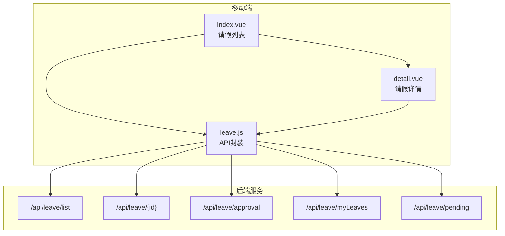
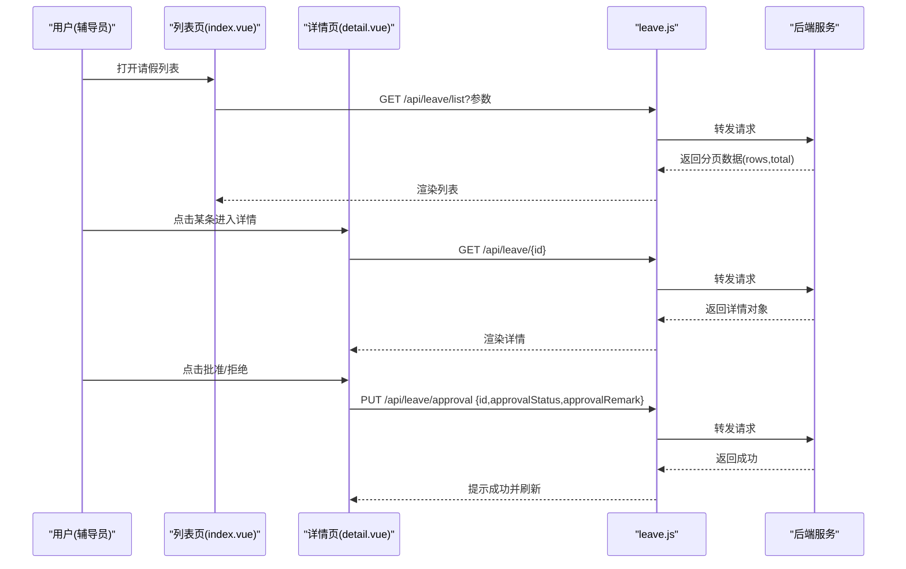
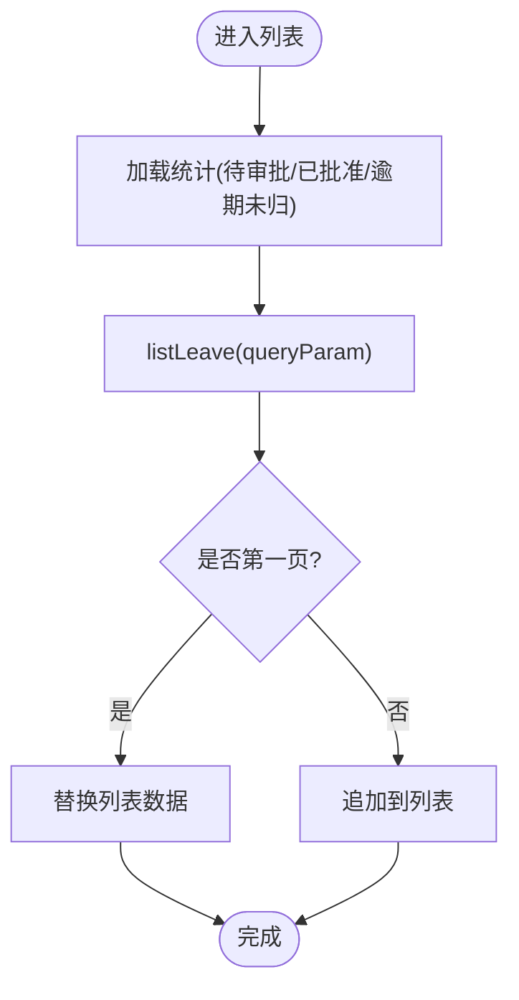
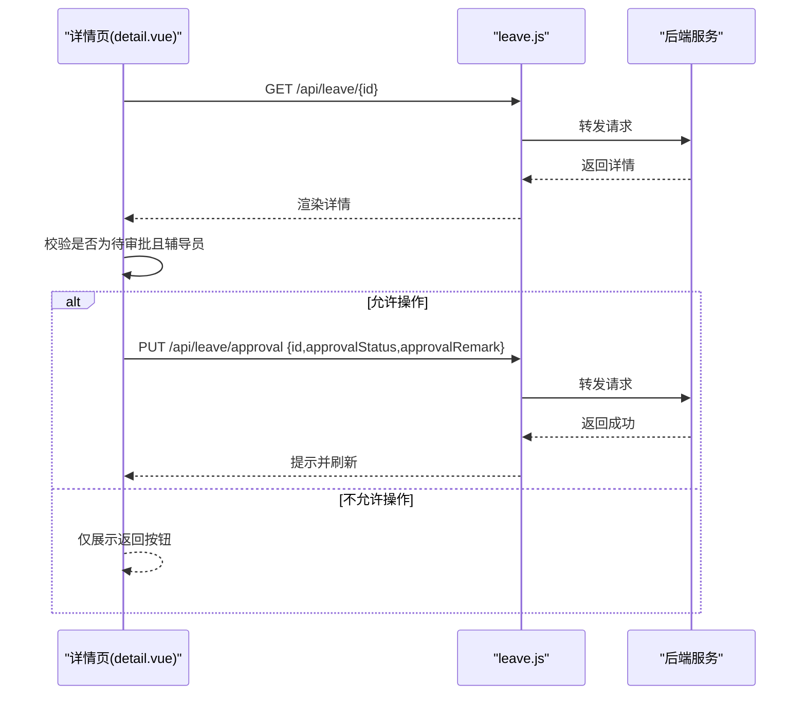
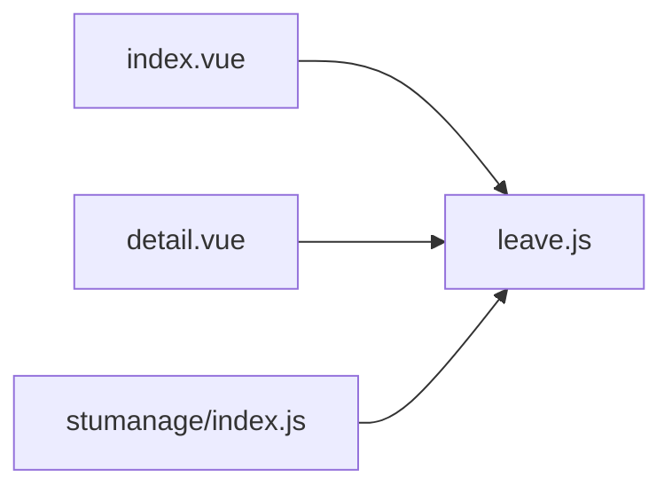
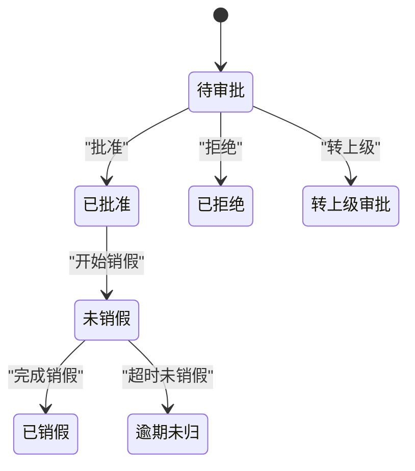

# 请假管理接口

<cite>
**本文引用的文件**   
- [api/stumanage/leave.js](file://api/stumanage/leave.js)
- [pages/sub-work/leave/index.vue](file://pages/sub-work/leave/index.vue)
- [pages/sub-work/leave/detail.vue](file://pages/sub-work/leave/detail.vue)
- [api/stumanage/index.js](file://api/stumanage/index.js)
</cite>

## 目录
1. [简介](#简介)
2. [项目结构](#项目结构)
3. [核心组件](#核心组件)
4. [架构总览](#架构总览)
5. [详细组件分析](#详细组件分析)
6. [依赖关系分析](#依赖关系分析)
7. [性能与可用性建议](#性能与可用性建议)
8. [故障排查指南](#故障排查指南)
9. [结论](#结论)
10. [附录：接口规范与数据模型](#附录接口规范与数据模型)

## 简介
本文件面向移动端（小程序）的“请假管理”功能，覆盖以下能力：
- 请假申请、审批流程与状态跟踪
- 请假类型、时间范围、事由描述等数据模型说明
- 请假记录的查询、筛选与统计
- 请假日历视图的数据接口规范（概念性说明）
- 通知机制与消息推送接口（概念性说明）
- 权限控制与审批规则配置（基于前端可见的审批级别与状态流转）
- 完整业务流程示例与异常处理方案

## 项目结构
与请假管理相关的前端代码主要分布在以下位置：
- API 封装层：api/stumanage/leave.js
- 页面层：pages/sub-work/leave/index.vue（列表页）、pages/sub-work/leave/detail.vue（详情页）
- 模块聚合入口：api/stumanage/index.js

图表来源
- [api/stumanage/leave.js:1-51](file://api/stumanage/leave.js#L1-L51)
- [pages/sub-work/leave/index.vue:145-147](file://pages/sub-work/leave/index.vue#L145-L147)
- [pages/sub-work/leave/detail.vue:181-183](file://pages/sub-work/leave/detail.vue#L181-L183)

章节来源
- [api/stumanage/leave.js:1-51](file://api/stumanage/leave.js#L1-L51)
- [api/stumanage/index.js:1-32](file://api/stumanage/index.js#L1-L32)

## 核心组件
- 请假列表页（index.vue）
  - 提供按状态筛选（全部/待审批/已批准/已拒绝/转上级）
  - 支持按学生姓名或学号搜索，并展示下拉选择
  - 顶部统计：待审批数、已批准数、逾期未归数
  - 快捷审批：仅对≤3天且当前审批级别为辅导员的待审批记录显示“批准/拒绝”按钮
  - 附件预览：优先使用缩略图 base64，否则拼接 baseUrl + /profile 路径
- 请假详情页（detail.vue）
  - 展示学生信息、请假信息（类型、天数、目的地、交通方式、起止时间、事由）
  - 非待审批时展示审批人、审批时间与审批意见
  - 已批准时展示销假状态、实际返校时间与备注
  - 支持附件预览（请假佐证/销假佐证）
  - 底部操作栏：仅当待审批且审批级别为辅导员时显示“批准/拒绝”
- API 封装（leave.js）
  - listLeave：分页查询请假列表
  - getLeave：获取请假详情
  - approvalLeave：提交审批结果（批准/拒绝/转上级）
  - getMyLeaves：学生端我的请假列表
  - getPendingLeaves：待审批列表

章节来源
- [pages/sub-work/leave/index.vue:145-446](file://pages/sub-work/leave/index.vue#L145-L446)
- [pages/sub-work/leave/detail.vue:181-292](file://pages/sub-work/leave/detail.vue#L181-L292)
- [api/stumanage/leave.js:1-51](file://api/stumanage/leave.js#L1-L51)

## 架构总览
移动端通过统一的 API 封装访问后端 REST 接口。列表与详情页面分别调用对应接口；审批动作统一走审批接口。

图表来源
- [pages/sub-work/leave/index.vue:299-333](file://pages/sub-work/leave/index.vue#L299-L333)
- [pages/sub-work/leave/detail.vue:205-234](file://pages/sub-work/leave/detail.vue#L205-L234)
- [api/stumanage/leave.js:9-32](file://api/stumanage/leave.js#L9-L32)

## 详细组件分析

### 请假列表页（index.vue）
- 关键能力
  - 筛选：按 approvalStatus 过滤（all/pending/approved/rejected/forward）
  - 搜索：支持 studentName 与 xh 模糊匹配（前端同时赋值两个字段，由后端 OR 连接）
  - 统计：三次独立查询 pending/approved/approved+overdue 汇总计数
  - 快捷审批：仅当 approvalStatus=pending 且 approvalLevel=counselor 时显示操作按钮
  - 附件：根据 returnStatus 决定展示“请假佐证”或“销假佐证”，图片优先使用 thumbnailBase64
- 交互要点
  - 防抖输入触发搜索
  - 下拉选择学生后以 xh 精准筛选
  - 分页加载：pageNum/pageSize 控制

图表来源
- [pages/sub-work/leave/index.vue:255-333](file://pages/sub-work/leave/index.vue#L255-L333)

章节来源
- [pages/sub-work/leave/index.vue:145-446](file://pages/sub-work/leave/index.vue#L145-L446)

### 请假详情页（detail.vue）
- 关键能力
  - 展示：学生信息、请假信息、审批信息（非待审批）、销假信息（已批准）
  - 操作：仅当待审批且审批级别为辅导员时，显示批准/拒绝
  - 附件：支持多图预览，优先使用 thumbnailBase64
- 交互要点
  - 审批弹窗可编辑拒绝理由
  - 成功后刷新详情

图表来源
- [pages/sub-work/leave/detail.vue:205-234](file://pages/sub-work/leave/detail.vue#L205-L234)
- [api/stumanage/leave.js:18-32](file://api/stumanage/leave.js#L18-L32)

章节来源
- [pages/sub-work/leave/detail.vue:181-292](file://pages/sub-work/leave/detail.vue#L181-L292)

### API 封装（leave.js）
- 接口清单
  - GET /api/leave/list：分页查询列表
  - GET /api/leave/{id}：获取详情
  - PUT /api/leave/approval：提交审批结果
  - GET /api/leave/myLeaves：学生端我的请假
  - GET /api/leave/pending：待审批列表
- 调用约定
  - 列表与我的请假采用分页参数 pageNum/pageSize
  - 审批接口使用 data 传递 approvalStatus 与 approvalRemark

章节来源
- [api/stumanage/leave.js:1-51](file://api/stumanage/leave.js#L1-L51)

## 依赖关系分析
- 页面依赖 API 封装
- API 封装依赖网络请求工具（request），统一转发至后端
- 模块聚合入口将 leave 模块导出，便于其他模块统一引用

图表来源
- [pages/sub-work/leave/index.vue:145-147](file://pages/sub-work/leave/index.vue#L145-L147)
- [pages/sub-work/leave/detail.vue:181-183](file://pages/sub-work/leave/detail.vue#L181-L183)
- [api/stumanage/index.js:12-13](file://api/stumanage/index.js#L12-L13)

章节来源
- [api/stumanage/index.js:1-32](file://api/stumanage/index.js#L1-L32)

## 性能与可用性建议
- 列表页统计采用多次独立查询，建议在服务端提供聚合统计接口以减少请求次数
- 附件图片优先使用 thumbnailBase64，避免跨域与小程序 HTTP 限制问题
- 搜索框增加防抖，减少频繁请求
- 分页加载时注意去重与边界条件处理，避免重复渲染

[本节为通用建议，不直接分析具体文件]

## 故障排查指南
- 列表为空
  - 检查 queryParam 是否正确设置（pageNum/pageSize/approvalStatus/studentName/xh）
  - 确认后端返回 rows 与 total 字段
- 审批失败
  - 确认仅当待审批且审批级别为辅导员时允许操作
  - 检查 approvalStatus 值是否为 approved/rejected/forward
  - 查看 approvalRemark 是否必填（拒绝场景）
- 附件无法显示
  - 优先检查 thumbnailBase64 是否存在且以 data: 开头
  - 若使用 filePath，确保 baseUrl 拼接正确且路径以 /profile 开头

章节来源
- [pages/sub-work/leave/index.vue:299-333](file://pages/sub-work/leave/index.vue#L299-L333)
- [pages/sub-work/leave/detail.vue:205-234](file://pages/sub-work/leave/detail.vue#L205-L234)
- [pages/sub-work/leave/index.vue:411-444](file://pages/sub-work/leave/index.vue#L411-L444)
- [pages/sub-work/leave/detail.vue:273-290](file://pages/sub-work/leave/detail.vue#L273-L290)

## 结论
本实现围绕移动端请假管理提供了完整的列表、详情与审批能力，并通过清晰的 API 封装与页面逻辑实现了稳定的工作流。后续可在服务端增强统计与日历数据接口，进一步提升体验与效率。

[本节为总结性内容，不直接分析具体文件]

## 附录：接口规范与数据模型

### 接口定义
- 获取请假列表
  - 方法：GET
  - 路径：/api/leave/list
  - 查询参数：pageNum、pageSize、approvalStatus、studentName、xh
  - 响应体：rows（数组）、total（总数）
- 获取请假详情
  - 方法：GET
  - 路径：/api/leave/{id}
  - 响应体：详情对象（见数据模型）
- 审批请假
  - 方法：PUT
  - 路径：/api/leave/approval
  - 请求体：id、approvalStatus、approvalRemark
- 我的请假列表（学生端）
  - 方法：GET
  - 路径：/api/leave/myLeaves
  - 查询参数：pageNum、pageSize、approvalStatus
- 待审批列表
  - 方法：GET
  - 路径：/api/leave/pending

章节来源
- [api/stumanage/leave.js:9-49](file://api/stumanage/leave.js#L9-L49)

### 数据模型（字段说明）
- 基本信息
  - id：请假记录ID
  - studentName：学生姓名
  - xh：学号
  - bjjc/bjmc：班级简称/班级名称
  - counselorName：辅导员姓名
  - contactPhone：联系电话
- 请假信息
  - leaveType：请假类型（sick=病假，personal=事假，other=其他）
  - leaveDays：请假天数
  - destination：目的地
  - transportType：交通方式（train=火车，plane=飞机，bus=汽车，other=其他）
  - transportInfo：交通补充信息
  - startTime：离校时间
  - endTime：返校时间
  - leaveReason：请假事由
- 审批信息
  - approvalStatus：审批状态（pending=待审批，approved=已批准，rejected=已拒绝，forward=转上级审批）
  - approvalLevel：审批级别（counselor=辅导员，secretary=秘书/上级）
  - approverName：审批人姓名
  - approvalTime：审批时间
  - approvalRemark：审批意见
- 销假信息
  - returnStatus：销假状态（not_returned=未销假，returned=已销假，overdue=逾期未归）
  - actualReturnTime：实际返校时间
  - returnRemark：销假备注
- 附件
  - leaveAttachmentList：请假佐证材料数组
  - returnAttachmentList：销假佐证材料数组
  - 附件项包含：filePath、thumbnailBase64（可选）

章节来源
- [pages/sub-work/leave/index.vue:385-410](file://pages/sub-work/leave/index.vue#L385-L410)
- [pages/sub-work/leave/detail.vue:235-269](file://pages/sub-work/leave/detail.vue#L235-L269)

### 审批工作流与状态流转
- 初始状态：pending（待审批）
- 辅导员审批（≤3天）
  - 批准：approved
  - 拒绝：rejected
- 超过3天或需上级审批
  - 转上级：forward（由辅导员发起）
- 销假阶段（仅已批准）
  - not_returned：未销假
  - returned：已销假
  - overdue：逾期未归

图表来源
- [pages/sub-work/leave/index.vue:385-401](file://pages/sub-work/leave/index.vue#L385-L401)
- [pages/sub-work/leave/detail.vue:235-269](file://pages/sub-work/leave/detail.vue#L235-L269)

### 查询、筛选与统计
- 查询与筛选
  - 列表支持按 approvalStatus 筛选
  - 支持按 studentName 与 xh 同时传入，后端进行 OR 匹配
- 统计
  - 待审批数：approvalStatus=pending
  - 已批准数：approvalStatus=approved
  - 逾期未归数：approvalStatus=approved 且 returnStatus=overdue

章节来源
- [pages/sub-work/leave/index.vue:261-274](file://pages/sub-work/leave/index.vue#L261-L274)

### 请假日历视图数据接口规范（概念性）
- 目标：在日历中展示学生的请假日期区间与状态
- 建议数据结构
  - date：日期字符串（YYYY-MM-DD）
  - status：当日状态（leave_start/leave_middle/leave_end/return_overdue/normal）
  - leaveId：关联的请假记录ID
  - leaveType：请假类型
  - reason：简要事由
- 建议接口
  - GET /api/leave/calendar?yearMonth=YYYY-MM&userId=xh
  - 返回：{ yearMonth, items: [{date,status,leaveId,leaveType,reason}] }
- 说明：该接口为概念性设计，用于指导前端日历组件的数据接入

[本节为概念性说明，不直接分析具体文件]

### 通知机制与消息推送接口（概念性）
- 触发时机
  - 提交申请：通知辅导员
  - 审批通过/拒绝：通知申请人
  - 转上级：通知上级审批人
  - 销假完成/逾期：通知相关人员
- 建议接口
  - POST /api/notification/send {type,targetUserId,message}
  - GET /api/notification/list?userId=xh&pageNum=1&pageSize=20
- 说明：该部分为概念性设计，用于扩展系统通知能力

[本节为概念性说明，不直接分析具体文件]

### 权限控制与审批规则配置
- 权限控制
  - 辅导员：可对≤3天的待审批记录进行批准/拒绝
  - 秘书/上级：对超过3天或转上级的记录进行审批
- 审批规则
  - ≤3天：辅导员可直接审批
  - >3天：需转上级审批或由上级直接审批
- 前端体现
  - 列表与详情页根据 approvalLevel 与 approvalStatus 控制操作按钮显示
  - 快捷审批仅在辅导员且≤3天时可用

章节来源
- [pages/sub-work/leave/index.vue:131-135](file://pages/sub-work/leave/index.vue#L131-L135)
- [pages/sub-work/leave/detail.vue:168-177](file://pages/sub-work/leave/detail.vue#L168-L177)

### 完整业务流程示例
- 辅导员快速审批（≤3天）
  - 列表页看到待审批记录 → 点击“批准/拒绝” → 弹出确认框 → 提交审批 → 提示成功 → 刷新列表
- 转上级审批（>3天）
  - 详情页显示“转上级审批” → 提交审批 → 状态变为 forward → 上级收到待审批任务
- 销假流程
  - 已批准后进入销假阶段 → 可选择未销假/已销假/逾期未归 → 更新 returnStatus 与备注

章节来源
- [pages/sub-work/leave/index.vue:343-384](file://pages/sub-work/leave/index.vue#L343-L384)
- [pages/sub-work/leave/detail.vue:212-234](file://pages/sub-work/leave/detail.vue#L212-L234)

### 异常处理方案
- 网络异常
  - 列表加载失败：提示“加载失败”，保持当前状态
  - 审批失败：提示“操作失败”，保留原状态
- 业务异常
  - 无权限操作：隐藏操作按钮，仅展示返回
  - 附件不可用：回退到 filePath 拼接 baseUrl 的方式
- 数据异常
  - 空数据：显示“暂无请假记录”
  - 时间格式异常：兜底显示原始字符串

章节来源
- [pages/sub-work/leave/index.vue:324-333](file://pages/sub-work/leave/index.vue#L324-L333)
- [pages/sub-work/leave/detail.vue:205-234](file://pages/sub-work/leave/detail.vue#L205-L234)