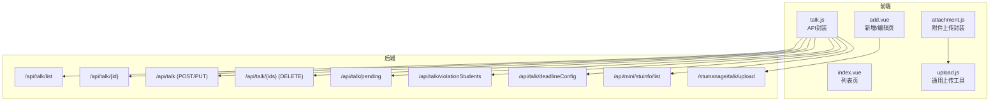
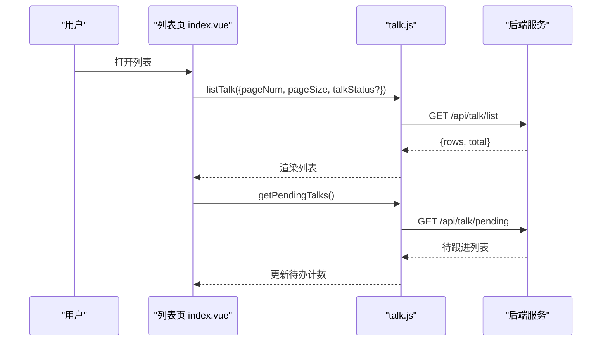
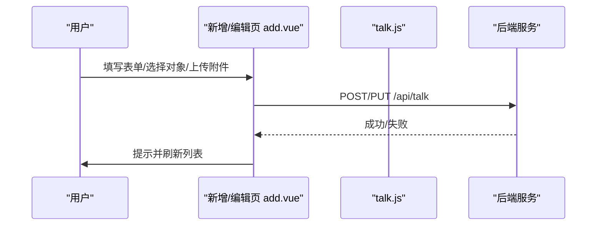
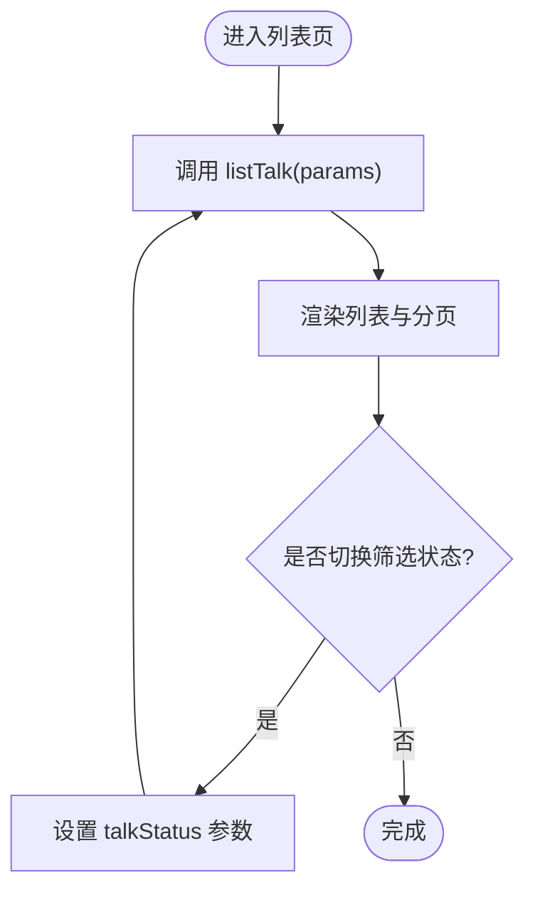
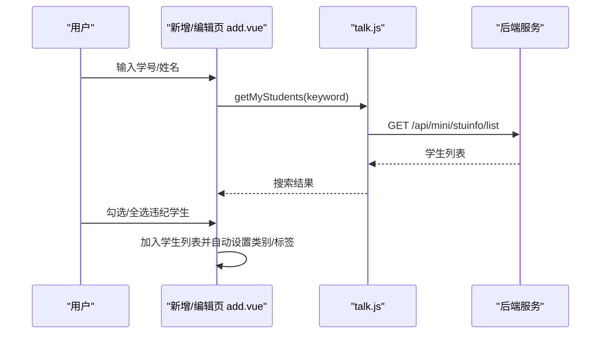
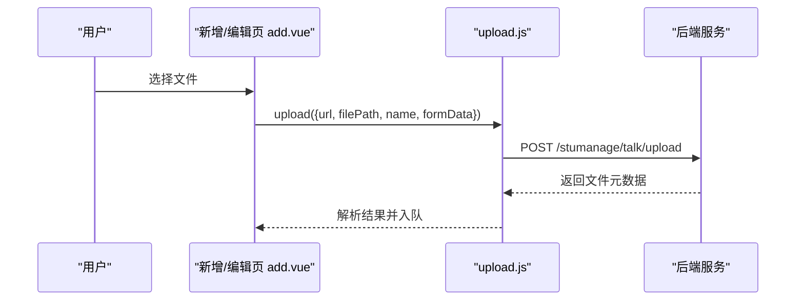
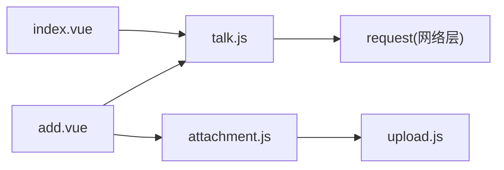

# 谈话记录接口

<cite>
**本文引用的文件**   
- [api/stumanage/talk.js](file://api/stumanage/talk.js)
- [pages/sub-work/talk/index.vue](file://pages/sub-work/talk/index.vue)
- [pages/sub-work/talk/add.vue](file://pages/sub-work/talk/add.vue)
- [api/stumanage/attachment.js](file://api/stumanage/attachment.js)
- [utils/upload.js](file://utils/upload.js)
</cite>

## 目录
1. [简介](#简介)
2. [项目结构](#项目结构)
3. [核心组件](#核心组件)
4. [架构总览](#架构总览)
5. [详细组件分析](#详细组件分析)
6. [依赖分析](#依赖分析)
7. [性能考虑](#性能考虑)
8. [故障排查指南](#故障排查指南)
9. [结论](#结论)
10. [附录](#附录)

## 简介
本文件面向移动端“师生谈话记录”功能，提供完整的接口与使用文档。内容涵盖：
- 谈话记录的创建、编辑、查询与管理
- 数据类型定义（主题、参与人员、内容、分类标签等）
- 与学生信息、辅导员信息的关联查询
- 统计分析接口（频次统计、主题分布等）
- 附件上传与文件管理
- 隐私保护与权限控制机制
- 导出与分享能力说明
- 业务场景示例与使用指南

## 项目结构
围绕谈话记录的前端实现主要包含以下模块：
- API 封装层：统一封装谈话相关接口调用
- 页面层：列表页与新增/编辑页
- 附件上传：通用上传工具与专用上传封装

图表来源
- [api/stumanage/talk.js:1-90](file://api/stumanage/talk.js#L1-L90)
- [pages/sub-work/talk/index.vue:118-194](file://pages/sub-work/talk/index.vue#L118-L194)
- [pages/sub-work/talk/add.vue:172-176](file://pages/sub-work/talk/add.vue#L172-L176)
- [api/stumanage/attachment.js:1-43](file://api/stumanage/attachment.js#L1-L43)
- [utils/upload.js:1-71](file://utils/upload.js#L1-L71)

章节来源
- [api/stumanage/talk.js:1-90](file://api/stumanage/talk.js#L1-L90)
- [pages/sub-work/talk/index.vue:118-194](file://pages/sub-work/talk/index.vue#L118-L194)
- [pages/sub-work/talk/add.vue:172-176](file://pages/sub-work/talk/add.vue#L172-L176)
- [api/stumanage/attachment.js:1-43](file://api/stumanage/attachment.js#L1-L43)
- [utils/upload.js:1-71](file://utils/upload.js#L1-L71)

## 核心组件
- 谈话记录 API 封装：提供列表、详情、新增、修改、删除、待跟进、违纪学生、限时配置等接口
- 列表页：分页展示、状态筛选、统计数据、待办提醒、附件预览
- 新增/编辑页：表单校验、类型选择、时间地点、对象搜索与批量添加、历史内容追加、佐证材料上传
- 附件上传：通用上传工具与业务类型化封装

章节来源
- [api/stumanage/talk.js:1-90](file://api/stumanage/talk.js#L1-L90)
- [pages/sub-work/talk/index.vue:118-194](file://pages/sub-work/talk/index.vue#L118-L194)
- [pages/sub-work/talk/add.vue:172-176](file://pages/sub-work/talk/add.vue#L172-L176)
- [api/stumanage/attachment.js:1-43](file://api/stumanage/attachment.js#L1-L43)
- [utils/upload.js:1-71](file://utils/upload.js#L1-L71)

## 架构总览
从前端到后端的请求链路如下：
- 列表/详情/增删改查：通过 talk.js 的 request 调用后端 /api/talk/* 系列接口
- 学生搜索：通过 talk.js 调用 /api/mini/stuinfo/list
- 待跟进与违纪学生：通过 talk.js 调用 /api/talk/pending 与 /api/talk/violationStudents
- 限时配置：通过 talk.js 调用 /api/talk/deadlineConfig
- 附件上传：add.vue 直接调用 /stumanage/talk/upload；也可复用 attachment.js + upload.js 进行通用上传

图表来源
- [pages/sub-work/talk/index.vue:162-194](file://pages/sub-work/talk/index.vue#L162-L194)
- [api/stumanage/talk.js:9-15](file://api/stumanage/talk.js#L9-L15)
- [api/stumanage/talk.js:67-72](file://api/stumanage/talk.js#L67-L72)

## 详细组件分析

### 数据模型与字段说明
- 谈话记录主表关键字段
  - 基本信息：类别（日常谈心/违纪谈话）、类型标签集合、时间、地点、截止时间、结束标记、状态（待谈话/进行中/已完成）
  - 参与对象：学生学号、姓名、班级代码、违纪类型（迟到/早退/旷课）、关联查课记录ID、备注
  - 内容：多条内容条目（文本+时间），支持追加
  - 附件：文件名、路径、大小、类型、媒体类型（图片/文档/录音）、排序
- 学生信息关键字段
  - 学号、姓名、班级代码、班级名称、违纪次数、已谈次数等
- 辅导员信息
  - 当前登录用户即辅导员，用于权限与数据范围控制（由后端鉴权）

章节来源
- [pages/sub-work/talk/add.vue:178-186](file://pages/sub-work/talk/add.vue#L178-L186)
- [pages/sub-work/talk/add.vue:194-214](file://pages/sub-work/talk/add.vue#L194-L214)
- [pages/sub-work/talk/add.vue:266-319](file://pages/sub-work/talk/add.vue#L266-L319)
- [pages/sub-work/talk/add.vue:645-674](file://pages/sub-work/talk/add.vue#L645-L674)
- [api/stumanage/talk.js:52-64](file://api/stumanage/talk.js#L52-L64)

### 接口清单与参数说明
- 获取谈话记录列表
  - 方法：GET
  - 路径：/api/talk/list
  - 参数：pageNum、pageSize、talkStatus（可选）
  - 返回：rows、total
- 获取谈话记录详情
  - 方法：GET
  - 路径：/api/talk/{id}
  - 返回：记录详情（含学生列表、内容列表、附件列表等）
- 新增谈话记录
  - 方法：POST
  - 路径：/api/talk
  - 请求体：包含类别、类型、时间、地点、截止时间、结束标记、状态、学生列表、内容列表、附件列表
- 修改谈话记录
  - 方法：PUT
  - 路径：/api/talk
  - 请求体：同新增，需携带 id
- 删除谈话记录
  - 方法：DELETE
  - 路径：/api/talk/{ids}
- 获取我的学生列表（支持学号/姓名模糊搜索）
  - 方法：GET
  - 路径：/api/mini/stuinfo/list
  - 参数：xh 或 studentName、pageNum、pageSize
- 获取待跟进的谈话记录
  - 方法：GET
  - 路径：/api/talk/pending
- 获取违纪学生列表
  - 方法：GET
  - 路径：/api/talk/violationStudents
  - 参数：checkDate、bjdm（可选）
- 获取限时谈话配置
  - 方法：GET
  - 路径：/api/talk/deadlineConfig
- 上传附件（谈话业务）
  - 方法：POST
  - 路径：/stumanage/talk/upload
  - 表单字段：file、mediaType
- 通用附件上传（多业务）
  - 方法：POST
  - 路径：/api/attachment/upload
  - 表单字段：file、businessType、fileName（可选）

章节来源
- [api/stumanage/talk.js:9-15](file://api/stumanage/talk.js#L9-L15)
- [api/stumanage/talk.js:18-23](file://api/stumanage/talk.js#L18-L23)
- [api/stumanage/talk.js:26-32](file://api/stumanage/talk.js#L26-L32)
- [api/stumanage/talk.js:35-41](file://api/stumanage/talk.js#L35-L41)
- [api/stumanage/talk.js:44-49](file://api/stumanage/talk.js#L44-L49)
- [api/stumanage/talk.js:52-64](file://api/stumanage/talk.js#L52-L64)
- [api/stumanage/talk.js:67-72](file://api/stumanage/talk.js#L67-L72)
- [api/stumanage/talk.js:75-81](file://api/stumanage/talk.js#L75-L81)
- [api/stumanage/talk.js:84-89](file://api/stumanage/talk.js#L84-L89)
- [pages/sub-work/talk/add.vue:570-598](file://pages/sub-work/talk/add.vue#L570-L598)
- [api/stumanage/attachment.js:10-20](file://api/stumanage/attachment.js#L10-L20)

### 业务流程与时序

#### 新增/编辑流程

图表来源
- [pages/sub-work/talk/add.vue:631-695](file://pages/sub-work/talk/add.vue#L631-L695)
- [api/stumanage/talk.js:26-41](file://api/stumanage/talk.js#L26-L41)

#### 列表加载与筛选

图表来源
- [pages/sub-work/talk/index.vue:162-180](file://pages/sub-work/talk/index.vue#L162-L180)
- [api/stumanage/talk.js:9-15](file://api/stumanage/talk.js#L9-L15)

#### 学生搜索与批量添加

图表来源
- [pages/sub-work/talk/add.vue:350-393](file://pages/sub-work/talk/add.vue#L350-L393)
- [api/stumanage/talk.js:52-64](file://api/stumanage/talk.js#L52-L64)

### 附件上传与文件管理
- 上传入口
  - 谈话业务上传：/stumanage/talk/upload（表单字段 file、mediaType）
  - 通用上传：/api/attachment/upload（表单字段 file、businessType、fileName）
- 上传流程
  - 选择图片/文档/录音
  - 调用 upload 工具，自动注入 Authorization 头
  - 成功后将附件元数据加入提交数据
- 预览与下载
  - 图片：缩略图预览
  - 文档/录音：下载后打开

图表来源
- [pages/sub-work/talk/add.vue:570-598](file://pages/sub-work/talk/add.vue#L570-L598)
- [utils/upload.js:10-67](file://utils/upload.js#L10-L67)
- [api/stumanage/attachment.js:10-20](file://api/stumanage/attachment.js#L10-L20)

### 统计分析接口
- 列表页在加载时调用统计接口，用于展示总数、待谈话、进行中、已完成等指标
- 建议后端提供主题分布、频次统计等扩展字段，便于后续可视化

章节来源
- [pages/sub-work/talk/index.vue:182-188](file://pages/sub-work/talk/index.vue#L182-L188)

### 隐私保护与权限控制
- 认证
  - 上传工具自动注入 Authorization 头，基于 token 鉴权
- 授权
  - 辅导员仅能访问其负责的学生与谈话记录（由后端根据当前用户上下文控制）
- 数据安全
  - 敏感字段（如学生信息）按最小可见原则返回
  - 附件访问需鉴权，避免未授权下载

章节来源
- [utils/upload.js:14-16](file://utils/upload.js#L14-L16)
- [pages/sub-work/talk/add.vue:606-629](file://pages/sub-work/talk/add.vue#L606-L629)

### 导出与分享
- 导出
  - 列表页可结合后端导出接口（例如 Excel/PDF）实现批量导出，当前前端未内置导出按钮，可在列表页增加入口
- 分享
  - 可将谈话摘要生成链接或二维码，通过系统内分享组件转发给相关人员（注意脱敏处理）

[本节为概念性说明，不直接分析具体文件]

## 依赖分析
- 模块耦合
  - 列表页依赖 talk.js 的 listTalk、getPendingTalks、getTalkStats
  - 新增/编辑页依赖 talk.js 的详情、增删改、学生搜索、违纪学生、限时配置，以及附件上传
  - 附件上传依赖通用 upload.js 工具
- 外部依赖
  - uni-app 原生 API（选择文件、预览、下载、打开文档等）
  - 后端 REST 接口

图表来源
- [pages/sub-work/talk/index.vue:118-194](file://pages/sub-work/talk/index.vue#L118-L194)
- [pages/sub-work/talk/add.vue:172-176](file://pages/sub-work/talk/add.vue#L172-L176)
- [api/stumanage/attachment.js:1-43](file://api/stumanage/attachment.js#L1-L43)
- [utils/upload.js:1-71](file://utils/upload.js#L1-L71)

章节来源
- [pages/sub-work/talk/index.vue:118-194](file://pages/sub-work/talk/index.vue#L118-L194)
- [pages/sub-work/talk/add.vue:172-176](file://pages/sub-work/talk/add.vue#L172-L176)
- [api/stumanage/attachment.js:1-43](file://api/stumanage/attachment.js#L1-L43)
- [utils/upload.js:1-71](file://utils/upload.js#L1-L71)

## 性能考虑
- 列表分页：默认 pageSize=20，按需加载更多
- 防抖搜索：学生搜索采用 400ms 防抖，减少频繁请求
- 图片压缩：选择图片时使用压缩模式，降低传输体积
- 懒加载与缓存：详情页按需加载附件，避免首屏过重
- 并发控制：附件上传串行或限制并发，避免阻塞

[本节为通用指导，不直接分析具体文件]

## 故障排查指南
- 上传失败
  - 检查网络与 token 有效性
  - 确认 mediaType/businessType 参数正确
  - 查看错误码与提示信息
- 列表为空
  - 检查筛选条件与分页参数
  - 确认后端权限与数据范围
- 学生搜索无结果
  - 核对关键词是否为学号或姓名
  - 检查后端 mini 学生接口可用性

章节来源
- [utils/upload.js:31-67](file://utils/upload.js#L31-L67)
- [pages/sub-work/talk/add.vue:570-598](file://pages/sub-work/talk/add.vue#L570-L598)
- [pages/sub-work/talk/index.vue:162-180](file://pages/sub-work/talk/index.vue#L162-L180)

## 结论
本方案以轻量前端封装配合标准 REST 接口，实现了谈话记录的全生命周期管理与附件支撑。通过状态筛选、待办提醒与统计面板，提升了辅导员的工作效率。建议在后续迭代中完善导出与分享能力，并增强统计维度（主题分布、频次趋势等）。

[本节为总结性内容，不直接分析具体文件]

## 附录

### 使用指南与业务场景示例
- 场景一：日常谈心
  - 步骤：选择类型标签（思想动态/心理健康/学业指导/就业指导/生活关怀/其他）→ 选择时间与地点 → 搜索并添加学生 → 填写内容 → 可选上传佐证材料 → 提交
- 场景二：违纪谈话
  - 步骤：从“违纪学生列表”或“查课记录”导入对象 → 自动设置为违纪谈话并选中纪律教育标签 → 设置截止时间（受限时配置影响）→ 填写内容与附件 → 提交
- 场景三：跟进与闭环
  - 步骤：在列表页查看“待谈话/进行中/已完成” → 点击记录查看详情 → 追加内容并标记结束 → 系统自动刷新统计

章节来源
- [pages/sub-work/talk/add.vue:178-186](file://pages/sub-work/talk/add.vue#L178-L186)
- [pages/sub-work/talk/add.vue:372-496](file://pages/sub-work/talk/add.vue#L372-L496)
- [pages/sub-work/talk/add.vue:244-254](file://pages/sub-work/talk/add.vue#L244-L254)
- [pages/sub-work/talk/index.vue:162-194](file://pages/sub-work/talk/index.vue#L162-L194)