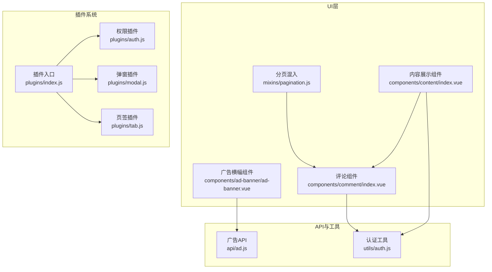
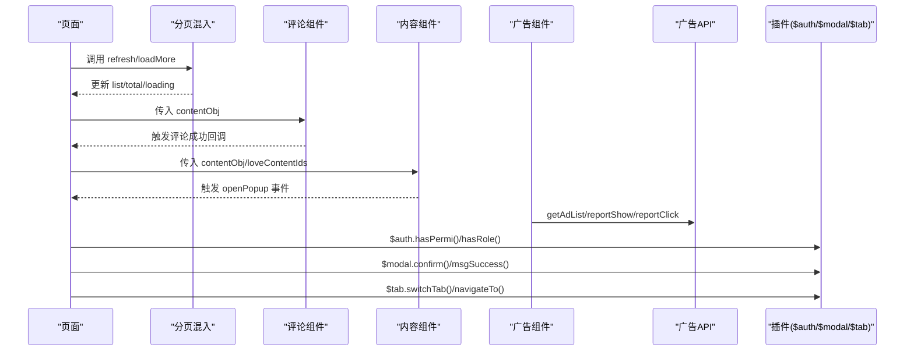
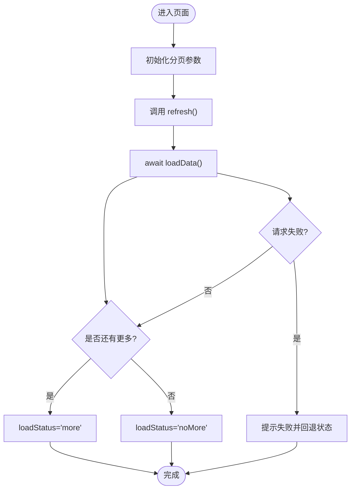
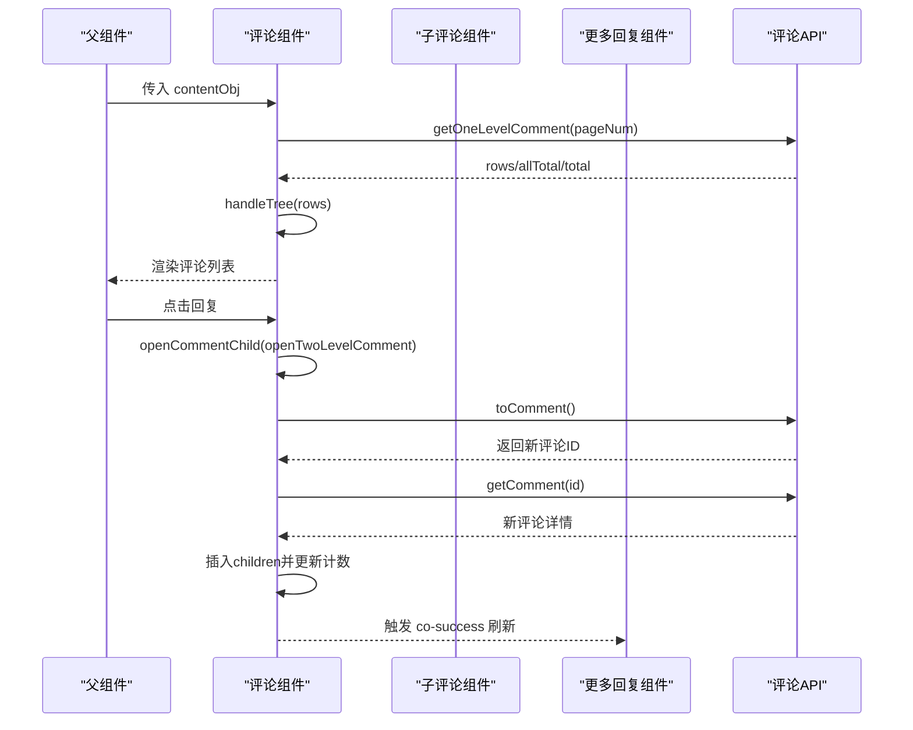
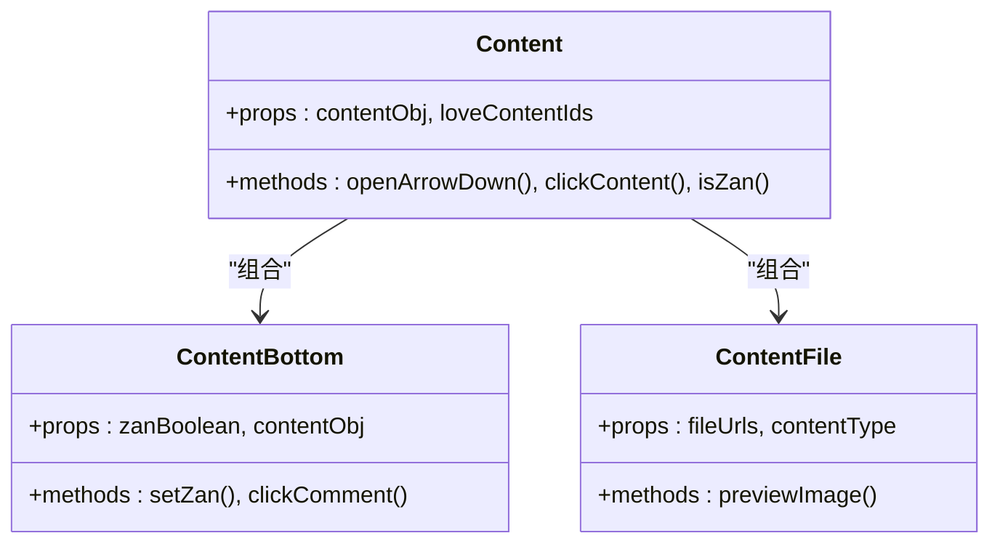
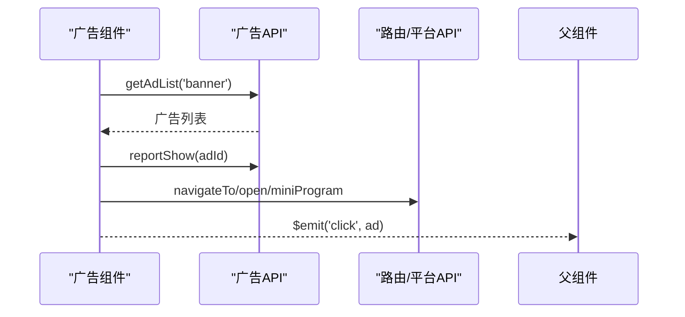
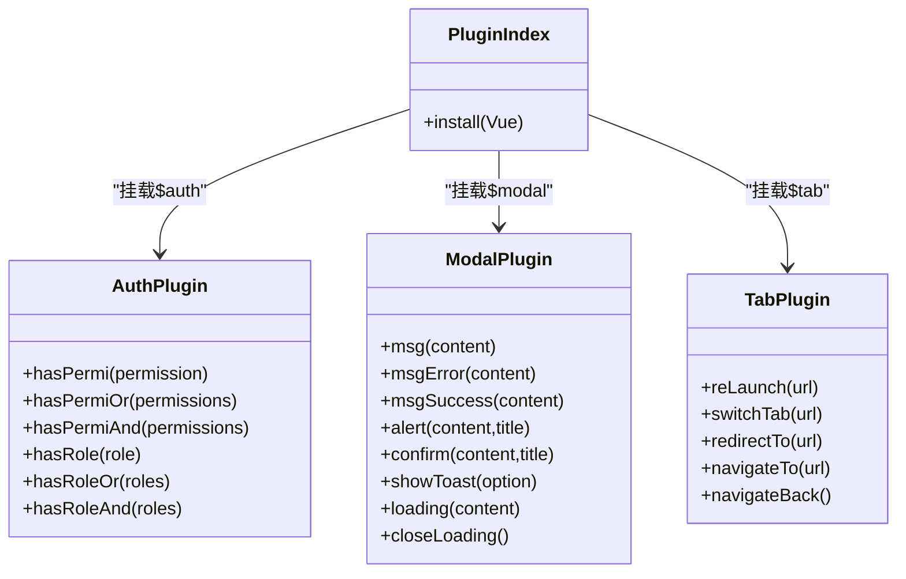
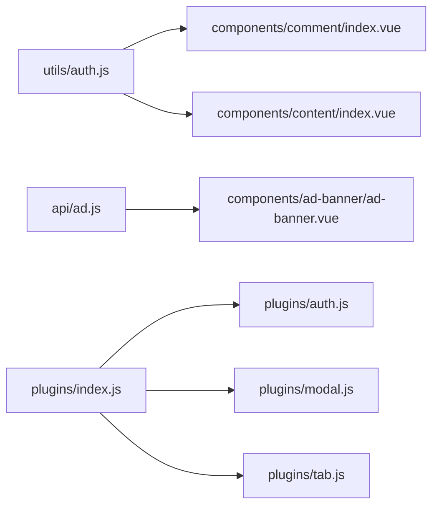

# UI混入与组件

<cite>
**本文引用的文件**   
- [mixins/pagination.js](file://mixins/pagination.js)
- [components/comment/index.vue](file://components/comment/index.vue)
- [components/comment/CommentChild.vue](file://components/comment/CommentChild.vue)
- [components/comment/MoreReplies.vue](file://components/comment/MoreReplies.vue)
- [components/content/index.vue](file://components/content/index.vue)
- [components/content/ContentBottom.vue](file://components/content/ContentBottom.vue)
- [components/content/ContentFile.vue](file://components/content/ContentFile.vue)
- [components/ad-banner/ad-banner.vue](file://components/ad-banner/ad-banner.vue)
- [api/ad.js](file://api/ad.js)
- [plugins/auth.js](file://plugins/auth.js)
- [plugins/modal.js](file://plugins/modal.js)
- [plugins/tab.js](file://plugins/tab.js)
- [plugins/index.js](file://plugins/index.js)
- [utils/auth.js](file://utils/auth.js)
</cite>

## 目录
1. [简介](#简介)
2. [项目结构](#项目结构)
3. [核心组件与混入](#核心组件与混入)
4. [架构总览](#架构总览)
5. [详细组件分析](#详细组件分析)
6. [依赖关系分析](#依赖关系分析)
7. [性能与体验优化](#性能与体验优化)
8. [故障排查指南](#故障排查指南)
9. [结论](#结论)
10. [附录：开发规范与最佳实践](#附录开发规范与最佳实践)

## 简介
本文件聚焦于 RuoYi-App 的 UI 层能力，系统化梳理分页混入 pagination、评论与内容展示等自定义组件、广告轮播组件以及插件系统（权限、弹窗、路由）的使用方法与扩展方式。文档面向不同技术背景的读者，提供从使用到扩展的全链路说明，并给出可视化图示与可操作的排错建议。

## 项目结构
围绕 UI 混入与组件，仓库关键目录如下：
- mixins：通用逻辑复用，如分页混入
- components：业务级 UI 组件，包括评论、内容展示、广告横幅等
- plugins：全局插件注册与挂载，包含权限、模态提示、页面跳转封装
- api：前端 API 封装，如广告上报接口
- utils：工具函数，如登录状态判断、用户ID获取

图表来源
- [mixins/pagination.js:1-125](file://mixins/pagination.js#L1-L125)
- [components/comment/index.vue:1-476](file://components/comment/index.vue#L1-L476)
- [components/content/index.vue:1-213](file://components/content/index.vue#L1-L213)
- [components/ad-banner/ad-banner.vue:1-140](file://components/ad-banner/ad-banner.vue#L1-L140)
- [api/ad.js:1-50](file://api/ad.js#L1-L50)
- [plugins/index.js:1-15](file://plugins/index.js#L1-L15)
- [plugins/auth.js:1-61](file://plugins/auth.js#L1-L61)
- [plugins/modal.js:1-79](file://plugins/modal.js#L1-L79)
- [plugins/tab.js:1-31](file://plugins/tab.js#L1-L31)
- [utils/auth.js:1-47](file://utils/auth.js#L1-L47)

章节来源
- [mixins/pagination.js:1-125](file://mixins/pagination.js#L1-L125)
- [components/comment/index.vue:1-476](file://components/comment/index.vue#L1-L476)
- [components/content/index.vue:1-213](file://components/content/index.vue#L1-L213)
- [components/ad-banner/ad-banner.vue:1-140](file://components/ad-banner/ad-banner.vue#L1-L140)
- [api/ad.js:1-50](file://api/ad.js#L1-L50)
- [plugins/index.js:1-15](file://plugins/index.js#L1-L15)
- [plugins/auth.js:1-61](file://plugins/auth.js#L1-L61)
- [plugins/modal.js:1-79](file://plugins/modal.js#L1-L79)
- [plugins/tab.js:1-31](file://plugins/tab.js#L1-L31)
- [utils/auth.js:1-47](file://utils/auth.js#L1-L47)

## 核心组件与混入
本节概述各核心模块的职责与交互要点，便于快速上手与定位问题。

- 分页混入 pagination
  - 职责：统一列表页的分页参数管理、上拉加载更多、下拉刷新、加载状态控制
  - 集成方式：在页面中引入并混入，实现 loadData 方法返回 Promise，resolve 数据列表和总数
  - 对外暴露：refresh、loadMore、onPullDownRefresh 等方法

- 评论组件 comment
  - 职责：一级评论列表、二级回复展开、评论输入框、作者标签、时间地址显示
  - 子组件：CommentChild（子评论列表）、MoreReplies（更多回复）
  - 事件：通过 provide/inject 或 $emit 与父组件通信

- 内容展示组件 content
  - 职责：展示用户头像、昵称、分类、状态、时间、正文、图片/视频
  - 子组件：ContentBottom（点赞、评论入口）、ContentFile（图片/视频渲染）
  - 事件：openPopup 向父组件传递弹出菜单数据

- 广告横幅组件 ad-banner
  - 职责：轮播广告展示、点击上报、跳转内部页面或外部链接
  - API：getAdList、reportShow、reportClick

- 插件系统
  - auth：权限与角色校验，基于 store 中的 permissions/roles
  - modal：消息提示、确认弹窗、loading 遮罩
  - tab：统一的页面跳转封装（reLaunch、switchTab、redirectTo、navigateTo、navigateBack）
  - index：统一安装，挂载到 Vue 原型 $auth/$modal/$tab

章节来源
- [mixins/pagination.js:1-125](file://mixins/pagination.js#L1-L125)
- [components/comment/index.vue:1-476](file://components/comment/index.vue#L1-L476)
- [components/content/index.vue:1-213](file://components/content/index.vue#L1-L213)
- [components/ad-banner/ad-banner.vue:1-140](file://components/ad-banner/ad-banner.vue#L1-L140)
- [plugins/auth.js:1-61](file://plugins/auth.js#L1-L61)
- [plugins/modal.js:1-79](file://plugins/modal.js#L1-L79)
- [plugins/tab.js:1-31](file://plugins/tab.js#L1-L31)
- [plugins/index.js:1-15](file://plugins/index.js#L1-L15)

## 架构总览
下图展示了 UI 层与插件、API 的协作关系，以及评论与内容组件的组合方式。

图表来源
- [mixins/pagination.js:1-125](file://mixins/pagination.js#L1-L125)
- [components/comment/index.vue:1-476](file://components/comment/index.vue#L1-L476)
- [components/content/index.vue:1-213](file://components/content/index.vue#L1-L213)
- [components/ad-banner/ad-banner.vue:1-140](file://components/ad-banner/ad-banner.vue#L1-L140)
- [api/ad.js:1-50](file://api/ad.js#L1-L50)
- [plugins/auth.js:1-61](file://plugins/auth.js#L1-L61)
- [plugins/modal.js:1-79](file://plugins/modal.js#L1-L79)
- [plugins/tab.js:1-31](file://plugins/tab.js#L1-L31)

## 详细组件分析

### 分页混入 pagination
- 设计要点
  - 维护 pageNum、pageSize、total、list、loading、loadStatus、refreshing 等状态
  - 强制子类实现 loadData()，返回 { list, total }
  - 提供 refresh、loadMore、onPullDownRefresh 三个常用生命周期钩子
- 使用步骤
  - 在页面引入并混入
  - 实现 loadData()，根据当前 pageNum 请求后端
  - 在模板中绑定 loadStatus 以显示“加载中/没有更多”等状态
- 错误处理
  - 捕获异常后回退 pageNum、重置 loadStatus，并提示用户
- 复杂度
  - 时间复杂度 O(1) 的状态切换；数据追加为 concat，整体线性取决于列表长度

图表来源
- [mixins/pagination.js:1-125](file://mixins/pagination.js#L1-L125)

章节来源
- [mixins/pagination.js:1-125](file://mixins/pagination.js#L1-L125)

### 评论组件 comment
- 功能概览
  - 一级评论列表与分页（通过 scroll-list 驱动）
  - 二级评论展开与“查看更多回复”
  - 评论输入弹窗，支持键盘高度自适应
  - 作者标签、时间、地址信息展示
- 关键流程
  - 获取一级评论：getCommentList(paging)
  - 刷新：refresh(paging)
  - 新增一级评论：addOneLevelComment()
  - 新增二级评论：addCommentChild()
  - 打开评论弹窗：openCommentChild()/openTwoLevelComment()
- 事件与通信
  - 通过 provide/inject 向子组件开放 openTwoLevelComment
  - 子组件通过 $emit('co-success') 通知父组件刷新
- 注意事项
  - 树形数据处理：handleTree(commentRows, 'commentId')
  - 评论成功后局部插入 children 数组并更新 childrenCount

图表来源
- [components/comment/index.vue:1-476](file://components/comment/index.vue#L1-L476)
- [components/comment/CommentChild.vue:1-206](file://components/comment/CommentChild.vue#L1-L206)
- [components/comment/MoreReplies.vue:1-193](file://components/comment/MoreReplies.vue#L1-L193)

章节来源
- [components/comment/index.vue:1-476](file://components/comment/index.vue#L1-L476)
- [components/comment/CommentChild.vue:1-206](file://components/comment/CommentChild.vue#L1-L206)
- [components/comment/MoreReplies.vue:1-193](file://components/comment/MoreReplies.vue#L1-L193)

### 内容展示组件 content
- 功能概览
  - 头部：头像、昵称、分类、状态、时间
  - 正文：文本、图片/视频（ContentFile）
  - 底部：分享、评论、点赞（ContentBottom）
  - 事件：openPopup 向父组件传递弹出菜单数据
- 关键点
  - 图片/视频 URL 处理与懒加载
  - 点赞状态同步与本地乐观更新，失败回滚
  - 跳转到详情页 /pages/c/index?id=contentId

图表来源
- [components/content/index.vue:1-213](file://components/content/index.vue#L1-L213)
- [components/content/ContentBottom.vue:1-276](file://components/content/ContentBottom.vue#L1-L276)
- [components/content/ContentFile.vue:1-83](file://components/content/ContentFile.vue#L1-L83)

章节来源
- [components/content/index.vue:1-213](file://components/content/index.vue#L1-L213)
- [components/content/ContentBottom.vue:1-276](file://components/content/ContentBottom.vue#L1-L276)
- [components/content/ContentFile.vue:1-83](file://components/content/ContentFile.vue#L1-L83)

### 广告横幅组件 ad-banner
- 功能概览
  - 自动轮播、广告标识、点击上报与跳转
  - 支持小程序内跳转与 H5 外链
- 关键流程
  - mounted 时加载广告列表并上报展示
  - 点击时上报点击并执行跳转策略
- 配置项
  - autoplay、interval、duration、showMark

图表来源
- [components/ad-banner/ad-banner.vue:1-140](file://components/ad-banner/ad-banner.vue#L1-L140)
- [api/ad.js:1-50](file://api/ad.js#L1-L50)

章节来源
- [components/ad-banner/ad-banner.vue:1-140](file://components/ad-banner/ad-banner.vue#L1-L140)
- [api/ad.js:1-50](file://api/ad.js#L1-L50)

### 插件系统
- 权限插件 auth
  - 提供 hasPermi、hasPermiOr、hasPermiAnd、hasRole、hasRoleOr、hasRoleAnd
  - 基于 store.getters.permissions 与 store.getters.roles 进行匹配
- 弹窗插件 modal
  - msg、msgError、msgSuccess、alert、confirm、showToast、loading、closeLoading
- 页签插件 tab
  - reLaunch、switchTab、redirectTo、navigateTo、navigateBack
- 安装方式
  - 通过 plugins/index.js 统一 install，挂载到 Vue.prototype.$auth/$modal/$tab

图表来源
- [plugins/auth.js:1-61](file://plugins/auth.js#L1-L61)
- [plugins/modal.js:1-79](file://plugins/modal.js#L1-L79)
- [plugins/tab.js:1-31](file://plugins/tab.js#L1-L31)
- [plugins/index.js:1-15](file://plugins/index.js#L1-L15)

章节来源
- [plugins/auth.js:1-61](file://plugins/auth.js#L1-L61)
- [plugins/modal.js:1-79](file://plugins/modal.js#L1-L79)
- [plugins/tab.js:1-31](file://plugins/tab.js#L1-L31)
- [plugins/index.js:1-15](file://plugins/index.js#L1-L15)

## 依赖关系分析
- 组件间耦合
  - content 组合 ContentBottom 与 ContentFile，低耦合高内聚
  - comment 组合 CommentChild 与 MoreReplies，通过事件与 provide/inject 解耦
- 插件与全局
  - 通过 install 将 $auth/$modal/$tab 注入到所有组件/页面
- 外部依赖
  - 广告组件依赖 api/ad.js
  - 评论与内容组件依赖 utils/auth.js 进行登录态判断

图表来源
- [utils/auth.js:1-47](file://utils/auth.js#L1-L47)
- [components/comment/index.vue:1-476](file://components/comment/index.vue#L1-L476)
- [components/content/index.vue:1-213](file://components/content/index.vue#L1-L213)
- [api/ad.js:1-50](file://api/ad.js#L1-L50)
- [components/ad-banner/ad-banner.vue:1-140](file://components/ad-banner/ad-banner.vue#L1-L140)
- [plugins/index.js:1-15](file://plugins/index.js#L1-L15)
- [plugins/auth.js:1-61](file://plugins/auth.js#L1-L61)
- [plugins/modal.js:1-79](file://plugins/modal.js#L1-L79)
- [plugins/tab.js:1-31](file://plugins/tab.js#L1-L31)

章节来源
- [utils/auth.js:1-47](file://utils/auth.js#L1-L47)
- [components/comment/index.vue:1-476](file://components/comment/index.vue#L1-L476)
- [components/content/index.vue:1-213](file://components/content/index.vue#L1-L213)
- [api/ad.js:1-50](file://api/ad.js#L1-L50)
- [components/ad-banner/ad-banner.vue:1-140](file://components/ad-banner/ad-banner.vue#L1-L140)
- [plugins/index.js:1-15](file://plugins/index.js#L1-L15)
- [plugins/auth.js:1-61](file://plugins/auth.js#L1-L61)
- [plugins/modal.js:1-79](file://plugins/modal.js#L1-L79)
- [plugins/tab.js:1-31](file://plugins/tab.js#L1-L31)

## 性能与体验优化
- 列表与分页
  - 使用分页混入避免重复状态管理；合理设置 pageSize 平衡首屏与滚动体验
  - 上拉加载前检查 loadStatus 与 loading，防止重复请求
- 评论与嵌套
  - 对子评论采用按需加载与“查看更多”，减少初始渲染压力
  - 树形数据转换仅在必要时执行，避免频繁重建
- 媒体资源
  - 图片懒加载与预览，视频启用手势播放
  - 相对路径转绝对路径时注意缓存与去重
- 插件与交互
  - 使用 $modal.loading/closeLoading 包裹耗时操作，提升感知性能
  - 使用 $tab 统一跳转，减少重复代码

[本节为通用指导，不直接分析具体文件]

## 故障排查指南
- 评论无法加载
  - 检查 contentObj.contentId 是否正确传入
  - 查看 getOneLevelComment 返回值结构与字段映射
  - 确认 handleTree 的根节点字段是否为 commentId
- 点赞状态不一致
  - 确认 isZan 的布尔值与 loveCount 同步更新
  - 网络失败时回滚本地状态，确保 UI 与后端一致
- 广告点击无响应
  - 检查 ad.adLink 格式与平台分支逻辑
  - 确认 reportClick 上报是否成功
- 权限控制无效
  - 确认 store 中 permissions/roles 已正确填充
  - 使用 $auth.hasPermi/hasRole 进行断点验证

章节来源
- [components/comment/index.vue:1-476](file://components/comment/index.vue#L1-L476)
- [components/content/ContentBottom.vue:1-276](file://components/content/ContentBottom.vue#L1-L276)
- [components/ad-banner/ad-banner.vue:1-140](file://components/ad-banner/ad-banner.vue#L1-L140)
- [plugins/auth.js:1-61](file://plugins/auth.js#L1-L61)

## 结论
本文件系统性梳理了 RuoYi-App 的 UI 混入与组件体系，明确了分页混入的使用方法、评论与内容组件的设计与组合、广告组件的数据流与上报机制，以及插件系统的统一挂载与使用。通过上述规范与实践，可在保证可维护性的同时提升用户体验与开发效率。

[本节为总结性内容，不直接分析具体文件]

## 附录：开发规范与最佳实践
- 组件设计原则
  - 单一职责：每个组件只负责一个明确的功能域
  - 属性契约：props 类型与默认值清晰，必要时做校验
  - 事件最小化：仅向上抛出必要事件，避免过度耦合
- 事件通信
  - 父子：props/$emit
  - 跨层级：provide/inject 或事件总线
  - 兄弟：通过共同父组件中转
- 样式隔离
  - 使用 scoped 样式，避免全局污染
  - 命名空间化类名，降低冲突概率
- 性能优化
  - 列表虚拟化或分页加载
  - 图片懒加载与按需渲染
  - 避免在模板中进行复杂计算
- 质量保证
  - 单元测试：对纯函数与工具方法进行覆盖
  - 组件测试：模拟 props 与事件，验证渲染与交互
  - 端到端测试：关键业务流程自动化验证
- 实际组合示例
  - 列表页：使用 pagination 混入 + 内容组件 + 评论组件
  - 首页：广告横幅 + 内容卡片 + 底部导航（$tab）
  - 详情页：内容组件 + 评论组件 + 权限控制（$auth）
- 扩展开发指导
  - 新增组件：遵循 props/events 契约，编写 README 与示例
  - 新增插件：在 plugins 下新建模块并在 index.js 中安装
  - 新增 API：在 api 目录下按模块组织，统一 request 封装

[本节为通用指导，不直接分析具体文件]