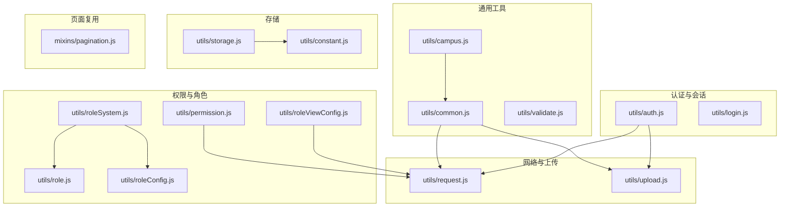
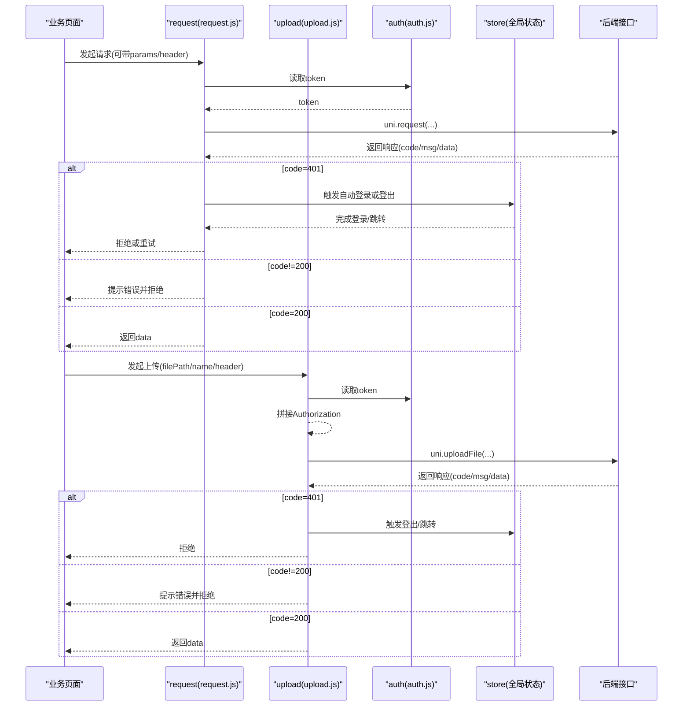
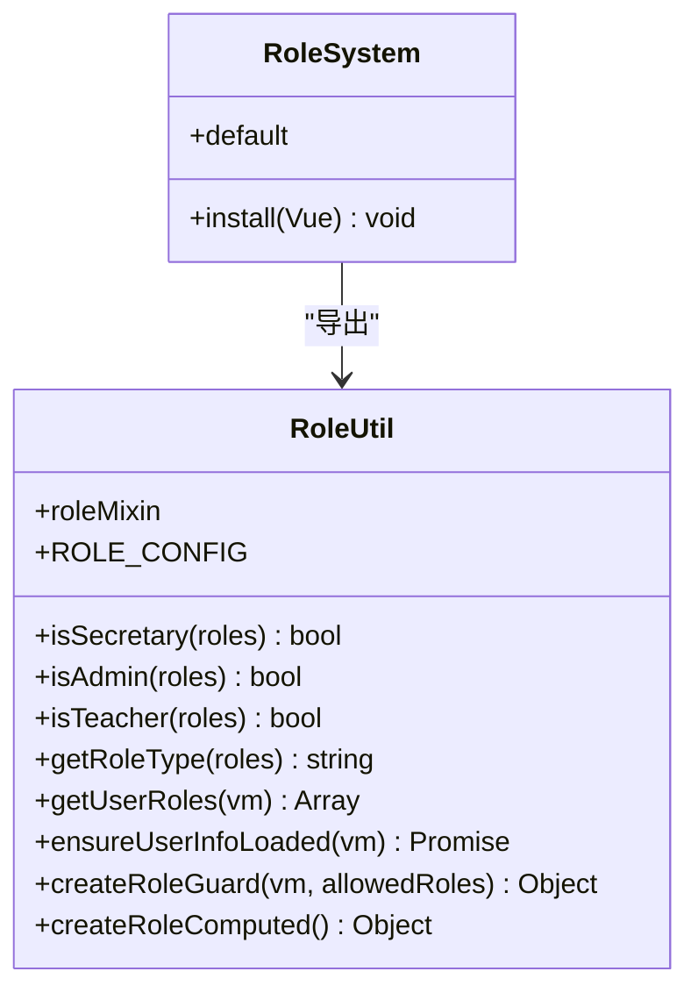
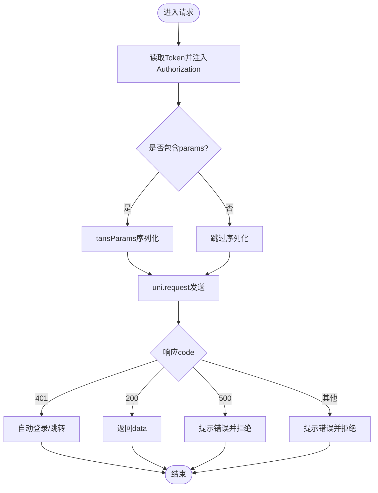
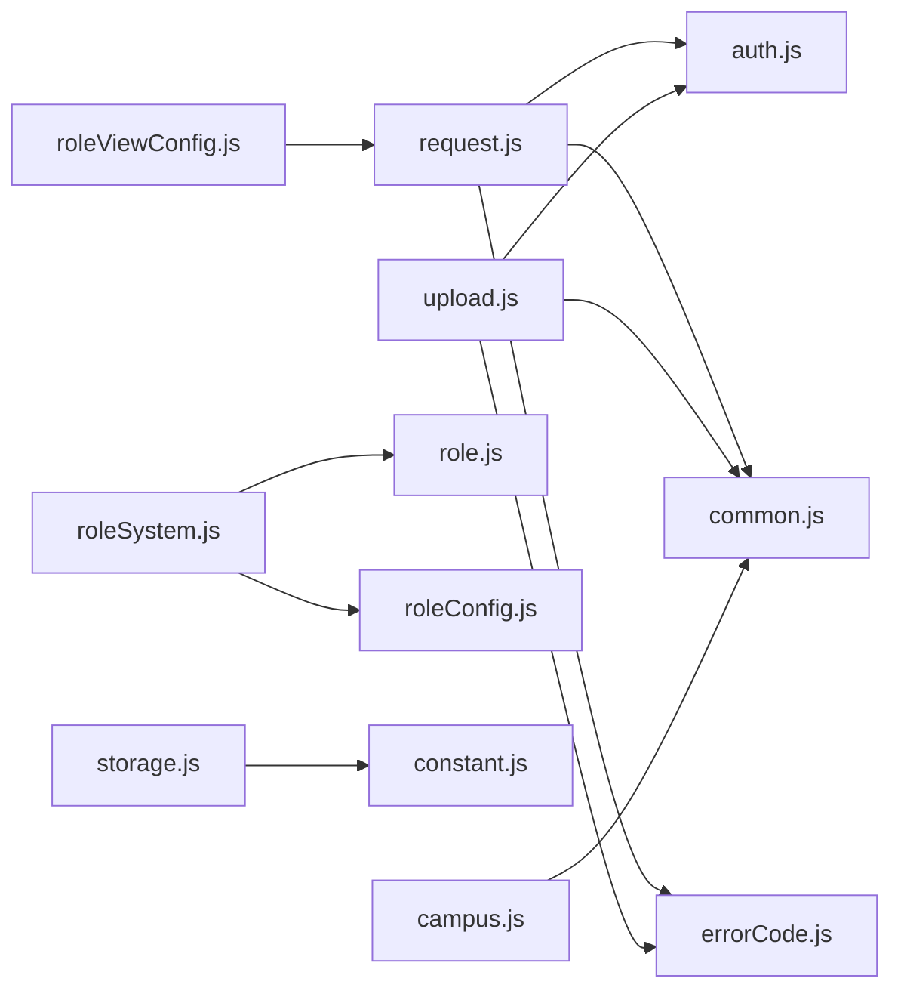

# 工具函数库

<cite>
**本文引用的文件**   
- [utils/common.js](file://utils/common.js)
- [utils/auth.js](file://utils/auth.js)
- [utils/permission.js](file://utils/permission.js)
- [utils/storage.js](file://utils/storage.js)
- [utils/upload.js](file://utils/upload.js)
- [utils/request.js](file://utils/request.js)
- [utils/validate.js](file://utils/validate.js)
- [utils/campus.js](file://utils/campus.js)
- [utils/constant.js](file://utils/constant.js)
- [utils/errorCode.js](file://utils/errorCode.js)
- [utils/login.js](file://utils/login.js)
- [utils/role.js](file://utils/role.js)
- [utils/roleConfig.js](file://utils/roleConfig.js)
- [utils/roleSystem.js](file://utils/roleSystem.js)
- [utils/roleViewConfig.js](file://utils/roleViewConfig.js)
- [mixins/pagination.js](file://mixins/pagination.js)
</cite>

## 目录
1. [简介](#简介)
2. [项目结构](#项目结构)
3. [核心组件](#核心组件)
4. [架构总览](#架构总览)
5. [详细组件分析](#详细组件分析)
6. [依赖关系分析](#依赖关系分析)
7. [性能与最佳实践](#性能与最佳实践)
8. [测试与质量保证](#测试与质量保证)
9. [扩展与定制指南](#扩展与定制指南)
10. [常见问题排查](#常见问题排查)
11. [结论](#结论)

## 简介
本文件为 RuoYi-App 前端工具函数库的综合文档，覆盖权限判断、数据处理、格式化工具、存储、上传、网络请求、校验、角色与视图配置、分页混入等模块。文档面向不同技术背景的读者，提供从高层架构到代码级细节的说明，并给出使用示例路径、流程图和最佳实践建议。

## 项目结构
工具函数主要分布在 utils 与 mixins 目录下，按职责划分：
- 通用工具：common、validate、campus
- 认证与会话：auth、login
- 权限与角色：permission、role、roleSystem、roleConfig、roleViewConfig
- 网络与上传：request、upload
- 存储：storage、constant
- 页面能力复用：mixins/pagination

图表来源
- [utils/common.js:1-121](file://utils/common.js#L1-L121)
- [utils/request.js:1-117](file://utils/request.js#L1-L117)
- [utils/upload.js:1-71](file://utils/upload.js#L1-L71)
- [utils/auth.js:1-47](file://utils/auth.js#L1-L47)
- [utils/permission.js:1-49](file://utils/permission.js#L1-L49)
- [utils/role.js:1-165](file://utils/role.js#L1-L165)
- [utils/roleSystem.js:1-297](file://utils/roleSystem.js#L1-L297)
- [utils/roleConfig.js:1-149](file://utils/roleConfig.js#L1-L149)
- [utils/roleViewConfig.js:1-115](file://utils/roleViewConfig.js#L1-L115)
- [utils/storage.js:1-33](file://utils/storage.js#L1-L33)
- [utils/constant.js:1-10](file://utils/constant.js#L1-L10)
- [utils/campus.js:1-73](file://utils/campus.js#L1-L73)
- [mixins/pagination.js:1-125](file://mixins/pagination.js#L1-L125)

章节来源
- [utils/common.js:1-121](file://utils/common.js#L1-L121)
- [utils/request.js:1-117](file://utils/request.js#L1-L117)
- [utils/upload.js:1-71](file://utils/upload.js#L1-L71)
- [utils/auth.js:1-47](file://utils/auth.js#L1-L47)
- [utils/permission.js:1-49](file://utils/permission.js#L1-L49)
- [utils/role.js:1-165](file://utils/role.js#L1-L165)
- [utils/roleSystem.js:1-297](file://utils/roleSystem.js#L1-L297)
- [utils/roleConfig.js:1-149](file://utils/roleConfig.js#L1-L149)
- [utils/roleViewConfig.js:1-115](file://utils/roleViewConfig.js#L1-L115)
- [utils/storage.js:1-33](file://utils/storage.js#L1-L33)
- [utils/constant.js:1-10](file://utils/constant.js#L1-L10)
- [utils/campus.js:1-73](file://utils/campus.js#L1-L73)
- [mixins/pagination.js:1-125](file://mixins/pagination.js#L1-L125)

## 核心组件
本节概述各工具模块的职责与关键接口，便于快速定位与组合使用。

- 通用工具（common）
  - 消息提示：toast
  - 日期格式化：parseTime
  - 确认弹窗：showConfirm
  - 参数序列化：tansParams
  - 位置选择：chooseLocation
- 认证与会话（auth、login）
  - Token 存取与登录态判断：getToken/setToken/removeToken/isLogin
  - 用户ID存取：getUserId/setUserId/removeUserId
  - 微信一键登录流程封装：wxampLogin
- 权限与角色（permission、role、roleSystem、roleConfig、roleViewConfig）
  - 字符权限校验：checkPermi
  - 角色权限校验：checkRole
  - 角色判定与显示：isSecretary/isAdmin/isCounselor/isTeacher/getRoleType/getRoleTypes/getRoleDisplayName
  - 统一角色系统：roleMixin、createRoleComputed、createRoleGuard、getUserRoles、ensureUserInfoLoaded
  - 角色视图配置：ROLE_CONFIG、getConfigByRoles、hasFeature、getRoleName
  - 动态视图配置加载：getRoleViewConfig、preloadConfigs、clearConfigCache
- 网络与上传（request、upload）
  - 统一请求封装：自动注入 Authorization、错误处理、401 自动重登或跳转
  - 统一上传封装：自动注入 Authorization、错误映射、超时处理
- 存储（storage、constant）
  - 统一存储节点管理：set/get/remove/clean
  - 常量定义：avatar/id/name/roles/permissions
- 校验（validate）
  - 路径匹配、空值判断、URL/外链判断、用户名/邮箱/大小写/字母校验、类型判断
- 校园工具（campus）
  - 头像 URL 拼接：handleCampusUrl
  - 时间差计算：diffTime
  - 时间展示格式化：handelTimeFormat
- 页面复用（mixins/pagination）
  - 列表分页、上拉加载更多、下拉刷新统一实现

章节来源
- [utils/common.js:1-121](file://utils/common.js#L1-L121)
- [utils/auth.js:1-47](file://utils/auth.js#L1-L47)
- [utils/login.js:1-50](file://utils/login.js#L1-L50)
- [utils/permission.js:1-49](file://utils/permission.js#L1-L49)
- [utils/role.js:1-165](file://utils/role.js#L1-L165)
- [utils/roleSystem.js:1-297](file://utils/roleSystem.js#L1-L297)
- [utils/roleConfig.js:1-149](file://utils/roleConfig.js#L1-L149)
- [utils/roleViewConfig.js:1-115](file://utils/roleViewConfig.js#L1-L115)
- [utils/request.js:1-117](file://utils/request.js#L1-L117)
- [utils/upload.js:1-71](file://utils/upload.js#L1-L71)
- [utils/storage.js:1-33](file://utils/storage.js#L1-L33)
- [utils/constant.js:1-10](file://utils/constant.js#L1-L10)
- [utils/validate.js:1-115](file://utils/validate.js#L1-L115)
- [utils/campus.js:1-73](file://utils/campus.js#L1-L73)
- [mixins/pagination.js:1-125](file://mixins/pagination.js#L1-L125)

## 架构总览
下图展示了请求与上传在应用中的调用链路与错误处理分支。

图表来源
- [utils/request.js:1-117](file://utils/request.js#L1-L117)
- [utils/upload.js:1-71](file://utils/upload.js#L1-L71)
- [utils/auth.js:1-47](file://utils/auth.js#L1-L47)

## 详细组件分析

### 通用工具（common）
- toast(content)
  - 功能：显示无图标提示框
  - 参数：content（字符串）
  - 返回：无
  - 使用示例路径：[utils/common.js:5-10](file://utils/common.js#L5-L10)
- parseTime(time, pattern)
  - 功能：将时间对象/字符串/毫秒数格式化为指定模板
  - 参数：time（Date|number|string），pattern（可选，默认“{y}-{m}-{d} {h}:{i}:{s}”）
  - 返回：格式化后的字符串
  - 使用示例路径：[utils/common.js:13-51](file://utils/common.js#L13-L51)
- showConfirm(content)
  - 功能：显示确认弹窗，返回 Promise
  - 参数：content（字符串）
  - 返回：Promise<{confirm: boolean}>
  - 使用示例路径：[utils/common.js:57-69](file://utils/common.js#L57-L69)
- tansParams(params)
  - 功能：将对象参数序列化为查询串，支持嵌套对象
  - 参数：params（Object）
  - 返回：字符串
  - 使用示例路径：[utils/common.js:75-95](file://utils/common.js#L75-L95)
- chooseLocation(options)
  - 功能：打开地图选点，封装授权与取消逻辑
  - 参数：options（可选，透传给 uni.chooseLocation）
  - 返回：Promise<{name,address,latitude,longitude}>
  - 使用示例路径：[utils/common.js:102-121](file://utils/common.js#L102-L121)

章节来源
- [utils/common.js:1-121](file://utils/common.js#L1-L121)

### 认证与会话（auth、login）
- getToken()/setToken(token)/removeToken()
  - 功能：获取/设置/移除 Token
  - 使用示例路径：[utils/auth.js:4-14](file://utils/auth.js#L4-L14)
- getUserId()/setUserId(userId)/removeUserId()
  - 功能：用户ID存取
  - 使用示例路径：[utils/auth.js:20-37](file://utils/auth.js#L20-L37)
- isLogin()
  - 功能：判断是否已登录
  - 使用示例路径：[utils/auth.js:43-46](file://utils/auth.js#L43-L46)
- wxampLogin(code)
  - 功能：微信小程序登录流程封装，成功后保存 token 并提示
  - 参数：code（小程序登录凭证）
  - 返回：Promise<"success"> | Promise<"error">
  - 使用示例路径：[utils/login.js:12-49](file://utils/login.js#L12-L49)

章节来源
- [utils/auth.js:1-47](file://utils/auth.js#L1-L47)
- [utils/login.js:1-50](file://utils/login.js#L1-L50)

### 权限与角色（permission、role、roleSystem、roleConfig、roleViewConfig）
- checkPermi(value)
  - 功能：字符权限校验，支持通配符 "*:*:*"
  - 参数：value（字符串数组）
  - 返回：boolean
  - 使用示例路径：[utils/permission.js:8-25](file://utils/permission.js#L8-L25)
- checkRole(value)
  - 功能：角色权限校验，支持超级管理员 "admin"
  - 参数：value（字符串数组）
  - 返回：boolean
  - 使用示例路径：[utils/permission.js:32-49](file://utils/permission.js#L32-L49)
- 角色判定函数
  - isSecretary(roles)、isAdmin(roles)、isCounselor(roles)、isTeacher(roles)
  - getRoleType(roles)、getRoleTypes(roles)、getRoleDisplayName(roles)
  - 支持字符串数组与对象数组两种角色格式
  - 使用示例路径：[utils/role.js:16-165](file://utils/role.js#L16-L165)
- 统一角色系统（roleSystem）
  - getUserRoles(vm)、ensureUserInfoLoaded(vm)
  - roleMixin：提供 isSecretaryRole 等数据与方法
  - createRoleComputed：生成响应式计算属性
  - createRoleGuard(vm, allowedRoles)：页面访问守卫
  - install(Vue)：挂载到 Vue.prototype.$role
  - 使用示例路径：[utils/roleSystem.js:39-297](file://utils/roleSystem.js#L39-L297)
- 角色视图配置（roleConfig）
  - ROLE_CONFIG：教师/学生角色 TabBar、功能开关、首页路径
  - getConfigByRoles(roles)：合并多角色配置
  - hasFeature(config, feature)、getRoleName(role)
  - 使用示例路径：[utils/roleConfig.js:6-149](file://utils/roleConfig.js#L6-L149)
- 动态视图配置（roleViewConfig）
  - getRoleViewConfig(pageKey)：缓存+后端加载，失败回退默认
  - preloadConfigs()：预加载常用页面配置
  - clearConfigCache()：清除缓存
  - 使用示例路径：[utils/roleViewConfig.js:16-115](file://utils/roleViewConfig.js#L16-L115)

图表来源
- [utils/roleSystem.js:251-297](file://utils/roleSystem.js#L251-L297)
- [utils/role.js:16-165](file://utils/role.js#L16-L165)

章节来源
- [utils/permission.js:1-49](file://utils/permission.js#L1-L49)
- [utils/role.js:1-165](file://utils/role.js#L1-L165)
- [utils/roleSystem.js:1-297](file://utils/roleSystem.js#L1-L297)
- [utils/roleConfig.js:1-149](file://utils/roleConfig.js#L1-L149)
- [utils/roleViewConfig.js:1-115](file://utils/roleViewConfig.js#L1-L115)

### 网络与上传（request、upload）
- request(config)
  - 功能：统一请求封装，自动注入 Authorization、GET 参数序列化、错误映射、401 自动处理
  - 参数：config（method/url/data/header/params/baseUrl/timeout）
  - 返回：Promise<any>
  - 使用示例路径：[utils/request.js:10-117](file://utils/request.js#L10-L117)
- upload(config)
  - 功能：统一上传封装，自动注入 Authorization、错误映射、超时处理
  - 参数：config（url/filePath/name/header/formData/timeout）
  - 返回：Promise<any>
  - 使用示例路径：[utils/upload.js:10-71](file://utils/upload.js#L10-L71)

图表来源
- [utils/request.js:10-117](file://utils/request.js#L10-L117)
- [utils/common.js:75-95](file://utils/common.js#L75-L95)

章节来源
- [utils/request.js:1-117](file://utils/request.js#L1-L117)
- [utils/upload.js:1-71](file://utils/upload.js#L1-L71)

### 存储（storage、constant）
- storage.set(key, value)
  - 功能：写入受控节点（avatar/id/name/roles/permissions）
  - 使用示例路径：[utils/storage.js:10-17](file://utils/storage.js#L10-L17)
- storage.get(key)
  - 功能：读取受控节点
  - 使用示例路径：[utils/storage.js:18-21](file://utils/storage.js#L18-L21)
- storage.remove(key)
  - 功能：删除受控节点
  - 使用示例路径：[utils/storage.js:22-26](file://utils/storage.js#L22-L26)
- storage.clean()
  - 功能：清空所有受控节点
  - 使用示例路径：[utils/storage.js:27-29](file://utils/storage.js#L27-L29)
- constant
  - 功能：定义受控节点键名
  - 使用示例路径：[utils/constant.js:1-10](file://utils/constant.js#L1-L10)

章节来源
- [utils/storage.js:1-33](file://utils/storage.js#L1-L33)
- [utils/constant.js:1-10](file://utils/constant.js#L1-L10)

### 校验（validate）
- isPathMatch(pattern, path)
  - 功能：路径模式匹配（支持 * 与 **）
  - 使用示例路径：[utils/validate.js:7-11](file://utils/validate.js#L7-L11)
- isEmpty(value)
  - 功能：空值判断
  - 使用示例路径：[utils/validate.js:18-23](file://utils/validate.js#L18-L23)
- isHttp(url) / isExternal(path)
  - 功能：http(s) 判断、外链判断
  - 使用示例路径：[utils/validate.js:30-41](file://utils/validate.js#L30-L41)
- validUsername(str) / validEmail(email) / validLowerCase/UpperCase/Alphabets
  - 功能：用户名白名单、邮箱、大小写、纯字母校验
  - 使用示例路径：[utils/validate.js:47-95](file://utils/validate.js#L47-L95)
- isString(str) / isArray(arg)
  - 功能：类型判断
  - 使用示例路径：[utils/validate.js:101-115](file://utils/validate.js#L101-L115)

章节来源
- [utils/validate.js:1-115](file://utils/validate.js#L1-L115)

### 校园工具（campus）
- handleCampusUrl(avatar)
  - 功能：头像 URL 拼接（相对路径补全 baseUrl）
  - 使用示例路径：[utils/campus.js:10-21](file://utils/campus.js#L10-L21)
- diffTime(startDate, endDate)
  - 功能：计算时间差（天/小时/分钟/秒）
  - 使用示例路径：[utils/campus.js:24-55](file://utils/campus.js#L24-L55)
- handelTimeFormat(startDate)
  - 功能：根据年份决定输出“相对时间”或“标准日期”
  - 使用示例路径：[utils/campus.js:58-72](file://utils/campus.js#L58-L72)

章节来源
- [utils/campus.js:1-73](file://utils/campus.js#L1-L73)

### 分页混入（mixins/pagination）
- 数据字段
  - pageNum/pageSize/total/list/loading/loadStatus/refreshing
- 方法
  - loadData()：子类必须实现，返回 Promise<{list,total}>
  - refresh()：重置到第一页并刷新
  - loadMore()：追加下一页数据
  - onPullDownRefresh()：下拉刷新
- 使用方式
  - 在页面中引入并混入，实现 loadData 即可获得完整分页体验
- 使用示例路径：[mixins/pagination.js:1-125](file://mixins/pagination.js#L1-L125)

章节来源
- [mixins/pagination.js:1-125](file://mixins/pagination.js#L1-L125)

## 依赖关系分析
- 低耦合高内聚
  - request/upload 仅依赖 auth、common、errorCode、config，职责单一
  - roleSystem 聚合 role 与 roleConfig，对外暴露 mixin/computed/guard
  - storage 通过 constant 限定可操作节点，避免随意写入
- 外部依赖
  - uni.* API（存储、网络、上传、路由跳转）
  - store（Vuex）用于用户信息与登出动作
- 潜在循环依赖
  - 当前未见循环引用；若新增模块需确保不反向依赖 request/upload

图表来源
- [utils/request.js:1-117](file://utils/request.js#L1-L117)
- [utils/upload.js:1-71](file://utils/upload.js#L1-L71)
- [utils/roleSystem.js:1-297](file://utils/roleSystem.js#L1-L297)
- [utils/role.js:1-165](file://utils/role.js#L1-L165)
- [utils/roleConfig.js:1-149](file://utils/roleConfig.js#L1-L149)
- [utils/roleViewConfig.js:1-115](file://utils/roleViewConfig.js#L1-L115)
- [utils/storage.js:1-33](file://utils/storage.js#L1-L33)
- [utils/constant.js:1-10](file://utils/constant.js#L1-L10)
- [utils/campus.js:1-73](file://utils/campus.js#L1-L73)

## 性能与最佳实践
- 请求与上传
  - 复用 request/upload，避免重复拼装 Authorization 与错误处理
  - GET 请求尽量使用 params 而非拼接字符串，交由 tansParams 统一处理
  - 合理设置 timeout，避免长耗时阻塞
- 权限与角色
  - 优先使用 roleSystem 提供的 mixin/computed/guard，减少重复逻辑
  - 对复杂页面可使用 createRoleGuard 进行一次性权限检查
- 存储
  - 仅通过 storage 写入受控节点，避免直接操作本地存储导致不一致
- 表单与输入
  - 使用 validate 工具集中校验，保证一致性
- 列表与分页
  - 使用 pagination 混入，避免重复实现加载状态与边界条件

## 测试与质量保证
- 单元测试建议
  - 通用工具：对 parseTime、tansParams、isEmpty、validEmail 等进行边界用例覆盖
  - 权限与角色：构造多种 roles 格式（字符串/对象），验证 isSecretary/isAdmin/isCounselor/isTeacher 及 getRoleType/getRoleTypes
  - 网络层：mock uni.request/uni.uploadFile，验证 401/500/网络异常分支
  - 存储：验证 set/get/remove/clean 行为与 key 白名单限制
- 集成测试建议
  - 使用 roleSystem 的 roleMixin 与 createRoleComputed 在页面中验证响应式更新
  - 使用 createRoleGuard 验证页面跳转拦截
- 质量措施
  - 统一错误码映射（errorCode）
  - 统一提示文案（toast）
  - 统一登录态处理（isLogin、自动重登/跳转）

## 扩展与定制指南
- 新增角色
  - 在 role.js 中新增判定函数，并在 roleSystem 中补充 roleMixin 的计算属性与 createRoleComputed 的返回项
  - 如需界面差异化，可在 roleConfig 中扩展对应角色的 tabBar/features/homePage
- 新增权限点
  - 在 permission 中扩展 checkPermi/checkRole 规则，或在业务侧基于角色类型做二次控制
- 自定义视图配置
  - 在 roleViewConfig 中扩展 getDefaultConfig 的默认项，并通过 preloadConfigs 预加载
- 自定义存储节点
  - 在 constant 中新增键名，并在 storage 的 storageNodeKeys 中注册，方可通过 storage.set/get 读写

## 常见问题排查
- 401 未跳转或重复提示
  - 检查 request/upload 的 401 分支与 store 的登出动作是否正常执行
  - 确认登录相关接口是否被排除在自动重登之外
- 上传失败但无明确错误
  - 查看 errorCode 映射与网络错误分支，确认 message 是否被正确转换
- 角色判断不符合预期
  - 确认 roles 数据结构（字符串/对象）与关键词匹配规则
  - 使用 roleSystem 的 console.log 输出辅助定位
- 列表无法加载更多
  - 检查 loadData 是否正确返回 list 与 total，以及 loadStatus 的状态切换逻辑

## 结论
本工具函数库围绕“统一、可复用、可扩展”的原则构建，覆盖了认证、权限、角色、网络、存储、校验、分页等核心场景。通过统一的封装与约定，显著降低业务页面的复杂度，提升一致性与可维护性。建议在项目中广泛采用这些工具与混入，并结合角色与视图配置实现灵活的多角色体验。