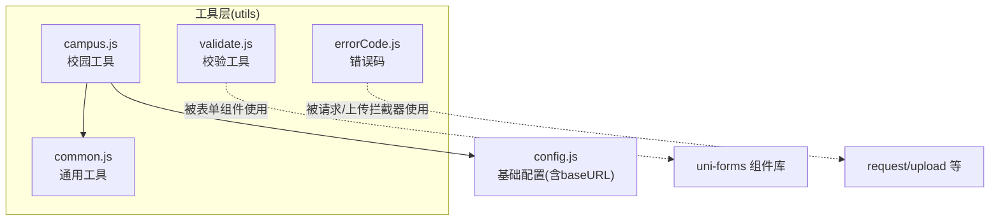
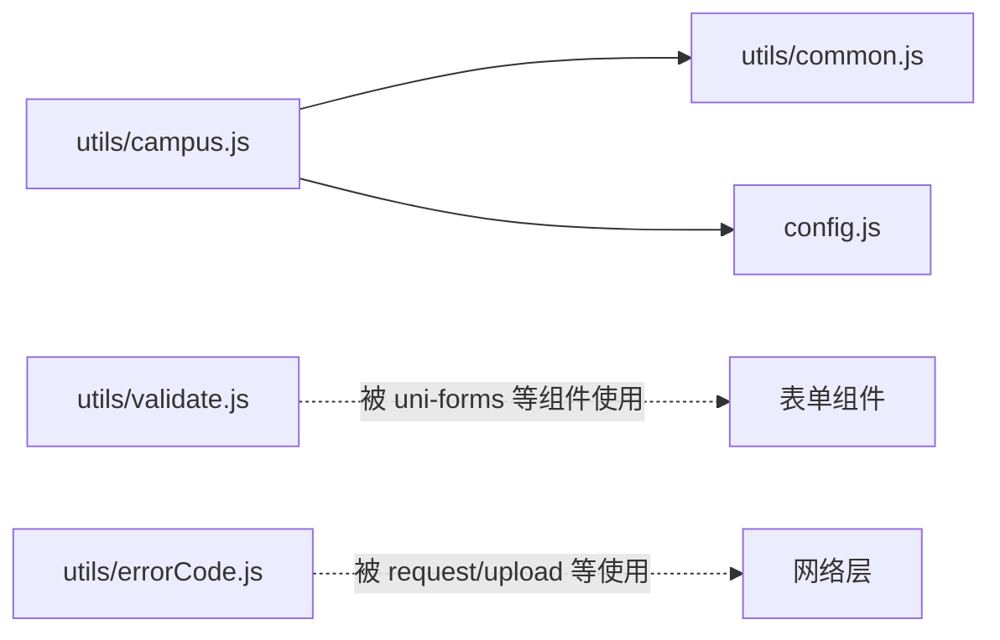
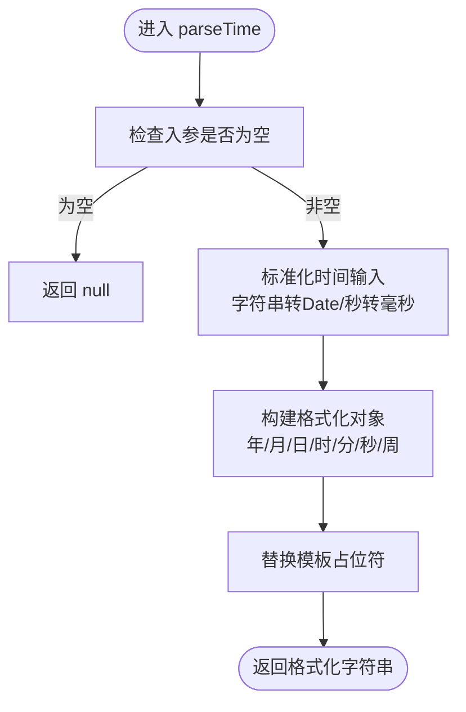
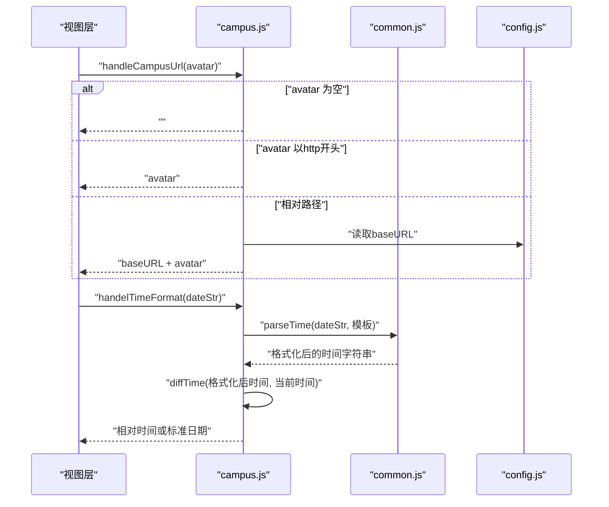
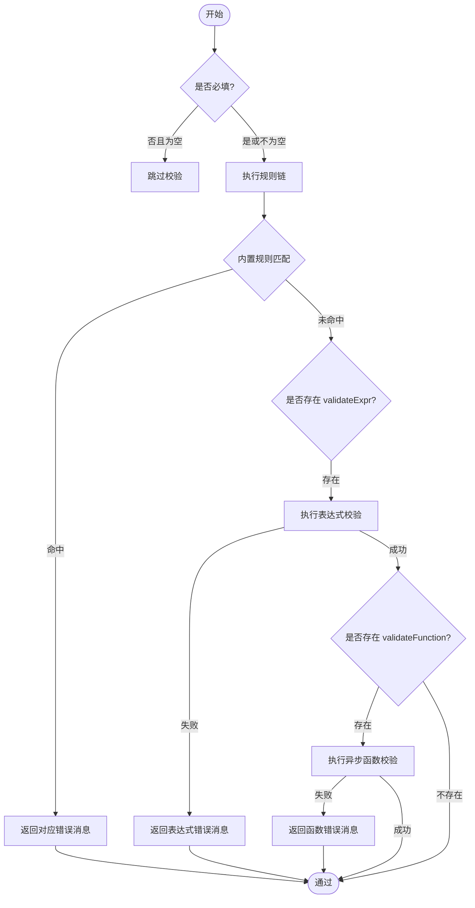
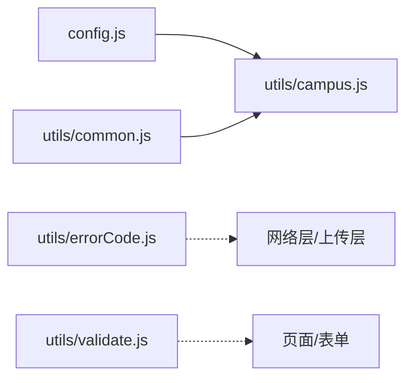

# 数据处理工具

<cite>
**本文引用的文件**   
- [utils/common.js](file://utils/common.js)
- [utils/campus.js](file://utils/campus.js)
- [utils/validate.js](file://utils/validate.js)
- [utils/errorCode.js](file://utils/errorCode.js)
- [config.js](file://config.js)
</cite>

## 目录
1. [简介](#简介)
2. [项目结构](#项目结构)
3. [核心组件](#核心组件)
4. [架构总览](#架构总览)
5. [详细组件分析](#详细组件分析)
6. [依赖关系分析](#依赖关系分析)
7. [性能考虑](#性能考虑)
8. [故障排查指南](#故障排查指南)
9. [结论](#结论)
10. [附录](#附录)

## 简介
本文件聚焦于 RuoYi-App 的数据处理工具层，围绕以下四个核心模块进行系统化说明：
- utils/common.js：通用数据处理与交互提示函数（消息提示、日期格式化、参数序列化、位置选择等）
- utils/campus.js：校园相关数据处理（头像 URL 拼接、时间差计算、时间格式化处理）
- utils/validate.js：表单验证与数据校验工具（路径匹配、空值判断、URL/邮箱/大小写校验、类型判断等）
- utils/errorCode.js：错误码定义与统一错误信息映射

文档提供每个函数的职责说明、使用示例、最佳实践、性能优化建议以及常见陷阱规避方法，帮助读者快速掌握并正确应用这些工具。

## 项目结构
数据处理工具位于 utils 目录下，按功能域拆分：
- common.js：通用工具
- campus.js：校园领域工具
- validate.js：校验工具
- errorCode.js：错误码常量

图表来源
- [utils/common.js:1-121](file://utils/common.js#L1-L121)
- [utils/campus.js:1-73](file://utils/campus.js#L1-L73)
- [utils/validate.js:1-115](file://utils/validate.js#L1-L115)
- [utils/errorCode.js:1-7](file://utils/errorCode.js#L1-L7)
- [config.js:1-200](file://config.js#L1-L200)

章节来源
- [utils/common.js:1-121](file://utils/common.js#L1-L121)
- [utils/campus.js:1-73](file://utils/campus.js#L1-L73)
- [utils/validate.js:1-115](file://utils/validate.js#L1-L115)
- [utils/errorCode.js:1-7](file://utils/errorCode.js#L1-L7)
- [config.js:1-200](file://config.js#L1-L200)

## 核心组件
本节概述各工具模块的职责边界与对外暴露能力，便于在业务中按需引用。

- utils/common.js
  - 消息提示：toast(content)
  - 日期格式化：parseTime(time, pattern)
  - 确认弹窗：showConfirm(content)
  - 参数序列化：tansParams(params)
  - 位置选择：chooseLocation(options)

- utils/campus.js
  - 头像 URL 处理：handleCampusUrl(avatar)
  - 时间差计算：diffTime(startDate, endDate)
  - 时间格式处理：handelTimeFormat(startDate)

- utils/validate.js
  - 路径匹配：isPathMatch(pattern, path)
  - 空值判断：isEmpty(value)
  - HTTP 协议判断：isHttp(url)
  - 外链判断：isExternal(path)
  - 用户名白名单：validUsername(str)
  - URL 校验：validURL(url)
  - 小写字母校验：validLowerCase(str)
  - 大写字母校验：validUpperCase(str)
  - 字母校验：validAlphabets(str)
  - 邮箱校验：validEmail(email)
  - 字符串类型判断：isString(str)
  - 数组类型判断：isArray(arg)

- utils/errorCode.js
  - 错误码到中文信息的映射表（如 401、403、404、default）

章节来源
- [utils/common.js:1-121](file://utils/common.js#L1-L121)
- [utils/campus.js:1-73](file://utils/campus.js#L1-L73)
- [utils/validate.js:1-115](file://utils/validate.js#L1-L115)
- [utils/errorCode.js:1-7](file://utils/errorCode.js#L1-L7)

## 架构总览
工具层之间通过明确的依赖关系协作：
- campus.js 依赖 common.js 的 parseTime 完成时间格式化
- campus.js 依赖 config.js 的 baseURL 完成资源地址拼接
- validate.js 作为纯函数集合，供页面或表单组件直接调用
- errorCode.js 作为错误信息字典，供网络层或业务层统一展示

图表来源
- [utils/common.js:1-121](file://utils/common.js#L1-L121)
- [utils/campus.js:1-73](file://utils/campus.js#L1-L73)
- [utils/validate.js:1-115](file://utils/validate.js#L1-L115)
- [utils/errorCode.js:1-7](file://utils/errorCode.js#L1-L7)
- [config.js:1-200](file://config.js#L1-L200)

## 详细组件分析

### utils/common.js 通用工具
- toast(content)
  - 作用：显示轻量提示消息
  - 使用示例：在提交失败时调用 toast('提交失败')
  - 最佳实践：避免频繁连续调用，必要时配合防抖
  - 常见陷阱：在长列表渲染中不要每次渲染都触发 toast

- parseTime(time, pattern)
  - 作用：将多种时间输入（对象、毫秒/秒数字串、ISO 字符串等）格式化为指定模板
  - 支持占位符：y/m/d/h/i/s/a（a 为星期）
  - 使用示例：parseTime(new Date(), '{y}-{m}-{d} {h}:{i}:{s}')
  - 性能建议：对大量数据进行批量格式化时，可缓存常用模板结果
  - 常见陷阱：传入无效时间会导致 NaN 输出，需先做有效性检查

- showConfirm(content)
  - 作用：返回 Promise 的确认弹窗封装
  - 使用示例：await showConfirm('确定删除吗？').then(res => {...})
  - 最佳实践：在异步流程中使用 await，避免嵌套回调
  - 常见陷阱：不要在循环中多次弹出确认框

- tansParams(params)
  - 作用：将对象序列化为查询字符串，支持嵌套对象展开为 key[subKey]=value
  - 使用示例：tansParams({ page: 1, filter: { status: 'active' } })
  - 性能建议：避免在高频渲染路径中重复构造复杂对象
  - 常见陷阱：值为 undefined/null/空串会被忽略，注意业务语义

- chooseLocation(options)
  - 作用：封装 uni.chooseLocation，返回 Promise；对定位权限拒绝、用户取消、失败等情况分别处理
  - 使用示例：const loc = await chooseLocation({ success: res => console.log(res) })
  - 最佳实践：在用户主动触发的场景下调用，避免自动弹窗
  - 常见陷阱：未授权时需引导用户开启定位权限

图表来源
- [utils/common.js:13-51](file://utils/common.js#L13-L51)

章节来源
- [utils/common.js:1-121](file://utils/common.js#L1-L121)

### utils/campus.js 校园数据处理
- handleCampusUrl(avatar)
  - 作用：若 avatar 为空则返回空串；若已是 http(s) 开头则原样返回；否则拼接 baseURL + avatar
  - 使用示例：handleCampusUrl('/uploads/avatar.png')
  - 最佳实践：在列表渲染前统一处理头像 URL，减少模板逻辑
  - 常见陷阱：avatar 为 undefined 时应返回空串，避免显示默认图异常

- diffTime(startDate, endDate)
  - 作用：计算两个时间的相对差值，并以“X天/X小时/X分/X秒前”的形式返回
  - 使用示例：diffTime('2024-01-01', new Date())
  - 性能建议：仅在需要展示相对时间的地方调用，避免在大数据量列表中频繁计算
  - 常见陷阱：startDate/endDate 必须为有效时间，否则结果为 NaN

- handelTimeFormat(startDate)
  - 作用：根据是否为本年决定输出相对时间或标准日期格式
  - 使用示例：handelTimeFormat('2024-06-01T12:00:00Z')
  - 最佳实践：结合 parseTime 与 diffTime 组合使用，保证跨平台兼容性
  - 常见陷阱：跨年比较时注意时区差异

图表来源
- [utils/campus.js:10-21](file://utils/campus.js#L10-L21)
- [utils/campus.js:58-72](file://utils/campus.js#L58-L72)
- [utils/common.js:13-51](file://utils/common.js#L13-L51)
- [config.js:1-200](file://config.js#L1-L200)

章节来源
- [utils/campus.js:1-73](file://utils/campus.js#L1-L73)
- [utils/common.js:13-51](file://utils/common.js#L13-L51)
- [config.js:1-200](file://config.js#L1-L200)

### utils/validate.js 表单验证与数据校验
- isPathMatch(pattern, path)
  - 作用：基于通配符 * 和 ** 的路径匹配
  - 使用示例：isPathMatch('/api/**', '/api/user/list')
  - 最佳实践：pattern 由配置生成时，确保转义斜杠与通配符顺序正确
  - 常见陷阱：* 不跨层级，** 才匹配任意层级

- isEmpty(value)
  - 作用：判断 null、undefined、空串、字面量字符串 "undefined" 等
  - 使用示例：isEmpty(inputValue)
  - 最佳实践：在表单提交前统一清理空白字符后再判断
  - 常见陷阱：数字 0、布尔 false 不会被判定为空

- isHttp(url) / isExternal(path)
  - 作用：前者检测 http/https 协议；后者检测外链协议（http/https/mailto/tel）
  - 使用示例：isExternal('/pages/index') 返回 false；isExternal('tel:10086') 返回 true
  - 最佳实践：外链跳转前用 isExternal 判断，避免内部路由误判
  - 常见陷阱：isHttp 仅检测是否包含协议片段，严格校验建议使用 validURL

- validUsername(str)
  - 作用：白名单校验（admin/editor）
  - 使用示例：validUsername('editor')
  - 最佳实践：白名单应集中管理，便于扩展
  - 常见陷阱：trim 后比对，避免前后空格导致失败

- validURL(url)
  - 作用：较严格的 URL 正则校验
  - 使用示例：validURL('https://example.com/path?a=1')
  - 最佳实践：用于图片/附件链接的前端预校验
  - 常见陷阱：部分合法 URL 可能不被某些正则覆盖，需结合实际需求调整

- validLowerCase / validUpperCase / validAlphabets
  - 作用：分别校验全小写、全大写、纯字母
  - 使用示例：validAlphabets('abc')
  - 最佳实践：用于编码类字段（如状态码、标识符）
  - 常见陷阱：不包含数字和下划线，如需请自定义规则

- validEmail(email)
  - 作用：邮箱格式校验
  - 使用示例：validEmail('user@example.com')
  - 最佳实践：结合后端二次校验，前端仅作体验优化
  - 常见陷阱：国际化邮箱（带引号、IP 域名）可能不被覆盖

- isString(str) / isArray(arg)
  - 作用：类型判断
  - 使用示例：isArray(formData.tags)
  - 最佳实践：在复杂数据结构处理前先做类型守卫
  - 常见陷阱：Array.isArray 兼容性问题已在实现中处理

图表来源
- [utils/validate.js:1-115](file://utils/validate.js#L1-L115)

章节来源
- [utils/validate.js:1-115](file://utils/validate.js#L1-L115)

### utils/errorCode.js 错误码定义
- 内容：统一的错误码到中文消息映射（如 401、403、404、default）
- 使用方式：在网络层或业务层根据响应码查找对应消息并提示
- 最佳实践：新增错误码时同步更新此映射，保持全局一致
- 常见陷阱：避免硬编码错误消息，统一从此处获取

章节来源
- [utils/errorCode.js:1-7](file://utils/errorCode.js#L1-L7)

## 依赖关系分析
- campus.js 依赖 common.js 的 parseTime 与 config.js 的 baseURL
- validate.js 为无副作用的纯函数集合，适合在多处复用
- errorCode.js 作为共享字典，被网络层或业务层消费

图表来源
- [utils/campus.js:1-73](file://utils/campus.js#L1-L73)
- [utils/common.js:1-121](file://utils/common.js#L1-L121)
- [utils/validate.js:1-115](file://utils/validate.js#L1-L115)
- [utils/errorCode.js:1-7](file://utils/errorCode.js#L1-L7)
- [config.js:1-200](file://config.js#L1-L200)

章节来源
- [utils/campus.js:1-73](file://utils/campus.js#L1-L73)
- [utils/common.js:1-121](file://utils/common.js#L1-L121)
- [utils/validate.js:1-115](file://utils/validate.js#L1-L115)
- [utils/errorCode.js:1-7](file://utils/errorCode.js#L1-L7)
- [config.js:1-200](file://config.js#L1-L200)

## 性能考虑
- 避免在高频渲染路径中执行耗时操作
  - 例如：列表渲染中避免逐条调用 diffTime，可在数据加载阶段批量预处理
- 减少不必要的 DOM 交互
  - 例如：避免在循环中调用 toast 或 showConfirm
- 合理使用缓存
  - 对于固定模板的 parseTime 结果，可按需缓存以减少重复计算
- 类型守卫前置
  - 在复杂数据处理前先用 isString/isArray 等做类型判断，降低分支复杂度

[本节为通用指导，无需特定文件来源]

## 故障排查指南
- 头像无法显示
  - 检查 handleCampusUrl 返回值是否为空或 baseURL 是否正确
  - 确认 avatar 是否为空或未定义
- 时间显示异常
  - 检查 parseTime 的输入是否有效，避免传入非法时间
  - 跨年比较时使用 handelTimeFormat 而非直接 diffTime
- 表单校验不生效
  - 确认字段是否满足 isEmpty 的判定条件
  - 检查 isPathMatch 的通配符模式是否正确转义
- 错误提示不一致
  - 统一从 errorCode.js 获取错误消息，避免硬编码

章节来源
- [utils/campus.js:10-21](file://utils/campus.js#L10-L21)
- [utils/campus.js:58-72](file://utils/campus.js#L58-L72)
- [utils/common.js:13-51](file://utils/common.js#L13-L51)
- [utils/validate.js:1-115](file://utils/validate.js#L1-L115)
- [utils/errorCode.js:1-7](file://utils/errorCode.js#L1-L7)

## 结论
上述工具模块提供了稳定、可复用的数据处理与校验能力。建议在项目中遵循以下原则：
- 统一入口：所有通用逻辑集中在 utils 下，避免散落在页面中
- 明确依赖：campus.js 仅依赖 common.js 与 config.js，保持低耦合
- 一致性：错误消息与校验规则集中管理，便于维护与扩展
- 性能优先：在大数据量场景中，尽量在数据层预处理，减少运行时开销

[本节为总结性内容，无需特定文件来源]

## 附录
- 使用示例速查
  - 消息提示：toast('操作成功')
  - 日期格式化：parseTime(time, '{y}/{m}/{d}')
  - 确认弹窗：await showConfirm('确定吗？')
  - 参数序列化：tansParams({ page: 1, filter: { status: 'active' } })
  - 位置选择：const loc = await chooseLocation()
  - 头像 URL：handleCampusUrl(avatar)
  - 相对时间：handelTimeFormat(dateStr)
  - 路径匹配：isPathMatch('/api/**', path)
  - 空值判断：isEmpty(value)
  - 外链判断：isExternal(path)
  - URL 校验：validURL(url)
  - 邮箱校验：validEmail(email)
  - 类型判断：isString(str)、isArray(arr)
  - 错误消息：errorCode[code] 或 errorCode['default']

[本节为汇总性内容，无需特定文件来源]