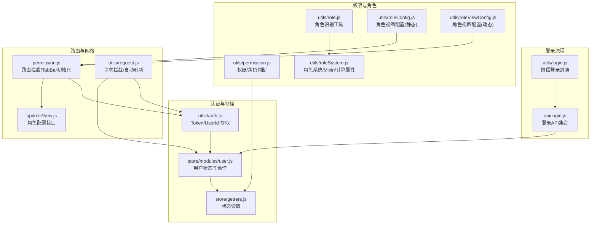
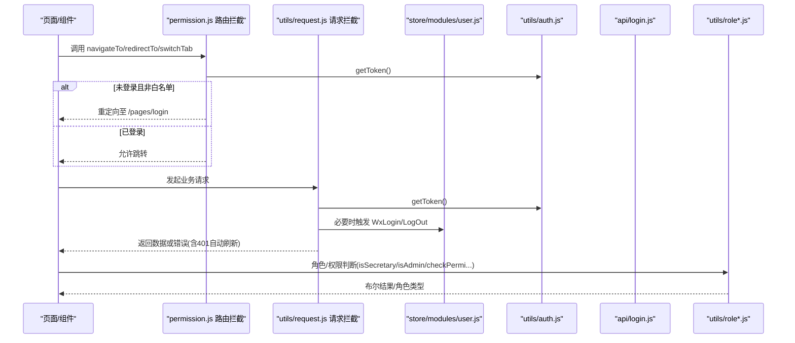
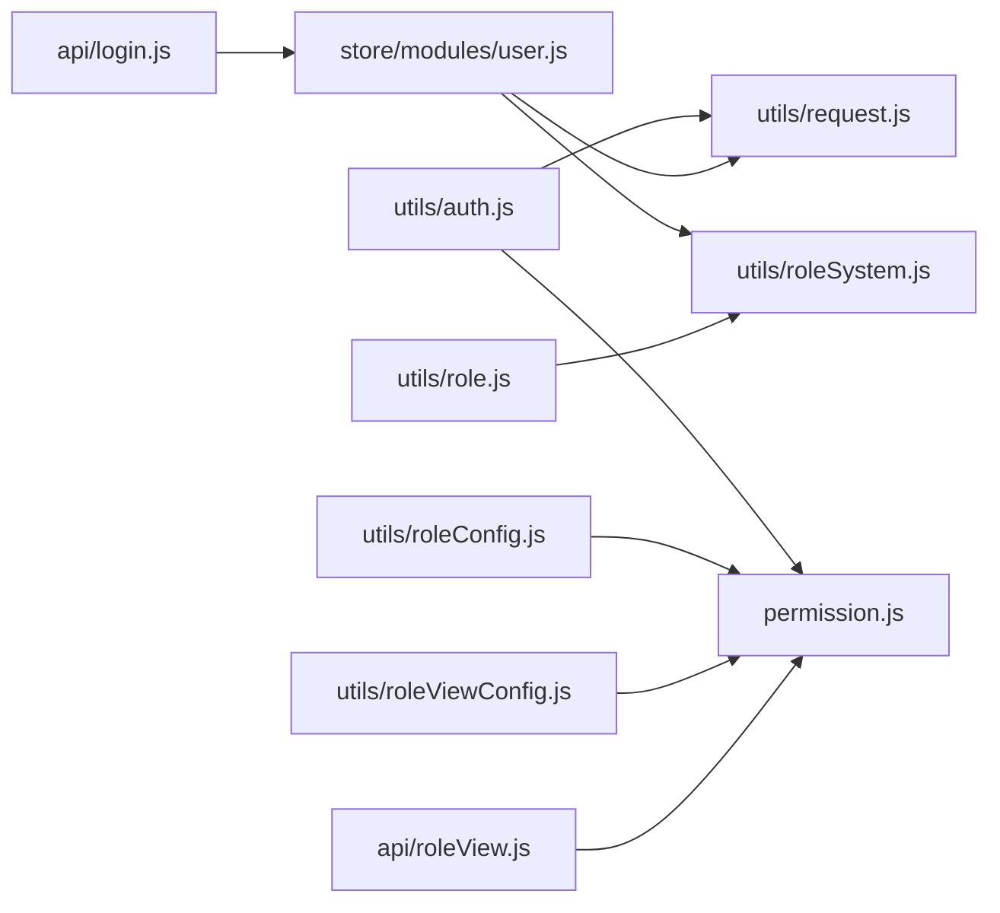

# 权限认证工具

<cite>
**本文引用的文件列表**
- [utils/auth.js](file://utils/auth.js)
- [utils/permission.js](file://utils/permission.js)
- [utils/login.js](file://utils/login.js)
- [utils/role.js](file://utils/role.js)
- [utils/roleConfig.js](file://utils/roleConfig.js)
- [utils/roleSystem.js](file://utils/roleSystem.js)
- [utils/roleViewConfig.js](file://utils/roleViewConfig.js)
- [permission.js](file://permission.js)
- [api/login.js](file://api/login.js)
- [store/modules/user.js](file://store/modules/user.js)
- [store/getters.js](file://store/getters.js)
- [utils/request.js](file://utils/request.js)
- [api/roleView.js](file://api/roleView.js)
</cite>

## 目录
1. [简介](#简介)
2. [项目结构](#项目结构)
3. [核心组件](#核心组件)
4. [架构总览](#架构总览)
5. [详细组件分析](#详细组件分析)
6. [依赖关系分析](#依赖关系分析)
7. [性能与可扩展性](#性能与可扩展性)
8. [故障排查指南](#故障排查指南)
9. [结论](#结论)
10. [附录：函数清单与使用示例](#附录函数清单与使用示例)

## 简介
本文件围绕 RuoYi-App 的权限认证体系，系统性梳理用户认证、权限校验、角色管理、路由守卫与菜单控制等关键能力。重点覆盖以下模块：
- utils/auth.js：Token 与用户标识的存取、登录状态判断
- utils/permission.js：基于角色的权限判断（字符权限与角色权限）
- utils/login.js：微信一键登录封装
- permission.js：全局路由拦截器、白名单、登录后重定向、动态 TabBar 初始化
- store/modules/user.js：统一的用户状态管理与多方式登录流程
- api/login.js：多种登录方式的 API 定义
- utils/role*.js：角色识别、视图配置、动态权限与页面级控制
- utils/request.js：请求拦截、自动刷新会话、错误处理

## 项目结构
下图展示了与权限认证相关的核心文件及其职责划分：

图表来源
- [utils/auth.js:1-47](file://utils/auth.js#L1-L47)
- [store/modules/user.js:1-283](file://store/modules/user.js#L1-L283)
- [store/getters.js:1-11](file://store/getters.js#L1-L11)
- [api/login.js:1-168](file://api/login.js#L1-L168)
- [utils/login.js:1-50](file://utils/login.js#L1-L50)
- [utils/permission.js:1-49](file://utils/permission.js#L1-L49)
- [utils/role.js:1-165](file://utils/role.js#L1-L165)
- [utils/roleSystem.js:1-297](file://utils/roleSystem.js#L1-L297)
- [utils/roleConfig.js:1-149](file://utils/roleConfig.js#L1-L149)
- [utils/roleViewConfig.js:1-115](file://utils/roleViewConfig.js#L1-L115)
- [permission.js:1-133](file://permission.js#L1-L133)
- [utils/request.js:1-117](file://utils/request.js#L1-L117)
- [api/roleView.js:1-23](file://api/roleView.js#L1-L23)

章节来源
- [utils/auth.js:1-47](file://utils/auth.js#L1-L47)
- [utils/permission.js:1-49](file://utils/permission.js#L1-L49)
- [utils/login.js:1-50](file://utils/login.js#L1-L50)
- [utils/role.js:1-165](file://utils/role.js#L1-L165)
- [utils/roleConfig.js:1-149](file://utils/roleConfig.js#L1-L149)
- [utils/roleSystem.js:1-297](file://utils/roleSystem.js#L1-L297)
- [utils/roleViewConfig.js:1-115](file://utils/roleViewConfig.js#L1-L115)
- [permission.js:1-133](file://permission.js#L1-L133)
- [api/login.js:1-168](file://api/login.js#L1-L168)
- [store/modules/user.js:1-283](file://store/modules/user.js#L1-L283)
- [store/getters.js:1-11](file://store/getters.js#L1-L11)
- [utils/request.js:1-117](file://utils/request.js#L1-L117)
- [api/roleView.js:1-23](file://api/roleView.js#L1-L23)

## 核心组件
- Token 与登录态
  - 提供 Token 与 UserId 的本地存取与登录态判断，作为所有鉴权的基础。
- 权限与角色
  - 提供字符权限与角色权限判断；提供角色识别工具与系统级 Mixin/计算属性；支持静态与动态角色视图配置。
- 登录流程
  - 统一封装多种登录方式（账号密码、微信、手机号、绑定），并持久化 Token 与用户信息。
- 路由与网络
  - 全局路由拦截器实现未登录跳转、已登录访问登录页重定向、动态 TabBar 初始化；请求层统一注入 Authorization、处理 401 自动刷新与会话失效。

章节来源
- [utils/auth.js:1-47](file://utils/auth.js#L1-L47)
- [utils/permission.js:1-49](file://utils/permission.js#L1-L49)
- [utils/role.js:1-165](file://utils/role.js#L1-L165)
- [utils/roleSystem.js:1-297](file://utils/roleSystem.js#L1-L297)
- [utils/roleConfig.js:1-149](file://utils/roleConfig.js#L1-L149)
- [utils/roleViewConfig.js:1-115](file://utils/roleViewConfig.js#L1-L115)
- [permission.js:1-133](file://permission.js#L1-L133)
- [utils/request.js:1-117](file://utils/request.js#L1-L117)
- [api/login.js:1-168](file://api/login.js#L1-L168)
- [store/modules/user.js:1-283](file://store/modules/user.js#L1-L283)

## 架构总览
下图展示从“发起请求/页面跳转”到“鉴权决策”的整体链路：

图表来源
- [permission.js:1-133](file://permission.js#L1-L133)
- [utils/request.js:1-117](file://utils/request.js#L1-L117)
- [utils/auth.js:1-47](file://utils/auth.js#L1-L47)
- [store/modules/user.js:1-283](file://store/modules/user.js#L1-L283)
- [api/login.js:1-168](file://api/login.js#L1-L168)
- [utils/permission.js:1-49](file://utils/permission.js#L1-L49)
- [utils/role.js:1-165](file://utils/role.js#L1-L165)

## 详细组件分析

### 一、utils/auth.js：Token 与用户标识管理
- 功能要点
  - 提供获取/设置/移除 Token 与 UserId 的方法
  - isLogin 用于快速判断是否已登录
- 复杂度
  - 均为 O(1) 本地存储操作
- 典型用法
  - 在路由拦截、请求拦截、页面初始化时检查登录态
- 注意事项
  - 仅做本地态判断，不验证服务端有效性

章节来源
- [utils/auth.js:1-47](file://utils/auth.js#L1-L47)

### 二、utils/permission.js：权限与角色判断
- 功能要点
  - checkPermi：基于 store.getters.permissions 进行字符权限匹配，支持通配符
  - checkRole：基于 store.getters.roles 进行角色匹配，支持超级管理员
- 复杂度
  - 数组遍历 some，时间复杂度 O(n)，n 为权限/角色数量
- 典型用法
  - 在按钮/菜单渲染前进行 v-if 控制
- 注意事项
  - 需要确保 store 中 roles/permissions 已正确加载

章节来源
- [utils/permission.js:1-49](file://utils/permission.js#L1-L49)
- [store/getters.js:1-11](file://store/getters.js#L1-L11)

### 三、utils/login.js：微信一键登录封装
- 功能要点
  - wxampLogin：调用 uni.login 获取 code，再调用后端登录接口，成功后保存 Token 并提示
- 异常处理
  - 失败时隐藏 loading 并提示错误
- 典型用法
  - 在登录页点击“微信登录”后调用

章节来源
- [utils/login.js:1-50](file://utils/login.js#L1-L50)
- [api/login.js:1-168](file://api/login.js#L1-L168)

### 四、permission.js：全局路由拦截与动态菜单
- 功能要点
  - 白名单机制：允许匿名访问的页面
  - 登录态检查：未登录访问非白名单页面跳转到登录页
  - 已登录访问登录页：重定向到首页（根据角色配置 homePage）
  - 初始化角色配置：从后端拉取角色配置，缓存并设置全局 roleConfig、userRoles，并在小程序端动态设置 TabBar
  - 实名认证状态检查：可独立调用以更新本地认证状态
- 复杂度
  - 初始化配置为一次网络请求，后续为内存/本地缓存读取
- 典型用法
  - 应用启动时调用 initRoleConfig；在页面跳转前由拦截器自动执行

章节来源
- [permission.js:1-133](file://permission.js#L1-L133)
- [api/roleView.js:1-23](file://api/roleView.js#L1-L23)

### 五、utils/role.js：角色识别工具
- 功能要点
  - isSecretary/isCounselor/isAdmin/isTeacher：按 roleName/roleKey 关键词匹配
  - getRoleType/getRoleTypes：返回主角色类型或全部匹配类型
  - getRoleDisplayName：将多角色合并显示
- 设计模式
  - 字符串与对象两种角色格式兼容
- 复杂度
  - 单次遍历 roles，O(n)

章节来源
- [utils/role.js:1-165](file://utils/role.js#L1-L165)

### 六、utils/roleSystem.js：角色系统、Mixin 与计算属性
- 功能要点
  - getUserRoles：从 store.state.user.roles 或 getters.roles 或本地存储获取
  - ensureUserInfoLoaded：若存在 token 但无 roles，则触发 GetInfo 补全
  - roleMixin：混入后可用 isSecretaryRole 等计算属性与方法
  - createRoleComputed：在 computed 中展开获得响应式角色属性
  - createRoleGuard：页面级角色守卫，支持多角色与通配符
  - install：安装到 Vue.prototype.$role
- 复杂度
  - 首次加载可能触发异步 GetInfo，后续为 O(1)/O(n) 判断
- 典型用法
  - 页面 onLoad 中调用 checkRole 或使用 createRoleComputed

章节来源
- [utils/roleSystem.js:1-297](file://utils/roleSystem.js#L1-L297)
- [store/modules/user.js:1-283](file://store/modules/user.js#L1-L283)

### 七、utils/roleConfig.js：静态角色视图配置
- 功能要点
  - ROLE_CONFIG：按角色定义 tabBar、features、homePage、roleName
  - getConfigByRoles：合并多角色配置，去重 tabBar，合并 features，确定首页
  - hasFeature：检查某功能开关
  - getRoleName：获取角色显示名
- 复杂度
  - 合并过程线性于角色数与 tab 项数

章节来源
- [utils/roleConfig.js:1-149](file://utils/roleConfig.js#L1-L149)

### 八、utils/roleViewConfig.js：动态角色视图配置
- 功能要点
  - getRoleViewConfig：按 pageKey 从后端拉取配置，带本地缓存
  - fetchRoleViewConfig：解析后端返回的 JSON 配置或直接返回 data
  - getDefaultConfig：后端不可用时回退默认配置
  - preloadConfigs：预加载常用页面配置
- 复杂度
  - 首次请求 O(1) 网络 + 解析，后续命中缓存 O(1)

章节来源
- [utils/roleViewConfig.js:1-115](file://utils/roleViewConfig.js#L1-L115)

### 九、store/modules/user.js：用户状态与多方式登录
- 功能要点
  - state/mutations/actions：集中管理 token、id、name、avatar、roles、permissions、userType
  - Login/WxLogin/WxBind/PhoneLogin/StudentBindLogin/TeacherPhoneBind 等多登录方式
  - GetInfo：拉取用户详情，校验 userType，写入 roles/permissions，并同步本地存储
  - LogOut/Unbind：清理本地状态与存储
- 复杂度
  - 登录/登出为网络请求 + 本地写，GetInfo 为网络请求 + 状态更新

章节来源
- [store/modules/user.js:1-283](file://store/modules/user.js#L1-L283)

### 十、utils/request.js：请求拦截与自动刷新
- 功能要点
  - 自动注入 Authorization 头
  - 401 处理：区分登录相关接口与非登录接口；小程序环境尝试微信自动登录并重试，否则退出并跳转登录页
  - 其他错误码统一提示
- 复杂度
  - 重试逻辑增加一次网络往返

章节来源
- [utils/request.js:1-117](file://utils/request.js#L1-L117)

## 依赖关系分析
- 低耦合高内聚
  - auth 仅负责本地存取；permission 仅做判断；role* 系列专注角色与视图；login 与 user 模块解耦通过 API 层
- 直接依赖
  - permission.js 依赖 api/roleView.js 与 utils/auth.js
  - utils/request.js 依赖 utils/auth.js 与 store/modules/user.js
  - utils/roleSystem.js 依赖 utils/role.js 与 store
- 潜在循环
  - 未见明显循环依赖；各模块职责清晰

图表来源
- [utils/auth.js:1-47](file://utils/auth.js#L1-L47)
- [utils/request.js:1-117](file://utils/request.js#L1-L117)
- [permission.js:1-133](file://permission.js#L1-L133)
- [store/modules/user.js:1-283](file://store/modules/user.js#L1-L283)
- [utils/role.js:1-165](file://utils/role.js#L1-L165)
- [utils/roleSystem.js:1-297](file://utils/roleSystem.js#L1-L297)
- [utils/roleConfig.js:1-149](file://utils/roleConfig.js#L1-L149)
- [utils/roleViewConfig.js:1-115](file://utils/roleViewConfig.js#L1-L115)
- [api/login.js:1-168](file://api/login.js#L1-L168)
- [api/roleView.js:1-23](file://api/roleView.js#L1-L23)

## 性能与可扩展性
- 性能
  - 本地存取与判断均为 O(1)/O(n)，开销极低
  - 角色配置与视图配置具备缓存策略，避免重复请求
- 可扩展
  - 新增角色：扩展 utils/role.js 与 utils/roleConfig.js，或在后端动态配置
  - 新增权限点：在 store 的 permissions 中维护，前端通过 checkPermi 控制
  - 新增登录方式：在 api/login.js 与 store/modules/user.js 中补充 actions

[本节为通用建议，无需源码引用]

## 故障排查指南
- 常见问题
  - 登录后仍被重定向到登录页：检查 getToken 返回值与路由白名单；确认 initRoleConfig 是否成功
  - 按钮/菜单不显示：确认 store.getters.roles/permissions 是否正确加载；检查 checkRole/checkPermi 参数
  - 401 自动刷新无效：确认是否为登录相关接口；检查微信授权流程与后端会话有效期
  - 角色判断不符合预期：确认角色数据结构（字符串或对象）及关键词匹配规则
- 定位步骤
  - 打印 getUserRoles 与 roleTypes 结果
  - 查看 request 层的错误消息与重试路径
  - 检查本地存储中的 roleConfig、userRoles、token 是否一致

章节来源
- [permission.js:1-133](file://permission.js#L1-L133)
- [utils/request.js:1-117](file://utils/request.js#L1-L117)
- [utils/roleSystem.js:1-297](file://utils/roleSystem.js#L1-L297)
- [utils/permission.js:1-49](file://utils/permission.js#L1-L49)

## 结论
该权限认证体系以 Token 为中心，结合 store 中的角色与权限数据，配合路由拦截与请求拦截，形成前后端一致的 RBAC 模型。角色识别与视图配置既支持静态声明，也支持后端动态下发，具备良好的灵活性与可维护性。建议在复杂场景中优先采用动态配置与最小权限原则，并结合日志与埋点持续优化体验。

[本节为总结，无需源码引用]

## 附录：函数清单与使用示例

### utils/auth.js
- getToken(): 返回当前 Token
- setToken(token): 设置 Token
- removeToken(): 移除 Token
- getUserId(): 返回当前用户ID
- setUserId(userId): 设置用户ID
- removeUserId(): 移除用户ID
- isLogin(): 返回是否已登录

使用示例
- 在路由拦截中判断 isLogin() 决定是否放行
- 在页面初始化时读取 getUserId() 显示头像或用户名

章节来源
- [utils/auth.js:1-47](file://utils/auth.js#L1-L47)

### utils/permission.js
- checkPermi(value): 字符权限校验，value 为权限字符串数组
- checkRole(value): 角色权限校验，value 为角色字符串数组

使用示例
- 在模板中使用 v-if="checkPermi(['system:user:add'])" 控制按钮显示
- 在方法中 if(checkRole(['admin'])) 执行敏感操作

章节来源
- [utils/permission.js:1-49](file://utils/permission.js#L1-L49)

### utils/login.js
- wxampLogin(code): 微信一键登录封装，内部完成 uni.login 与后端登录

使用示例
- 在登录页点击“微信登录”后调用 wxampLogin，成功后进入首页

章节来源
- [utils/login.js:1-50](file://utils/login.js#L1-L50)

### permission.js
- initRoleConfig(): 初始化角色配置，设置全局 roleConfig 与 userRoles，并动态设置 TabBar
- checkRealNameAuth(): 检查实名认证状态
- getRoleConfigSync(): 同步获取角色配置
- hasFeature(feature): 检查功能开关
- 路由拦截：对 navigateTo/redirectTo/reLaunch/switchTab 进行鉴权

使用示例
- 应用启动时 await initRoleConfig()
- 在页面中 const show = hasFeature('classcheck') 控制功能入口

章节来源
- [permission.js:1-133](file://permission.js#L1-L133)

### utils/role.js
- isSecretary(roles)/isAdmin(roles)/isCounselor(roles)/isTeacher(roles)
- getRoleType(roles)/getRoleTypes(roles)/getRoleDisplayName(roles)

使用示例
- 在页面中根据 getRoleType() 切换不同布局或入口

章节来源
- [utils/role.js:1-165](file://utils/role.js#L1-L165)

### utils/roleSystem.js
- getUserRoles(vm)/ensureUserInfoLoaded(vm)
- roleMixin：混入后可用 isSecretaryRole 等方法
- createRoleComputed()：在 computed 中展开获得响应式属性
- createRoleGuard(vm, allowedRoles)：页面级角色守卫
- install(Vue)：安装到 Vue.prototype.$role

使用示例
- 在页面 onLoad 中 this.checkRole()
- 在模板中直接使用 this.isSecretaryRole

章节来源
- [utils/roleSystem.js:1-297](file://utils/roleSystem.js#L1-L297)

### utils/roleConfig.js
- ROLE_CONFIG：静态角色配置
- getConfigByRoles(roles)：合并多角色配置
- hasFeature(config, feature)：检查功能开关
- getRoleName(role)：获取角色名称

使用示例
- 在应用启动时根据用户角色生成 tabBar 与首页

章节来源
- [utils/roleConfig.js:1-149](file://utils/roleConfig.js#L1-L149)

### utils/roleViewConfig.js
- getRoleViewConfig(pageKey)：获取页面级角色视图配置（带缓存）
- clearConfigCache()/preloadConfigs()：缓存管理与预加载

使用示例
- 在页面 onLoad 中 const cfg = await getRoleViewConfig('stuinfo') 控制侧边栏与搜索类型

章节来源
- [utils/roleViewConfig.js:1-115](file://utils/roleViewConfig.js#L1-L115)

### store/modules/user.js
- Login/WxLogin/WxBind/PhoneLogin/StudentBindLogin/TeacherPhoneBind/LogOut/Unbind/GetInfo
- mutations：SET_TOKEN/SET_ID/SET_NAME/SET_AVATAR/SET_ROLES/SET_PERMISSIONS/SET_USERTYPE

使用示例
- 在登录页提交表单后 dispatch('Login')
- 在需要用户信息时 dispatch('GetInfo')

章节来源
- [store/modules/user.js:1-283](file://store/modules/user.js#L1-L283)

### api/login.js
- login/register/getInfo/logout/getCodeImg
- studentBindLogin/wxLogin/wxBind/unbindWx
- phoneLogin/teacherPhoneBind/teacherBindLogin/studentPhoneBind

使用示例
- 在登录页调用 login(username, password, code, uuid)

章节来源
- [api/login.js:1-168](file://api/login.js#L1-L168)

### utils/request.js
- 自动注入 Authorization
- 401 自动刷新与会话失效处理
- 错误消息统一提示

使用示例
- 所有业务请求均通过此封装，无需手动处理 Token 与错误

章节来源
- [utils/request.js:1-117](file://utils/request.js#L1-L117)

### api/roleView.js
- getRoleConfig(): 获取角色配置
- getRealNameStatus(): 获取实名认证状态

使用示例
- 在应用启动时调用 getRoleConfig() 初始化角色与菜单

章节来源
- [api/roleView.js:1-23](file://api/roleView.js#L1-L23)