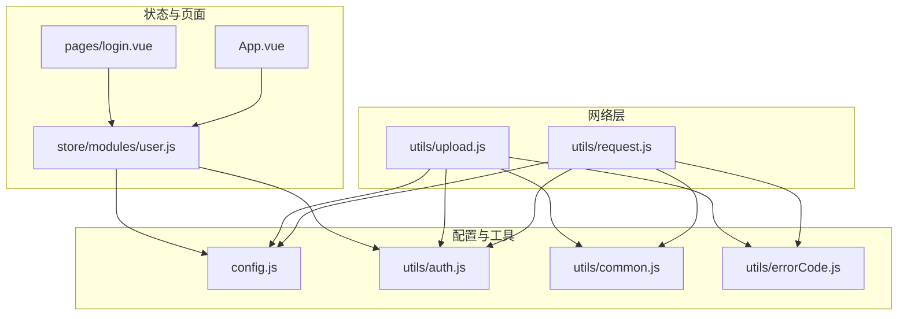
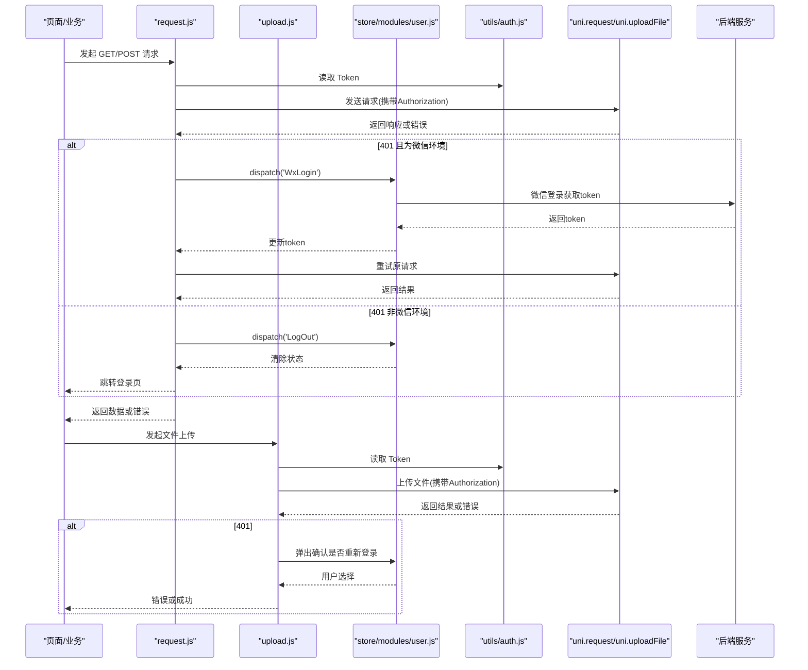
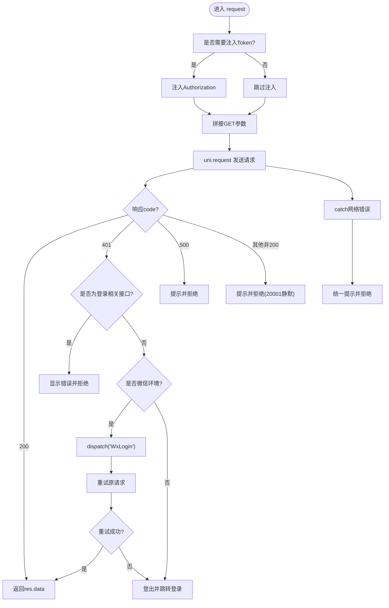
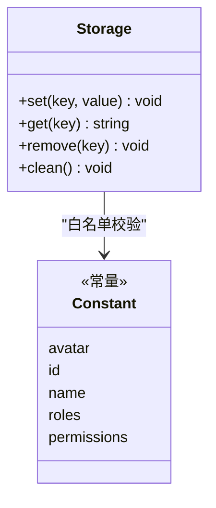
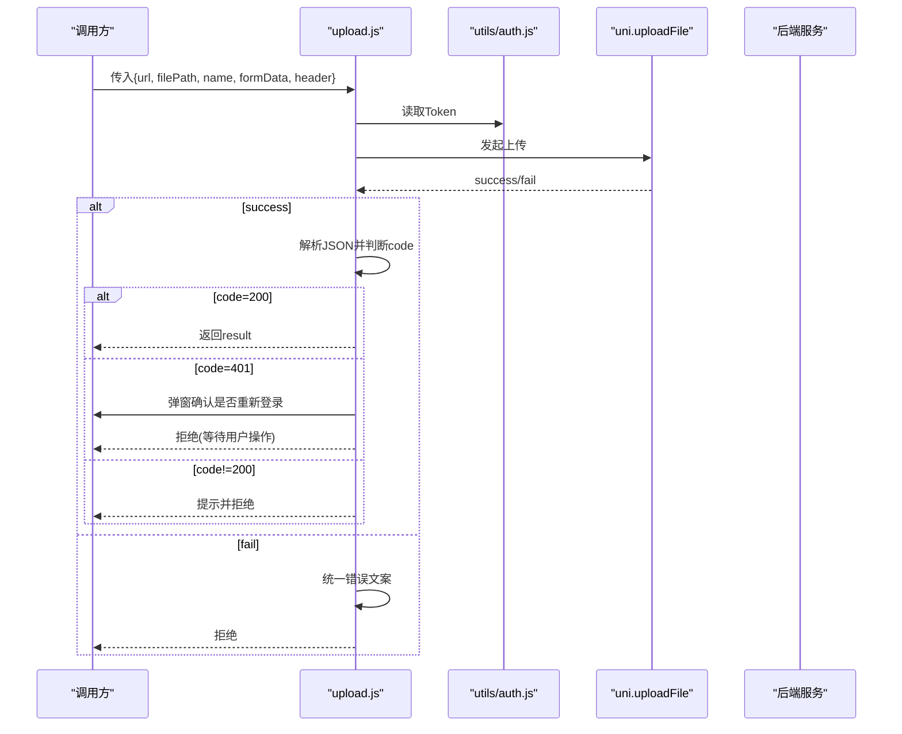
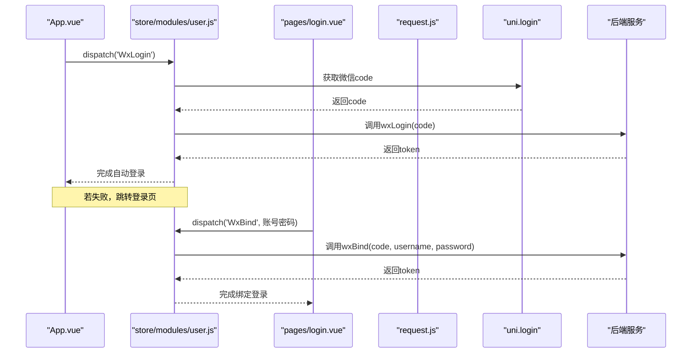
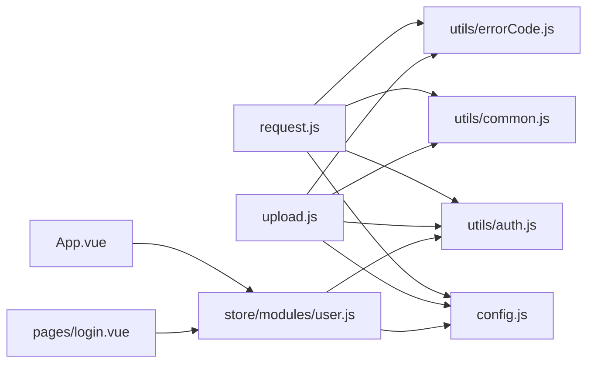

# 网络存储工具

<cite>
**本文引用的文件**   
- [utils/request.js](file://utils/request.js)
- [utils/storage.js](file://utils/storage.js)
- [utils/upload.js](file://utils/upload.js)
- [config.js](file://config.js)
- [utils/auth.js](file://utils/auth.js)
- [store/modules/user.js](file://store/modules/user.js)
- [utils/common.js](file://utils/common.js)
- [utils/errorCode.js](file://utils/errorCode.js)
- [App.vue](file://App.vue)
- [pages/login.vue](file://pages/login.vue)
</cite>

## 目录
1. [简介](#简介)
2. [项目结构](#项目结构)
3. [核心组件](#核心组件)
4. [架构总览](#架构总览)
5. [详细组件分析](#详细组件分析)
6. [依赖关系分析](#依赖关系分析)
7. [性能与优化建议](#性能与优化建议)
8. [故障排查指南](#故障排查指南)
9. [结论](#结论)
10. [附录：API 参考](#附录api-参考)

## 简介
本文件面向 RuoYi-App 的网络与存储能力，聚焦以下三个核心模块：
- HTTP 请求封装（request.js）：统一拦截、响应处理、错误提示、Token 自动注入、微信环境特殊处理与自动登录重试。
- 本地存储封装（storage.js）：基于 uni.getStorageSync 的键值持久化、白名单节点管理、清理策略。
- 文件上传封装（upload.js）：统一上传入口、鉴权头注入、错误分类提示、失败处理。

文档同时提供架构图、流程图、时序图与 API 参考，帮助开发者快速理解并正确使用这些能力。

## 项目结构
与网络与存储相关的核心文件分布如下：
- utils/request.js：HTTP 请求封装
- utils/upload.js：文件上传封装
- utils/storage.js：本地存储封装
- config.js：全局配置（baseUrl 等）
- utils/auth.js：Token/UserId 存取
- store/modules/user.js：用户状态与登录流程（含微信自动登录）
- utils/common.js：通用 UI 与参数序列化
- utils/errorCode.js：错误码映射
- App.vue：应用启动时初始化与微信自动登录
- pages/login.vue：登录页与微信绑定登录

图表来源
- [utils/request.js:1-117](file://utils/request.js#L1-L117)
- [utils/upload.js:1-71](file://utils/upload.js#L1-L71)
- [config.js:1-38](file://config.js#L1-L38)
- [utils/auth.js:1-47](file://utils/auth.js#L1-L47)
- [utils/common.js:1-121](file://utils/common.js#L1-L121)
- [utils/errorCode.js:1-7](file://utils/errorCode.js#L1-L7)
- [store/modules/user.js:1-283](file://store/modules/user.js#L1-L283)
- [App.vue:1-47](file://App.vue#L1-L47)
- [pages/login.vue:65-193](file://pages/login.vue#L65-L193)

章节来源
- [config.js:1-38](file://config.js#L1-L38)
- [utils/request.js:1-117](file://utils/request.js#L1-L117)
- [utils/upload.js:1-71](file://utils/upload.js#L1-L71)
- [utils/storage.js:1-33](file://utils/storage.js#L1-L33)
- [utils/auth.js:1-47](file://utils/auth.js#L1-L47)
- [store/modules/user.js:1-283](file://store/modules/user.js#L1-L283)
- [utils/common.js:1-121](file://utils/common.js#L1-L121)
- [utils/errorCode.js:1-7](file://utils/errorCode.js#L1-L7)
- [App.vue:1-47](file://App.vue#L1-L47)
- [pages/login.vue:65-193](file://pages/login.vue#L65-L193)

## 核心组件
本节对三大核心模块进行概览式说明，后续章节将深入展开。

- request.js
  - 功能要点：统一发起 HTTP 请求；默认注入 Authorization 头；GET 请求参数拼接；统一错误码与消息提示；401 会话过期处理；在微信小程序环境下触发自动登录并重试原请求；非微信环境直接登出跳转登录页。
  - 关键路径：[utils/request.js:10-114](file://utils/request.js#L10-L114)

- storage.js
  - 功能要点：以单一 JSON 对象为容器，按白名单 key 写入；提供 set/get/remove/clean 接口；底层使用 uni.getStorageSync/setStorageSync。
  - 关键路径：[utils/storage.js:9-30](file://utils/storage.js#L9-L30)

- upload.js
  - 功能要点：统一文件上传；按需注入 Authorization 头；解析后端返回并统一错误提示；401 弹窗确认是否重新登录；超时与网络异常友好提示。
  - 关键路径：[utils/upload.js:10-68](file://utils/upload.js#L10-L68)

章节来源
- [utils/request.js:10-114](file://utils/request.js#L10-L114)
- [utils/storage.js:9-30](file://utils/storage.js#L9-L30)
- [utils/upload.js:10-68](file://utils/upload.js#L10-L68)

## 架构总览
下图展示了从业务调用到网络层、状态管理与登录流程的整体交互。

图表来源
- [utils/request.js:10-114](file://utils/request.js#L10-L114)
- [utils/upload.js:10-68](file://utils/upload.js#L10-L68)
- [store/modules/user.js:113-132](file://store/modules/user.js#L113-L132)
- [utils/auth.js:1-47](file://utils/auth.js#L1-L47)

## 详细组件分析

### HTTP 请求封装（request.js）
- 设计目标
  - 统一请求入口，屏蔽平台差异
  - 自动注入鉴权信息
  - 统一错误码与提示
  - 微信环境下的自动登录与重试
- 关键实现点
  - 默认超时与 baseUrl 合并：[utils/request.js:7-8](file://utils/request.js#L7-L8)、[config.js:12-15](file://config.js#L12-L15)
  - Token 注入条件控制：[utils/request.js:11-17](file://utils/request.js#L11-L17)
  - GET 参数拼接：[utils/request.js:18-23](file://utils/request.js#L18-L23)、[utils/common.js:75-95](file://utils/common.js#L75-L95)
  - 响应体 code 分支处理：[utils/request.js:39-99](file://utils/request.js#L39-L99)
  - 401 微信自动登录与重试：[utils/request.js:41-88](file://utils/request.js#L41-L88)、[store/modules/user.js:113-132](file://store/modules/user.js#L113-L132)
  - 网络错误与超时提示：[utils/request.js:101-112](file://utils/request.js#L101-L112)
- 错误处理
  - 后端业务码：401/500/其他非200，分别提示并拒绝 Promise
  - 网络异常：Network Error/timeout/status code 等统一文案
- 微信环境特殊处理
  - 仅在 MP-WEIXIN 条件下触发自动登录与重试
  - 登录相关接口（如 /login、/phoneLogin、/wxLogin、/captchaImage）不触发自动登录，避免死循环
- 可观测性
  - 所有错误均通过 toast 提示，便于定位问题

图表来源
- [utils/request.js:10-114](file://utils/request.js#L10-L114)
- [utils/common.js:75-95](file://utils/common.js#L75-L95)
- [store/modules/user.js:113-132](file://store/modules/user.js#L113-L132)

章节来源
- [utils/request.js:10-114](file://utils/request.js#L10-L114)
- [utils/common.js:75-95](file://utils/common.js#L75-L95)
- [utils/errorCode.js:1-7](file://utils/errorCode.js#L1-L7)
- [store/modules/user.js:113-132](file://store/modules/user.js#L113-L132)

### 本地存储封装（storage.js）
- 设计目标
  - 简化 uni.getStorageSync 的使用
  - 限定可写 key 白名单，避免污染命名空间
  - 提供统一的 clean 清理能力
- 关键实现点
  - 存储容器 key：'storage_data'
  - 白名单 key：avatar/id/name/roles/permissions（来自 constant）
  - set/get/remove/clean 四个方法
- 注意事项
  - 仅白名单内的 key 会被写入，其余将被忽略
  - 未设置的数据读取返回空字符串
  - 无容量限制与过期策略，需上层自行控制

图表来源
- [utils/storage.js:1-33](file://utils/storage.js#L1-L33)

章节来源
- [utils/storage.js:1-33](file://utils/storage.js#L1-L33)

### 文件上传封装（upload.js）
- 设计目标
  - 统一上传入口，复用鉴权与错误处理
  - 支持自定义字段名与表单附加数据
- 关键实现点
  - 默认超时与 baseUrl 合并：[utils/upload.js:7-8](file://utils/upload.js#L7-L8)
  - Token 注入逻辑：当 headers.isToken !== false 时才注入（注意与 request 的差异）：[utils/upload.js:11-16](file://utils/upload.js#L11-L16)
  - GET 参数拼接：[utils/upload.js:17-22](file://utils/upload.js#L17-L22)
  - 成功回调解析与错误分支：[utils/upload.js:31-52](file://utils/upload.js#L31-L52)
  - 失败回调统一提示：[utils/upload.js:54-65](file://utils/upload.js#L54-L65)
- 特性说明
  - 进度监控：当前封装未暴露进度事件，如需可在调用方使用 uni.uploadTask.onProgressUpdate 监听
  - 批量上传：可通过多次调用封装函数实现
  - 断点续传：当前封装未实现，需要结合分片与后端能力扩展

图表来源
- [utils/upload.js:10-68](file://utils/upload.js#L10-L68)
- [utils/auth.js:1-47](file://utils/auth.js#L1-L47)

章节来源
- [utils/upload.js:10-68](file://utils/upload.js#L10-L68)
- [utils/auth.js:1-47](file://utils/auth.js#L1-L47)

### 登录与微信自动登录（store/modules/user.js 与 App.vue/pages/login.vue）
- 微信自动登录
  - App.vue 启动时若为微信环境且无 token，则触发 WxLogin，成功后拉取用户信息，否则跳转登录页：[App.vue:25-35](file://App.vue#L25-L35)
  - 登录页在微信环境尝试自动登录，失败后展示账号密码输入框用于绑定：[pages/login.vue:113-127](file://pages/login.vue#L113-L127)
- 自动登录动作
  - store/modules/user.js 中 WxLogin 调用 uni.login(provider='weixin') 获取 code，再调用后端 wxLogin 接口换取 token，并写入本地：[store/modules/user.js:113-132](file://store/modules/user.js#L113-L132)
- 退出登录
  - LogOut 会清空 token、角色、权限并清理 storage：[store/modules/user.js:214-228](file://store/modules/user.js#L214-L228)

图表来源
- [App.vue:25-35](file://App.vue#L25-L35)
- [pages/login.vue:113-127](file://pages/login.vue#L113-L127)
- [store/modules/user.js:113-132](file://store/modules/user.js#L113-L132)

章节来源
- [App.vue:25-35](file://App.vue#L25-L35)
- [pages/login.vue:113-127](file://pages/login.vue#L113-L127)
- [store/modules/user.js:113-132](file://store/modules/user.js#L113-L132)

## 依赖关系分析
- 低耦合高内聚
  - request.js 与 upload.js 只依赖配置、鉴权、通用工具与错误码，职责清晰
  - storage.js 仅依赖常量与 uni 存储 API
- 外部依赖
  - uni.request/uni.uploadFile/uni.login 等平台 API
  - Vuex store 的用户模块用于状态与登录流程
- 潜在风险
  - upload.js 的 isToken 判定逻辑与 request.js 相反，需注意调用方传递 headers.isToken 的行为一致性
  - 微信自动登录重试仅在 401 时触发，若后端返回其他鉴权失败码，不会自动重试

图表来源
- [utils/request.js:1-117](file://utils/request.js#L1-117)
- [utils/upload.js:1-71](file://utils/upload.js#L1-71)
- [config.js:1-38](file://config.js#L1-38)
- [utils/auth.js:1-47](file://utils/auth.js#L1-L47)
- [utils/common.js:1-121](file://utils/common.js#L1-L121)
- [utils/errorCode.js:1-7](file://utils/errorCode.js#L1-L7)
- [store/modules/user.js:1-283](file://store/modules/user.js#L1-L283)
- [App.vue:1-47](file://App.vue#L1-L47)
- [pages/login.vue:65-193](file://pages/login.vue#L65-L193)

章节来源
- [utils/request.js:1-117](file://utils/request.js#L1-117)
- [utils/upload.js:1-71](file://utils/upload.js#L1-71)
- [config.js:1-38](file://config.js#L1-L38)
- [utils/auth.js:1-47](file://utils/auth.js#L1-L47)
- [utils/common.js:1-121](file://utils/common.js#L1-L121)
- [utils/errorCode.js:1-7](file://utils/errorCode.js#L1-L7)
- [store/modules/user.js:1-283](file://store/modules/user.js#L1-L283)
- [App.vue:1-47](file://App.vue#L1-L47)
- [pages/login.vue:65-193](file://pages/login.vue#L65-L193)

## 性能与优化建议
- 网络请求
  - 合理设置 timeout，避免长耗时阻塞；对于列表类接口可考虑分页与缓存
  - 利用 GET 参数拼接减少重复 URL 构造成本
  - 在弱网环境下可增加重试次数与退避策略（当前未内置，可在调用方扩展）
- 文件上传
  - 大文件建议分片上传与断点续传（需在调用方实现）
  - 上传前压缩图片，降低带宽占用
  - 并发上传需谨慎，避免阻塞主线程与触发平台限制
- 本地存储
  - 控制存储体积，定期清理无用数据
  - 敏感信息建议使用加密后再落盘（当前未内置，可在上层实现）
  - 避免频繁同步读写，必要时做批处理

## 故障排查指南
- 常见错误与现象
  - 后端接口连接异常：网络不可达或跨域/证书问题
  - 系统接口请求超时：后端处理过慢或网络延迟过高
  - 无效的会话：401 触发自动登录或登出跳转
  - 微信未绑定账号：特定业务码（如 20001）静默拒绝
- 定位步骤
  - 检查 baseUrl 与协议/主机/端口是否正确：[config.js:2-15](file://config.js#L2-L15)
  - 确认 Token 是否存在与有效：[utils/auth.js:4-14](file://utils/auth.js#L4-L14)
  - 查看错误码映射与提示：[utils/errorCode.js:1-7](file://utils/errorCode.js#L1-L7)
  - 观察微信自动登录链路是否被触发：[store/modules/user.js:113-132](file://store/modules/user.js#L113-L132)
- 日志与调试
  - 在 catch 分支打印原始 error.message，便于区分 Network Error/timeout/status code
  - 在微信环境开启开发版日志，观察 uni.login 与 wxLogin 返回值

章节来源
- [utils/request.js:101-112](file://utils/request.js#L101-L112)
- [utils/upload.js:54-65](file://utils/upload.js#L54-L65)
- [utils/errorCode.js:1-7](file://utils/errorCode.js#L1-L7)
- [config.js:2-15](file://config.js#L2-L15)
- [utils/auth.js:4-14](file://utils/auth.js#L4-L14)
- [store/modules/user.js:113-132](file://store/modules/user.js#L113-L132)

## 结论
RuoYi-App 的网络与存储工具提供了稳定、易用的基础能力：
- request.js 实现了统一的请求拦截、错误处理与微信环境自动登录重试
- storage.js 提供了简洁的本地持久化能力，适合轻量级数据保存
- upload.js 统一了上传流程与错误提示，便于扩展更多上传场景

建议在现有基础上逐步增强：
- 增加请求重试与退避策略
- 完善上传进度与断点续传
- 引入存储加密与容量管理策略

## 附录：API 参考

### request.js
- 调用方式
  - 入参：对象，包含 method/url/data/header/params/baseUrl/timeout/isToken 等
  - 返回值：Promise，成功 resolve(res.data)，失败 reject(error/msg)
- 行为约定
  - 默认注入 Authorization 头，除非 headers.isToken === false
  - GET 请求会将 params 拼接到 URL
  - 401 时：微信环境自动登录并重试；非微信环境登出并跳转登录页
  - 500 或其他非 200：toast 提示并 reject
- 典型用法
  - 普通请求：传入 url/data/method
  - 无需 Token：headers.isToken = false
  - 自定义超时：timeout 毫秒

章节来源
- [utils/request.js:10-114](file://utils/request.js#L10-L114)
- [utils/common.js:75-95](file://utils/common.js#L75-L95)
- [utils/errorCode.js:1-7](file://utils/errorCode.js#L1-L7)

### storage.js
- 方法
  - set(key, value)：仅白名单 key 生效
  - get(key)：返回对应值或空字符串
  - remove(key)：删除指定 key
  - clean()：清空整个存储容器
- 白名单 key
  - avatar/id/name/roles/permissions（来自常量）
- 典型用法
  - 保存用户信息片段
  - 应用启动时恢复必要数据

章节来源
- [utils/storage.js:1-33](file://utils/storage.js#L1-L33)

### upload.js
- 调用方式
  - 入参：对象，包含 url/filePath/name/formData/header/timeout 等
  - 返回值：Promise，成功 resolve(result)，失败 reject(error/code)
- 行为约定
  - 默认注入 Authorization 头，除非 headers.isToken === false（注意与 request 的差异）
  - 401：弹窗确认是否重新登录
  - 500 或其他非 200：toast 提示并 reject
- 典型用法
  - 单图上传：传入 filePath/name
  - 带额外字段：formData 传入
  - 自定义字段名：name 指定

章节来源
- [utils/upload.js:10-68](file://utils/upload.js#L10-L68)
- [utils/auth.js:1-47](file://utils/auth.js#L1-L47)