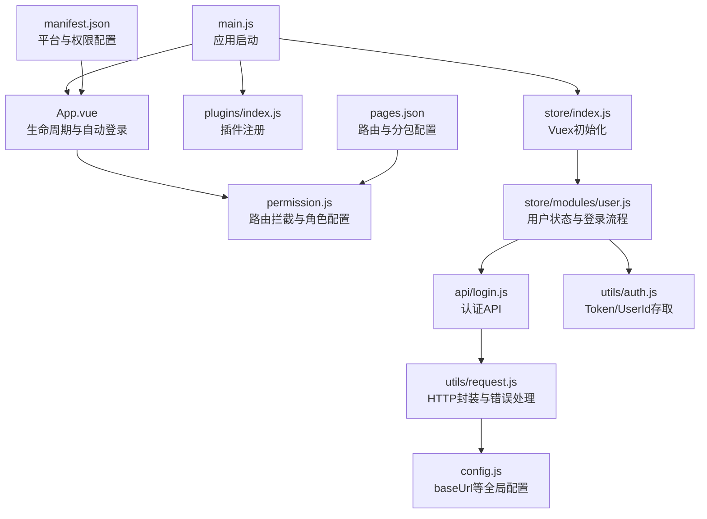
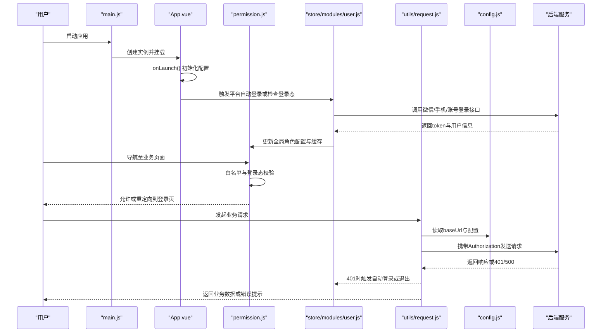
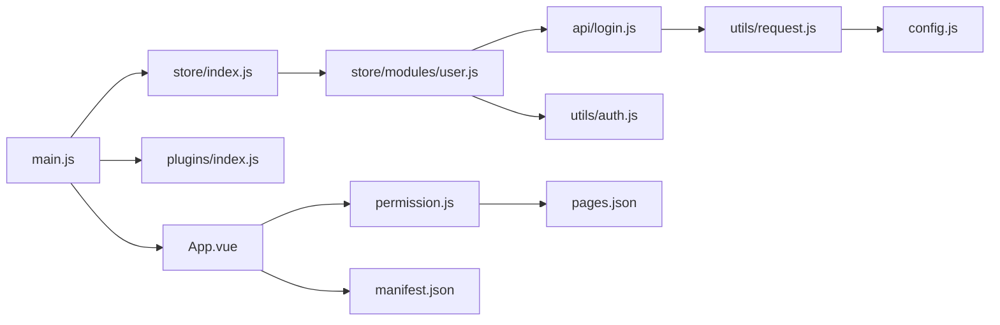

# 团队协作

<cite>
**本文引用的文件**   
- [README.md](file://README.md)
- [config.js](file://config.js)
- [main.js](file://main.js)
- [manifest.json](file://manifest.json)
- [pages.json](file://pages.json)
- [permission.js](file://permission.js)
- [App.vue](file://App.vue)
- [utils/request.js](file://utils/request.js)
- [store/index.js](file://store/index.js)
- [plugins/index.js](file://plugins/index.js)
- [api/login.js](file://api/login.js)
- [utils/auth.js](file://utils/auth.js)
- [store/modules/user.js](file://store/modules/user.js)
- [utils/common.js](file://utils/common.js)
</cite>

## 目录
1. [简介](#简介)
2. [项目结构](#项目结构)
3. [核心组件](#核心组件)
4. [架构总览](#架构总览)
5. [详细组件分析](#详细组件分析)
6. [依赖分析](#依赖分析)
7. [性能考虑](#性能考虑)
8. [故障排查指南](#故障排查指南)
9. [结论](#结论)
10. [附录](#附录)

## 简介
本团队协作指南面向RuoYi-App移动端团队，目标是建立统一、高效、可追溯的协作流程与规范。内容覆盖Git工作流（分支策略、提交信息、合并流程）、代码审查、版本发布、开发环境配置与共享、沟通协作工具、知识分享与培训机制，以及冲突解决与问题升级流程。文档同时结合仓库现有实现，给出与代码映射的流程说明，确保规范落地可执行。

## 项目结构
本项目为基于uni-app的移动端应用，采用Vue2技术栈，包含页面路由、权限控制、网络请求封装、状态管理、插件扩展等模块。关键入口与配置文件如下：
- 应用入口与初始化：main.js、App.vue
- 全局配置：config.js、manifest.json、pages.json
- 权限与拦截：permission.js
- 网络层：utils/request.js
- 状态管理：store/index.js、store/modules/user.js
- 插件体系：plugins/index.js
- 认证与登录：api/login.js、utils/auth.js
- 通用工具：utils/common.js

图示来源
- [main.js:1-31](file://main.js#L1-L31)
- [App.vue:1-48](file://App.vue#L1-L48)
- [permission.js:1-133](file://permission.js#L1-L133)
- [plugins/index.js:1-15](file://plugins/index.js#L1-L15)
- [store/index.js:1-16](file://store/index.js#L1-L16)
- [store/modules/user.js:1-283](file://store/modules/user.js#L1-L283)
- [api/login.js:1-168](file://api/login.js#L1-L168)
- [utils/auth.js:1-47](file://utils/auth.js#L1-L47)
- [utils/request.js:1-117](file://utils/request.js#L1-L117)
- [config.js:1-38](file://config.js#L1-L38)
- [manifest.json:1-77](file://manifest.json#L1-L77)
- [pages.json:1-235](file://pages.json#L1-L235)

章节来源
- [README.md:1-52](file://README.md#L1-L52)
- [main.js:1-31](file://main.js#L1-L31)
- [App.vue:1-48](file://App.vue#L1-L48)
- [config.js:1-38](file://config.js#L1-L38)
- [manifest.json:1-77](file://manifest.json#L1-L77)
- [pages.json:1-235](file://pages.json#L1-L235)

## 核心组件
- 应用初始化与插件
  - main.js负责引入uView UI、挂载插件、注入全局方法与字典接口；App.vue在onLaunch中完成配置加载与平台差异化自动登录检查。
- 权限与路由拦截
  - permission.js提供白名单校验、未登录跳转、已登录访问登录页重定向到首页、动态TabBar设置与角色特性开关。
- 网络请求与错误处理
  - utils/request.js统一封装uni.request，自动附加Authorization头、参数序列化、超时与异常提示、401会话失效处理（含微信自动登录重试与非微信退出）。
- 状态管理与认证
  - store/modules/user.js集中管理token、用户信息、角色与权限，并提供多种登录方式（账号密码、微信、手机号、学生绑定、教师绑定）与退出逻辑。
  - utils/auth.js提供Token与UserId的本地存取方法。
- 配置与清单
  - config.js定义协议、主机、端口、API前缀与appInfo；manifest.json定义多端打包与权限；pages.json定义路由、分包与tabBar。

章节来源
- [main.js:1-31](file://main.js#L1-L31)
- [App.vue:1-48](file://App.vue#L1-L48)
- [permission.js:1-133](file://permission.js#L1-L133)
- [utils/request.js:1-117](file://utils/request.js#L1-L117)
- [store/modules/user.js:1-283](file://store/modules/user.js#L1-L283)
- [utils/auth.js:1-47](file://utils/auth.js#L1-L47)
- [config.js:1-38](file://config.js#L1-L38)
- [manifest.json:1-77](file://manifest.json#L1-L77)
- [pages.json:1-235](file://pages.json#L1-L235)

## 架构总览
下图展示从应用启动到认证与数据请求的整体流程，体现各模块职责与交互关系。

图示来源
- [main.js:1-31](file://main.js#L1-L31)
- [App.vue:1-48](file://App.vue#L1-L48)
- [permission.js:1-133](file://permission.js#L1-L133)
- [store/modules/user.js:1-283](file://store/modules/user.js#L1-L283)
- [utils/request.js:1-117](file://utils/request.js#L1-L117)
- [config.js:1-38](file://config.js#L1-L38)

## 详细组件分析

### Git工作流与分支管理（Git Flow）
- 分支模型
  - master/main：稳定发布分支，仅接受来自release与hotfix的合并。
  - develop：集成开发分支，日常功能迭代在此进行。
  - feature/*：功能分支，从develop切出，完成后合并回develop。
  - release/*：预发布分支，从develop切出，用于测试与修复，完成后合并到master与develop。
  - hotfix/*：紧急修复分支，从master切出，修复后合并到master与develop。
- 分支命名规范
  - feature/需求编号-简述（如feature/TASK-123-新增查课记录）
  - bugfix/问题编号-简述（如bugfix/ISSUE-456-修复登录超时）
  - release/vX.Y.Z（如release/v1.2.0）
  - hotfix/vX.Y.Z-fix（如hotfix/v1.2.0-fix-登录401）
- 提交信息规范（建议遵循Conventional Commits）
  - 格式：<type>(scope): <subject>
  - type：feat、fix、docs、style、refactor、perf、test、build、ci、chore、revert
  - scope：模块名（如login、request、permission）
  - subject：简洁描述变更目的
  - 示例路径参考：[api/login.js:1-168](file://api/login.js#L1-L168)、[utils/request.js:1-117](file://utils/request.js#L1-L117)
- 合并流程
  - 功能分支合并到develop需通过CI与至少一名同行评审。
  - release分支合并到master需通过完整回归测试与发布评审。
  - hotfix分支合并到master后立即同步develop。
- 标签与版本
  - 使用语义化版本号（主.次.修订），在release与hotfix合并后打tag。
  - 版本信息维护于config.js与manifest.json，保持前后一致。

章节来源
- [config.js:1-38](file://config.js#L1-L38)
- [manifest.json:1-77](file://manifest.json#L1-L77)

### 代码审查流程与规范
- 审查清单
  - 功能正确性：是否满足需求，边界条件与异常路径是否处理。
  - 安全性：敏感信息是否泄露，鉴权与权限控制是否完备。
  - 可维护性：命名清晰、函数单一职责、注释充分。
  - 性能：是否存在不必要的渲染、重复请求、大对象传输。
  - 兼容性：多端差异（小程序/H5/APP）是否适配。
  - 日志与错误：错误码与提示信息是否友好且可追踪。
- 审查工具
  - 使用IDE内置Lint与ESLint规则；提交前运行静态检查。
  - 使用Git钩子（pre-commit）阻止不规范提交。
- 反馈处理
  - 评论分级：阻塞（必须修改）、建议（可选优化）、信息（背景说明）。
  - 修改后重新触发CI并通过审查方可合并。
- 自动化检查
  - 构建与单元测试在PR阶段执行，失败则阻断合并。

### 版本发布流程
- 版本号管理
  - 采用语义化版本：主版本（破坏性变更）、次版本（新功能）、修订（缺陷修复）。
  - 前端版本信息位于：
    - config.js中的appInfo.version
    - manifest.json中的versionName与versionCode
- 变更日志维护
  - 在release分支合并前生成变更日志，按类型分类（新增、修复、优化、破坏性变更）。
  - 变更记录与提交信息保持一致，便于回溯。
- 发布步骤
  - 从develop创建release分支，冻结非关键变更。
  - 全量回归测试通过后，合并到master并打tag。
  - 同步更新config.js与manifest.json的版本号。
- 回滚策略
  - 线上问题优先热修复：从当前稳定tag创建hotfix分支，修复后快速发布。
  - 若影响范围大，回退到上一个稳定tag并重新发布。

章节来源
- [config.js:1-38](file://config.js#L1-L38)
- [manifest.json:1-77](file://manifest.json#L1-L77)

### 开发环境配置与共享
- 依赖管理
  - uni_modules第三方组件统一管理，避免重复安装与版本冲突。
  - 建议在团队内统一依赖版本，并在CI中锁定依赖树。
- 配置文件同步
  - 全局配置集中于config.js，环境变量通过平台编译宏区分（如MP-WEIXIN、H5）。
  - 敏感配置（如域名、密钥）应通过环境变量或安全配置中心注入，不直接写入源码。
- 环境变量设置
  - 不同环境（开发、测试、生产）通过不同的config或构建脚本切换。
  - pages.json与manifest.json中的平台特定配置需与环境匹配。
- 本地开发
  - 使用H5模式进行快速调试，端口与路由配置见manifest.json。
  - 小程序模式需配置对应appid与权限声明。

章节来源
- [config.js:1-38](file://config.js#L1-L38)
- [manifest.json:1-77](file://manifest.json#L1-L77)
- [pages.json:1-235](file://pages.json#L1-L235)

### 沟通协作工具使用指南
- 项目管理
  - 使用看板跟踪任务状态（待办、进行中、评审、已完成），关联需求与缺陷。
  - 每个任务对应一个feature或bugfix分支，提交信息与任务ID关联。
- 文档协作
  - 设计稿、接口文档、技术方案统一存放于协作平台，版本与变更可追溯。
- 即时通讯
  - 重要决策与风险点需在群组中留痕，必要时形成会议纪要归档。

### 知识分享与培训机制
- 技术分享会
  - 定期组织分享，主题涵盖架构演进、性能优化、踩坑总结。
- 新人入职培训
  - 提供项目结构、开发规范、工具链使用手册，安排导师制辅导。
- 经验总结
  - 将常见问题与解决方案沉淀为知识库，持续更新。

### 冲突解决与问题升级流程
- 冲突解决
  - 小范围冲突由开发者自行协调解决；大范围冲突需拉通相关方评估影响面。
  - 合并前务必拉取最新分支并本地验证。
- 问题升级
  - 一线支持无法解决的严重问题，升级到技术负责人与产品负责人联合处理。
  - 重大缺陷需走应急流程，优先恢复服务，再根因分析与修复。

## 依赖分析
下图展示核心模块间的依赖关系，帮助理解耦合度与潜在循环依赖风险。

图示来源
- [main.js:1-31](file://main.js#L1-L31)
- [App.vue:1-48](file://App.vue#L1-L48)
- [permission.js:1-133](file://permission.js#L1-L133)
- [store/index.js:1-16](file://store/index.js#L1-L16)
- [store/modules/user.js:1-283](file://store/modules/user.js#L1-L283)
- [api/login.js:1-168](file://api/login.js#L1-L168)
- [utils/auth.js:1-47](file://utils/auth.js#L1-L47)
- [utils/request.js:1-117](file://utils/request.js#L1-L117)
- [config.js:1-38](file://config.js#L1-L38)
- [manifest.json:1-77](file://manifest.json#L1-L77)
- [pages.json:1-235](file://pages.json#L1-L235)

章节来源
- [main.js:1-31](file://main.js#L1-L31)
- [App.vue:1-48](file://App.vue#L1-L48)
- [permission.js:1-133](file://permission.js#L1-L133)
- [store/index.js:1-16](file://store/index.js#L1-L16)
- [store/modules/user.js:1-283](file://store/modules/user.js#L1-L283)
- [api/login.js:1-168](file://api/login.js#L1-L168)
- [utils/auth.js:1-47](file://utils/auth.js#L1-L47)
- [utils/request.js:1-117](file://utils/request.js#L1-L117)
- [config.js:1-38](file://config.js#L1-L38)
- [manifest.json:1-77](file://manifest.json#L1-L77)
- [pages.json:1-235](file://pages.json#L1-L235)

## 性能考虑
- 请求优化
  - 合理设置超时与重试策略，避免频繁无效请求。
  - 对大数据列表采用分页与懒加载，减少首屏压力。
- 包体优化
  - 利用分包与按需加载，减小初始包体积。
  - 图片与静态资源压缩与CDN加速。
- 运行时优化
  - 避免在高频回调中进行复杂计算，必要时使用Web Worker或WXS。
  - 合理使用缓存（本地存储与内存缓存），降低重复请求。

## 故障排查指南
- 常见错误定位
  - 401会话失效：检查utils/request.js中的401处理逻辑与自动登录重试路径。
  - 网络异常：查看utils/request.js的错误捕获与提示文案。
  - 权限不足：确认permission.js的白名单与角色特性开关。
- 诊断步骤
  - 打开控制台日志，定位错误堆栈与请求URL。
  - 检查config.js的baseUrl与manifest.json的平台配置是否正确。
  - 复现路径最小化，隔离问题模块。
- 恢复措施
  - 临时降级或关闭非核心功能，保障主线可用。
  - 快速回滚到上一稳定版本，随后定位根因并修复。

章节来源
- [utils/request.js:1-117](file://utils/request.js#L1-L117)
- [permission.js:1-133](file://permission.js#L1-L133)
- [config.js:1-38](file://config.js#L1-L38)
- [manifest.json:1-77](file://manifest.json#L1-L77)

## 结论
通过统一的Git工作流、严格的代码审查、规范的版本发布与完善的故障排查机制，团队能够在保证质量的前提下提升交付效率。结合本仓库的实际实现，上述流程可直接落地执行，并在实践中持续优化。

## 附录
- 术语表
  - 语义化版本：主.次.修订版本号规范。
  - 白名单：无需登录即可访问的路径集合。
  - 特性开关：基于角色的功能启用/禁用机制。
- 参考路径
  - 登录与认证：[api/login.js:1-168](file://api/login.js#L1-L168)、[store/modules/user.js:1-283](file://store/modules/user.js#L1-L283)
  - 网络与错误：[utils/request.js:1-117](file://utils/request.js#L1-L117)
  - 权限与路由：[permission.js:1-133](file://permission.js#L1-L133)
  - 配置与清单：[config.js:1-38](file://config.js#L1-L38)、[manifest.json:1-77](file://manifest.json#L1-L77)、[pages.json:1-235](file://pages.json#L1-L235)