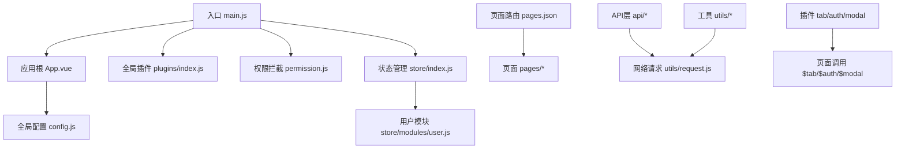
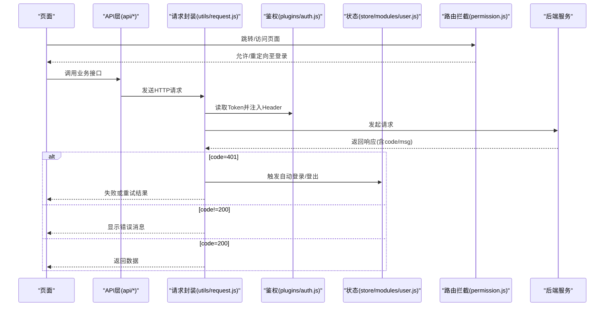
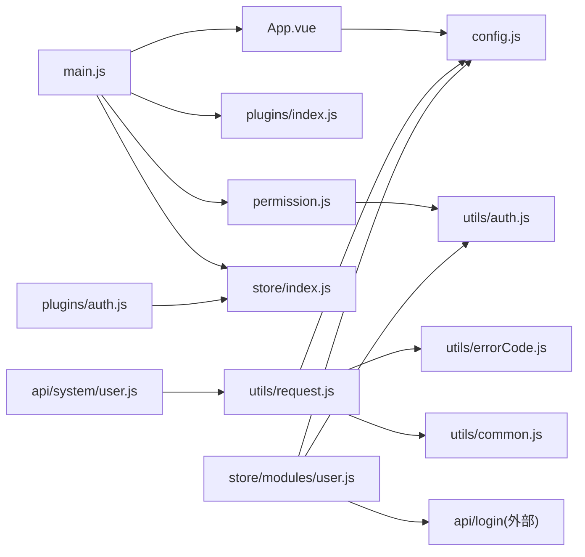

# 开发指南

<cite>
**本文引用的文件**   
- [README.md](file://README.md)
- [main.js](file://main.js)
- [App.vue](file://App.vue)
- [pages.json](file://pages.json)
- [config.js](file://config.js)
- [permission.js](file://permission.js)
- [utils/request.js](file://utils/request.js)
- [utils/auth.js](file://utils/auth.js)
- [store/index.js](file://store/index.js)
- [store/modules/user.js](file://store/modules/user.js)
- [plugins/index.js](file://plugins/index.js)
- [plugins/auth.js](file://plugins/auth.js)
- [plugins/modal.js](file://plugins/modal.js)
- [plugins/tab.js](file://plugins/tab.js)
- [mixins/pagination.js](file://mixins/pagination.js)
- [api/system/user.js](file://api/system/user.js)
- [utils/common.js](file://utils/common.js)
- [utils/errorCode.js](file://utils/errorCode.js)
</cite>

## 目录
1. [简介](#简介)
2. [项目结构](#项目结构)
3. [核心组件](#核心组件)
4. [架构总览](#架构总览)
5. [详细组件分析](#详细组件分析)
6. [依赖关系分析](#依赖关系分析)
7. [性能考虑](#性能考虑)
8. [故障排除指南](#故障排除指南)
9. [结论](#结论)
10. [附录](#附录)

## 简介
本指南面向RuoYi-App（基于uni-app）的开发者，提供从规范、流程到扩展与优化的完整实践说明。项目为轻量级移动端解决方案，支持小程序、H5、Android和iOS多端运行，并与RuoYi-Vue/RuoYi-Cloud后端无缝对接。

- 技术栈：uni-app + Vue2/Vuex（当前仓库）/Vue3/Pinia（另分支）
- UI框架：uni-ui/uView
- 网络请求：封装自 uni.request
- 状态管理：Vuex（modules/user）
- 权限控制：路由拦截 + 角色/功能开关配置
- 插件体系：全局插件注册（tab、auth、modal）

章节来源
- [README.md:12-20](file://README.md#L12-L20)

## 项目结构
整体采用“按领域+分层”组织方式：
- api：按业务域划分接口模块（如 system、stumanage、campus 等）
- pages：页面路由与分包（主包 + subPackages）
- components：通用业务组件
- mixins：可复用逻辑混入（如分页）
- plugins：全局插件（tab、auth、modal）
- store：状态管理（Vuex modules）
- utils：工具库（请求、鉴权、错误码、上传、校验等）
- static：静态资源（样式、图标、图片等）
- uni_modules：第三方组件与SDK（uview-ui、uni-list等）

图表来源
- [main.js:1-31](file://main.js#L1-L31)
- [App.vue:1-48](file://App.vue#L1-L48)
- [pages.json:1-235](file://pages.json#L1-L235)
- [config.js:1-38](file://config.js#L1-L38)
- [permission.js:1-133](file://permission.js#L1-L133)
- [store/index.js:1-16](file://store/index.js#L1-L16)
- [store/modules/user.js:1-283](file://store/modules/user.js#L1-L283)
- [plugins/index.js:1-15](file://plugins/index.js#L1-L15)
- [utils/request.js:1-117](file://utils/request.js#L1-L117)

章节来源
- [main.js:1-31](file://main.js#L1-L31)
- [App.vue:1-48](file://App.vue#L1-L48)
- [pages.json:1-235](file://pages.json#L1-L235)
- [config.js:1-38](file://config.js#L1-L38)
- [permission.js:1-133](file://permission.js#L1-L133)
- [store/index.js:1-16](file://store/index.js#L1-L16)
- [store/modules/user.js:1-283](file://store/modules/user.js#L1-L283)
- [plugins/index.js:1-15](file://plugins/index.js#L1-L15)
- [utils/request.js:1-117](file://utils/request.js#L1-L117)

## 核心组件
- 应用初始化与平台差异处理
  - 在应用启动时加载全局配置，并根据平台执行自动登录或登录态检查。
- 全局插件
  - 统一挂载 $tab、$auth、$modal，简化页面调用。
- 网络请求封装
  - 统一注入Authorization头、参数序列化、错误提示、401会话失效处理与重试策略。
- 权限与路由拦截
  - 白名单机制、登录后重定向首页、动态TabBar设置、角色能力开关。
- 状态管理
  - 用户信息、Token、角色与权限持久化；微信/手机号等多种登录流程。
- 分页混入
  - 列表页统一的上拉加载、下拉刷新、加载状态管理。

章节来源
- [App.vue:1-48](file://App.vue#L1-L48)
- [plugins/index.js:1-15](file://plugins/index.js#L1-L15)
- [utils/request.js:1-117](file://utils/request.js#L1-L117)
- [permission.js:1-133](file://permission.js#L1-L133)
- [store/modules/user.js:1-283](file://store/modules/user.js#L1-L283)
- [mixins/pagination.js:1-125](file://mixins/pagination.js#L1-L125)

## 架构总览
下图展示了从页面发起请求到后端响应、再到UI反馈的关键链路，以及权限与状态管理的参与点。

图表来源
- [utils/request.js:1-117](file://utils/request.js#L1-L117)
- [plugins/auth.js:1-61](file://plugins/auth.js#L1-L61)
- [store/modules/user.js:1-283](file://store/modules/user.js#L1-L283)
- [permission.js:1-133](file://permission.js#L1-L133)

## 详细组件分析

### 应用初始化与生命周期
- 入口main.js负责：
  - 引入并注册uView UI、全局插件、权限拦截
  - 挂载store、字典获取方法、公共工具到原型
  - 创建并挂载Vue实例
- 根组件App.vue负责：
  - 初始化全局配置
  - 平台差异化登录流程（微信小程序自动登录、H5登录态检查）

章节来源
- [main.js:1-31](file://main.js#L1-L31)
- [App.vue:1-48](file://App.vue#L1-L48)

### 路由与页面组织
- pages.json定义主包与分包，包含：
  - 主包：登录、注册、首页、工作台、我的
  - 分包：sub-mine（个人中心）、sub-work（教师工作区）、common（通用webview/textview）
- tabBar配置三个主入口页

章节来源
- [pages.json:1-235](file://pages.json#L1-L235)

### 全局配置与环境
- config.js集中管理：
  - 协议、主机、端口、API前缀、baseUrl计算
  - 应用信息与协议链接

章节来源
- [config.js:1-38](file://config.js#L1-L38)

### 权限与路由拦截
- 白名单机制：登录、注册、通用webview无需登录
- 已登录访问登录页：重定向到角色首页（带redirect参数）
- 未登录访问非白名单：重定向登录页
- 动态TabBar：仅小程序生效，根据后端角色配置更新
- 角色配置缓存：本地存储roleConfig与userRoles

章节来源
- [permission.js:1-133](file://permission.js#L1-L133)

### 网络请求封装
- 统一行为：
  - 自动注入Authorization头（可关闭）
  - GET参数序列化
  - 超时与错误消息映射
  - 401处理：区分登录相关接口与非登录接口；小程序自动登录并重试，其他平台直接登出跳转
- 错误码映射：errorCode.js提供默认文案

章节来源
- [utils/request.js:1-117](file://utils/request.js#L1-L117)
- [utils/errorCode.js:1-7](file://utils/errorCode.js#L1-L7)

### 认证与用户状态
- 用户模块store/modules/user.js：
  - 登录、获取用户信息、退出、微信/手机号绑定登录、学生绑定登录
  - 头像URL补全、教师账号校验（userType/roles）
  - Token与用户信息持久化（storage + auth.js）
- 认证工具utils/auth.js：
  - Token与UserId存取、是否登录判断

章节来源
- [store/modules/user.js:1-283](file://store/modules/user.js#L1-L283)
- [utils/auth.js:1-47](file://utils/auth.js#L1-L47)

### 插件系统
- 插件注册plugins/index.js：
  - 挂载$tab、$auth、$modal到Vue原型
- 功能插件：
  - tab：封装页面跳转API
  - auth：权限与角色判定（支持and/or组合）
  - modal：统一消息提示、确认框、loading

章节来源
- [plugins/index.js:1-15](file://plugins/index.js#L1-L15)
- [plugins/tab.js:1-31](file://plugins/tab.js#L1-L31)
- [plugins/auth.js:1-61](file://plugins/auth.js#L1-L61)
- [plugins/modal.js:1-79](file://plugins/modal.js#L1-L79)

### 分页混入
- mixins/pagination.js提供：
  - 统一分页状态（pageNum、pageSize、total、list、loadStatus、refreshing）
  - 刷新、加载更多、下拉刷新
  - 要求实现loadData()返回Promise<{list,total}>

章节来源
- [mixins/pagination.js:1-125](file://mixins/pagination.js#L1-L125)

### API层示例（用户资料）
- api/system/user.js：
  - 修改密码、查询/更新个人信息、头像上传
  - 使用request与upload工具进行网络与文件操作

章节来源
- [api/system/user.js:1-42](file://api/system/user.js#L1-L42)

### 常用工具
- utils/common.js：
  - toast、showConfirm、parseTime、tansParams、chooseLocation
- utils/errorCode.js：
  - 错误码到中文提示映射

章节来源
- [utils/common.js:1-121](file://utils/common.js#L1-L121)
- [utils/errorCode.js:1-7](file://utils/errorCode.js#L1-L7)

## 依赖关系分析
- 入口依赖：
  - main.js依赖App.vue、store、plugins、permission、uView、字典API
- 运行时依赖：
  - App.vue依赖config、auth、store
  - permission依赖auth、roleView API
  - request依赖config、auth、errorCode、common
  - store/user依赖config、storage、validate、login API、auth
  - plugins依赖store（权限判定）
  - mixins/pagination被页面引用
  - api/*依赖request/upload

图表来源
- [main.js:1-31](file://main.js#L1-L31)
- [App.vue:1-48](file://App.vue#L1-L48)
- [permission.js:1-133](file://permission.js#L1-L133)
- [utils/request.js:1-117](file://utils/request.js#L1-L117)
- [utils/auth.js:1-47](file://utils/auth.js#L1-L47)
- [utils/errorCode.js:1-7](file://utils/errorCode.js#L1-L7)
- [utils/common.js:1-121](file://utils/common.js#L1-L121)
- [store/index.js:1-16](file://store/index.js#L1-L16)
- [store/modules/user.js:1-283](file://store/modules/user.js#L1-L283)
- [plugins/index.js:1-15](file://plugins/index.js#L1-L15)
- [plugins/auth.js:1-61](file://plugins/auth.js#L1-L61)
- [api/system/user.js:1-42](file://api/system/user.js#L1-L42)

## 性能考虑
- 分包与按需加载
  - 将低频功能放入subPackages，减少首屏体积
- 列表渲染优化
  - 使用分页混入避免一次性加载大量数据
  - 长列表建议结合虚拟滚动方案（第三方组件）
- 图片与静态资源
  - 使用CDN与压缩格式，合理命名与缓存策略
- 网络请求
  - 合理设置timeout，避免阻塞
  - 对重复请求做去抖/节流与缓存（可按需扩展）
- 条件编译
  - 利用条件编译减少无用代码在各平台的打包体积

[本节为通用指导，不直接分析具体文件]

## 故障排除指南
- 401会话过期
  - 现象：请求返回401，自动触发登出或自动登录
  - 排查：检查Token是否存在、后端会话是否有效、登录接口是否被误判为非登录接口
  - 参考：请求封装中的401分支与自动登录逻辑
- 网络异常/超时
  - 现象：提示“后端接口连接异常”或“系统接口请求超时”
  - 排查：检查baseUrl、代理路径、网络连通性、超时阈值
- 权限不足
  - 现象：提示无权限或无法访问页面
  - 排查：检查角色配置、权限标识、路由白名单
- 微信自动登录失败
  - 现象：小程序环境自动登录失败后跳转登录页
  - 排查：检查wxLogin流程、授权回调、后端绑定状态
- 头像/文件上传失败
  - 现象：上传接口报错或返回空
  - 排查：检查filePath、name字段、后端接收参数名

章节来源
- [utils/request.js:1-117](file://utils/request.js#L1-L117)
- [permission.js:1-133](file://permission.js#L1-L133)
- [store/modules/user.js:1-283](file://store/modules/user.js#L1-L283)
- [utils/errorCode.js:1-7](file://utils/errorCode.js#L1-L7)

## 结论
本项目以清晰的模块化与统一的工具链为基础，提供了完善的登录鉴权、网络请求、状态管理与插件体系。遵循本文的开发规范与最佳实践，可快速扩展新功能并保持代码一致性与可维护性。

[本节为总结性内容，不直接分析具体文件]

## 附录

### 开发规范与代码风格约定
- 文件与目录命名
  - 小写英文字母与短横线分隔，如：api/stumanage/activity.js
  - 页面按功能域分目录，如：pages/sub-work/talk
- 注释规范
  - 关键函数与复杂逻辑添加行内注释，说明输入输出与边界情况
- 常量与配置
  - 将易变配置集中于config.js，避免硬编码
- 错误处理
  - 统一通过toast/showModal提示，错误码映射到中文文案
- 组件与混入
  - 复用逻辑优先抽取为mixin或组件，保持页面简洁

[本节为通用规范，不直接分析具体文件]

### 新功能开发流程与最佳实践
- 需求分析
  - 明确用户角色、权限范围、数据模型与交互流程
- 设计
  - 确定页面路由（pages.json）、API接口（api/*）、状态变更（store/modules/*）
- 编码
  - 使用统一请求封装与错误码映射
  - 需要列表的页面使用分页混入
  - 权限控制使用$auth与路由拦截
- 测试
  - 单元测试：针对工具函数与混入逻辑编写用例
  - 集成测试：覆盖登录、鉴权、关键业务流程
- 文档
  - 更新接口文档、页面使用说明与变更记录

[本节为通用流程，不直接分析具体文件]

### 插件系统的开发与扩展机制
- 新增插件步骤
  - 在plugins目录下新建插件文件，导出install或对象方法
  - 在plugins/index.js中引入并挂载到Vue原型
- 插件职责建议
  - 单一职责：如tab只负责导航，auth只负责权限判定
- 使用方式
  - 在页面中通过this.$xxx调用，或在模板中使用v-if="$auth.hasRole(...)"

章节来源
- [plugins/index.js:1-15](file://plugins/index.js#L1-L15)
- [plugins/tab.js:1-31](file://plugins/tab.js#L1-L31)
- [plugins/auth.js:1-61](file://plugins/auth.js#L1-L61)
- [plugins/modal.js:1-79](file://plugins/modal.js#L1-L79)

### 测试方法与框架使用
- 单元测试
  - 针对utils下的纯函数（如parseTime、tansParams）编写断言
  - 针对mixins/pagination的refresh/loadMore进行行为验证
- 集成测试
  - 模拟登录流程：WxLogin/PhoneLogin -> GetInfo -> 路由跳转
  - 模拟401场景：请求失败 -> 自动登录/登出 -> 重定向
- 推荐工具
  - Jest/Mocha + chai（Node环境）
  - uni-app官方测试能力（小程序/H5真机调试）

[本节为通用指导，不直接分析具体文件]

### 团队协作与Git分支管理
- 分支策略
  - main：稳定版本
  - develop：日常开发主干
  - feature/*：功能分支
  - hotfix/*：紧急修复
- 提交规范
  - 语义化提交信息（feat/fix/docs/style/refactor/test/chore）
- 代码审查
  - 至少一人Review，关注可读性、安全性与性能

[本节为通用流程，不直接分析具体文件]

### 常见问题解答（FAQ）
- 如何切换后端环境？
  - 修改config.js中的protocol/host/port/apiPrefix
- 如何新增一个页面？
  - 在pages.json中注册路由，并在对应目录创建页面文件
- 如何实现上拉加载与下拉刷新？
  - 引入pagination混入，实现loadData方法
- 如何限制页面访问权限？
  - 使用$auth进行权限判断，配合permission.js白名单与重定向

章节来源
- [config.js:1-38](file://config.js#L1-L38)
- [pages.json:1-235](file://pages.json#L1-L235)
- [mixins/pagination.js:1-125](file://mixins/pagination.js#L1-L125)
- [plugins/auth.js:1-61](file://plugins/auth.js#L1-L61)
- [permission.js:1-133](file://permission.js#L1-L133)