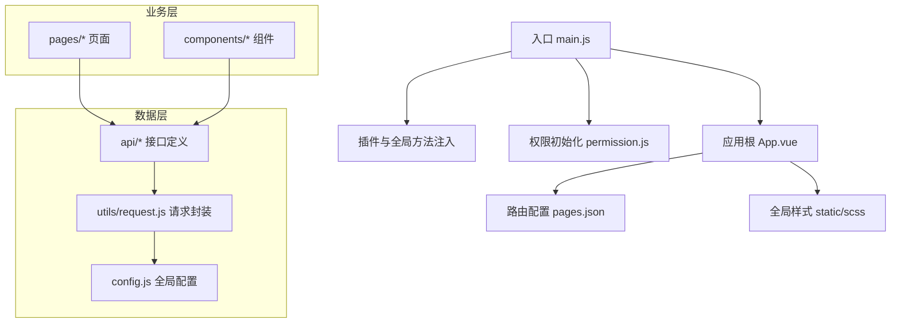
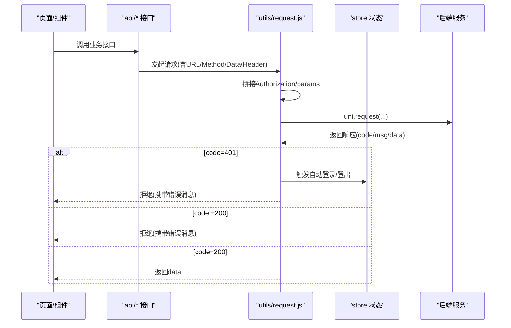
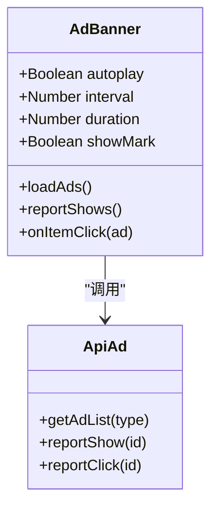
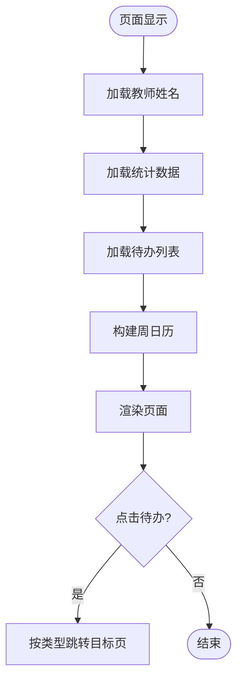
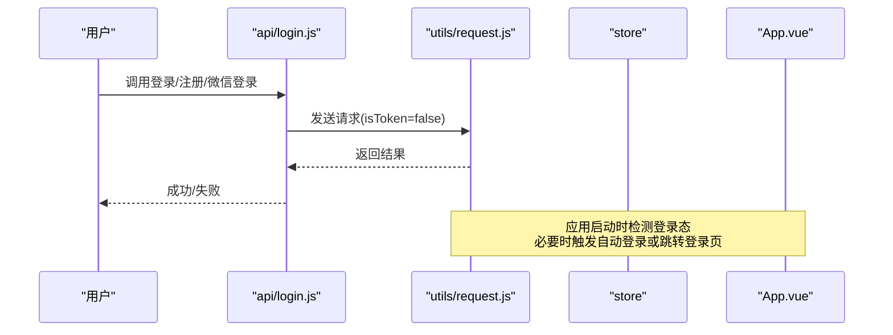
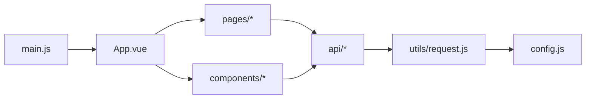

# 开发规范

<cite>
**本文引用的文件**   
- [README.md](file://README.md)
- [main.js](file://main.js)
- [App.vue](file://App.vue)
- [pages.json](file://pages.json)
- [config.js](file://config.js)
- [utils/request.js](file://utils/request.js)
- [api/login.js](file://api/login.js)
- [pages/index.vue](file://pages/index.vue)
- [components/ad-banner/ad-banner.vue](file://components/ad-banner/ad-banner.vue)
- [static/scss/global.scss](file://static/scss/global.scss)
</cite>

## 目录
1. [引言](#引言)
2. [项目结构](#项目结构)
3. [核心组件](#核心组件)
4. [架构总览](#架构总览)
5. [详细组件分析](#详细组件分析)
6. [依赖分析](#依赖分析)
7. [性能考虑](#性能考虑)
8. [故障排查指南](#故障排查指南)
9. [结论](#结论)
10. [附录](#附录)

## 引言
本规范面向 RuoYi-App（基于 UniApp）的移动端前端工程，统一代码风格、目录组织、API 封装、样式编写、注释与命名约定，并给出 Git 分支策略、提交信息规范、代码审查流程以及质量检查工具使用建议。目标是提升团队协作效率、降低维护成本、保障多端一致性与可观测性。

## 项目结构
本项目采用“按领域/功能划分 + 分层”的组织方式：
- pages：页面路由与业务页面，主包与分包清晰分离
- api：按模块划分的接口定义，统一通过请求封装调用
- components：通用业务组件与基础 UI 组合
- utils：工具函数、网络请求、权限、存储等
- store：全局状态管理（Vuex/Pinia）
- static：静态资源与全局样式
- uni_modules：第三方插件与 UI 库
- plugins：应用级插件注册
- mixins：可复用逻辑混入
- sql：数据库脚本（如有）

图表来源
- [main.js:1-31](file://main.js#L1-L31)
- [App.vue:1-48](file://App.vue#L1-L48)
- [pages.json:1-235](file://pages.json#L1-L235)
- [config.js:1-38](file://config.js#L1-L38)
- [utils/request.js:1-117](file://utils/request.js#L1-L117)

章节来源
- [README.md:1-52](file://README.md#L1-L52)
- [main.js:1-31](file://main.js#L1-L31)
- [App.vue:1-48](file://App.vue#L1-L48)
- [pages.json:1-235](file://pages.json#L1-L235)
- [config.js:1-38](file://config.js#L1-L38)

## 核心组件
- 应用启动与初始化
  - 在入口文件中完成插件注册、全局方法挂载、Store 绑定与字典接口挂载
  - 在应用根生命周期中根据平台进行自动登录或登录态校验
- 请求封装
  - 统一处理鉴权头、参数序列化、错误码映射、超时与网络异常提示
  - 针对 401 会话失效场景，区分微信平台的自动重登与非微信平台的退出跳转
- 页面与组件
  - 页面遵循“数据加载 + 事件处理 + 导航跳转”的职责边界
  - 组件以 props 驱动、事件回调为主，避免过度耦合父组件状态

章节来源
- [main.js:1-31](file://main.js#L1-L31)
- [App.vue:1-48](file://App.vue#L1-L48)
- [utils/request.js:1-117](file://utils/request.js#L1-L117)

## 架构总览
下图展示从页面到后端的核心调用链路与关键决策点（如鉴权、错误处理、平台差异）。

图表来源
- [utils/request.js:1-117](file://utils/request.js#L1-L117)
- [api/login.js:1-168](file://api/login.js#L1-L168)
- [App.vue:1-48](file://App.vue#L1-L48)

## 详细组件分析

### 组件：广告轮播 AdBanner
职责
- 接收外部配置（是否自动播放、间隔、时长、是否显示标记）
- 拉取广告列表、上报曝光与点击、根据链接类型执行跳转
- 向父组件暴露 click 事件

最佳实践要点
- props 明确类型与默认值，保持组件可配置
- 使用 async/await 简化异步流程，失败路径记录日志
- 跨平台跳转使用条件编译，保证小程序/H5 行为一致
- 对外仅暴露必要事件，内部实现细节不泄漏

图表来源
- [components/ad-banner/ad-banner.vue:1-140](file://components/ad-banner/ad-banner.vue#L1-L140)

章节来源
- [components/ad-banner/ad-banner.vue:1-140](file://components/ad-banner/ad-banner.vue#L1-L140)

### 页面：首页 Home
职责
- 聚合统计指标（学生总数、待审请假、未读待办、本周查课）
- 展示近期待办事项，支持按周日历筛选
- 提供快捷入口跳转至各业务子页

最佳实践要点
- onShow 中按需刷新数据，避免重复请求
- 使用计算属性过滤展示数据，减少模板复杂度
- 对可能失败的接口增加兜底值，保证页面可用性
- 跳转前做容错处理，失败时回退到列表页

图表来源
- [pages/index.vue:1-711](file://pages/index.vue#L1-L711)

章节来源
- [pages/index.vue:1-711](file://pages/index.vue#L1-L711)

### 认证相关流程
职责
- 提供登录、注册、获取用户信息、退出、验证码、微信/手机号一键登录等接口
- 配合请求封装完成鉴权头注入与会话失效处理

最佳实践要点
- 登录类接口显式设置 isToken=false，避免循环鉴权
- 将敏感参数集中传递，便于审计与替换
- 结合平台差异（微信小程序/H5）在应用启动阶段完成自动登录或登录态校验

图表来源
- [api/login.js:1-168](file://api/login.js#L1-L168)
- [utils/request.js:1-117](file://utils/request.js#L1-L117)
- [App.vue:1-48](file://App.vue#L1-L48)

章节来源
- [api/login.js:1-168](file://api/login.js#L1-L168)
- [App.vue:1-48](file://App.vue#L1-L48)

## 依赖分析
- 入口依赖
  - main.js 负责插件、全局方法与 Store 的注入
  - App.vue 负责应用初始化与平台差异化登录流程
- 配置与请求
  - config.js 提供协议、主机、端口、API 前缀与 baseUrl 计算
  - utils/request.js 统一处理鉴权、参数、错误码与平台差异
- 页面与组件
  - pages 与 components 通过 api 模块访问后端，遵循单一职责

图表来源
- [main.js:1-31](file://main.js#L1-L31)
- [App.vue:1-48](file://App.vue#L1-L48)
- [config.js:1-38](file://config.js#L1-L38)
- [utils/request.js:1-117](file://utils/request.js#L1-L117)

章节来源
- [main.js:1-31](file://main.js#L1-L31)
- [App.vue:1-48](file://App.vue#L1-L48)
- [config.js:1-38](file://config.js#L1-L38)
- [utils/request.js:1-117](file://utils/request.js#L1-L117)

## 性能考虑
- 首屏优化
  - 按需加载分包页面，减少主包体积
  - 图片资源压缩与懒加载，优先使用 CDN
- 请求优化
  - 合理设置超时时间，避免长耗时阻塞
  - 对高频短接口启用缓存策略（如字典数据）
- 渲染优化
  - 列表分页与虚拟滚动（大数据量场景）
  - 避免在模板中进行复杂计算，尽量使用 computed 或预计算
- 内存与生命周期
  - 及时移除事件监听与定时器，防止内存泄漏
  - 在 onHide/onUnload 中清理副作用

[本节为通用指导，无需源码引用]

## 故障排查指南
常见问题与定位思路
- 401 会话失效
  - 现象：请求被拦截并提示无效会话
  - 排查：确认是否误将登录接口设置为需要 token；检查自动登录流程是否被执行
- 网络异常/超时
  - 现象：提示连接异常或超时
  - 排查：检查 baseUrl 与代理配置；确认后端可达性与超时阈值
- 平台差异问题
  - 现象：H5 与小程序表现不一致
  - 排查：关注条件编译与平台 API 的差异，确保兼容处理

章节来源
- [utils/request.js:1-117](file://utils/request.js#L1-L117)
- [App.vue:1-48](file://App.vue#L1-L48)

## 结论
通过统一的目录组织、清晰的职责边界、规范的请求封装与样式约定，RuoYi-App 在多端一致性、可维护性与可扩展性方面具备良好基础。建议在团队内严格执行本规范，并结合 CI 流水线进行自动化质量门禁。

[本节为总结性内容，无需源码引用]

## 附录

### 一、文件与目录命名规范
- 页面
  - 目录名小写短横线或驼峰均可，推荐小写短横线；文件名 index.vue 作为入口
  - 示例：pages/sub-work/todo/index.vue
- 组件
  - 组件目录与文件名保持一致，使用 PascalCase 或 kebab-case 统一即可
  - 示例：components/ad-banner/ad-banner.vue
- API 接口
  - 按业务域分目录，文件名对应模块，导出函数名使用动词+名词
  - 示例：api/stumanage/todo.js 中的 listTodo、getUnreadCount
- 工具函数
  - 文件名使用小写短横线，函数名使用 camelCase
  - 示例：utils/common.js、utils/storage.js
- 样式
  - 全局样式放在 static/scss，组件样式使用 scoped 的 SCSS 文件
  - 示例：static/scss/global.scss

章节来源
- [pages.json:1-235](file://pages.json#L1-L235)
- [components/ad-banner/ad-banner.vue:1-140](file://components/ad-banner/ad-banner.vue#L1-L140)
- [api/login.js:1-168](file://api/login.js#L1-L168)
- [static/scss/global.scss:1-91](file://static/scss/global.scss#L1-L91)

### 二、JavaScript/SCSS 代码风格约定
- JavaScript
  - 使用 const/let，避免 var
  - 箭头函数与解构赋值优先
  - 异步使用 async/await，错误捕获 try/catch
  - 常量与枚举集中管理，避免魔法字符串
- SCSS
  - 使用 rpx 适配移动端
  - 变量与 mixin 抽取到主题/全局文件
  - 选择器层级不超过三层，避免深层嵌套
  - 使用 BEM 或类似命名法，保证可读性与可维护性

章节来源
- [static/scss/global.scss:1-91](file://static/scss/global.scss#L1-L91)
- [pages/index.vue:1-711](file://pages/index.vue#L1-L711)

### 三、注释规范
- 单行注释
  - 用于解释局部逻辑或边界条件
- 多行注释
  - 用于说明复杂算法或业务规则
- 函数注释
  - 描述参数、返回值、副作用与注意事项
- 组件注释
  - 说明 props、事件、插槽与使用示例

[本节为通用指导，无需源码引用]

### 四、Vue 组件开发规范
- Props
  - 明确 type、default、required，必要时添加 validator
- 事件处理
  - 使用 $emit 向上抛出事件，避免直接操作父组件状态
- 生命周期
  - 在 mounted 中发起数据请求，在 beforeDestroy/unmounted 中清理副作用
- 数据流
  - 单向数据流，避免双向绑定滥用
- 可测试性
  - 将业务逻辑抽离为纯函数，便于单元测试

章节来源
- [components/ad-banner/ad-banner.vue:1-140](file://components/ad-banner/ad-banner.vue#L1-L140)
- [pages/index.vue:1-711](file://pages/index.vue#L1-L711)

### 五、CSS/SCSS 样式编写规范
- 命名约定
  - 使用语义化类名，避免无意义缩写
- 模块化组织
  - 全局样式集中在 static/scss，组件样式使用 scoped
- 响应式设计
  - 使用 rpx 与媒体查询，适配不同屏幕尺寸
- 主题与变量
  - 颜色、字号、间距等抽象为变量，统一管理

章节来源
- [static/scss/global.scss:1-91](file://static/scss/global.scss#L1-L91)
- [App.vue:45-48](file://App.vue#L45-L48)

### 六、Git 提交信息与分支管理
- 分支策略
  - main：生产分支
  - develop：开发主干
  - feature/*：功能分支
  - hotfix/*：紧急修复分支
- 提交信息规范
  - 格式：<type>(<scope>): <subject>
  - type：feat、fix、docs、style、refactor、perf、test、build、ci、chore、revert
  - subject：简洁明了，动词开头，不超过 50 字符
- 合并流程
  - Pull Request 需至少一名 Reviewer 批准
  - 通过自动化检查后合并至 develop/main

[本节为通用指导，无需源码引用]

### 七、代码审查流程
- 自测
  - 本地运行与多端预览，覆盖主要用例
- 评审要点
  - 代码风格与规范符合度
  - 逻辑正确性与边界处理
  - 安全性与性能影响
  - 文档与注释完整性
- 合并后验证
  - 集成测试与回归验证

[本节为通用指导，无需源码引用]

### 八、ESLint 与代码质量检查
- 建议配置
  - 启用 Vue 与 ES6+ 规则集
  - 强制缩进、分号、引号、禁止 console 等
- 集成方式
  - 编辑器插件实时提示
  - Git Hooks 在提交前执行 lint 与格式化
  - CI 流水线阻断不符合规范的提交
- 常用命令
  - npm run lint / npm run format

[本节为通用指导，无需源码引用]

### 九、请求与错误码约定
- 请求封装
  - 统一注入 Authorization 头
  - GET 请求 params 自动拼接
  - 错误码映射与用户提示
- 错误码
  - 200：成功
  - 401：会话失效，触发自动登录或跳转
  - 500：服务端异常，提示具体消息
  - 其他：根据 errorCode 映射提示

章节来源
- [utils/request.js:1-117](file://utils/request.js#L1-L117)

### 十、全局配置与运行时
- 全局配置
  - 协议、主机、端口、API 前缀与 baseUrl 计算
- 应用初始化
  - 在 App.vue 中根据平台执行自动登录或登录态校验
- 入口初始化
  - 在 main.js 中注册插件、挂载全局方法与字典接口

章节来源
- [config.js:1-38](file://config.js#L1-L38)
- [App.vue:1-48](file://App.vue#L1-L48)
- [main.js:1-31](file://main.js#L1-L31)