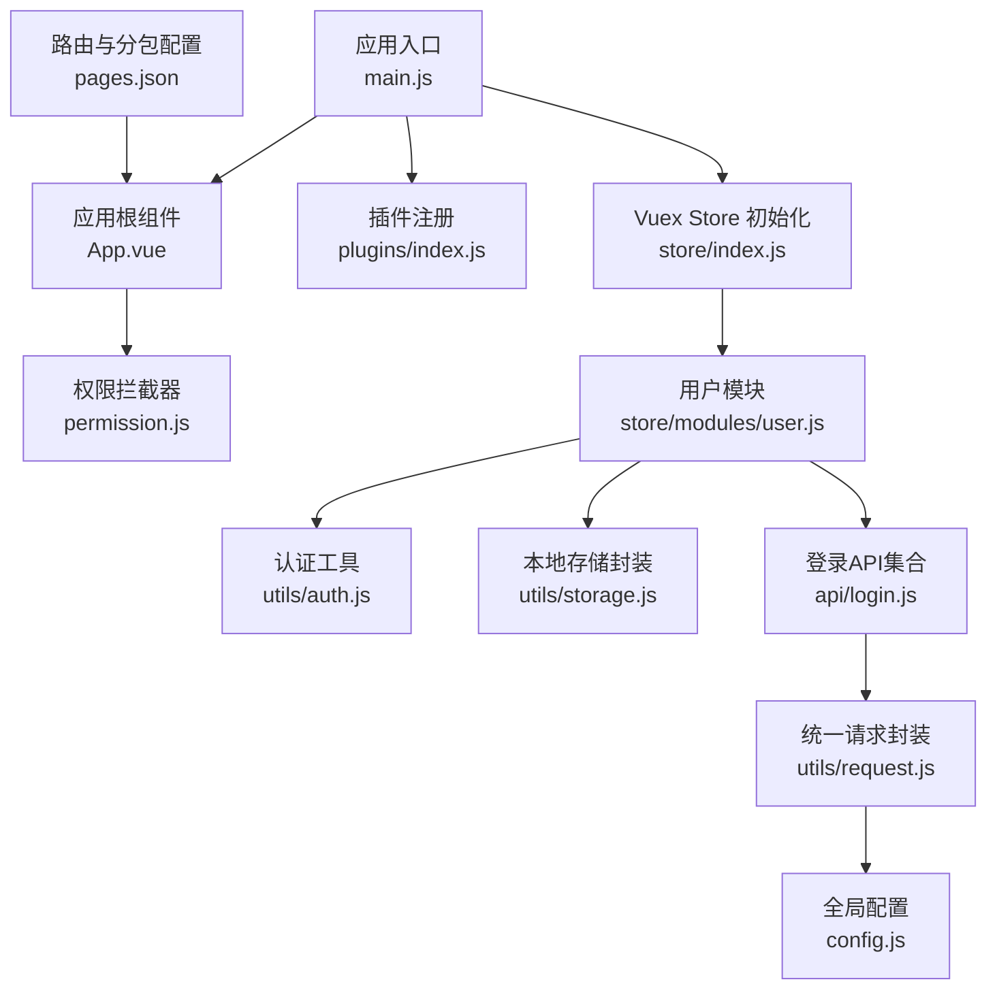
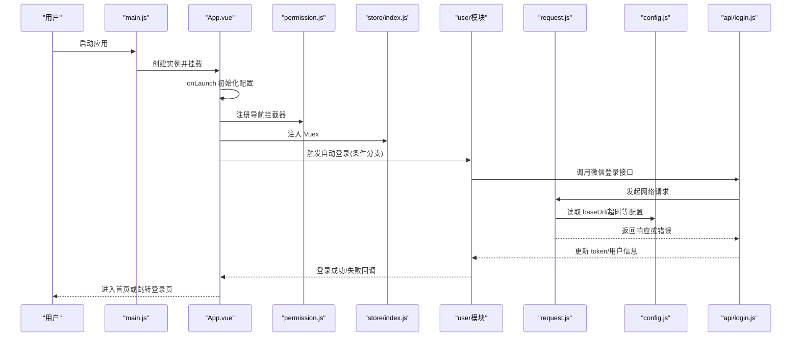
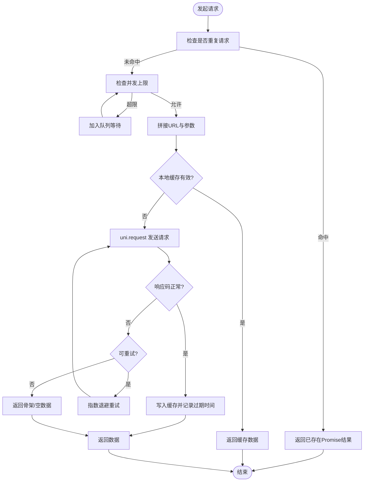
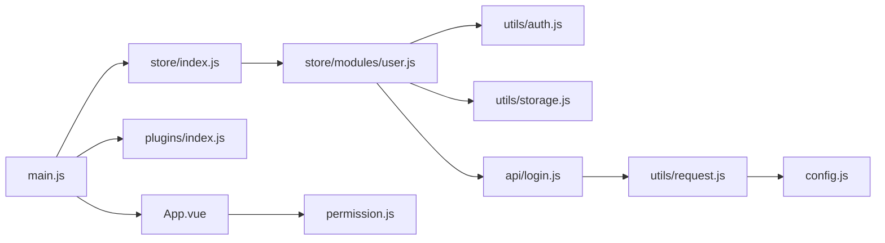

# 性能优化

<cite>
**本文引用的文件**   
- [main.js](file://main.js)
- [App.vue](file://App.vue)
- [pages.json](file://pages.json)
- [config.js](file://config.js)
- [utils/request.js](file://utils/request.js)
- [utils/storage.js](file://utils/storage.js)
- [store/index.js](file://store/index.js)
- [store/modules/user.js](file://store/modules/user.js)
- [plugins/index.js](file://plugins/index.js)
- [api/login.js](file://api/login.js)
- [utils/auth.js](file://utils/auth.js)
- [utils/common.js](file://utils/common.js)
- [utils/constant.js](file://utils/constant.js)
- [permission.js](file://permission.js)
</cite>

## 目录
1. [简介](#简介)
2. [项目结构](#项目结构)
3. [核心组件](#核心组件)
4. [架构总览](#架构总览)
5. [详细组件分析](#详细组件分析)
6. [依赖分析](#依赖分析)
7. [性能考虑](#性能考虑)
8. [故障排查指南](#故障排查指南)
9. [结论](#结论)
10. [附录](#附录)

## 简介
本指南面向 RuoYi-App（基于 uni-app）的性能优化，聚焦小程序场景。围绕网络请求、页面渲染、内存管理、存储与打包等关键领域，结合仓库现有实现进行系统性分析与实践建议，帮助在保持功能完整性的前提下提升首屏速度、交互流畅度与资源利用率。

## 项目结构
RuoYi-App 采用典型的前端分层：应用入口与初始化、路由与分包配置、全局状态与权限、通用工具与网络层、业务 API 封装、UI 组件库集成等。

图示来源
- [main.js:1-31](file://main.js#L1-L31)
- [App.vue:1-48](file://App.vue#L1-L48)
- [permission.js:1-133](file://permission.js#L1-L133)
- [plugins/index.js:1-15](file://plugins/index.js#L1-L15)
- [store/index.js:1-16](file://store/index.js#L1-L16)
- [store/modules/user.js:1-283](file://store/modules/user.js#L1-L283)
- [utils/auth.js:1-47](file://utils/auth.js#L1-L47)
- [utils/storage.js:1-33](file://utils/storage.js#L1-L33)
- [api/login.js:1-168](file://api/login.js#L1-L168)
- [utils/request.js:1-117](file://utils/request.js#L1-L117)
- [config.js:1-38](file://config.js#L1-L38)
- [pages.json:1-235](file://pages.json#L1-L235)

章节来源
- [main.js:1-31](file://main.js#L1-L31)
- [App.vue:1-48](file://App.vue#L1-L48)
- [pages.json:1-235](file://pages.json#L1-L235)

## 核心组件
- 应用启动与初始化
  - 入口 main.js 完成 UI 框架、插件、Store 与全局方法挂载；App.vue 的 onLaunch 中执行环境差异化初始化与自动登录流程。
- 路由与分包
  - pages.json 定义主包与多个 subPackages，降低首包体积并支持按需加载。
- 网络层
  - utils/request.js 统一封装 uni.request，处理鉴权、错误码、超时、重试与平台差异。
- 状态与持久化
  - store/modules/user.js 负责登录态、用户信息与角色权限；utils/auth.js 与 utils/storage.js 提供 Token 与结构化数据持久化。
- 权限与跳转拦截
  - permission.js 通过 uni.addInterceptor 对导航进行鉴权与白名单控制，并缓存角色配置。

章节来源
- [main.js:1-31](file://main.js#L1-L31)
- [App.vue:1-48](file://App.vue#L1-L48)
- [pages.json:1-235](file://pages.json#L1-L235)
- [utils/request.js:1-117](file://utils/request.js#L1-L117)
- [store/modules/user.js:1-283](file://store/modules/user.js#L1-L283)
- [utils/auth.js:1-47](file://utils/auth.js#L1-L47)
- [utils/storage.js:1-33](file://utils/storage.js#L1-L33)
- [permission.js:1-133](file://permission.js#L1-L133)

## 架构总览
下图展示从应用启动到页面渲染的关键路径，以及网络请求与状态管理的交互关系。

图示来源
- [main.js:1-31](file://main.js#L1-L31)
- [App.vue:1-48](file://App.vue#L1-L48)
- [permission.js:1-133](file://permission.js#L1-L133)
- [store/index.js:1-16](file://store/index.js#L1-L16)
- [store/modules/user.js:1-283](file://store/modules/user.js#L1-L283)
- [api/login.js:1-168](file://api/login.js#L1-L168)
- [utils/request.js:1-117](file://utils/request.js#L1-L117)
- [config.js:1-38](file://config.js#L1-L38)

## 详细组件分析

### 网络请求优化
现状与瓶颈
- 统一封装位于 utils/request.js，具备基础鉴权、错误提示、超时与平台分支逻辑。
- 当前未实现请求去重、并发限制、HTTP 缓存、断网重试与降级策略。

优化方案与实践
- 请求合并与去重
  - 为相同 URL+参数 的请求建立 Promise 队列，避免重复网络开销。
  - 适用于列表首屏、字典/配置类高频小请求。
- 并发与节流
  - 设置最大并发数，避免瞬时大量请求阻塞线程与带宽。
- 缓存策略
  - 对静态或低频变更数据（如字典、公告）增加本地缓存与过期时间，优先读本地再发请求。
  - 使用 ETag/Last-Modified（若后端支持）减少传输量。
- 懒加载与分页
  - 列表采用分页与滚动触底加载，避免一次性拉取全量数据。
- 错误重试与退避
  - 对可重试错误（如网络抖动）实施指数退避重试，限制最大次数。
- 超时与降级
  - 按接口类型区分超时阈值；超时后返回骨架或缓存数据，保障可用性。
- 压缩与协议
  - 启用 gzip/br 压缩（服务端），HTTPS 复用连接，减少握手成本。

相关代码参考
- 请求封装与错误处理：[utils/request.js:1-117](file://utils/request.js#L1-L117)
- 登录接口示例（isToken 头控制）：[api/login.js:1-168](file://api/login.js#L1-L168)
- 全局配置（baseUrl/端口/前缀）：[config.js:1-38](file://config.js#L1-L38)

章节来源
- [utils/request.js:1-117](file://utils/request.js#L1-L117)
- [api/login.js:1-168](file://api/login.js#L1-L168)
- [config.js:1-38](file://config.js#L1-L38)

### 页面渲染优化
现状与瓶颈
- 路由采用分包 pages.json，有利于首屏体积控制。
- 大列表与复杂视图可能带来长任务与掉帧风险。

优化方案与实践
- 组件懒加载
  - 非首屏组件使用 import() 动态引入，减少初始解析与渲染压力。
- 虚拟列表
  - 大数据列表使用虚拟滚动，仅渲染可视区域节点，显著降低 DOM 数量。
- 图片优化
  - 使用合适尺寸与格式（WebP/AVIF），开启懒加载与占位图，避免阻塞首屏。
- 样式与布局
  - 减少层级与重排重绘，合理使用 will-change 与 transform 动画。
- 骨架屏与渐进式渲染
  - 首屏先出骨架，数据到达后再替换，提升感知性能。

相关代码参考
- 分包配置：[pages.json:1-235](file://pages.json#L1-L235)

章节来源
- [pages.json:1-235](file://pages.json#L1-L235)

### 存储优化
现状与瓶颈
- 使用 utils/storage.js 将用户信息以 JSON 对象形式集中存储在 storageKey 下，读写均为同步 API。
- 频繁同步 IO 会阻塞主线程，影响交互流畅性。

优化方案与实践
- 批量写入与最小化键值
  - 合并多次 set 为一次 setStorageSync，减少磁盘 IO。
  - 仅存储必要字段，避免冗余数据。
- 异步化与防抖
  - 对高频写操作进行防抖/节流，合并写入窗口。
- 数据结构设计
  - 合理拆分 key，避免单对象过大导致序列化/反序列化开销。
- 清理策略
  - 退出登录或敏感操作后及时 clean，释放空间。

相关代码参考
- 存储封装与键名常量：[utils/storage.js:1-33](file://utils/storage.js#L1-L33)、[utils/constant.js:1-10](file://utils/constant.js#L1-L10)
- 用户信息持久化与清理：[store/modules/user.js:1-283](file://store/modules/user.js#L1-L283)

章节来源
- [utils/storage.js:1-33](file://utils/storage.js#L1-L33)
- [utils/constant.js:1-10](file://utils/constant.js#L1-L10)
- [store/modules/user.js:1-283](file://store/modules/user.js#L1-L283)

### 内存管理最佳实践
现状与瓶颈
- 应用包含大量第三方 UI 组件与插件，运行时内存占用需关注。
- 事件监听、定时器、长轮询等若未清理，易造成泄漏。

优化方案与实践
- 对象释放
  - 页面销毁时主动置空大对象引用，避免闭包持有。
- 事件监听清理
  - 在 onUnload/onHide 中移除自定义事件与全局监听。
- 定时器管理
  - 使用唯一标识管理 setInterval/setTimeout，确保在合适的生命周期清除。
- 图片与视频
  - 及时释放不再使用的媒体资源，避免常驻内存。
- 组件卸载
  - 动态组件与弹窗关闭后及时销毁，减少实例堆积。

相关代码参考
- 插件挂载与全局方法：[plugins/index.js:1-15](file://plugins/index.js#L1-L15)
- 应用生命周期与自动登录：[App.vue:1-48](file://App.vue#L1-L48)

章节来源
- [plugins/index.js:1-15](file://plugins/index.js#L1-L15)
- [App.vue:1-48](file://App.vue#L1-L48)

### 打包与构建优化
现状与瓶颈
- 项目使用 uni-app 构建，默认包含 uView 等 UI 库，首包体积较大。

优化方案与实践
- 代码分割
  - 利用分包与动态 import 进一步拆分模块，按需加载。
- Tree Shaking
  - 确保使用 ES Module 导入，剔除未使用代码。
- 资源压缩
  - 启用图片压缩与字体子集化，减少静态资源体积。
- 生产模式
  - 关闭调试日志与 SourceMap，减小产物体积。
- 依赖瘦身
  - 评估第三方库必要性，按需引入或替换轻量替代。

相关代码参考
- 分包与 TabBar 配置：[pages.json:1-235](file://pages.json#L1-L235)
- 全局引入 uView：[main.js:1-31](file://main.js#L1-L31)

章节来源
- [pages.json:1-235](file://pages.json#L1-L235)
- [main.js:1-31](file://main.js#L1-L31)

### 权限与路由拦截的性能影响
现状与瓶颈
- permission.js 通过 uni.addInterceptor 对 navigateTo/redirectTo/reLaunch/switchTab 进行拦截，并在首次获取角色配置后进行本地缓存。

优化方案与实践
- 预加载与缓存
  - 在 App 启动时异步拉取角色配置并缓存，避免每次跳转都触发网络。
- 白名单精简
  - 仅保留必要白名单，减少判断分支。
- 动态 TabBar
  - 仅在小程序环境下尝试修改 TabBar，避免无效调用。

相关代码参考
- 权限拦截与角色配置缓存：[permission.js:1-133](file://permission.js#L1-L133)

章节来源
- [permission.js:1-133](file://permission.js#L1-L133)

## 依赖分析
下图展示关键模块间的依赖关系，便于识别耦合点与潜在循环依赖风险。

图示来源
- [main.js:1-31](file://main.js#L1-L31)
- [App.vue:1-48](file://App.vue#L1-L48)
- [plugins/index.js:1-15](file://plugins/index.js#L1-L15)
- [store/index.js:1-16](file://store/index.js#L1-L16)
- [store/modules/user.js:1-283](file://store/modules/user.js#L1-L283)
- [utils/auth.js:1-47](file://utils/auth.js#L1-L47)
- [utils/storage.js:1-33](file://utils/storage.js#L1-L33)
- [api/login.js:1-168](file://api/login.js#L1-L168)
- [utils/request.js:1-117](file://utils/request.js#L1-L117)
- [config.js:1-38](file://config.js#L1-L38)
- [permission.js:1-133](file://permission.js#L1-L133)

章节来源
- [main.js:1-31](file://main.js#L1-L31)
- [App.vue:1-48](file://App.vue#L1-L48)
- [store/index.js:1-16](file://store/index.js#L1-L16)
- [store/modules/user.js:1-283](file://store/modules/user.js#L1-L283)
- [utils/request.js:1-117](file://utils/request.js#L1-L117)
- [permission.js:1-133](file://permission.js#L1-L133)

## 性能考虑
- 首屏性能
  - 利用分包与懒加载减少首包体积；首屏只加载必要组件与数据。
- 交互性能
  - 避免在主线程执行耗时计算，必要时使用 Web Worker（H5）或分片渲染。
- 网络性能
  - 合并请求、缓存、重试与超时策略组合使用，提高成功率与体验。
- 内存与稳定性
  - 严格的生命周期管理，防止内存泄漏；定期压测与回归。
- 监控与度量
  - 接入性能埋点，采集首屏时间、FCP/LCP、JS 执行时长、网络耗时与错误率。

## 故障排查指南
常见问题与定位思路
- 登录态异常
  - 检查 getToken/removeToken 与 storage 一致性；确认登出流程是否清理所有键值。
  - 参考：[utils/auth.js:1-47](file://utils/auth.js#L1-L47)、[utils/storage.js:1-33](file://utils/storage.js#L1-L33)、[store/modules/user.js:1-283](file://store/modules/user.js#L1-L283)
- 网络错误与超时
  - 查看 request 的错误映射与 toast 提示；根据错误码定位后端或网络问题。
  - 参考：[utils/request.js:1-117](file://utils/request.js#L1-L117)
- 权限与跳转异常
  - 检查白名单与角色配置缓存；确认拦截器是否误拦截。
  - 参考：[permission.js:1-133](file://permission.js#L1-L133)
- 自动登录失败
  - 确认 wxLogin 流程与平台分支；检查 token 写入与后续 getInfo 调用。
  - 参考：[App.vue:1-48](file://App.vue#L1-L48)、[api/login.js:1-168](file://api/login.js#L1-L168)、[store/modules/user.js:1-283](file://store/modules/user.js#L1-L283)

章节来源
- [utils/auth.js:1-47](file://utils/auth.js#L1-L47)
- [utils/storage.js:1-33](file://utils/storage.js#L1-L33)
- [utils/request.js:1-117](file://utils/request.js#L1-L117)
- [permission.js:1-133](file://permission.js#L1-L133)
- [App.vue:1-48](file://App.vue#L1-L48)
- [api/login.js:1-168](file://api/login.js#L1-L168)
- [store/modules/user.js:1-283](file://store/modules/user.js#L1-L283)

## 结论
通过对网络、渲染、存储、内存与打包的系统性优化，可在不改变业务逻辑的前提下显著提升 RuoYi-App 在小程端的性能表现。建议优先落地请求去重与缓存、分包与懒加载、同步 IO 批量化与生命周期清理，并结合性能监控持续迭代。

## 附录
- 指标建议
  - 首屏时间、FCP/LCP、JS 主线程阻塞时长、网络成功率与平均耗时、内存峰值与泄漏检测。
- 工具建议
  - 小程序开发者工具性能面板、Network 面板、Memory 面板；线上埋点上报与可视化看板。