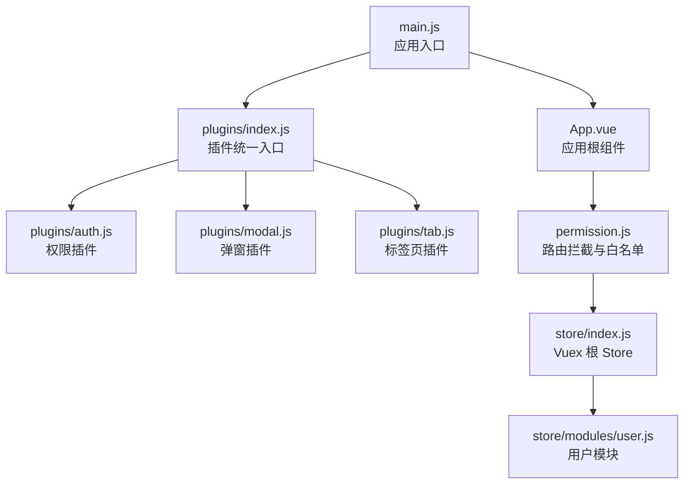
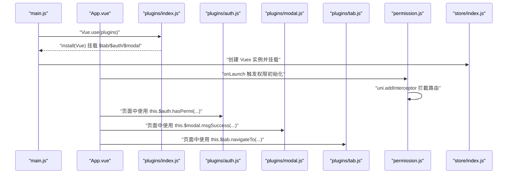
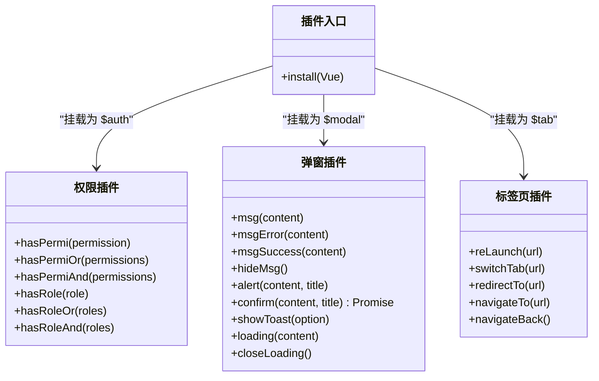
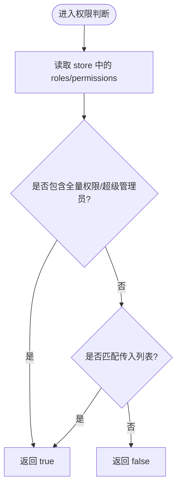
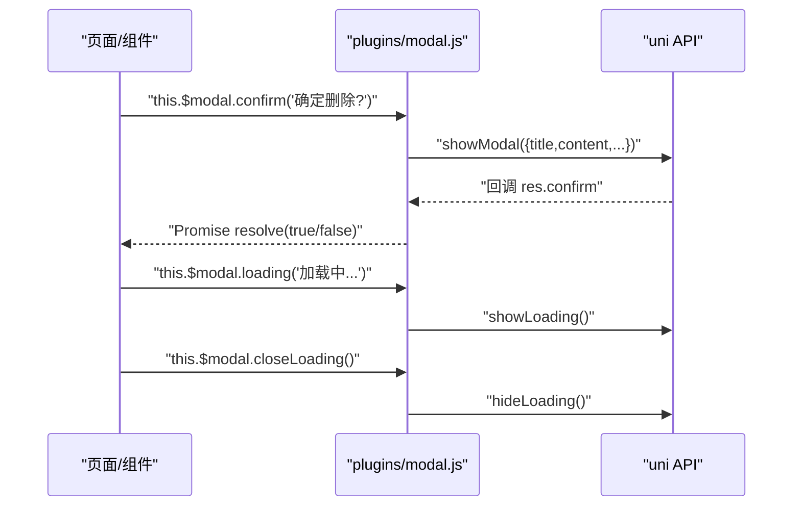
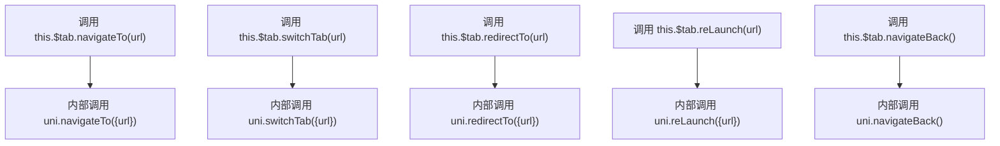
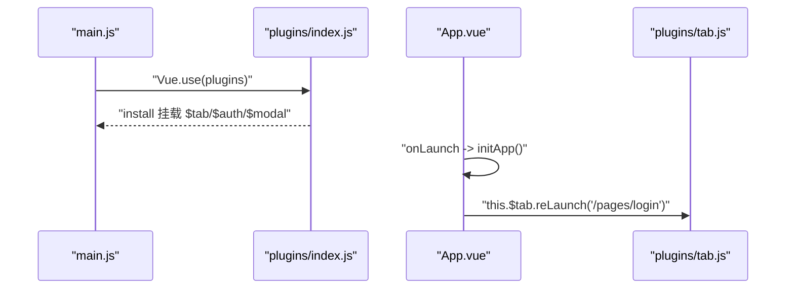
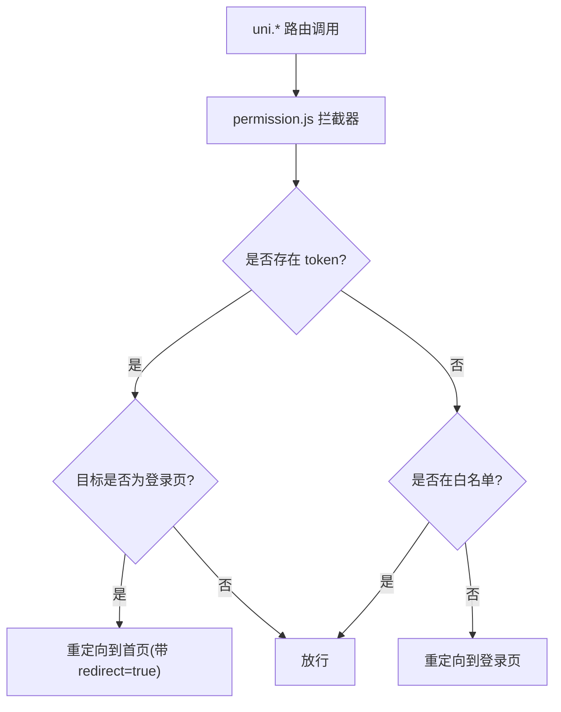
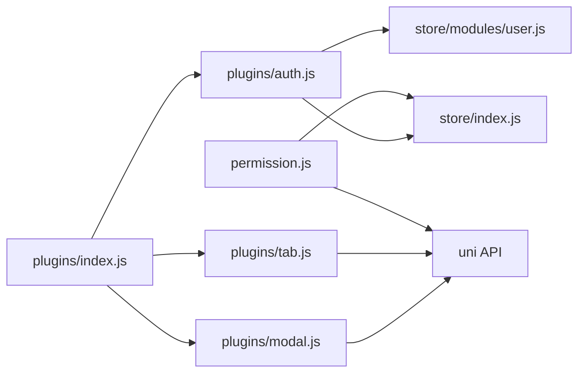

# 插件开发

<cite>
**本文引用的文件**   
- [plugins/index.js](file://plugins/index.js)
- [plugins/auth.js](file://plugins/auth.js)
- [plugins/modal.js](file://plugins/modal.js)
- [plugins/tab.js](file://plugins/tab.js)
- [main.js](file://main.js)
- [App.vue](file://App.vue)
- [permission.js](file://permission.js)
- [store/index.js](file://store/index.js)
- [store/modules/user.js](file://store/modules/user.js)
- [utils/permission.js](file://utils/permission.js)
</cite>

## 目录
1. [简介](#简介)
2. [项目结构](#项目结构)
3. [核心组件](#核心组件)
4. [架构总览](#架构总览)
5. [详细组件分析](#详细组件分析)
6. [依赖关系分析](#依赖关系分析)
7. [性能与兼容性考虑](#性能与兼容性考虑)
8. [故障排查指南](#故障排查指南)
9. [结论](#结论)
10. [附录：插件开发与使用最佳实践](#附录插件开发与使用最佳实践)

## 简介
本文件面向开发者，系统化阐述 RuoYi-App 的“插件系统”设计与使用方法。该插件体系基于 Vue 插件机制，通过统一的入口将全局能力挂载到 Vue 实例原型上，提供权限控制、弹窗提示、页面跳转等通用能力。文档涵盖：
- 插件基本概念与类型（全局插件、页面插件、组件插件）
- 插件注册与加载机制（在 plugins/index.js 中配置）
- 现有插件实现原理（auth 权限、modal 弹窗、tab 标签页）
- 插件开发模板与示例路径（初始化、生命周期钩子、API 暴露）
- 最佳实践（错误处理、性能优化、兼容性）
- 测试方法与调试技巧

## 项目结构
RuoYi-App 采用分层组织方式：
- 应用启动与全局注入：main.js 负责引入并安装插件、挂载 store 与工具方法
- 插件统一入口：plugins/index.js 聚合各插件并通过 install 挂载到 Vue.prototype
- 业务插件：plugins/auth.js、plugins/modal.js、plugins/tab.js
- 运行时拦截与权限：permission.js 对 uni 路由 API 进行拦截，结合 store 完成鉴权
- 状态管理：store/index.js 与 store/modules/user.js 维护用户信息、角色与权限

图表来源
- [main.js:1-31](file://main.js#L1-L31)
- [plugins/index.js:1-15](file://plugins/index.js#L1-L15)
- [plugins/auth.js:1-61](file://plugins/auth.js#L1-L61)
- [plugins/modal.js:1-79](file://plugins/modal.js#L1-L79)
- [plugins/tab.js:1-31](file://plugins/tab.js#L1-L31)
- [permission.js:1-133](file://permission.js#L1-L133)
- [store/index.js:1-16](file://store/index.js#L1-L16)
- [store/modules/user.js:1-283](file://store/modules/user.js#L1-L283)

章节来源
- [main.js:1-31](file://main.js#L1-L31)
- [plugins/index.js:1-15](file://plugins/index.js#L1-L15)

## 核心组件
本节聚焦插件系统的核心构件与职责边界：
- 插件统一入口：定义 install(Vue) 并将各插件对象挂载至 Vue.prototype，使所有页面和组件可通过 this.$xxx 访问
- 权限插件：封装 hasPermi/hasRole 等方法，读取 store 中的 roles/permissions 进行校验
- 弹窗插件：封装 showToast、alert、confirm、loading 等交互能力，统一调用 uni.* API
- 标签页插件：封装 navigateTo、redirectTo、switchTab、reLaunch、navigateBack 等路由操作

章节来源
- [plugins/index.js:1-15](file://plugins/index.js#L1-L15)
- [plugins/auth.js:1-61](file://plugins/auth.js#L1-L61)
- [plugins/modal.js:1-79](file://plugins/modal.js#L1-L79)
- [plugins/tab.js:1-31](file://plugins/tab.js#L1-L31)

## 架构总览
下图展示了从应用启动到插件生效的关键流程，以及权限拦截如何与插件协作。

图表来源
- [main.js:1-31](file://main.js#L1-L31)
- [plugins/index.js:1-15](file://plugins/index.js#L1-L15)
- [plugins/auth.js:1-61](file://plugins/auth.js#L1-L61)
- [plugins/modal.js:1-79](file://plugins/modal.js#L1-L79)
- [plugins/tab.js:1-31](file://plugins/tab.js#L1-L31)
- [permission.js:1-133](file://permission.js#L1-L133)
- [store/index.js:1-16](file://store/index.js#L1-L16)

## 详细组件分析

### 插件统一入口（plugins/index.js）
- 职责：集中导入各插件，并在 install 中将它们挂载到 Vue.prototype，形成全局可用的 $tab、$auth、$modal
- 扩展点：新增插件时，只需在 index.js 中 import 并挂载即可

图表来源
- [plugins/index.js:1-15](file://plugins/index.js#L1-L15)
- [plugins/auth.js:1-61](file://plugins/auth.js#L1-L61)
- [plugins/modal.js:1-79](file://plugins/modal.js#L1-L79)
- [plugins/tab.js:1-31](file://plugins/tab.js#L1-L31)

章节来源
- [plugins/index.js:1-15](file://plugins/index.js#L1-L15)

### 权限插件（plugins/auth.js）
- 设计要点
  - 读取 store.getters.roles 与 store.getters.permissions
  - 支持单个或批量权限/角色的“或/且”组合判断
  - 内置超级管理员与全量权限常量，便于快速放行
- 典型用法
  - 在页面或组件中通过 this.$auth.hasPermi('...') 或 this.$auth.hasRole('...') 进行条件渲染或逻辑分支

图表来源
- [plugins/auth.js:1-61](file://plugins/auth.js#L1-L61)
- [store/index.js:1-16](file://store/index.js#L1-L16)
- [store/modules/user.js:1-283](file://store/modules/user.js#L1-L283)

章节来源
- [plugins/auth.js:1-61](file://plugins/auth.js#L1-L61)
- [store/index.js:1-16](file://store/index.js#L1-L16)
- [store/modules/user.js:1-283](file://store/modules/user.js#L1-L283)

### 弹窗插件（plugins/modal.js）
- 设计要点
  - 统一封装 uni.showToast/showModal/showLoading/hideLoading
  - confirm 返回 Promise，便于异步确认流程
  - loading/closeLoading 成对使用，避免遮罩残留
- 典型用法
  - 表单提交前 msgError 提示；成功后 msgSuccess；需要二次确认时使用 confirm

图表来源
- [plugins/modal.js:1-79](file://plugins/modal.js#L1-L79)

章节来源
- [plugins/modal.js:1-79](file://plugins/modal.js#L1-L79)

### 标签页插件（plugins/tab.js）
- 设计要点
  - 统一封装 uni.navigateTo/redirectTo/switchTab/reLaunch/navigateBack
  - 对外暴露简洁的命名空间，降低页面间耦合
- 典型用法
  - 登录成功跳转首页：this.$tab.reLaunch('/pages/index')
  - 保留当前页跳转详情：this.$tab.navigateTo('/pages/detail?id=1')

图表来源
- [plugins/tab.js:1-31](file://plugins/tab.js#L1-L31)

章节来源
- [plugins/tab.js:1-31](file://plugins/tab.js#L1-L31)

### 应用启动与插件装配（main.js / App.vue）
- main.js
  - 引入并安装插件：Vue.use(plugins)
  - 挂载 store 与字典接口等全局能力
- App.vue
  - onLaunch 中执行 initApp，根据平台进行自动登录或登录态检查
  - 使用 this.$tab.reLaunch 做未登录重定向

图表来源
- [main.js:1-31](file://main.js#L1-L31)
- [plugins/index.js:1-15](file://plugins/index.js#L1-L15)
- [App.vue:1-48](file://App.vue#L1-L48)
- [plugins/tab.js:1-31](file://plugins/tab.js#L1-L31)

章节来源
- [main.js:1-31](file://main.js#L1-L31)
- [App.vue:1-48](file://App.vue#L1-L48)

### 路由拦截与权限联动（permission.js）
- 功能
  - 白名单校验：允许匿名访问的页面
  - 登录态检查：未登录跳转到登录页；已登录访问登录页则重定向到首页
  - 动态设置 TabBar（仅小程序环境）
  - 通过 uni.addInterceptor 对 navigateTo/redirectTo/reLaunch/switchTab 进行统一拦截
- 与插件的关系
  - 页面内通过 this.$tab.* 发起跳转，最终由 permission.js 的拦截器决定是否放行或重定向

图表来源
- [permission.js:1-133](file://permission.js#L1-L133)

章节来源
- [permission.js:1-133](file://permission.js#L1-L133)

## 依赖关系分析
- 插件入口依赖各具体插件模块
- 权限插件依赖 store 中的用户信息与权限数据
- 弹窗与标签页插件依赖 uni 平台 API
- 路由拦截依赖 uni.addInterceptor 与本地存储

图表来源
- [plugins/index.js:1-15](file://plugins/index.js#L1-L15)
- [plugins/auth.js:1-61](file://plugins/auth.js#L1-L61)
- [plugins/modal.js:1-79](file://plugins/modal.js#L1-L79)
- [plugins/tab.js:1-31](file://plugins/tab.js#L1-L31)
- [permission.js:1-133](file://permission.js#L1-L133)
- [store/index.js:1-16](file://store/index.js#L1-L16)
- [store/modules/user.js:1-283](file://store/modules/user.js#L1-L283)

章节来源
- [plugins/index.js:1-15](file://plugins/index.js#L1-L15)
- [plugins/auth.js:1-61](file://plugins/auth.js#L1-L61)
- [plugins/modal.js:1-79](file://plugins/modal.js#L1-L79)
- [plugins/tab.js:1-31](file://plugins/tab.js#L1-L31)
- [permission.js:1-133](file://permission.js#L1-L133)
- [store/index.js:1-16](file://store/index.js#L1-L16)
- [store/modules/user.js:1-283](file://store/modules/user.js#L1-L283)

## 性能与兼容性考虑
- 性能
  - 弹窗与加载提示应成对出现，避免多次 showLoading 导致无法关闭
  - 权限判断尽量在渲染层缓存结果，减少重复计算
  - 路由跳转复用 this.$tab 封装，避免分散调用 uni API 造成不一致
- 兼容性
  - 动态设置 TabBar 仅在小程序环境可用，需按平台条件编译
  - 部分 uni API 在不同端存在差异，建议在插件内部做好兼容处理
- 可维护性
  - 插件职责单一，遵循高内聚低耦合原则
  - 通过统一入口集中管理，便于扩展与替换

[本节为通用建议，不直接分析具体文件]

## 故障排查指南
- 现象：弹窗无法关闭或遮罩残留
  - 排查：确保 closeLoading 被调用；注意异常分支也要关闭
  - 参考：[plugins/modal.js:64-77](file://plugins/modal.js#L64-L77)
- 现象：登录后仍跳转到登录页
  - 排查：检查 token 是否正确保存；确认白名单与重定向逻辑
  - 参考：[permission.js:97-133](file://permission.js#L97-L133)
- 现象：权限判断无效
  - 排查：确认 store 中 roles/permissions 是否已正确写入；检查全量权限与超级管理员常量
  - 参考：[plugins/auth.js:3-25](file://plugins/auth.js#L3-L25)、[store/modules/user.js:96-106](file://store/modules/user.js#L96-L106)
- 现象：路由跳转不生效
  - 排查：确认使用的是 this.$tab 封装方法；检查拦截器是否拦截了目标 API
  - 参考：[plugins/tab.js:1-31](file://plugins/tab.js#L1-L31)、[permission.js:97-133](file://permission.js#L97-L133)

章节来源
- [plugins/modal.js:64-77](file://plugins/modal.js#L64-L77)
- [permission.js:97-133](file://permission.js#L97-L133)
- [plugins/auth.js:3-25](file://plugins/auth.js#L3-L25)
- [store/modules/user.js:96-106](file://store/modules/user.js#L96-L106)
- [plugins/tab.js:1-31](file://plugins/tab.js#L1-L31)

## 结论
RuoYi-App 的插件系统以“统一入口 + 原型挂载”的方式，将权限、弹窗、路由等通用能力标准化输出。配合路由拦截与状态管理，形成了清晰、可扩展的前端基础设施。遵循本文的最佳实践与排障指引，可高效地扩展新的插件并保持代码一致性。

[本节为总结性内容，不直接分析具体文件]

## 附录：插件开发与使用最佳实践

### 插件类型与概念
- 全局插件：通过 Vue.use 安装，挂载到 Vue.prototype，供所有页面/组件使用
- 页面插件：针对特定页面的增强逻辑，可在页面 created/onLoad 中按需引入
- 组件插件：封装为可复用的 UI 组件，通过 uni_modules 或本地 components 引入

### 插件开发模板与示例路径
- 基本结构
  - 导出默认对象，包含初始化函数与对外 API
  - 若需要生命周期钩子，可在 install 中注册全局事件或在 mixin 中提供钩子
- 示例参考
  - 插件入口与挂载：[plugins/index.js:1-15](file://plugins/index.js#L1-L15)
  - 权限插件 API 暴露：[plugins/auth.js:27-60](file://plugins/auth.js#L27-L60)
  - 弹窗插件 API 暴露：[plugins/modal.js:1-79](file://plugins/modal.js#L1-L79)
  - 标签页插件 API 暴露：[plugins/tab.js:1-31](file://plugins/tab.js#L1-L31)
- 生命周期钩子
  - 应用级：在 App.vue 的 onLaunch/initApp 中执行初始化逻辑
  - 页面级：在页面 created/onLoad 中执行页面相关初始化
  - 组件级：在组件 mounted 中执行 DOM 相关初始化

章节来源
- [plugins/index.js:1-15](file://plugins/index.js#L1-L15)
- [plugins/auth.js:27-60](file://plugins/auth.js#L27-L60)
- [plugins/modal.js:1-79](file://plugins/modal.js#L1-L79)
- [plugins/tab.js:1-31](file://plugins/tab.js#L1-L31)
- [App.vue:1-48](file://App.vue#L1-L48)

### 插件注册与加载机制
- 在 plugins/index.js 中 import 新插件，并在 install 中挂载到 Vue.prototype
- 在 main.js 中通过 Vue.use(plugins) 完成统一安装
- 如需在应用启动阶段执行初始化，可在 App.vue 的 onLaunch 中调用

章节来源
- [plugins/index.js:1-15](file://plugins/index.js#L1-L15)
- [main.js:1-31](file://main.js#L1-L31)
- [App.vue:1-48](file://App.vue#L1-L48)

### 现有插件实现原理速览
- auth.js：基于 store 的 roles/permissions 进行权限判定，支持单/多权限与角色组合
- modal.js：统一封装 uni 消息与弹窗 API，提供 Promise 化的 confirm
- tab.js：统一封装 uni 路由 API，屏蔽平台差异

章节来源
- [plugins/auth.js:1-61](file://plugins/auth.js#L1-L61)
- [plugins/modal.js:1-79](file://plugins/modal.js#L1-L79)
- [plugins/tab.js:1-31](file://plugins/tab.js#L1-L31)

### 测试方法与调试技巧
- 单元测试思路
  - 权限插件：构造不同 roles/permissions 场景，断言 hasPermi/hasRole 返回值
  - 弹窗插件：mock uni API，验证 show/hide 调用次数与参数
  - 标签页插件：mock uni 路由 API，验证调用链路与参数
- 调试技巧
  - 在插件方法首行打印关键参数与中间变量
  - 使用浏览器控制台或真机调试查看 uni API 调用栈
  - 针对路由问题，重点检查 permission.js 的拦截器逻辑

[本节为通用指导，不直接分析具体文件]