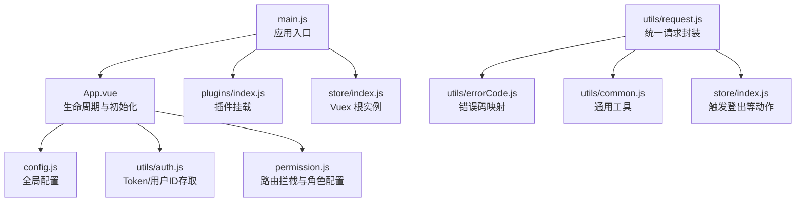
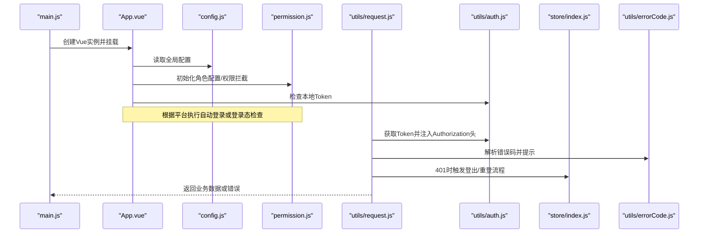
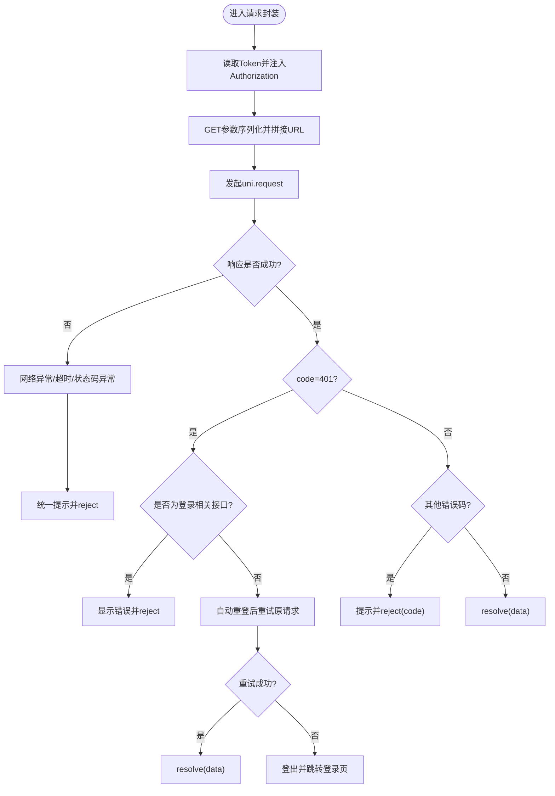
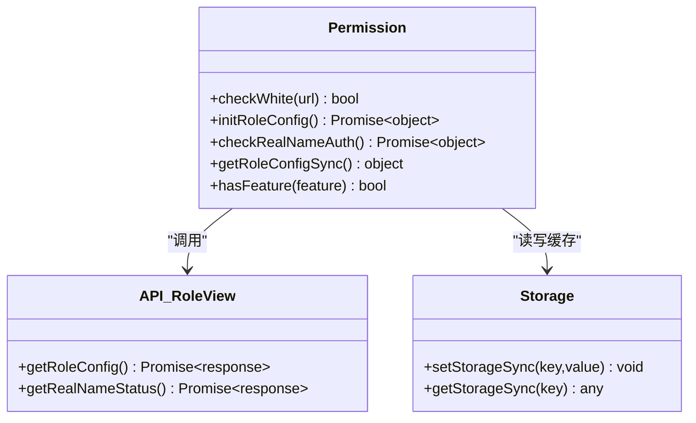
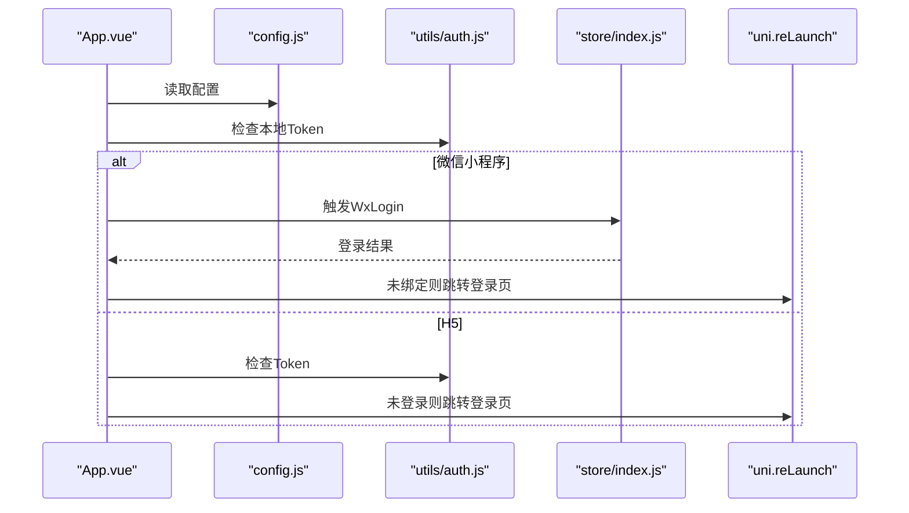
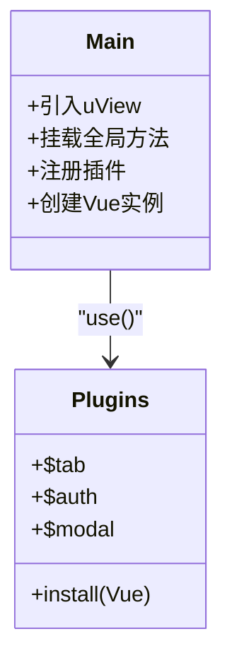
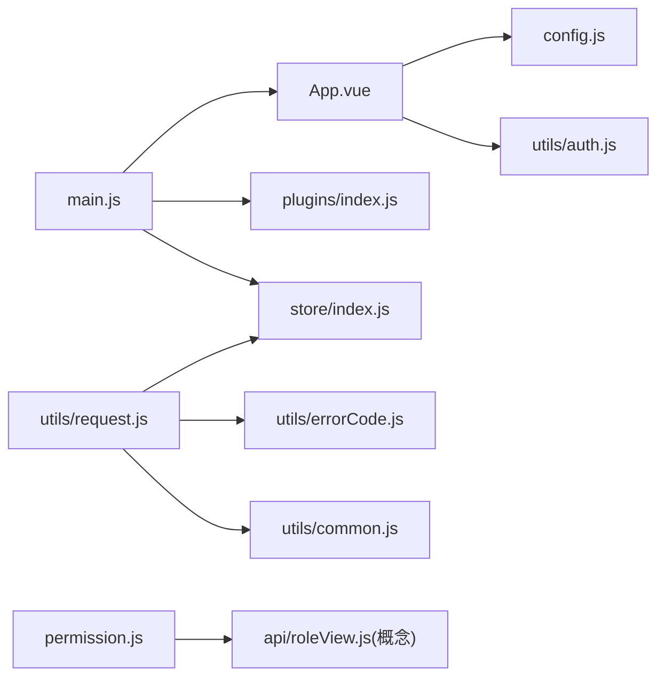

# 代码审查与质量保证

<cite>
**本文引用的文件**   
- [README.md](file://README.md)
- [main.js](file://main.js)
- [App.vue](file://App.vue)
- [config.js](file://config.js)
- [utils/request.js](file://utils/request.js)
- [utils/auth.js](file://utils/auth.js)
- [utils/common.js](file://utils/common.js)
- [utils/errorCode.js](file://utils/errorCode.js)
- [store/index.js](file://store/index.js)
- [plugins/index.js](file://plugins/index.js)
- [permission.js](file://permission.js)
</cite>

## 目录
1. [简介](#简介)
2. [项目结构](#项目结构)
3. [核心组件](#核心组件)
4. [架构总览](#架构总览)
5. [详细组件分析](#详细组件分析)
6. [依赖关系分析](#依赖关系分析)
7. [性能考量](#性能考量)
8. [故障排查指南](#故障排查指南)
9. [结论](#结论)
10. [附录](#附录)

## 简介
本指南面向 RuoYi-App（基于 uni-app 的移动端解决方案）的代码审查与质量保证，提供完整的审查流程、质量标准与工具实践。内容覆盖：
- 代码审查清单：规范检查、安全扫描、性能识别、逻辑错误检测
- 质量指标：复杂度、重复率、覆盖率、依赖关系分析
- 静态分析工具：ESLint 配置建议、代码格式化、类型检查
- 安全审查要点：SQL 注入防护、XSS 防护、敏感信息保护
- 性能优化检查：内存泄漏、网络请求优化、渲染性能
- 流程与跟踪：审查流程、标准、改进建议跟踪

## 项目结构
本项目采用 uni-app 多端工程结构，核心入口与初始化在 main.js 与 App.vue；全局配置集中于 config.js；网络请求封装于 utils/request.js；鉴权与权限控制位于 utils/auth.js 与 permission.js；状态管理使用 store/index.js；插件挂载在 plugins/index.js。

图表来源
- [main.js:1-31](file://main.js#L1-L31)
- [App.vue:1-48](file://App.vue#L1-L48)
- [config.js:1-38](file://config.js#L1-L38)
- [utils/request.js:1-117](file://utils/request.js#L1-L117)
- [utils/auth.js:1-47](file://utils/auth.js#L1-L47)
- [utils/common.js:1-121](file://utils/common.js#L1-L121)
- [utils/errorCode.js:1-7](file://utils/errorCode.js#L1-L7)
- [store/index.js:1-16](file://store/index.js#L1-L16)
- [plugins/index.js:1-15](file://plugins/index.js#L1-L15)
- [permission.js:1-133](file://permission.js#L1-L133)

章节来源
- [README.md:1-52](file://README.md#L1-L52)
- [main.js:1-31](file://main.js#L1-L31)
- [App.vue:1-48](file://App.vue#L1-L48)
- [config.js:1-38](file://config.js#L1-L38)
- [utils/request.js:1-117](file://utils/request.js#L1-L117)
- [utils/auth.js:1-47](file://utils/auth.js#L1-L47)
- [utils/common.js:1-121](file://utils/common.js#L1-L121)
- [utils/errorCode.js:1-7](file://utils/errorCode.js#L1-L7)
- [store/index.js:1-16](file://store/index.js#L1-L16)
- [plugins/index.js:1-15](file://plugins/index.js#L1-L15)
- [permission.js:1-133](file://permission.js#L1-L133)

## 核心组件
- 应用启动与插件注册：main.js 负责引入 uView UI、挂载插件、注入全局方法与字典接口，并创建 Vue 实例。
- 应用初始化与登录态校验：App.vue 在 onLaunch 中初始化配置，按平台执行自动登录或登录态检查。
- 全局配置：config.js 提供协议、主机、端口、API 前缀与 baseUrl 计算，以及应用信息。
- 统一请求封装：utils/request.js 处理 Authorization 头、参数序列化、超时、错误码处理、401 会话失效与微信环境自动重登。
- 鉴权与存储：utils/auth.js 提供 Token 与 UserId 的存取与登录态判断。
- 通用工具：utils/common.js 提供 toast、showConfirm、parseTime、tansParams、chooseLocation 等。
- 错误码映射：utils/errorCode.js 定义常见后端错误码提示。
- 状态管理：store/index.js 初始化 Vuex 并加载 user 模块。
- 插件系统：plugins/index.js 将 $tab、$auth、$modal 挂载到 Vue 原型。
- 路由与权限：permission.js 实现页面跳转拦截、白名单、角色配置缓存与动态 TabBar 设置。

章节来源
- [main.js:1-31](file://main.js#L1-L31)
- [App.vue:1-48](file://App.vue#L1-L48)
- [config.js:1-38](file://config.js#L1-L38)
- [utils/request.js:1-117](file://utils/request.js#L1-L117)
- [utils/auth.js:1-47](file://utils/auth.js#L1-L47)
- [utils/common.js:1-121](file://utils/common.js#L1-L121)
- [utils/errorCode.js:1-7](file://utils/errorCode.js#L1-L7)
- [store/index.js:1-16](file://store/index.js#L1-L16)
- [plugins/index.js:1-15](file://plugins/index.js#L1-L15)
- [permission.js:1-133](file://permission.js#L1-L133)

## 架构总览
下图展示从应用启动到网络请求与权限控制的交互关系。

图表来源
- [main.js:1-31](file://main.js#L1-L31)
- [App.vue:1-48](file://App.vue#L1-L48)
- [config.js:1-38](file://config.js#L1-L38)
- [permission.js:1-133](file://permission.js#L1-L133)
- [utils/request.js:1-117](file://utils/request.js#L1-L117)
- [utils/auth.js:1-47](file://utils/auth.js#L1-L47)
- [store/index.js:1-16](file://store/index.js#L1-L16)
- [utils/errorCode.js:1-7](file://utils/errorCode.js#L1-L7)

## 详细组件分析

### 统一请求封装（utils/request.js）
- 功能要点
  - 自动注入 Authorization 头（Bearer + Token），支持按需关闭 isToken。
  - GET 参数通过 tansParams 序列化拼接。
  - 统一超时与错误码处理，401 区分登录相关接口避免循环重登，非登录接口触发自动重登或登出。
  - 捕获网络异常并转换为友好提示。
- 风险点与审查建议
  - 401 分支对登录相关接口的判断应严格匹配路径，避免误判导致重登循环。
  - 重试逻辑需限制次数与退避策略，防止雪崩。
  - 错误码映射应集中维护，新增后端状态码需同步更新。
- 流程图

图表来源
- [utils/request.js:1-117](file://utils/request.js#L1-L117)
- [utils/common.js:1-121](file://utils/common.js#L1-L121)
- [utils/errorCode.js:1-7](file://utils/errorCode.js#L1-L7)

章节来源
- [utils/request.js:1-117](file://utils/request.js#L1-L117)
- [utils/common.js:1-121](file://utils/common.js#L1-L121)
- [utils/errorCode.js:1-7](file://utils/errorCode.js#L1-L7)

### 权限与路由拦截（permission.js）
- 功能要点
  - 白名单机制：允许未登录访问指定页面。
  - 已登录访问登录页时重定向至首页（带 redirect 标记）。
  - 角色配置缓存与动态 TabBar 设置（小程序平台）。
  - 实名认证状态获取与缓存。
- 风险点与审查建议
  - 白名单与重定向逻辑需确保路径规范化，避免绕过。
  - 角色配置失败时应回退默认配置，保证可用性。
  - 动态 TabBar 需在目标平台可用时调用，避免运行时异常。
- 类图（概念化）

图表来源
- [permission.js:1-133](file://permission.js#L1-L133)

章节来源
- [permission.js:1-133](file://permission.js#L1-L133)

### 应用初始化与登录态检查（App.vue）
- 功能要点
  - 初始化全局配置。
  - 微信小程序自动登录流程，失败则跳转登录页。
  - H5 环境检查本地 Token，未登录则跳转登录页。
- 风险点与审查建议
  - 自动登录失败路径需明确错误提示与后续引导。
  - 不同平台的条件编译逻辑需保持行为一致性与可测试性。
- 时序图

图表来源
- [App.vue:1-48](file://App.vue#L1-L48)
- [config.js:1-38](file://config.js#L1-L38)
- [utils/auth.js:1-47](file://utils/auth.js#L1-L47)
- [store/index.js:1-16](file://store/index.js#L1-L16)

章节来源
- [App.vue:1-48](file://App.vue#L1-L48)
- [config.js:1-38](file://config.js#L1-L38)
- [utils/auth.js:1-47](file://utils/auth.js#L1-L47)
- [store/index.js:1-16](file://store/index.js#L1-L16)

### 应用入口与插件挂载（main.js 与 plugins/index.js）
- 功能要点
  - 引入并启用 uView UI。
  - 挂载全局方法（时间处理、校园链接处理等）。
  - 注册插件，暴露 $tab、$auth、$modal。
- 风险点与审查建议
  - 全局方法命名应避免冲突，必要时增加命名空间。
  - 插件安装顺序影响原型挂载，需保持稳定。
- 类图（概念化）

图表来源
- [main.js:1-31](file://main.js#L1-L31)
- [plugins/index.js:1-15](file://plugins/index.js#L1-L15)

章节来源
- [main.js:1-31](file://main.js#L1-L31)
- [plugins/index.js:1-15](file://plugins/index.js#L1-L15)

## 依赖关系分析
- 直接依赖
  - main.js 依赖 App.vue、store、plugins、permission、uView、全局工具。
  - App.vue 依赖 config、auth、store。
  - request.js 依赖 store、config、auth、errorCode、common。
  - permission.js 依赖 auth、roleView API。
- 潜在耦合
  - request.js 与 store 的耦合体现在 401 处理中的登出与重登动作，建议抽象为中间件或事件总线以降低耦合度。
  - permission.js 与 roleView API 的耦合可通过服务层封装提升可测试性。
- 外部依赖
  - uni-app 原生 API（uni.request、uni.reLaunch、uni.setTabBar 等）。
  - uView UI 组件库。
  - Vuex 状态管理。

图表来源
- [main.js:1-31](file://main.js#L1-L31)
- [App.vue:1-48](file://App.vue#L1-L48)
- [config.js:1-38](file://config.js#L1-L38)
- [utils/request.js:1-117](file://utils/request.js#L1-L117)
- [utils/auth.js:1-47](file://utils/auth.js#L1-L47)
- [utils/common.js:1-121](file://utils/common.js#L1-L121)
- [utils/errorCode.js:1-7](file://utils/errorCode.js#L1-L7)
- [store/index.js:1-16](file://store/index.js#L1-L16)
- [plugins/index.js:1-15](file://plugins/index.js#L1-L15)
- [permission.js:1-133](file://permission.js#L1-L133)

章节来源
- [main.js:1-31](file://main.js#L1-L31)
- [App.vue:1-48](file://App.vue#L1-L48)
- [config.js:1-38](file://config.js#L1-L38)
- [utils/request.js:1-117](file://utils/request.js#L1-L117)
- [utils/auth.js:1-47](file://utils/auth.js#L1-L47)
- [utils/common.js:1-121](file://utils/common.js#L1-L121)
- [utils/errorCode.js:1-7](file://utils/errorCode.js#L1-L7)
- [store/index.js:1-16](file://store/index.js#L1-L16)
- [plugins/index.js:1-15](file://plugins/index.js#L1-L15)
- [permission.js:1-133](file://permission.js#L1-L133)

## 性能考量
- 网络请求优化
  - 合理设置超时与重试策略，避免频繁重试造成雪崩。
  - 合并请求与分页拉取，减少重复数据加载。
  - 对大列表进行虚拟滚动或懒加载。
- 渲染性能
  - 避免在模板中进行复杂计算，尽量在 computed 或 methods 中预处理。
  - 减少不必要的 re-render，合理使用 v-if/v-show。
- 内存泄漏检测
  - 及时移除定时器与事件监听器。
  - 避免在组件销毁后继续操作 DOM 或异步回调。
- 资源体积
  - 图片与静态资源按需加载与压缩。
  - 第三方库按需引入，避免全量打包。

[本节为通用指导，不直接分析具体文件]

## 故障排查指南
- 常见问题定位
  - 401 会话失效：检查请求封装的 401 分支与自动重登逻辑，确认登录相关接口判断是否正确。
  - 网络异常：查看统一错误处理与提示，确认超时与错误码映射是否完善。
  - 权限拦截：核对白名单与重定向逻辑，确认路径规范化与角色配置缓存。
- 调试建议
  - 在请求封装中打印关键上下文（URL、method、headers、timeout）。
  - 在权限拦截中记录跳转来源与目标，便于复现问题。
  - 使用平台开发者工具监控网络与存储状态。

章节来源
- [utils/request.js:1-117](file://utils/request.js#L1-L117)
- [permission.js:1-133](file://permission.js#L1-L133)
- [utils/errorCode.js:1-7](file://utils/errorCode.js#L1-L7)

## 结论
通过对应用入口、初始化、请求封装、权限控制等核心模块的分析，结合统一的错误处理与工具函数，可以建立稳定的前端基础能力。建议在持续集成中引入静态分析与安全检查，配合明确的审查清单与质量指标，持续提升代码质量与项目健康度。

[本节为总结性内容，不直接分析具体文件]

## 附录

### 代码审查清单
- 代码规范检查
  - 命名约定、文件组织、注释完整性、常量与配置集中管理。
- 安全漏洞扫描
  - SQL 注入防护：所有数据库查询必须使用参数化语句，禁止字符串拼接。
  - XSS 攻击防护：对用户输入进行转义与白名单过滤，避免直接使用 innerHTML。
  - 敏感信息保护：不在日志与前端存储明文敏感数据，Token 仅存必要字段。
- 性能问题识别
  - 长列表渲染、重复计算、过度重绘、未释放的资源。
- 逻辑错误检测
  - 边界条件、空值处理、异常分支、幂等性设计。

### 代码质量指标
- 代码复杂度：圈复杂度阈值建议 ≤ 10，嵌套层级 ≤ 4。
- 重复率：重复代码块比例 ≤ 5%，优先抽取公共函数或组件。
- 覆盖率：单元测试行覆盖率 ≥ 80%，关键路径 ≥ 90%。
- 依赖关系分析：模块间耦合度低，避免循环依赖。

### 静态代码分析工具使用
- ESLint 配置建议
  - 启用规则集：eslint:recommended、plugin:vue/vue3-recommended（或 vue2 对应规则）、plugin:security/recommended。
  - 自定义规则：禁止 console.log、强制错误处理、限制 import 深度。
- 代码格式化
  - Prettier 统一风格，与编辑器集成，提交前自动格式化。
- 类型检查
  - TypeScript 或 JSDoc 标注关键函数签名，提升可读性与可维护性。

### 安全审查要点
- SQL 注入防护
  - 后端使用参数化查询与 ORM 预编译，禁止拼接用户输入。
- XSS 攻击防护
  - 前端对用户输入进行转义，服务端输出编码，启用 CSP。
- 敏感信息保护
  - 最小化存储，加密传输，定期轮换密钥，禁用硬编码。

### 性能优化检查
- 内存泄漏检测
  - 使用浏览器/小程序开发者工具的 Memory 面板，定位未释放引用。
- 网络请求优化
  - 请求去重、缓存策略、断网重试与降级。
- 渲染性能分析
  - 使用 Performance 面板分析主线程耗时，优化重排与重绘。

### 代码审查流程与跟踪
- 流程
  - 提交前自检 → 自动化检查（ESLint/Prettier/类型检查）→ 人工审查 → 修复反馈 → 合并发布。
- 标准
  - 通过全部自动化检查；高风险问题零容忍；中低风险限期修复。
- 改进建议跟踪
  - 使用 Issue 或任务看板记录问题，关联 PR，闭环跟踪直至解决。

[本节为通用指导，不直接分析具体文件]