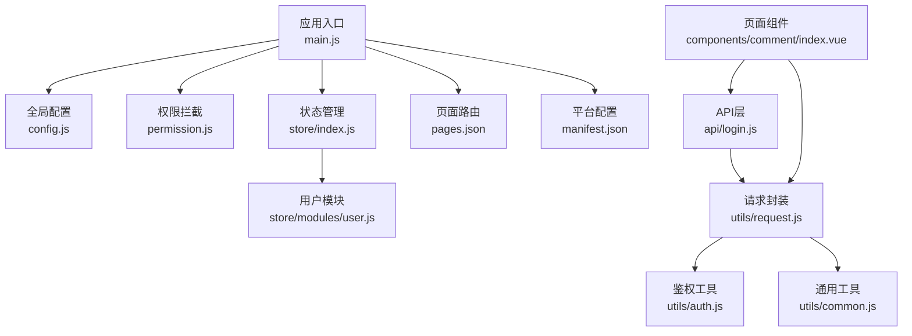
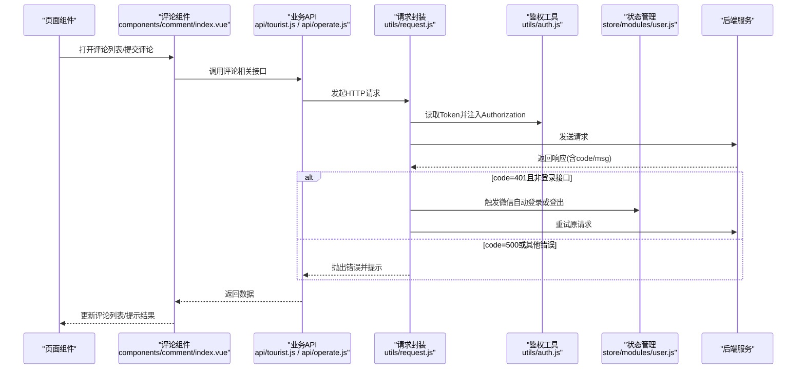
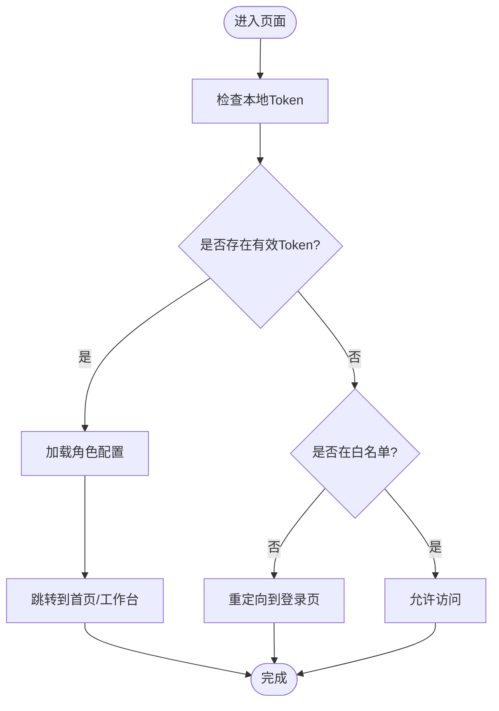
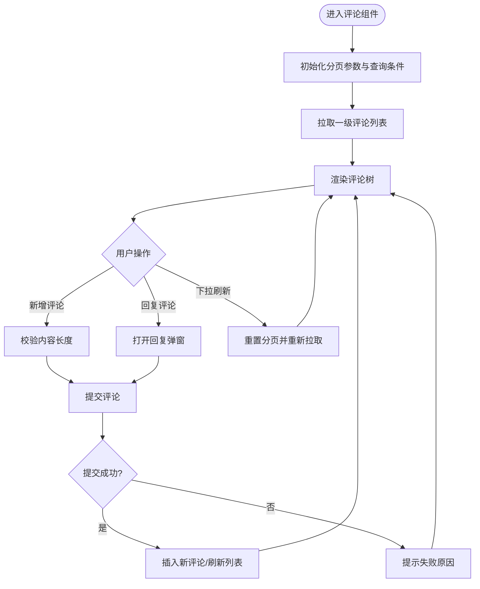
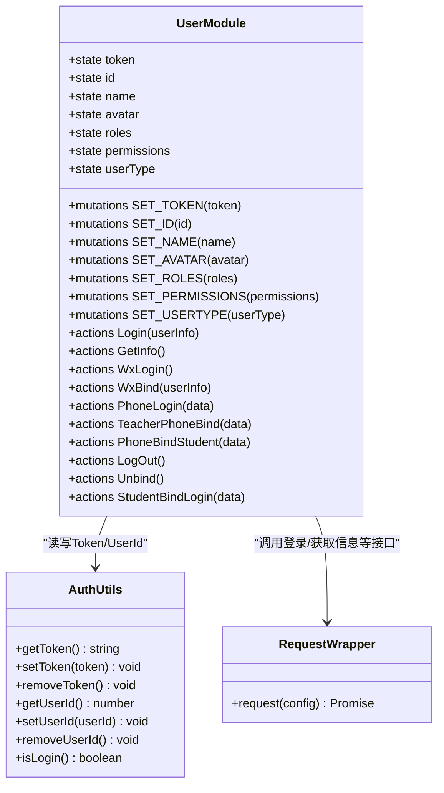
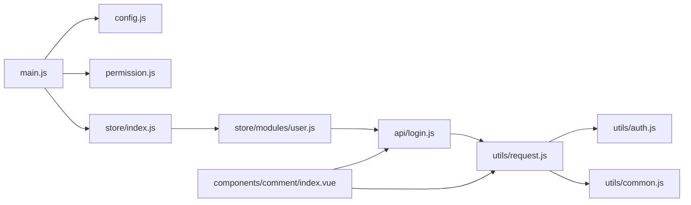

# 文档编写

<cite>
**本文引用的文件**   
- [README.md](file://README.md)
- [config.js](file://config.js)
- [main.js](file://main.js)
- [permission.js](file://permission.js)
- [manifest.json](file://manifest.json)
- [pages.json](file://pages.json)
- [api/login.js](file://api/login.js)
- [utils/request.js](file://utils/request.js)
- [utils/auth.js](file://utils/auth.js)
- [store/index.js](file://store/index.js)
- [store/modules/user.js](file://store/modules/user.js)
- [utils/common.js](file://utils/common.js)
- [utils/validate.js](file://utils/validate.js)
- [components/comment/index.vue](file://components/comment/index.vue)
</cite>

## 目录
1. [引言](#引言)
2. [项目结构](#项目结构)
3. [核心组件](#核心组件)
4. [架构总览](#架构总览)
5. [详细组件分析](#详细组件分析)
6. [依赖分析](#依赖分析)
7. [性能考虑](#性能考虑)
8. [故障排查指南](#故障排查指南)
9. [结论](#结论)
10. [附录](#附录)

## 引言
本文件为“文档编写”指南，面向RuoYi-App项目的技术文档与用户文档的编写规范与实践。目标包括：
- 统一用户手册与技术文档的编写标准
- 明确代码注释规范、README模板、版本发布文档要求
- 建立文档版本管理、审核流程与维护责任机制
- 结合本项目实际（登录鉴权、请求封装、权限控制、页面路由等）给出可落地的示例与流程图

## 项目结构
本项目基于UniApp构建，采用多端适配策略，包含应用入口、全局配置、权限拦截、状态管理、API层、工具库、页面与分包、第三方组件等模块。整体组织方式以“功能域+分层”为主：
- 应用入口与全局初始化：main.js、App.vue、manifest.json、pages.json
- 全局配置：config.js
- 权限与路由拦截：permission.js
- 状态管理：store/index.js、store/modules/user.js
- API接口：api/*（按业务域拆分）
- 通用工具：utils/*（网络、鉴权、校验、提示等）
- 页面与分包：pages/*、subPackages
- 第三方组件：uni_modules/*、components/*

图示来源
- [main.js:1-31](file://main.js#L1-L31)
- [config.js:1-38](file://config.js#L1-L38)
- [permission.js:1-133](file://permission.js#L1-L133)
- [store/index.js:1-16](file://store/index.js#L1-L16)
- [store/modules/user.js:1-283](file://store/modules/user.js#L1-L283)
- [pages.json:1-235](file://pages.json#L1-L235)
- [manifest.json:1-77](file://manifest.json#L1-L77)
- [api/login.js:1-168](file://api/login.js#L1-L168)
- [utils/request.js:1-117](file://utils/request.js#L1-L117)
- [utils/auth.js:1-47](file://utils/auth.js#L1-L47)
- [utils/common.js:1-121](file://utils/common.js#L1-L121)
- [components/comment/index.vue:1-476](file://components/comment/index.vue#L1-L476)

章节来源
- [main.js:1-31](file://main.js#L1-L31)
- [config.js:1-38](file://config.js#L1-L38)
- [permission.js:1-133](file://permission.js#L1-L133)
- [pages.json:1-235](file://pages.json#L1-L235)
- [manifest.json:1-77](file://manifest.json#L1-L77)

## 核心组件
- 应用入口与插件注册：在应用启动时引入uView UI、权限拦截、字典数据获取方法，并挂载到Vue原型上，便于全局使用。
- 全局配置：集中管理后端协议、主机、端口、API前缀与应用信息，提供baseUrl计算属性供请求层使用。
- 权限与路由拦截：实现登录态检查、白名单放行、登录后访问登录页重定向、动态角色配置缓存与TabBar设置。
- 状态管理：Vuex统一管理token、用户信息、角色与权限，并提供登录、登出、微信绑定、手机号快捷登录等动作。
- 请求封装：统一处理Authorization头、参数拼接、错误码映射、会话过期自动重试或跳转登录。
- 鉴权工具：封装Token与UserId的存取与登录态判断。
- 通用工具：消息提示、模态确认、时间格式化、URL/路径校验、定位选择等。
- 页面与分包：通过pages.json定义主包与分包页面、TabBar与全局样式。
- 第三方组件：通过uni_modules引入UI与工具组件，按需使用。

章节来源
- [main.js:1-31](file://main.js#L1-L31)
- [config.js:1-38](file://config.js#L1-L38)
- [permission.js:1-133](file://permission.js#L1-L133)
- [store/index.js:1-16](file://store/index.js#L1-L16)
- [store/modules/user.js:1-283](file://store/modules/user.js#L1-L283)
- [utils/request.js:1-117](file://utils/request.js#L1-L117)
- [utils/auth.js:1-47](file://utils/auth.js#L1-L47)
- [utils/common.js:1-121](file://utils/common.js#L1-L121)
- [pages.json:1-235](file://pages.json#L1-L235)
- [manifest.json:1-77](file://manifest.json#L1-L77)

## 架构总览
下图展示从页面发起评论到后端返回数据的完整调用链，体现组件、API层、请求封装、错误处理与状态更新的协作关系。

图示来源
- [components/comment/index.vue:1-476](file://components/comment/index.vue#L1-L476)
- [api/login.js:1-168](file://api/login.js#L1-L168)
- [utils/request.js:1-117](file://utils/request.js#L1-L117)
- [utils/auth.js:1-47](file://utils/auth.js#L1-L47)
- [store/modules/user.js:1-283](file://store/modules/user.js#L1-L283)

## 详细组件分析

### 登录与鉴权流程
- 登录态维护：通过utils/auth.js读写Token与UserId；store/modules/user.js在登录成功后持久化用户信息与角色权限。
- 请求拦截：utils/request.js根据是否携带Token自动添加Authorization头；对401进行差异化处理（登录接口不触发自动登录）。
- 路由拦截：permission.js实现白名单放行、未登录跳转登录页、已登录访问登录页重定向至首页。

图示来源
- [permission.js:1-133](file://permission.js#L1-L133)
- [utils/auth.js:1-47](file://utils/auth.js#L1-L47)
- [store/modules/user.js:1-283](file://store/modules/user.js#L1-L283)

章节来源
- [permission.js:1-133](file://permission.js#L1-L133)
- [utils/auth.js:1-47](file://utils/auth.js#L1-L47)
- [store/modules/user.js:1-283](file://store/modules/user.js#L1-L283)

### 评论组件交互逻辑
- 数据加载：组件通过分页滚动加载一级评论，支持刷新与空数据提示。
- 评论提交：支持新增一级评论与回复二级评论，成功后即时更新列表。
- 键盘适配：监听键盘高度变化，动态调整输入框位置。
- 登录态判断：在mounted中检查登录态并获取当前用户ID用于作者标签显示。

图示来源
- [components/comment/index.vue:1-476](file://components/comment/index.vue#L1-L476)

章节来源
- [components/comment/index.vue:1-476](file://components/comment/index.vue#L1-L476)

### 类图：用户状态与动作

图示来源
- [store/modules/user.js:1-283](file://store/modules/user.js#L1-L283)
- [utils/auth.js:1-47](file://utils/auth.js#L1-L47)
- [utils/request.js:1-117](file://utils/request.js#L1-L117)

章节来源
- [store/modules/user.js:1-283](file://store/modules/user.js#L1-L283)
- [utils/auth.js:1-47](file://utils/auth.js#L1-L47)
- [utils/request.js:1-117](file://utils/request.js#L1-L117)

## 依赖分析
- 入口依赖：main.js引入uView UI、权限拦截、字典方法与插件，并将部分工具挂载到Vue原型。
- 配置依赖：config.js提供baseUrl与appInfo，被请求层与用户模块使用。
- 权限依赖：permission.js依赖auth与roleView接口，负责路由拦截与角色配置缓存。
- 状态依赖：store/index.js聚合user模块；user模块依赖login API、auth工具与storage。
- 请求依赖：utils/request.js依赖config、auth、errorCode与common提示工具。
- 页面依赖：components/comment/index.vue依赖tourist与operate API，间接依赖request封装。

图示来源
- [main.js:1-31](file://main.js#L1-L31)
- [config.js:1-38](file://config.js#L1-L38)
- [permission.js:1-133](file://permission.js#L1-L133)
- [store/index.js:1-16](file://store/index.js#L1-L16)
- [store/modules/user.js:1-283](file://store/modules/user.js#L1-L283)
- [api/login.js:1-168](file://api/login.js#L1-L168)
- [utils/request.js:1-117](file://utils/request.js#L1-L117)
- [utils/auth.js:1-47](file://utils/auth.js#L1-L47)
- [utils/common.js:1-121](file://utils/common.js#L1-L121)
- [components/comment/index.vue:1-476](file://components/comment/index.vue#L1-L476)

章节来源
- [main.js:1-31](file://main.js#L1-L31)
- [config.js:1-38](file://config.js#L1-L38)
- [permission.js:1-133](file://permission.js#L1-L133)
- [store/index.js:1-16](file://store/index.js#L1-L16)
- [store/modules/user.js:1-283](file://store/modules/user.js#L1-L283)
- [api/login.js:1-168](file://api/login.js#L1-L168)
- [utils/request.js:1-117](file://utils/request.js#L1-L117)
- [utils/auth.js:1-47](file://utils/auth.js#L1-L47)
- [utils/common.js:1-121](file://utils/common.js#L1-L121)
- [components/comment/index.vue:1-476](file://components/comment/index.vue#L1-L476)

## 性能考虑
- 分包加载：通过pages.json将非首屏页面放入subPackages，减少主包体积，提升冷启动速度。
- 懒加载与按需引入：合理使用uni_modules中的组件，避免全量引入导致打包体积过大。
- 请求优化：在utils/request.js中复用超时与错误提示逻辑，减少重复代码；对高频接口考虑缓存策略。
- 列表渲染：评论组件使用滚动分页与树形数据处理，避免一次性渲染大量节点。
- 平台差异：针对小程序与H5的差异进行条件编译与兼容处理，减少运行时开销。

[本节为通用指导，无需列出具体文件来源]

## 故障排查指南
- 登录失败或会话过期
  - 现象：请求返回401或提示无效会话
  - 排查：检查Token是否正确存储、是否被清除；确认请求封装是否自动重试或跳转登录
  - 参考：[utils/request.js:41-88](file://utils/request.js#L41-L88)、[store/modules/user.js:215-228](file://store/modules/user.js#L215-L228)
- 微信自动登录异常
  - 现象：微信登录回调失败或无法自动续期
  - 排查：确认wxLogin调用与code传递；检查平台条件编译与授权
  - 参考：[store/modules/user.js:114-132](file://store/modules/user.js#L114-L132)
- 路由拦截异常
  - 现象：未登录仍进入受保护页面或登录后仍可访问登录页
  - 排查：检查白名单配置与拦截器逻辑；确认homePage路径格式
  - 参考：[permission.js:17-21](file://permission.js#L17-L21)、[permission.js:106-127](file://permission.js#L106-L127)
- 评论提交无响应
  - 现象：点击提交后无提示或列表未更新
  - 排查：检查API调用与返回值结构；确认Toast与错误处理分支
  - 参考：[components/comment/index.vue:251-348](file://components/comment/index.vue#L251-L348)

章节来源
- [utils/request.js:41-88](file://utils/request.js#L41-L88)
- [store/modules/user.js:114-132](file://store/modules/user.js#L114-L132)
- [store/modules/user.js:215-228](file://store/modules/user.js#L215-L228)
- [permission.js:17-21](file://permission.js#L17-L21)
- [permission.js:106-127](file://permission.js#L106-L127)
- [components/comment/index.vue:251-348](file://components/comment/index.vue#L251-L348)

## 结论
本指南围绕RuoYi-App的实际代码结构与运行流程，给出了用户手册与技术文档的编写规范、代码注释标准、README模板与版本发布文档要求，并结合登录鉴权、请求封装、权限控制与评论组件等关键路径提供了可视化说明。建议团队在后续迭代中持续完善文档体系，确保文档与代码同步演进。

[本节为总结性内容，无需列出具体文件来源]

## 附录

### 用户手册编写规范
- 目标读者：教师与学生用户
- 内容结构
  - 功能使用说明：按模块划分，描述功能目的、前置条件、操作步骤、预期结果
  - 操作步骤指导：分步骤编号，配图说明，强调注意事项与常见误操作
  - 常见问题解答：按问题分类，提供快速定位与解决方案
- 写作原则
  - 语言简洁明了，避免技术术语堆砌
  - 步骤可复现，截图清晰标注
  - 问题覆盖率高，答案可直接执行

### 技术文档编写规范
- 架构设计文档
  - 系统边界与上下文、模块职责、数据流向、外部依赖
  - 关键流程图与时序图，标注异常分支
- API接口文档
  - 接口名称、URL、方法、请求参数、响应字段、错误码、示例
  - 鉴权方式、限流策略、幂等性与重试建议
- 数据库设计文档
  - 表结构、字段类型与约束、索引策略、关联关系
  - 迁移脚本与回滚方案、数据备份与恢复策略

### 代码注释规范
- 函数注释
  - 说明：功能概述、参数类型与含义、返回值、异常与副作用
  - 示例路径：[utils/common.js:1-10](file://utils/common.js#L1-L10)、[utils/validate.js:1-11](file://utils/validate.js#L1-L11)
- 类注释
  - 说明：类职责、主要方法、依赖关系、使用示例
  - 示例路径：[store/modules/user.js:11-52](file://store/modules/user.js#L11-L52)
- 复杂逻辑注释
  - 说明：算法思路、边界条件、性能考量、可替代方案
  - 示例路径：[utils/request.js:24-113](file://utils/request.js#L24-L113)、[permission.js:97-132](file://permission.js#L97-L132)

### README文档编写模板
- 项目介绍：背景、目标、适用场景、技术栈概览
- 安装说明：环境要求、依赖安装、配置项说明
- 使用方法：快速开始、常用命令、示例截图
- 贡献指南：开发流程、分支策略、提交流程、测试要求
- 许可证与联系方式：开源协议、交流群、反馈渠道
- 示例路径：[README.md:12-31](file://README.md#L12-L31)

### 版本发布文档要求
- 更新日志：版本号、发布日期、新增功能、修复缺陷、性能优化
- 变更说明：破坏性变更、兼容性说明、升级影响评估
- 迁移指南：配置变更、接口变更、数据迁移脚本、回滚方案
- 示例路径：[config.js:17-36](file://config.js#L17-L36)、[manifest.json:1-10](file://manifest.json#L1-L10)

### 文档版本管理与审核流程
- 版本管理
  - 文档与代码同仓库管理，按版本分支或标签归档
  - 变更记录纳入变更说明，保持与发布同步
- 审核流程
  - 初稿编写 → 同行评审 → 技术负责人审核 → 发布前终审
  - 评审要点：准确性、完整性、可读性、一致性
- 维护责任
  - 产品文档：产品经理负责
  - 技术文档：架构师与核心开发者负责
  - 用户手册：技术支持与运营负责
  - 定期巡检与更新周期：季度复审、重大变更即时更新