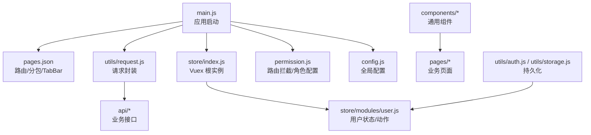
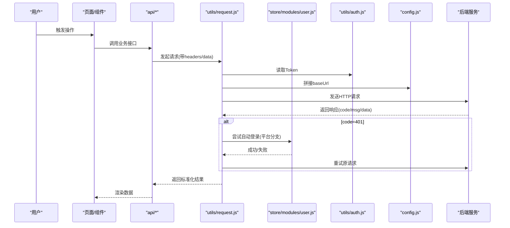
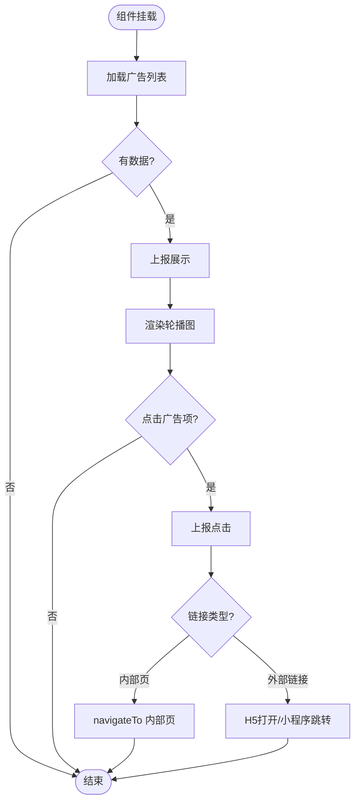
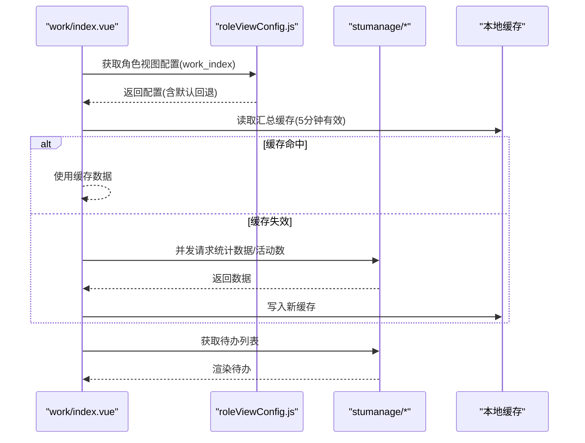
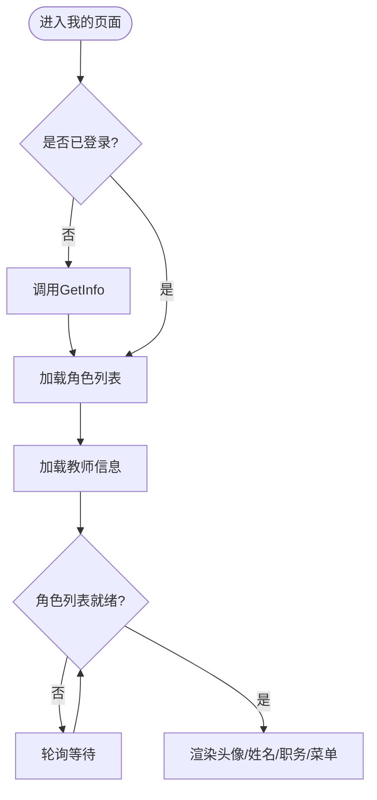
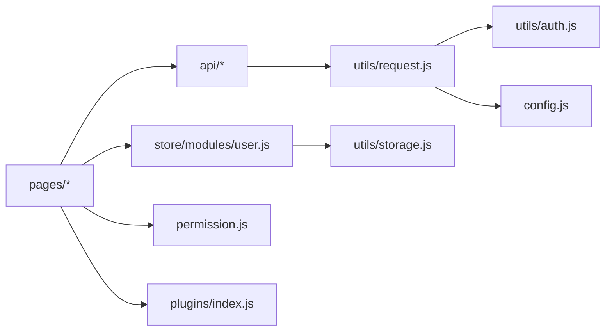

# 新功能开发

<cite>
**本文引用的文件**   
- [README.md](file://README.md)
- [main.js](file://main.js)
- [config.js](file://config.js)
- [pages.json](file://pages.json)
- [permission.js](file://permission.js)
- [store/index.js](file://store/index.js)
- [store/getters.js](file://store/getters.js)
- [store/modules/user.js](file://store/modules/user.js)
- [utils/request.js](file://utils/request.js)
- [utils/auth.js](file://utils/auth.js)
- [utils/storage.js](file://utils/storage.js)
- [api/login.js](file://api/login.js)
- [api/stumanage/index.js](file://api/stumanage/index.js)
- [utils/roleViewConfig.js](file://utils/roleViewConfig.js)
- [test-config-driven.js](file://test-config-driven.js)
- [components/ad-banner/ad-banner.vue](file://components/ad-banner/ad-banner.vue)
- [pages/work/index.vue](file://pages/work/index.vue)
- [pages/mine/index.vue](file://pages/mine/index.vue)
- [plugins/index.js](file://plugins/index.js)
</cite>

## 目录
1. [引言](#引言)
2. [项目结构](#项目结构)
3. [核心组件](#核心组件)
4. [架构总览](#架构总览)
5. [详细组件分析](#详细组件分析)
6. [依赖分析](#依赖分析)
7. [性能考虑](#性能考虑)
8. [故障排查指南](#故障排查指南)
9. [结论](#结论)
10. [附录](#附录)

## 引言
本指南面向希望在 RuoYi-App（基于 uni-app）中新增功能的开发者，提供从需求分析、设计、编码实现、测试验证到文档与质量保障的完整流程。项目为移动端多端解决方案，支持小程序、H5、Android/iOS，并与 RuoYi-Vue/RuoYi-Cloud 后端无缝对接。

## 项目结构
- 入口与全局初始化：main.js 负责插件、UI 库、全局方法挂载与 store 注入；config.js 集中管理后端地址、协议、前缀等；permission.js 提供路由拦截与角色配置加载；pages.json 定义页面与分包、TabBar 与全局样式。
- 状态管理：store/index.js 注册 Vuex 模块；store/modules/user.js 维护登录态、用户信息与权限；store/getters.js 暴露常用字段。
- 网络层：utils/request.js 封装 uni.request，统一鉴权、错误处理、超时与重试策略；api/* 按业务域组织接口；api/stumanage/index.js 作为学生管理域的统一导出入口。
- 工具与存储：utils/auth.js 管理 Token 与 UserId；utils/storage.js 提供结构化本地存储；utils/roleViewConfig.js 提供角色视图配置缓存与预加载。
- 页面与组件：pages/* 为页面级代码；components/* 为可复用组件；示例包含广告轮播组件与工作台、我的页面。

图示来源
- [main.js:1-31](file://main.js#L1-L31)
- [config.js:1-38](file://config.js#L1-L38)
- [permission.js:1-133](file://permission.js#L1-L133)
- [store/index.js:1-15](file://store/index.js#L1-L15)
- [store/modules/user.js:1-283](file://store/modules/user.js#L1-L283)
- [utils/request.js:1-117](file://utils/request.js#L1-L117)
- [pages.json:1-235](file://pages.json#L1-L235)

章节来源
- [README.md:1-52](file://README.md#L1-L52)
- [main.js:1-31](file://main.js#L1-L31)
- [config.js:1-38](file://config.js#L1-L38)
- [pages.json:1-235](file://pages.json#L1-L235)
- [permission.js:1-133](file://permission.js#L1-L133)

## 核心组件
- 应用入口与插件
  - main.js 引入 uView UI、插件集、权限拦截、字典接口，并挂载到 Vue 原型。
  - plugins/index.js 将 $tab/$auth/$modal 挂载至 Vue 原型，供页面便捷调用。
- 全局配置
  - config.js 提供协议、主机、端口、API 前缀与 baseUrl 计算属性，以及应用信息。
- 路由与权限
  - pages.json 定义主包与分包页面、TabBar 与全局导航栏样式。
  - permission.js 提供角色配置初始化、实名认证检查、白名单校验与跳转拦截。
- 状态管理
  - store/index.js 注册 user 模块与 getters。
  - store/modules/user.js 提供登录、获取用户信息、微信绑定、手机号快捷登录、退出、解除绑定等动作，并同步持久化。
  - store/getters.js 暴露 token、avatar、id、name、roles、permissions、userType。
- 网络层
  - utils/request.js 统一添加 Authorization、拼接 params、错误码映射、401 自动重登（含微信小程序分支）、网络异常提示。
  - api/login.js 封装登录、注册、获取用户信息、退出、验证码、微信登录/绑定/解绑等接口。
  - api/stumanage/index.js 聚合学生管理域各子模块导出，便于统一引用。
- 工具与存储
  - utils/auth.js 提供 Token/UserId 存取与登录态判断。
  - utils/storage.js 提供结构化本地存储读写与清理。
  - utils/roleViewConfig.js 提供角色视图配置的远程加载、内存缓存与默认回退，支持预加载。
- 典型页面与组件
  - components/ad-banner/ad-banner.vue 展示广告轮播，上报曝光与点击，支持内部页与外部链接跳转。
  - pages/work/index.vue 工作台页面，汇总数据、待办、功能九宫格与金句展示，结合角色视图配置与缓存。
  - pages/mine/index.vue 个人中心，展示教师信息、职务转换、头像与菜单跳转。

章节来源
- [main.js:1-31](file://main.js#L1-L31)
- [plugins/index.js:1-15](file://plugins/index.js#L1-L15)
- [config.js:1-38](file://config.js#L1-L38)
- [pages.json:1-235](file://pages.json#L1-L235)
- [permission.js:1-133](file://permission.js#L1-L133)
- [store/index.js:1-15](file://store/index.js#L1-L15)
- [store/getters.js:1-9](file://store/getters.js#L1-L9)
- [store/modules/user.js:1-283](file://store/modules/user.js#L1-L283)
- [utils/request.js:1-117](file://utils/request.js#L1-L117)
- [api/login.js:1-106](file://api/login.js#L1-L106)
- [api/stumanage/index.js:1-32](file://api/stumanage/index.js#L1-L32)
- [utils/auth.js:1-47](file://utils/auth.js#L1-L47)
- [utils/storage.js:1-33](file://utils/storage.js#L1-L33)
- [utils/roleViewConfig.js:1-114](file://utils/roleViewConfig.js#L1-L114)
- [components/ad-banner/ad-banner.vue:1-140](file://components/ad-banner/ad-banner.vue#L1-L140)
- [pages/work/index.vue:1-800](file://pages/work/index.vue#L1-L800)
- [pages/mine/index.vue:1-309](file://pages/mine/index.vue#L1-L309)

## 架构总览
下图展示了新功能在现有架构中的落地路径：页面通过 API 模块发起请求，经 request 封装后携带鉴权访问后端；登录态与用户信息通过 Vuex 管理；路由与权限由 permission 控制；配置集中在 config；页面与组件遵循分包与 TabBar 规范。

图示来源
- [pages/work/index.vue:1-800](file://pages/work/index.vue#L1-L800)
- [api/login.js:1-106](file://api/login.js#L1-L106)
- [utils/request.js:1-117](file://utils/request.js#L1-L117)
- [store/modules/user.js:1-283](file://store/modules/user.js#L1-L283)
- [utils/auth.js:1-47](file://utils/auth.js#L1-L47)
- [config.js:1-38](file://config.js#L1-L38)

## 详细组件分析

### 组件A：广告轮播组件（ad-banner）
- 职责：拉取广告列表、自动轮播、上报曝光与点击、根据链接类型进行页面或外部跳转。
- 关键交互：
  - 组件 mounted 时加载广告列表，成功后批量上报展示。
  - 点击广告项上报点击，再根据 adLink 决定内部 navigateTo 或 H5/小程序外链跳转。
- 扩展建议：
  - 增加占位图与骨架屏，提升弱网体验。
  - 对上报接口做幂等与失败重试，避免影响主流程。
  - 支持自定义高度与圆角等 props。

图示来源
- [components/ad-banner/ad-banner.vue:1-140](file://components/ad-banner/ad-banner.vue#L1-L140)

章节来源
- [components/ad-banner/ad-banner.vue:1-140](file://components/ad-banner/ad-banner.vue#L1-L140)

### 组件B：工作台页面（work/index）
- 职责：展示学工金句、汇总卡片、待办事项、学生管理九宫格；支持角色视图配置与本地缓存。
- 关键逻辑：
  - created 阶段加载教师姓名、角色视图配置、随机金句；onShow 刷新未读与汇总数据。
  - 汇总数据采用本地缓存（5分钟），减少重复请求；活动总数与统计并行请求。
  - 九宫格功能项来自 ALL_FUNCS 常量，支持“常用功能”本地保存与动态增删。
- 扩展建议：
  - 将 ALL_FUNCS 与角色视图配置合并，实现更细粒度的可见性控制。
  - 对长列表与图片资源进行懒加载与压缩优化。

图示来源
- [pages/work/index.vue:1-800](file://pages/work/index.vue#L1-L800)
- [utils/roleViewConfig.js:1-114](file://utils/roleViewConfig.js#L1-L114)
- [api/stumanage/index.js:1-32](file://api/stumanage/index.js#L1-L32)

章节来源
- [pages/work/index.vue:1-800](file://pages/work/index.vue#L1-L800)
- [utils/roleViewConfig.js:1-114](file://utils/roleViewConfig.js#L1-L114)
- [api/stumanage/index.js:1-32](file://api/stumanage/index.js#L1-L32)

### 组件C：个人中心页面（mine/index）
- 职责：展示教师头像、姓名、学院、职务；提供编辑资料、常见问题、关于我们、设置等入口。
- 关键逻辑：
  - onShow 监听刷新事件，确保用户信息已加载后再拉取教师详情与角色列表。
  - 行政职务ID转中文名称，若角色列表尚未就绪则轮询等待。
  - 头像路径拼接 baseUrl + '/profile' + photo。
- 扩展建议：
  - 增加空状态与错误重试机制。
  - 职务映射改为字典驱动，降低硬编码。

图示来源
- [pages/mine/index.vue:1-309](file://pages/mine/index.vue#L1-L309)
- [store/modules/user.js:1-283](file://store/modules/user.js#L1-L283)

章节来源
- [pages/mine/index.vue:1-309](file://pages/mine/index.vue#L1-L309)
- [store/modules/user.js:1-283](file://store/modules/user.js#L1-L283)

## 依赖分析
- 组件耦合
  - 页面与 API 模块低耦合，通过统一的 request 封装屏蔽差异。
  - 状态与持久化分离：store 负责运行时状态，auth/storage 负责持久化。
- 外部依赖
  - uni-app 原生能力（uni.request、uni.login、uni.navigateTo 等）。
  - uView UI 组件库。
- 潜在循环依赖
  - 当前未见明显循环引用；注意在新增模块时保持单向依赖（页面→API→request→store/utils）。

图示来源
- [pages/work/index.vue:1-800](file://pages/work/index.vue#L1-L800)
- [api/stumanage/index.js:1-32](file://api/stumanage/index.js#L1-L32)
- [utils/request.js:1-117](file://utils/request.js#L1-L117)
- [utils/auth.js:1-47](file://utils/auth.js#L1-L47)
- [config.js:1-38](file://config.js#L1-L38)
- [store/modules/user.js:1-283](file://store/modules/user.js#L1-L283)
- [utils/storage.js:1-33](file://utils/storage.js#L1-L33)
- [permission.js:1-133](file://permission.js#L1-L133)
- [plugins/index.js:1-15](file://plugins/index.js#L1-L15)

章节来源
- [utils/request.js:1-117](file://utils/request.js#L1-L117)
- [api/stumanage/index.js:1-32](file://api/stumanage/index.js#L1-L32)
- [store/modules/user.js:1-283](file://store/modules/user.js#L1-L283)
- [permission.js:1-133](file://permission.js#L1-L133)

## 性能考虑
- 请求合并与缓存
  - 如工作台汇总数据采用本地缓存与并发请求，减少首屏耗时与后端压力。
- 分包与按需加载
  - 利用 pages.json 的分包能力，将低频页面放入 subPackages，降低主包体积。
- 图片与静态资源
  - 使用 CDN 与合适尺寸的图片，必要时启用懒加载与占位图。
- 列表渲染
  - 大数据量列表使用虚拟滚动或分页加载，避免一次性渲染过多节点。
- 网络容错
  - 合理设置超时时间，对关键接口实现重试与降级策略。

[本节为通用指导，不直接分析具体文件]

## 故障排查指南
- 401 未授权
  - 现象：请求返回 401，非登录接口会触发自动重登或跳转登录页。
  - 排查：确认 Token 是否存在且有效；检查登录相关接口是否被误判为需要鉴权；查看微信小程序分支的自动登录逻辑。
- 网络异常与超时
  - 现象：Network Error 或 timeout 提示。
  - 排查：检查 config.baseUrl 与代理配置；确认后端可达性与超时阈值。
- 微信未绑定账号
  - 现象：返回特定错误码，静默拒绝且不弹提示。
  - 排查：引导用户完成绑定流程；确认 wxLogin/wxBind/unbindWx 接口行为。
- 角色视图配置不可用
  - 现象：角色视图配置加载失败，回退默认配置。
  - 排查：检查 roleViewConfig 的缓存与预加载逻辑；确认后端接口可用性。

章节来源
- [utils/request.js:1-117](file://utils/request.js#L1-L117)
- [api/login.js:1-106](file://api/login.js#L1-L106)
- [utils/roleViewConfig.js:1-114](file://utils/roleViewConfig.js#L1-L114)

## 结论
通过在现有架构中遵循分层与约定，新功能可以高效落地：以 pages.json 规划路由与分包，以 api/* 组织接口，以 utils/request.js 统一网络层，以 store/modules/user.js 管理用户态，以 permission.js 控制访问与角色能力，配合组件化与缓存策略，兼顾可维护性与性能。

[本节为总结，不直接分析具体文件]

## 附录

### 新功能开发流程与最佳实践

- 需求分析与可行性评估
  - 明确业务目标、用户场景与验收标准。
  - 评估技术可行性：是否需要新增页面/组件/API/权限点；是否涉及跨端差异；是否需引入第三方库。
  - 输出：需求说明、用例清单、风险与依赖项。

- 设计阶段
  - 页面原型设计：绘制关键页面与交互流程，标注数据来源与状态变化。
  - 数据模型设计：定义前后端数据结构、必填字段、枚举值与校验规则。
  - API 接口设计：在 api/* 下新建模块，明确 URL、方法、参数、返回值与错误码；在 utils/request.js 基础上约定统一响应格式。
  - 权限与路由：如需新页面，更新 pages.json 路由与分包；如需权限控制，完善 permission.js 白名单与角色配置。

- 编码实现
  - 页面与组件
    - 在 pages/* 创建页面，遵循模板/脚本/样式结构；复杂 UI 抽取为 components/* 组件。
    - 使用 uView 组件与 uni-ui 生态，保持风格一致。
  - API 封装
    - 在 api/* 对应模块中封装接口，统一使用 request 封装；对敏感接口设置 isToken=false 或正确 headers。
  - 状态管理集成
    - 在 store/modules/user.js 中新增 actions/mutations，并在 getters 中暴露必要字段；必要时新增独立模块。
  - 路由配置
    - 在 pages.json 中注册页面与样式，必要时加入 subPackages；TabBar 仅允许固定数量入口。
  - 权限与角色
    - 使用 permission.js 提供的 initRoleConfig/hasFeature 等能力；对受控页面进行登录态与角色校验。
  - 配置与常量
    - 将可变配置放入 config.js 或字典接口；常量集中管理，避免魔法字符串。

- 测试验证
  - 单元测试
    - 针对工具函数与纯逻辑编写单测（如 roleViewConfig 的缓存与默认回退）。
    - 参考 test-config-driven.js 的测试思路，覆盖正常、异常与边界情况。
  - 集成测试
    - 模拟登录态与网络环境，验证页面与 API 的端到端流程；重点覆盖 401 自动重登与错误提示。
  - 用户验收测试
    - 依据用例清单逐项验证，关注跨端兼容与用户体验细节。

- 文档编写要求
  - 用户手册：功能说明、操作步骤、注意事项与常见问题。
  - 技术文档：接口定义、数据模型、权限与路由变更、配置项说明。
  - 维护文档：部署步骤、环境变量、监控与告警、回滚方案。

- 代码审查清单与质量保证
  - 代码规范：命名、注释、目录结构与导入顺序符合约定。
  - 安全：敏感信息不入日志；Token 与用户信息仅在必要处存取。
  - 健壮性：错误分支与兜底策略完备；网络异常与超时处理清晰。
  - 性能：避免不必要的重渲染与重复请求；合理使用缓存与分包。
  - 可测试性：关键逻辑可被单测覆盖；对外部依赖具备 Mock 能力。
  - 兼容性：小程序/H5/APP 三端差异已处理；TabBar 与导航行为符合预期。

章节来源
- [test-config-driven.js:93-137](file://test-config-driven.js#L93-L137)
- [pages.json:1-235](file://pages.json#L1-L235)
- [permission.js:1-133](file://permission.js#L1-L133)
- [utils/roleViewConfig.js:1-114](file://utils/roleViewConfig.js#L1-L114)