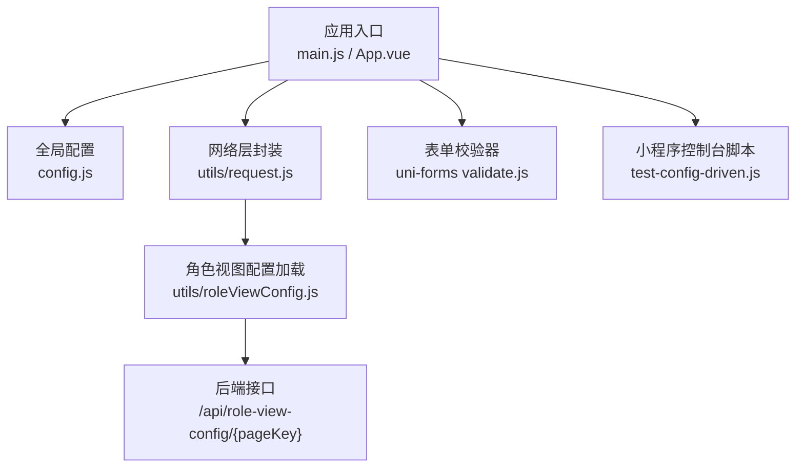
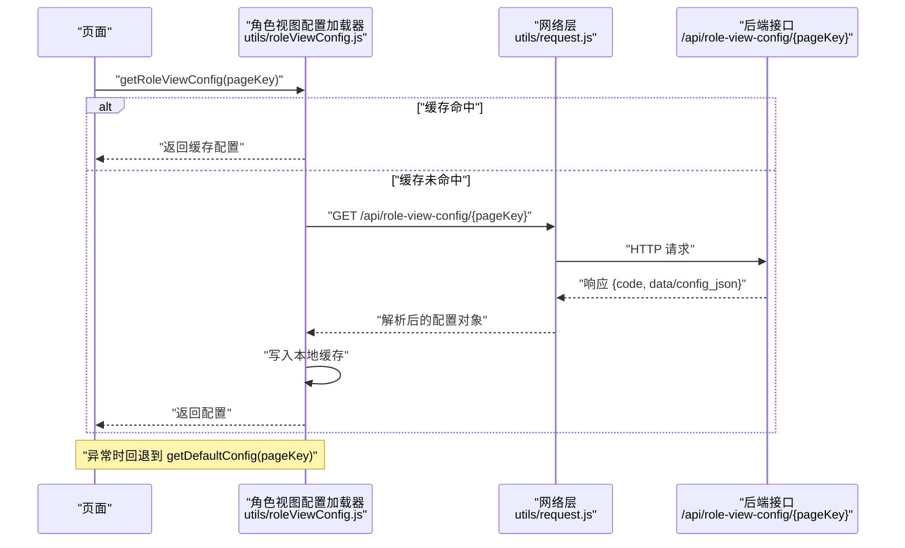
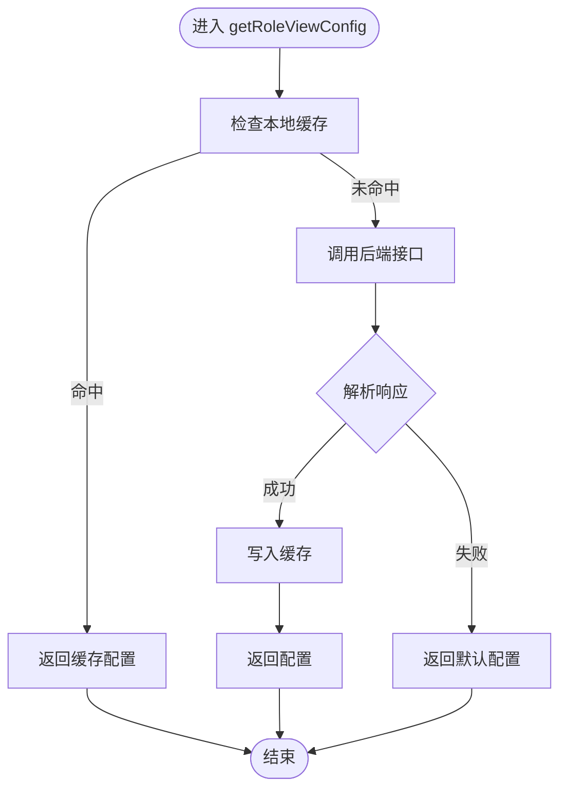
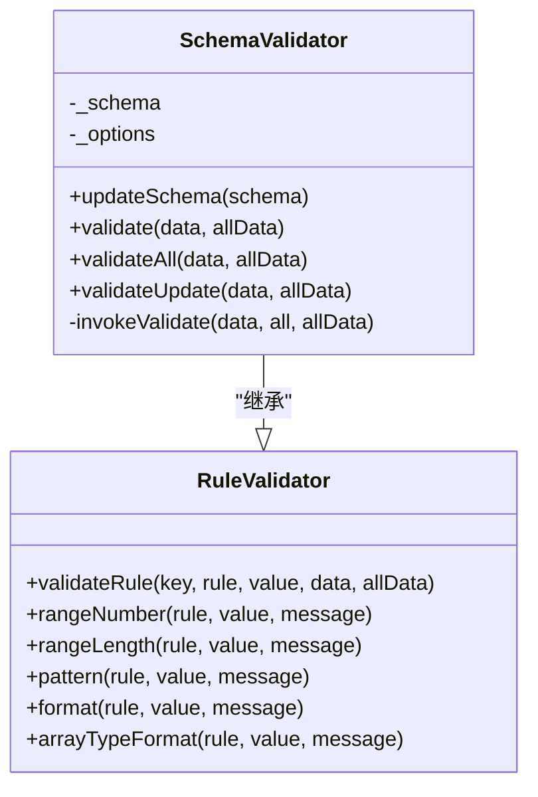
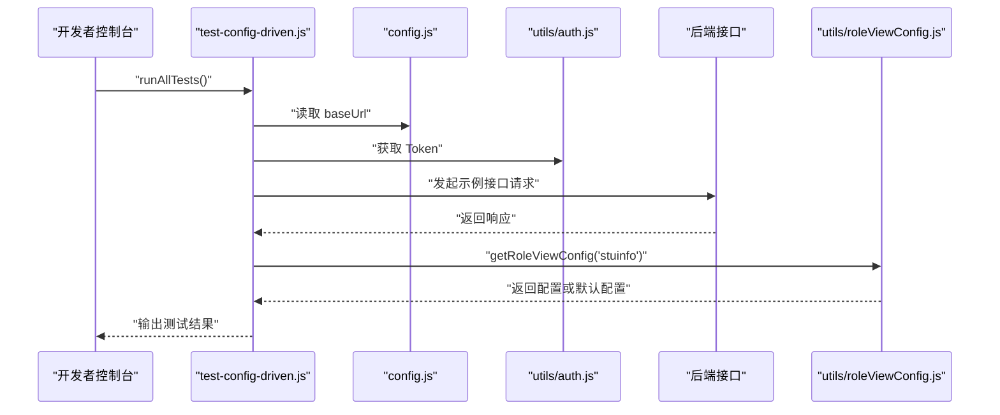
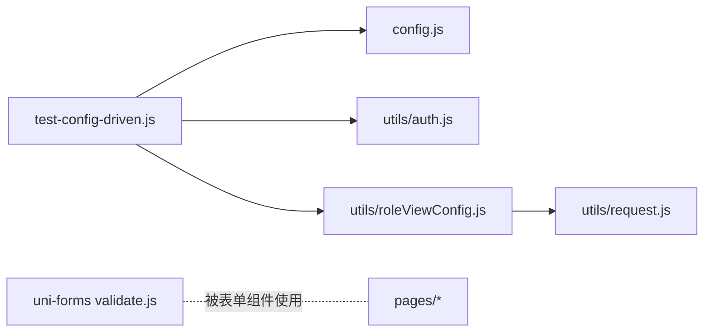

# 测试验证

<cite>
**本文引用的文件**   
- [README.md](file://README.md)
- [config.js](file://config.js)
- [test-config-driven.js](file://test-config-driven.js)
- [utils/roleViewConfig.js](file://utils/roleViewConfig.js)
- [utils/request.js](file://utils/request.js)
- [utils/auth.js](file://utils/auth.js)
- [uni_modules/uni-forms/components/uni-forms/validate.js](file://uni_modules/uni-forms/components/uni-forms/validate.js)
</cite>

## 目录
1. [简介](#简介)
2. [项目结构](#项目结构)
3. [核心组件](#核心组件)
4. [架构总览](#架构总览)
5. [详细组件分析](#详细组件分析)
6. [依赖分析](#依赖分析)
7. [性能考虑](#性能考虑)
8. [故障排查指南](#故障排查指南)
9. [结论](#结论)
10. [附录](#附录)

## 简介
本指南面向 RuoYi-App（基于 UniApp 的移动端解决方案），提供覆盖单元测试、集成测试、用户验收测试与性能测试的完整策略与落地方法，并给出调试技巧与自动化配置建议。文档结合仓库现有能力（如角色视图配置加载、表单校验器、小程序控制台脚本）构建可执行的验证流程，帮助团队在功能质量与稳定性方面建立体系化保障。

## 项目结构
本项目采用按领域与职责划分的目录组织方式：
- api：按业务域划分接口封装（如 stumanage、system 等）
- components：通用 UI 组件
- pages：页面路由与业务页面
- utils：工具函数（请求、鉴权、存储、校验、权限等）
- uni_modules：第三方或内部模块（如表单校验、UI 组件库）
- config.js：全局应用配置（协议、主机、端口、API 前缀、应用信息等）
- test-config-driven.js：小程序控制台驱动的配置与接口快速验证脚本

图表来源
- [config.js:1-38](file://config.js#L1-L38)
- [utils/roleViewConfig.js:1-115](file://utils/roleViewConfig.js#L1-L115)
- [utils/request.js](file://utils/request.js)
- [uni_modules/uni-forms/components/uni-forms/validate.js:41-403](file://uni_modules/uni-forms/components/uni-forms/validate.js#L41-L403)
- [test-config-driven.js:1-255](file://test-config-driven.js#L1-L255)

章节来源
- [README.md:12-20](file://README.md#L12-L20)
- [config.js:1-38](file://config.js#L1-L38)

## 核心组件
- 全局配置中心（config.js）
  - 统一维护协议、主机、端口、API 前缀与应用信息，并提供 baseUrl 计算属性，便于旧代码兼容。
- 角色视图配置加载（utils/roleViewConfig.js）
  - 从后端动态获取页面级视图配置，具备本地缓存与降级默认配置能力，支持预加载常用页面配置。
- 网络请求封装（utils/request.js）
  - 作为 HTTP 客户端抽象，被角色视图配置加载器调用，负责实际的网络访问。
- 表单校验器（uni-forms validate.js）
  - 提供 Schema 驱动的字段校验能力，包含类型、范围、长度、正则、枚举等规则，以及批量校验与更新校验。
- 小程序控制台脚本（test-config-driven.js）
  - 在微信开发者工具控制台中执行，用于快速验证基础配置、后端接口连通性、配置加载与缓存、降级机制与页面状态。

章节来源
- [config.js:1-38](file://config.js#L1-L38)
- [utils/roleViewConfig.js:1-115](file://utils/roleViewConfig.js#L1-L115)
- [utils/request.js](file://utils/request.js)
- [uni_modules/uni-forms/components/uni-forms/validate.js:41-403](file://uni_modules/uni-forms/components/uni-forms/validate.js#L41-L403)
- [test-config-driven.js:1-255](file://test-config-driven.js#L1-L255)

## 架构总览
下图展示“角色视图配置”端到端数据流：页面发起请求 → 配置加载器 → 网络层 → 后端服务；同时体现缓存命中与降级默认配置的分支逻辑。

图表来源
- [utils/roleViewConfig.js:16-65](file://utils/roleViewConfig.js#L16-L65)
- [utils/request.js](file://utils/request.js)

## 详细组件分析

### 组件A：角色视图配置加载器（utils/roleViewConfig.js）
- 职责
  - 提供 getRoleViewConfig(pageKey)、clearConfigCache()、preloadConfigs() 等方法。
  - 实现本地内存缓存、失败降级至默认配置、预加载常用页面配置。
- 关键流程
  - 先查缓存，命中则直接返回。
  - 未命中则通过 request 调用后端接口，解析返回体（可能为 config_json 字符串或已合并字段）。
  - 捕获异常后返回对应 pageKey 的默认配置。
- 复杂度与优化
  - 时间复杂度 O(1) 缓存查询；网络 I/O 为外部成本。
  - 可通过 preloadConfigs 提前拉取热点配置，降低首屏等待。
- 错误处理
  - 网络异常或后端返回非成功码时，走降级路径，保证页面可用。

图表来源
- [utils/roleViewConfig.js:16-92](file://utils/roleViewConfig.js#L16-L92)

章节来源
- [utils/roleViewConfig.js:1-115](file://utils/roleViewConfig.js#L1-L115)

### 组件B：表单校验器（uni-forms validate.js）
- 职责
  - 提供 Schema 驱动的字段校验，包括类型、数值范围、长度、正则、枚举、数组元素格式等。
  - 支持单次校验、全部校验与更新校验。
- 关键能力
  - types 内置多种类型判定（integer、string、number、boolean、float、array、object、date、timestamp、email、url、pattern、method 等）。
  - rangeNumber/rangeLength/pattern/format/arrayTypeFormat 等规则处理器。
  - SchemaValidator 类封装 validate/validateAll/validateUpdate 等异步校验入口。
- 使用建议
  - 将复杂表单规则集中定义于 schema，避免分散在页面逻辑中。
  - 对长列表或大数据量表单，优先使用 validateUpdate 增量校验以提升性能。

图表来源
- [uni_modules/uni-forms/components/uni-forms/validate.js:41-403](file://uni_modules/uni-forms/components/uni-forms/validate.js#L41-L403)

章节来源
- [uni_modules/uni-forms/components/uni-forms/validate.js:41-403](file://uni_modules/uni-forms/components/uni-forms/validate.js#L41-L403)

### 组件C：小程序控制台驱动脚本（test-config-driven.js）
- 职责
  - 在微信开发者工具控制台运行，快速验证基础配置、后端接口连通性、配置加载与缓存、降级机制与当前页面状态。
- 用例说明
  - 检查基础配置（读取 config.js 的 baseUrl）。
  - 测试后端接口（携带 Authorization 头调用示例接口）。
  - 测试配置加载器（调用 getRoleViewConfig 并断言返回结构）。
  - 测试缓存机制（对比三次调用耗时，验证缓存生效）。
  - 测试降级机制（调用 getDefaultConfig 断言默认值）。
  - 查看页面状态（读取当前页 data 中的 viewConfig 等字段）。
- 运行方式
  - 在控制台执行 runAllTests() 一键运行所有用例，或单独调用各测试函数。

图表来源
- [test-config-driven.js:1-255](file://test-config-driven.js#L1-L255)
- [config.js:1-38](file://config.js#L1-L38)
- [utils/auth.js](file://utils/auth.js)
- [utils/roleViewConfig.js:16-65](file://utils/roleViewConfig.js#L16-L65)

章节来源
- [test-config-driven.js:1-255](file://test-config-driven.js#L1-L255)

## 依赖分析
- 模块耦合关系
  - roleViewConfig.js 依赖 request.js 进行网络访问，依赖 auth.js 获取令牌（由上层注入或内部封装）。
  - test-config-driven.js 依赖 config.js、auth.js、roleViewConfig.js 完成端到端验证。
  - uni-forms validate.js 独立于业务模块，供表单组件复用。
- 潜在风险
  - 若后端接口变更或鉴权策略调整，需同步更新 roleViewConfig.js 与测试脚本。
  - 缓存键设计需与 pageKey 一一对应，避免跨页面污染。

图表来源
- [test-config-driven.js:1-255](file://test-config-driven.js#L1-L255)
- [config.js:1-38](file://config.js#L1-L38)
- [utils/roleViewConfig.js:1-115](file://utils/roleViewConfig.js#L1-L115)
- [utils/request.js](file://utils/request.js)
- [utils/auth.js](file://utils/auth.js)
- [uni_modules/uni-forms/components/uni-forms/validate.js:41-403](file://uni_modules/uni-forms/components/uni-forms/validate.js#L41-L403)

章节来源
- [test-config-driven.js:1-255](file://test-config-driven.js#L1-L255)
- [utils/roleViewConfig.js:1-115](file://utils/roleViewConfig.js#L1-L115)
- [config.js:1-38](file://config.js#L1-L38)
- [utils/request.js](file://utils/request.js)
- [utils/auth.js](file://utils/auth.js)
- [uni_modules/uni-forms/components/uni-forms/validate.js:41-403](file://uni_modules/uni-forms/components/uni-forms/validate.js#L41-L403)

## 性能考虑
- 页面加载性能
  - 利用 preloadConfigs 预拉取热点页面配置，减少首屏等待。
  - 合理拆分页面与懒加载资源，避免一次性渲染过多节点。
- 网络请求优化
  - 复用 request 封装，统一拦截器处理重试、超时与错误提示。
  - 对频繁读的配置开启本地缓存，必要时提供 clearConfigCache 手动刷新。
- 内存使用监控
  - 定期清理无用缓存与事件监听，避免长时间运行导致内存泄漏。
  - 在控制台脚本中对比多次调用耗时，辅助定位慢路径。

[本节为通用指导，不直接分析具体文件]

## 故障排查指南
- 常见问题定位
  - 后端不可达：检查 config.js 的协议、主机、端口与 API 前缀是否正确；确认域名白名单与证书配置。
  - 鉴权失败：确认 token 是否有效且随请求头正确传递。
  - 配置为空：检查后端返回结构与 roleViewConfig.js 的解析逻辑是否一致；必要时启用降级默认配置。
  - 表单校验异常：核对 schema 规则与输入数据类型，关注 rangeNumber/rangeLength/pattern 等规则。
- 快速验证手段
  - 使用 test-config-driven.js 在控制台一键运行，逐项输出结果与可能原因。
  - 针对表单场景，构造最小可复现的 schema 与数据，逐步缩小问题范围。

章节来源
- [config.js:1-38](file://config.js#L1-L38)
- [test-config-driven.js:1-255](file://test-config-driven.js#L1-L255)
- [utils/roleViewConfig.js:16-92](file://utils/roleViewConfig.js#L16-L92)
- [uni_modules/uni-forms/components/uni-forms/validate.js:260-350](file://uni_modules/uni-forms/components/uni-forms/validate.js#L260-L350)

## 结论
通过以角色视图配置加载器为核心的端到端验证、表单校验器的 Schema 驱动能力，以及小程序控制台脚本的快速诊断，本项目已具备完善的测试与排障基础。建议在持续集成中引入自动化用例集，覆盖单元、集成与验收场景，并结合性能基线监控，持续提升质量与稳定性。

[本节为总结性内容，不直接分析具体文件]

## 附录

### 单元测试编写规范
- 目标
  - 覆盖纯函数与工具方法（如配置加载、校验规则、权限判断等）。
- 要点
  - 每个用例聚焦单一职责，命名清晰表达预期行为。
  - 使用 Mock 隔离外部依赖（网络、存储、系统 API）。
  - 断言明确，包含正常路径与异常路径。
- 参考位置
  - 表单校验器规则与入口：[uni_modules/uni-forms/components/uni-forms/validate.js:41-403](file://uni_modules/uni-forms/components/uni-forms/validate.js#L41-L403)
  - 配置加载与降级：[utils/roleViewConfig.js:16-92](file://utils/roleViewConfig.js#L16-L92)

章节来源
- [uni_modules/uni-forms/components/uni-forms/validate.js:41-403](file://uni_modules/uni-forms/components/uni-forms/validate.js#L41-L403)
- [utils/roleViewConfig.js:16-92](file://utils/roleViewConfig.js#L16-L92)

### 集成测试策略
- 模块间集成
  - 验证 roleViewConfig.js 与 request.js 的协作，确保网络异常时能正确降级。
- 业务流程
  - 模拟登录成功后，触发需要角色视图配置的页面，验证配置加载与渲染。
- 数据流
  - 断言后端返回结构（含 config_json 或已合并字段）能被正确解析并缓存。

章节来源
- [utils/roleViewConfig.js:16-65](file://utils/roleViewConfig.js#L16-L65)
- [utils/request.js](file://utils/request.js)

### 用户验收测试方法
- 用户场景模拟
  - 不同角色（如书记/教师）访问同一页面，验证视图差异是否符合预期。
- 用户体验验证
  - 检查首屏加载时长、交互反馈与错误提示友好度。
- 兼容性测试
  - 多端（小程序/H5/APP）与多设备尺寸下验证布局与交互一致性。

[本节为通用指导，不直接分析具体文件]

### 性能测试方案
- 页面加载性能
  - 使用控制台脚本对比首次与缓存命中时的耗时，评估预加载效果。
- 网络请求优化
  - 统计接口成功率、平均耗时与失败原因分布，定位瓶颈。
- 内存使用监控
  - 在长时间运行场景下观察内存增长趋势，及时清理缓存与监听。

章节来源
- [test-config-driven.js:96-137](file://test-config-driven.js#L96-L137)

### 调试技巧与工具使用
- 浏览器调试
  - H5 模式使用浏览器开发者工具进行断点、网络与性能面板分析。
- 移动端调试
  - 小程序使用开发者工具控制台与真机调试，结合日志输出定位问题。
- 日志记录与分析
  - 在关键路径添加结构化日志，配合控制台脚本快速收集上下文。

[本节为通用指导，不直接分析具体文件]

### 测试环境搭建与自动化配置
- 环境准备
  - 配置 config.js 指向开发/测试后端地址，确保域名白名单与证书正确。
- 自动化
  - 将 test-config-driven.js 的关键步骤转化为 CI 脚本，在每次提交后自动执行。
  - 结合表单校验器与业务表单页面，生成回归用例集。

章节来源
- [config.js:1-38](file://config.js#L1-L38)
- [test-config-driven.js:203-229](file://test-config-driven.js#L203-L229)