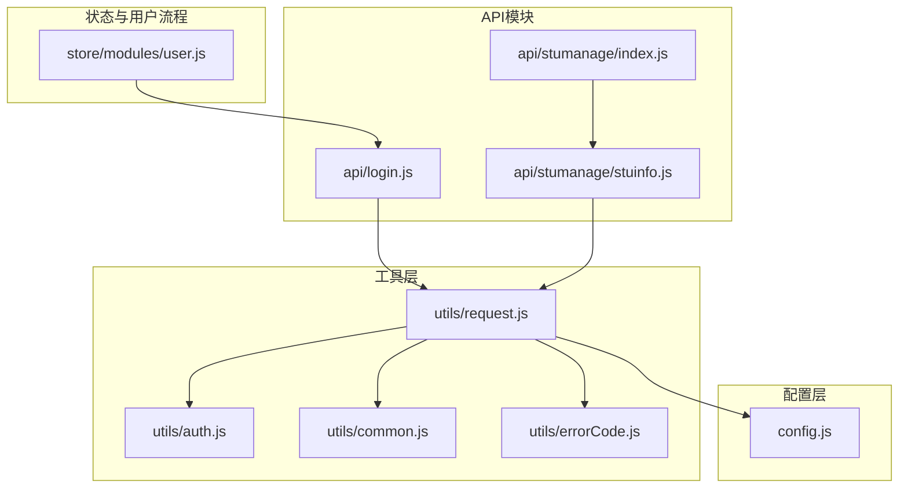
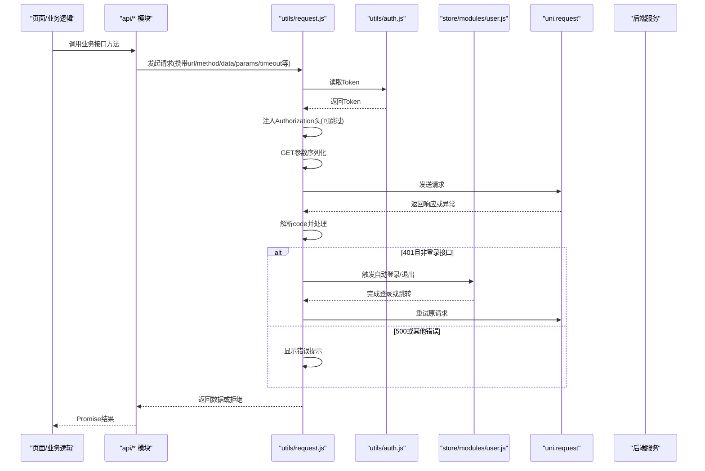
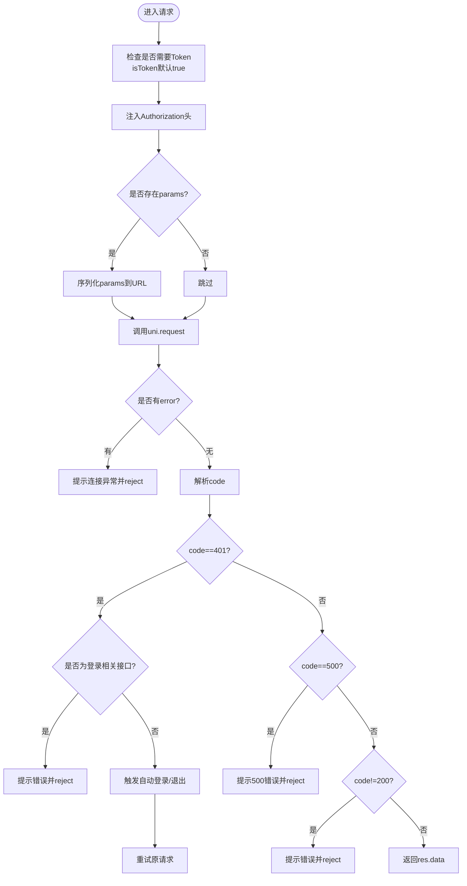
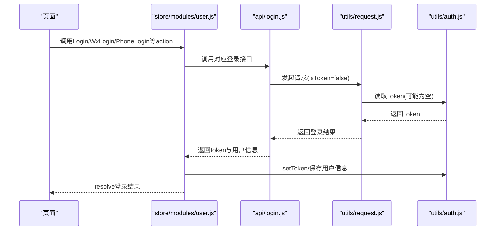
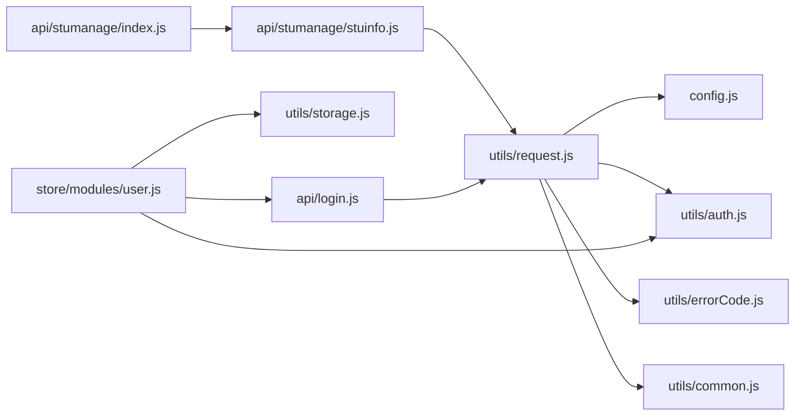

# API接口封装

<cite>
**本文引用的文件**   
- [utils/request.js](file://utils/request.js)
- [config.js](file://config.js)
- [utils/auth.js](file://utils/auth.js)
- [utils/errorCode.js](file://utils/errorCode.js)
- [utils/common.js](file://utils/common.js)
- [store/modules/user.js](file://store/modules/user.js)
- [api/login.js](file://api/login.js)
- [api/stumanage/index.js](file://api/stumanage/index.js)
- [api/stumanage/stuinfo.js](file://api/stumanage/stuinfo.js)
</cite>

## 目录
1. [简介](#简介)
2. [项目结构](#项目结构)
3. [核心组件](#核心组件)
4. [架构总览](#架构总览)
5. [详细组件分析](#详细组件分析)
6. [依赖关系分析](#依赖关系分析)
7. [性能与可靠性](#性能与可靠性)
8. [最佳实践](#最佳实践)
9. [故障排查指南](#故障排查指南)
10. [结论](#结论)

## 简介
本指南围绕项目的请求封装架构，系统化说明统一请求封装的实现原理与使用方法。重点包括：
- request.js 的核心能力：请求拦截（Token自动注入、参数拼接）、响应拦截（错误码处理、登录态失效处理）、网络异常与超时提示
- API 模块的组织方式：按功能域划分接口文件，并提供统一入口
- 请求配置选项：超时设置、重试机制、缓存策略的落地方案与扩展点
- 调用最佳实践：参数校验、错误处理、加载状态管理
- 示例：学生管理、登录认证等模块的接口封装实现路径

## 项目结构
本项目采用“工具层 + 配置层 + 业务API层”的分层组织方式：
- 工具层：request.js 提供统一的网络请求封装；auth.js 提供 Token 存取；common.js 提供通用 UI 与参数处理；errorCode.js 提供错误码映射
- 配置层：config.js 集中管理后端地址、协议、端口、API前缀等
- 业务API层：api/ 下按功能域拆分模块，如 login.js、stumanage/ 等，每个模块导出对应接口方法，便于维护与复用

图表来源
- [utils/request.js:1-117](file://utils/request.js#L1-L117)
- [config.js:1-38](file://config.js#L1-L38)
- [utils/auth.js:1-47](file://utils/auth.js#L1-L47)
- [utils/common.js:1-121](file://utils/common.js#L1-L121)
- [utils/errorCode.js:1-7](file://utils/errorCode.js#L1-L7)
- [store/modules/user.js:1-283](file://store/modules/user.js#L1-L283)
- [api/login.js:1-168](file://api/login.js#L1-L168)
- [api/stumanage/index.js:1-32](file://api/stumanage/index.js#L1-L32)
- [api/stumanage/stuinfo.js:1-85](file://api/stumanage/stuinfo.js#L1-L85)

章节来源
- [utils/request.js:1-117](file://utils/request.js#L1-L117)
- [config.js:1-38](file://config.js#L1-L38)
- [api/stumanage/index.js:1-32](file://api/stumanage/index.js#L1-L32)

## 核心组件
- 统一请求封装（utils/request.js）
  - 请求拦截：从本地存储读取 Token 并注入 Authorization 头；支持按需跳过 Token 注入（headers.isToken=false）；GET 请求将 params 序列化为查询字符串
  - 响应拦截：根据后端返回 code 进行分支处理（200成功、401会话过期、500服务端错误、其他业务错误），统一提示消息
  - 网络异常与超时：捕获 uni.request 的 catch，区分网络错误、超时、HTTP状态码异常，并给出友好提示
  - 登录态失效处理：401时非登录相关接口触发自动重登或跳转登录页；微信环境下尝试静默登录并重试原请求
- 配置中心（config.js）
  - 集中定义协议、主机、端口、API前缀，并通过 getter 生成 baseUrl，供 request.js 使用
- 认证工具（utils/auth.js）
  - 提供 Token 的获取、设置、移除以及是否已登录判断
- 错误码映射（utils/errorCode.js）
  - 将后端返回的错误码映射为中文提示文案
- 通用工具（utils/common.js）
  - toast 提示、showConfirm 确认框、tansParams 参数序列化、chooseLocation 定位选择等

章节来源
- [utils/request.js:1-117](file://utils/request.js#L1-L117)
- [config.js:1-38](file://config.js#L1-L38)
- [utils/auth.js:1-47](file://utils/auth.js#L1-L47)
- [utils/errorCode.js:1-7](file://utils/errorCode.js#L1-L7)
- [utils/common.js:1-121](file://utils/common.js#L1-L121)

## 架构总览
下图展示了从页面到后端的完整调用链路，包含 Token 注入、错误处理、登录态失效与自动重登流程。

图表来源
- [utils/request.js:1-117](file://utils/request.js#L1-L117)
- [utils/auth.js:1-47](file://utils/auth.js#L1-L47)
- [store/modules/user.js:1-283](file://store/modules/user.js#L1-L283)
- [api/login.js:1-168](file://api/login.js#L1-L168)

## 详细组件分析

### 统一请求封装（utils/request.js）
- 请求拦截器
  - Token自动注入：若存在 Token 且未显式关闭 isToken，则自动在 header 中注入 Authorization
  - GET参数拼接：当传入 params 时，将其序列化为 URL 查询串并合并到 url
  - 基础URL拼接：优先使用 config.baseUrl，否则回退至全局 baseUrl
- 响应拦截器
  - 成功：code=200 时直接返回 res.data
  - 401：对登录相关接口仅提示错误不触发自动登录；对其他接口触发自动登录或退出，并在微信环境尝试静默登录后重试原请求
  - 500：提示后端具体错误信息并拒绝
  - 其他错误码：除特定业务码外统一提示并拒绝
- 网络异常与超时
  - 捕获 catch 中的 message，区分 Network Error、timeout、HTTP状态码异常，并给出友好提示
- 可扩展点
  - 可在请求前增加签名、时间戳、防重放等逻辑
  - 可在响应后增加日志上报、埋点统计、数据清洗等

图表来源
- [utils/request.js:1-117](file://utils/request.js#L1-L117)
- [utils/common.js:75-95](file://utils/common.js#L75-L95)

章节来源
- [utils/request.js:1-117](file://utils/request.js#L1-L117)
- [utils/common.js:75-95](file://utils/common.js#L75-L95)

### 配置中心（config.js）
- 作用：集中管理协议、主机、端口、API前缀，并通过 getter 计算 baseUrl
- 使用：request.js 通过 config.baseUrl 拼接最终请求地址，避免硬编码域名

章节来源
- [config.js:1-38](file://config.js#L1-L38)

### 认证工具（utils/auth.js）
- 提供 getToken/setToken/removeToken/isLogin 等方法，基于 uni.getStorageSync 读写 Token
- 与 request.js 配合实现 Token 自动注入与失效清理

章节来源
- [utils/auth.js:1-47](file://utils/auth.js#L1-L47)

### 错误码映射（utils/errorCode.js）
- 将常见后端错误码映射为中文提示，提升用户体验
- 在 request.js 中作为默认错误消息的来源

章节来源
- [utils/errorCode.js:1-7](file://utils/errorCode.js#L1-L7)

### 通用工具（utils/common.js）
- tansParams：将对象参数序列化为 URL 查询串，支持嵌套对象
- toast/showConfirm：统一的消息提示与确认弹窗
- chooseLocation：封装定位选择，处理权限与取消场景

章节来源
- [utils/common.js:1-121](file://utils/common.js#L1-L121)

### 登录与用户状态（store/modules/user.js 与 api/login.js）
- store/modules/user.js
  - 封装登录、获取用户信息、微信自动登录、手机号快捷登录、退出、解除绑定等动作
  - 登录成功后持久化 Token 与用户信息，失败时清理本地状态
- api/login.js
  - 暴露登录、注册、验证码、微信登录、手机号登录、教师/学生绑定等接口方法
  - 针对无需 Token 的接口设置 headers.isToken=false，避免重复注入

图表来源
- [store/modules/user.js:1-283](file://store/modules/user.js#L1-L283)
- [api/login.js:1-168](file://api/login.js#L1-L168)
- [utils/request.js:1-117](file://utils/request.js#L1-L117)
- [utils/auth.js:1-47](file://utils/auth.js#L1-L47)

章节来源
- [store/modules/user.js:1-283](file://store/modules/user.js#L1-L283)
- [api/login.js:1-168](file://api/login.js#L1-L168)

### 学生管理模块（api/stumanage）
- 组织结构
  - index.js 作为统一入口，按功能域 re-export 子模块（stuinfo、leave、classcheck、talk、todo、teacherinfo、attachment、workstats 等）
  - stuinfo.js 提供学生信息查询、详情、搜索、学院班级树等接口
- 调用方式
  - 页面可直接 import { listStuinfo, getMyInfo } from '@/api/stumanage'
  - 也可按需 import { listStuinfo } from '@/api/stumanage/stuinfo'

章节来源
- [api/stumanage/index.js:1-32](file://api/stumanage/index.js#L1-L32)
- [api/stumanage/stuinfo.js:1-85](file://api/stumanage/stuinfo.js#L1-L85)

## 依赖关系分析
- request.js 依赖
  - config.js：获取 baseUrl
  - utils/auth.js：读取 Token
  - utils/errorCode.js：错误码映射
  - utils/common.js：toast、showConfirm、tansParams
- user store 依赖
  - api/login.js：调用登录相关接口
  - utils/auth.js：持久化 Token
  - utils/storage.js：持久化用户信息
- API 模块依赖
  - 所有 api/* 模块均依赖 request.js 发起请求

图表来源
- [utils/request.js:1-117](file://utils/request.js#L1-L117)
- [config.js:1-38](file://config.js#L1-L38)
- [utils/auth.js:1-47](file://utils/auth.js#L1-L47)
- [utils/errorCode.js:1-7](file://utils/errorCode.js#L1-L7)
- [utils/common.js:1-121](file://utils/common.js#L1-L121)
- [store/modules/user.js:1-283](file://store/modules/user.js#L1-L283)
- [api/login.js:1-168](file://api/login.js#L1-L168)
- [api/stumanage/index.js:1-32](file://api/stumanage/index.js#L1-L32)
- [api/stumanage/stuinfo.js:1-85](file://api/stumanage/stuinfo.js#L1-L85)

章节来源
- [utils/request.js:1-117](file://utils/request.js#L1-L117)
- [store/modules/user.js:1-283](file://store/modules/user.js#L1-L283)
- [api/login.js:1-168](file://api/login.js#L1-L168)
- [api/stumanage/index.js:1-32](file://api/stumanage/index.js#L1-L32)
- [api/stumanage/stuinfo.js:1-85](file://api/stumanage/stuinfo.js#L1-L85)

## 性能与可靠性
- 超时控制
  - 可通过 request 配置项 timeout 指定单次请求超时时间；默认值由 request.js 内部变量控制
  - 建议对耗时操作（如验证码图片、复杂列表）适当增大超时
- 重试机制
  - 当前仅在 401 非登录接口时进行自动重登并重试一次
  - 如需通用重试（如网络抖动），可在 request.js 中扩展指数退避重试逻辑
- 缓存策略
  - 当前未在 request.js 内置缓存；建议在业务层或中间件层实现：
    - 基于 URL+params 的简单内存缓存
    - 结合 storage 做短期缓存，带过期时间
    - 对只读列表类接口启用缓存，写操作后主动失效
- 并发与节流
  - 对于高频请求（如搜索联想），建议在前端加防抖/节流
  - 大列表分页加载时，注意避免重复请求与竞态条件

[本节为通用指导，不涉及具体文件分析]

## 最佳实践
- 参数校验
  - 在调用 API 前进行必要的前端校验（必填、格式、范围），减少无效请求
  - 利用 common.js 的 tansParams 确保参数正确序列化
- 错误处理
  - 统一通过 request.js 的错误提示与 reject 返回值处理异常
  - 对 401 场景，信任框架的自动重登与跳转逻辑，避免重复处理
- 加载状态管理
  - 在页面或组件内维护 loading 状态，调用前开启，完成后关闭
  - 对批量操作或长耗时接口，考虑使用进度提示或骨架屏
- 接口组织
  - 按功能域拆分 API 文件，并通过 index.js 统一导出，保持清晰边界
  - 对需要跨模块复用的接口，提取为公共模块
- 安全与鉴权
  - 对敏感接口确保 headers.isToken=true（默认），避免遗漏 Token
  - 对无需 Token 的接口明确设置 headers.isToken=false

[本节为通用指导，不涉及具体文件分析]

## 故障排查指南
- 常见问题
  - 401 频繁出现：检查 Token 是否正确写入与读取；确认登录流程是否成功持久化
  - 请求超时：检查网络环境与服务器响应；必要时增大 timeout
  - 参数丢失或乱码：检查 params 结构与 tansParams 的使用
  - 微信自动登录失败：检查 wxLogin 流程与授权配置
- 定位步骤
  - 查看 request.js 的 catch 分支提示信息
  - 检查 errorCode 映射是否覆盖实际错误码
  - 核对 config.baseUrl 与实际部署地址一致
  - 在 store/modules/user.js 中打印关键状态变化，确认 Token 与用户信息

章节来源
- [utils/request.js:1-117](file://utils/request.js#L1-L117)
- [utils/errorCode.js:1-7](file://utils/errorCode.js#L1-L7)
- [config.js:1-38](file://config.js#L1-L38)
- [store/modules/user.js:1-283](file://store/modules/user.js#L1-L283)

## 结论
本项目通过 request.js 实现了统一的请求封装，涵盖 Token 注入、参数序列化、错误处理与登录态失效恢复；配合 config.js 与 auth.js 形成清晰的配置与认证体系；API 模块按功能域组织，便于维护与扩展。在此基础上，可按需引入重试与缓存策略，并结合前端校验与加载状态管理，构建稳定、易用的接口调用体验。