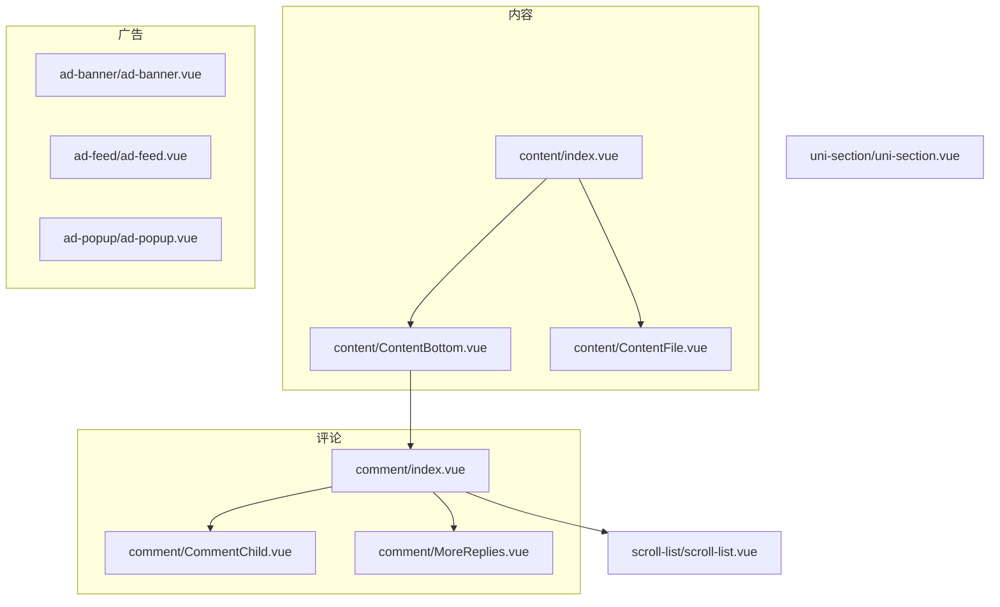
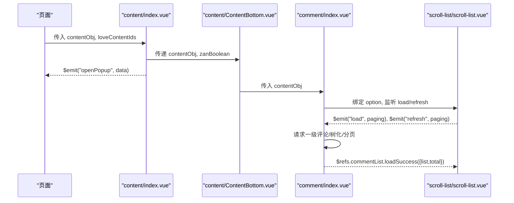
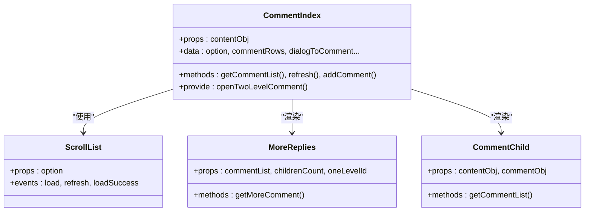
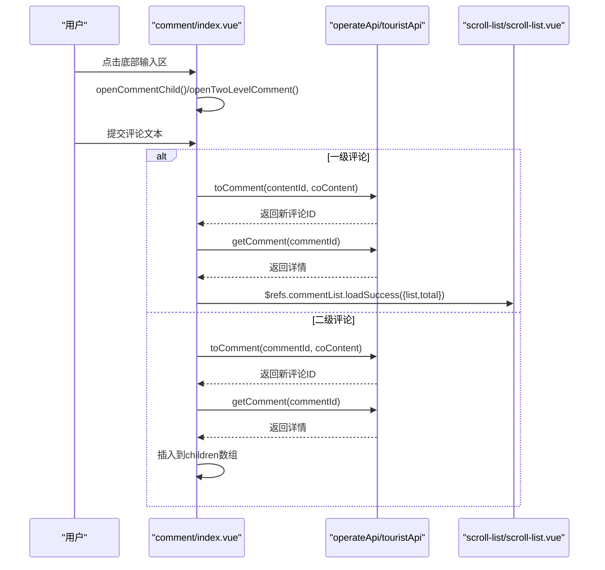
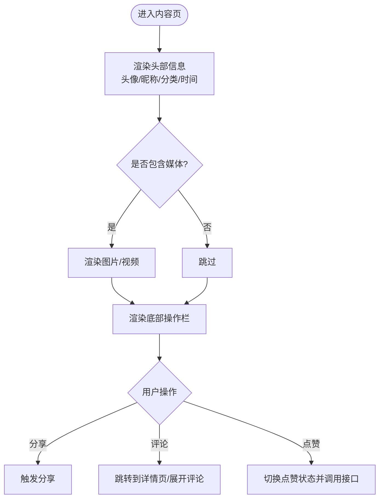
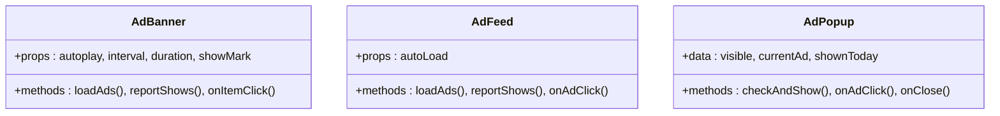
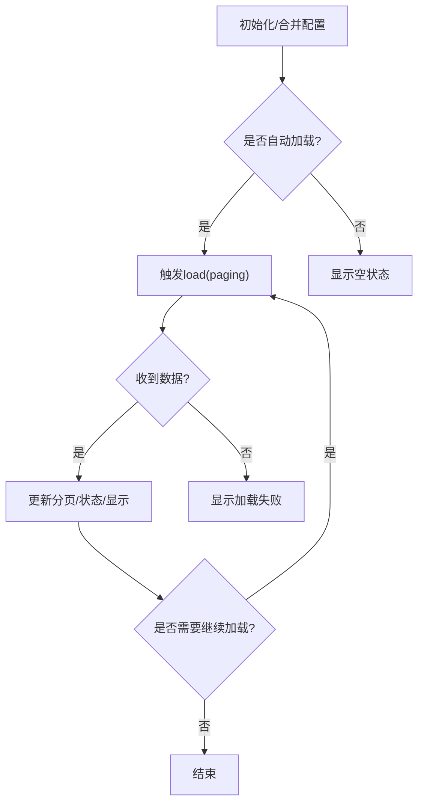
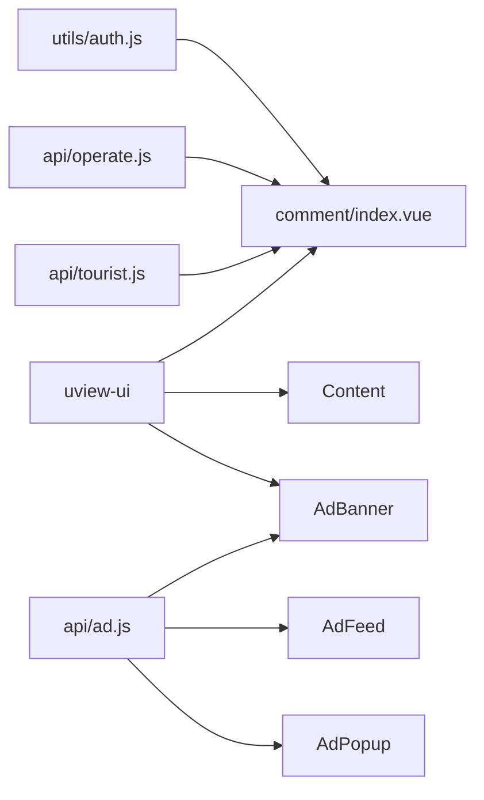

# Vue组件开发

<cite>
**本文引用的文件列表**
- [components/comment/index.vue](file://components/comment/index.vue)
- [components/comment/CommentChild.vue](file://components/comment/CommentChild.vue)
- [components/comment/MoreReplies.vue](file://components/comment/MoreReplies.vue)
- [components/content/index.vue](file://components/content/index.vue)
- [components/content/ContentBottom.vue](file://components/content/ContentBottom.vue)
- [components/content/ContentFile.vue](file://components/content/ContentFile.vue)
- [components/ad-banner/ad-banner.vue](file://components/ad-banner/ad-banner.vue)
- [components/ad-feed/ad-feed.vue](file://components/ad-feed/ad-feed.vue)
- [components/ad-popup/ad-popup.vue](file://components/ad-popup/ad-popup.vue)
- [components/scroll-list/scroll-list.vue](file://components/scroll-list/scroll-list.vue)
- [components/uni-section/uni-section.vue](file://components/uni-section/uni-section.vue)
</cite>

## 目录
1. [简介](#简介)
2. [项目结构](#项目结构)
3. [核心组件](#核心组件)
4. [架构总览](#架构总览)
5. [详细组件分析](#详细组件分析)
6. [依赖关系分析](#依赖关系分析)
7. [性能与体验优化](#性能与体验优化)
8. [常见问题排查](#常见问题排查)
9. [结论](#结论)
10. [附录：最佳实践清单](#附录最佳实践清单)

## 简介
本指南基于仓库中的实际组件实现，系统化讲解Vue（uni-app）组件的结构设计、模板编写、脚本逻辑与样式组织；深入说明props定义与校验、事件通信、生命周期使用时机；覆盖父子、兄弟、跨层级通信模式；并提供评论、内容、广告等真实场景的落地示例与复用建议。

## 项目结构
本项目采用“按功能域”组织组件的方式，通用能力下沉到基础组件，业务组合在页面或聚合组件中完成。关键目录与职责如下：
- components/comment：评论相关（一级评论、子评论、更多回复）
- components/content：内容卡片（头部信息、媒体展示、底部操作）
- components/ad-*：广告组件（轮播、信息流、弹窗）
- components/scroll-list：下拉刷新+上拉加载的滚动容器
- components/uni-section：通用标题区块

图表来源
- [components/comment/index.vue:1-120](file://components/comment/index.vue#L1-L120)
- [components/content/index.vue:1-70](file://components/content/index.vue#L1-L70)
- [components/content/ContentBottom.vue:1-44](file://components/content/ContentBottom.vue#L1-L44)
- [components/scroll-list/scroll-list.vue:1-44](file://components/scroll-list/scroll-list.vue#L1-L44)

章节来源
- [components/comment/index.vue:1-120](file://components/comment/index.vue#L1-L120)
- [components/content/index.vue:1-70](file://components/content/index.vue#L1-L70)
- [components/content/ContentBottom.vue:1-44](file://components/content/ContentBottom.vue#L1-L44)
- [components/scroll-list/scroll-list.vue:1-44](file://components/scroll-list/scroll-list.vue#L1-L44)

## 核心组件
本节聚焦三类典型组件：评论、内容、广告，并给出其职责边界、数据流向与交互方式。

- 评论组件
  - 负责一级评论列表渲染、分页加载、新增评论/回复、弹出输入框、键盘高度适配、作者标签显示等。
  - 通过provide/inject向子级暴露打开二级评论的方法，配合子组件向上触发事件完成状态更新。
  - 使用自定义滚动容器组件封装下拉刷新与上拉加载。

- 内容组件
  - 负责用户头像、昵称、分类标签、时间格式化、正文文本与多媒体展示、分享与跳转。
  - 将点赞状态与数量交由底部组件处理，并通过事件通知父层。

- 广告组件
  - 提供三种形态：轮播、信息流、弹窗。均具备自动加载、展示上报、点击上报与跳转逻辑。
  - 通过props控制行为开关，统一对外暴露click/close事件供上层统计与路由控制。

章节来源
- [components/comment/index.vue:120-350](file://components/comment/index.vue#L120-L350)
- [components/content/index.vue:73-165](file://components/content/index.vue#L73-L165)
- [components/ad-banner/ad-banner.vue:17-110](file://components/ad-banner/ad-banner.vue#L17-L110)
- [components/ad-feed/ad-feed.vue:34-126](file://components/ad-feed/ad-feed.vue#L34-L126)
- [components/ad-popup/ad-popup.vue:32-118](file://components/ad-popup/ad-popup.vue#L32-L118)

## 架构总览
下图展示了评论与内容模块的组合关系、事件与数据流向，以及滚动容器的接入点。

图表来源
- [components/content/index.vue:86-165](file://components/content/index.vue#L86-L165)
- [components/content/ContentBottom.vue:61-116](file://components/content/ContentBottom.vue#L61-L116)
- [components/comment/index.vue:132-246](file://components/comment/index.vue#L132-L246)
- [components/scroll-list/scroll-list.vue:112-191](file://components/scroll-list/scroll-list.vue#L112-L191)

## 详细组件分析

### 评论组件体系
- 组件拆分
  - 一级评论入口：负责列表渲染、分页、新增评论/回复、弹出输入框、键盘适配、作者标签。
  - 子评论展开：按需加载子评论列表，支持“查看更多”。
  - 更多回复：懒加载二级评论，避免首屏过重。

- 数据结构与复杂度
  - 一级评论数组经树化处理为嵌套children结构，便于递归渲染。
  - 新增回复时直接push到对应children数组，时间复杂度O(1)。

- 事件与通信
  - 父子：通过props传递contentObj，$emit('load'/'refresh')驱动分页。
  - 跨层级：provide/openTwoLevelComment + 子组件调用，打开统一输入框。
  - 兄弟：通过共同父组件中转事件（如MoreReplies与CommentUser）。

- 生命周期
  - created/mounted：初始化登录态、首次加载数据。
  - watch：监听外部数据变化触发本地同步。

图表来源
- [components/comment/index.vue:132-350](file://components/comment/index.vue#L132-L350)
- [components/comment/MoreReplies.vue:44-145](file://components/comment/MoreReplies.vue#L44-L145)
- [components/comment/CommentChild.vue:51-110](file://components/comment/CommentChild.vue#L51-L110)
- [components/scroll-list/scroll-list.vue:48-191](file://components/scroll-list/scroll-list.vue#L48-L191)

章节来源
- [components/comment/index.vue:1-476](file://components/comment/index.vue#L1-L476)
- [components/comment/MoreReplies.vue:1-193](file://components/comment/MoreReplies.vue#L1-L193)
- [components/comment/CommentChild.vue:1-206](file://components/comment/CommentChild.vue#L1-L206)
- [components/scroll-list/scroll-list.vue:1-666](file://components/scroll-list/scroll-list.vue#L1-L666)

#### 评论新增流程（序列图）

图表来源
- [components/comment/index.vue:251-348](file://components/comment/index.vue#L251-L348)

### 内容组件体系
- 职责划分
  - 内容主体：头像、昵称、分类、时间、正文、媒体。
  - 底部操作：分享、评论、点赞；条件渲染评论区域。
  - 媒体展示：图片预览、视频播放。

- 事件与通信
  - 内容组件向父层发出openPopup事件，用于弹出菜单。
  - 底部组件内部处理点赞状态与数量，必要时调用接口。

图表来源
- [components/content/index.vue:1-70](file://components/content/index.vue#L1-L70)
- [components/content/ContentBottom.vue:1-116](file://components/content/ContentBottom.vue#L1-L116)
- [components/content/ContentFile.vue:1-83](file://components/content/ContentFile.vue#L1-L83)

章节来源
- [components/content/index.vue:1-213](file://components/content/index.vue#L1-L213)
- [components/content/ContentBottom.vue:1-276](file://components/content/ContentBottom.vue#L1-L276)
- [components/content/ContentFile.vue:1-83](file://components/content/ContentFile.vue#L1-L83)

### 广告组件
- 轮播广告（AdBanner）
  - props：autoplay、interval、duration、showMark
  - 行为：mounted加载广告、批量上报展示、点击上报与跳转、对外暴露click事件

- 信息流广告（AdFeed）
  - props：autoLoad
  - 行为：自动加载、逐项上报展示、点击上报与跳转、对外暴露click事件

- 弹窗广告（AdPopup）
  - 行为：检查今日是否已展示、加载并显示、点击上报与跳转、关闭回调

图表来源
- [components/ad-banner/ad-banner.vue:20-110](file://components/ad-banner/ad-banner.vue#L20-L110)
- [components/ad-feed/ad-feed.vue:37-126](file://components/ad-feed/ad-feed.vue#L37-L126)
- [components/ad-popup/ad-popup.vue:35-118](file://components/ad-popup/ad-popup.vue#L35-L118)

章节来源
- [components/ad-banner/ad-banner.vue:1-140](file://components/ad-banner/ad-banner.vue#L1-L140)
- [components/ad-feed/ad-feed.vue:1-199](file://components/ad-feed/ad-feed.vue#L1-L199)
- [components/ad-popup/ad-popup.vue:1-200](file://components/ad-popup/ad-popup.vue#L1-L200)

### 滚动容器组件（scroll-list）
- 能力
  - 下拉刷新：手势识别、阈值判断、动画反馈、刷新成功/失败回调
  - 上拉加载：触底检测、分页参数计算、无更多状态
  - 空状态：可定制图片与文案
  - 配置项：背景、安全区域、延迟、颜色等

- 对外接口
  - 事件：load、refresh、loadSuccess、loadFail、refreshSuccess、refreshError
  - 方法：loadSuccess(data)、refreshSuccess(data)

图表来源
- [components/scroll-list/scroll-list.vue:112-191](file://components/scroll-list/scroll-list.vue#L112-L191)
- [components/scroll-list/scroll-list.vue:205-327](file://components/scroll-list/scroll-list.vue#L205-L327)

章节来源
- [components/scroll-list/scroll-list.vue:1-666](file://components/scroll-list/scroll-list.vue#L1-L666)

### 通用区块组件（uni-section）
- 用途：统一的标题区块，支持装饰类型、主副标题、右侧插槽、点击事件
- 特点：props丰富、computed动态padding、watch上报埋点

章节来源
- [components/uni-section/uni-section.vue:1-168](file://components/uni-section/uni-section.vue#L1-L168)

## 依赖关系分析
- 组件内聚与耦合
  - 评论模块内聚度高，通过provide/inject降低跨层级耦合。
  - 内容模块将媒体与操作分离，提升复用性。
  - 广告组件彼此独立，仅共享API调用约定。

- 外部依赖
  - 认证工具：isLogin/getUserId
  - 网络请求：operateApi/touristApi/ad
  - UI库：uview-ui（u-line、u--image、u-icon等）
  - 系统API：uni.navigateTo、uni.previewImage、uni.getStorageSync等

图表来源
- [components/comment/index.vue:120-131](file://components/comment/index.vue#L120-L131)
- [components/ad-banner/ad-banner.vue:17-20](file://components/ad-banner/ad-banner.vue#L17-L20)
- [components/ad-feed/ad-feed.vue:34-36](file://components/ad-feed/ad-feed.vue#L34-L36)
- [components/ad-popup/ad-popup.vue:32-34](file://components/ad-popup/ad-popup.vue#L32-L34)

章节来源
- [components/comment/index.vue:120-131](file://components/comment/index.vue#L120-L131)
- [components/ad-banner/ad-banner.vue:17-20](file://components/ad-banner/ad-banner.vue#L17-L20)
- [components/ad-feed/ad-feed.vue:34-36](file://components/ad-feed/ad-feed.vue#L34-L36)
- [components/ad-popup/ad-popup.vue:32-34](file://components/ad-popup/ad-popup.vue#L32-L34)

## 性能与体验优化
- 列表渲染
  - 使用key稳定标识，避免不必要的重排。
  - 大列表分页加载，结合scroll-list的上拉加载与空状态提示。
- 图片与媒体
  - 图片懒加载与预览，减少首屏压力。
  - 视频按需加载，避免阻塞。
- 交互反馈
  - 下拉刷新与上拉加载的状态文案与动画，提升感知。
  - 键盘高度变化时动态调整输入框位置，保证可用性。
- 埋点与上报
  - 广告展示/点击上报异步执行，避免阻塞主流程。
  - 标题变更上报埋点，便于追踪。

[本节为通用指导，不直接分析具体文件]

## 常见问题排查
- 评论无法加载
  - 检查contentObj.contentId是否正确传入。
  - 确认scroll-list的option.auto与分页参数page/size。
  - 查看loadSuccess是否被正确调用。

- 点赞状态不同步
  - 确认父层loveContentIds是否更新。
  - 检查接口返回后是否回写本地状态。

- 广告未展示或未上报
  - 检查getAdList返回值code与data是否为空。
  - 确认reportShow/reportClick是否捕获异常。

- 弹窗广告重复出现
  - 检查本地存储键值是否记录当日展示标记。

章节来源
- [components/comment/index.vue:207-246](file://components/comment/index.vue#L207-L246)
- [components/content/index.vue:155-161](file://components/content/index.vue#L155-L161)
- [components/ad-banner/ad-banner.vue:54-75](file://components/ad-banner/ad-banner.vue#L54-L75)
- [components/ad-popup/ad-popup.vue:49-77](file://components/ad-popup/ad-popup.vue#L49-L77)

## 结论
通过对评论、内容、广告三大类组件的系统梳理，可以形成一套清晰的组件设计与协作范式：以props作为单向数据流入口，以事件作为反向通信通道，辅以provide/inject解决跨层级问题；借助滚动容器统一分页体验；广告组件保持高内聚与低耦合，便于替换与扩展。遵循上述规范，可在保证可维护性的同时快速迭代业务需求。

[本节为总结，不直接分析具体文件]

## 附录：最佳实践清单
- 组件拆分原则
  - 单一职责：一个组件只做一件事（如内容展示、评论、广告）。
  - 可复用：抽象出通用UI（如滚动容器、标题区块）。
- 命名规范
  - 组件名使用PascalCase，文件名与目录名保持一致。
  - 公共组件前缀清晰（如ad-、content-、comment-）。
- 目录结构组织
  - 按功能域分组，每个域下包含index入口与子组件。
  - 通用能力下沉至components根目录。
- Props与验证
  - 明确type、default、required，必要时增加validator。
- 事件与通信
  - 父子：props向下，$emit向上。
  - 兄弟：通过共同父组件中转。
  - 跨层级：provide/inject或全局状态管理。
- 生命周期
  - created：准备数据与依赖。
  - mounted：访问DOM/节点尺寸。
  - watch：响应外部数据变化。
- 样式组织
  - 使用scoped隔离样式，必要时引入SCSS变量。
  - 合理命名BEM风格类名，避免冲突。
- 错误处理
  - 网络请求统一catch并友好提示。
  - 上报埋点失败不影响主流程。

[本节为通用指导，不直接分析具体文件]