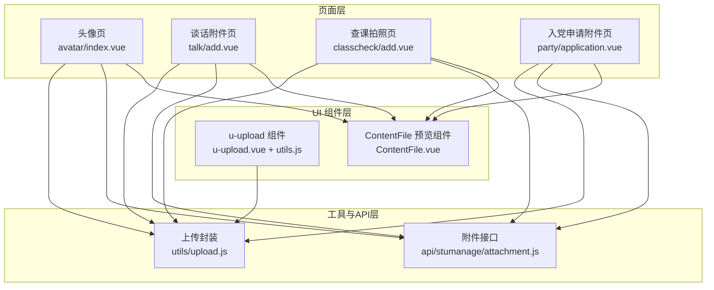
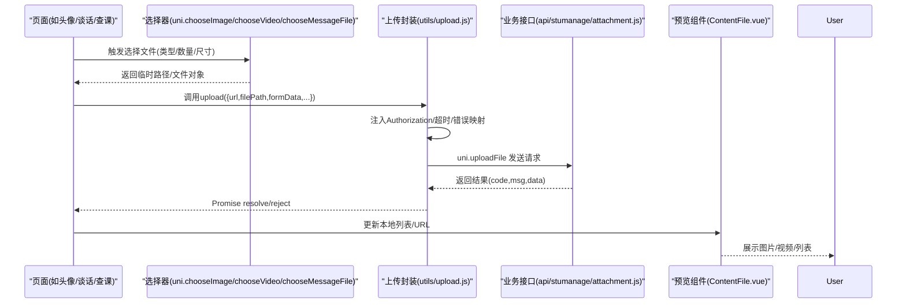
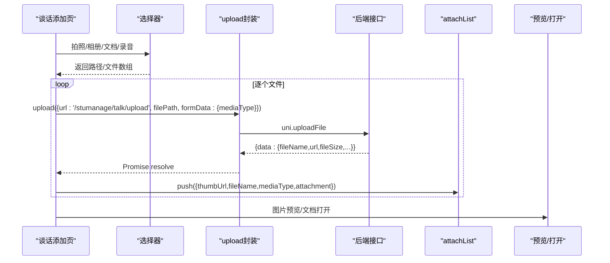
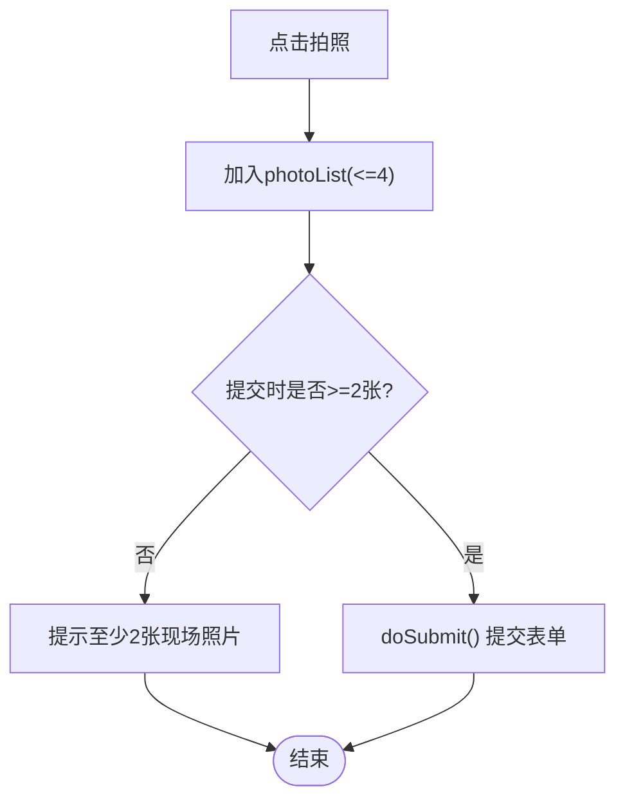
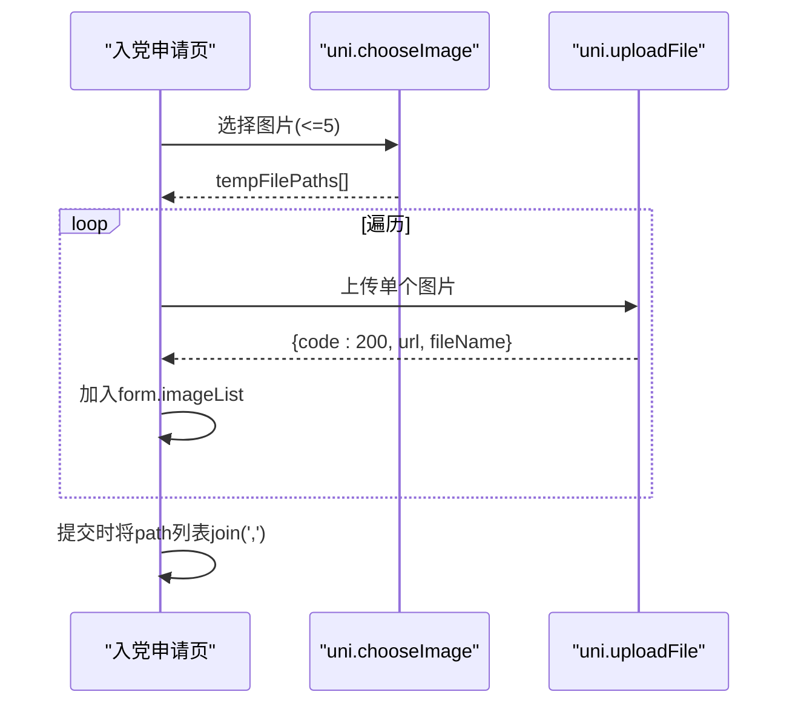
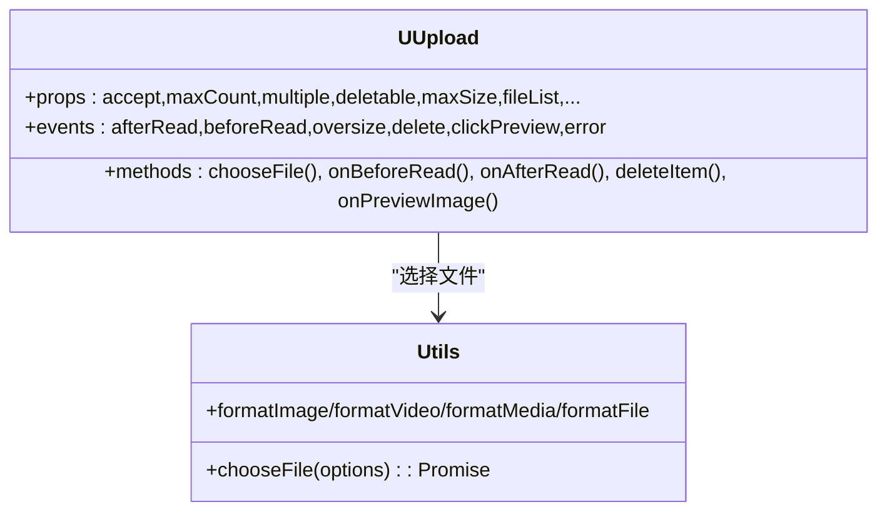
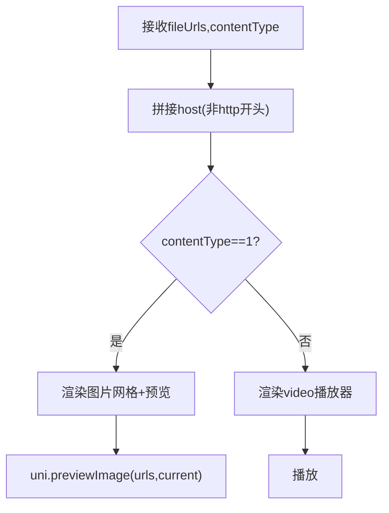
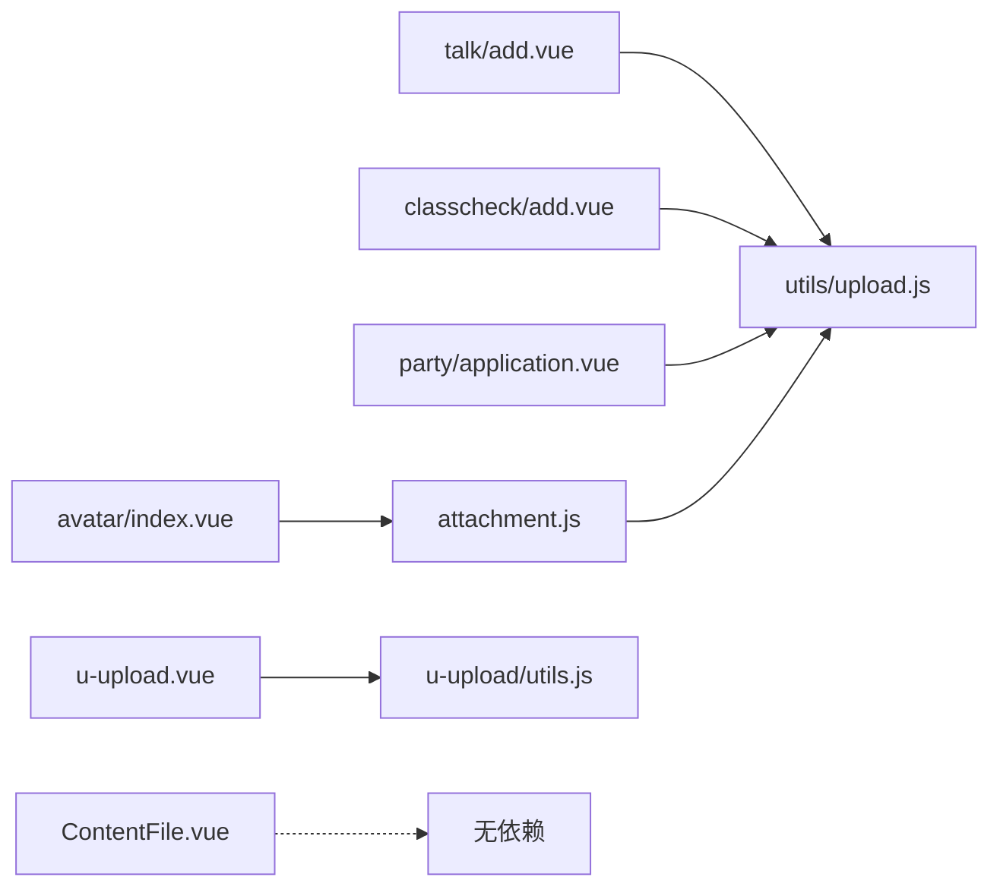

# 文件上传

<cite>
**本文引用的文件列表**
- [utils/upload.js](file://utils/upload.js)
- [api/stumanage/attachment.js](file://api/stumanage/attachment.js)
- [pages/sub-mine/avatar/index.vue](file://pages/sub-mine/avatar/index.vue)
- [components/content/ContentFile.vue](file://components/content/ContentFile.vue)
- [uni_modules/uview-ui/components/u-upload/u-upload.vue](file://uni_modules/uview-ui/components/u-upload/u-upload.vue)
- [uni_modules/uview-ui/components/u-upload/utils.js](file://uni_modules/uview-ui/components/u-upload/utils.js)
- [pages/sub-work/talk/add.vue](file://pages/sub-work/talk/add.vue)
- [pages/sub-work/classcheck/add.vue](file://pages/sub-work/classcheck/add.vue)
- [pages/sub-mine/party/application.vue](file://pages/sub-mine/party/application.vue)
</cite>

## 目录
1. [简介](#简介)
2. [项目结构](#项目结构)
3. [核心组件](#核心组件)
4. [架构总览](#架构总览)
5. [详细组件分析](#详细组件分析)
6. [依赖关系分析](#依赖关系分析)
7. [性能与体验优化](#性能与体验优化)
8. [故障排查指南](#故障排查指南)
9. [结论](#结论)
10. [附录：示例实现路径](#附录示例实现路径)

## 简介
本指南围绕项目的文件上传能力，系统化梳理从“选择文件”到“上传、预览、管理”的完整流程。内容覆盖图片选择、类型与大小校验、进度反馈、多文件批量上传、并发控制、错误重试策略，以及图片预览与附件列表管理等实际场景（头像上传、附件上传、图片预览等）。文档同时给出基于现有源码的实现路径与参考位置，便于快速落地。

## 项目结构
本项目采用分层组织方式：
- utils：通用工具（请求封装、上传封装）
- api：业务接口定义（按模块划分）
- pages：页面级功能（如头像上传、谈话附件、查课拍照、入党申请附件）
- components：可复用展示组件（如 ContentFile 用于图片/视频预览）
- uni_modules：第三方 UI 组件库（u-upload 提供上传交互与基础能力）

图表来源
- [utils/upload.js:1-71](file://utils/upload.js#L1-L71)
- [api/stumanage/attachment.js:1-43](file://api/stumanage/attachment.js#L1-L43)
- [pages/sub-mine/avatar/index.vue:1-231](file://pages/sub-mine/avatar/index.vue#L1-L231)
- [pages/sub-work/talk/add.vue:1-800](file://pages/sub-work/talk/add.vue#L1-L800)
- [pages/sub-work/classcheck/add.vue:1-800](file://pages/sub-work/classcheck/add.vue#L1-L800)
- [pages/sub-mine/party/application.vue:1-170](file://pages/sub-mine/party/application.vue#L1-L170)
- [components/content/ContentFile.vue:1-83](file://components/content/ContentFile.vue#L1-L83)
- [uni_modules/uview-ui/components/u-upload/u-upload.vue:1-559](file://uni_modules/uview-ui/components/u-upload/u-upload.vue#L1-L559)
- [uni_modules/uview-ui/components/u-upload/utils.js:1-152](file://uni_modules/uview-ui/components/u-upload/utils.js#L1-L152)

章节来源
- [utils/upload.js:1-71](file://utils/upload.js#L1-L71)
- [api/stumanage/attachment.js:1-43](file://api/stumanage/attachment.js#L1-L43)
- [components/content/ContentFile.vue:1-83](file://components/content/ContentFile.vue#L1-L83)
- [uni_modules/uview-ui/components/u-upload/u-upload.vue:1-559](file://uni_modules/uview-ui/components/u-upload/u-upload.vue#L1-L559)
- [uni_modules/uview-ui/components/u-upload/utils.js:1-152](file://uni_modules/uview-ui/components/u-upload/utils.js#L1-L152)

## 核心组件
- 上传封装 utils/upload.js
  - 统一处理 Authorization 头、超时、错误码映射、网络异常提示。
  - 通过 uni.uploadFile 发起上传，返回 Promise，供各页面或 API 调用。
- 附件接口 api/stumanage/attachment.js
  - 将业务类型（teacher_photo/student_photo 等）与上传参数组合，复用 upload 封装。
- u-upload 组件（uview-ui）
  - 提供选择文件、预览、删除、状态显示等交互；支持 beforeRead/afterRead 钩子、oversize 事件、最大数量限制、accept 类型过滤。
  - 内部使用 chooseFile 工具函数，根据 accept 分支调用 chooseImage/chooseVideo/chooseMessageFile/chooseFile。
- ContentFile 预览组件
  - 接收 fileUrls 与 contentType，自动拼接 host，支持图片预览与视频播放。

章节来源
- [utils/upload.js:1-71](file://utils/upload.js#L1-L71)
- [api/stumanage/attachment.js:1-43](file://api/stumanage/attachment.js#L1-L43)
- [uni_modules/uview-ui/components/u-upload/u-upload.vue:1-559](file://uni_modules/uview-ui/components/u-upload/u-upload.vue#L1-L559)
- [uni_modules/uview-ui/components/u-upload/utils.js:1-152](file://uni_modules/uview-ui/components/u-upload/utils.js#L1-L152)
- [components/content/ContentFile.vue:1-83](file://components/content/ContentFile.vue#L1-L83)

## 架构总览
下图展示了从页面触发选择文件到上传完成并展示的端到端流程。

图表来源
- [utils/upload.js:1-71](file://utils/upload.js#L1-L71)
- [api/stumanage/attachment.js:1-43](file://api/stumanage/attachment.js#L1-L43)
- [components/content/ContentFile.vue:1-83](file://components/content/ContentFile.vue#L1-L83)

## 详细组件分析

### 头像上传（单图、压缩、提示）
- 选择图片：限制 count=1，sizeType=['compressed']，sourceType=['album','camera']。
- 上传流程：调用 uploadTeacherPhoto -> uploadAttachment -> upload 封装 -> uni.uploadFile。
- 成功后更新教师信息中的 photo 字段，刷新本地预览并返回上一页。

```mermaid
flowchart TD
Start(["点击选择照片"]) --> Choose["uni.chooseImage(count=1,sizeType=compressed)"]
Choose --> SetLocal["设置本地预览路径"]
SetLocal --> Upload["uploadTeacherPhoto(filePath)"]
Upload --> API["uploadAttachment({businessType:'teacher_photo',filePath})"]
API --> Encapsulate["utils/upload.js 注入token/超时/错误映射"]
Encapsulate --> UniUpload["uni.uploadFile 发送"]
UniUpload --> Result{"code===200?"}
Result --> |是| Update["updateMyTeacherinfo(photoPath)"]
Result --> |否| Toast["提示失败"]
Update --> Refresh["更新本地预览并返回上一页"]
Toast --> End(["结束"])
Refresh --> End
```

图表来源
- [pages/sub-mine/avatar/index.vue:71-143](file://pages/sub-mine/avatar/index.vue#L71-L143)
- [api/stumanage/attachment.js:26-31](file://api/stumanage/attachment.js#L26-L31)
- [utils/upload.js:10-68](file://utils/upload.js#L10-L68)

章节来源
- [pages/sub-mine/avatar/index.vue:71-143](file://pages/sub-mine/avatar/index.vue#L71-L143)
- [api/stumanage/attachment.js:26-31](file://api/stumanage/attachment.js#L26-L31)
- [utils/upload.js:10-68](file://utils/upload.js#L10-L68)

### 谈话附件（多图/多类型、批量、预览、打开）
- 选择入口：拍照、相册、文档、录音，分别调用 chooseImage/chooseDocument/chooseAudio。
- 上传：对每个文件调用 upload({url:'/stumanage/talk/upload', formData:{mediaType}})。
- 列表管理：维护 attachList，包含缩略图、文件名、媒体类型、后端返回的 attachment 元数据。
- 预览与打开：图片使用 uni.previewImage；文档/音频使用 downloadFile + openDocument。

图表来源
- [pages/sub-work/talk/add.vue:508-629](file://pages/sub-work/talk/add.vue#L508-L629)
- [utils/upload.js:10-68](file://utils/upload.js#L10-L68)

章节来源
- [pages/sub-work/talk/add.vue:508-629](file://pages/sub-work/talk/add.vue#L508-L629)
- [utils/upload.js:10-68](file://utils/upload.js#L10-L68)

### 查课拍照（至少2张、最多4张、提交前校验）
- 选择：拍照按钮，限制总数不超过4张。
- 列表：photoList 存储缩略图与标签（教室前方/后方/补充）。
- 提交：书记角色需输入实到人数且至少2张；辅导员角色也需至少2张。

图表来源
- [pages/sub-work/classcheck/add.vue:119-151](file://pages/sub-work/classcheck/add.vue#L119-L151)
- [pages/sub-work/classcheck/add.vue:712-784](file://pages/sub-work/classcheck/add.vue#L712-L784)

章节来源
- [pages/sub-work/classcheck/add.vue:119-151](file://pages/sub-work/classcheck/add.vue#L119-L151)
- [pages/sub-work/classcheck/add.vue:712-784](file://pages/sub-work/classcheck/add.vue#L712-L784)

### 入党申请附件（多图、直接上传、列表管理）
- 选择：最多5张，sizeType=['compressed']。
- 上传：直接调用 uni.uploadFile 至 /party/upload/image，成功后加入 form.imageList。
- 提交：将图片路径以逗号分隔提交。

图表来源
- [pages/sub-mine/party/application.vue:88-138](file://pages/sub-mine/party/application.vue#L88-L138)

章节来源
- [pages/sub-mine/party/application.vue:88-138](file://pages/sub-mine/party/application.vue#L88-L138)

### u-upload 组件（通用上传交互）
- 选择：根据 accept 分支调用 chooseImage/chooseVideo/chooseMessageFile/chooseFile。
- 校验：beforeRead/afterRead 钩子；oversize 事件；maxCount 控制。
- 预览：onPreviewImage 调用 uni.previewImage；支持删除、成功标记。
- 事件：afterRead/delete/clickPreview/error 等。

图表来源
- [uni_modules/uview-ui/components/u-upload/u-upload.vue:167-353](file://uni_modules/uview-ui/components/u-upload/u-upload.vue#L167-L353)
- [uni_modules/uview-ui/components/u-upload/utils.js:63-152](file://uni_modules/uview-ui/components/u-upload/utils.js#L63-L152)

章节来源
- [uni_modules/uview-ui/components/u-upload/u-upload.vue:167-353](file://uni_modules/uview-ui/components/u-upload/u-upload.vue#L167-L353)
- [uni_modules/uview-ui/components/u-upload/utils.js:63-152](file://uni_modules/uview-ui/components/u-upload/utils.js#L63-L152)

### ContentFile 预览组件
- 输入：fileUrls（字符串数组）、contentType（1=图片，2=视频）。
- 处理：若 URL 非 http 开头则拼接 host；图片点击预览，视频直接播放。

图表来源
- [components/content/ContentFile.vue:43-72](file://components/content/ContentFile.vue#L43-L72)

章节来源
- [components/content/ContentFile.vue:43-72](file://components/content/ContentFile.vue#L43-L72)

## 依赖关系分析
- 页面依赖上传封装 utils/upload.js 或直接使用 uni.uploadFile。
- 附件接口 api/stumanage/attachment.js 依赖 upload 封装。
- u-upload 组件依赖其内部 utils.js 的选择器封装。
- ContentFile 仅负责展示，不依赖上传逻辑。

图表来源
- [pages/sub-mine/avatar/index.vue:1-231](file://pages/sub-mine/avatar/index.vue#L1-L231)
- [pages/sub-work/talk/add.vue:1-800](file://pages/sub-work/talk/add.vue#L1-L800)
- [pages/sub-work/classcheck/add.vue:1-800](file://pages/sub-work/classcheck/add.vue#L1-L800)
- [pages/sub-mine/party/application.vue:1-170](file://pages/sub-mine/party/application.vue#L1-L170)
- [api/stumanage/attachment.js:1-43](file://api/stumanage/attachment.js#L1-L43)
- [utils/upload.js:1-71](file://utils/upload.js#L1-L71)
- [uni_modules/uview-ui/components/u-upload/u-upload.vue:1-559](file://uni_modules/uview-ui/components/u-upload/u-upload.vue#L1-L559)
- [uni_modules/uview-ui/components/u-upload/utils.js:1-152](file://uni_modules/uview-ui/components/u-upload/utils.js#L1-L152)
- [components/content/ContentFile.vue:1-83](file://components/content/ContentFile.vue#L1-L83)

章节来源
- [api/stumanage/attachment.js:1-43](file://api/stumanage/attachment.js#L1-L43)
- [utils/upload.js:1-71](file://utils/upload.js#L1-L71)
- [uni_modules/uview-ui/components/u-upload/u-upload.vue:1-559](file://uni_modules/uview-ui/components/u-upload/u-upload.vue#L1-L559)
- [uni_modules/uview-ui/components/u-upload/utils.js:1-152](file://uni_modules/uview-ui/components/u-upload/utils.js#L1-L152)

## 性能与体验优化
- 图片压缩：在头像与申请附件中均使用 sizeType=['compressed']，减少带宽与内存占用。
- 数量限制：头像 count=1；谈话附件最多5个；查课拍照最多4张；申请附件最多5张。
- 并发控制：当前实现多为串行上传（循环逐个上传），建议在高并发场景引入队列与并发上限（例如 Promise.allSettled 分批执行）。
- 进度反馈：
  - 现状：多处使用 uni.showLoading 表示“上传中...”，未使用 onProgressUpdate 回调。
  - 建议：在 utils/upload.js 中接入 onProgressUpdate，计算百分比并暴露给页面，实现进度条。
- 取消上传：
  - 现状：未实现取消逻辑。
  - 建议：保存 uploadTask 引用，在用户操作时调用 abort 或 cancel（取决于平台能力），并在 UI 上提供取消按钮。
- 断点续传：
  - 现状：未实现分片与断点续传。
  - 建议：大文件场景可考虑前端分片、记录已上传片段、服务端合并与恢复。
- 错误重试：
  - 现状：错误统一 toast 提示，未自动重试。
  - 建议：对网络错误进行有限次指数退避重试，避免重复失败。

[本节为通用指导，不涉及具体代码行引用]

## 故障排查指南
- 登录态失效
  - 现象：返回 code=401，弹出确认框引导重新登录。
  - 定位：utils/upload.js 的错误处理分支。
- 网络异常/超时
  - 现象：Network Error、timeout 等提示。
  - 定位：utils/upload.js fail 分支，统一转换为友好文案。
- 文件过大
  - 现象：触发 oversize 事件（u-upload 组件）。
  - 定位：u-upload.vue 的 onAfterRead 中 maxSize 判断。
- 预览失败
  - 现象：预览图片/视频失败提示。
  - 定位：u-upload.vue 的 onPreviewImage/onPreviewVideo 的 fail 回调。

章节来源
- [utils/upload.js:31-66](file://utils/upload.js#L31-L66)
- [uni_modules/uview-ui/components/u-upload/u-upload.vue:280-342](file://uni_modules/uview-ui/components/u-upload/u-upload.vue#L280-L342)

## 结论
本项目已具备完善的文件上传基础能力：统一的上传封装、清晰的接口分层、丰富的页面实践（头像、附件、拍照、申请附件）以及通用的 u-upload 组件。建议在现有基础上增强进度条、取消上传与错误重试机制，并在大文件场景评估断点续传方案，以提升用户体验与系统健壮性。

[本节为总结，不涉及具体代码行引用]

## 附录：示例实现路径
- 头像上传
  - 选择与上传：[pages/sub-mine/avatar/index.vue:71-143](file://pages/sub-mine/avatar/index.vue#L71-L143)
  - 接口封装：[api/stumanage/attachment.js:26-31](file://api/stumanage/attachment.js#L26-L31)
  - 上传封装：[utils/upload.js:10-68](file://utils/upload.js#L10-L68)
- 附件上传（谈话）
  - 选择与上传：[pages/sub-work/talk/add.vue:508-629](file://pages/sub-work/talk/add.vue#L508-L629)
  - 上传封装：[utils/upload.js:10-68](file://utils/upload.js#L10-L68)
- 查课拍照
  - 选择与校验：[pages/sub-work/classcheck/add.vue:119-151](file://pages/sub-work/classcheck/add.vue#L119-L151)
  - 提交校验：[pages/sub-work/classcheck/add.vue:712-784](file://pages/sub-work/classcheck/add.vue#L712-L784)
- 入党申请附件
  - 选择与上传：[pages/sub-mine/party/application.vue:88-138](file://pages/sub-mine/party/application.vue#L88-L138)
- 图片预览
  - 自定义预览组件：[components/content/ContentFile.vue:43-72](file://components/content/ContentFile.vue#L43-L72)
  - u-upload 内置预览：[uni_modules/uview-ui/components/u-upload/u-upload.vue:310-320](file://uni_modules/uview-ui/components/u-upload/u-upload.vue#L310-L320)