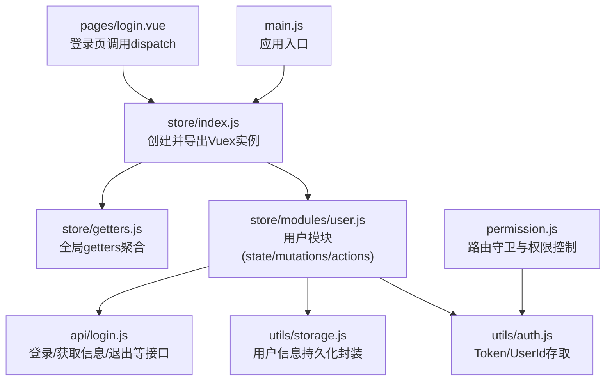
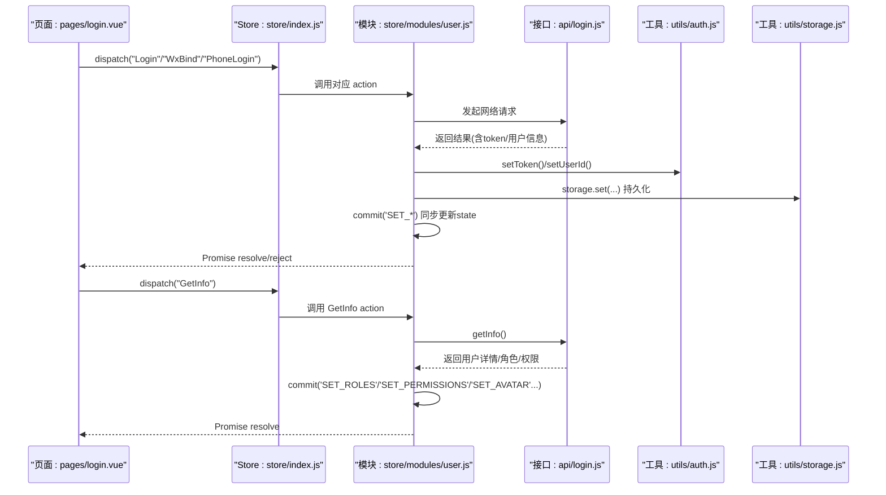
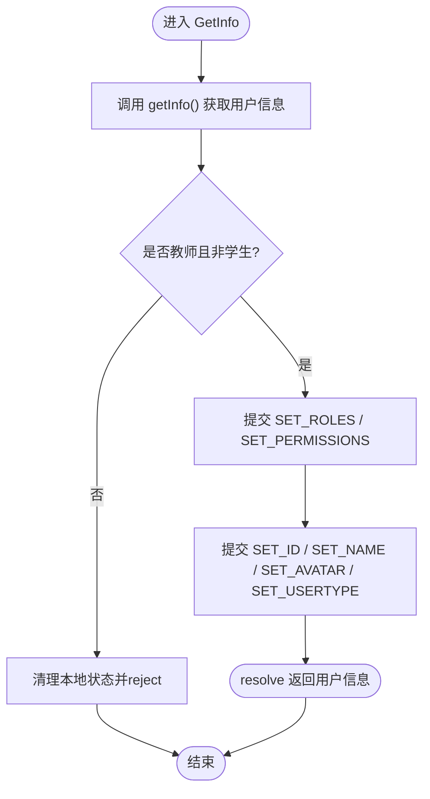
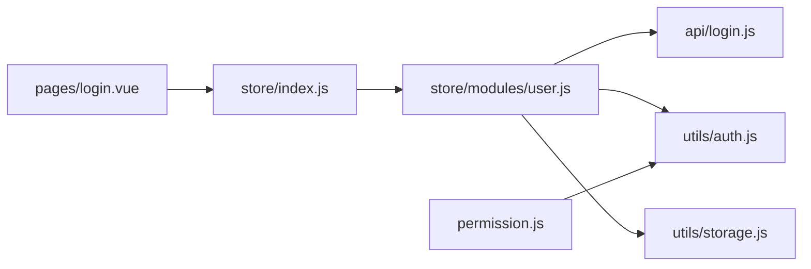
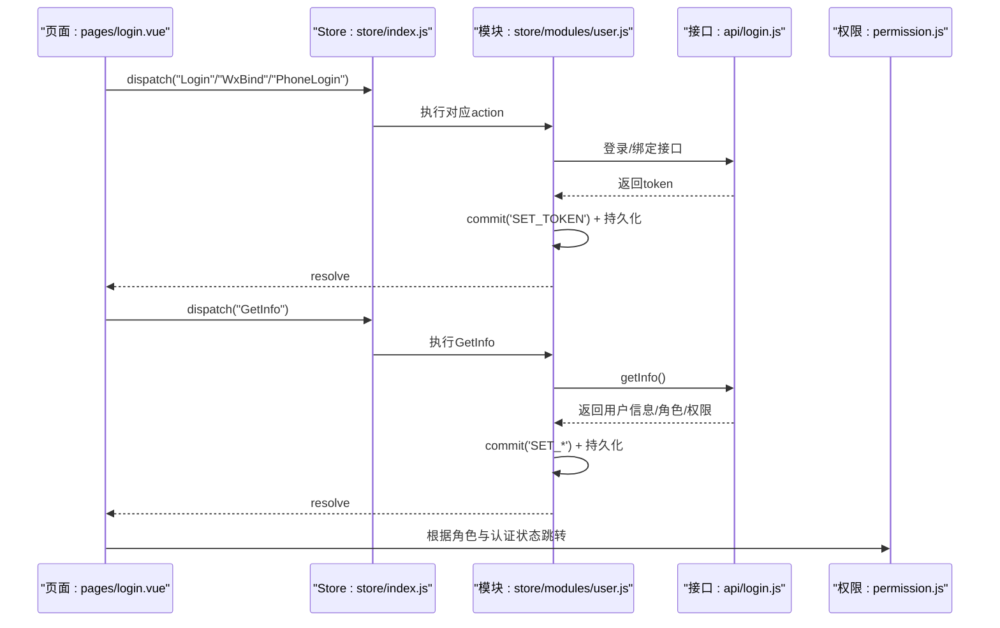

# 状态管理集成

<cite>
**本文引用的文件**   
- [store/index.js](file://store/index.js)
- [store/modules/user.js](file://store/modules/user.js)
- [store/getters.js](file://store/getters.js)
- [main.js](file://main.js)
- [utils/storage.js](file://utils/storage.js)
- [utils/auth.js](file://utils/auth.js)
- [api/login.js](file://api/login.js)
- [pages/login.vue](file://pages/login.vue)
- [permission.js](file://permission.js)
</cite>

## 目录
1. [简介](#简介)
2. [项目结构](#项目结构)
3. [核心组件](#核心组件)
4. [架构总览](#架构总览)
5. [详细组件分析](#详细组件分析)
6. [依赖关系分析](#依赖关系分析)
7. [性能与可维护性建议](#性能与可维护性建议)
8. [故障排查指南](#故障排查指南)
9. [结论](#结论)
10. [附录：用户模块数据流示例](#附录用户模块数据流示例)

## 简介
本指南围绕项目的 Vuex 状态管理架构，系统阐述模块设计模式、用户状态管理实现、计算属性（getters）使用场景、以及本地持久化方案。文档以“用户模块”为主线，展示从页面触发到后端交互、再到状态更新与持久化的完整数据流，并提供可操作的实践建议与排错指引。

## 项目结构
本项目采用基于 Vuex 的模块化状态管理，入口在应用初始化时挂载 store，用户相关状态集中在 user 模块中，并通过 getters 对外暴露只读视图。

图示来源
- [main.js:1-31](file://main.js#L1-L31)
- [store/index.js:1-16](file://store/index.js#L1-L16)
- [store/modules/user.js:1-283](file://store/modules/user.js#L1-L283)
- [store/getters.js:1-11](file://store/getters.js#L1-L11)
- [utils/auth.js:1-47](file://utils/auth.js#L1-L47)
- [utils/storage.js:1-33](file://utils/storage.js#L1-L33)
- [api/login.js:1-168](file://api/login.js#L1-L168)
- [pages/login.vue:1-462](file://pages/login.vue#L1-L462)
- [permission.js:1-133](file://permission.js#L1-L133)

章节来源
- [main.js:1-31](file://main.js#L1-L31)
- [store/index.js:1-16](file://store/index.js#L1-L16)

## 核心组件
- 模块组织
  - 根 store 通过 modules 注册 user 模块，并在顶层引入 getters 聚合。
- 用户模块（user）
  - state：token、id、name、avatar、roles、permissions、userType 等。
  - mutations：同步更新 state 并写入本地存储（storage/auth）。
  - actions：封装登录、获取用户信息、微信绑定、手机号快捷登录、退出、解绑等异步流程。
- 全局 getters
  - 提供 token、avatar、id、name、roles、permissions、userType 等只读访问。
- 持久化
  - utils/auth.js：负责 Token 与 UserId 的存取。
  - utils/storage.js：统一封装 uni.getStorageSync/setStorageSync/clean 等操作，按 key 白名单持久化用户信息。

章节来源
- [store/index.js:1-16](file://store/index.js#L1-L16)
- [store/modules/user.js:1-283](file://store/modules/user.js#L1-L283)
- [store/getters.js:1-11](file://store/getters.js#L1-L11)
- [utils/auth.js:1-47](file://utils/auth.js#L1-L47)
- [utils/storage.js:1-33](file://utils/storage.js#L1-L33)

## 架构总览
下图展示了用户登录主流程中，页面、store、API、持久化层之间的交互顺序。

图示来源
- [pages/login.vue:112-225](file://pages/login.vue#L112-L225)
- [store/modules/user.js:54-111](file://store/modules/user.js#L54-L111)
- [api/login.js:3-47](file://api/login.js#L3-L47)
- [utils/auth.js:1-47](file://utils/auth.js#L1-L47)
- [utils/storage.js:1-33](file://utils/storage.js#L1-L33)

## 详细组件分析

### 用户模块（store/modules/user.js）
- 状态定义
  - 初始值优先从本地持久化恢复（auth.js 与 storage.js），保证刷新后状态一致。
- 同步操作（mutations）
  - SET_TOKEN/SET_ID/SET_NAME/SET_AVATAR/SET_ROLES/SET_PERMISSIONS/SET_USERTYPE
  - 每个 mutation 在更新 state 的同时，将关键信息写入本地存储，确保状态与持久化一致。
- 异步操作（actions）
  - Login/WxLogin/WxBind/PhoneLogin/TeacherPhoneBind/StudentBindLogin/LogOut/Unbind/GetInfo
  - 典型流程：调用 api/login.js 中的接口 -> 成功后 setToken/commit -> 必要时继续拉取用户信息 -> 失败则清理本地状态或抛出错误。
  - GetInfo 包含账号类型校验逻辑，若不符合教师身份要求，会清理本地状态并拒绝 Promise。
- 数据流要点
  - 所有写操作均通过 commit 进行，避免在组件中直接修改 state。
  - 持久化由 mutation 内部完成，降低业务侧复杂度。

图示来源
- [store/modules/user.js:72-111](file://store/modules/user.js#L72-L111)

章节来源
- [store/modules/user.js:1-283](file://store/modules/user.js#L1-L283)

### 全局 getters（store/getters.js）
- 作用
  - 为组件提供统一的只读访问入口，屏蔽模块路径细节。
- 常用字段
  - token、avatar、id、name、roles、permissions、userType
- 使用建议
  - 在组件中通过 this.$store.getters.xxx 或 mapGetters 映射使用。
  - 对复杂派生数据可在模块内扩展局部 getters，保持全局 getters 简洁。

章节来源
- [store/getters.js:1-11](file://store/getters.js#L1-L11)

### 持久化工具（utils/auth.js 与 utils/storage.js）
- auth.js
  - 提供 getToken/setToken/removeToken 与 getUserId/setUserId/removeUserId/isLogin 等基础能力。
- storage.js
  - 统一封装 uni.getStorageSync/setStorageSync/clean，并对特定 key 做集中管理。
- 与 user 模块的关系
  - user 模块在 mutation 中调用上述工具，确保 token 与用户信息在应用重启后可恢复。

章节来源
- [utils/auth.js:1-47](file://utils/auth.js#L1-L47)
- [utils/storage.js:1-33](file://utils/storage.js#L1-L33)

### 页面集成（pages/login.vue）
- 登录流程
  - 根据环境选择密码登录或微信绑定登录，调用 $store.dispatch 触发相应 action。
  - 登录成功后再调用 GetInfo 获取用户信息与权限，随后跳转首页或认证页。
- 异常处理
  - 登录失败时刷新验证码或提示错误；GetInfo 失败时统一提示“账号不存在”。

章节来源
- [pages/login.vue:112-225](file://pages/login.vue#L112-L225)

### 权限与路由拦截（permission.js）
- 功能
  - 基于 token 判断登录态，未登录访问非白名单页面重定向至登录页。
  - 登录后访问登录页重定向至首页。
- 与状态管理的关系
  - 读取 token 来自 utils/auth.js，与 user 模块的持久化保持一致。

章节来源
- [permission.js:1-133](file://permission.js#L1-L133)

## 依赖关系分析
- 模块耦合
  - user 模块依赖 api/login.js、utils/auth.js、utils/storage.js，职责清晰，边界明确。
- 外部依赖
  - 通过 uni.* 系列 API 进行本地存储与平台能力调用。
- 潜在风险
  - 若后续新增模块，建议在 store/index.js 中集中注册，并保持 getters 的聚合风格一致。

图示来源
- [pages/login.vue:112-225](file://pages/login.vue#L112-L225)
- [store/index.js:1-16](file://store/index.js#L1-L16)
- [store/modules/user.js:1-283](file://store/modules/user.js#L1-L283)
- [api/login.js:1-168](file://api/login.js#L1-L168)
- [utils/auth.js:1-47](file://utils/auth.js#L1-L47)
- [utils/storage.js:1-33](file://utils/storage.js#L1-L33)
- [permission.js:1-133](file://permission.js#L1-L133)

## 性能与可维护性建议
- 减少不必要的重复请求
  - 在 GetInfo 成功返回后，可将用户信息缓存于内存，避免频繁拉取。
- 合并多次 commit
  - 对于批量更新，可在 action 中一次性提交多个 mutation，减少中间渲染开销。
- 错误边界与重试
  - 对网络异常增加重试与降级策略，提升用户体验。
- 模块化扩展
  - 新增业务域时，遵循现有 user 模块结构，保持 state/mutations/actions 的职责单一。

[本节为通用建议，不直接分析具体文件]

## 故障排查指南
- 登录后仍被重定向到登录页
  - 检查 token 是否正确写入与读取（utils/auth.js）。
  - 确认 permission.js 的白名单配置是否符合预期。
- 头像显示异常
  - 检查 avatar 是否为相对路径，GetInfo 中已拼接 baseUrl，需确认 baseUrl 配置正确。
- 微信绑定失败
  - 关注 WxBind 的 Promise reject 分支，确认后端返回码与错误消息。
- 退出后状态未清空
  - 确认 LogOut/Unbind 是否执行了 removeToken 与 storage.clean。

章节来源
- [utils/auth.js:1-47](file://utils/auth.js#L1-L47)
- [permission.js:1-133](file://permission.js#L1-L133)
- [store/modules/user.js:214-258](file://store/modules/user.js#L214-L258)

## 结论
本项目采用清晰的 Vuex 模块化架构，用户模块职责明确，结合 auth 与 storage 实现了稳定的状态持久化。通过 getters 暴露只读视图，配合页面层的 dispatch 调用，形成良好的单向数据流。建议在后续迭代中持续优化错误处理与缓存策略，并按需扩展更多业务模块。

[本节为总结性内容，不直接分析具体文件]

## 附录：用户模块数据流示例
- 登录成功后获取用户信息并跳转
  - 页面调用 $store.dispatch('Login'/'WxBind'/'PhoneLogin')
  - 成功后再调用 $store.dispatch('GetInfo')
  - 根据返回的角色配置与实名认证状态决定跳转目标

图示来源
- [pages/login.vue:190-225](file://pages/login.vue#L190-L225)
- [store/modules/user.js:54-111](file://store/modules/user.js#L54-L111)
- [api/login.js:3-47](file://api/login.js#L3-L47)
- [permission.js:1-133](file://permission.js#L1-L133)