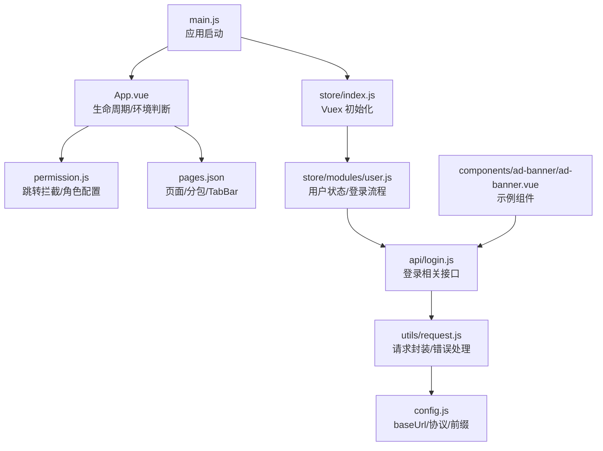
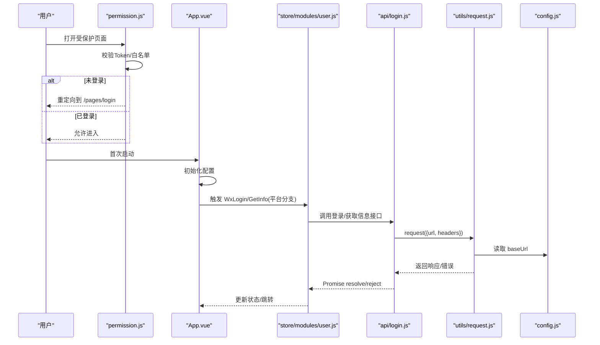
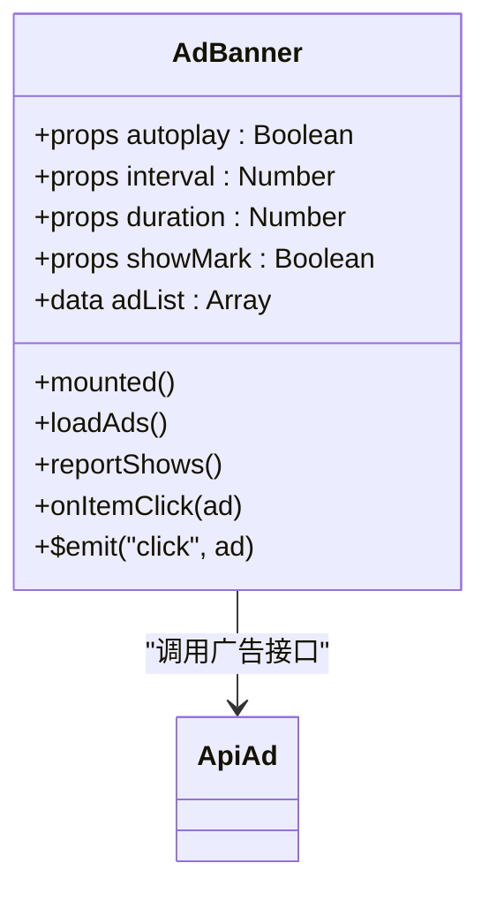
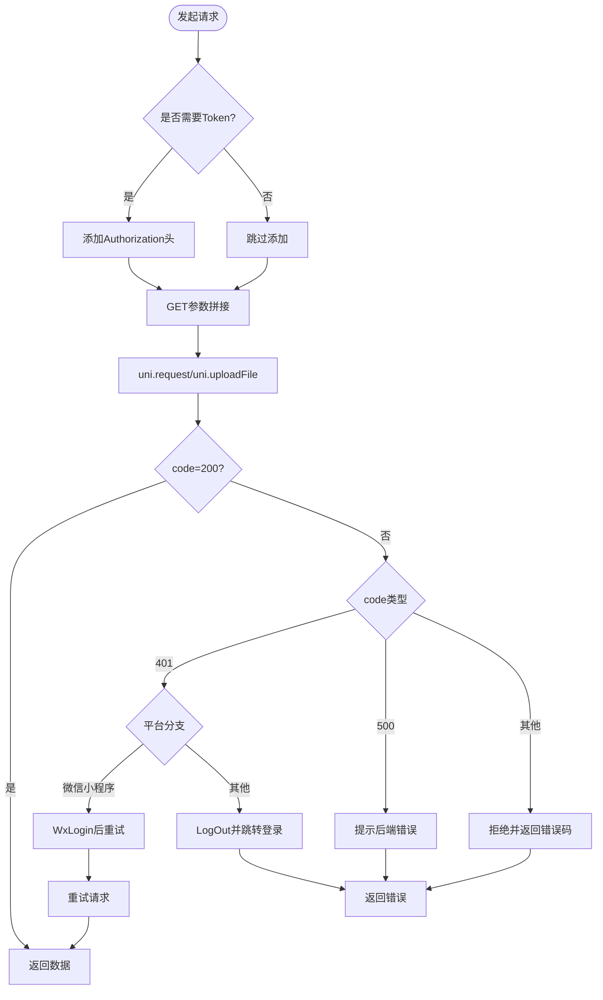
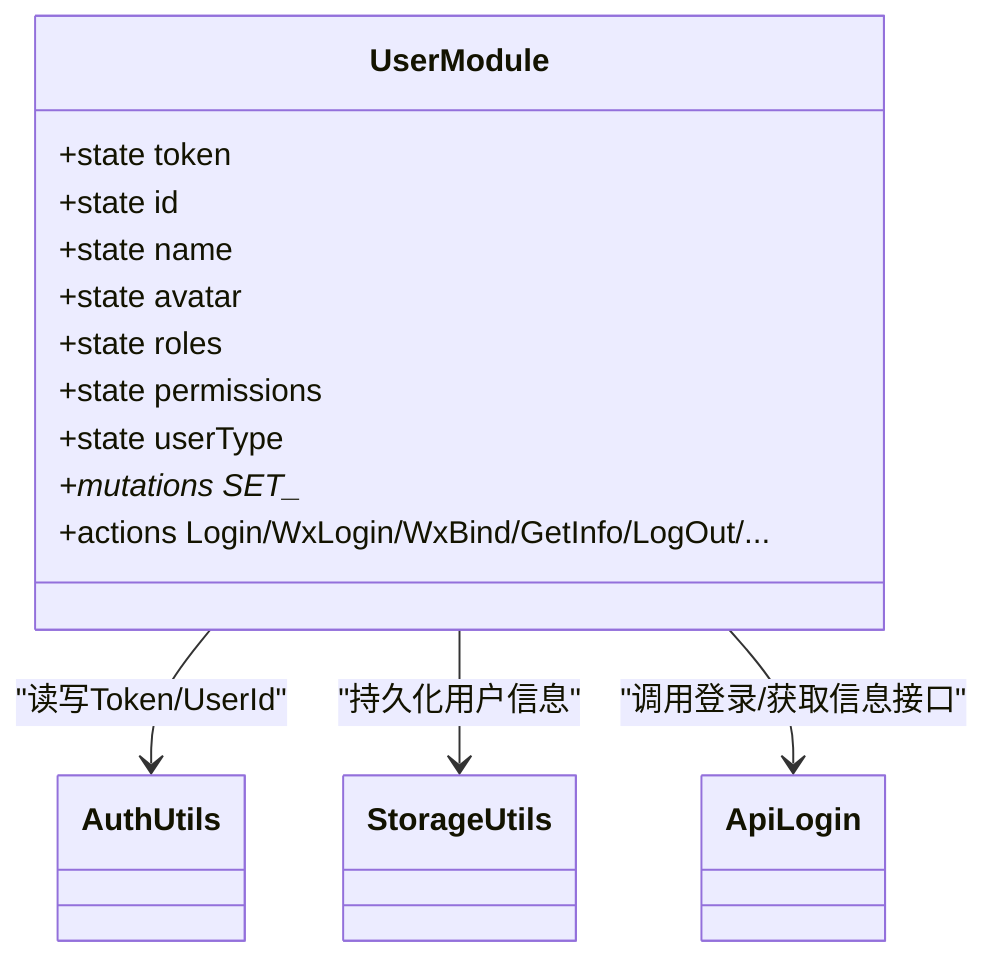
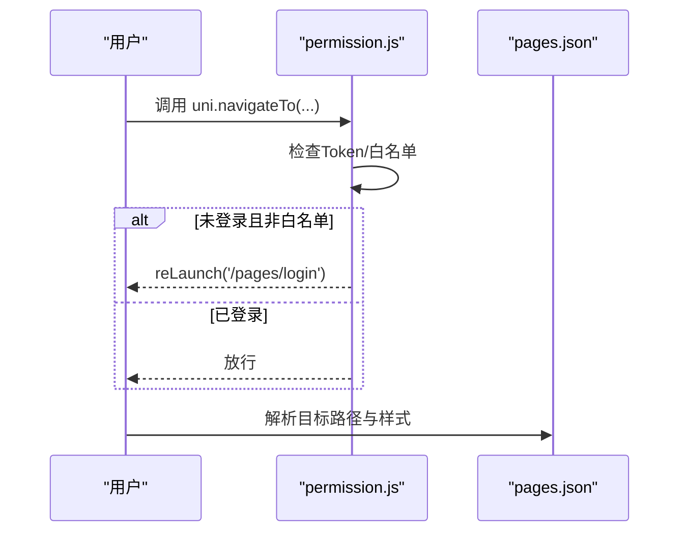
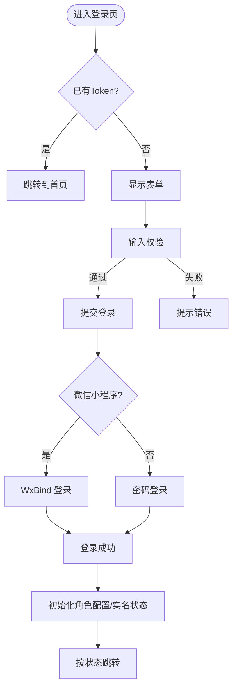
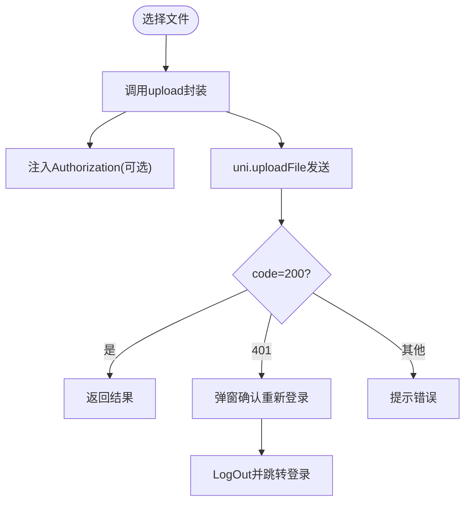
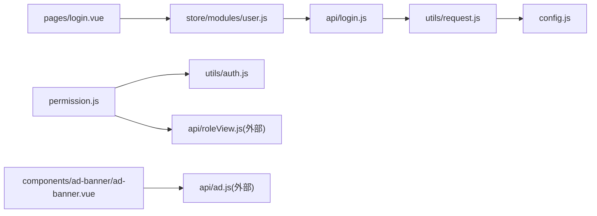

# 编码实现

<cite>
**本文引用的文件**   
- [main.js](file://main.js)
- [App.vue](file://App.vue)
- [pages.json](file://pages.json)
- [config.js](file://config.js)
- [utils/request.js](file://utils/request.js)
- [utils/upload.js](file://utils/upload.js)
- [utils/auth.js](file://utils/auth.js)
- [store/index.js](file://store/index.js)
- [store/modules/user.js](file://store/modules/user.js)
- [permission.js](file://permission.js)
- [api/login.js](file://api/login.js)
- [pages/login.vue](file://pages/login.vue)
- [components/ad-banner/ad-banner.vue](file://components/ad-banner/ad-banner.vue)
</cite>

## 目录
1. [引言](#引言)
2. [项目结构](#项目结构)
3. [核心组件](#核心组件)
4. [架构总览](#架构总览)
5. [详细组件分析](#详细组件分析)
6. [依赖关系分析](#依赖关系分析)
7. [性能与可维护性建议](#性能与可维护性建议)
8. [故障排查指南](#故障排查指南)
9. [结论](#结论)
10. [附录：编码规范与最佳实践](#附录编码规范与最佳实践)

## 引言
本指南面向新功能开发，提供从 Vue 组件、API 封装、状态管理、路由配置到表单与上传的完整编码规范与最佳实践。结合当前代码库的实际实现，给出可直接落地的方案与图示，帮助团队统一风格、提升质量与可维护性。

## 项目结构
本项目基于 uni-app + Vue2 + Vuex，采用模块化组织：
- 应用入口与全局初始化：main.js、App.vue
- 路由与页面注册：pages.json
- 全局配置：config.js
- 网络层：utils/request.js（请求）、utils/upload.js（上传）
- 认证与权限：utils/auth.js、permission.js
- 状态管理：store/index.js、store/modules/user.js
- API 接口：api/login.js 等
- 示例页面与组件：pages/login.vue、components/ad-banner/ad-banner.vue

图表来源
- [main.js:1-31](file://main.js#L1-L31)
- [App.vue:1-48](file://App.vue#L1-L48)
- [permission.js:1-133](file://permission.js#L1-L133)
- [store/index.js:1-16](file://store/index.js#L1-L16)
- [store/modules/user.js:1-283](file://store/modules/user.js#L1-L283)
- [api/login.js:1-168](file://api/login.js#L1-L168)
- [utils/request.js:1-117](file://utils/request.js#L1-L117)
- [config.js:1-38](file://config.js#L1-L38)
- [pages.json:1-235](file://pages.json#L1-L235)
- [components/ad-banner/ad-banner.vue:1-140](file://components/ad-banner/ad-banner.vue#L1-L140)

章节来源
- [main.js:1-31](file://main.js#L1-L31)
- [App.vue:1-48](file://App.vue#L1-L48)
- [pages.json:1-235](file://pages.json#L1-L235)
- [config.js:1-38](file://config.js#L1-L38)

## 核心组件
- 应用入口与插件挂载
  - main.js 中引入 uView UI、插件、store，并挂载全局方法与字典接口。
- 应用初始化与环境分支
  - App.vue 在 onLaunch 中初始化配置，按平台执行微信自动登录或 H5 登录检查。
- 路由与 TabBar
  - pages.json 定义主包与分包页面、TabBar 列表与全局样式。
- 全局配置
  - config.js 集中管理协议、主机、端口、API 前缀与 baseUrl 计算，以及应用信息。

章节来源
- [main.js:1-31](file://main.js#L1-L31)
- [App.vue:1-48](file://App.vue#L1-L48)
- [pages.json:1-235](file://pages.json#L1-L235)
- [config.js:1-38](file://config.js#L1-L38)

## 架构总览
整体数据流与控制流：
- 启动阶段：main.js 初始化 store、插件；App.vue 初始化配置并根据平台触发登录流程。
- 鉴权阶段：permission.js 对导航进行拦截，未登录且非白名单则重定向至登录页；登录后根据角色配置动态设置首页与 TabBar。
- 业务阶段：页面通过 api/* 调用 utils/request.js 发起请求，携带 Token；失败时统一提示与错误码映射；401 时触发自动登录或退出。
- 状态管理：store/modules/user.js 负责登录、获取用户信息、角色权限、持久化到本地存储。

图表来源
- [permission.js:1-133](file://permission.js#L1-L133)
- [App.vue:1-48](file://App.vue#L1-L48)
- [store/modules/user.js:1-283](file://store/modules/user.js#L1-L283)
- [api/login.js:1-168](file://api/login.js#L1-L168)
- [utils/request.js:1-117](file://utils/request.js#L1-L117)
- [config.js:1-38](file://config.js#L1-L38)

## 详细组件分析

### 组件开发规范与示例：广告轮播组件
- 结构设计
  - props 控制行为：是否自动播放、间隔、动画时长、是否显示“广告”标识。
  - data 仅保存内部状态：广告列表。
  - mounted 生命周期加载数据。
  - methods 暴露加载、上报展示/点击、点击跳转逻辑。
- 事件处理
  - 对外暴露 click 事件，供父组件监听。
- 数据流
  - 组件内调用 api/ad 获取数据，成功后渲染并上报展示。
- 跨端兼容
  - H5 使用 window.open，小程序使用 navigateToMiniProgram。

图表来源
- [components/ad-banner/ad-banner.vue:1-140](file://components/ad-banner/ad-banner.vue#L1-L140)

章节来源
- [components/ad-banner/ad-banner.vue:1-140](file://components/ad-banner/ad-banner.vue#L1-L140)

### API 接口封装与错误处理
- 请求封装（utils/request.js）
  - 自动注入 Authorization 头（除非显式 isToken=false）。
  - GET 参数序列化拼接。
  - 统一超时、错误码映射与提示。
  - 401 分支：
    - 微信小程序：尝试自动登录并重试原请求；失败则登出并跳转登录页。
    - 其他平台：直接登出并跳转登录页。
  - 登录相关接口不触发自动登录，避免死循环。
- 上传封装（utils/upload.js）
  - 支持 header、formData、name 字段自定义。
  - 统一错误处理与提示，401 弹窗确认是否重新登录。
- 登录接口（api/login.js）
  - 登录、注册、获取用户信息、退出、验证码、微信绑定、手机号快捷登录等。
  - 所有需要鉴权的接口默认带 Token，无需鉴权的接口设置 isToken=false。

图表来源
- [utils/request.js:1-117](file://utils/request.js#L1-L117)
- [utils/upload.js:1-71](file://utils/upload.js#L1-L71)
- [api/login.js:1-168](file://api/login.js#L1-L168)

章节来源
- [utils/request.js:1-117](file://utils/request.js#L1-L117)
- [utils/upload.js:1-71](file://utils/upload.js#L1-L71)
- [api/login.js:1-168](file://api/login.js#L1-L168)

### 状态管理与数据持久化
- 模块设计（store/modules/user.js）
  - state：token、id、name、avatar、roles、permissions、userType。
  - mutations：SET_TOKEN/ID/NAME/AVATAR/ROLES/PERMISSIONS/USERTYPE，同步更新 state 并持久化。
  - actions：
    - Login/WxLogin/WxBind/PhoneLogin/TeacherPhoneBind/StudentBindLogin：完成登录并写入 token 与用户信息。
    - GetInfo：拉取用户详情，校验教师账号，设置 roles/permissions/avatar/userType。
    - LogOut/Unbind：清理本地与状态。
- 持久化策略
  - 使用 utils/storage 与 utils/auth 将关键信息写入本地存储，保证刷新后状态恢复。
- 集成方式
  - store/index.js 注册 user 模块与 getters。
  - main.js 挂载 $store 与全局方法。

图表来源
- [store/modules/user.js:1-283](file://store/modules/user.js#L1-L283)
- [utils/auth.js:1-47](file://utils/auth.js#L1-L47)
- [api/login.js:1-168](file://api/login.js#L1-L168)

章节来源
- [store/index.js:1-16](file://store/index.js#L1-L16)
- [store/modules/user.js:1-283](file://store/modules/user.js#L1-L283)
- [utils/auth.js:1-47](file://utils/auth.js#L1-L47)

### 路由配置与守卫
- 页面注册与分包
  - pages.json 定义主包页面与多个 subPackages，减少首屏体积。
  - tabBar 配置底部导航项。
- 全局跳转拦截
  - permission.js 对 navigateTo/redirectTo/reLaunch/switchTab 进行拦截：
    - 已登录访问登录页：重定向到角色配置的首页。
    - 未登录访问非白名单：重定向到登录页。
  - 角色配置缓存与动态 TabBar（小程序支持）。
- 参数传递
  - 通过 URL 查询参数传递标题、链接等，如 webview 页面。

图表来源
- [permission.js:1-133](file://permission.js#L1-L133)
- [pages.json:1-235](file://pages.json#L1-L235)

章节来源
- [pages.json:1-235](file://pages.json#L1-L235)
- [permission.js:1-133](file://permission.js#L1-L133)

### 表单处理方案
- 登录页表单（pages/login.vue）
  - 数据绑定：v-model 绑定 username/password/code/uuid。
  - 验证：空值校验、验证码开关控制。
  - 提交：区分微信小程序与非小程序环境，分别调用 WxBind/Login。
  - 成功回调：清除旧角色配置缓存，异步初始化角色配置与实名认证状态，按需跳转。
- 建议扩展
  - 使用 uni-forms/u-view 的表单组件与规则校验，统一错误提示与聚焦行为。
  - 提交前做前端二次校验，提交后统一 loading 与错误提示。

图表来源
- [pages/login.vue:1-462](file://pages/login.vue#L1-L462)
- [permission.js:1-133](file://permission.js#L1-L133)

章节来源
- [pages/login.vue:1-462](file://pages/login.vue#L1-L462)

### 文件上传功能实现
- 上传封装（utils/upload.js）
  - 支持 filePath/name/header/formData 等参数。
  - 统一错误处理与提示，401 弹窗确认是否重新登录。
- 使用建议
  - 选择图片：使用 uni.chooseImage，限制数量与大小。
  - 进度显示：如需进度，可在外层包装 uni.uploadTask 或使用第三方组件（如 u-upload），并在组件内复用 upload 封装的错误处理。
  - 错误处理：网络异常、超时、服务端错误分类提示。

图表来源
- [utils/upload.js:1-71](file://utils/upload.js#L1-L71)

章节来源
- [utils/upload.js:1-71](file://utils/upload.js#L1-L71)

## 依赖关系分析
- 组件与 API
  - 示例组件 components/ad-banner/ad-banner.vue 依赖 api/ad（未在引用文件中列出具体实现，但遵循相同封装模式）。
- 登录链路
  - pages/login.vue -> store/modules/user.js -> api/login.js -> utils/request.js -> config.js
- 权限与路由
  - permission.js 依赖 utils/auth.js 与 api/roleView（用于角色配置与实名状态）。

图表来源
- [pages/login.vue:1-462](file://pages/login.vue#L1-L462)
- [store/modules/user.js:1-283](file://store/modules/user.js#L1-L283)
- [api/login.js:1-168](file://api/login.js#L1-L168)
- [utils/request.js:1-117](file://utils/request.js#L1-L117)
- [config.js:1-38](file://config.js#L1-L38)
- [permission.js:1-133](file://permission.js#L1-L133)
- [components/ad-banner/ad-banner.vue:1-140](file://components/ad-banner/ad-banner.vue#L1-L140)

章节来源
- [permission.js:1-133](file://permission.js#L1-L133)
- [utils/auth.js:1-47](file://utils/auth.js#L1-L47)

## 性能与可维护性建议
- 首屏优化
  - 使用分包与懒加载，减少主包体积。
  - 静态资源按需引入，避免全局污染。
- 网络层
  - 合理设置超时时间，避免长连接阻塞。
  - 错误提示去重与合并，避免频繁 toast。
- 状态管理
  - 仅在必要处持久化，避免过多本地存储读写。
  - 角色配置缓存与失效策略明确，避免脏数据。
- 组件设计
  - props 最小化，内部状态尽量保持简单。
  - 事件命名清晰，避免过度耦合。

[本节为通用建议，不直接分析具体文件]

## 故障排查指南
- 401 会话过期
  - 现象：请求返回 401，自动触发登录或登出。
  - 排查：检查 Token 是否存在、是否被清理；确认登录接口未误触发自动登录。
  - 参考：请求封装中的 401 分支与登出逻辑。
- 网络异常/超时
  - 现象：Network Error 或 timeout。
  - 排查：检查 baseUrl 配置、代理路径、网络环境。
  - 参考：请求封装 catch 分支与错误映射。
- 微信自动登录失败
  - 现象：wxLogin 失败或未绑定账号。
  - 排查：确认 wxLogin 接口可用、code 有效；必要时引导用户绑定账号。
  - 参考：App.vue 与 store/modules/user.js 的微信登录流程。
- 角色配置异常
  - 现象：首页或 TabBar 不符合预期。
  - 排查：检查 roleConfig 缓存与初始化时机；确认 getRoleConfig 返回结构与权限位。
  - 参考：permission.js 的角色配置初始化与缓存。

章节来源
- [utils/request.js:1-117](file://utils/request.js#L1-L117)
- [utils/upload.js:1-71](file://utils/upload.js#L1-L71)
- [App.vue:1-48](file://App.vue#L1-L48)
- [store/modules/user.js:1-283](file://store/modules/user.js#L1-L283)
- [permission.js:1-133](file://permission.js#L1-L133)

## 结论
本指南以现有代码为基础，总结了组件、API、状态、路由、表单与上传的标准化实现路径。遵循上述规范可显著提升一致性、可维护性与用户体验。建议在新增功能时严格复用现有封装与模式，确保团队协作效率与质量稳定。

[本节为总结性内容，不直接分析具体文件]

## 附录：编码规范与最佳实践
- 组件开发
  - 命名：组件名使用 PascalCase，文件名与目录保持一致。
  - Props：明确 type、default、required；避免在 props 中存放复杂对象。
  - 事件：使用 camelCase 命名，避免与原生事件冲突。
  - 生命周期：在 mounted 中发起数据请求，避免在 created 中操作 DOM。
- API 封装
  - 统一 baseUrl 与请求头；isToken 控制是否携带 Token。
  - 错误码映射集中管理，提示文案友好。
  - 登录相关接口禁止自动登录，防止循环。
- 状态管理
  - 模块职责单一，mutation 只负责同步变更，action 处理异步逻辑。
  - 持久化键名集中管理，避免硬编码。
- 路由与权限
  - 白名单最小化，敏感页面必须鉴权。
  - 角色配置缓存需有失效与刷新机制。
- 表单与上传
  - 表单校验前置，错误提示明确。
  - 上传失败重试与进度反馈，避免重复提交。
- 代码风格
  - 缩进与分号统一；变量命名语义化；注释简洁明了。
  - 避免在模板中写复杂逻辑，抽离到 methods/computed。

[本节为通用规范，不直接分析具体文件]