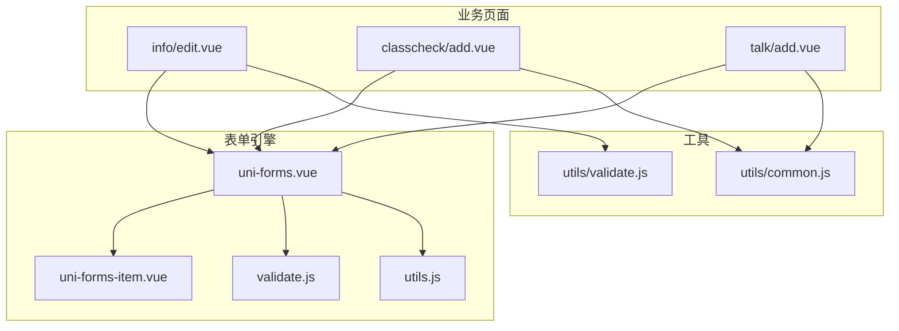
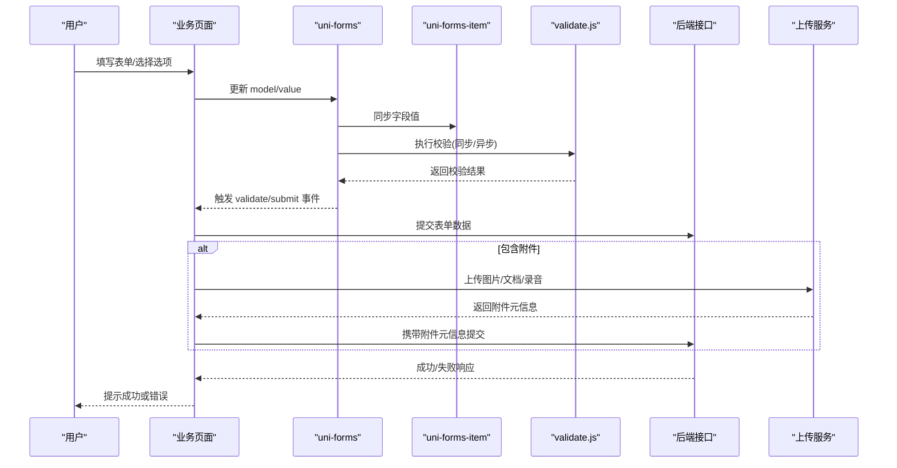
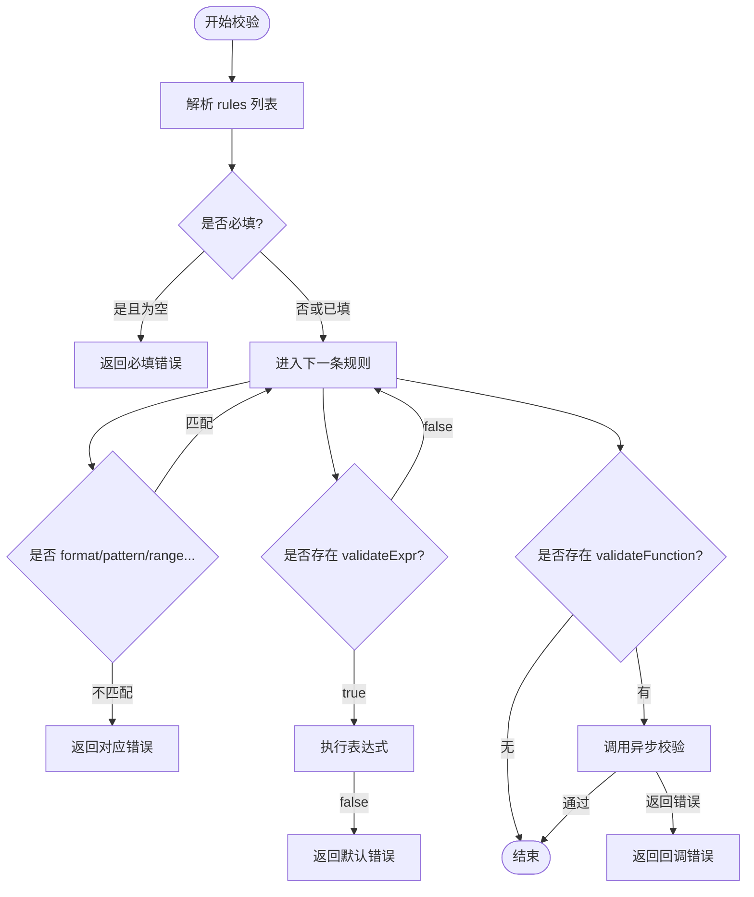
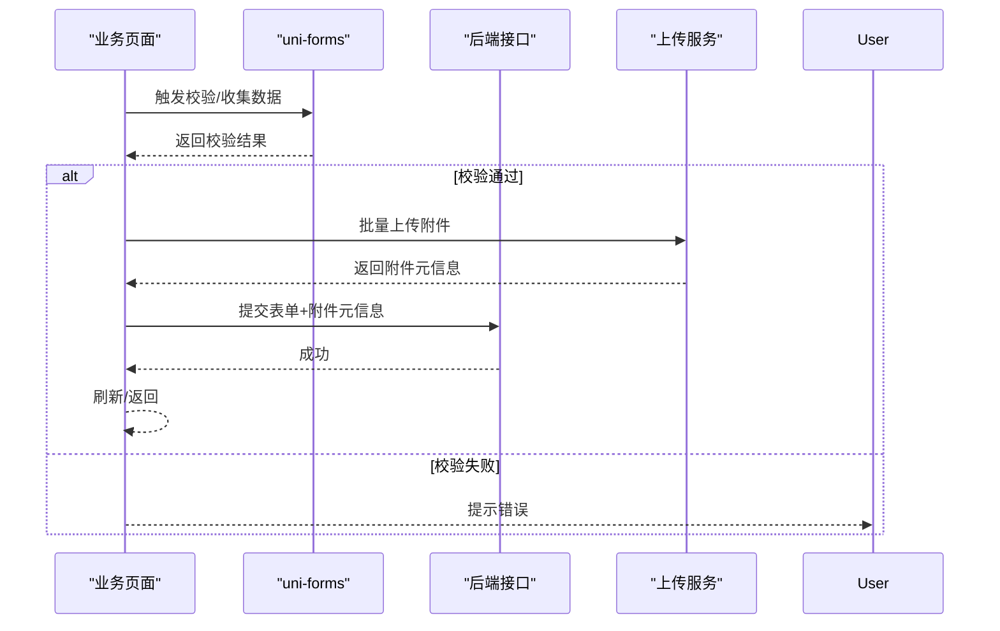
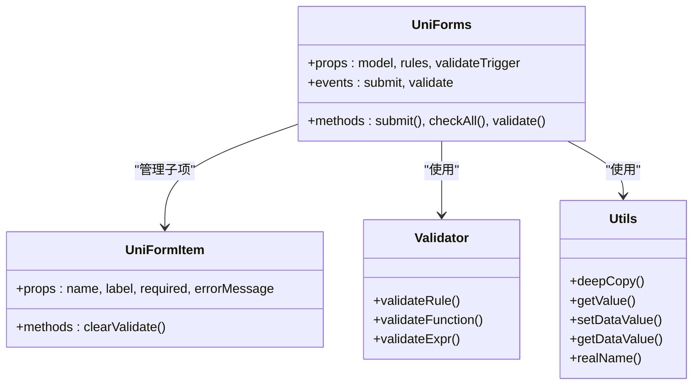

# 表单处理

<cite>
**本文引用的文件列表**
- [README.md](file://README.md)
- [uni-forms 组件 - uni-forms.vue](file://uni_modules/uni-forms/components/uni-forms/uni-forms.vue)
- [uni-forms 组件 - validate.js](file://uni_modules/uni-forms/components/uni-forms/validate.js)
- [uni-forms 组件 - utils.js](file://uni_modules/uni-forms/components/uni-forms/utils.js)
- [uni-forms-item 组件 - uni-forms-item.vue](file://uni_modules/uni-forms/components/uni-forms-item/uni-forms-item.vue)
- [信息编辑页面 - edit.vue](file://pages/sub-mine/info/edit.vue)
- [查课登记页面 - add.vue（查课）](file://pages/sub-work/classcheck/add.vue)
- [谈话记录页面 - add.vue（谈话）](file://pages/sub-work/talk/add.vue)
- [通用工具 - common.js](file://utils/common.js)
- [通用校验 - validate.js](file://utils/validate.js)
</cite>

## 目录
1. [简介](#简介)
2. [项目结构](#项目结构)
3. [核心组件与模式](#核心组件与模式)
4. [架构总览](#架构总览)
5. [详细组件分析](#详细组件分析)
6. [依赖关系分析](#依赖关系分析)
7. [性能与体验优化](#性能与体验优化)
8. [故障排查指南](#故障排查指南)
9. [结论](#结论)
10. [附录：示例实现清单](#附录示例实现清单)

## 简介
本指南围绕项目的表单处理模式，系统化梳理表单数据结构设计、验证规则配置、提交流程与错误提示，并给出复杂表单的解决方案与实战示例。项目基于 UniApp + uni-ui 生态，采用 uni-forms 作为统一表单引擎，结合业务页面中的自定义交互与上传能力，形成“声明式规则 + 动态渲染 + 异步校验”的完整方案。

## 项目结构
- 表单引擎层：uni-forms 提供表单容器、表单项、校验器与数据绑定工具。
- 业务表单页：信息编辑、查课登记、谈话记录等页面分别体现不同复杂度与交互形态。
- 工具层：通用工具函数与基础校验方法，支撑表单输入、提示、定位等能力。

图表来源
- [uni-forms 组件 - uni-forms.vue:1-120](file://uni_modules/uni-forms/components/uni-forms/uni-forms.vue#L1-L120)
- [uni-forms 组件 - validate.js:1-120](file://uni_modules/uni-forms/components/uni-forms/validate.js#L1-L120)
- [uni-forms 组件 - utils.js:1-94](file://uni_modules/uni-forms/components/uni-forms/utils.js#L1-L94)
- [uni-forms-item 组件 - uni-forms-item.vue:345-399](file://uni_modules/uni-forms/components/uni-forms-item/uni-forms-item.vue#L345-L399)
- [信息编辑页面 - edit.vue:1-120](file://pages/sub-mine/info/edit.vue#L1-L120)
- [查课登记页面 - add.vue（查课）:1-120](file://pages/sub-work/classcheck/add.vue#L1-L120)
- [谈话记录页面 - add.vue（谈话）:1-120](file://pages/sub-work/talk/add.vue#L1-L120)
- [通用工具 - common.js:1-121](file://utils/common.js#L1-L121)
- [通用校验 - validate.js:1-115](file://utils/validate.js#L1-L115)

章节来源
- [README.md:1-52](file://README.md#L1-L52)

## 核心组件与模式
- 表单容器 uni-forms
  - 负责收集子项值、触发校验、分发 submit/validate 事件。
  - 支持 label 位置、宽度、对齐方式、错误展示策略等属性。
- 表单项 uni-forms-item
  - 注册 name、rules、label、required 等；与父级同步值与校验结果。
- 校验器 validate.js
  - 内置 required、format、range、pattern、validateFunction 等规则类型。
  - 支持表达式 validateExpr 与异步 validateFunction 回调。
- 工具 utils.js
  - 提供 deepCopy、getValue、setDataValue、getDataValue、realName 等。

章节来源
- [uni-forms 组件 - uni-forms.vue:49-120](file://uni_modules/uni-forms/components/uni-forms/uni-forms.vue#L49-L120)
- [uni-forms 组件 - validate.js:121-230](file://uni_modules/uni-forms/components/uni-forms/validate.js#L121-L230)
- [uni-forms 组件 - utils.js:1-94](file://uni_modules/uni-forms/components/uni-forms/utils.js#L1-L94)
- [uni-forms-item 组件 - uni-forms-item.vue:345-399](file://uni_modules/uni-forms/components/uni-forms-item/uni-forms-item.vue#L345-L399)

## 架构总览
下图展示了从用户交互到校验、再到提交的端到端流程，以及附件上传与后端接口的集成点。

图表来源
- [uni-forms 组件 - uni-forms.vue:269-399](file://uni_modules/uni-forms/components/uni-forms/uni-forms.vue#L269-L399)
- [uni-forms 组件 - validate.js:121-230](file://uni_modules/uni-forms/components/uni-forms/validate.js#L121-L230)
- [查课登记页面 - add.vue（查课）:786-867](file://pages/sub-work/classcheck/add.vue#L786-L867)
- [谈话记录页面 - add.vue（谈话）:631-695](file://pages/sub-work/talk/add.vue#L631-L695)

## 详细组件分析

### 表单数据结构设计
- 字段定义与默认值
  - 使用 uni-forms-item 的 name 绑定到 model 路径，通过 rules 声明必填、格式、长度、范围等约束。
  - 初始值在 data 中维护，必要时通过 getValue 工具按 rules.format 做类型转换，保证入库值类型正确。
- 字典与下拉数据
  - 使用 uni-data-select 的 localdata 或远程字典，保持与系统字典一致。
- 复杂字段
  - 数组型字段（如学生列表、附件列表）通过 v-model 双向绑定，配合计算属性进行统计与展示。
- 参考实现
  - 信息编辑：多 Tab 分组，只读与可编辑字段并存，日期格式化显示。
  - 查课登记：班级、日期、节次、课程信息等结构化字段，配合状态机式的点击流转。
  - 谈话记录：标签化对象集合、时间选择、附件网格等。

章节来源
- [信息编辑页面 - edit.vue:110-186](file://pages/sub-mine/info/edit.vue#L110-L186)
- [查课登记页面 - add.vue（查课）:181-218](file://pages/sub-work/classcheck/add.vue#L181-L218)
- [谈话记录页面 - add.vue（谈话）:188-215](file://pages/sub-work/talk/add.vue#L188-L215)
- [uni-forms 组件 - utils.js:24-42](file://uni_modules/uni-forms/components/uni-forms/utils.js#L24-L42)

### 表单验证实现
- 内置验证器
  - required、format（int/bool/number/string/date/url/email 等）、range、rangeNumber、rangeLength、pattern、arrayTypeFormat。
  - 支持 message 模板占位符 {label}、{minLength} 等。
- 自定义验证规则
  - 通过 validateExpr 编写同步表达式校验。
  - 通过 validateFunction 编写异步校验（例如查重），支持回调消息。
- 触发时机
  - 支持 bind/blur/submit 三种触发策略，由 uni-forms 统一管理。
- 错误提示
  - 支持 undertext/toast/modal 多种展示方式，uni-forms-item 内部渲染 errMsg。

图表来源
- [uni-forms 组件 - validate.js:121-230](file://uni_modules/uni-forms/components/uni-forms/validate.js#L121-L230)
- [uni-forms 组件 - uni-forms.vue:269-399](file://uni_modules/uni-forms/components/uni-forms/uni-forms.vue#L269-L399)

章节来源
- [uni-forms 组件 - validate.js:1-120](file://uni_modules/uni-forms/components/uni-forms/validate.js#L1-L120)
- [uni-forms 组件 - uni-forms.vue:49-120](file://uni_modules/uni-forms/components/uni-forms/uni-forms.vue#L49-L120)

### 表单提交处理
- 数据收集与格式转换
  - uni-forms 自动聚合子项值，utils.getValue 根据 rules.format 对数字/布尔等进行类型转换。
- 错误提示
  - 校验失败时，uni-forms 触发 validate 事件，页面可按需 toast/modal/underText 提示。
- 提交流程
  - 组装业务数据（含附件元信息），调用后端接口，成功后刷新列表或返回上一页。
- 参考实现
  - 查课登记：根据角色（辅导员/书记）构建 detailList 或实到人数，附带 checkerId/Role 与附件列表。
  - 谈话记录：将时间拼接为字符串，构造 studentList/contentList/attachmentList 后提交。

图表来源
- [查课登记页面 - add.vue（查课）:786-867](file://pages/sub-work/classcheck/add.vue#L786-L867)
- [谈话记录页面 - add.vue（谈话）:631-695](file://pages/sub-work/talk/add.vue#L631-L695)
- [uni-forms 组件 - utils.js:24-42](file://uni_modules/uni-forms/components/uni-forms/utils.js#L24-L42)

章节来源
- [查课登记页面 - add.vue（查课）:786-867](file://pages/sub-work/classcheck/add.vue#L786-L867)
- [谈话记录页面 - add.vue（谈话）:631-695](file://pages/sub-work/talk/add.vue#L631-L695)

### 复杂表单解决方案
- 动态表单
  - 通过 computed 派生筛选条件与展示内容（如专业/年级→班级→学生）。
  - 使用 v-if/v-show 控制区域显隐（如书记角色 vs 辅导员角色）。
- 条件渲染
  - 根据角色、已有记录、是否违纪等条件切换 UI 与校验逻辑。
- 批量操作
  - 多选面板、全选、批量添加至表单集合（如违纪学生批量加入谈话对象）。
- 草稿与恢复
  - 本地缓存关键状态（如点击状态 map），退出时保存，进入时恢复。
- 参考实现
  - 查课登记：角色分支、自动查重进入编辑、拍照上传与压缩、草稿持久化。
  - 谈话记录：搜索去抖、批量选择、历史时间线、附件预览与打开。

章节来源
- [查课登记页面 - add.vue（查课）:219-300](file://pages/sub-work/classcheck/add.vue#L219-L300)
- [查课登记页面 - add.vue（查课）:688-711](file://pages/sub-work/classcheck/add.vue#L688-L711)
- [谈话记录页面 - add.vue（谈话）:349-393](file://pages/sub-work/talk/add.vue#L349-L393)

### 具体示例

#### 评论表单（概念性说明）
- 字段建议：评论内容、@提及、图片/视频附件。
- 验证建议：必填、长度限制、敏感词正则、附件数量上限。
- 提交建议：先上传附件，再提交文本与附件 ID 列表。
[本节为概念性说明，不涉及具体源码]

#### 查课登记
- 数据结构要点
  - 基础信息：班级、日期、节次、课程名、教室、教师、备注。
  - 状态统计：应到/请假/异常/实到人数（角色差异）。
  - 明细：辅导员侧按学生点击状态生成迟到/早退/旷课明细；书记侧仅记录实到人数。
  - 附件：现场照片至少两张，支持压缩上传。
- 交互要点
  - 自动查重：同班同日同节次存在记录则进入修改模式。
  - 草稿：离开页面自动保存，再次进入恢复。
- 参考路径
  - [查课登记页面 - add.vue（查课）:181-218](file://pages/sub-work/classcheck/add.vue#L181-L218)
  - [查课登记页面 - add.vue（查课）:786-867](file://pages/sub-work/classcheck/add.vue#L786-L867)

章节来源
- [查课登记页面 - add.vue（查课）:181-218](file://pages/sub-work/classcheck/add.vue#L181-L218)
- [查课登记页面 - add.vue（查课）:786-867](file://pages/sub-work/classcheck/add.vue#L786-L867)

#### 谈话记录
- 数据结构要点
  - 基本信息：类别、类型多选、时间地点、截止时间（纪律类）。
  - 对象集合：支持搜索与批量选择，保留违纪来源信息。
  - 内容历史：追加式内容列表。
  - 附件：图片/文档/录音，最多 5 个，支持预览与打开。
- 交互要点
  - 搜索去抖、下拉面板收起、全选/反选。
  - 自动设置类别与标签（违纪学生自动设为纪律教育）。
- 参考路径
  - [谈话记录页面 - add.vue（谈话）:188-215](file://pages/sub-work/talk/add.vue#L188-L215)
  - [谈话记录页面 - add.vue（谈话）:631-695](file://pages/sub-work/talk/add.vue#L631-L695)

章节来源
- [谈话记录页面 - add.vue（谈话）:188-215](file://pages/sub-work/talk/add.vue#L188-L215)
- [谈话记录页面 - add.vue（谈话）:631-695](file://pages/sub-work/talk/add.vue#L631-L695)

#### 信息编辑
- 数据结构要点
  - 多 Tab 分组：基本信息、学历职务、联系方式、其他信息。
  - 字典映射：性别、学历、学位、职称、状态等。
  - 只读字段：工号、姓名、身份证号、所属学院/专业等。
- 交互要点
  - 等待角色列表加载完成后再转换行政职务中文名称。
  - 提交前二次确认，成功后原地刷新。
- 参考路径
  - [信息编辑页面 - edit.vue:110-186](file://pages/sub-mine/info/edit.vue#L110-L186)
  - [信息编辑页面 - edit.vue:277-321](file://pages/sub-mine/info/edit.vue#L277-L321)

章节来源
- [信息编辑页面 - edit.vue:110-186](file://pages/sub-mine/info/edit.vue#L110-L186)
- [信息编辑页面 - edit.vue:277-321](file://pages/sub-mine/info/edit.vue#L277-L321)

## 依赖关系分析
- uni-forms 与 uni-forms-item 之间通过 name 与 value 双向同步，校验器集中管理。
- 业务页面依赖 uni-forms 提供的 submit/validate 事件与 setValue/clearValidate 等方法。
- 工具模块提供通用校验与交互辅助，减少重复代码。

图表来源
- [uni-forms 组件 - uni-forms.vue:1-120](file://uni_modules/uni-forms/components/uni-forms/uni-forms.vue#L1-L120)
- [uni-forms 组件 - validate.js:121-230](file://uni_modules/uni-forms/components/uni-forms/validate.js#L121-L230)
- [uni-forms 组件 - utils.js:1-94](file://uni_modules/uni-forms/components/uni-forms/utils.js#L1-L94)
- [uni-forms-item 组件 - uni-forms-item.vue:345-399](file://uni_modules/uni-forms/components/uni-forms-item/uni-forms-item.vue#L345-L399)

章节来源
- [uni-forms 组件 - uni-forms.vue:1-120](file://uni_modules/uni-forms/components/uni-forms/uni-forms.vue#L1-L120)
- [uni-forms 组件 - validate.js:121-230](file://uni_modules/uni-forms/components/uni-forms/validate.js#L121-L230)
- [uni-forms 组件 - utils.js:1-94](file://uni_modules/uni-forms/components/uni-forms/utils.js#L1-L94)
- [uni-forms-item 组件 - uni-forms-item.vue:345-399](file://uni_modules/uni-forms/components/uni-forms-item/uni-forms-item.vue#L345-L399)

## 性能与体验优化
- 校验性能
  - 避免在高频事件中执行重校验，优先使用 blur/submit 触发。
  - 对长列表（如学生名单）采用分页或虚拟滚动，减少 DOM 压力。
- 上传优化
  - 图片先压缩再上传，降低带宽与服务器压力。
  - 并发上传时增加队列与重试机制，提升成功率。
- 交互优化
  - 搜索去抖，避免频繁请求。
  - 大表单分步/分 Tab，降低首屏渲染压力。
- 参考实现
  - 查课登记：图片压缩上传、草稿持久化。
  - 谈话记录：搜索去抖、附件预览与打开。

章节来源
- [查课登记页面 - add.vue（查课）:901-949](file://pages/sub-work/classcheck/add.vue#L901-L949)
- [谈话记录页面 - add.vue（谈话）:349-363](file://pages/sub-work/talk/add.vue#L349-L363)

## 故障排查指南
- 常见问题
  - 字段未生效：检查 name 是否与 model 路径一致，确保 uni-forms-item 包裹了正确的输入控件。
  - 校验不触发：确认 validateTrigger 与事件绑定是否正确。
  - 异步校验报错：确保 validateFunction 返回 Promise 或调用回调，捕获异常并返回错误消息。
  - 附件上传失败：检查网络权限、文件大小与类型限制，查看上传接口返回码。
- 调试建议
  - 监听 uni-forms 的 validate 事件，打印校验结果。
  - 使用浏览器开发者工具或小程序调试面板观察数据流。
- 参考路径
  - [通用工具 - common.js:1-121](file://utils/common.js#L1-L121)
  - [通用校验 - validate.js:1-115](file://utils/validate.js#L1-L115)

章节来源
- [通用工具 - common.js:1-121](file://utils/common.js#L1-L121)
- [通用校验 - validate.js:1-115](file://utils/validate.js#L1-L115)

## 结论
本项目以 uni-forms 为核心，结合业务页面的动态渲染与上传能力，形成了可扩展、可维护的表单处理体系。通过统一的校验器与工具函数，既能满足简单表单的快速开发，也能支撑复杂场景下的批量操作与异步校验。建议在新增表单时遵循本文的数据结构与流程规范，复用现有工具与组件，以提升一致性与稳定性。

## 附录：示例实现清单
- 信息编辑：多 Tab 分组、字典映射、只读字段、二次确认提交。
  - [信息编辑页面 - edit.vue:110-186](file://pages/sub-mine/info/edit.vue#L110-L186)
  - [信息编辑页面 - edit.vue:277-321](file://pages/sub-mine/info/edit.vue#L277-L321)
- 查课登记：角色分支、自动查重、草稿恢复、照片压缩上传。
  - [查课登记页面 - add.vue（查课）:181-218](file://pages/sub-work/classcheck/add.vue#L181-L218)
  - [查课登记页面 - add.vue（查课）:786-867](file://pages/sub-work/classcheck/add.vue#L786-L867)
  - [查课登记页面 - add.vue（查课）:901-949](file://pages/sub-work/classcheck/add.vue#L901-L949)
- 谈话记录：搜索去抖、批量选择、历史时间线、附件预览与打开。
  - [谈话记录页面 - add.vue（谈话）:349-393](file://pages/sub-work/talk/add.vue#L349-L393)
  - [谈话记录页面 - add.vue（谈话）:631-695](file://pages/sub-work/talk/add.vue#L631-L695)