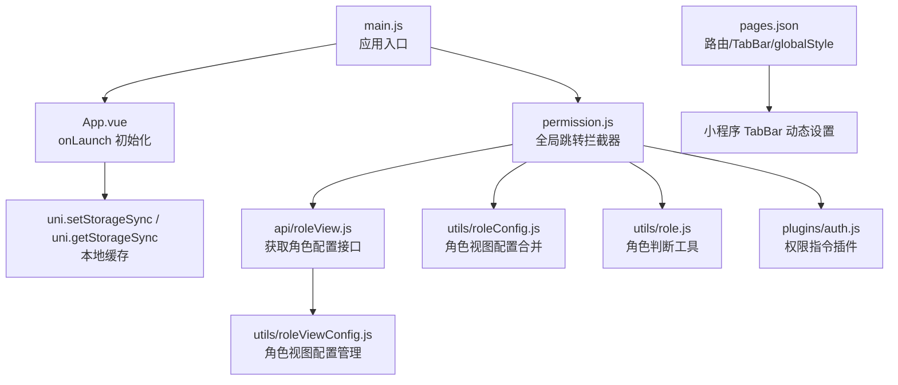
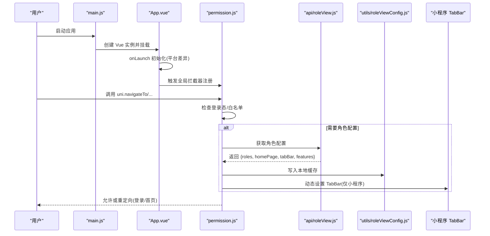
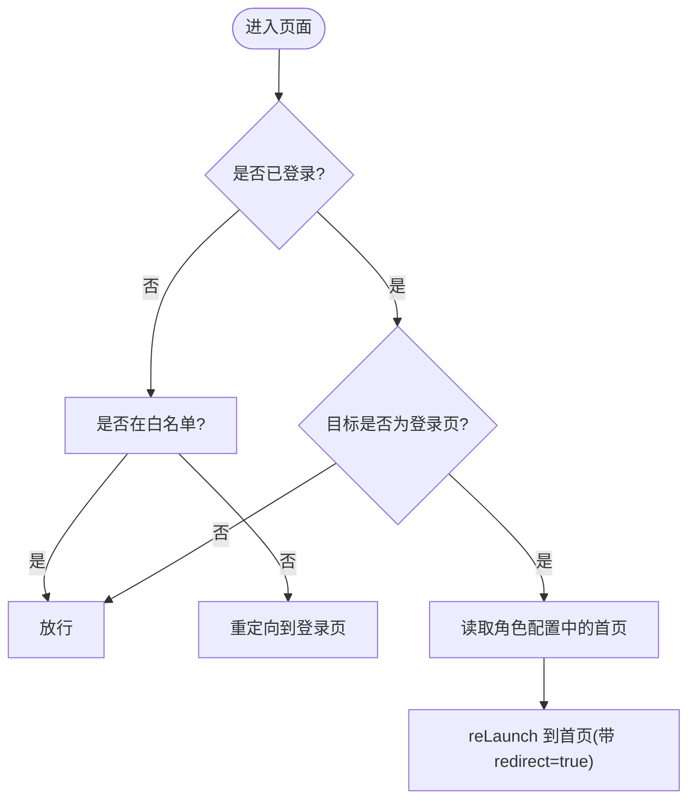
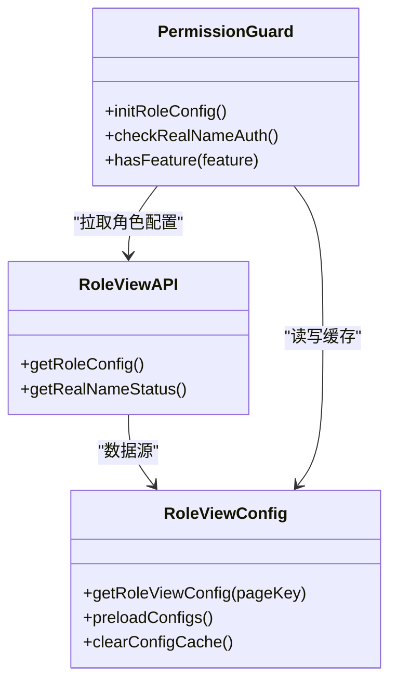
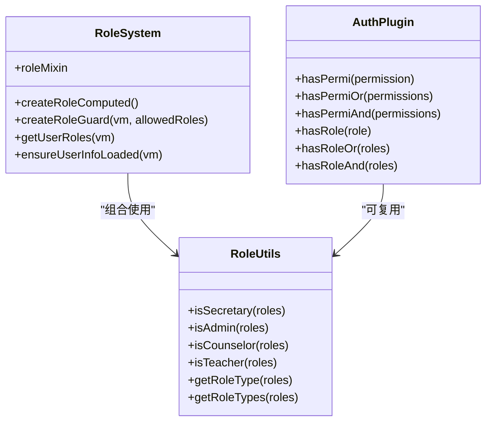
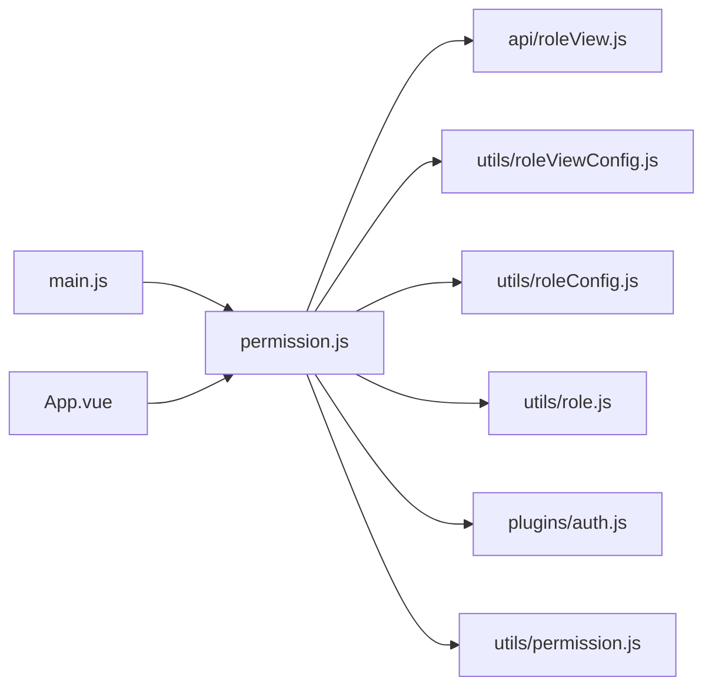

# 路由配置

<cite>
**本文引用的文件**   
- [pages.json](file://pages.json)
- [permission.js](file://permission.js)
- [main.js](file://main.js)
- [App.vue](file://App.vue)
- [utils/role.js](file://utils/role.js)
- [utils/roleConfig.js](file://utils/roleConfig.js)
- [utils/roleSystem.js](file://utils/roleSystem.js)
- [utils/roleViewConfig.js](file://utils/roleViewConfig.js)
- [api/roleView.js](file://api/roleView.js)
- [plugins/auth.js](file://plugins/auth.js)
- [plugins/index.js](file://plugins/index.js)
- [utils/permission.js](file://utils/permission.js)
</cite>

## 目录
1. [简介](#简介)
2. [项目结构](#项目结构)
3. [核心组件](#核心组件)
4. [架构总览](#架构总览)
5. [详细组件分析](#详细组件分析)
6. [依赖关系分析](#依赖关系分析)
7. [性能考虑](#性能考虑)
8. [故障排查指南](#故障排查指南)
9. [结论](#结论)
10. [附录](#附录)

## 简介
本指南面向基于 uni-app 的路由与权限体系，围绕 pages.json 配置、全局路由守卫、动态角色视图与 TabBar 控制、以及页面跳转传参等主题，提供从配置到落地的完整实现说明。文档结合仓库现有实现，给出可操作的步骤与示例路径，帮助读者快速搭建“权限路由 + 动态菜单 + 登录校验”的完整链路。

## 项目结构
本项目采用 uni-app 标准工程结构，路由相关的关键位置如下：
- 路由与窗口配置：pages.json（主包与分包、TabBar、globalStyle）
- 应用启动与平台初始化：main.js、App.vue
- 全局路由拦截与登录态检查：permission.js
- 角色与权限工具：utils/role*.js、utils/permission.js、plugins/auth.js
- 动态角色视图配置：api/roleView.js、utils/roleViewConfig.js

图示来源
- [main.js:1-31](file://main.js#L1-L31)
- [App.vue:1-48](file://App.vue#L1-L48)
- [permission.js:1-133](file://permission.js#L1-L133)
- [api/roleView.js:1-23](file://api/roleView.js#L1-L23)
- [utils/roleViewConfig.js:1-115](file://utils/roleViewConfig.js#L1-L115)
- [utils/roleConfig.js:1-149](file://utils/roleConfig.js#L1-L149)
- [utils/role.js:1-165](file://utils/role.js#L1-L165)
- [plugins/auth.js:1-61](file://plugins/auth.js#L1-L61)
- [pages.json:1-235](file://pages.json#L1-L235)

章节来源
- [main.js:1-31](file://main.js#L1-L31)
- [App.vue:1-48](file://App.vue#L1-L48)
- [pages.json:1-235](file://pages.json#L1-L235)

## 核心组件
- pages.json：声明主包与分包页面、TabBar 列表、全局样式；是 uni-app 路由系统的核心配置文件。
- permission.js：通过 uni.addInterceptor 对 navigateTo/redirectTo/reLaunch/switchTab 进行统一拦截，完成登录态校验、白名单放行、已登录访问登录页重定向等逻辑；同时负责拉取并缓存角色配置，必要时动态设置 TabBar。
- App.vue：在 onLaunch 中执行平台差异化初始化（如微信小程序自动登录、H5 登录检查），为后续路由守卫提供基础状态。
- utils/role*.js 与 plugins/auth.js：提供角色识别、权限判定、Vue 原型挂载等能力，配合路由守卫形成“角色+权限”的双重控制。
- api/roleView.js 与 utils/roleViewConfig.js：封装后端角色视图配置接口与本地缓存策略，支持按页面维度动态渲染与功能开关。

章节来源
- [pages.json:1-235](file://pages.json#L1-L235)
- [permission.js:1-133](file://permission.js#L1-L133)
- [App.vue:1-48](file://App.vue#L1-L48)
- [utils/role.js:1-165](file://utils/role.js#L1-L165)
- [utils/roleConfig.js:1-149](file://utils/roleConfig.js#L1-L149)
- [utils/roleSystem.js:1-297](file://utils/roleSystem.js#L1-L297)
- [utils/roleViewConfig.js:1-115](file://utils/roleViewConfig.js#L1-L115)
- [api/roleView.js:1-23](file://api/roleView.js#L1-L23)
- [plugins/auth.js:1-61](file://plugins/auth.js#L1-L61)

## 架构总览
下图展示了从应用启动到路由跳转的完整流程，包括登录态检查、角色配置加载、TabBar 动态更新与权限拦截。

图示来源
- [main.js:1-31](file://main.js#L1-L31)
- [App.vue:1-48](file://App.vue#L1-L48)
- [permission.js:1-133](file://permission.js#L1-L133)
- [api/roleView.js:1-23](file://api/roleView.js#L1-L23)
- [utils/roleViewConfig.js:1-115](file://utils/roleViewConfig.js#L1-L115)

## 详细组件分析

### pages.json 配置指南
- 页面注册
  - 主包页面：在 pages 数组中声明 path 与 style，path 以相对根目录为准。
  - 分包页面：在 subPackages 中指定 root 与 pages，减少首屏体积。
- TabBar 配置
  - 使用 tabBar.list 定义底部导航项，包含 pagePath、iconPath、selectedIconPath、text。
  - 可在运行时根据角色动态替换（见 permission.js 中的动态设置）。
- 窗口配置
  - globalStyle 定义全局导航栏样式与标题。
  - 单个页面可通过 style.navigationStyle 设置为 custom 以实现自定义导航栏。

章节来源
- [pages.json:1-235](file://pages.json#L1-L235)

### 全局路由守卫与登录检查
- 拦截范围
  - 覆盖 navigateTo、redirectTo、reLaunch、switchTab 四种跳转方式。
- 白名单机制
  - 未登录用户仅能访问白名单内的页面（如登录、注册、通用 webview）。
- 已登录访问登录页
  - 若已登录且尝试进入登录页，则重定向至首页（homePage 来自角色配置）。
- 角色配置加载与缓存
  - 首次进入时请求角色配置接口，成功后写入本地存储，并在小程序环境下动态设置 TabBar。
  - 失败时回退默认教师角色配置，保证可用性。

图示来源
- [permission.js:1-133](file://permission.js#L1-L133)

章节来源
- [permission.js:1-133](file://permission.js#L1-L133)

### 动态路由与角色视图
- 角色配置来源
  - 通过 api/roleView.js 提供的 getRoleConfig 接口获取当前用户的角色配置，包含 roles、homePage、tabBar、features 等。
- 动态 TabBar
  - 在小程序环境，permission.js 会调用 uni.setTabBar 将后端返回的 tabBar 列表应用到 UI。
- 页面级视图配置
  - utils/roleViewConfig.js 提供按页面 key 获取视图配置的封装，含本地缓存与默认回退策略，便于不同角色看到不同的页面布局与功能开关。

图示来源
- [api/roleView.js:1-23](file://api/roleView.js#L1-L23)
- [utils/roleViewConfig.js:1-115](file://utils/roleViewConfig.js#L1-L115)
- [permission.js:1-133](file://permission.js#L1-L133)

章节来源
- [api/roleView.js:1-23](file://api/roleView.js#L1-L23)
- [utils/roleViewConfig.js:1-115](file://utils/roleViewConfig.js#L1-L115)
- [permission.js:1-133](file://permission.js#L1-L133)

### 权限验证与角色判断
- 角色判断工具
  - utils/role.js 提供 isSecretary/isAdmin/isCounselor/isTeacher 等函数，兼容字符串与对象两种角色格式，并支持多角色类型聚合。
- 角色系统 Mixin/Computed/Guard
  - utils/roleSystem.js 提供 roleMixin、createRoleComputed、createRoleGuard 等，方便在页面中便捷地进行角色判断与守卫控制。
- 权限指令插件
  - plugins/auth.js 暴露 hasPermi/hasRole 等方法，结合 store 中的 permissions/roles 做细粒度权限控制。
- 字符/角色校验工具
  - utils/permission.js 提供 checkPermi/checkRole 两个工具函数，用于模板或业务逻辑中的快速校验。

图示来源
- [utils/role.js:1-165](file://utils/role.js#L1-L165)
- [utils/roleSystem.js:1-297](file://utils/roleSystem.js#L1-L297)
- [plugins/auth.js:1-61](file://plugins/auth.js#L1-L61)

章节来源
- [utils/role.js:1-165](file://utils/role.js#L1-L165)
- [utils/roleSystem.js:1-297](file://utils/roleSystem.js#L1-L297)
- [plugins/auth.js:1-61](file://plugins/auth.js#L1-L61)
- [utils/permission.js:1-49](file://utils/permission.js#L1-L49)

### 路由传参与页面栈管理
- URL 参数传递
  - 使用 uni.navigateTo/redirectTo/reLaunch 的 url 拼接 query 参数，例如 ?id=1&name=test。
  - 在目标页面 onLoad(options) 中通过 options 读取参数。
- 页面栈管理
  - uni.navigateBack 返回上一页；uni.switchTab 切换 TabBar 页面；uni.reLaunch 关闭所有页面并打开新页面。
  - 注意：switchTab 无法携带 query 参数，如需跨 Tab 传参，建议使用本地存储或全局状态。
- 数据传递建议
  - 小量数据：URL query。
  - 跨页面共享：store 或 uni.setStorageSync/uni.getStorageSync。
  - 复杂对象：JSON 序列化后存入 storage，或使用事件总线/全局变量（谨慎使用）。

章节来源
- [permission.js:1-133](file://permission.js#L1-L133)
- [App.vue:1-48](file://App.vue#L1-L48)

### 实战示例与落地指引

- 示例一：权限路由（登录后访问登录页重定向）
  - 行为：已登录用户访问登录页会被重定向到角色配置中的首页，并附带 redirect=true 标记。
  - 参考实现路径：[permission.js:97-133](file://permission.js#L97-L133)

- 示例二：TabBar 动态配置（按角色显示不同底部导航）
  - 行为：首次拉取角色配置后，在小程序端调用 uni.setTabBar 动态更新 TabBar。
  - 参考实现路径：[permission.js:26-60](file://permission.js#L26-L60)、[pages.json:206-228](file://pages.json#L206-L228)

- 示例三：页面跳转与参数传递
  - 行为：在业务页面中使用 uni.navigateTo 跳转并携带参数，目标页面 onLoad(options) 接收。
  - 参考实现路径：[permission.js:97-133](file://permission.js#L97-L133)

- 示例四：角色视图配置预加载
  - 行为：在应用启动后预加载常用页面的视图配置，提升首屏体验。
  - 参考实现路径：[utils/roleViewConfig.js:106-115](file://utils/roleViewConfig.js#L106-L115)

章节来源
- [permission.js:26-60](file://permission.js#L26-L60)
- [permission.js:97-133](file://permission.js#L97-L133)
- [pages.json:206-228](file://pages.json#L206-L228)
- [utils/roleViewConfig.js:106-115](file://utils/roleViewConfig.js#L106-L115)

## 依赖关系分析
- 模块耦合
  - permission.js 依赖 api/roleView.js 获取角色配置，依赖 utils/roleViewConfig.js 进行缓存管理，依赖小程序 API 动态设置 TabBar。
  - App.vue 在 onLaunch 中进行平台差异化初始化，为后续路由守卫提供 token 与用户信息基础。
  - main.js 引入 permission.js 确保全局拦截器在应用启动阶段生效。
- 外部依赖
  - uni-app 原生 API：uni.addInterceptor、uni.setTabBar、uni.reLaunch、uni.navigateTo 等。
  - 本地存储：uni.setStorageSync/uni.getStorageSync。
  - 网络请求：utils/request（通过 api/roleView.js 间接使用）。

图示来源
- [main.js:1-31](file://main.js#L1-L31)
- [App.vue:1-48](file://App.vue#L1-L48)
- [permission.js:1-133](file://permission.js#L1-L133)
- [api/roleView.js:1-23](file://api/roleView.js#L1-L23)
- [utils/roleViewConfig.js:1-115](file://utils/roleViewConfig.js#L1-L115)
- [utils/roleConfig.js:1-149](file://utils/roleConfig.js#L1-L149)
- [utils/role.js:1-165](file://utils/role.js#L1-L165)
- [plugins/auth.js:1-61](file://plugins/auth.js#L1-L61)
- [utils/permission.js:1-49](file://utils/permission.js#L1-L49)

章节来源
- [main.js:1-31](file://main.js#L1-L31)
- [App.vue:1-48](file://App.vue#L1-L48)
- [permission.js:1-133](file://permission.js#L1-L133)

## 性能考虑
- 分包加载
  - 将非首屏页面放入 subPackages，降低主包体积，缩短冷启动时间。
- 角色配置缓存
  - 使用本地存储缓存角色配置与视图配置，避免重复请求；必要时提供刷新与清理接口。
- 动态 TabBar 限制
  - 仅在小程序环境动态设置 TabBar，避免在非目标平台出现兼容问题。
- 预加载常用配置
  - 在应用启动后异步预加载常用页面视图配置，减少用户操作时的等待时间。

## 故障排查指南
- 现象：登录后仍跳转到登录页
  - 排查点：token 是否正确持久化；白名单是否包含目标页面；permission.js 拦截逻辑是否被覆盖。
  - 参考路径：[permission.js:97-133](file://permission.js#L97-L133)
- 现象：TabBar 未按角色变化
  - 排查点：是否处于小程序环境；角色配置中 tabBar 字段是否存在；uni.setTabBar 是否成功调用。
  - 参考路径：[permission.js:26-60](file://permission.js#L26-L60)、[pages.json:206-228](file://pages.json#L206-L228)
- 现象：页面视图未按角色显示
  - 排查点：角色视图配置是否成功拉取与缓存；pageKey 是否与后端约定一致；默认配置是否生效。
  - 参考路径：[utils/roleViewConfig.js:16-37](file://utils/roleViewConfig.js#L16-L37)
- 现象：权限按钮不可用
  - 排查点：store 中 permissions/roles 是否正确加载；auth 插件方法是否正确使用。
  - 参考路径：[plugins/auth.js:1-61](file://plugins/auth.js#L1-L61)、[utils/permission.js:1-49](file://utils/permission.js#L1-L49)

章节来源
- [permission.js:26-60](file://permission.js#L26-L60)
- [permission.js:97-133](file://permission.js#L97-L133)
- [utils/roleViewConfig.js:16-37](file://utils/roleViewConfig.js#L16-L37)
- [plugins/auth.js:1-61](file://plugins/auth.js#L1-L61)
- [utils/permission.js:1-49](file://utils/permission.js#L1-L49)

## 结论
通过 pages.json 声明式路由、permission.js 的全局拦截与角色配置加载、以及 utils/role* 与 plugins/auth.js 的角色与权限工具，本项目实现了“登录态校验 + 角色视图 + 动态 TabBar + 页面级权限”的完整闭环。建议在新增页面时遵循以下原则：
- 在 pages.json 中正确注册页面与样式；
- 在 permission.js 的白名单中按需放行公开页面；
- 在角色配置中维护 tabBar 与 features；
- 在页面内使用 createRoleGuard 或 auth 插件进行二次权限控制；
- 合理选择传参方式，避免不必要的跨页面状态污染。

## 附录
- 关键实现路径速查
  - 全局拦截与登录检查：[permission.js:97-133](file://permission.js#L97-L133)
  - 角色配置拉取与缓存：[permission.js:26-60](file://permission.js#L26-L60)、[api/roleView.js:1-23](file://api/roleView.js#L1-L23)
  - 角色视图配置管理：[utils/roleViewConfig.js:1-115](file://utils/roleViewConfig.js#L1-L115)
  - 角色判断与系统工具：[utils/role.js:1-165](file://utils/role.js#L1-L165)、[utils/roleSystem.js:1-297](file://utils/roleSystem.js#L1-L297)
  - 权限指令与校验工具：[plugins/auth.js:1-61](file://plugins/auth.js#L1-L61)、[utils/permission.js:1-49](file://utils/permission.js#L1-L49)
  - 路由与 TabBar 配置：[pages.json:1-235](file://pages.json#L1-L235)
  - 应用启动与平台初始化：[main.js:1-31](file://main.js#L1-L31)、[App.vue:1-48](file://App.vue#L1-L48)