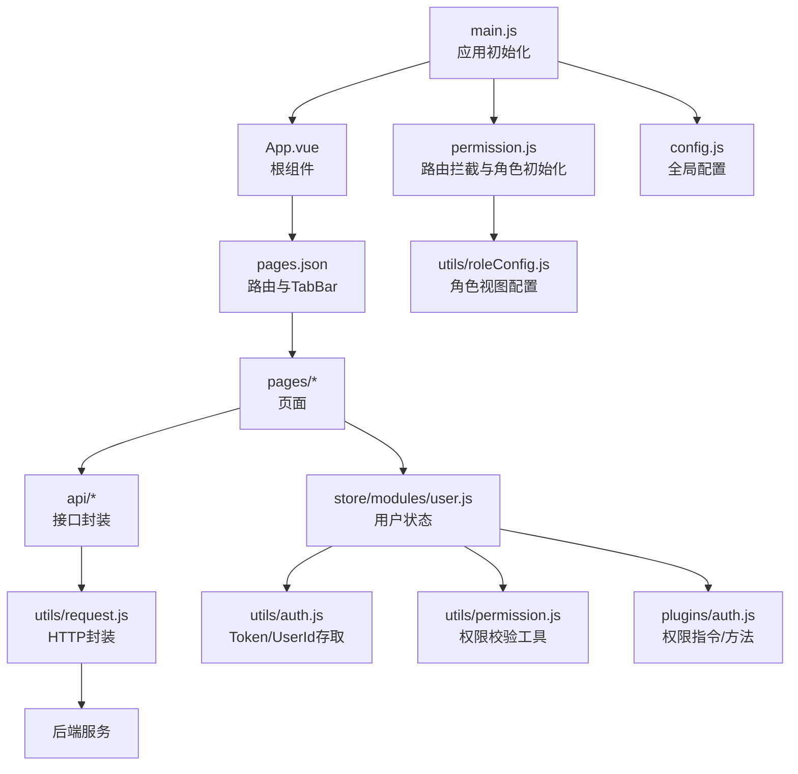
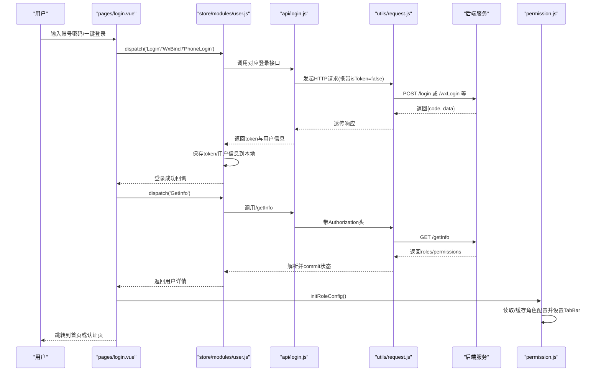
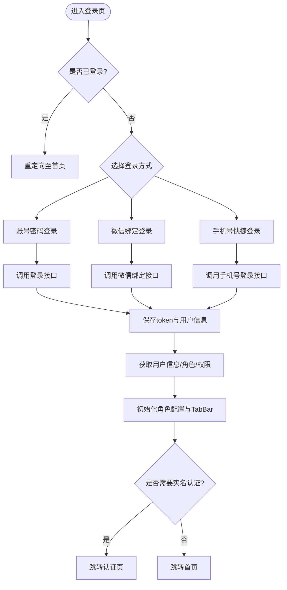
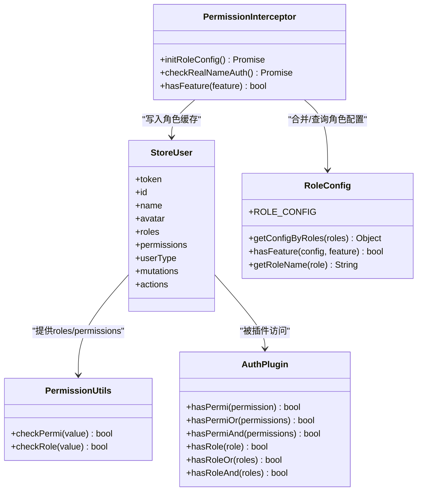
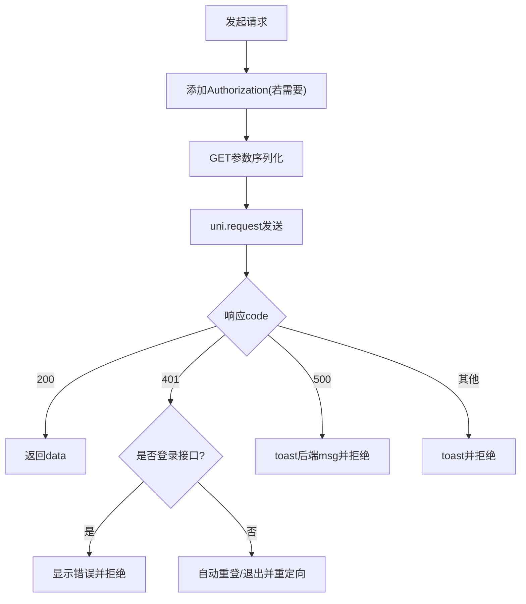
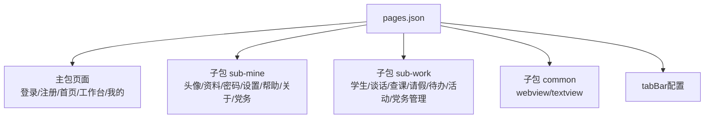
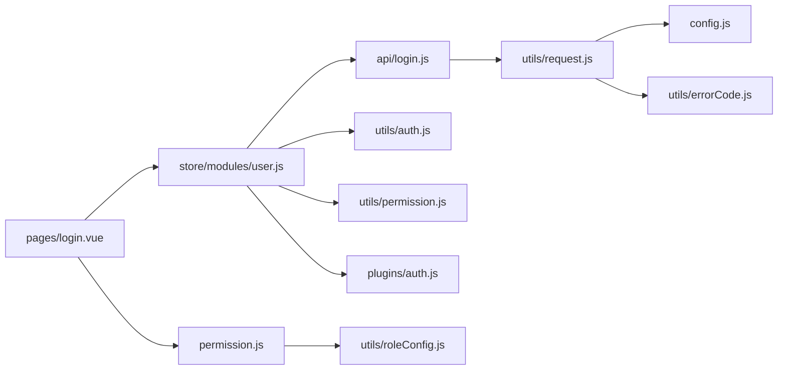

# 需求分析与设计

<cite>
**本文引用的文件**   
- [README.md](file://README.md)
- [main.js](file://main.js)
- [pages.json](file://pages.json)
- [config.js](file://config.js)
- [permission.js](file://permission.js)
- [utils/auth.js](file://utils/auth.js)
- [utils/permission.js](file://utils/permission.js)
- [api/login.js](file://api/login.js)
- [store/modules/user.js](file://store/modules/user.js)
- [utils/request.js](file://utils/request.js)
- [utils/errorCode.js](file://utils/errorCode.js)
- [utils/roleConfig.js](file://utils/roleConfig.js)
- [plugins/auth.js](file://plugins/auth.js)
- [api/stumanage/index.js](file://api/stumanage/index.js)
- [pages/login.vue](file://pages/login.vue)
</cite>

## 目录
1. [引言](#引言)
2. [项目结构](#项目结构)
3. [核心组件](#核心组件)
4. [架构总览](#架构总览)
5. [详细组件分析](#详细组件分析)
6. [依赖分析](#依赖分析)
7. [性能考虑](#性能考虑)
8. [故障排查指南](#故障排查指南)
9. [结论](#结论)
10. [附录](#附录)

## 引言
本指南面向新功能开发，提供从业务需求理解、技术可行性评估、功能边界定义到页面原型设计、数据模型设计、API接口规范、权限控制方案以及设计文档模板与评审流程的完整方法论。结合当前移动端应用（基于 uni-app）的实现现状，给出可落地的实践建议与图示说明，帮助团队在统一规范下高效完成设计与开发。

## 项目结构
本项目采用模块化组织方式：
- 入口与全局配置：main.js、App.vue、manifest.json、pages.json、config.js
- 路由与页面：pages、subPackages（子包）
- 状态管理：store（Vuex/Pinia 模块）
- 网络请求：utils/request.js + api/*
- 权限与鉴权：permission.js、utils/auth.js、utils/permission.js、plugins/auth.js、utils/roleConfig.js
- 业务模块：api/stumanage/* 等按领域划分
- 通用组件：components/*、uni_modules/*

图表来源
- [main.js:1-31](file://main.js#L1-L31)
- [pages.json:1-235](file://pages.json#L1-L235)
- [config.js:1-38](file://config.js#L1-L38)
- [permission.js:1-133](file://permission.js#L1-L133)
- [utils/roleConfig.js:1-149](file://utils/roleConfig.js#L1-L149)
- [store/modules/user.js:1-283](file://store/modules/user.js#L1-L283)
- [utils/auth.js:1-47](file://utils/auth.js#L1-L47)
- [utils/permission.js:1-49](file://utils/permission.js#L1-L49)
- [plugins/auth.js:1-61](file://plugins/auth.js#L1-L61)
- [utils/request.js:1-117](file://utils/request.js#L1-L117)

章节来源
- [README.md:1-52](file://README.md#L1-L52)
- [main.js:1-31](file://main.js#L1-L31)
- [pages.json:1-235](file://pages.json#L1-L235)
- [config.js:1-38](file://config.js#L1-L38)

## 核心组件
- 应用初始化与插件注册：在入口中挂载 store、插件、uView UI，并注入全局方法与字典获取函数。
- 路由与导航：通过 pages.json 声明主包与分包页面、TabBar 与全局样式；配合 permission.js 实现登录态与角色驱动的跳转拦截。
- 用户状态与认证：store/modules/user.js 集中管理 token、用户信息、角色与权限；utils/auth.js 负责本地存储 Token/UserId；utils/permission.js 与 plugins/auth.js 提供权限校验能力。
- 网络层：utils/request.js 统一处理请求头、参数拼接、错误码映射、会话过期与自动重登逻辑。
- 角色与视图：permission.js 与 utils/roleConfig.js 协同，根据后端返回的角色配置动态设置 TabBar 与功能开关。

章节来源
- [main.js:1-31](file://main.js#L1-L31)
- [permission.js:1-133](file://permission.js#L1-L133)
- [store/modules/user.js:1-283](file://store/modules/user.js#L1-L283)
- [utils/auth.js:1-47](file://utils/auth.js#L1-L47)
- [utils/permission.js:1-49](file://utils/permission.js#L1-L49)
- [plugins/auth.js:1-61](file://plugins/auth.js#L1-L61)
- [utils/request.js:1-117](file://utils/request.js#L1-L117)
- [utils/roleConfig.js:1-149](file://utils/roleConfig.js#L1-L149)

## 架构总览
整体采用“前端多端适配 + 统一网络层 + 集中式状态 + 角色驱动视图”的架构模式。登录成功后拉取用户信息与角色配置，前端据此渲染菜单、TabBar 与功能按钮；所有 API 调用经 request 封装，统一处理鉴权、错误提示与重试策略。

图表来源
- [pages/login.vue:1-462](file://pages/login.vue#L1-L462)
- [store/modules/user.js:1-283](file://store/modules/user.js#L1-L283)
- [api/login.js:1-168](file://api/login.js#L1-L168)
- [utils/request.js:1-117](file://utils/request.js#L1-L117)
- [permission.js:1-133](file://permission.js#L1-L133)

## 详细组件分析

### 登录与认证流程
- 登录入口：支持账号密码、微信绑定登录、手机号快捷登录等多方式。
- 状态同步：登录成功后立即拉取用户信息，更新 roles/permissions，并清理旧角色配置缓存后重新初始化角色视图。
- 会话管理：request 层对 401 进行差异化处理，非登录接口触发自动重登或退出登录并重定向。

图表来源
- [pages/login.vue:1-462](file://pages/login.vue#L1-L462)
- [store/modules/user.js:1-283](file://store/modules/user.js#L1-L283)
- [api/login.js:1-168](file://api/login.js#L1-L168)
- [permission.js:1-133](file://permission.js#L1-L133)

章节来源
- [pages/login.vue:1-462](file://pages/login.vue#L1-L462)
- [store/modules/user.js:1-283](file://store/modules/user.js#L1-L283)
- [api/login.js:1-168](file://api/login.js#L1-L168)
- [utils/request.js:1-117](file://utils/request.js#L1-L117)
- [permission.js:1-133](file://permission.js#L1-L133)

### 权限与角色控制
- 字符权限校验：checkPermi 对比 store 中的 permissions 列表，支持通配符匹配。
- 角色权限校验：checkRole 对比 store 中的 roles 列表，支持超级管理员判定。
- 插件化权限：plugins/auth.js 暴露 hasPermi/hasRole 等方法供页面或指令使用。
- 角色视图：permission.js 与 utils/roleConfig.js 协作，登录后动态设置 TabBar 与功能开关。

图表来源
- [store/modules/user.js:1-283](file://store/modules/user.js#L1-L283)
- [utils/permission.js:1-49](file://utils/permission.js#L1-L49)
- [plugins/auth.js:1-61](file://plugins/auth.js#L1-L61)
- [utils/roleConfig.js:1-149](file://utils/roleConfig.js#L1-L149)
- [permission.js:1-133](file://permission.js#L1-L133)

章节来源
- [utils/permission.js:1-49](file://utils/permission.js#L1-L49)
- [plugins/auth.js:1-61](file://plugins/auth.js#L1-L61)
- [utils/roleConfig.js:1-149](file://utils/roleConfig.js#L1-L149)
- [permission.js:1-133](file://permission.js#L1-L133)

### 网络请求与错误处理
- 统一请求封装：自动附加 Authorization 头、GET 参数序列化、超时与错误映射。
- 401 处理：区分登录相关接口与非登录接口；非登录接口尝试微信自动重登或退出登录并重定向。
- 错误消息：errorCode 映射默认错误文案，request 层将后端 msg 透传到前端提示。

图表来源
- [utils/request.js:1-117](file://utils/request.js#L1-L117)
- [utils/errorCode.js:1-7](file://utils/errorCode.js#L1-L7)

章节来源
- [utils/request.js:1-117](file://utils/request.js#L1-L117)
- [utils/errorCode.js:1-7](file://utils/errorCode.js#L1-L7)

### 页面与路由规划
- 主包页面：登录、注册、首页、工作台、我的。
- 子包页面：个人中心、党务、学生管理、请假、查课、谈话、待办、活动等。
- TabBar：根据角色配置动态设置，仅小程序平台生效。

图表来源
- [pages.json:1-235](file://pages.json#L1-L235)

章节来源
- [pages.json:1-235](file://pages.json#L1-L235)

### 数据模型设计原则
- 实体关系建模：以用户为中心，关联角色、权限、个人信息、头像等；业务域（如学生、请假、查课、谈话、活动）作为独立实体，通过外键或标识字段建立关系。
- 字段定义规范：统一时间格式、枚举值、必填项与长度限制；敏感字段脱敏展示；图片字段统一为相对路径或完整URL。
- 数据验证规则：前端表单校验与后端校验双重保障；错误码与提示信息标准化。

[本节为概念性内容，不直接分析具体文件]

### API接口设计规范
- RESTful 原则：资源名词复数、HTTP 动词语义清晰、状态码规范、分页与过滤参数一致。
- 请求响应格式：统一返回结构包含 code、msg、data；分页对象包含 list、total、pageNo、pageSize。
- 错误处理机制：统一错误码映射、用户友好提示、异常日志记录；401 自动重登策略。

章节来源
- [api/login.js:1-168](file://api/login.js#L1-L168)
- [utils/request.js:1-117](file://utils/request.js#L1-L117)
- [utils/errorCode.js:1-7](file://utils/errorCode.js#L1-L7)

### 权限控制设计方案
- 角色权限配置：后端返回 roles/permissions，前端持久化并在启动时加载。
- 菜单权限管理：根据角色配置动态生成菜单与 TabBar。
- 功能权限控制：页面级与按钮级权限校验，结合 checkPermi/checkRole 与插件方法。

章节来源
- [store/modules/user.js:1-283](file://store/modules/user.js#L1-L283)
- [utils/permission.js:1-49](file://utils/permission.js#L1-L49)
- [plugins/auth.js:1-61](file://plugins/auth.js#L1-L61)
- [permission.js:1-133](file://permission.js#L1-L133)
- [utils/roleConfig.js:1-149](file://utils/roleConfig.js#L1-L149)

## 依赖分析
- 低耦合高内聚：网络层、状态层、权限层职责清晰，页面只关注交互与展示。
- 外部依赖：uni-app 生态组件库（uView）、uni.request 原生能力。
- 潜在循环依赖：避免在 request 中直接引入 store 导致循环引用；当前实现通过顶层导入 store，注意保持单向依赖。

图表来源
- [pages/login.vue:1-462](file://pages/login.vue#L1-L462)
- [store/modules/user.js:1-283](file://store/modules/user.js#L1-L283)
- [api/login.js:1-168](file://api/login.js#L1-L168)
- [utils/request.js:1-117](file://utils/request.js#L1-L117)
- [config.js:1-38](file://config.js#L1-L38)
- [utils/errorCode.js:1-7](file://utils/errorCode.js#L1-L7)
- [permission.js:1-133](file://permission.js#L1-L133)
- [utils/roleConfig.js:1-149](file://utils/roleConfig.js#L1-L149)
- [utils/auth.js:1-47](file://utils/auth.js#L1-L47)
- [utils/permission.js:1-49](file://utils/permission.js#L1-L49)
- [plugins/auth.js:1-61](file://plugins/auth.js#L1-L61)

章节来源
- [api/stumanage/index.js:1-32](file://api/stumanage/index.js#L1-L32)

## 性能考虑
- 分包加载：将低频页面放入子包，减少首屏体积。
- 懒加载与按需引入：路由与组件按需加载，减少初始渲染压力。
- 请求优化：合理设置超时、复用请求实例、避免重复请求；必要时增加本地缓存。
- 图片与静态资源：压缩与 CDN 加速，合理使用懒加载。

[本节为通用指导，不直接分析具体文件]

## 故障排查指南
- 登录失败：检查验证码是否启用、微信环境差异、后端返回码与错误消息。
- 401 未跳转：确认是否为登录相关接口；检查自动重登逻辑与 reLaunch 跳转路径。
- 权限无效：核对 roles/permissions 是否正确持久化；检查 checkPermi/checkRole 传入值。
- 网络异常：查看 errorCode 映射与 toast 提示；确认 baseUrl 与代理路径配置。

章节来源
- [utils/request.js:1-117](file://utils/request.js#L1-L117)
- [utils/errorCode.js:1-7](file://utils/errorCode.js#L1-L7)
- [permission.js:1-133](file://permission.js#L1-L133)
- [pages/login.vue:1-462](file://pages/login.vue#L1-L462)

## 结论
通过统一的路由与权限控制、集中的状态管理与网络封装，本项目具备良好的可扩展性与可维护性。新功能开发应遵循本文档的需求分析流程与设计规范，确保业务目标与技术实现的一致性，并通过设计文档与评审流程保障质量与落地效果。

[本节为总结性内容，不直接分析具体文件]

## 附录

### 设计文档编写模板
- 背景与目标：描述业务痛点、目标用户与核心价值。
- 范围与边界：明确功能范围、不在范围内的内容与约束条件。
- 用户故事与用例：关键用户旅程、主要场景与异常场景。
- 界面原型与交互：页面布局、交互流程、响应式适配策略。
- 数据模型与关系：实体清单、字段规范、校验规则与索引策略。
- API 设计：接口清单、请求/响应示例、错误码与幂等性说明。
- 权限与安全：角色与权限矩阵、敏感操作审计、数据安全策略。
- 非功能性需求：性能指标、可用性、兼容性、可观测性。
- 风险与缓解：技术风险、依赖风险与应对方案。
- 验收标准与测试计划：用例覆盖、回归策略与上线检查清单。

[本节为模板说明，不直接分析具体文件]

### 评审流程
- 初审：产品与前端负责人对齐需求与边界。
- 设计评审：UI/UX、前端架构、后端接口三方联合评审。
- 技术评审：复杂度评估、性能与安全审查、依赖与兼容确认。
- 开发与联调：分阶段交付，持续集成与自动化测试。
- 验收与发布：灰度发布、监控告警与回滚预案。

[本节为流程说明，不直接分析具体文件]